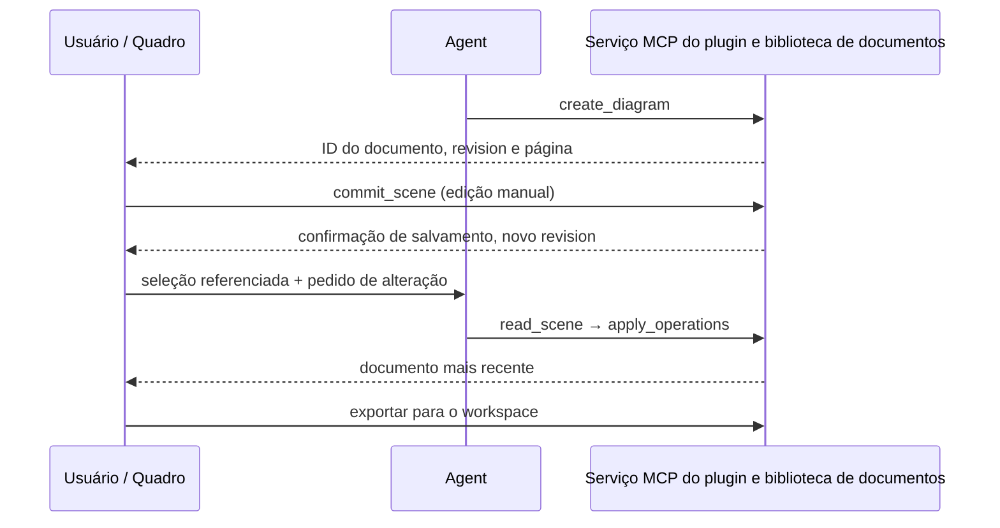
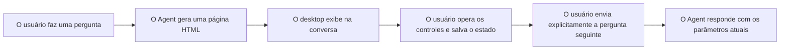

# Plugin de UI: capacidades, desenvolvimento, depuração e exemplos

Português (Brasil) | [English](UI_PLUGIN.en.md)

Comece a conhecer o Plugin de UI pelo Excalidraw: uma forma de o Agent e o usuário editarem juntos um conteúdo que pode ser salvo. Este documento cobre as capacidades presentes no código-fonte atual, as APIs realmente disponíveis, os passos de instalação e depuração e cinco exemplos — leia preferencialmente na ordem abaixo.

- [Veja primeiro a demonstração do Excalidraw](#exemplo-principal-excalidraw)
- [Gen UI: exemplos, interfaces e casos de uso](#gen-ui-respostas-interativas-sob-demanda)
- [Desenvolvimento e depuração](#desenvolvimento-e-depuracao)
- [Referência rápida da API de página](#referencia-rapida-da-api-de-pagina)
- [Adicionando UI ao seu plugin](#adicionando-ui-ao-seu-plugin)
- [Outros plugins de exemplo](#outros-plugins-de-exemplo)

Este documento trata da integração com o host do repositório principal; o desenvolvimento e o build dos plugins acontecem no repositório separado `zcode-plugins`.

## O que o Plugin de UI pode fazer

O Plugin de UI adiciona páginas interativas a plugins comuns. O Agent pode chamar ferramentas para criar ou modificar conteúdo, e o usuário pode operar diretamente o canvas, formulários e listas de arquivos, devolvendo seleções ou resultados de operações para a conversa. A página se comunica com o host via MCP Apps, e os dados de negócio são gerenciados pelo serviço MCP do plugin.

Registro, instalação, ativação e atualização seguem o fluxo comum de plugins. A página usa o pacote oficial `@modelcontextprotocol/ext-apps`; não é preciso um SDK separado do BR Code Plugin, nem instalar o plugin de guias de desenvolvimento. Atualmente o repositório de plugins fixa o SDK de páginas em `2.0.0` e o SDK de serviços MCP em `1.29.0`; ao ler exemplos upstream, atente para a versão principal do SDK — a instalação real segue o lockfile do repositório.

| Capacidade                              | Efeito visto pelo usuário                                                      | Ponto de entrada para o dev                                  |
| --------------------------------------- | ------------------------------------------------------------------------------ | ------------------------------------------------------------ |
| Resultado de ferramenta com página      | Gera um quadro, exibe gráficos, preenche formulários                           | Ferramenta MCP `_meta.ui.resourceUri` + recurso HTML         |
| Painel na barra lateral da sessão       | Abre manualmente um editor; ferramentas seguintes operam o mesmo documento     | `ui.surfaces` no manifesto, `_meta.ui.surface` na ferramenta |
| Página chama o serviço do plugin        | Clique em botão atualiza dados, salva documento, executa operações             | `app.callServerTool()`                                       |
| Página coopera com a conversa principal | Referencia uma seleção, ou o usuário clica para enviar a próxima mensagem      | `updateModelContext()` / `sendMessage()`                     |
| Chamada de modelo dentro do App         | A resposta fica na própria interface do plugin                                 | `createSamplingMessage()`                                    |
| Modelo chama ferramentas da página      | Opera o estado do editor que só a página ativa possui                          | `registerTool()` ou `onlisttools` + `oncalltool`             |
| Estado da página e atualizações         | Mudar de posição preserva a página; reconstruir recupera a visão; assina mudanças | Página ativa preservada, widgetState, assinatura de recursos |

As páginas interativas hoje são destinadas ao **workspace local do BR Code Desktop**. Web, celular e workspaces remotos mantêm o registro comum de ferramentas MCP; esses caminhos não são considerados com suporte a painéis interativos. As páginas de plugin e o Gen UI usam protocolos de carregamento e comunicação diferentes — as APIs dos dois não podem ser misturadas.

## Exemplo principal: Excalidraw

O Excalidraw demonstra um fluxo de desenho continuamente editável: o Agent traça o rascunho, o usuário ajusta o layout, e o Agent faz ajustes locais conforme a seleção. O canvas não é uma imagem única e descartável.

### Ilustração: do canvas de volta à conversa

Abaixo, o cenário de estudo de equações diferenciais mostra o fluxo completo: gerar o canvas, referenciar uma seleção e continuar perguntando com esse contexto.

**1. Gerar um canvas editável a partir de uma pergunta**

Peça "desenhe uma equação diferencial, estou estudando, quero entender rápido", e o Agent desenha conceitos, passos de resolução e o campo de direções no canvas do Excalidraw. A explicação na conversa e o canvas na barra lateral aparecem lado a lado; a figura e o texto continuam editáveis, e podem ser salvos e exportados.


**2. Referenciar a seleção e entregar o foco ao Agent**

Selecione com um retângulo o grupo de elementos do "campo de direções" e clique com o botão direito em **Referenciar seleção na conversa**. O plugin adiciona as informações dos elementos selecionados ao contexto da conversa, e o usuário pode continuar dialogando sobre uma parte específica da figura.


**3. Continuar perguntando com a seleção**

Quando surgir **Contexto do plugin** na área de entrada, complemente "o que significam as direções das setas?" e clique em enviar. Referenciar a seleção apenas adiciona o contexto pendente de envio; ao enviar a pergunta, o Agent recebe a pergunta e as informações da seleção e entende a qual parte do canvas o usuário se refere.


### Roteiro de demonstração em cinco minutos

Com o `excalidraw` instalado e ativado, em uma nova sessão de um workspace local do desktop:

1. Envie: "Desenhe com o Excalidraw um diagrama de arquitetura com API, cache e banco de dados, indicando o sentido das requisições." O modelo chama `create_diagram` e a barra lateral abre um quadro editável.
2. Arraste nós, mude cores ou textos e aguarde a página mostrar "salvo". Isso indica que o backend confirmou a gravação.
3. Selecione o nó "cache", clique com o botão direito em "Referenciar seleção na conversa"; envie: "Transforme o cache selecionado em dois nós, mantendo o restante do layout." Sem elementos selecionados, também é possível referenciar a figura inteira.
4. O Agent lê a versão mais recente com `read_scene` e executa `apply_operations` usando IDs estáveis de elementos, sem redesenhar o canvas inteiro. Edições do usuário e do próprio usuário compartilham o mesmo desfazer/refazer da página ativa.
5. Clique no título do quadro para trocar ou importar documentos; pelo "Exportar", salve `.excalidraw`, PNG e SVG no workspace — sobrescrever arquivos existentes exige confirmação explícita.



### Tabela de ferramentas do Excalidraw

A seguir estão as ferramentas MCP do próprio plugin, que formam um nível diferente da API genérica de páginas descrita adiante. Ferramentas "somente página" não são expostas na lista de ferramentas do modelo.

| Ferramenta         | Chamador              | Uso e parâmetros principais                                                       |
| ------------------ | --------------------- | --------------------------------------------------------------------------------- |
| `create_diagram`   | Modelo, página        | Cria um quadro com `title` e `elements`; retorna ID do documento e versão         |
| `open_diagram`     | Modelo, página        | Abre documento salvo por `id`, ou importa `.excalidraw` do workspace por `path`; escolha um |
| `read_scene`       | Modelo, página        | Lê a versão atual e um resumo dos elementos; `elementIds` limita à seleção        |
| `apply_operations` | Modelo, página        | Adiciona, altera ou remove por ID de elemento; carrega `expectedRevision` e `operationId` |
| `export_diagram`   | Modelo, página        | Exporta `.excalidraw` nativo; verifica a versão; sobrescrever exige `overwrite: true` |
| `commit_scene`     | Somente página        | Envia o rascunho completo de edição, com verificação de conflito de versão        |
| `list_diagrams`    | Somente página        | Lista os documentos do workspace atual                                            |
| `save_copy`        | Somente página        | Salva o rascunho ou conteúdo importado como novo documento                        |
| `save_image`       | Somente página        | Grava o PNG / SVG renderizado pela página no workspace                            |

Os documentos de negócio são salvos em SQLite no diretório de dados do plugin, isolados por workspace. Em conflito de versão, o rascunho local da página é preservado — é possível salvar uma cópia ou recarregar; reexecutar a mesma operação reutiliza o `operationId`. O `widgetState` guarda apenas informações de visão e não substitui a biblioteca de documentos.

Atualmente cada documento admite no máximo 5000 elementos e 6 MiB. O editor e as fontes acompanham o pacote, sem depender de CDN. O histórico de desfazer pertence apenas ao editor ativo atual e não é preservado entre reinícios do aplicativo; hoje não há colaboração em tempo real multiusuário, permissões da área de transferência do sistema ou compartilhamento em nuvem.

## Gen UI: respostas interativas sob demanda

O Gen UI (interface generativa) permite que o Agent gere páginas HTML / JavaScript para a pergunta atual, incorporadas diretamente na conversa. Você pode arrastar controles deslizantes, alternar condições, marcar itens, observar o resultado e continuar perguntando com os parâmetros atuais. Cada página é gerada sob demanda, sem precisar criar e instalar um plugin antes.

### Exemplos de interface do Gen UI

Abaixo, um conjunto de páginas de demonstração de capacidades geradas sob demanda. Os agrupamentos e conteúdos mostram como as páginas podem ser organizados — não são telas fixas do aplicativo. Clique nas imagens para ver o original.

| Componentes e organização de informação                                                                                                                               | Cálculo orientado a controles                                                                                                                                              |
| --------------------------------------------------------------------------------------------------------------------------------------------------------------------- | -------------------------------------------------------------------------------------------------------------------------------------------------------------------------- |
| <a href="docs/images/gen-ui/components.png"></a> | <a href="docs/images/gen-ui/controls.png"></a> |
| Organiza a resposta em painéis navegáveis com cartões de resumo, barras de progresso, tabelas e ícones.                                                               | Compara resultados de cálculo sob diferentes parâmetros, com controle deslizante de taxa de crescimento, interruptor de juros compostos e opção de linha de base.         |

| Gráficos e comparação de dados                                                                                                                                         | Calendário e agenda                                                                                                                                           |
| ---------------------------------------------------------------------------------------------------------------------------------------------------------------------- | -------------------------------------------------------------------------------------------------------------------------------------------------------------- |
| <a href="docs/images/gen-ui/charts.png"></a> | <a href="docs/images/gen-ui/calendar.png"></a> |
| O gráfico de linhas compara as tendências P50 / P95; o de barras mostra cada percentil; os dados são de exemplo.                                                        | O `viz-calendar` exibe a agenda por período e permite ver detalhes dos eventos; aqui é uma demonstração de agenda dentro da página.                             |

| Persistência de estado e perguntas de acompanhante                                                                                                                              | Pré-visualização e ajuste de design                                                                                                                            |
| -------------------------------------------------------------------------------------------------------------------------------------------------------------------------------- | ---------------------------------------------------------------------------------------------------------------------------------------------------------------- |
| <a href="docs/images/gen-ui/state.png"></a> | <a href="docs/images/gen-ui/design.png"></a> |
| Organiza preferências e parâmetros em snapshots `modelContent` / `privateContent`. A imagem mostra o estado pendente; a página pode salvar os parâmetros e disparar perguntas de acompanhamento por botão. | O `viz-carousel` apresenta vários designs de reprodutor, com o Tweak para ajustar estilos; este é um protótipo de interface.                                    |

Em uma sessão do BR Code Desktop com suporte a Gen UI, você pode fazer pedidos como os abaixo. Os controles e interações concretos são gerados pelo Agent conforme a tarefa:

| Cenário                | Exemplo de prompt                                                                                                                       | Como interagir                                                                                   |
| ---------------------- | --------------------------------------------------------------------------------------------------------------------------------------- | ------------------------------------------------------------------------------------------------ |
| Compreender conceitos  | "Use o Gen UI para explicar a onda senoidal; quero arrastar controles para ajustar amplitude e frequência e observar a curva."         | Ajustar parâmetros, comparar curvas e entender a relação entre variáveis                         |
| Explorar algoritmos    | "Use o Gen UI para criar uma demonstração de busca binária, permitindo digitar o valor alvo, executar passo a passo e destacar o intervalo de busca atual." | Modificar entradas, avançar e reiniciar, observando o estado de cada passo                       |
| Ajustar proposta de UI | "Use o Gen UI para criar um cartão de curso, com controles Tweak para ajustar arredondamento, paleta e densidade do layout; depois refine com os parâmetros que eu escolher." | Pré-visualizar estilos em tempo real e deixar o Agent continuar alterando após a submissão explícita |



### Capacidades e interfaces da página

| Capacidade                   | Comportamento atual                                                                                                     |
| ---------------------------- | ----------------------------------------------------------------------------------------------------------------------- |
| Interação dentro da conversa | A página é exibida após a resposta, podendo conter gráficos, formulários, simuladores e protótipos leves                 |
| Expandir e compartilhar      | É possível expandir a pré-visualização, recolher e copiar a interface atual como imagem; expandir e recolher mantêm a mesma página ativa |
| Estado e acompanhamento      | A página pode salvar o estado dos controles e, após acionamento do usuário, enviar perguntas seguintes; ajustar controles ou salvar estado não inicia o Agent automaticamente |
| Ajustes com Tweak            | Após a página registrar controles, o host oferece entradas de ajuste como controles deslizantes, cores, interruptores e opções, com reinício, pré-visualização do efeito original e submissão explícita |

As páginas geradas usam as interfaces do Gen UI injetadas pelo host:

| Interface                                                       | Uso                                                                                              |
| --------------------------------------------------------------- | ------------------------------------------------------------------------------------------------- |
| `window.zcode.widgetState`                                      | Lê o estado salvo da página; o valor inicial pode ser `null`                                       |
| `window.zcode.setWidgetState({ modelContent, privateContent })` | Substitui todo o snapshot de estado JSON, com até 16 KiB no total; apenas o `modelContent` entra no contexto do modelo na próxima rodada |
| `window.zcode.sendFollowUpMessage({ prompt, title })`           | Envia a pergunta seguinte; `title` é opcional; sem uma ação válida do usuário é preciso confirmar; sessões expiradas ou somente leitura não podem enviar |
| `zcode:set_globals`                                             | Escuta atualizações de estado ou tema, lendo os novos valores de `detail.globals` do evento         |

O desktop fornece ao Agent um diretório de saída dedicado da sessão atual. O HTML gerado é salvo nesse diretório e carregado pelo host, sem gravar no workspace do projeto; o estado das páginas é isolado por workspace e sessão. A ponte da página é injetada pelo host — o autor não precisa criar uma conexão MCP Apps. As páginas do Gen UI não oferecem `callTool`, leitura de recursos MCP, Node ou acesso arbitrário a arquivos; quando for preciso executar operações por meio de serviços de plugin, use o Plugin de UI.

### Como escolher entre Gen UI e Plugin de UI

| Critério            | Gen UI                                                            | Plugin de UI                                                        |
| ------------------- | ----------------------------------------------------------------- | ------------------------------------------------------------------- |
| Origem              | O Agent gera a página na hora para a pergunta atual                | Desenvolvedores mantêm e publicam o plugin; o usuário instala e ativa |
| Indicado para       | Explicações de conceitos, gráficos interativos, simuladores, calculadoras temporárias e protótipos de interface | Editores de uso contínuo, ferramentas de arquivos e aplicativos com dados de negócio |
| Capacidades da página | Estado do Gen UI, interfaces de acompanhamento e Tweak            | API MCP Apps, ferramentas e recursos MCP do plugin, dentro do que o host suporta |
| Propriedade dos dados | O host gerencia arquivos gerados e o estado das páginas da sessão | O serviço do plugin gerencia arquivos ou bancos de negócio; a página gerencia a visão |

As capturas do Excalidraw acima mostram um **Plugin de UI**. Se precisar gerar uma pequena página com parâmetros ajustáveis para a pergunta atual, use o **Gen UI**; se quiser distribuir uma ferramenta de longo prazo, com serviços e gerenciamento de documentos, desenvolva um Plugin de UI. Ambos podem exibir `window.zcode`, mas os métodos disponíveis e as estruturas de estado diferem e não podem ser misturados. O desenvolvimento e as APIs do Plugin de UI estão em [Desenvolvimento e depuração](#desenvolvimento-e-depuracao) e [Referência rápida da API de página](#referencia-rapida-da-api-de-pagina).

Implementação e exemplos de página: [Contrato do Gen UI](packages/ui/src/gen-ui/CONTRACT.md), [Exemplos da API de página](apps/zcode-cli/packages/visualize-plugin/skills/visualize/references/api.md), [Guia do Tweak](apps/zcode-cli/packages/visualize-plugin/skills/visualize/tweak.md). O ponto de entrada para validação da integração no desktop é `node packages/desktop/scripts/gen-ui-e2e.mjs`.

## Outros plugins de exemplo

| Plugin                        | Função e comando de demonstração                          | O que serve de referência                                                          | Limites atuais                                                                             |
| ----------------------------- | --------------------------------------------------------- | ----------------------------------------------------------------------------------- | ------------------------------------------------------------------------------------------- |
| **Excalidraw** `excalidraw`   | "Desenhe um diagrama de arquitetura e modifique pela seleção" | Canvas, salvamento automático, edição local, referência de contexto e exportação; sugerido como primeiro exemplo completo | Workspace local; documentos persistentes e visões temporárias separados                     |
| **OpenPencil** `openpencil`   | "Crie um design designs/landing.fig e coloque um bloco hero" | Designs `.fig`, ferramentas de design, referência de seleção e geração de código pelo design | Um editor ativo por workspace; importação de `.pen` somente leitura; exportação para `exports/` |
| **Blender** `blender`         | "Crie uma cena do Blender, posicione objetos e renderize uma prévia" | Cenas `.blend`, prévia 3D, materiais, câmeras, luzes e recursos de renderização      | Operações reais exigem o motor do Blender; o motor falso serve apenas para testes           |
| **Limpador de disco** `disk-cleaner` | "Veja quais arquivos grandes na pasta de downloads ocupam espaço" | Varredura somente leitura, filtros paginados, seleção de candidatos, plano de confirmação e retorno da execução | A ferramenta de limpeza é apenas para a página; após confirmação move para a lixeira, sem exclusão permanente |
| **Showcase** `showcase`       | "Demonstre todos os cases com o Showcase"                 | Diretórios SC01–SC53; recursos, mensagens, estado, sampling, ferramentas de página e cenários de falha | Itens do diretório divididos em: operação direta, operação assistida, automação dedicada e a implementar; 53 itens não significam que os 53 estejam implementados ou validados automaticamente |

## Desenvolvimento e depuração

### O que cada repositório é responsável

| Endereço do repositório                                            | Branch           | Escopo das alterações                                                  | Onde rodar                                                |
| ------------------------------------------------------------------ | ---------------- | ----------------------------------------------------------------------- | ---------------------------------------------------------- |
| [zai-org/ZCode](https://github.com/zai-org/ZCode)                  | `feat/ui-plugin` | Protocolo do host, barra lateral e exibição inline, sandbox, aprovações e ciclo de vida | `pnpm dev:desktop`                                         |
| [zai-org/zcode-plugins](https://github.com/zai-org/zcode-plugins) | `feat/ui-plugin` | Manifesto de plugins, serviços MCP, páginas, dados de negócio e empacotamento de recursos | `ui-plugins/<name>` é o código-fonte; `plugins/<name>` é o artefato instalado |

Os passos de desenvolvimento e depuração deste documento correspondem aos branches `feat/ui-plugin` de cada repositório. **Esse branch ainda não está disponível nos repositórios públicos do ZCode**; aguarde os branches estarem prontos para clonar dos repositórios acima e fazer a integração.

Os exemplos de shell abaixo valem para macOS / Linux; primeiro ajuste os dois caminhos para os seus diretórios de checkout. Use Node.js `24.14.0` e pnpm `10.33.2`. No Windows é possível definir as mesmas variáveis de ambiente no PowerShell e executar os comandos `pnpm` / `node` de cada repositório.

### Primeira integração: instale apenas o plugin a testar

```sh
ZCODE_REPO=/path/to/z-code
PLUGINS_REPO=/path/to/zcode-plugins

# Configuração de desenvolvimento isolada, opcional; CLI e desktop usam o mesmo valor depois.
export ZCODE_DATA_BASE_DIR="$HOME/.zcode-ui-plugin-dev"

# Inicialização inicial do repositório principal; pule se já foi feito.
cd "$ZCODE_REPO"
pnpm bootstrap

# Repositório de plugins: compila e gera o diretório local, sem registrar ou instalar plugins automaticamente.
cd "$PLUGINS_REPO"
pnpm install --frozen-lockfile
pnpm build

# Repositório principal: usa o CLI recém-compilado e instala o plugin na mesma configuração de desenvolvimento.
cd "$ZCODE_REPO"
node apps/zcode-cli/packages/cli/dist/zcode.cjs plugins marketplace add "$PLUGINS_REPO/dist/local-marketplace" --scope user
node apps/zcode-cli/packages/cli/dist/zcode.cjs plugins install excalidraw@zcode-plugins-local --scope user
node apps/zcode-cli/packages/cli/dist/zcode.cjs plugins enable excalidraw@zcode-plugins-local --scope user
node apps/zcode-cli/packages/cli/dist/zcode.cjs plugins list --json
pnpm dev:desktop
```

Também é possível adicionar o caminho absoluto de `dist/local-marketplace` na mesma instância do desktop, em **Marketplace de plugins → Adicionar**, e escolher o plugin para instalar e ativar. O nome padrão da fonte local é `zcode-plugins-local`; o nome oficial do manifesto raiz é um nome reservado e não se pode adicionar diretamente a raiz do repositório. O `pnpm dev:desktop` apenas inicia o host, sem registrar plugins automaticamente.

Se usar apenas o cliente desktop pronto, faça o build no repositório de plugins e siga a instalação pela UI descrita acima; o próprio cliente precisa suportar as funcionalidades deste documento. Ao usar o CLI `zcode` já instalado, confirme que ele e o desktop usam a mesma configuração de dados. Ao usar a configuração isolada pela primeira vez, também é preciso fazer login ou configurar o modelo nela.

### Ciclo de atualização após alterações

```sh
cd "$PLUGINS_REPO"
pnpm build
cd "$ZCODE_REPO"
node apps/zcode-cli/packages/cli/dist/zcode.cjs plugins marketplace update zcode-plugins-local
node apps/zcode-cli/packages/cli/dist/zcode.cjs plugins install excalidraw@zcode-plugins-local --scope user
```

Depois, reinicie a instância do desktop correspondente e abra uma nova sessão para validar. O monitoramento de código-fonte não copia automaticamente as alterações do repositório de plugins para o plugin instalado; atualizar a fonte atualiza apenas o diretório, e reinstalar é o que atualiza a cópia do código. Durante o desenvolvimento, reinstalar a mesma versão recopia os arquivos; em distribuições oficiais, mudanças de conteúdo ainda exigem atualizar as versões do manifesto do plugin, do marketplace e do pacote de código.

Se já existir outro nome de fonte local, use `pnpm marketplace:local --name my-local-plugins --output dist/my-local-plugins` para manter a identidade original e ajuste o nome do marketplace nos comandos. Não crie múltiplas identidades de instalação para atualizar a mesma fonte local. O `python3 scripts/build_dist.py` limpa o `dist/` raiz; depois é possível executar `pnpm marketplace:local` para reconstruir o diretório local.

### Validação em camadas

| Camada                                       | Onde rodar          | Comando                                                       | O que comprova                                                            |
| -------------------------------------------- | -------------------- | -------------------------------------------------------------- | --------------------------------------------------------------------------- |
| Checagem estática dos plugins                | Repositório de plugins | `pnpm typecheck`, `pnpm lint`, `python3 scripts/validate.py` | Tipos, regras de código e consistência do manifesto                         |
| Testes unitários de comunicação e negócio    | Repositório de plugins | `pnpm test`                                                  | Regressão automatizada de ordem de conexão, conflito de versão, cancelamentos etc. |
| Artefatos instalados de forma independente   | Repositório de plugins | `pnpm test:artifacts`                                        | Inicia os artefatos de build fora do repositório, lê páginas/recursos e verifica dependências de execução |
| Comunicação oficial App/AppBridge das páginas | Repositório de plugins | `pnpm test:pages`                                            | Handshake real do SDK, resultado inicial, tema e cancelamento de Blender, Excalidraw e OpenPencil |
| Smoke do Excalidraw                          | Repositório de plugins | `pnpm --filter @zcode/plugin-excalidraw smoke`               | Serviço stdio real e interface de recursos                                   |
| Interação no navegador do Excalidraw         | Repositório de plugins | `pnpm --filter @zcode/plugin-excalidraw test:e2e`            | Interação real com o canvas, salvamento, desfazer/refazer e partida fria; a ponte de testes não equivale ao sandbox do Electron |
| Integração desktop do Showcase               | Repositório principal | comando `--showcase-only` abaixo                             | Agent do código atual, sandbox, páginas reais e comunicação da sessão        |

Antes de testar páginas, execute `pnpm build`; os testes no navegador exigem o Chrome, ou um Chromium indicado por `CHROME_PATH`. As capturas de tela do Excalidraw no navegador ficam por padrão em `excalidraw-e2e` no diretório temporário do sistema; use `EXCALIDRAW_E2E_ARTIFACTS` para definir o caminho de saída.

```sh
cd "$ZCODE_REPO"
ZCODE_SHOWCASE_SERVER="$PLUGINS_REPO/plugins/showcase/dist/server.mjs" \
  node packages/desktop/scripts/mcp-apps-host-e2e.mjs --showcase-only
```

O fixture do desktop usa um profile temporário e um fixture de modelo local e imprime ao final o diretório de resultados. Capacidade/lixeira, armazenamento estável e sampling podem ser executados separadamente com `--retention-only`, `--storage-only` e `--sampling-only` do mesmo script. Executar esses testes não substitui a validação de permissões reais do sistema de cada plugin, do motor real do Blender ou entre plataformas.

### Diagnóstico de problemas comuns

| Sintoma                                        | Verifique primeiro                                                                                                                               |
| ----------------------------------------------- | -------------------------------------------------------------------------------------------------------------------------------------------------- |
| Plugin não aparece no marketplace               | Se há uma fonte local gerada em `plugins marketplace list --json`; se a raiz do repositório foi usada por engano como fonte de teste; se CLI e desktop usam a mesma configuração |
| Fonte registrada, mas sem painel na barra lateral | Estado de instalação/ativação em `plugins list --json`; se é um workspace local do desktop; se o `ui.surfaces` do manifesto referencia as chaves `mcpServers` e URIs `ui://` corretos |
| Página antiga após alterar o código              | Se o `pnpm build` raiz foi executado, a mesma fonte foi atualizada e o plugin reinstalado; se ainda roda uma instância ou sessão antiga            |
| Painel abre, mas os recursos falham              | Se o diretório de instalação contém `dist`, fontes/scripts/WASM offline; use `test:artifacts` para descartar dependências do workspace; verifique o CSP e os limites de leitura de recursos |
| Handshake duplicado ou canvas inicial vazio      | Se dois Apps foram criados, ou o App oficial foi misturado com `window.zcode`; se os handlers de eventos foram instalados antes da conexão e o resultado inicial preservado |
| Clicar em "Referenciar" não envia mensagem na hora | `updateModelContext` adiciona contexto para a próxima rodada; para enviar mensagens use `sendMessage`; verifique o contexto do plugin na área de entrada |
| sampling indisponível ou parâmetros rejeitados   | Verifique se o host declara `sampling`, se a tarefa atual está operável e se os parâmetros pertencem ao subconjunto suportado neste documento     |
| Duas instalações após renomear                   | O ID do plugin mudou; nome antigo e novo são instalações independentes; trate a instalação antiga conforme necessário, preservando antes os dados — não apague diretamente o diretório de dados do plugin |
| Sem logs da página nas ferramentas de desenvolvedor | Em "Ajuda → Ferramentas de desenvolvedor", verifique primeiro os erros do host; o plugin tem um guest próprio — prefira `app.sendLog()` e os testes de página para coletar os próprios logs |

O stdout de serviços MCP stdio deve conter apenas mensagens de protocolo; logs de depuração vão no stderr. Ao investigar, registre ID do plugin, nome da fonte, workspace, URI do recurso e passos de reprodução — nunca credenciais nem documentos completos de usuários.

### Declarar o tipo de plugin no PR

**Ao abrir um PR para `zcode-plugins`, é obrigatório declarar explicitamente o tipo de plugin no template do PR e informar o `name` no manifesto dos plugins envolvidos antes de solicitar revisão.** Escolha uma, e apenas uma, das opções:

| Opção                          | Critério                                                                                    |
| ------------------------------ | --------------------------------------------------------------------------------------------- |
| **Plugin de UI**               | O plugin envolvido fornece páginas interativas MCP Apps, incluindo painéis `ui.surfaces` e páginas de `_meta.ui.resourceUri` de ferramentas |
| **Plugin comum (não UI)**      | O plugin não fornece páginas interativas MCP Apps; apenas ferramentas MCP ou skills que geram Gen UI não contam como Plugin de UI |
| **Não aplicável**              | Apenas mudanças de documentação, build ou CI do repositório, sem conteúdo de plugins instaláveis |

Mesmo alterando apenas documentação ou skills de um Plugin de UI, ou adicionando/removendo páginas interativas, escolha Plugin de UI. Com múltiplos plugins envolvidos, liste nomes e tipos separadamente; se qualquer um for Plugin de UI, escolha essa opção. É uma declaração de tipo no PR, independente da categoria `category` do marketplace; os revisores devem confirmar antes de aprovar que o preenchimento está completo e correto.

## Adicionando UI ao seu plugin

Siga o diretório de instalação e a entrada de marketplace dos plugins comuns; pacotes de código que exigem compilação declaram o próprio `build`, e recursos extras usam o `stage` opcional. Abaixo, um exemplo mínimo de página no manifesto de instalação `.zcode-plugin/plugin.json`:

```json
{
  "name": "my-panel",
  "version": "0.1.0",
  "description": "Meu painel interativo",
  "mcpServers": {
    "app": {
      "type": "stdio",
      "command": "node",
      "args": ["${ZCODE_PLUGIN_ROOT}/dist/server.mjs"],
      "cwd": "${ZCODE_PROJECT_DIR}",
      "env": {
        "ZCODE_WORKSPACE_ROOT": "${ZCODE_PROJECT_DIR}",
        "ZCODE_PLUGIN_DATA": "${ZCODE_PLUGIN_DATA}"
      }
    }
  },
  "ui": {
    "surfaces": [
      {
        "id": "editor",
        "title": { "en": "Editor", "zh-CN": "编辑器" },
        "server": "app",
        "resourceUri": "ui://my-panel/editor.html",
        "availability": "session"
      }
    ]
  }
}
```

O servidor precisa registrar de fato o recurso `ui://my-panel/editor.html` e responder `text/html;profile=mcp-app`. Para que o resultado de uma ferramenta use esse painel, defina na ferramenta `_meta.ui.resourceUri` e `_meta.ui.surface: "editor"`; `_meta.ui.visibility: ["model", "app"]` permite chamadas do modelo e da página, e ferramentas somente de página usam `["app"]`. O `ui.surfaces` pode ser omitido; nesse caso, páginas inline ainda podem ser fornecidas pelos metadados das ferramentas.

Os arquivos do plugin são localizados com `${ZCODE_PLUGIN_ROOT}`, operações de arquivos do workspace usam `${ZCODE_PROJECT_DIR}` e dados persistentes usam `${ZCODE_PLUGIN_DATA}`. A configuração do usuário é definida pelo `userConfig` do manifesto e referenciada na configuração do serviço com `${user_config.<key>}`. As páginas executam operações de arquivos por meio do serviço, sem acessar diretamente o código do aplicativo principal ou APIs de Node.

## Referência rápida da API de página

Considere a implementação atual do host e os tipos do SDK fixados. Registre os eventos antes e chame `connect()`; após conectar, leia `getHostCapabilities()` e habilite funcionalidades conforme as capacidades retornadas. A documentação oficial da API descreve a superfície completa do SDK; o que o host suporta deve ser conferido na tabela abaixo.

### API oficial do MCP Apps

| API / evento                                                    | Uso                                   | Comportamento e observações no ZCode                                                          |
| --------------------------------------------------------------- | -------------------------------------- | ----------------------------------------------------------------------------------------------- |
| `new App(info, capabilities, options)`, `connect()`             | Cria a conexão da página e faz o handshake | Crie apenas um App por página ativa; não acesse ao mesmo tempo o `window.zcode`, que dispara outra conexão |
| `getHostVersion()`, `getHostCapabilities()`, `getHostContext()` | Lê host, capacidades, tema, idioma e modo de exibição | Use após concluir a conexão; não infira capacidades apenas pela versão do host                   |
| `ontoolinput`, `ontoolresult`, `ontoolcancelled`                | Recebe entrada completa, resultado e cancelamento | Ao carregar tardiamente UIs grandes, preserve o resultado inicial antes de passá-lo à UI, evitando perder notificações |
| `onhostcontextchanged`                                          | Reage a mudanças de tema, idioma, tamanho ou modo | Atualize a exibição; não reexecute operações de negócio por causa disso                          |
| `callServerTool({ name, arguments }, options)`                  | Chama uma ferramenta do serviço do plugin atual | Segue as permissões e aprovações do Agent; `options.signal` cancela; retorna um `CallToolResult` real |
| `readServerResource({ uri })`                                   | Lê um recurso do serviço atual          | Retorna `contents` do MCP; binários em base64; não serve para acessar outros plugins ou arquivos locais arbitrários |
| `listServerResources({ cursor })`                               | Lista recursos do serviço com paginação | Para a lista de templates de recursos, use a requisição `resources/templates/list` da tabela abaixo |
| `sendMessage({ role: "user", content })`                        | Envia mensagem seguinte à conversa principal | Requer a capacidade `message`; com gesto do usuário envia direto, sem gesto entra no fluxo de confirmação |
| `updateModelContext({ content, structuredContent })`            | Anexa à próxima rodada contexto como a seleção | Requer a capacidade `updateModelContext`; fica visível e removível na área de entrada, não envia mensagem na hora e não é armazenamento persistente |
| `createSamplingMessage(params, { signal })`                     | Chama o modelo da tarefa atual dentro do App | Requer a capacidade `sampling`; aceita texto e imagens dentro dos limites, retorna texto; o histórico da conversa é fornecido pelo App |
| `registerTool(name, config, handler)`                           | A página fornece uma ferramenta que o modelo pode chamar | Registre antes do handshake; declara a capacidade `tools` do App; registra/revoga junto com a página ativa e respeita as aprovações existentes |
| `onlisttools`, `oncalltool`, `sendToolListChanged()`            | Gerenciamento manual do catálogo de ferramentas da página | É outra forma de implementar ferramentas de página; o sinal de cancelamento está em `extra.mcpReq?.signal` do callback; o Showcase tem um exemplo completo |
| `requestDisplayMode({ mode })`                                  | Pede mudança de posição de exibição     | `inline` é embutido, `fullscreen` é a barra lateral; considere o modo retornado; `pip` atualmente mantém o modo original |
| `sendSizeChanged({ height })`                                   | Reporta a altura do conteúdo            | O SDK pode medir automaticamente quando disponível; meça manualmente o contêiner de conteúdo, evitando devolver ao host a altura da viewport |
| `openLink({ url })`                                             | Abre link externo pelo host             | Apenas `http:` / `https:` são permitidos                                                          |
| `downloadFile({ contents })`                                    | Aciona o diálogo nativo de salvamento   | Requer a capacidade `downloadFile`; aceita recursos embutidos ou links de recursos do serviço atual; cancelamento ou falha de gravação retorna `isError: true` |
| `sendLog({ level, data })`                                      | Envia diagnósticos observáveis da página | Não escreva logs de depuração no stdout do serviço stdio; não registre chaves nem conteúdo de usuários |
| `onteardown`                                                    | Libera listeners e demais recursos da página | O host faz o teardown com prazo; não deixe a única operação de salvamento para esse momento       |
| `requestTeardown()`                                             | Pede ao host para liberar a página      | O ZCode atualmente apenas registra o pedido; o ciclo de vida real segue o cartão/painel — não trate como botão de fechar |

O sampling usa o modelo da tarefa no momento da aceitação da requisição e não lê o histórico principal do chat; apenas o histórico explicitamente passado pelo App entra na requisição. Parâmetros não implementados como `temperature`, `tools` e áudio nativo não são aceitos atualmente, e `includeContext` só suporta `none`. Respostas e cancelamentos não devem ser adicionados automaticamente como turnos da conversa principal.

### Extensões do ZCode e requisições MCP de baixo nível

O `app.request()` abaixo é a interface de baixo nível do App oficial. Os resultados das requisições devem ser validados com os schemas correspondentes do `@modelcontextprotocol/core`.

| Interface / campo   | Forma de chamada ou declaração                                                            | Escopo de aplicação                                                                                                    |
| ------------------- | ------------------------------------------------------------------------------------------- | ------------------------------------------------------------------------------------------------------------------------ |
| Estado de visão da sessão | `ui/set-widget-state`, parâmetro `{ widgetState }`, resultado `EmptyResultSchema`       | Verifique antes `experimental["zcode/widgetState"]`; o valor inicial vem da chave homônima do hostContext; apenas memória do host — restaurável ao reconstruir na sessão, sem garantia após reinício do app |
| Lista de templates de recursos | `resources/templates/list`, resultado `ListResourceTemplatesResultSchema`           | Diretório de templates MCP do serviço atual; não presuma que o App tenha o método conveniente `listServerResourceTemplates()` |
| Assinatura de recursos | `resources/subscribe` / `resources/unsubscribe`, parâmetro `{ uri }`, resultado `EmptyResultSchema` | Verifique antes `experimental["zcode/resourceSubscribe"]`; o servidor também precisa suportar assinatura               |
| Notificações de mudança de recursos | `notifications/resources/updated` / `notifications/resources/list_changed`        | Registre o handler antes com `setNotificationHandler()`; ao receber o URI, releia o recurso por conta própria            |
| Painel atual da barra lateral | `app.getHostCapabilities()?.experimental?.["zcode/surface"]` retorna `{ id }`         | O `ui.surfaces[].id` do manifesto deve ser consistente com o `_meta.ui.surface` da ferramenta                           |
| Relaxamento de CSP  | `_meta["zcode/csp"]` do recurso, com `unsafeEval`, `wasmUnsafeEval`                         | Verifique os marcadores de suporte retornados em `experimental["zcode/csp"]`; não equivale a obter permissões de arquivos ou rede |

### Páginas existentes com `window.zcode`

Páginas compatíveis já existentes podem continuar usando os aliases abaixo. Em páginas novas, prefira o App oficial; basta escolher uma das duas formas de conexão.

| Categoria              | Membros disponíveis                                                                                                                    |
| ---------------------- | ---------------------------------------------------------------------------------------------------------------------------------------- |
| Conexão e observação   | `ready()`, `subscribe(listener)`; o último retorna a função de cancelamento                                                              |
| Entrada e infos do host | `toolInput`, `toolOutput`, `toolResponseMetadata`, `toolCancelled`, `hostInfo`, `hostCapabilities`, `hostContext`, `protocolVersion`     |
| Informações de exibição | `theme`, `locale`, `displayMode`, `maxHeight`, `safeArea`, `userAgent`                                                                   |
| Ferramentas e recursos | `callTool(name, args)`, `readResource(uri)`, `listResources()`, `listResourceTemplates()`                                                |
| Assinatura de recursos | `subscribeResource(uri)`, `unsubscribeResource(uri)`, `onResourceUpdated(listener)`, `onResourceListChanged(listener)`                    |
| Estado de visão da sessão | `widgetState`, `setWidgetState(state)`                                                                                                 |
| Colaboração na conversa | `sendFollowUpMessage({ prompt, structuredContent })`, `updateModelContext({ content, structuredContent })`                              |
| Exibição e arquivos    | `requestDisplayMode({ mode })`, `notifyIntrinsicHeight(height)`, `openExternal({ href })`, `downloadFile(contents)`                      |

Os aliases não têm interfaces convenientes para sampling ou ferramentas de página; quando precisar dessas capacidades, use o App oficial. O parâmetro do `openExternal` se chama `href`, e o do `openLink` oficial se chama `url` — não misture.

### Exemplo mínimo de conexão da página

Este é o código da página que precisa ser empacotado no HTML do plugin, não um script que conecta ao host diretamente em uma aba comum do navegador.

```ts
import { App } from "@modelcontextprotocol/ext-apps";
import { EmptyResultSchema } from "@modelcontextprotocol/core";

const app = new App(
  { name: "my-panel", version: "0.1.0" },
  { availableDisplayModes: ["inline", "fullscreen"] },
);
let latestResult: unknown;
app.ontoolresult = (result) => {
  latestResult = result.structuredContent;
  document.querySelector("pre")!.textContent = JSON.stringify(latestResult);
};
function applyTheme() {
  document.documentElement.dataset.theme = app.getHostContext()?.theme ?? "light";
}
app.onhostcontextchanged = applyTheme;
await app.connect();
applyTheme();

async function saveViewState(state: unknown) {
  if (!app.getHostCapabilities()?.experimental?.["zcode/widgetState"]) return;
  await app.request(
    { method: "ui/set-widget-state", params: { widgetState: state } },
    EmptyResultSchema,
  );
}
```

O HTML da página precisa fornecer o `<pre>` do exemplo; os componentes reais devem consumir o `latestResult` já recebido após a montagem. Este código trata apenas da comunicação; o salvamento de documentos continua sendo feito pelo serviço do plugin.

## Plataforma, dados e limites de capacidades

| Dados / capacidade                                 | Onde colocar ou como usar                                                                 |
| --------------------------------------------------- | -------------------------------------------------------------------------------------------- |
| Documentos de negócio, planos de limpeza, versões de cena | O serviço do plugin é o dono; arquivos ou bancos são gravados no diretório de dados do plugin, com confirmação e recuperação por regras de negócio |
| Entrada, rolagem e requisições em andamento da página ativa atual | Preservados quando a mesma página ativa muda entre inline/barra lateral; não reconecte nem reenvie requisições |
| `widgetState`                                       | Snapshot temporário da interface; os significados de reconstrução, tentativa manual e reinício do processo diferem — não use para prometer persistência eterna |
| localStorage / IndexedDB                            | Armazenamento do navegador sob origem estável, persiste entre processos; isolado por identidade do plugin/workspace/conta — limpar os dados do navegador não equivale a limpar os documentos do plugin |
| Rede, fontes, WASM, scripts                         | Prefira incluir no pacote; acesso externo é limitado pelo CSP dos recursos, e as páginas não têm acesso a Node ou ao sistema de arquivos arbitrário |
| Permissões nativas                                  | camera / microphone / geolocation / clipboardWrite exigem declaração no recurso e autorização do host/sistema; não estão disponíveis por padrão |

O limite atual de recursos HTML é **16 MiB**, e o de leitura de recursos pelas páginas é **8 MiB**; páginas grandes podem dividir recursos. O resultado inicial das ferramentas tem limites de tamanho: `structuredContent` 64 KiB, metadados da página 16 KiB, `content` 32 KiB; campos acima do limite são omitidos e marcados, e a página deve reler os dados completos do serviço.

**Ainda não implementado:** extensão completa do conteúdo de mensagens com imagens/links de recursos puros e progresso bidirecional das ferramentas do App (Showcase SC51/SC52). As imagens anexadas a texto, a leitura de recursos e o progresso de ferramentas do modelo já existentes não devem ser interpretados como essas capacidades completas.

Para os conceitos e a entrada das interfaces do SDK oficial, veja [MCP Apps API](https://apps.extensions.modelcontextprotocol.io/api/) e [Quickstart](https://apps.extensions.modelcontextprotocol.io/api/documents/quickstart.html). O comportamento do host deve ser considerado conforme o código-fonte atual correspondente a este documento e a negociação real de capacidades, sem prometer escopo de compatibilidade de nenhuma versão já publicada.

## Navegação pelo código-fonte do host

| Objetivo de investigação                        | Entrada no código-fonte atual                                                                                                                                                                    |
| ------------------------------------------------ | --------------------------------------------------------------------------------------------------------------------------------------------------------------------------------------------------- |
| Declaração de capacidades                        | [buildPluginUiHostCapabilities.ts](packages/ui/src/plugin-ui/domain/buildPluginUiHostCapabilities.ts)                                                                                               |
| Mensagens da sessão, contexto e widgetState      | [pluginUiInteractionPorts.ts](packages/ui/src/plugin-ui/app/pluginUiInteractionPorts.ts)                                                                                                            |
| Ferramentas, links externos e modo de exibição   | [pluginUiHostAppHandlers.ts](packages/ui/src/plugin-ui/app/pluginUiHostAppHandlers.ts)                                                                                                              |
| Assinatura de recursos                           | [pluginUiResourceSubscriptions.ts](packages/ui/src/plugin-ui/app/pluginUiResourceSubscriptions.ts)                                                                                                  |
| Regras de preservação, coleta e recuperação de páginas | [plugin-ui/CONTRACT.md](packages/ui/src/plugin-ui/CONTRACT.md)                                                                                                                                  |
| Fronteira de HTML, recursos e Host               | [plugin-ui-bridge/CONTRACT.md](packages/services/src/plugin-ui-bridge/CONTRACT.md)                                                                                                                  |
| Sandbox do Electron e armazenamento do navegador | [pluginSandbox/CONTRACT.md](packages/desktop/src/main/pluginSandbox/CONTRACT.md)                                                                                                                    |
| Limites da API, parâmetros de sampling e tipos de alias | [Contrato MCP Apps](packages/shared/src/mcp-apps/contract.ts), [sampling.ts](packages/shared/src/mcp-apps/sampling.ts), [aliasApi.ts](packages/desktop/src/renderer/src/plugin-sandbox/aliasApi.ts) |
| Testes reais de integração no desktop            | [mcp-apps-host-e2e.mjs](packages/desktop/scripts/mcp-apps-host-e2e.mjs)                                                                                                                             |

O código de negócio dos cinco plugins fica no repositório separado `zcode-plugins`, que também fornece um `UI_PLUGIN.md` em sua raiz. Este repositório é responsável pelo host e não copia os plugins prontos; quando a API do host mudar, mantenha sincronizadas, em ambos os lados e nas versões em inglês e português, as tabelas de capacidades e APIs.
