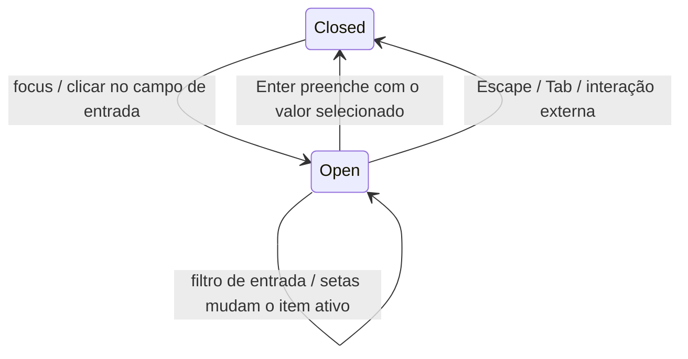

# Especificação da entrada de conexão de dispositivos remotos e da exibição de estado

Contrato de interação vigente, cobrindo as entradas SSH / WSL / Docker e o Server de desenvolvimento. O assistente de três telas e a tabela de cinco estados são a única regra de exibição;
o antigo assistente de cinco passos, o agrupamento de dispositivos e a UI connect-and-chat não se aplicam mais.

2026-10-12 confirmada a meta do próximo ciclo: [Separação entre criação de projeto e gestão de conexão remota](../issues/remote-connection-ux/15-project-device-selection-and-connection-management.md)
(ready-for-agent, ainda não implementada). Ao implementar essa issue, as regras da entrada unificada de três telas, da lista de descoberta mista, da entrada obrigatória no diretório após a conexão bem-sucedida, da posição do progresso na barra lateral recolhida e da limpeza de todos os rascunhos ao fechar passam a ser regidas pela spec de objetivo;
os cinco estados, a classificação de erros, os logs, o salvamento de credenciais e a confirmação de instalação continuam conforme este documento. O estado atual e os registros históricos de validação aqui presentes não significam que a nova meta esteja concluída.

- A entrada de projeto, a reconexão no local, a queda de conexão e a restauração após reinício estão na [spec de navegação de projeto](../remote/project-first-remote-navigation-spec.md).
- Identidade, instalação e o portão de versão estão na [spec principal do R3](r3-source-server-remote-architecture.md); o provisionamento automático de Provider está na [spec dedicada](../remote/provider-provisioning.md).
- O gerenciamento de dispositivos não oferece entrada de edição de modelo/sincronização manual; a configuração de modelo permanece sempre vinculada ao Environment local. A sincronização de skills/MCP/plugins mantém seus respectivos escopos.
- Não alteramos o workspace identity, o owner de Host/task, o continuous do desktop ou os limites do replayable do celular.
- A aceitação e as evidências estão no [catálogo de cases](../conversation-session-case-catalog.md) e na [matriz de cobertura](../testing/conversation-session-e2e-coverage-matrix.md); execução real não equivale a promoção manual.

## Assistente de três telas e seleção unificada (2026-09-28, RDUX-10)

Esta seção substitui as descrições do antigo assistente de cinco passos na barra lateral, dos diretórios recentes offline não clicáveis e do popup automático quando o recolhimento falhava. No topo das entradas de projeto/chat só aparece "Selecionar dispositivo → Conectar → Selecionar diretório"; a entrada de Settings não exibe a barra de passos (ver RDUX-27). O formulário de criação pertence à primeira tela e, na primeira entrada, não marca nenhum passo como concluído. A borda superior do popup fica fixa em 10% do topo da viewport, a altura cresce para baixo conforme o conteúdo e listas longas rolam internamente.

- A primeira tela é sempre uma lista unificada e pesquisável, agrupada por dispositivos salvos (com estado e chip de diretório recente), Hosts do SSH config, distribuições WSL (somente Windows) e contêineres Docker em execução (somente quando Docker está disponível). Clicar em um item conecta imediatamente; diretórios recentes offline também são clicáveis e preservam a intenção de diretório até a conexão e a abertura. A falha na carga da descoberta não bloqueia as demais fontes nem a entrada manual.
- Na parte inferior ficam as opções de criar SSH, WSL manual (somente Windows) e Docker; a entrada de Server de desenvolvimento e sua dica aparecem apenas em execução de desenvolvimento. A disposição do formulário está em RDUX-27: host e porta lado a lado, alternância segmentada de autenticação, senha com mostrar/ocultar, opções avançadas recolhidas, rodapé com "voltar à lista" à esquerda e "conectar" à direita.
- O formulário usa um form real; Enter submete, a porta é validada como inteiro decimal de 1–65535, e host e usuário têm espaços das extremidades removidos. A troca de tela move o foco para o primeiro controle acionável; na tela de formulário, o campo de host. Após selecionar um alias, exibe a etiqueta de vínculo. O dropdown e a digitação manual de Docker são mutuamente exclusivos, com rótulos associados; distingue-se Docker indisponível de ausência de contêineres em execução.
- Quando o Host do config não tem senha, ela é supplementada na tela de conexão; não é preciso redigitar as informações do Host. Quando o usuário está ausente, retorna-se ao formulário já preenchido. Um Profile existente sem credenciais continua usando o fluxo de supplementação de credenciais.
- O recolhimento altera apenas a visibilidade, preservando todos os rascunhos, aliases, alvos e requisições. O topo da área de projetos exibe um cartão de duas linhas: nome do dispositivo com o percentual da etapa e a etapa atual, com barra de progresso abaixo; o percentual é a proporção concluída da etapa existente. Após uma falha, o estado recolhido é mantido, o cartão fica em cor de perigo e mostra o motivo até que se clique para voltar a ver. Em caso de sucesso, entra-se na tela de diretório (abrindo direto se o diretório já existir) e o cartão desaparece.
- O cartão de restauração do recolhimento restaura apenas o mesmo fluxo; as novas entradas explícitas de conexão têm um identificador de intenção próprio, e fluxos ociosos de falha, cancelamento, formulário ou credencial pendente cedem passagem a essa intenção. Mesmo com Profile, distribuição WSL ou valores de alvo idênticos, é preciso consumir de novo, usando os parâmetros mais recentes; antes de aceitar, revoga-se o epoch antigo, limpa-se a espera de confirmação e a intenção de diretório antiga, e credenciais/resultados tardios não podem ressuscitar o fluxo antigo. Se houver construção/atualização real em curso ou conexão estabelecida aguardando diretório, mantém-se o fluxo atual, sem tomar recursos à força.
- Fechar cancela a conexão em curso, revoga a posse da requisição e limpa todos os rascunhos de formulário; o histórico de entrada persistido é preservado. Descobertas/credenciais/resultados de conexão tardios após o fechamento não podem reabrir o fluxo antigo.
- Ao recolher ativamente as telas de seleção, configuração e diretório, também são oferecidos os respectivos cartões de restauração; fora do estado de conexão não se forja progresso. O caminho de navegação de diretórios é mantido pelo assistente; o unload da instância do navegador revoga requisições antigas e, após a restauração, respostas antigas não podem sobrescrever o novo diretório. O sucesso da conexão remove o cartão; trocar de alvo limpa o caminho de diretório.

```text
Lista / Formulário → useRemoteConnectionFlow (único owner da sessão do assistente) → comandos de conexão existentes
                   ├─ requestId / epoch atuais → resultados, pontos de espera, intenção de diretório
                   ├─ recolhido → a mesma sessão renderiza diretamente o cartão da barra lateral (o portal apenas registra o container DOM)
                   └─ fechado → revoga epoch / cancela requisição / limpa rascunhos
Os limites de Host, attachment, snapshot e restauração do continuous do desktop e do replayable do celular mantêm o contrato existente.
```

Os pontos de aceitação seguem a spec pai: DOM do assistente + porta de serviço, além de E2E real de SSH no desktop (volume de operações na primeira conexão via config, diretório recente offline, falha no recolhimento e rascunhos ao fechar). O layout completo das telas de conexão em curso e de diretório está em RDUX-11.

## Formulário de nova conexão (RDUX-27, 2026-10-14)

Esta seção define o formulário compartilhado entre a entrada "Nova conexão" de Settings e a entrada "Nova conexão SSH" das entradas de projeto/chat. Altera apenas a exibição e a interação do front-end, não o fluxo de conexão, o protocolo nem a semântica do estado do formulário. A issue de implementação está em [#27](../issues/remote-connection-ux/27-new-connection-form-polish.md).

```text
Entrada de Settings                                Entrada de projeto/chat
┌ Nova conexão                            — ×    │      ┌ ① Selecionar dispositivo ─ ② Conectar ─ ③ Selecionar diretório  — × │
│ root@10.0.0.5:2222 (prévia ao vivo)            │      │ Nova conexão [SSH]                                       │
│ [▣SSH|▣WSL|▣Docker]  Importar do SSH config ▾  │      │ user@host:22                                             │
│ (🔗Host vinculado dev-box ×)                   │      │ Host + porta / usuário / autenticação / opções avançadas │
│ Host + porta / usuário / autenticação / avanç. │      │                                                          │
├────────────────────────────────────────────────┤      ├──────────────────────────────────────────────────────────┤
│        [Cancelar] [Adicionar e conectar]       │      │ ← Voltar à lista                      [Conectar]         │
└────────────────────────────────────────────────┘      └──────────────────────────────────────────────────────────┘
```

- **Cabeçalho**: nos dois entradas o título é "Nova conexão / New connection", sem frase explicativa. Sob o título, uma prévia ao vivo do alvo de conexão em fonte monoespaçada (SSH `user@host:port`, nome do contêiner Docker, distribuição WSL); quando não preenchido, mostra um placeholder claro. A entrada de projeto/chat exibe a etiqueta de tipo ao lado do título; a entrada de Settings não exibe, porque a alternância de tipo já expressa o tipo. A entrada de Settings não exibe a barra de passos.
- **Alternância de tipo**: SSH / WSL (somente Windows) / Docker usam um controle segmentado, cada item com um ícone de tipo; o item selecionado usa fundo claro, contorno e cor de frente da cor correspondente ao tipo (mesma origem de `RemoteConnectionKindTag`). Cada item da alternância de tipo é uma etiqueta de tipo de conexão, o que se enquadra no permitido pelo DESIGN.md ("tokens de tipo só em etiquetas de tipo"); as demais tabs mantêm o estado selecionado neutro.
- **Importação do SSH config**: somente a entrada de Settings oferece, à direita do lado da alternância de tipo, "Importar do SSH config ▾", que abre a camada de busca já existente; sem Hosts o botão fica desabilitado exibindo o motivo, e em caso de falha de leitura é exibido um aviso abaixo sem bloquear o preenchimento manual. Após selecionar um Host, exibe-se acima do host a etiqueta de vínculo na cor do tipo SSH "Host vinculado xxx ×" e a mensagem "Modificar qualquer campo remove o vínculo automaticamente". O × apenas remove o vínculo, preservando os valores já preenchidos. A entrada de projeto/chat não oferece entrada de alias (a tela anterior da lista já oferece os config Hosts); ao voltar da lista para o formulário, a etiqueta de vínculo continua sendo exibida. A seleção de alias no diálogo de edição de conexão permanece dentro das opções avançadas.
- **Disposição dos campos**: host e porta na mesma linha (porta com cerca de 6rem, também lado a lado em tela estreita), usuário em uma linha exclusiva; a etiqueta "Método de autenticação" fica na mesma linha do controle segmentado, com a entrada de credenciais logo em seguida. As opções avançadas são um gatilho de texto compacto, sem linha tracejada divisória. Os rótulos de campo usam `text-ui-sm`.
- **Divisão ao colar**: ao colar `user@host`, `user@host:port`, `ssh user@host -p N` (inclusive `[IPv6]:port`) no campo de host, o conteúdo é dividido entre host, usuário e porta, exibindo abaixo do host a mensagem de sucesso "Reconhecido …"; outros conteúdos são colados como estão. A colagem é tratada como modificação manual e remove o vínculo de alias. Isso só acontece na colagem.
- **Foco**: ao abrir o formulário o foco está no host. Depois de importar um Host, o foco vai para o primeiro campo obrigatório vazio; se tudo estiver preenchido, vai para a ação principal.
- **Validação**: validada no momento do envio, com o erro exibido abaixo do campo correspondente (`aria-invalid` + `aria-describedby`), e o foco movido para o primeiro campo com erro; a partir daí, campo que se torne válido elimina o erro. O rodapé deixa de exibir texto de validação e a ação principal não é desabilitada. Falha real de conexão continua usando a barra de erro no topo. A única origem das regras de validação é `collectRemoteFormFieldErrors`, reutilizada por `buildRemoteTarget` e pelo diálogo de edição de conexão.
- **Docker / WSL**: remove-se o parágrafo explicativo do topo. O modo de entrada de Docker (selecionar contêiner em execução / digitação manual) usa um controle segmentado neutro; quando Docker está indisponível, exibe-se um cartão de aviso abaixo do seletor; quando não há contêineres em execução, exibe-se um aviso neutro. À esquerda de cada linha de contêiner candidato há um bloco de ícone na cor do tipo Docker. O lembrete de execução do WSL como root permanece como cartão de aviso.
- **Cores**: apenas tokens existentes são reutilizados. A cor de tipo é usada na alternância de tipo, na etiqueta de vínculo, no bloco de ícone das linhas candidatas e na etiqueta de tipo da entrada de projeto; cartão de aviso usa `warning-surface`, o reconhecimento de colagem usa `success`, erros de campo usam `destructive`; a ação principal e a alternância de método de autenticação permanecem neutras.
- **Rodapé**: na entrada de Settings, "Cancelar" e "Adicionar e conectar" alinhados à direita; na entrada de projeto/chat, "← Voltar à lista" à esquerda e "Conectar" à direita. O rodapé tem apenas uma linha divisória.

## Assistente P0 e posse do fluxo (2026-09-27, RDUX-04)

Ao criar manualmente uma conexão reutilizando uma conexão já online, exibe-se "Este dispositivo já está conectado via `<descrição da conexão>`; a conexão existente foi reutilizada diretamente". A descrição vem do alvo de conexão realmente reutilizado pelo Host, não dos valores deste formulário; a senha ou a passphrase que não participaram da autenticação desta vez não é salva nem sobrescreve as credenciais existentes. A mensagem continua visível ao entrar no diretório ou no projeto original, e a descrição da conexão reaproveita o modelo de exibição unificado (como `SSH · dev@host:22`). A exibição pertence à intenção original de criação; supplementação de credenciais, confirmação de instalação e reenvio de atualização continuam como antes; selecionar um dispositivo salvo, conectar pela página de Settings, escolher o diretório em um dispositivo online e reconexão em segundo plano não exibem a mensagem. O resultado de conexão do Host carrega um `reusedConnectionTarget` opcional (alvo anonimizado), propagado pelo Main conforme o requestId; não é possível adivinhar pelo snapshot da UI se houve reutilização. O registry de janelas pode projetar a reutilização de uma entry existente, mas, na ausência de entry, é obrigatório continuar consumindo o resultado de reutilização física de conexão do Manager. Antes de construir a conexão, o Host registra somente o profile sem novas credenciais; a conexão real só conclui as credenciais desta vez quando termina sem reutilização; falha, cancelamento, mescla do mesmo dispositivo ou join concorrente não sobrescrevem valores salvos; a única exceção de ponto de espera é a necessidade de upgrade descoberta após autenticação real: apenas a requisição que executou a autenticação pode salvar credenciais nesse ponto de espera, e quem entra na mesma requisição não pode submeter outra senha; o serviço de gerenciamento pode continuar a atualizar conforme o profile original.

A intenção de entrada do assistente, a espera de instalação, o cancelamento, o recolhimento/fechamento e o destino do resultado são mantidos de forma isolada por `useRemoteConnectionFlow`; os rascunhos do formulário seguem `useRemoteConnectionForm`, e a conexão real e as credenciais continuam pertencendo ao Host. Faltando credenciais, o fluxo para na etapa de conexão e a ação principal "Informar senha" retorna à configuração com o foco na senha ou na passphrase da chave privada; depois de completá-las, o diretório e o método de download originais são preservados. Em conexão, a ação principal "Cancelar conexão" revoga imediatamente a posse da UI sobre aquela requisição; o cancelamento ativo exibe "Cancelado", mantém a entrada de reenvio e não entra no painel de erros.

```mermaid
stateDiagram-v2
  Configuração --> Conectando: enviar / criar requestId
  Conectando --> Aguardando_credenciais: faltam credenciais salvas
  Aguardando_credenciais --> Configuração: informar senha / focar
  Conectando --> Aguardando_instalação: é necessária confirmação
  Aguardando_instalação --> Conectando: concordar com a instalação / preservar a intenção do resultado
  Aguardando_instalação --> Cancelado: cancelar
  Conectando --> Cancelado: cancelar / revogar requestId
  Conectando --> "Diretório ou projeto original": requisição atual bem-sucedida
  Conectando --> Erro: requisição atual falhou
  Cancelado --> Conectando: reenviar / novo requestId
```

O recolhimento apenas oculta o fluxo atual; em caso de sucesso entra-se no diretório e em caso de falha o resultado permanece na barra lateral (conforme RDUX-10); o fechamento revoga a requisição atual e libera a sessão não confirmada. Resultados tardios de requisições revogadas não podem sobrescrever fluxos posteriores, e sessões temporárias tardias são apenas descartadas. Essa extração não muda Host, workspace identity, os limites de restauração do continuous do desktop nem do replayable do celular.

## Contrato unificado de exibição (2026-09-27, RDUX-03)

Esta seção substitui, no texto abaixo e nas specs de design antigas, o mapeamento de quatro estados, o pending→offline, o empréstimo da cor do tipo de conexão para o estado e os termos de engenharia; o fluxo de conexão antigo é regido pelo [contrato de navegação de projeto](../remote/project-first-remote-navigation-spec.md). O contrato de layout está no RDUX-10/11/13 deste documento e na spec de navegação de projeto.

### Modelo de exibição de conexão remota (exibição unificada na UI)

Um módulo de função pura, que mapeia os "fatos de conexão de dispositivo e projeto" para o "resultado de exibição visto pelo usuário". As interfaces a seguir **só** podem buscar o estado de exibição neste módulo, sem calculá-lo por conta própria:

- linha de projeto da barra lateral, cartão de detalhe, cabeçalho de sessão, banner de sessão
- cartão de dispositivo da página de Settings, assistente, etiqueta de dispositivo na linha de tarefa
- ponto de estado da navegação de Settings, menu "Abrir projeto remoto"
- seleção de dispositivo no diálogo de criação de projeto (layout em [layout do diálogo de criação de projeto](../specs/project-editor-dialog-ui.md))

O Header do controle remoto lê o attachment pelo resolvedor de sessão por workspaceIdentity existente; não é exigido que a tab carregue remoteSessionId. O nome do dispositivo é obtido do Host do diretório de projetos compartilhado da janela, correspondente à mesma identidade; o nome do gerenciamento de dispositivos do desktop tem prioridade; é proibido tomar emprestado o nome de outro dispositivo por caminho. Depois que a conexão é removida, exibe-se "não conectado", e após novo registro o estado é atualizado; não se criam novas conexões nem reenvios.

As três mapeações existentes são removidas e fundidas neste módulo: o mapeamento de estado agregado do dispositivo, o mapeamento do estado de conexão do projeto na barra lateral e as etiquetas de estado da página de Settings com seus auxiliares de exibição.

Entradas:

| Entrada                 | Significado                                             |
| ---------------------- | ------------------------------------------------------- |
| Estado agregado do dispositivo | Estado no nível do dispositivo vindo da projeção autoritativa do Source |
| Estado do attachment do projeto | Se a montagem do projeto está pronta; dispositivo online não equivale a projeto pronto |
| Instalação e identidade | Não instalado / instalado / identidade pendente de confirmação (o alvo de conexão mudou) |
| Necessidade de upgrade | Nenhuma / atualização opcional / o remoto exige atualização / o desktop local exige atualização |
| Origem da desconexão    | Desconexão manual pelo usuário / desconexão anormal / ainda não conectado na inicialização |
| Progresso de recuperação automática | Estamos na n-ésima tentativa, de 3 no total |
| Último erro            | Código de erro de conexão classificado e sua fase        |
| Integridade das credenciais | Se falta a senha ou a passphrase de chave privada já salva |
| Modo de conexão e endereço | SSH / WSL / Docker, e o endereço, distro ou nome de contêiner |
| Nome de exibição do dispositivo | O nome alterado pelo usuário tem prioridade; por padrão, o alias SSH |

Saídas:

| Saída                 | Descrição                                                                    |
| --------------------- | ---------------------------------------------------------------------------- |
| Estado visível        | Um entre 5                                                                   |
| Texto de estado e texto curto de estado | O texto curto substitui o nome do dispositivo na linha do projeto |
| Cor semântica         | Sucesso / em andamento (novo) / neutro / aviso / perigo                      |
| Ícone                 | A linha de projeto tem apenas um slot de ícone                               |
| Ação principal        | Conectar / Desconectar / Cancelar conexão / Atualizar o remoto / Atualizar o desktop / Instalar e conectar / Confirmar novo dispositivo / Informar senha / Reenviar / Nenhuma |
| Causa e ação de reparo | Vêm da classificação de erros                                               |
| Texto do progresso de recuperação | Como "recuperação automática 2/3"                                            |
| Descrição da conexão  | Como `SSH · dev@localhost:2222`, gerada conforme o modo de conexão             |

Os 5 estados visíveis:

| Estado visível | Fato disparador                                                        | Cor semântica                        | Ícone na linha do projeto | Ação principal                              |
| ------------- | ---------------------------------------------------------------------- | ------------------------------------- | ------------------------- | ------------------------------------------- |
| Conectado     | Dispositivo online e attachment do projeto pronto                     | Sucesso (mostrado só no cartão de detalhe e na página de Settings) | Nuvem neutra, sem marca | Desconectar |
| Conectando    | Conexão explícita, reconexão no local ou recuperação automática em curso; ou dispositivo online com attachment não pronto | Em andamento | Um único spinner | "Cancelar conexão" dentro do assistente, ausente em outros lugares |
| Não conectado | Desconexão manual pelo usuário, ainda não conectado na inicialização, offline antes da recuperação automática | Neutro | Nuvem riscada | Conectar |
| Requer ação   | Precisa de instalação, o remoto exige atualização, o local exige atualização, identidade pendente de confirmação, faltam credenciais | Aviso | Nuvem + `!` | Ação correspondente à causa |
| Falha na conexão | A última conexão explícita falhou ou a recuperação automática esgotou, e a causa não pertence a "Requer ação" | Perigo | Nuvem + `✕` | Ação de reparo conforme a classificação de erro, por padrão "Reenviar" |

Regras de decisão:

- **"Requer ação" tem precedência sobre "Falha na conexão".** Enquanto existir uma ação de reparo executável, exibe-se "Requer ação".
- **Uma desconexão manual do usuário sempre mapeia para "Não conectado".**
- **"Atualizando" sobrepõe o texto antigo**, e o "precisa de atualização" anterior ou o texto de erro deixam de ser exibidos.
- **Uma atualização opcional não muda o estado visível**, afetando apenas o pequeno ponto da navegação de Settings e o banner do cartão de dispositivo.
- **Estados não online precisam de texto** (texto curto de estado ou texto do cartão de detalhe), não podem se expressar apenas por cor.

### Classificação de erros de conexão

- **Contrato de códigos de erro.**
  - O processo principal e o host produzem, para cada falha de transporte ou de implantação, um código de erro do conjunto de códigos de erro, mais uma mensagem não vazia.
  - Códigos de erro de domínio já confirmados pelo adaptador têm precedência sobre a inferência textual a partir do `cause`; `AggregateError` e os wrappers de fase sem classificação explícita continuam procurando o código de erro interno.
  - Quando a mensagem está vazia ou não é reconhecível, o erro é classificado como "desconhecido", e a resposta de erro nunca é descartada por falha de validação de schema. Essa é exatamente a causa raiz de "rejeitar a conexão sempre parar em conectando".
  - O probe (sonda) classifica como "falha na pré-verificação" apenas a falha da própria verificação do ambiente remoto: script de sonda com saída diferente de zero, plataforma remota sem suporte, glibc do Linux remoto abaixo do piso de execução do Source Server (2.28). Falhas de transporte ao estabelecer a conexão ou ao executar o comando de sonda (como timeout de handshake, desconexão antes do handshake) não recebem fallback de fase; quando não reconhecidas, são classificadas como "desconhecido"; quando a recuperação automática da desconexão esgota o orçamento, a UI mostra "recuperação automática encerrada" com base nisso, sem sugerir problema de ambiente de instalação.
  - Os tipos compartilhados e o schema de runtime são estendidos em sincronia. Quando a UI encontra um código de erro desconhecido, recorre ao texto genérico da classe "desconhecido", mantendo a compatibilidade retroativa.
- **Classificação e exibição:**

| Classe                        | Origem típica                               | Título                    | Ação de reparo                                                                                                                         |
| ----------------------------- | ------------------------------------------ | ------------------------- | --------------------------------------------------------------------------------------------------------------------------------------- |
| Falha de autenticação         | Senha ou chave privada incorreta           | Falha de autenticação SSH | Alterar a senha ou a chave privada: reinserir a senha ou a passphrase no local, na tela de conectando (mesma interação de "precisa de senha"); quando for preciso trocar o usuário ou o arquivo de chave privada, voltar ao formulário, focar o campo e assinalar o erro |
| Credenciais ausentes         | Sem senha ou passphrase salva              | Precisa de senha          | Informar a senha (pertence a "Requer ação")                                                                                            |
| Conexão recusada ou inacessível | ECONNREFUSED, EHOSTUNREACH, ECONNRESET   | Não foi possível conectar ao host | Verificar o endereço e a porta; reenviar                                                                                                |
| Tempo esgotado               | ETIMEDOUT                                  | Tempo de conexão esgotado | Reenviar                                                                                                                                 |
| Host não encontrado           | ENOTFOUND                                  | Host não encontrado       | Alterar o host                                                                                                                           |
| Chave do host mudou          | Incompatibilidade de host key               | A identidade do host mudou | Ver as instruções de segurança, sem oferecer opção de ignorar em um clique                                                             |
| Falha no download, upload, pré-verificação ou instalação | Várias fases da implantação; a pré-verificação contém apenas falhas da verificação do ambiente remoto | Escrever explicitamente qual fase falhou | Reenviar; somente em SSH e com download local, oferecer adicionalmente "usar download direto do dispositivo"                                   |
| Espaço ou permissão insuficiente no remoto | Fase de implantação ou de inicialização | Espaço insuficiente no remoto / sem permissão de escrita | Ver detalhes                                                                                          |
| Versão incompatível          | Fase de handshake                           | Precisa de atualização     | Atualizar o remoto ou atualizar o desktop (pertence a "Requer ação")                                                                     |
| Cancelamento pelo usuário     | Cancelar a instalação ou a conexão          | Cancelado                  | Conectar de novo, sem exibir com estilo de erro                                                                                         |
| Desconhecido                 | Fallback                                   | Falha na conexão          | Reenviar + informações detalhadas                                                                                                       |

- **O erro original** é recolhido em "Informações detalhadas" e pode ser copiado.
- **Os textos** são distinguidos por modo de conexão, com variantes para WSL e Docker. Todos os textos têm versão em chinês e em inglês.
- **Local de exibição**: o erro é exibido no local, no painel do assistente, no cartão de dispositivo, no banner de sessão ou na linha do projeto. O toast é usado apenas para eventos em segundo plano e precisa trazer "Ver detalhes", permitindo saltar para o dispositivo correspondente.
- **Fallback em caso de capacidade insuficiente**: se a mudança da chave do host não puder ser detectada de forma confiável pela camada de transporte atual, o erro é classificado como "desconhecido", sem adivinhações.

### Termos e textos

| Palavra vista pelo usuário | Significado e uso                                          |
| ------------------------- | --------------------------------------------------------- |
| Dispositivo remoto        | Uma máquina remota; uma distro WSL ou um contêiner Docker contam cada um como um dispositivo |
| Conexão                   | Uma forma de acessar um dispositivo, exibida pela descrição da conexão; quando há várias, chamam-se de "outras conexões" |
| Projeto / tarefa          | Inalterado                                                 |
| ZCode Server              | Aparece apenas nos cenários de instalação e atualização   |
| Distro / contêiner        | Substituem respectivamente distro e os nomes de comando docker exec, docker cp etc. |

- **Palavras proibidas na interface**: link, linha, Source Server, troca de geração, oficial, canonical, direct-tcpip, componente remoto, ID curto do dispositivo. O ID do dispositivo só pode ser copiado em "Mais → Informações do dispositivo".
- **A troca de geração de identidade é reescrita em linguagem de usuário**: por exemplo, "a identidade do alvo de conexão mudou" + "usar como novo dispositivo".
- **Os textos da fase "Conectando"** são gerados separadamente para SSH, WSL e Docker.
- **Textos novos e reescritos** precisam ter versão em chinês e em inglês, e o texto em inglês também precisa ser validado quanto à largura da linha de projeto.

### Design system

- **Nova cor semântica "em andamento"**, com os dois tokens de surface e foreground, registrada na spec de design e na documentação de tokens. "Conectando" deixa de tomar emprestada a cor do tipo SSH ou o âmbar.
- **Os tokens de tipo SSH, WSL e Docker** só são usados em etiquetas de tipo; a alternância de tipo, a etiqueta de vínculo e o bloco de ícone candidato do formulário de nova conexão são etiquetas de tipo (RDUX-27).
- **Limpeza das escritas fora do padrão**: tamanhos de fonte fora da escala, cores hardcoded, cores de valor arbitrário, tamanhos de ícone e raios de canto que não estão na spec.
- **Tema escuro**: revisar o contraste das etiquetas de estado, da barra lateral e da navegação de Settings.

### Propriedade da exibição e aceitação

```text
Estado de conexão do Host / Instalação e identidade do Directory → management snapshot existente
Attachment do projeto / Fatos de recuperação automática → Modelo de exibição de função pura da UI → estados, ação principal e cores em cada lugar
Ação do usuário → Assistente de conexão existente / comando de atualização → owner do Host → próximo snapshot
Os caminhos de restauração de attachment do desktop continuous e do mobile replayable mantêm os limites originais
```

- Código de erro/texto original do dispositivo e o erro do projeto entram separadamente: o erro do projeto já pode estar localizado, mas não pode sobrescrever o texto original do erro do dispositivo usado para a classificação de autenticação. O Root repassa ao cabeçalho/linha de tarefa, por um Context somente leitura, os fatos de recuperação de projeto existentes; o resultado da exibição preserva o profileId que originou o estado, para que a conexão correta seja reparada.
- Duas costuras públicas: a projeção de estado `resolveRemoteConnectionPresentation` e a classificação de erros `classifyRemoteConnectionError`; nenhuma delas mantém estado de negócio mutável.
- Cobertura por tabelas das combinações de estado da spec pai, de todos os códigos de erro públicos de 02 e do fallback desconhecido, dos textos SSH/WSL/Docker e do portão de download local.
- Cada componente usa asserções de DOM sobre a saída do modelo; reproduzir antes a direção de atualização local, o estado pending, o spinner duplo e o progresso de recuperação invisível.
- Após a desconexão manual, a barra lateral e Settings ficam neutras em "não conectado"; E2E real de SSH valida e sincroniza o catálogo de cases.
- Verificações de contraste dos tokens, de palavras proibidas e de consistência das chaves em chinês e inglês; regressões de tema claro/escuro e tela estreita no desktop e na recuperação existente no celular.

## Nome do dispositivo e compatibilidade

### Nome padrão do dispositivo

- No primeiro handshake de um novo Source, se o `target.sshConfigAlias` do Profile SSH atual não for vazio, o `displayName` padrão é o alias após trim.
- Sem alias, continua sendo usado `hostname · osUser`; com ambos ausentes, o fallback é `sourceServerId`.
- O `displayName` de um Source existente sempre tem prioridade, evitando sobrescrever a renomeação feita pelo usuário.
- O novo Source descoberto após a confirmação de identity change também segue as regras acima.
- O alias continua não participando do `workspaceIdentity`, da deduplicação de Profiles nem da verificação de identidade do dispositivo.

### Compatibilidade e autocorreção de credenciais SSH

- O Profile do Source continua sendo a autoridade das credenciais SSH da versão atual; ao gravar `lastWorkspaceSession` para o Desktop antigo, cada workspace usa um mirror independente `remote-workspace:<legacyIdentity>:*`, evitando que uma versão antiga apague o secret do Profile compartilhado ao fechar um workspace.
- O snapshot de rollback precisa gravar primeiro, via `credentialService`, o secret do Profile no legacy mirror e só depois a credential key correspondente; quando a escrita no mirror falha, é proibido gravar a referência de settings.
- Quando há vários legacy workspaces para a mesma rota SSH exata, os metadados de target não sensíveis vêm ainda do item com o `lastOpenedAt` mais recente, e a senha/passphrase de chave privada vêm respectivamente dos itens mais recentes que de fato tinham valor.
- A migração do Profile só grava a referência `connection-profile:<profileId>:*` depois que a cópia do secret teve sucesso; referências vazias deixam de propagar novas referências penduradas.
- `SourceServerDirectory.initialize()` executa uma auditoria idempotente nos Profiles SSH com migrationVersion=1 já concluído: quando o secret canônico está ausente, ele é restaurado apenas a partir dos legacy siblings com o mesmo `routeKey`; quando não se encontra nenhum secret real, mantém-se a semântica de "requer credencial interativa", sem correspondência aproximada.
- O diálogo não pode chamar o SSH quando a cadeia de autenticação por senha e por chave privada estiver incompleta; a tela de conexão mostra que é necessário suprir credenciais e permite voltar à configuração. Esse portão é defense in depth e não substitui a correção de mirror e migração.
- Não alteramos o workspace identity, o schema de Profile, o formato de criptografia das credenciais nem a semântica de attachment do Mobile.

### Menu e recolhimento

- O menu "mais" do dispositivo usa uma largura mínima estável, e as linhas de ação usam layout sem quebra; a largura máxima disponível continua limitada pelo conteúdo e pela viewport.
- O menu "mais" do dispositivo oferece "Remover dispositivo" em todos os estados instalados (online, offline, falha, reenviando, precisa de upgrade, atualizando etc.); a remoção apaga apenas o registro local e as credenciais, sem depender de conexão remota, e o `removeSourceServer` do Host desconecta de forma idempotente antes de apagar o registro. "Mostrar na barra lateral" só é oferecido quando o dispositivo tem projetos abertos, e localizar os projetos existentes não depende do estado online; o menu não pode exibir conteúdo vazio.
- O botão de recolher deixa de ser condicionado por `loading || connectedSessionId`; fica visível em todas as etapas.
- Recolher não é fechar, não limpa estado; a semântica de fechar mantém o contrato original.

## Progresso de instalação e atualização

- Durante uma atualização automática ou manual, o subtítulo exibe "Atualizando o serviço remoto", com precedência sobre o erro de upgrade da última conexão; após falha ou cancelamento, o cenário de erro que permite reenviar é preservado.
- O percentual de upload representa apenas o transporte do archive e não pode significar instalação concluída. Imediatamente após o transporte, entra-se na fase de extração; a CLI remota emite, pela opção opcional `--progress`, eventos JSON por linha `{type:"source-server-install-progress", phase}`, com phase entre `verify-archive`, `extract`, `verify` ou `restart`. A saída padrão da CLI e o JSON de resultado da última linha permanecem inalterados.
- O Adapter valida e encaminha o progresso durante a execução do comando, reutilizando o log de operações do Host; saídas desconhecidas ou que não são de progresso não servem como base de fase nem de sucesso. A falha continua usando o código de saída e o resultado final, preservando a limpeza do staging, a guarda de tarefas em execução e a semântica de rollback.
- Na fase de instalação da tela de conexão são exibidas sub-descrições localizadas de upload, extração, verificação do pacote de instalação ou verificação dos arquivos de serviço; o percentual aparece somente na fase atual de upload. As demais fases mantêm o indicador de em andamento, sem simular percentuais. `restart` entra na etapa já existente "Iniciar o serviço e fazer o handshake" e só é concluído após o handshake real e a conexão pronta.

```text
antes: upload 100% -> [extract / verify / restart, sem eventos] -> resultado
depois:  Adapter upload/extract -> CLI verify-archive/extract/verify/restart
        -> log de operações do Host -> projeção de fases na UI -> handshake -> pronto
```

Os fatos de progresso pertencem ao instalador remoto; o estado de conexão continua pertencendo ao Host manager; a UI apenas projeta eventos existentes. Não se adiciona estado persistido nem reenvio, e não se muda o limite de restauração de sessão do desktop continuous nem do replayable do celular. SSH/WSL/Docker compartilham a interpretação de progresso do Adapter.

Aceitação: durante a verificação atrasada, a verificação já aparece e não há percentual de upload; a fase fica visível antes de o comando terminar; a saída fragmentada e os logs não-JSON não afetam o resultado; falha na verificação/reinício não pode exibir pronto; durante a atualização automática não há subtítulo de falha antigo, e após cancelar/falhar o erro continua visível.

## Log de conexão e contrato de falha

- O Host só encaminha o progresso reportado ativamente pelo `onLog` do pipeline de conexão; saídas de console e de diagnóstico de outros serviços não entram no log visível ao usuário. Filtram-se uniformemente caminhos absolutos, credenciais, tokens, perfis de conexão e identificadores de dispositivo; caminhos com espaços são filtrados por aspas ou por limites explícitos de campo de caminho, preservando a causa de falha não-path depois do caminho; a parte final de um caminho sem aspas e que não pode ser desambiguada é mantida sob mascaramento conservador, preservando apenas diagnósticos explícitos como o código de saída; o assistente, o log recente e o feedback usam o mesmo resultado de filtragem. Segredos conhecidos como senha e passphrase de chave privada só são mascarados como token completo (quando as extremidades do segredo são letras, dígitos ou sublinhado, os caracteres adjacentes não podem ser também desse tipo); não é permitido o mascaramento por substring, senão uma senha curta transformaria textos fixos como `device` em `[redacted]ice`, permitindo deduzir a senha.
- A espera da confirmação de instalação é registrada como info. A resposta de falha sempre contém uma mensagem não vazia e o código de erro registrado no shared; códigos de domínio já confirmados têm precedência sobre a inferência textual a partir do cause, e AggregateError e os wrappers de fase sem classificação explícita usam o erro interno reconhecível. Falhas de autenticação SSH e as falhas conhecidas de descriptografia de chave privada recebem `remote-authentication-failed` na fronteira do adaptador SSH, e o fallback de fase não sobrescreve essa classificação; a classificação da UI em chinês e inglês é sincronizada, e os textos antigos sem code são mantidos como fallback de compatibilidade. Conexão recusada/inacessível, tempo esgotado, DNS, erro confiável de host-key, download, upload, pré-verificação, instalação, espaço, permissão, cancelamento e desconhecido são classificados separadamente, com o mapeamento em chinês e inglês sincronizado.
- O serviço de gerenciamento de conexões do Host é o único owner do log de operações recentes; cada dispositivo guarda no máximo as 100 linhas mais recentes da última conexão ou atualização, apenas em memória de runtime. Conexões que ainda não fizeram handshake são isoladas por profile; depois do handshake, são agrupadas por sourceServerId, e o mesmo dispositivo com linhas diferentes compartilha as operações recentes. Uma nova operação substitui o log antigo, e a saída tardia de uma operação antiga não pode sobrescrever a nova. A reconexão interna após a atualização pertence à mesma atualização.
- `getRecentOperationLogs(profileId)` consulta o log mais recente do dispositivo correspondente e continua legível depois de fechar/reabrir o assistente ou a página de Settings; é limpo ao remover o dispositivo/linha e quando o Host sai. O cartão de dispositivo da página de Settings e as conexões incompletas oferecem "Ver log recente"; os detalhes de identidade remota no menu de projeto da barra lateral/chat leem o mesmo log durante a conexão e exibem apenas fase, progresso e tempo decorrido, sem o log bruto (ver [detalhes do progresso de conexão](../remote/project-first-remote-navigation-spec.md#连接进度详情2026-10-15)). O resultado da consulta é uma projeção de exibição, e a UI não mantém um histórico de logs separado.

```text
Conexão/atualização → SourceServerConnectionManager aceita a operação → progresso explícito → filtragem unificada → log em memória limitada
                                                └→ notificação de evento → a UI consulta o log mais recente
Falha → classificação de erro shared + mensagem não vazia → schema do Host → Main → textos em chinês e inglês
```

Este contrato trata apenas do RPC de gerenciamento de conexões de dispositivo e do log de conexão, e não altera o limite de restauração desktop continuous / mobile replayable do task stream.

## Conexão em curso e tela de diretório (RDUX-11, 2026-09-29)

Conforme o protótipo aprovado em 06: a tela de conexão usa como título o nome do dispositivo, o modo de conexão e o endereço completo; as fases verticais são estabelecer o canal (nomeadas separadamente para SSH / WSL / Docker), identificar o dispositivo, instalar os componentes e iniciar a conexão. Não existe fase "conexão pronta"; em caso de sucesso, entra-se diretamente no diretório ou restaura-se o projeto especificado. A fase atual aparece em negrito, com o tempo já gasto, e os itens concluídos mantêm a duração; as sub-etapas de instalação mostram o progresso de upload/download, o tamanho, a velocidade e o tempo restante estimado; quando a velocidade é desconhecida, exibe-se explicitamente que ela está sendo estimada. Espera por senha/passphrase de chave privada, instalação, confirmação de reinstalação do dispositivo, confirmação de atualização forçada e erros classificados ficam embutidos na fase correspondente. O log vem recolhido por padrão e expandido em caso de falha, e o botão de copiar o log só aparece após a expansão. Durante a execução ou enquanto se aguarda o usuário, o rodapé traz "Continuar em segundo plano" à esquerda e "Cancelar conexão" à direita; no estado final de falha, passa a ter "Voltar à lista" à esquerda e "Fechar" à direita, sem jamais reescrever uma falha existente como cancelamento ativo. Após o cancelamento, é permitido reenviar. A marca de instalação concluída exibe "instalação concluída, aguardando o início", sem regredir para "verificando arquivos".

As informações de instalação vêm da sonda remota do Host e da mesma descrição de release: versão, caminho absoluto de instalação, bytes reais do pacote de instalação (explicitamente rotulados como espaço ocupado pelo pacote de instalação, sem passar o tamanho comprimido como se fosse o espaço após a extração); informações desconhecidas exibem "temporariamente indisponível", sem valores falsos. A prévia de instalação somente leitura não faz upload nem instalação; após a confirmação, o comando de instalação existente é reutilizado. A lista de tarefas em execução vem da projeção de atividade do task owner remoto, e a atualização forçada continua passando antes pelo guard force=false. Quando o remoto antigo não fornece a lista, exibe-se explicitamente que a lista está indisponível, sem fabricar tarefas. Falhas de leitura adicionais na prévia de instalação, nos metadados de release ou na lista de tarefas em execução preservam o ponto de espera de instalação/atualização forçada já confirmado e exibem que a informação está indisponível; a resolução de release e a verificação exigidas para a instalação efetiva continuam falhando de forma estrita, sem contornar o guard force=false nem confirmar a atualização forçada pelo usuário.

```text
Escolha/reenvio do usuário → owner do fluxo do assistente (requestId / epoch) → owner de conexão do Host
                   ↑ estado somente leitura, prévia de instalação, log, projeção de atividade de tarefas ↓
              confirmação inline → comandos existentes de instalação/confirmação de identidade/atualização
Cancelar/fechar → liquidar imediatamente a telemetria de cancelamento → revogar epoch → descartar resultados tardios; recolher só muda a visibilidade
Nova entrada explícita → o owner do fluxo limpa os pontos de espera/intenções antigas → consumo do novo epoch; a restauração do cartão mantém o epoch original
Chip de diretório → requisição de navegação mais recente do navegador → caminho de sucesso → abrir o projeto
```

A tela de diretório exibe o caminho completo, com os diretórios recentes e remotos em linhas separadas; a navegação pelo chip precisa atualizar o conteúdo do diretório, e requisições mais antigas não podem sobrescrever a navegação nova. Uma falha de leitura exibe um motivo amigável, e durante a falha ou o carregamento não se pode abrir um diretório não confirmado; o rodapé mantém "Selecionar depois". O nome do dispositivo pode ser salvo no local, exibindo "Salvo" em caso de sucesso e preservando o rascunho com feedback em caso de falha; a barra de estado exibe apenas o estado da conexão, o modo/linha de conexão e a versão conhecida, sem repetir o nome do dispositivo e sem preencher placeholders.

A introdução de primeiro uso volta à página original "Local offline, as tarefas continuam rodando", removendo-se a linha de aviso da página de diretório. Ela é exibida após uma conexão ativa bem-sucedida, antes de continuar para a conclusão do dispositivo/escolha do diretório/projeto original; a primeira navegação explícita de diretório remoto de um dispositivo já conectado também reutiliza a mesma entrada de confirmação. Conclusões em segundo plano e restaurações silenciosas na inicialização não abrem popup; o resultado em segundo plano só é exibido quando o usuário continua de forma explícita. Quando já existe uma caixa de confirmação em uso, o fluxo de conexão preserva a ação de conclusão e continua após a liberação dela; fechar a confirmação ou trocar a entrada revoga. Recolher durante a leitura do estado de lido ou do salvamento também precisa preservar o resultado concluído, aguardando a continuação explícita do usuário, sem abrir a introdução automaticamente nem entregar o callback de conclusão original. Somente o clique em "Entendi" grava `remoteBoundaryIntroAcknowledgedVersion: 1`; exibição, cancelamento, desinstalação, falha de leitura e resposta expirada não marcam como lido. A versão 2 contém simultaneamente a confirmação do popup antigo e a linha de aviso marcada automaticamente como lida, o que impede uma distinção confiável; por isso, os usuários sem a nova marca (inclusive os com o campo antigo na versão 2) veem a introdução mais uma vez de forma unificada, e a nova marca igual a 1 não a repete. O campo antigo permanece `remoteBoundaryOnboardingVersion?: 2`, apenas para compatibilidade de rollback, e não pode servir como base para a confirmação da nova versão. O campo antigo já gravado na versão 3 é migrado, antes da validação completa do schema, para o campo antigo 2 e a nova marca 1; na leitura, o SettingService relê, migra e salva de forma atômica sob o lock de escrita existente, e a migração não pode sobrescrever uma atualização concorrente de preferências. Clientes antigos que removem a nova marca continuam conseguindo ler e salvar as settings originais, e o rollback não depende de uma versão de compatibilidade adicional; um rollback seguido de upgrade permite exibir a introdução mais uma vez. Falhas de leitura ou salvamento mantêm o estado não lido, sem converter a falha da introdução em falha de conexão; o uso ativo posterior pode confirmar novamente. A aparência e os textos da página de introdução reutilizam o componente original, e Escape ou o overlay não contam como confirmação; quando o entryEpoch/epoch do formulário da ação expira, a navegação antiga não continua. O owner de tarefa, o isolamento de identidade e a cadeia de restauração do desktop continuous e do replayable do celular permanecem inalterados.

O texto em chinês do corpo da introdução é "关闭 ZCode 或休眠本机，\n远程任务继续运行。", com quebra explícita após a vírgula; em inglês é "Remote tasks keep running, even when you close ZCode or put your computer to sleep.", com quebra equilibrada e sem posição fixa de quebra. O corpo preserva as quebras de linha e permite que a janela estreita continue quebrando, evitando que a última linha fique com um ou dois caracteres chineses. Reutiliza-se a largura, o tamanho de fonte e o tema atuais do popup; com o tamanho padrão de 14px, tanto o chinês quanto o inglês ocupam duas linhas; com 16px, o chinês continua em duas linhas e o inglês pode ocupar três. A verificação visual monta o popup real, cobrindo desktop e janela estreita de 390px, temas claro e escuro e os tamanhos 14/16px, sem necessidade de conectar a um servidor remoto.

```text
Comportamento original: o aviso do diretório é exibido → marca antiga 2 é gravada automaticamente
Marcas antigas existentes 3 → migração de schema → SettingService salva a marca antiga 2 + a nova marca 1 dentro do lock de escrita
Novo comportamento: conexão ativa bem-sucedida / uso explícito de um dispositivo já conectado → página de introdução → Entendi → nova marca 1 → fluxo original
Conclusão em segundo plano → aguarda o usuário continuar ────────────────────────────┘
Cancelar/trocar de entrada → revoga o epoch original → descarta resultados tardios
```

Aceitação: o DOM do assistente cobre a espera inline, o reenvio de autenticação, o cancelamento e as respostas tardias, as informações reais de instalação, as fases e o transporte, a navegação de diretório/erro/renomeação; o SSH real cobre falha de autenticação/conexão recusada/informações de primeira instalação/descrição não bloqueante, e as capturas de tela cobrem os temas claro e escuro e 900px.

Contrato da lista de tarefas em execução: o Core continua derivando o conjunto de atividades dos fatos de owner de `turn.started/turn.terminal`, isolando por `workspaceIdentity || workspacePath` + sessionId; o heartbeat/task-activity dirigido ao Supervisor recebe a lista como opcional. `running-tasks --json` devolve somente leitura essa lista (null quando desconhecida), e o Host a lê após o guard de atualização forçada rejeitar, exibindo-a por meio do snapshot de gerenciamento. Essa extensão não modifica o `status.json` persistido, o formato de rollback de versão, as mensagens App ↔ Agent, nem a entrega do desktop continuous ou do replayable do celular.

## Proteção das Settings, edição de conexão e marcação de máquina (RDUX-05)

- O diálogo de edição de conexão reutiliza os campos de conexão existentes; o nome do dispositivo e o nome da conexão são validados e salvos separadamente, e um erro no nome do dispositivo não pode exibir o erro do nome da conexão. Confirmações de operações perigosas focam por padrão o cancelamento, e não se pode executar por Enter uma operação perigosa por padrão; antes de desconectar, um aviso inline explica o impacto.
- A página de Settings não exibe de forma unificada a linha de aviso "Editando: esta máquina / <nome do dispositivo> (remoto)" nem o seu ícone, cobrindo as listas e os formulários de edição de itens comuns, plugins, MCP, skills, comandos, hooks e subagentes; desktop e celular, temas claro e escuro, com consistência entre chinês e inglês. O menu de escopo mantém o nome do dispositivo, e a leitura/escrita das settings segue o escopo de serviço existente.
- As operações de dispositivo fazem prevenção de duplicidade e exclusividade mútua pelo mesmo sourceServerId (profileId quando não identificado); operações de dispositivos não relacionados e as ações somente leitura de detalhes e de visualização de log permanecem disponíveis, e uma atualização longa de um dispositivo não pode travar o painel inteiro.
- "Gerenciar nas Settings" e o início da atualização apenas posicionam o cartão do dispositivo correspondente; apenas a intenção explícita de "Ver detalhes" abre o detalhe da falha. A falha atual de um dispositivo não significa que todas as ações de posicionamento devam abrir um modal.
- As causas de falha e as informações de atualização de conexões diferentes do mesmo dispositivo são exibidas de forma independente; apenas a mesma causa do mesmo Profile pode ser deduplicada, e não se permite que o banner de atualização de uma conexão sombreie a falha de outra.

## Cartão de dispositivo nas Settings e aviso de atualização (RDUX-13)

Cartão de dispositivo (fechamento de layout em 2026-10-15):

- **Linha de título**: ícone neutro do modo de conexão, nome, estado de cinco estados e ação principal/editar/mais. A ação principal é determinada pelo modelo de exibição; quando conectado, a ação principal "Desconectar" vira um botão ghost, e "Depois de desconectar, as tarefas remotas continuam rodando" passa a ser apenas a dica (title) desse botão, sem permanecer como uma linha de explicação.
- **Linha de conexão**: a descrição da conexão usa o token de tipo, priorizando a conexão efetivamente online; em seguida vem a versão remota e, quando offline, "online recentemente". Um dispositivo com apenas uma conexão não exibe "Atual" / "Padrão"; com várias conexões, marca-se "Atual" e "Padrão" com a mesma etiqueta neutra pequena.
- **Projetos recentes**: sob o subtítulo "Projetos recentes", listam-se em ordem decrescente de `lastOpenedAt` os projetos conhecidos, cada linha com ícone de pasta, nome de exibição, caminho remoto completo (monoespaçado, truncado, com o texto completo no title) e tempo relativo de abertura; quando o projeto já está aberto nesta janela, adiciona-se a etiqueta "Aberto". Por padrão são exibidas 3 linhas e, ao exceder, o cartão oferece "Mostrar todos (N)" expandindo dentro do próprio cartão, sem surgir um "+N" que não possa ser aberto. Ao clicar, primeiro se resolve a partir do diretório de projetos compartilhado, pelo Source e pelo diretório, a única entrada existente, passando preferredProjectEntryId, preferredProfileId e preferredDirectoryPath, e após a conexão o projeto original é aberto diretamente, sem passar pelo criador; quando não é possível determinar a entrada original, a página atual é mantida com a dica de escolher pela barra lateral. A validação de entrada e de conclusão da conexão está em [navegação de projeto](../remote/project-first-remote-navigation-spec.md#2-入口与连接顺序). Sem projetos, exibe-se "0 projetos".
- **Rodapé**: abaixo de uma linha divisória no fundo do cartão ficam as entradas recolhidas "Outras conexões (N)" e "Log recente", com o conteúdo expandido aparecendo sequencialmente abaixo do rodapé. O log recente vem recolhido por padrão; quando o estado de exibição do dispositivo é de falha, vem expandido, e depois de a alternância manual do usuário prevalece a escolha dele. O quadro do log usa `bg-surface`, sem borda adicional, evitando um cartão dentro do cartão. As demais conexões, quando expandidas, mantêm as ações visíveis e podem quebrar linha, sem uma segunda camada de borda de cartão.
- As informações do dispositivo (hostname, usuário do sistema, ID do dispositivo) e a cópia do ID ficam no menu "mais"; a versão já é exibida na linha de conexão.
- **Ordem da página**: texto explicativo e "Nova conexão" → subtítulo "Dispositivos (N)" e os cartões de dispositivo (mantendo a ordem do snapshot, sem reordenar por estado, para evitar que o cartão se mova após uma ação do usuário) → "Conexões incompletas" sem sourceServerId (recolhido por padrão, com suporte a reenvio, exclusão e limpeza após a confirmação) → conexões arquivadas → preferências de conexão. Dispositivos identificados permanecem com cartão mesmo offline ou precisando de reinstalação.

A atualização opcional é exibida apenas como ponto na navegação e banner neutro (depois/atualizar), sem toast; a atualização obrigatória usa um banner de aviso explicando a versão e o impacto, com as ações apenas na linha de título. A chave de deduplicação dos avisos automáticos é sourceServerId + availableVersion, mantida em preferências locais versionadas da UI; desconexão, troca de conexão e reinício não a limpam. "Depois" oculta o banner opcional do mesmo dispositivo e mesma versão, válido durante esta execução do renderer; remontar o painel de Settings não limpa, mas reiniciar o aplicativo torna a mensagem visível de novo. A deduplicação persistente não oculta o estado de atualização acionável do dispositivo. A atualização ativa exibe as fases/progresso existentes; em sucesso, um toast; em falha, um toast que pode abrir os detalhes da conexão e o log recente.

```text
Evento de estado do Host → snapshot de gerenciamento → modelo de exibição de cinco estados → cartão de dispositivo/ponto de navegação
                        → controlador de notificação → deduplicação persistente na UI (dispositivo + versão de destino)
Atualização do usuário → updateSource(force=false) → guard de tarefas em execução
         → leitura da mesma lista de tarefas do snapshot do Host → confirmação do usuário → force=true
```

A lista de tarefas em execução vem em somente leitura do owner existente; quando o remoto antigo não tem lista, exibe-se explicitamente como indisponível. A identidade do projeto, o desktop continuous e o mobile replayable seguem o contrato original. A aceitação cobre a classificação da conexão com falha, a ordenação dos projetos recentes e a expansão de todos, o Atual/Padrão das outras conexões, a deduplicação no reinício e na reconexão, o ciclo de vida do "depois", a lista da atualização forçada, o tema e a tela estreita.

## Acabamento visual e de acessibilidade (RDUX-A11Y, 2026-09-29)

- O texto auxiliar da UI remota, das etiquetas de dispositivo da barra lateral e da navegação de Settings usa `remote-foreground-muted`, atingindo 4.5:1 nas superfícies reais dos quatro temas embutidos; as etiquetas de tipo e as de cinco estados são verificadas separadamente, sem recorrer à redução do tamanho da fonte para fugir do contraste.
- Os botões segmentados de autenticação e de download de recursos fornecem nome de grupo localizado e `aria-pressed`; os rótulos de entrada estão associados a um id único. O estado de conexão oferece semântica legível, e as etiquetas de estado dinâmico usam uma live region polite.
- Os placeholders de entrada remota usam sans de forma unificada, e os valores de caminho mantêm mono. Os textos explicativos usam quebra natural e `text-pretty`, e os números de etapa e os botões de diretório seguem a spec de raio de canto.
- O nome de fechar do diálogo acompanha a troca de idioma; a prévia de arrastar do projeto mantém o nome do dispositivo consistente com a linha do projeto (a mesma projeção de nome do Source).
- Na linha de projeto da barra lateral e na lista de projetos da caixa de chat, o nome do projeto mantém `text-ui-base` e o nome do dispositivo mantém `text-ui-sm`; os dois trechos de texto ficam alinhados pela linha de base dentro do mesmo container, e o ícone de nuvem e a marca de seleção continuam centralizados verticalmente na camada externa. Nomes longos permanecem em uma linha única com elipse, sem empurrar as ações do fim da linha; desktop e tela estreita, temas claro e escuro e tamanhos de interface 14/16px seguem essa regra.
- O teclado cobre o formulário do assistente, a mostrar/ocultar a senha, a seleção de download, a confirmação de diretório, os detalhes/mais da barra lateral e as operações do cartão de Settings; as capturas em claro × escuro × chinês/inglês × 1400/900px fixam a barra lateral em 264px.

A expansão dos candidatos históricos, o item ativo e o mostrar/ocultar a senha são mantidos pelo componente de campo; o valor de entrada continua sendo devolvido ao owner pelo `onChange` do formulário original.



Ao abrir o histórico, o foco permanece no campo de entrada, e `aria-activedescendant` aponta para o candidato ativo; o Escape fecha apenas os candidatos, e o Tab continua o movimento nativo de foco. O botão de mostrar/ocultar a senha não submete o formulário.
