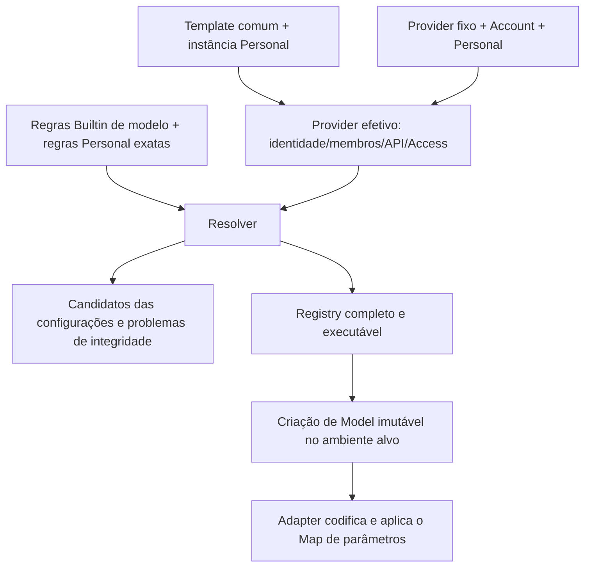

# Especificação de configuração de templates e regras de modelo

## Como a configuração se torna uma chamada

Os templates respondem "por qual entrada de produto, protocolo e via de acesso cada modelo é chamado"; as regras de modelo respondem "quais capacidades esses modelos têm e como as opções lógicas são codificadas em parâmetros de requisição". Os dois caminhos convergem no Resolver; a página de configurações e o catálogo de execução usam o mesmo resultado de resolução, e nenhum dos dois pode adivinhar capacidades por modelo ou por domínio.

| Conceito          | Significado e fronteira de manutenção                                                            |
| ----------------- | --------------------------------------------------------------------------------------------- |
| Builtin Release   | Configuração completa empacotada ou baixada dinamicamente; templates de Provider/Providers fixos e regras de modelo são versionados em conjunto |
| Template          | Baseline de conexão e membros de fornecedores comuns; `templateId` é a identidade estável do template, não a identidade da instância do usuário |
| Instância de Provider | Um conjunto de configurações de conexão concreto identificado por `providerId`; a identidade do modelo é `providerId + modelId` |
| Account           | Projeta configuração dinâmica e elegibilidade apenas para Providers de conta fixa conhecidos; não grava credenciais do usuário em templates comuns |
| Personal          | Sobrescritas explícitas do usuário e membros de modelo pessoais; campos não declarados continuam herdando e o resultado de resolução completo não é salvo |
| Effective         | Configuração vigente obtida por sobreposição em ordem; ainda pode estar incompleta e não é a configuração a gravar de volta no arquivo do usuário |
| Registry          | Conjunto completo e executável de Providers/Models; a página de configurações também mantém candidatos incompletos e problemas para correção |
| Model de execução | Fato de execução imutável criado a partir do Registry do ambiente de execução alvo; atualizações posteriores afetam apenas Models recém-criados |



Instâncias de template comum herdam o template e depois sobrepõem Personal; Providers fixos sobrepõem Account primeiro e Personal depois. Account só pode atuar sobre identidades fixas embutidas. Atualizações de configuração não podem sobrescrever endereços, nomes ou opções explícitos do usuário, nem usar credenciais ou resultados de resolução do Host local no lugar dos fatos do Host remoto. A interface do celular usa a projeção do Host alvo. Credenciais dinâmicas de conta são obtidas no momento da requisição, e o fornecedor continua sendo a autoridade final de autorização de cada requisição.

## Fonte única de arquivos e tipos

| Arquivo                                                                          | Responsabilidade                                          |
| -------------------------------------------------------------------------------- | -------------------------------------------------------- |
| [JSON oficial](../../config/provider/zcode-builtin.json)                         | Única fonte de edição manual; contém templates, Providers fixos e regras de modelo |
| [JSON de teste](../../config/provider/zcode-builtin.test.json)                    | Release completo gerado a partir da configuração oficial; modelos não são editados de forma independente |
| [Script de geração](../../scripts/sync-test-builtin-provider-config.mjs)        | Mapeamento de endpoints de teste e derivação das regras de Site correspondentes |
| [Schema de regras](../../packages/provider/src/config/rule-data-schema.ts)        | Campos por camada, formato de correspondência e permissão de escrita por origem |
| [Schema de Provider](../../packages/provider/src/config/provider-data-schema.ts) | API, Access e metadados de template |
| [Schema de Model](../../packages/shared/src/model-config.ts)                     | Capacidades, opções e integridade |
| [Resolver](../../packages/provider/src/resolver.ts)                              | Herança de template, membros e configuração final executável |

O invólucro do arquivo é `{schemaVersion: 1, revision, config}`. Mudanças no conteúdo da configuração devem usar uma nova revision para evitar o mesmo número com conteúdo diferente; reorganização puramente documental não incrementa. A revision é diferente do número de versão do produto; a entrega específica está descrita em [especificação de entrega](./delivery.md). Campos não aceitos pelo Schema não são estendidos manualmente.

## Templates, membros e regras

`providerConfigRules.templateRules` define os templates de API comuns. Mantenha `templateId`, nome localizado, Logo, `access`, `api.type/baseUrl`, link de gerenciamento de Key e `builtinModelIds`. O template não carrega Keys do usuário nem é um Provider diretamente executável; a instância herda do template e depois sobrepõe Personal.

Os tipos de API atuais são apenas `anthropic-messages`, `openai-chat-completions` e `openai-responses`. Access ainda inclui `api-key` comum, o plano manual `zhipu-coding-plan-api-key` e a conta fixa `zhipu-account`. O plano manual unificado como Key comum é uma solução futura e não pode ser escrito antecipadamente como implementação atual.

Ao adicionar uma nova key de Logo, verifique o [mapeamento de recursos](../../packages/ui/src/settings/model-provider-section/ProviderLogo.tsx), os recursos de tema e o registro de origem; para novos nomes, verifique a localização. Atualizações puramente configurais em tempo de execução não podem adicionar imagens ao pacote de instalação do nada.

`builtinModelIds` determina os membros do template; `templateModelRules` com `templateId + modelId` determina a ativação/desativação padrão desse membro e suas diferenças. Adicionar regras não adiciona membros; `modelOrder` apenas ordena membros existentes. Todos os membros de template atuais têm declarações exatas de ativação/desativação; mantenha essa auditabilidade ao adicionar novos.

### Atribuição de campos e estabilidade de identidade

A camada externa do template tem apenas `templateId`, `templateNameMap` e `config`; o mapa de nomes suporta `zh-CN` / `en-US`. O `config` do template aceita apenas `logo`, `access`, `api` e `builtinModelIds`, e o Access é proibido de carregar `apiKey`. Não escreva campos de instância, estado de conta ou modelos pessoais no template.

A camada externa da regra de instância guarda `providerId`, o opcional `templateId/providerName/enabled` e `config`. O `enabled` da instância (interruptor geral) é diferente do `config.enabled` do modelo; Providers de conta fixa não usam o interruptor geral de desativação e continuam sujeitos à elegibilidade da conta e à ativação/desativação dos modelos. `group` é o agrupamento de produto e `visibility` é o controle de exibição; nenhum dos dois substitui verificação de autorização ou de integridade.

`api` guarda `type/baseUrl` e `headers` estáticos opcionais; a URL deve corresponder a um produto e protocolo concretos, e a página inicial de divulgação do fornecedor não pode ser usada como endereço de API. O ID do template, o ID original do modelo e o nome da instância são mantidos separadamente; alterar o nome de exibição do template não renomeia a instância já salva. Prefixos, barras e maiúsculas/minúsculas no ID do modelo são usados como estão na requisição.

Os membros são compostos pela ordem de origem, com os embutidos primeiro e os pessoais depois; a deduplicação em um único conjunto mantém a primeira ocorrência, e quando um nome coincide entre pessoal e embutido a origem embutida é mantida. `modelOrder` ordena membros existentes e não cria membros. Candidatos sem template, sem Key, com URL inválida ou com capacidades incompletas podem aparecer na página de configurações, mas não podem entrar no Registry por isso; modelos desativados também não podem ser executados. `selectable` ainda é limitado pela visibilidade do Provider, e ocultar não é apagar nem perder a identidade de busca interna exata.

## Hierarquia de regras

```text
modelRules                    capacidades comuns do modelo
  → modelApiRules             diferenças de modelo × protocolo de API
  → providerSiteRules         diferenças de um Base URL específico, podendo limitar modelo e protocolo
  → templateModelRules        cobertura exata de templateId + modelId
  → builtinProviderModelRules cobertura exata de providerId + modelId fixos
  → Regras Personal exatas    sobrescritas do usuário
```

Dentro da mesma camada, a execução segue a ordem do array; itens posteriores só sobrescrevem os campos declarados, sem "correspondência mais específica primeiro", ordenação por comprimento ou priority adicional. Omissão significa herança, `null` significa limpeza explícita e um valor concreto significa sobrescrita; valores de array são substituídos conforme o contrato do campo, e não se deve esperar mesclagem automática de níveis de raciocínio. O valor Effective da página de configurações não pode ser gravado de volta inteiro em Personal.

Os registros em cada array usam os campos de correspondência abaixo e `config`; o arquivo não repete o `type` da camada em memória e não usa `providerMatch` nem condições entre camadas:

| Array                        | Campos de correspondência                                  |
| --------------------------- | ---------------------------------------------------------- |
| `modelRules`                | `modelMatch`                                              |
| `modelApiRules`             | `modelMatch + apiTypeMatch`                               |
| `providerSiteRules`         | `modelMatch + baseUrlMatch`, com `apiTypeMatch` opcional  |
| `templateModelRules`        | `templateId + modelId`                                    |
| `builtinProviderModelRules` | `providerId + modelId`                                    |

Personal permite apenas sobrescritas inteligentes exatas ou configuração manual para um Provider/Model concreto; a mesma identidade não pode entrar nos dois conjuntos ao mesmo tempo, e não existe uma camada pessoal global de regex. O modo manual fixa os campos editáveis abertos pelo produto, enquanto os campos de sistema continuam vindo das regras; manter o Builtin não deve reescrever junto essas intenções do usuário. A atribuição de campos na alternância entre inteligente/manual pode ser verificada na [implementação de configuração manual](../../packages/provider/src/config/manual-model-config.ts).

### Correspondência e simplificação

- Model/Model+API usam regex simples de prefixo/sufixo sobre um conjunto de manutenção limitado, como `.*deepseek-flash.*`; o ponto literal continua escapado. O parser faz correspondência sobre a string completa; a correspondência de nome de modelo ignora maiúsculas/minúsculas, mas o ID da requisição não muda.
- As regras comuns vêm antes e as variantes específicas depois. Não se deve ordenar automaticamente apenas pelo comprimento da string; é preciso validar o resultado completo após a herança.
- Formas normalizadas equivalentes do mesmo Base URL concreto podem compartilhar uma regra de Site; domínios ou caminhos diferentes não são unidos por alternation. Quando for necessário dividir por condições diferentes de modelo ou protocolo, mantenha várias regras.
- As regras exatas de Template/Provider correspondem pela identidade completa e não são relaxadas para curingas de modelo. O `modelMatch` de Site ainda suporta correspondência conforme o Schema e não deve ser escrito por engano como aceitando apenas modelos exatos.
- A baseline comum atual é `contextWindow=1000000` e `maxOutputTokens.max=128000`. Janelas/limites de saída menores já conhecidos precisam de sobrescrita explícita; a baseline não é uma promessa medida do upstream nem o orçamento de saída de cada requisição.
- Remova apenas valores duplicados que realmente podem ser herdados. Se a família de uma camada anterior mudar para um valor menor, restaurar um modelo concreto no valor comum ainda exige sobrescrita explícita.
- Preserve exceções semânticas, como a exclusão `(?!v)` para modelos visuais na regra GLM-4.6 Messages e a ordem de cobertura entre Flash e FlashX. Transformações de aliases históricos não podem ampliar seu escopo conforme o matcher é relaxado.

Essas escolhas se apoiam em um conjunto de manutenção limitado: expressam a diferença entre família e variante com uma ordem explícita, reduzindo declarações duplicadas e fronteiras complexas, em vez de prometer precisão para um número ilimitado de modelos desconhecidos. A revision 32 mudou a janela comum de 200000 para 1000000 e o limite de saída de 32000 para 128000; removeu duas regras de Model que existiam apenas para definir a janela de um milhão para `[1m]` e o limite de 128000 para aliases de preview, porque a nova baseline pode ser herdada. Os mapeamentos de raciocínio da camada de protocolo, a identidade dos membros e os orçamentos explícitos de requisição não mudam com a remoção dessas duas regras.

### Capacidades e Option Map

Properties incluem a capacidade de contexto, os formatos de entrada/saída, chamadas de ferramenta, saída estruturada, busca nativa, mensagens System no meio da conversa e os requisitos de Schema MFJS. Campos diferentes são verificados separadamente: o selo de visão nativa não equivale a um switch de entrada de mídia; suportar imagens não equivale a suportar vídeo/PDF; suportar ferramentas não equivale a suportar busca nativa.

A configuração de execução completa precisa de `enabled`, properties completas, `reasoningLevel.values/map` não vazio e ordenado e `maxOutputTokens.max/map`. Modelos sem raciocínio também precisam de um contrato de opções válido; não se adivinham valores padrão por modelo.

| Grupo de campos                | Folhas que precisam ser verificadas                                                                                                                                   |
| ------------------------------ | ------------------------------------------------------------------------------------------------------------------------------------------------------------------------ |
| `properties`                   | `contextWindow`, `requiresMfjsToolSchema`, `supportsToolCall`, `supportsJsonSchemaOutput`, `supportsNativeWebSearch`, `supportsMidConversationSystem` |
| `properties.inputFormat`       | `supportsText`, `supportsImage`, `supportsVideo`, `supportsAudio`, `supportsPdf`                                                                                    |
| `properties.outputFormat`      | Atualmente apenas `supportsText`; não pode ser usado para declarar suporte a geração de imagem ou áudio                                                                  |
| `optionSpecs.reasoningLevel`   | `values` e `map` ordenados; não guarda `type` separado nem renomeia automaticamente níveis desligados já existentes                                                      |
| `optionSpecs.maxOutputTokens`  | Limite de capacidade `max` e `map`; não guarda o orçamento padrão de requisição                                                                                       |

Regras esparsas escrevem apenas as diferenças, e a completude é provada pela configuração resolvida. Novos modelos devem ter todas as capacidades verificadas e, mesmo que acabem usando uma regra de família, deve ficar registrado o porquê de o valor herdado se aplicar. MFJS é o requisito de Schema de parâmetros de ferramenta e MCS é a permissão para mensagens System no meio da conversa; nenhum dos dois pode ser deduzido de "suporta chamadas de ferramenta".

```text
Adapter codifica a requisição base
  → reasoningLevel.map
  → maxOutputTokens.map
  → Body HTTP final
```

O Map usa CEL restrito, com a opção correspondente como entrada e um JSON Merge Patch como saída; sem IO, leitura de ambiente ou código dinâmico. `{}` não modifica a requisição e `null` no Patch remove o campo. `values` é ordenado do mais baixo ao mais alto, e valores brutos como `none/disabled` não são renomeados globalmente. Cada valor válido precisa ser validado na requisição final; não basta testar se a expressão compila. O Map também não substitui o suporte do Adapter a mídia, chamadas de ferramenta em streaming e respostas. A implementação está em [Option Maps](../../packages/model-option-map/src/option-maps.ts) e no [ponto de aplicação da requisição](../../apps/zcode-cli/packages/adapters/src/model/model-option-map-fetch.ts).

## Configuração oficial e de teste

```text
Editar JSON oficial → sync-test → JSON de teste → check-test → mesmo MR
```

O gerador deriva novamente a partir do arquivo oficial completo, sem aplicar correções incrementais sobre o arquivo de teste antigo:

- Converte apenas os endpoints oficiais conhecidos do Provider fixo `zhipu-account`, incluindo pessoal/equipe, Start, off-peak e cartão acelerado; endpoints de conta desconhecidos falham explicitamente.
- Templates de API manuais comuns, endereços de terceiros e links de gerenciamento de Key mantêm os valores originais. Portanto, os templates comuns no pacote de teste ainda podem chamar fornecedores oficiais e gerar custos reais.
- Mantém as regras de Site oficiais e anexa em seguida as regras de endpoint de teste, herdando as mesmas condições de modelo/API, capacidades e Map.
- Templates, membros de modelo, demais regras, schemaVersion e revision permanecem com a mesma origem. As diferenças do ambiente de teste não podem ser usadas para manter um segundo conjunto de capacidades de modelo.

```bash
pnpm provider:config:sync-test
pnpm provider:config:check-test
```

Se um novo template comum realmente precisar de um endpoint de teste diferente, confirme primeiro os requisitos do ambiente e só então altere a estratégia de geração e os testes do script; o JSON de teste não pode ser editado manualmente.

### Mapeamento atual de endpoints de conta

| Base URL oficial                                 | Base URL de teste                                            |
| ------------------------------------------------ | ------------------------------------------------------------ |
| `https://api.z.ai/api/anthropic`                 | `https://api.z.ai/api/anthropic`                 |
| `https://open.bigmodel.cn/api/anthropic`         | `https://open.bigmodel.cn/api/anthropic`                  |
| `https://zcode.z.ai/api/v1/zcode-plan/anthropic` | `https://zcode.z.ai/api/v1/zcode-plan/anthropic` |
| `https://zcode.z.ai/api/v1/off-peak/anthropic`   | `https://zcode.z.ai/api/v1/off-peak/anthropic`   |
| `https://zcode.z.ai/api/v1/highspeed/anthropic`  | `https://zcode.z.ai/api/v1/highspeed/anthropic`  |

Esta tabela dirige apenas a conversão de endereços do Provider de conta fixa e a derivação das regras de Site correspondentes; ela não altera templates comuns com a mesma URL. Ao adicionar um endereço de teste, é preciso verificar também a admissão na validação de segurança de requisição da versão oficial existente no Adapter; o switch de ambiente de produto, por si só, não concede acesso a novos domínios.

### Seleção de origem na build e recurso final

A [entrada de build](../../scripts/builtin-provider-config.mjs) compartilhada tem a responsabilidade de selecionar a origem por ambiente: um `ZCODE_ENV` explícito e não vazio tem prioridade; caso contrário, lê-se `.env` primeiro e, conforme `NODE_ENV=production`, `.env.production`; nos demais casos, `.env.development` e `.env.development.local` em sequência. Valores de arquivos lidos depois sobrepõem os anteriores, e arquivos ausentes são pulados. O valor final tem espaços removidos e é convertido para minúsculas; valor vazio assume `test` e valor não vazio inválido gera erro.

`production` seleciona `config/provider/zcode-builtin.json` e `test` seleciona `config/provider/zcode-builtin.test.json`. `NODE_ENV` determina apenas o grupo de arquivos de ambiente acima, não o ambiente de produto diretamente; o nome do branch também não participa da seleção.

```text
ZCODE_ENV e arquivos de ambiente → selecionar JSON completo → reutilizar o Decoder de Release para validar
                                     ↓
                   recurso do pacote ou constante embutida → Builtin Source → Registry
```

| Forma de consumo                | Local da configuração e requisitos de verificação                     |
| ------------------------------ | --------------------------------------------------------------------- |
| Pacote de instalação do Desktop | `resources/config/provider/zcode-builtin.json`                       |
| CLI comum                      | `dist/provider/zcode-builtin.json`, com refresh de recursos adjacentes na build |
| Executável único SEA           | key de recurso `zcode-provider/zcode-builtin.json`                   |
| HTTP / Remote / Server CLI     | JSON completo compilado como constante; verificar o JS/produto empacotado final |
| Desenvolvimento do Desktop       | Localiza o arquivo-fonte no repositório conforme o mesmo ambiente de compilação; a prioridade de injeção de caminho explícito permanece |

Falha na leitura, no parsing do JSON ou na validação do Schema encerra a build imediatamente, sem fallback entre ambientes. A build lê apenas o arquivo local selecionado, não baixa configuração online, não executa sincronização implícita e não sobrescreve arquivos-fonte. No Windows, ao carregar o decoder o caminho do arquivo é convertido primeiro para uma URL `file:`, evitando que a letra de unidade seja interpretada como protocolo.

O cache de build precisa cobrir `ZCODE_ENV`, os arquivos de ambiente, as duas configurações e as ferramentas comuns de build. As entradas atuais do Turbo do CLI e a impressão digital do E2E do Desktop incluem essas entradas relevantes; o conteúdo embutido do Server participa do hash do artefato; o bootstrap reconstrói o JS do Agent e atualiza os recursos de configuração adjacentes. Builds paralelos em ambientes diferentes usam worktree/diretório de saída independentes e não podem escrever no mesmo dist simultaneamente.

A build determina apenas a configuração inicial dentro do pacote; se o cliente a adota também depende do cache efetivo e da revision, conforme [entrega e recuperação](./delivery.md). A regressão de mudança de ambiente precisa usar Releases com conteúdos diferentes para verificar a seleção real de origem, a falha com arquivo corrompido, a invalidação do cache e o conteúdo embutido final; não se pode declarar aprovação só porque os dois arquivos aconteceram de ser idênticos.
