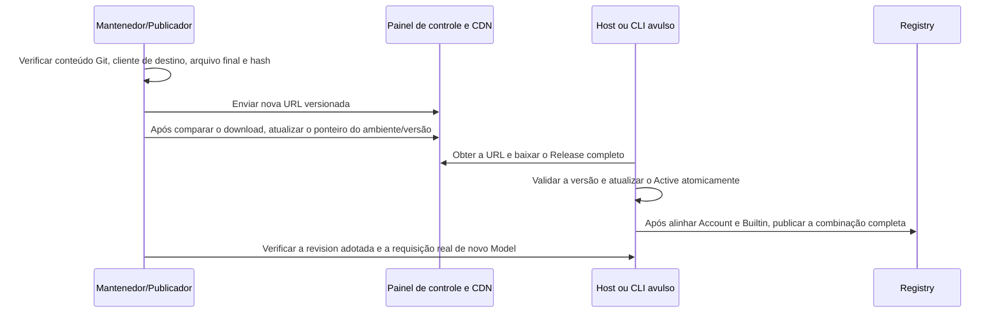

# Entrega de MR, versão e configuração dinâmica

Esta página explica como a configuração de templates/modelos é entregue, sem autorizar publicação automática por parte de quem mantém. Criar MR, fazer merge, publicar versão e alterar o ponteiro da configuração online são ações distintas, cada uma com seus resultados e responsabilidades.

## Git e MR

A configuração oficial é a única fonte de edição; a configuração de teste e a documentação/testes necessários são submetidos no mesmo MR. Alterações de conteúdo usam uma nova revision; os dois arquivos de ambiente mantêm a mesma revision, mas o conteúdo é derivado conforme cada ambiente. Depois de um conflito de merge, reexamine a revision mais recente do upstream — não basta resolver o conflito de texto reaproveitando um número de versão já ocupado por conteúdo diferente.

A descrição do MR deve listar, no mínimo: adições e remoções de templates e modelos, diferenças concretas de habilitação/desabilitação padrão, capacidades/Map/URL, resultados da derivação oficial/de teste, evidências oficiais, validação real e lacunas, impacto em instâncias existentes/seleções, forma de entrega e plano de rollback. O conteúdo segue a organização em cinco seções:

| Seção        | O que esta área deve explicar                                                                                     |
| ------------ | ---------------------------------------------------------------------------------------------------------------- |
| TL;DR        | Problema concreto e comportamento após a mudança; número real de arquivos e linhas adicionadas/removidas           |
| Objetivo     | Contexto, comportamento anterior, pontos de entrada/modelos integrados ou corrigidos, intenção de design e condições de aceite; em bugfix, anexar evidência da causa raiz, vínculo com o relato de feedback e o registro de trabalho deste diretório |
| Escopo       | Mudanças reais na configuração oficial/de teste, código, testes, normas e inventário deste diretório, além do que está fora do escopo |
| Verificação  | Comandos reais e resultados, matriz de Key/região/plano/protocolo, itens não verificados; em bugfix, o caso de regressão correspondente, com evidência anexada quando houver mudança de interação |
| Riscos e rollback | Instâncias existentes, substituições pessoais, versões do cliente de destino, forma de publicação e plano de recuperação |

O título do commit segue `<type>(<scope>): <subject>`; por exemplo, organização de documentação usa `docs(provider)`, distinguindo alteração de conteúdo de documentação pura. O tamanho dos arquivos vem de `git diff --shortstat origin/staging...HEAD`; o contrato de descrição segue a skill `zcode-mr` do repositório, e não se pode inventar causa raiz, vínculo com feedback ou resultados de validação.

Para criar/atualizar o MR, use a ferramenta `zcode-mr` do repositório: em uma branch de feature limpa, rode primeiro `python3 .agents/skills/zcode-mr/scripts/zcode_git_workflow.py setup` para verificar a autenticação, escreva a descrição em cinco seções em um arquivo temporário UTF-8 e então rode `python3 .agents/skills/zcode-mr/scripts/zcode_git_workflow.py mr --description-file <arquivo-de-descrição> staging`. A ferramenta preserva o push hook, procura MRs de mesma origem/destino e só cria um quando ele falta. Verifique a URL real do MR retornada; apenas gerar um link pré-preenchido não conta como criação bem-sucedida. Alterações no corpo de um MR existente ainda precisam ser aplicadas via glab e conferidas. Em caso de falha de autenticação, preserve o trabalho local e não grave credenciais na descrição ou no comando.

Alterações comuns de diretório passam por MR de configuração; novo protocolo, Access, Adapter, recurso de Logo ou comportamento de UI exigem o código e os testes correspondentes — não se pode omitir a verificação sob o argumento "apenas uma atualização de modelo". Alterações sem Key ficam claramente registradas como pendentes de validação no MR, e a aceitação de exceções é uma decisão explícita da função responsável.

## Escolha da forma de entrega

| Situação                                                                 | Forma de entrega e condições                                                             |
| ----------------------------------------------------------------------- | --------------------------------------------------------------------------------------- |
| Manutenção rotineira de templates/modelos                                 | Carrega a configuração completa junto da versão do produto, validando os recursos do pacote final |
| Usa apenas campos, protocolos e capacidades já suportados pelo cliente de destino, com necessidade real de antecipar catálogo/regras | Pode-se avaliar configuração dinâmica; ainda assim a origem é conteúdo Git já revisado e a validação é sobre o arquivo final |
| Novo Schema/Access/protocolo, comportamento de Adapter, recurso de imagem ou capacidade de UI | Entregar primeiro a capacidade do cliente; não basta enviar JSON a clientes antigos |
| Conteúdo já publicado está incorreto                                        | Publicar o conteúdo corrigido com uma revision maior; corrigir em paralelo a linha de base no Git/no pacote, para evitar a divergência de longo prazo entre os dois caminhos |

Um mesmo `schemaVersion=1` não prova que todos os clientes antigos entendem campos, valores ou Map novos. Antes da atualização dinâmica, confirme o decoder, o Adapter e os comportamentos conhecidos reais para a versão/plataforma de destino do produto; não valide apenas na branch de desenvolvimento.Liberação gradual (canário), desvio por versão, executor e permissões seguem o painel de controle real; este repositório não oferece nenhuma ferramenta de publicação de configuração em um clique nem de rollback automático que se possa presumir existente.

## Entrega junto da versão

1. A fonte oficial após o merge e a fonte de teste derivada passam pelas verificações, cada uma por vez.
2. Construa conforme o `ZCODE_ENV` real e verifique a revision, o hash e os templates de destino no conteúdo realmente embutido no pacote — não apenas no código-fonte. A seleção de fonte por ambiente, a posição dos recursos em Desktop/CLI/SEA/Server e os requisitos de cache estão em [Especificação de configuração](./configuration.md#seleção-de-origem-na-build-e-recurso-final) deste diretório.
3. Registre a versão do produto que contém o commit e os artefatos de teste/produção, e confirme qual configuração o Host de destino adota após a instalação; um cache válido já existente com revision maior pode continuar prevalecendo — não se pode inferir a adoção só porque o pacote foi atualizado.
4. Verifique, para esta alteração, instâncias novas e instâncias herdadas existentes, substituições pessoais e as requisições reais de modelo. Registre as plataformas/modos remotos não cobertos.

## Publicação dinâmica quando necessária

Os clientes existentes usam download em duas fases: o painel de controle `/api/v1/client/configs` retorna `data.configs.builtin_provider_config_json` conforme `app_version`/`platform`; esse campo é uma URL de download HTTPS, e o conteúdo da URL é um Release completo. A ausência do campo significa que não houve publicação nesta rodada e não limpa a configuração existente.

Ordem das operações:

1. Confirmar a necessidade, o cliente/plataforma de destino, o ambiente oficial ou de teste, a responsabilidade e a autorização de publicação, e registrar o conteúdo anterior e o plano de recuperação.
2. Preparar o arquivo final a partir do conteúdo Git a ser entregue, executar Decoder, verificação de integridade e a validação de regras/requisições desta rodada sobre esse arquivo, e registrar o hash. Oficial e teste são validados e entregues separadamente; os dois arquivos com a mesma revision não podem ser misturados.
3. Enviar a **nova URL**, conferir o hash/o conteúdo completo após o download e só então alternar o ponteiro correspondente no painel de controle. Não sobrescreva a URL antiga mantida em cache de longo prazo, nem edite JSON manualmente online para contornar o Git.
4. Verificar o resultado do download no cliente real, a revision do Active, o Registry completo e as requisições de criação de Model seguintes. Baixar com sucesso não é adotar com sucesso, e uma mudança na lista da página não significa que todos os chamadores foram atualizados.
5. Observar a autenticação, as rejeições de parâmetros, o fluxo de ferramentas e o feedback dos usuários nos pontos de entrada afetados; recuperar conforme os limites abaixo. Registrar as evidências de adoção e atualizar o status de entrega do item de trabalho.

O downloader exige HTTPS, não aceita userinfo na URL nem redirecionamentos, e não carrega Token/Key de conta; o orçamento total das duas requisições é de 20 segundos, com o corpo limitado a 10.000.000 bytes reais. A [implementação de download](../../packages/provider-node/src/zcode-builtin-download.ts) é a referência; não duplique um cliente de publicação.

## Limites de adoção e recuperação

- Na inicialização, entre os candidatos válidos em pacote/Active, escolhe-se a revision maior; versão online menor é ignorada, mesma versão com mesmo conteúdo não muda, e mesma versão com conteúdo diferente é rejeitada. Na inicialização, um conflito de conteúdo de cache com o mesmo número faz voltar ao candidato confiável do pacote.
- As regras de Provider e Model são substituídas por inteiro; estrutura válida não garante correção de negócio. Falha no download preserva a linha de base, e não se promete rollback automático de configuração de negócio incorreta.
- Host/CLI avulso mantém o refresh; a checagem é a cada minuto, e após o sucesso o download padrão acontece uma hora depois, com backoff exponencial por minuto em caso de falha, até uma hora. O `force` manual contorna o limite de validade, mas não um lease válido.
- O cache é isolado por plataforma, versão do App e Endpoint do painel de controle; trocar a URL da CDN não reinicia a versão de origem. Teste e oficial não podem ser julgados consistentes só por terem a mesma revision.
- O Managed Worker não baixa de forma independente; o celular usa o Host de destino. Enquanto Builtin e Account não estiverem alinhados, mantém-se o Registry completo anterior, e não se pode publicar um estado misturado.
- A intenção Personal não é sobrescrita, e Model já em execução não muda no lugar; não prometa que a requisição atual ou todas as execuções existentes mudam imediatamente.
- O rollback publica **uma revision maior com o comportamento antigo verificado ou o conteúdo corrigido**. Apontar a URL de volta para uma revision menor não faz o cliente já atualizado regredir; se o código do cliente for incompatível, é preciso um cliente corrigido ou uma restrição de entrega verificada.

Verificação da implementação: [Release Source](../../packages/provider-node/src/zcode-builtin-provider-config-source.ts), [coordenação de refresh](../../packages/provider-node/src/zcode-builtin-remote-synchronizer.ts), [pareamento de versão do Registry](../../packages/provider/src/registry-service.ts). Esta rodada não consultou o ponteiro online atual; nenhuma revision online histórica substitui o estado de produção de hoje.
