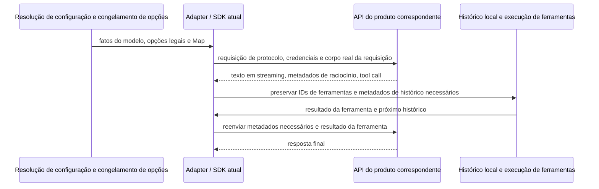

# Expansão de fornecedores e modelos mainstream (2026-10-14)

## Conclusões e limites das evidências

A implementação começa preenchendo os novos modelos dos fornecedores já mantidos, depois a interseção das entradas agregadas e, em seguida, a expansão de entradas como Tencent TokenHub e Volcano Ark conforme as evidências de protocolo. O ciclo de vida e as divergências de catálogo das entradas existentes são verificados em paralelo; quando envolver modificação ou remoção, são discutidos em separado e não funcionam como pré-requisito de novas adições independentes. O protocolo nativo do Google e o caminho da Mistral que exigem conversão de resposta ficam adiados; todas as outras entradas que não demandam adaptação adicional podem avançar. StepFun e SiliconFlow avançam em seguida; as APIs compatíveis de Azure e Bedrock são verificadas separadamente e não são mais classificadas em bloco como "é preciso desenvolver um novo protocolo". Além de novas entradas comuns, também é preciso verificar os planos de programação das marcas já existentes.

A metade superior desta página preserva as evidências de pesquisa de 2026-10-14. Os princípios de execução confirmados depois são: novas adições compatíveis com as capacidades existentes avançam direto, e ajustes/remoções de itens já existentes são discutidos antes. Em 2026-10-15 ficou confirmado ainda: todos os caminhos que exigem adaptação adicional ficam adiados nesta rodada, e as demais entradas podem ser conectadas; os lotes indicam apenas ordem de precedência. Materiais, validação de Key, implementação de configuração e entrega são registrados separadamente, com a implementação por lotes descrita abaixo; a ordem de candidatos anterior não pode sobrepor decisões posteriores explícitas.

- Data da verificação: 2026-10-14; baseline do repositório: staging `68fac8de4fcc`, Builtin revision 33, 21 templates e 246 entradas de membros de template, configuração formal e de teste com a mesma origem. O inventário completo está em [Estado atual](./current-state.md).
- Feito: leitura do catálogo oficial e dos avisos de lançamento e descontinuação; GET anônimo da Models API pública; execução do decodificador de Release, do parser de regras e da compilação de Option Map do repositório para ver os patches de requisição realmente gerados.
- Não feito: consulta de catálogo autenticada, inferência com cobrança, verificação de direitos de plano e ciclos reais de ferramentas no desktop/remoto. A "presença no catálogo" mencionada abaixo não pode ser escrita como "já suportado".
- Marcação de datas: datas explícitas de lançamento, vigência e descontinuação são escritas no item correspondente; páginas sem marcação registram apenas a data desta verificação, sem inferir data de publicação. O campo `created` de catálogos públicos também não é automaticamente tratado como data de publicação.
- Trade-offs: não foram obtidos o volume de uso dos usuários existentes nem o ranking de demanda por novos fornecedores; a ordem se baseia em relevância para o Agent, acessibilidade oficial, lacunas atuais, risco de invalidação e custo de manutenção — é uma sugestão de engenharia.

## Primeira prioridade: tratar os riscos das entradas existentes

### MiniMax precisa concluir a decisão de migração até 19 de outubro

A [visão geral oficial dos modelos](https://platform.minimax.cn/docs/guides/models-intro) anuncia que a série M2.5/M2.7 **deixa de ser aberta a novos usuários em 2026-10-19, e a API por volume é oficialmente descontinuada em 2026-11-18**; os nomes antigos dos usuários de plano passam a ser roteados para M3.1 Flash Preview a partir de 19 de outubro. O template `minimax` atual ainda habilita por padrão M2.7 e highspeed, portanto se deve verificar primeiro como a API comum e o plano serão tratados separadamente.

`MiniMax-M3.1-Flash-Preview` hoje está disponível apenas via M Plan / MiniMax Code, e não pode ser adicionado diretamente ao template comum por volume declarando-se disponível. Recomenda-se:

1. Um colaborador de conta verifica o produto da Key, o endpoint real, os membros do plano e o roteamento dos nomes antigos. Se os endpoints ou requisitos de credencial forem diferentes, o template é dividido; se forem iguais, a diferença de direitos também precisa ser registrada.
2. Na API comum, validar primeiro o M3 já listado como candidato à migração; após a confirmação, ajustar o nível de manutenção das séries antigas, preservando o tratamento das escolhas históricas e sem trocar silenciosamente por outro modelo.
3. Se o plano mantiver os IDs antigos, as regras precisam ser reconferidas conforme a capacidade real após o roteamento. O fato de o `modelId` não ter mudado não significa que os parâmetros de raciocínio e as capacidades não mudaram.
4. Se a Key não for obtida até a data limite: manter um estado de "pendente de validação" explícito e o responsável, sem registrar a migração como concluída no estado atual.

A [documentação oficial dos parâmetros de Messages](https://platform.minimax.cn/docs/api-reference/text-anthropic-api) deixa explícito: M3.1 Flash Preview não permite desligar o raciocínio e suporta `low/medium/high/xhigh/max`; o raciocínio do M3 pode ser desligado; M2.x aceita o parâmetro de desligamento mas não o desliga de fato. As regras atuais ainda produzem `disabled/enabled` na resolução offline para M3.1, portanto a completação dos modelos precisa vir acompanhada de correção das regras. A documentação usa o novo domínio, enquanto o repositório ainda usa o antigo; a mudança de domínio também precisa ser validada quanto à compatibilidade, e não se pode substituir a entrada do usuário só porque a documentação foi atualizada.

### O catálogo agregado tem 10 membros antigos pendentes de verificação

Resultados do GET desta rodada, sem Key e sem chamar inferência:

| Catálogo público                                                                                                    | HTTP / nº de itens | Resultado da comparação                                                                  |
| ---------------------------------------------------------------------------------------------------------------- | ------------------- | ----------------------------------------------------------------------------------------- |
| [OpenRouter Models](https://openrouter.ai/api/v1/models)                                                         | 200 / 462           | Dos 59 membros atuais, 4 não aparecem neste catálogo                                      |
| [OpenCode Zen catálogo antigo](https://opencode.ai/zen/v1/models), [catálogo novo](https://opencode.ai/inference/v1/models) | ambos 200 / 85      | Os dois JSON são idênticos; na união dos membros dos três templates Zen atuais faltam 6 itens |
| [OpenCode Go catálogo antigo](https://opencode.ai/zen/go/v1/models), [catálogo novo](https://opencode.ai/inference/go/v1/models) | ambos 200 / 40      | Os dois JSON são idênticos; os membros dos três templates Go atuais não têm lacunas      |

| Entrada        | IDs de configuração não listados neste catálogo                                        | Estado padrão atual       |
| -------------- | ------------------------------------------------------------------------------------ | ------------------------- |
| OpenRouter     | `qwen/qwen3.8-max`                                                                   | Habilitado                 |
| OpenRouter     | `openai/gpt-5.6`, `qwen/qwen3-vl-plus`, `qwen/qwen3-vl-flash`                        | Desabilitado              |
| Zen Messages   | `qwen3.7-max` / `qwen3.7-plus`                                                       | O primeiro habilitado, o segundo desabilitado |
| Zen Chat       | `hy3-free`, `ling-3.0-flash-fin-free`, `mimo-v2.5-free`, `nemotron-3-ultra-free`     | Todos habilitados          |

Priorize a verificação dos **6 membros habilitados por padrão**. Uma ausência em um catálogo público não basta para provar que a entrada de inferência está inválida: confirme primeiro o catálogo, os apelidos e o resultado das requisições com uma conta autorizada, e só então decida entre desabilitar o padrão, manter a compatibilidade ou remover do template. Também não se pode propagar a descontinuação de uma entrada para todos os fornecedores.

Os endpoints **Models** antigo e novo do OpenCode continuam legíveis, mas isso não força a migração da URL do template nem permite afirmar que os endpoints de inferência antigo e novo são equivalentes. A [documentação de integração do Go](https://opencode.ai/v2/docs/console/go/) ainda exige um `x-opencode-session` estável por sessão. Verifique antes da implementação se a requisição atual atende a isso; um Header estático no template não substitui a identidade dinâmica de sessão. Se houver necessidade de cabeamento em runtime, descreva e teste separadamente, sem misturar em atualizações apenas de lista de modelos.

## Fornecedores mantidos: recomendações de complementação e preservação

A tabela abaixo cobre as marcas oficiais atuais; as entradas agregadas são tratadas separadamente mais adiante. Salvo indicação explícita, as páginas de origem não dão uma data de publicação unificada. Candidatos prioritários só são considerados para habilitação padrão depois de validação real; se os modelos em foco devem ser rebaixados a manutenção geral, isso é uma decisão explícita à parte.

| Objeto       | Diferenças atuais e recomendação                                                                                                                                                                                                                                                                       | Fonte / data                                                                                                                                                                                                                       |
| ------------ | ---------------------------------------------------------------------------------------------------------------------------------------------------------------------------------------------------------------------------------------------------------------------------------------------------------------------------- | ---------------------------------------------------------------------------------------------------------------------------------------------------------------------------------------------------------------------------------- |
| OpenAI       | Priorizar novas entradas `gpt-6.1-sol` e `gpt-6-luna`, cobrindo respectivamente programação geral e a faixa de baixo custo; manter Astra. `gpt-6-sol` primeiro avaliado como candidato da geração anterior ainda disponível, sem abrir tudo só para ter a lista de versões completa. 6.1 Sol não suporta `none`; o chamada de ferramenta Chat do 6 Luna só é suportada no modo sem raciocínio, e o template oficial Responses existente é mais adequado para a validação inicial | [6.1 Sol](https://developers.openai.com/api/docs/models/gpt-6.1-sol), [6 Luna](https://developers.openai.com/api/docs/models/gpt-6-luna); o [registro de alterações](https://developers.openai.com/api/docs/changelog) registra o lançamento do 6.1 Sol em 09-29 |
| Anthropic    | Adicionar `claude-opus-5-5`, `claude-sonnet-5-5` e `claude-haiku-5-5`; manter a série Fable. As regras amplas existentes de Opus/Sonnet já cobrem os cinco níveis adaptive, não é preciso reescrevê-las por causa do número de versão; o Haiku 5.5 precisa de regras próprias. Não se deve passar o `between_tools` do Sonnet por um desligamento completo do raciocínio                                            | [Catálogo de modelos](https://platform.claude.com/docs/en/models/overview), [intensidade de raciocínio](https://platform.claude.com/docs/en/build-with-claude/effort)                                                                                                  |
| Z.AI         | Candidato para a API comum `glm-5.3-flashx`; verificar o `glm-5.2` que falta no template comum, este podendo ficar em manutenção geral. O ID oficial do FlashX é em minúsculas e não se pode mudar as maiúsculas/minúsculas por conta do nome de exibição; IDs salvos não são renomeados em massa. O Coding Plan exige prova de direitos separada                               | [Catálogo](https://docs.z.ai/guides/overview/overview), [Flash / FlashX](https://docs.z.ai/guides/vlm/glm-5.3-flash)                                                                                                                     |
| BigModel     | Verificar separadamente FlashX, 5.2 e o catálogo de planos. Já é possível ler o texto oficial dos modelos em chinês, mas nesta rodada não se obteve evidência de produto do FlashX equivalente à da Z.AI, portanto não se espelha a adição diretamente                                                              | [Documentação oficial dos modelos](https://docs.bigmodel.cn/cn/guide/models/text/glm-5)                                                                                                                                           |
| xAI          | Adicionar `grok-4.7`: context de 500.000, entrada de imagem, `low/medium/high/xhigh`; só depois de validar o histórico de raciocínio e o ciclo de ferramentas do Responses, decidir o estado padrão do 4.6                                                                                                          | [Model card](https://docs.x.ai/developers/models/grok-4.7), [protocolo de raciocínio](https://docs.x.ai/developers/model-capabilities/text/reasoning)                                                                                   |
| MiniMax      | Concluir antes o tratamento de ciclo de vida acima; M3.1 Flash Preview como candidato de plano, sem adição cegada à API comum; M2.1/M2 não podem ser declarados descontinuados junto por causa do aviso de M2.5/M2.7                                                                                                             | [Visão geral dos modelos](https://platform.minimax.cn/docs/guides/models-intro)                                                                                                                                                  |
| Kimi         | A linha principal atual da Kimi — K3, K2.7 Code, highspeed e K2.6 — já está nos templates, sem necessidade de IDs duplicados. O K2.8 Preview aparece em algumas plataformas e precisa ser validado contra o catálogo daquela plataforma; disso não se deduz disponibilidade na API de fábrica. O produto Kimi Coding é investigado à parte                           | [Catálogo oficial](https://platform.kimi.com/docs/models); as datas de descontinuação de K2.5 / moonshot-v1 de fábrica são 08-31, e com base nelas não se pode remover membros homônimos das entradas agregadas          |
| DeepSeek     | Continuar usando `deepseek-flash` e `deepseek-v4-pro`. O primeiro já aponta para V4.1 Flash, com foco em rever multimodalidade, raciocínio e apelidos antigos; não adicionar um `deepseek-v4.1-flash` de fábrica adivinhado                                                                                                          | [Alterações oficiais](https://api-docs.deepseek.com/updates/): publicação e roteamento de apelidos em 09-10; fica explícito que o V4 Pro continua atendendo após 09-14                                                                                                     |
| Qwen / Bailian | O 3.8 Max/Flash atual já cobre a linha principal; Messages doméstico e Chat internacional são validados separadamente. O 3.8 Omni Flash é um candidato multimodal adicional — confirme primeiro as necessidades de entrada/ferramentas deste produto, e saída de áudio e interfaces em tempo real não entram automaticamente em templates de conversa. Verificar também a entrada independente do Coding Plan          | [Catálogo de modelos](https://help.aliyun.com/zh/model-studio/models), [FAQ de planos](https://help.aliyun.com/en/model-studio/coding-plan-faq)                                                                                              |
| MiMo         | A revision 33 já recebeu os templates duplos de API comum / Token Plan e V2.6 Pro/Flash; nesta rodada não se repete a adição. O foco é a validação real, o V2.6 nas entradas agregadas e as mudanças posteriores de membros do plano                                                                                                                          | [Integração de planos](https://mimo.mi.com/docs/zh-CN/tokenplan/Token%20Plan/quick-access), [interface Messages](https://mimo.mi.com/docs/en-US/api/chat/anthropic-api); o repositório já tem implementação nesta rodada |

A tabela de descontinuação da OpenAI também fornece datas exatas de desligamento e o `shutdown_date` da Models API. Nesta leitura, o novo anúncio de 10-14 envolve a série GPT-4; disso não se pode deduzir que os membros GPT-5/6 atuais já estejam desligados. Rótulos de catálogo de modelos antigos, bloqueio de novos usuários, desligamento oficial e continuidade do atendimento pela entrada agregada devem ser registrados separadamente. [Avisos oficiais de descontinuação](https://developers.openai.com/api/docs/deprecations)

### Lista de complementação das entradas agregadas

Os IDs abaixo já apareceram neste catálogo público, mas não passaram por verificação item a item de inferência em Messages / Chat / Responses. Mantenha os IDs originais de cada plataforma; não infira por concatenação de IDs de fábrica.

| Entrada        | Complementar com prioridade                                                                                                                                                                                                          | Restrições adicionais                                                                                               |
| -------------- | ------------------------------------------------------------------------------------------------------------------------------------------------------------------------------------------------------------------------------- | ------------------------------------------------------------------------------------------------------------------ |
| OpenRouter     | `openai/gpt-6.1-sol`, `openai/gpt-6-luna`; `anthropic/claude-opus-5.5`, `anthropic/claude-sonnet-5.5`, `anthropic/claude-haiku-5.5`; `x-ai/grok-4.7`; `z-ai/glm-5.3-flashx`; `xiaomi/mimo-v2.6-pro`, `xiaomi/mimo-v2.6-flash` | O template atual é Messages. Verifique um a um o mapeamento, a saída e a capacidade de roteamento; `-pro` e `-ultraspeed` passam por revisão à parte, e `:batch` não entra em templates de conversa comuns |
| OpenCode Zen   | `gpt-6.1-sol`, `gpt-6-luna`, os três itens Claude 5.5, `grok-4.7`, `mimo-v2.6-flash-free`                                                                                                                                     | Distribuir pelos três templates existentes conforme a tabela de protocolos oficial; `-backup` não é uma cópia gratuita de um modelo comum |
| OpenCode Go    | `gpt-6-luna`, `claude-haiku-5-5`, `grok-4.7`, `mimo-v2.6-pro`, `mimo-v2.6-flash`                                                                                                                                         | O catálogo Go e a cota de planos são independentes do Zen; confirme primeiro se a Key atual acessa                               |

Os membros agregados de Google, Mistral, Tencent e StepFun são avaliados conforme o princípio de escopo já definido e as evidências de protocolo da própria entrada; havendo as condições de adição, podem avançar sem esperar aprovação marca a marca. A conexão direta de fábrica fica adiada e não proíbe automaticamente a entrada agregada compatível. Neste catálogo já foram vistos `google/gemini-4-argon`, `mistralai/mistral-large-4-0`, `tencent/hy4-preview` e `stepfun/step-5-preview`; isso não significa que todos os modelos, protocolos e regiões de fábrica correspondentes estejam cobertos. O `gemini-4-argon-contributor` do Go traz sufixo de produto e exige apuração separada das condições de uso, não sendo tratado como um Argon comum.

## Planejamento de novos fornecedores e entradas de produto

### Candidatos a novos fornecedores e limites de protocolo

| Fornecedor / Produto            | Modelos iniciais e justificativa                                                                                                                                                             | Caminho de integração e evidências ainda faltantes                                                                                                                                                                                       |
| ------------------------------ | -------------------------------------------------------------------------------------------------------------------------------------------------------------------------------------------- | ---------------------------------------------------------------------------------------------------------------------------------------------------------------------------------------------------------------------------------- |
| Google Gemini API (nativo adiado) | `gemini-4-argon` e `gemini-3.8-flash` como candidatos prioritários; 3.5 Flash-Lite como faixa de custo a verificar depois. Completar as famílias de modelos mainstream que hoje faltam | O protocolo nativo não está entre os três API type existentes, então fica adiado no curto prazo; a entrada compatível em Chat pode avançar se a validação mostrar que não exige adaptação adicional. A disponibilidade do serviço agregado é julgada por entrada. O 1.048.576 do Argon é a janela combinada de entrada e saída, e o limite de saída comum no modo síncrono é 65.536; saída longa na casa do milhão é outra capacidade de execução e não pode entrar no limite comum. O `minimal` do 3.8 Flash não é suportado |
| Mistral API                    | `mistral-large-4` e `mistral-small-2603`, com `mistral-medium-3-5` em manutenção geral; cobre modelos flagship e leves para Agent                                                                 | Verificar requisições Chat, controle de raciocínio, chamada de ferramenta em streaming e apelidos de modelo. O context de 256k de Small / Medium precisa de cobertura explícita e não pode herdar a linha de base de 1M. O catálogo atual coloca Devstral 2 / Small 2 na área de descontinuação, e não se prioriza adicionar modelos antigos de código |
| Tencent TokenHub                | `hy3` como candidato estável, `hy4-preview` desabilitado por padrão em observação; complementar com a entrada de fábrica do Hunyuan                                                                | O oficial suporta Messages e Chat, e a capacidade de Responses varia por modelo. Priorizar a validação de Messages. A documentação atual informa Guangzhou `https://tokenhub.tencentmaas.com/v1` e Singapura `https://tokenhub-intl.tencentmaas.com/v1`; há divergência de domínio entre a documentação antiga e a nova, então o template por região só é definido após o teste, sem montar a integração direto com material do antigo SDK do Hunyuan |
| Volcano Ark                    | A documentação do Coding Plan já lista `doubao-seed-2.1-pro` e `doubao-seed-2.1-lite`; `doubao-seed-evolving` como candidato de apelido rotativo                                                        | API comum, Coding Plan e Agent Plan são verificados separadamente. A evidência de modelo aqui vem do catálogo de planos e não é preenchida diretamente na API comum; é preciso obter os respectivos Model / Endpoint ID originais, endpoint, protocolo e Key. O Evolving precisa registrar a atualização de apelido e a compatibilidade do histórico de raciocínio |

Fontes: [model card do Argon](https://ai.google.dev/gemini-api/docs/models/gemini-4-argon) (atualizado em 10-13), [model card do 3.8 Flash](https://ai.google.dev/gemini-api/docs/models/gemini-3.8-flash) (atualizado em 09-02), [entrada compatível](https://ai.google.dev/gemini-api/docs/openai), [catálogo da Mistral](https://docs.mistral.ai/models), [Large 4](https://docs.mistral.ai/models/mistral-large-4-0), [Small 4](https://docs.mistral.ai/models/mistral-small-4-0-26-03), [Medium 3.5](https://docs.mistral.ai/models/mistral-medium-3-5-26-04), [visão geral de chamadas do TokenHub](https://cloud.tencent.com/document/product/1823/130079) (atualizado em 10-13), [alterações de planos do Ark](https://docs.volcengine.com/docs/ark/coding-plan-personal-model-release?lang=zh) (Seed 2.1 Pro/Lite: 09-23).

A autorização de novas adições já confirmada vale para candidatos expressáveis na cadeia de execução existente, sem exigir que todos os fornecedores terminem ao mesmo tempo. A documentação oficial da Mistral informa que, no modo high, o `delta.content` em streaming retorna uma lista de chunks de thinking e exige o reenvio do histórico; nesta verificação, o `@ai-sdk/openai-compatible` instalado tem Schema de resposta em que `message.content` / `delta.content` ainda aceitam apenas string ou null, e o histórico de assistant também usa strings. O adaptador de execução atual usa esse SDK diretamente, sem instalar a conversão desses blocos. Portanto esse modo de raciocínio exige pelo menos adaptação de resposta e de histórico, fica adiado nesta rodada e não pode se resolver apenas com a inclusão de um template. Essa conclusão vem da comparação entre código e protocolo, ainda sem reprodução por requisição real. [Contrato oficial de resposta de raciocínio](https://docs.mistral.ai/studio/conversations/reasoning)

### Lotes seguintes e lacunas de evidência

| Objeto                    | Sugestão e limites                                                                                                                                                        | Grau de evidência                                                                                                                                                                     |
| ------------------------- | ------------------------------------------------------------------------------------------------------------------------------------------------------------------------ | ------------------------------------------------------------------------------------------------------------------------------------------------------------------------------------ |
| StepFun                   | Investigar a fundo o Step 3.7 Flash; Step 5 Preview como candidato desabilitado por padrão; API comum e Step Plan separadas. Não tomar o `stepfun/step-5-preview` do OpenRouter como ID de fábrica | O [site oficial](https://platform.stepfun.com/) é pesquisável e o [lançamento do 3.7](https://www.stepfun.com/news/step-3-7-flash) é legível; a captura direta do site principal deu timeout, e o catálogo/parâmetros exatos de fábrica ainda precisam de prova; data de lançamento do 3.7: 05-29 |
| SiliconFlow              | Candidato de agregação doméstico, com manutenção sobre a interseção dos upstreams já aprovados; conferir prefixos de cobrança/roteamento como `Pro/`, sem removê-los                                    | O [quickstart](https://docs.siliconflow.cn/docs/userguide/quickstart) e a [Messages API](https://docs.siliconflow.cn/docs/api/messages-post) são legíveis; ainda faltam o catálogo da conta e as evidências de parâmetros por modelo |
| Azure / Microsoft Foundry | Validar primeiro a entrada compatível v1 com URL de recurso + Deployment + API Key estática; não é preciso desenvolver antes o protocolo nativo. O nome do deployment pode ser qualquer um, e a capacidade nem sempre pode ser deduzida por regex do nome do modelo; a cobertura exata ou o mapeamento de identidade precisam ficar explícitos | A [documentação v1](https://learn.microsoft.com/en-us/azure/foundry/openai/api-version-lifecycle?tabs=key) confirma que `/openai/v1/` não exige `api-version` no formato de data; a renovação automática do Entra é outro caminho de capacidade |
| AWS Bedrock               | Investigar primeiro o caminho de API Key + Responses; não se pode continuar afirmando que tudo exige SigV4. Region, runtime / mantle, Profile ID e autorização de modelos são verificados separadamente; a renovação do IAM é um design à parte | A [documentação de Responses](https://docs.aws.amazon.com/bedrock/latest/userguide/inference-responses-api.html) é legível; as ferramentas de servidor, o armazenamento de estado e os IDs de modelo de runtime e de mantle não são equivalentes |
| Groq                      | Introduzir só houver demanda clara por baixa latência, priorizando a investigação de GPT-OSS 120B / 20B; não tratar o sistema de Agent embutido na plataforma como modelo comum e não acrescentar indiscriminadamente todos os Llama | O [catálogo de modelos](https://console.groq.com/docs/models) e o [suporte a ferramentas](https://console.groq.com/docs/tool-use/overview) são legíveis; a combinação de streaming, saída estruturada e ferramentas paralelas precisa ser testada à parte |
| Together                  | Avaliar pela interseção dos upstreams já mantidos; Serverless e Dedicated não usam a mesma lista de modelos                                                                     | O [catálogo público](https://docs.together.ai/docs/serverless/models) é legível; ainda não há evidência de demanda ou Key deste projeto que justifique a primeira leva |
| Cerebras, Fireworks, API hospedada da NVIDIA, Cohere, Baidu Qianfan, Vertex | Manter a varredura de escopo e entrar na próxima rodada conforme a demanda do usuário, o valor de modelos exclusivos e a manutenibilidade; não se pode criar de uma vez templates vazios só por serem "mainstream" | Nesta rodada não se concluiu a verificação de catálogo e protocolo produto a produto; a captura do catálogo da Cerebras falhou. Como não foram dados IDs implementáveis, não se declara concluída a pesquisa de integração |

Modelos com pesos abertos também estão no escopo: GPT-OSS, Llama, Qwen, DeepSeek, StepFun etc. devem ser avaliados por "entrada de inferência disponível × ID exato × capacidades de Agent". Quando o publicador do modelo não tem API pública, a cobertura via entradas agregadas já mantidas tem precedência, em vez de criar um template de publicador sem como preencher credenciais. Esta rodada não cobre treinamento de modelos, download e implantação, Embeddings, geração de imagem/voz e produtos de áudio em tempo real.

### As lacunas de planos das marcas existentes também precisam ser verificadas

Aumentar novas marcas não pode mascarar a ausência de entradas de produto já existentes. Recomenda-se coletar em paralelo credenciais/catálogos do Coding Plan do Bailian, do Kimi Coding e do M Plan da MiniMax; ao adicionar marcas, verificar também o Coding/Agent Plan do Ark e o Step Plan. A prioridade se ajusta conforme os planos que os usuários realmente têm, sem reutilizar a Key comum só porque a marca é a mesma.

O FAQ oficial do Bailian distingue explicitamente a Key de plano da Key comum e o endpoint dedicado com `coding`; combinações erradas podem acabar caindo em cobrança por volume. Portanto o template de API comum atual do Bailian não pode ser descrito como já suportando planos. As restrições de uso automatizado do plano, a janela de uso, as cotas por modelo e o fallback de pagamento adicional também precisam ser confirmados pelo colaborador, e a validação real é executada pela forma de interação que o produto permite. [Documentação de planos](https://help.aliyun.com/en/model-studio/coding-plan-faq)

## Como as regras precisam ser ajustadas

### Resultados reais de resolução, e não apenas se o JSON tem o modelo

Nesta rodada foram usados o [decodificador de Release](../../packages/provider-node/src/zcode-builtin-release.ts), o [parser de regras](../../packages/provider/src/config/model-config.ts) e o [compilador de Map](../../packages/model-option-map/src/option-maps.ts) do repositório para uma sondagem somente leitura da configuração formal. A entrada inclui templates reais, API type e Base URL; modelos candidatos não são gravados na tabela de membros. Para cada nível de raciocínio resolvido, o Map é compilado e aplicado, o orçamento de saída é 1024, e apenas a requisição gerada é verificada, sem nenhuma requisição de rede.

| Objeto sondado                   | Resultado real na revision 33                                                                                                                                     | Impacto na implementação                                                                                                                  |
| -------------------------------- | ------------------------------------------------------------------------------------------------------------------------------------------------------------------ | -------------------------------------------------------------------------------------------------------------------------------------- |
| `gpt-6.1-sol` oficial           | 1M, entrada de texto, `disabled/enabled`; disabled gera `reasoning.effort=none`                                                                                      | Adicionar regra explícita do modelo; o oficial não suporta none e não basta adicionar o membro ao template                                   |
| `gpt-6-luna` oficial            | Também cai nos dois níveis genéricos e na entrada de texto                                                                                                        | Completar os níveis e as capacidades; as restrições de ferramenta de Chat / Responses são expressas separadamente                              |
| `grok-4.7` oficial              | 1M, entrada de texto, dois níveis; disabled gera none                                                                                                              | Corrigir para os 500k, a imagem e os quatro níveis comprovados pela evidência; o limite de saída precisa de prova e não pode ser deduzido do context |
| Claude Opus / Sonnet 5.5        | Já herdam imagem/PDF, os cinco níveis adaptive; o patch de saída contém `output_config.effort`                                                                         | O mapeamento base existente pode ser reutilizado; completar asserções precisas e testes reais, evitando refatoração inútil                           |
| Claude Haiku 5.5                | Dois níveis genéricos, entrada de texto                                                                                                                           | Adicionar capacidades e níveis exclusivos, sem herdar do Haiku 4.5 nem das regras genéricas                                                |
| MiniMax M3.1 Flash Preview      | A regra ampla de M3 fornece imagem/vídeo, saída de 32k, dois níveis e permite disabled                                                                              | É preciso uma regra mais específica para conter a regra ampla de M3; completar a evidência do limite de saída; a migração de apelidos antigos do plano também pode ser afetada |
| Z.AI `glm-5.3-flashx`           | Já acerta as capacidades da família 5.3 e os três níveis; a requisição Chat carrega simultaneamente vários campos de raciocínio                              | Não é "sem regra nenhuma"; valide quais campos o gateway atual suporta de fato e só então decida simplificar — não se pode remover em bloco os campos de compatibilidade de todas as marcas |
| OpenRouter `moonshotai/kimi-k3` | Resolvido em três níveis, gera `output_config.effort`, sem campo `thinking`                                                                                           | O escopo de correspondência de K2 do Site não cobre K3, mas Model+API já fornecem o mapeamento; só a falta na regex não basta para classificar como bug — é preciso evidência de requisição real |
| OpenRouter `openai/gpt-6.1-sol` | Dois níveis genéricos de Messages, consegue gerar `thinking.type=disabled`                                                                                            | As regras de modelo e o Map de fábrica e de agregação precisam ser verificados em conjunto; não basta corrigir só o Responses                      |

Um modelo novo passar pela validação estrutural não significa que os níveis recomendados e a requisição sejam válidos. Modelos desconhecidos continuam com a linha de base já decidida de 1.000.000 de context / 128.000 de output; **este plano não revoga essa decisão já tomada**. Diferenças reais conhecidas precisam ser cobertas, e um novo membro não pode usar a aprovação pela linha de base de modelo desconhecido como critério de conclusão.

### Recomenda-se manter a estratificação e apertar a validação

1. **A camada Model grava fatos de modelo, a camada API grava o mapeamento de protocolo e a camada Site grava as diferenças de produto.** Regras mais específicas vão depois das regras amplas que precisam cobrir; a insensibilidade a maiúsculas/minúsculas serve apenas para correspondência, e o ID original da requisição permanece inalterado. Se a semântica entre gerações antigas e novas for diferente, separe as regras explicitamente em vez de ampliar sempre a mesma regex.
2. **O controle de raciocínio lista as combinações legais por modelo.** O Opus 5.5 impõe adaptive; o `between_tools` do Sonnet 5.5 é um modo especial e não equivale a disabled; o disabled do Haiku 5.5 tem restrições de combinação com os níveis altos. A primeira leva prioriza os níveis adaptive já existentes e claramente expressáveis; qualquer modo especial novo exige confirmar antes a semântica do produto. [Documentação oficial de controle](https://platform.claude.com/docs/en/build-with-claude/effort)
3. **Capacidade distingue context, input, output e modo de execução.** A saída comum de 65.536 do Gemini, o context de 256k de Small/Medium da Mistral etc. precisam ser cobertos. Saída longa dinâmica e tarefas em background no servidor não obtêm suporte por causa de um número grande único. Modelos em que o orçamento de saída inclui o consumo do raciocínio precisam entrar na aceitação com orçamento baixo.
4. **Verifique separadamente a capacidade nativa e a capacidade disponível pela entrada.** Ter function calling não significa que chamadas paralelas, JSON estrito, streaming e multimodalidade possam ser combinadas ao mesmo tempo; ter um produto de busca do fabricante não significa que o Adapter atual já tenha integrado a busca nativa.
5. **As regras só declaram e mapeiam requisições; não podem complementar o protocolo de resposta.** A codificação de novos campos, o conteúdo opaco de raciocínio, os blocos de streaming, os IDs de chamada de ferramenta e a reprodução do histórico precisam ser medidos pelo Adapter/SDK atual. Ao encontrar perdas, localize primeiro essa camada, sem mascará-las ampliando a regex ou ignorando erros.
6. **Separe habilitação padrão de existência do modelo.** Depois de validar os novos flagships e a faixa de baixo custo, escolha a linha principal adequada para cada um; Preview, roteamento temporário gratuito, backup, ultraspeed e variantes pro são avaliados à parte e não são ligados todos automaticamente junto dos modelos comuns.
7. **Preserve o limite das escolhas existentes.** Não altere automaticamente a URL, o Model ID ou o valor de raciocínio das instâncias dos usuários nesta rodada; os avisos de descontinuação de modelos, o tratamento de invalidez e a migração automática, se precisarem mudar, exigem uma proposta de comportamento explícita à parte.

A cadeia de validação do ciclo de ferramentas é a seguinte; sem qualquer uma das etapas, não se pode escrever "suporta Agent":

O [adaptador de execução](../../apps/zcode-cli/packages/adapters/src/model/model-execution.ts) atual monta os três caminhos Responses, Messages e Chat; o [patch de requisição](../../apps/zcode-cli/packages/adapters/src/model/model-option-map-fetch.ts) é aplicado depois que o SDK gera a requisição. Use esta cadeia real para validar; não substitua a compatibilidade de produto por um exemplo HTTP isolado que passa.

## Implementação dividida e colaboração humana

| Lote                                      | Escopo                                                                                        | Condição de início / foco de aceitação                                                                                     |
| ---------------------------------------- | ---------------------------------------------------------------------------------------------- | ------------------------------------------------------------------------------------------------------------------------- |
| Primeira leva: novos modelos de marcas existentes | Dois da OpenAI, três do Claude 5.5, Grok 4.7 e Z.AI FlashX, 7 modelos no total; BigModel aguarda comprovação independente | Divida a configuração em MRs por fornecedor; complete capacidades precisas e mapeamento de requisição, mantendo inalterados os membros, as regras e as habilitações existentes. Sem Key, os novos itens podem ser preparados já desabilitados por padrão |
| Segunda leva: interseção agregada     | 9 itens do OpenRouter, 7 do Zen e 5 do Go na tabela acima, 21 entradas de membros candidatas no total | Verificação por entrada, protocolo e catálogo de produto; não são 21 modelos diferentes, e a verificação de fábrica não substitui a verificação agregada. O tratamento de membros antigos não se mistura com as adições |
| Terceira leva: novos fornecedores      | TokenHub e Ark verificados um a um e submetidos separadamente; os caminhos de Google nativo e Mistral que exigem conversão de resposta ficam adiados | Confirmar a entrada de produto, o ID exato, o protocolo, as capacidades e o colaborador de validação; a evidência de planos do Ark não pode ser preenchida diretamente no template da API comum |
| Seguinte: completar planos e fornecedores da segunda leva | Planos Bailian/Kimi/MiniMax; StepFun, SiliconFlow; entradas de nuvem sem adaptação adicional como Azure/Bedrock | Todos avançam assim que não exigirem adaptação adicional; ordenados pela maturidade das evidências; novas identidades ou comportamento de Adapter ficam adiados nesta rodada |
| Paralelo: verificação e discussão de mudanças existentes | Data limite da MiniMax, 6 lacunas de catálogo habilitadas por padrão; Header de sessão do OpenCode e compatibilidade com endpoints antigos | Priorize a verificação das datas próximas, apresentando a diferença concreta antes/depois de cada item; não altere a configuração existente antes da confirmação e não bloqueie as três primeiras levas de adições independentes |

Recomenda-se solicitar primeiro os recursos de validação para **os 7 modelos da primeira leva, as entradas agregadas atuais e a verificação do ciclo de vida da MiniMax**; para cada novo fornecedor, prepare uma conta/Key de teste restrita. O colaborador humano é responsável pela liberação, pelos requisitos de identidade real/região, pela autorização de modelos e pela cota de faturamento; o mantenedor é responsável pelos testes e pelo registro sanitizado. Cada registro de credencial deve indicar produto, região, modelos disponíveis, limite de orçamento, data de expiração e o papel do colaborador. As Keys são fornecidas por canal seguro ou em ambiente local restrito e não entram no Git, na documentação, em capturas de tela nem em MRs.

### Escopo de Git previsto para cada lote

A primeira leva se divide em quatro MRs de configuração verificáveis de forma independente, por OpenAI, Anthropic, xAI e Z.AI. Cada MR primeiro esclarece neste diretório os modelos, as capacidades, os níveis legais e a aceitação, e só depois completa os testes e modifica a configuração. A interseção agregada avança por OpenRouter, Zen e Go separadamente; os novos fornecedores avançam por entrada de produto, sem esperar a conclusão da leva inteira para submeter.

| Escopo                | Alterações previstas                                                                                                                                                | Limites que devem ser preservados                                                                 |
| --------------------- | ------------------------------------------------------------------------------------------------------------------------------------------------------------------ | -------------------------------------------------------------------------------------------------- |
| Configuração formal   | Adicionar membros ou templates a `config/provider/zcode-builtin.json`, com habilitação/desabilitação precisa e as regras Model/API/Site necessárias, incrementando a revision | Atua apenas sobre identidades novas; não altera capacidades, níveis padrão, habilitação, ordenação, URL ou Access de membros antigos |
| Configuração de teste | Derivar `config/provider/zcode-builtin.test.json` com o gerador existente                                                                                        | Ambos os ambientes com a mesma revision e os mesmos fatos de modelo; fornecedores comuns continuam usando os endpoints de produto originais, sem inventar um catálogo de modelos de teste |
| Testes afetados       | Integridade de configuração e cenários de modelo/Map em `packages/provider-node/test/`; cenários de herança em `packages/provider/test/` para novos templates, conforme necessário | Escreva primeiro as asserções de cenário; compare o resultado de resolução de todos os membros existentes e dos IDs vizinhos antes e depois da adição, cobrindo a preservação das sobrescritas explícitas do usuário |
| Documentação de manutenção | O plano, o estado atual e as especificações relacionadas neste diretório                                                                                        | Evidências oficiais, Key ausente, validação real e status de entrega são registrados separadamente; candidatos não são escritos como já suportados |
| Recursos de exibição de novas marcas | Quando for preciso o logo da marca, adicionar o material e estender o mapeamento de recursos de `packages/ui/src/settings/model-provider-section/ProviderLogo.tsx` | Verificar tema, exibição e localização conforme necessário; sem alterar de passagem a interação de configurações nem a estratégia de ordenação |

As regras de novos modelos também podem atingir modelos com o mesmo nome que o usuário já adicionou manualmente, ou atingir outras entradas por prefixo de agregação. Além dos membros estáticos do template, é preciso verificar essas identidades e as regras exatas já existentes; quando o resultado de resolução antigo mudar, essa parte deve ser levada a discussão como mudança existente, e não se pode concluir "sem impacto" só porque "o modelo ainda não está no template".

Todas as levas ficam restritas à cadeia de execução existente; templates, membros, regras de capacidade e a manutenção de configuração do Option Map atual podem continuar. Se algum candidato exigir extensão de API type, de Access ou do tratamento de requisição/resposta em runtime, adie esse caminho e registre a lacuna, e siga com as demais adições que não exigem adaptação adicional. O Header de sessão dinâmico do OpenCode, a adaptação de blocos de resposta/histórico da Mistral e a renovação automática de credenciais de nuvem não entram nesta rodada de implementação e não podem ser contornados por atualização de SDK ou código de compatibilidade novo.

Cada MR de configuração deve conter no mínimo:

- Escopo claro neste diretório, data das evidências oficiais, status de candidato/validado e a razão da habilitação padrão.
- Modificação de fonte única da configuração formal, incremento da revision, geração da configuração de teste e verificação das diferenças de ambiente permitidas. A "configuração de teste" de fornecedores comuns ainda pode chamar APIs reais com cobrança — não é um sandbox do fornecedor.
- Asserções de comportamento: correspondência positiva/negativa, níveis padrão, o patch de requisição real de cada valor legal de raciocínio, campos de saída, sobrescritas de Site, e o fato de as sobrescritas pessoais não serem quebradas. Ao adicionar capacidade, escreva os testes antes de mudar a implementação.
- Validação real mínima autorizada: texto em streaming, pelo menos dois rounds de chamada de ferramenta e reenvio do resultado da ferramenta, cada nível de raciocínio, uma imagem representativa, combinações de saída estruturada e mensagens de falha; registre model/base URL/protocolo/produto da conta, sem registrar segredos.
- Uma tarefa completa de Agent com o cliente atual; se protocolo, histórico ou UI mudarem, complete as regressões correspondentes de CLI / desktop / remoto. Mesmo para plataformas não modificadas, é preciso declarar a fronteira de aplicabilidade — a validação HTTP direta não conta como E2E de desktop.
- Itens sem Key marcados explicitamente como "pendente de validação", sem anunciar conclusão junto com os itens aprovados. Itens independentes já aprovados podem ser entregues antes, sem esperar todos os fornecedores.

Os detalhes de execução e o formato das evidências estão na [especificação de validação](./validation.md) deste diretório; a geração formal/de teste e o contrato das regras estão na [especificação de configuração](./configuration.md). Este plano apenas agenda mudanças de Git e validações, e não executa merge, publicação nem ativação dinâmica — essas ações precisam ser registradas conforme a [especificação de entrega](./delivery.md).

## Recomendações de reforço para a manutenção contínua

Mantém-se o ritmo atual de "verificar lançamentos/descontinuações toda semana, revisar o escopo todo mês". Acrescente três verificações fixas, sem criar outra fonte de catálogo em runtime:

- **Verificação de ciclo de vida**: liste separadamente o bloqueio de novos usuários, o desligamento e o redirecionamento de nomes antigos de planos como pendências datadas; reavalie imediatamente os eventos próximos, especialmente as duas datas da MiniMax nesta rodada.
- **Verificação de divergência de catálogo**: guarde por entrada um pequeno snapshot ou resumo sanitizado, com horário, e gere saídas de adicionado/ausente/ausente-com-habilitação-padrão. Um GET público pode coletar candidatos automaticamente; não altera templates automaticamente e não remove a partir de uma ausência no catálogo.
- **Verificação de divergência de comportamento**: execute as asserções de cenário de Resolver + Map quando um candidato entra no MR; registre em paralelo o contrato oficial e a requisição/resposta medida, sem comparar apenas strings de modelo.

Todo mês, ajuste a fila com a demanda do usuário, a disponibilidade de Keys, o status das duas últimas validações e o custo de manutenção. A primeira rodada não introduz nova base remota de modelos de dados, mecanismos de aprovação automática nem Schema de ciclo de vida extra; use primeiro os registros de manutenção deste diretório e os testes existentes para provar a necessidade, e só então decida se vale a pena criar ferramentas.

As adições que se enquadram no escopo acima já estão autorizadas a avançar, sem pedir aprovação uma a uma. Modificações e remoções de habilitação padrão, regras, endpoints e membros já existentes exigem antes uma proposta em discussão. Caminhos que exigem adaptação adicional, como modos especiais de raciocínio e novas capacidades de Adapter/identidade em nuvem, ficam adiados nesta rodada e serão confirmados separadamente mais adiante. A disponibilidade real das APIs continua dependendo de credenciais e cota humanas.

## Lista de mudanças existentes pendentes de discussão

Os itens abaixo registram apenas evidências e ações candidatas; **não há confirmação de mudança concreta e nenhuma configuração foi modificada**. Mesmo com data de desligamento próxima, não se remove nem migra automaticamente:

| Objeto                             | Estado atual                                                                                   | Ações candidatas e impactos a esclarecer na discussão                                                                  |
| ---------------------------------- | ---------------------------------------------------------------------------------------------- | ------------------------------------------------------------------------------------------------------------------------- |
| MiniMax M2.7 / highspeed           | Habilitado por padrão no template comum; aviso de data de desligamento recebido              | Se deve ser desabilitado por padrão primeiro, quando sair do template e como tratar as escolhas existentes; as regras após o roteamento dos IDs antigos do plano são um item à parte |
| OpenRouter `qwen/qwen3.8-max`      | Habilitado por padrão, não listado neste catálogo público                                    | Após a verificação da Key, escolher entre manter, desabilitar ou usar outro ID explícito; a troca de ID precisa explicar o impacto sobre as escolhas históricas |
| 5 lacunas do Zen habilitadas por padrão | `qwen3.7-max`, `hy3-free`, `ling-3.0-flash-fin-free`, `mimo-v2.5-free`, `nemotron-3-ultra-free` | Verificar cada uma individualmente, sem presumir descontinuação em bloco; apresentar uma proposta de habilitação/remoção para cada item |
| Endpoints do OpenCode e Header de sessão | Endpoint `/zen/` atual; catálogo público antigo e novo idêntico                             | Se for migrar para `/inference/` ou adicionar Header de sessão dinâmico, listar antes as diferenças de URL, regras de Site, sobrescritas de instância e comportamento das requisições |
| Regras de família, níveis padrão e capacidade existentes | Resultado real da resolução na revision 33                                                       | Qualquer simplificação, mudança de nível, de limite, de padrão ou de matcher ampliado exige comparar antes todas as identidades antigas afetadas, sem misturar no MR de adições |

Essas discussões não bloqueiam a spec, os testes e a preparação de configuração dos modelos novos e independentes. A configuração formal e de teste permanece sempre com a mesma origem; o runtime atual continua na revision 33. O que esta rodada consolida é a autorização de novas adições, a discussão de mudanças existentes e o princípio de adiamento de protocolo — sem escrever candidatos ainda não implementados como já incluídos no inventário.
