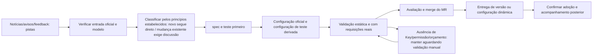

# Fluxo de manutenção contínua

## Papéis e status

Cada trabalho define papéis claramente, sem fixar nomes próprios na documentação: o mantenedor responde por material, configuração e MR; o responsável de produto discute e confirma ajustes de configuração existentes, remoções e propostas que ultrapassem as capacidades atuais; o colaborador de validação fornece conta/Key e orçamento; o revisor de código verifica regras e compatibilidade; o responsável de release registra a entrega de versão ou de configuração dinâmica. Uma pessoa pode assumir vários papéis, mas os resultados reais precisam ser registrados separadamente.

Estes são estágios de manutenção e não substituem o `Status:` do item de trabalho. Este diretório não cria monitoramento automático de notícias nem tarefas automáticas de lançamento.

Os itens de manutenção usam Markdown local e não criam Issue remota. Um spec já completo pode servir diretamente como item de trabalho, sem copiar o corpo do texto; novos specs de manutenção e registros de pesquisa desta área ficam neste diretório, preservando data explícita, objetivo, aceitação e o status da tabela abaixo. Caso seja necessário um Issue independente, o local no repositório é `docs/issues/<feature-slug>/<NN>-<slug>.md`; aqui ficam registrados apenas o status e a referência ao spec deste diretório — o contexto e os requisitos de manutenção permanecem completos neste diretório.

| `Status:`         | Condição de aplicação                                                    |
| ----------------- | ----------------------------------------------------------------------- |
| `needs-triage`    | A pista ainda não foi classificada e o escopo precisa ser avaliado      |
| `needs-info`      | Faltam fatos oficiais, reprodução ou outras informações necessárias     |
| `ready-for-human` | Aguardando conta, Key, orçamento ou decisão de produto                  |
| `ready-for-agent` | Objetivo e aceitação claros, pode ser implementado                       |
| `in-progress`     | Trabalho já iniciado                                                     |
| `done`            | A aceitação declarada por este item foi concluída; tarefas que só concluíram o MR de configuração ainda precisam registrar separadamente o estado não entregue |
| `wontfix`         | Decidido não integrar ou não tratar, com o motivo registrado             |

Escreva `Status:` abaixo do título do arquivo, use links locais para dependências e acrescente `## Comments` quando houver discussão necessária. O status do Issue e o estado de entrega de MR, versão e configuração dinâmica são registrados separadamente; `done` não pode substituir a evidência de adoção em produção.

## Uma alteração de configuração

1. Crie a branch a partir do staging mais recente, registre o commit de baseline e execute `node scripts/check-workspace-freshness.mjs`. Consulte primeiro o estado atual, os registros de pesquisa e os itens de manutenção deste diretório, evitando abrir o mesmo fornecedor em duplicidade.
2. Colete a entrada precisa, o protocolo, o ID original, as capacidades, o nível, o mapeamento de parâmetros, região/plano e as evidências de descontinuação. Classifique conforme a [fronteira entre novas adições e mudanças existentes](./scope.md#新增与既有变更的授权边界): novas adições que estão de acordo com o escopo e não exigem adaptação extra seguem direto; candidatos que exigem novo protocolo, autenticação, Header dinâmico, tratamento de requisição/resposta ou histórico, além de compatibilidade de SDK, ficam adiados — registre a lacuna e não desenvolva a adaptação de passagem. Qualquer ajuste, degradação ou remoção de configuração existente exige apresentar a diferença concreta antes e depois e obter a confirmação em discussão.
3. Atualize neste diretório a especificação correspondente ou o spec de manutenção, indicando o comportamento-alvo, a justificativa, os não-alvos e a aceitação; escreva primeiro os testes que expressam o objetivo e os limites preservados. O novo template cobre herança e identidade de instância; mudanças de regra cobrem a ordem, a nãoocorrência de falso positivo em modelos adjacentes e a requisição final.
4. Modifique o JSON oficial usando uma nova revision de conteúdo; para nova marca, acrescente Logo/localização conforme necessário. Execute `pnpm provider:config:sync-test` e inclua também o JSON de teste no Git. Só altere o gerador se o contrato de conversão de endereços mudar.
5. Faça a [validação](./validation.md), distinguindo configuração oficial/teste, Key comum/de plano, os três protocolos e entradas diferentes. Mudanças na interface do usuário exigem E2E conforme os requisitos do repositório; não basta testar a string JSON.
6. Atualize o [estado atual](./current-state.md) e as evidências deste item; confronte membros, habilitação/desabilitação padrão, capacidades resolvidas, regras precisas e exceções conhecidas. Verifique se foi escrito por engano alguma cobertura pessoal, se o orçamento de requisições foi alterado ou se outros templates foram mudados.
7. Após concluir as checagens aplicáveis e a autoverificação do diff, submeta um Conventional Commit e crie o MR para staging conforme [o conteúdo e as operações do MR](./delivery.md). Um MR sem evidência de teste real é marcado explicitamente como aguardando validação, sem alegar prontidão para produção.
8. Após o merge, o publicador autorizado executa conforme a [especificação de entrega](./delivery.md), registrando o resultado real da adoção do pacote ou da configuração dinâmica; o merge do MR não é evidência de conclusão do trabalho de manutenção em produção.

## Registro mínimo de cada trabalho

O contexto de manutenção, as decisões e os registros de aceitação ficam na especificação, no spec de manutenção ou na pesquisa datada correspondente deste diretório; um Issue independente apenas referencia a tarefa, sem guardar uma segunda cópia do corpo da especificação:

| Campo         | Conteúdo obrigatório                                                                     |
| ------------- | ---------------------------------------------------------------------------------------- |
| Identidade e status | templateId / modelId original / protocolo; estágio de manutenção e Status do Issue |
| Decisão de escopo | novo/ajuste/remoção; manutenção prioritária/comum; princípios confirmados aplicáveis às novas adições, ou registro da confirmação manual de mudanças existentes |
| Origem        | Links oficiais, data de publicação, data de vigência, data de verificação; conflitos ou itens desconhecidos |
| Diferença de configuração | Membros, enabled, capacidades, Map, URL, Access, conversão oficial/teste                   |
| Colaboração manual | Que tipo de conta/Key falta, região/plano, permissões necessárias, orçamento e forma segura de entrega; não registrar Secret |
| Validação     | Commit/revision de baseline, hash da configuração, casos de uso, protocolo real da requisição, resultados e itens não cobertos |
| Git           | commit, MR, branch de destino, conclusão da revisão e tarefas posteriores                |
| Entrega       | Forma planejada, clientes compatíveis, hash final do arquivo, versão/revision dinâmica real e resultado da adoção |
| Posterior      | Papel do owner, gatilho da próxima revisão, data de descontinuação ou condição de desbloqueio |

## Ampliação de escopo e limpeza

Todo mês, revise se os modelos prioritários/comuns ainda atendem à necessidade, se os itens aguardando validação manual estão parados há muito tempo, se o catálogo agregado deixou de incluir algum upstream já mantido e se as descontinuações e os apelidos oficiais mudaram. A ampliação de escopo é revisada com as evidências e os recursos de manutenção conforme os princípios confirmados, sem necessidade de perguntar item a item por nova autorização; candidatos que ultrapassam as capacidades de protocolo existentes ficam adiados. "Suportar mais" não é motivo para habilitar todos os modelos por padrão.

Membros de template inválidos são antes tratados com base na evidência da entrada real; regras de capacidade e regras precisas têm finalidades distintas e devem ser verificadas separadamente. Ao excluir um template, verifique as referências a template das instâncias existentes, as URLs customizadas pelo usuário, as seleções de modelo salvas e as migrações necessárias. Restaurar o padrão, desabilitar um modelo, remover um membro e remover um template são ações diferentes e não podem ser substituídas por uma única remoção em massa.

## Sincronização da documentação

Este diretório absorve por completo os conceitos de domínio, contratos, justificativas, aceitação e o inventário atual necessários à manutenção de templates. Regras novas devem ser explicadas por completo neste diretório; não se pode substituir o corpo do texto por "consulte outro design/tarefa". O código serve para verificar a implementação, e o material oficial serve para rastrear fatos externos. Investigações históricas preservam as evidências do momento em que foram coletadas. Entradas fora do diretório e o AUF podem referenciar este material, sem manter uma segunda especificação vigente nem um catálogo de modelos executável.

Assim que um princípio ou exceção novo for confirmado, atualize imediatamente o corpo correspondente deste diretório e os processos afetados, sem esperar o próximo MR de configuração. Todo MR de configuração precisa verificar a paridade oficial/teste, o inventário atual, o estado da pesquisa e a navegação a partir das entradas antigas. Ao apenas organizar a documentação, não ajuste a configuração de passagem, não eleve a revision e não escreva problemas encontrados como se já tivessem sido resolvidos.
