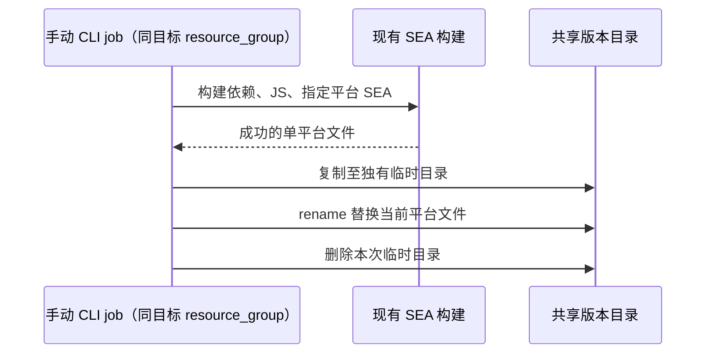

# CI de Empacotamento Independente da CLI

## Objetivo e Fronteira

O pipeline GitLab existente oferece seis jobs manuais e independentes de empacotamento da CLI SEA: macOS, Linux e Windows nos arquitetos arm64/x64.
Os jobs não rodam por padrão e suas falhas não bloqueiam a publicação do desktop; não dependem do build do desktop, do Helper, de recursos remotos nem do job de MR approve.
Clicar no job da CLI já é, por si só, a ação explícita de build e upload desta rodada. O workflow existente é quem decide se o pipeline é criado; a CLI não estende as fontes de disparo.
Não são modificados o job do desktop, o preparo de recursos do desktop, a coleta de instaladores, a assinatura, a notarização ou o DAG de publicação, e nada disso entra no Preview child pipeline.

## Contrato de Build

Entrada independente `node scripts/ci-cli-sea.mjs --target <target> --shared-root <path>`.
O target usa a nomenclatura SEA já existente: darwin-arm64, darwin-x64, linux-arm64, linux-x64, win-arm64, win-x64.
Primeiro são compilados os pacotes shared raiz que não oferecem build script; depois o pnpm workspace da raiz constrói os pacotes da CLI e seu fechamento completo de dependências conforme o grafo de dependências; por fim é gerado o zcode.cjs comum e chamada a entrada de plataforma única já existente do build-sea.
Não se pode usar apenas o grafo Turbo do sub-workspace da CLI, pois isso deixaria de fora dependências de runtime da TUI como o model-option-map da raiz.
Nos recursos de staging do SEA, os caminhos src de exports/main/module dos pacotes do workspace são mapeados para os arquivos dist já compilados; não se altera o package.json do código-fonte e não se enfiam arquivos de fonte TS no pacote publicado.
As dependências do SEA não podem ser deduplicadas apenas pelo nome do pacote: versões homônimas de origens diferentes vão, conforme as regras de resolução do Node, para node_modules aninhados do consumidor, e só a mesma versão visível é reutilizada. A regressão cobre o carregamento simultâneo do Zod 3 de contracts e do Zod 4 de shared.
Não se pode chamar o build:sea fixo com `--all`. A versão do Node é validada pelo ci:assert-node já existente, e a versão da CLI vem de apps/zcode-cli/package.json.
Manter a assinatura e a verificação SEA existentes: assinatura ad-hoc no host macOS, smoke de `--version` no alvo local e, explicitamente, pulo de execução no alvo cross-arquitetura.
Após gerar o JS, executar primeiro build-sea.test.mjs, incluindo o carregamento da TUI após desempacotamento independente; em caso de falha, nenhum SEA é gerado nem enviado.

## Upload e Concorrência

Reutilizar o runner, o registry, a função de instalação de dependências e a forma de cópia de arquivos de diretório compartilhado do CI do desktop; não chamar os scripts de filtragem de instaladores do desktop.
A raiz compartilhada usa ZCODE_CI_SHARED_ROOT (macOS), ZCODE_CI_LINUX_CONTAINER_OUT (Linux) e ZCODE_CI_WINDOWS_SHARED_ROOT (Windows).
Todas representam o diretório zcode compartilhado, e o destino segue `<shared-root>/deps/zcode-cli-<CLI版本>/<既有SEA文件名>`.
A nova variável interna do job CLI_SEA_TARGET apenas seleciona o alvo de build e não é passada como configuração de runtime do produto.
A raiz compartilhada precisa já existir, evitando que, em caso de montagem perdida, seja criado silenciosamente um diretório local substituto.



Jobs da mesma plataforma são serializados entre pipelines; o job executado depois e que enviar com sucesso sobrescreve o arquivo daquela plataforma. Plataformas diferentes podem rodar em paralelo, sem escrever um manifest comum e sem apagar o diretório de versão.
Falha na cópia mantém o arquivo antigo; falha no rename gera erro direto, sem apagar antes o arquivo antigo como saída de emergência. Não há publicação quando o arquivo de origem está vazio, o destino é inválido, a montagem está indisponível ou o build falha.
O log do job registra commit, pipeline, versão, alvo e caminho de destino para rastrear a origem das sobrescritas. O comando manual existente de upload via SMB para todas as plataformas permanece inalterado e não deve sobrescrever a mesma versão simultaneamente à CI.

## Manutenção de Versão Independente da CLI

A CLI usa a configuração independente `apps/zcode-cli/.release-it.json`, compartilhando apenas a ferramenta release-it já instalada no repositório e sem carregar o `.release-it.mjs` do desktop da raiz.
Os comandos são executados no diretório de trabalho `apps/zcode-cli`, tendo o version do package.json desse diretório como única entrada e alvo de modificação; não se alteram a versão da raiz, a versão dos subpacotes de entrada da CLI, o changelog do desktop nem o runtime descriptor.

```bash
pnpm release:cli                 # 交互选择新版本
pnpm release:cli patch --ci      # 仅递增 CLI patch
pnpm release:cli minor --ci
pnpm release:cli 0.17.0 --ci     # 显式指定版本
pnpm release:cli:dry patch --ci  # 预览，不落盘
pnpm --dir apps/zcode-cli run release patch --ci
```

Por padrão ficam desligadas as operações git, o npm publish e os releases do GitHub/GitLab, sem build ou upload automático; depois que a alteração de versão entra pelo commit/MR normal, o usuário clica no job de CI correspondente.
Motivo: o workflow atual do desktop vale para todas as tags, e um bump da CLI não deve disparar inesperadamente a publicação do desktop. A CLI não reutiliza o plugin de changelog do desktop nem a nomenclatura de tags do desktop.
O package.json da CLI oferece simultaneamente `release` e `release:dry`, e o package.json da raiz oferece as entradas de encaminhamento `release:cli` e `release:cli:dry`.
O tratamento de incremento, versão explícita e pré-release usa o comportamento nativo do release-it; não se escreve lógica própria de incremento de SemVer nem se adicionam novas variáveis de ambiente.
A entrada de preview usa `--release-version` para calcular apenas a próxima versão: no release-it 19.2.4 atual, o plugin npm marca `npm version` como comando sem escrita, mas o `--dry-run` nativo ainda modifica o manifest e, portanto, não deve ser usado diretamente.

A validação é feita executando o release-it real em um projeto Git temporário e independente: patch/minor/versão explícita alteram apenas o package.json da CLI, a entrada direta da CLI suporta major, o dry-run não altera arquivos e HEAD/tag/versão da raiz/changelog permanecem inalterados.

## Aceitação

- Mapeamento de nomes e de nomes de arquivo das seis plataformas, build de uma única plataforma; quando qualquer build anterior falha, o processo não continua nem envia.
- Testes com diretório compartilhado temporário cobrindo o primeiro upload, a sobrescrita da mesma plataforma, a preservação das outras plataformas, o paralelismo entre plataformas, entradas inválidas e a falha por artefato ausente/vazio.
- Verificar manual/allow_failure/needs/resource_group do job de CI e a herança de template, com os arquivos de CI do desktop originais byte a byte inalterados.
- Executar os testes unitários do script, a validação estática da configuração de CI, architecture:check, typecheck e lint; validar nos runners reais a montagem, o SEA e o comportamento de sobrescrita em cada SO.
- Esta rodada não envolve interação do APP nem a cadeia desktop continuous / web replayable e não adiciona UI E2E.

## Registro de Verificação Local (2026-09-15)

- O typecheck, o lint, o architecture:check, a verificação estática de CI e a verificação de formatação dos arquivos desta rodada passaram na raiz; o lint da raiz tem 43 warnings preexistentes.
- O upload de plataforma única, os testes de configuração de CI e a regressão de empacotamento SEA passaram; a TUI desempacotada carregou com sucesso em um diretório temporário independente.
- O macOS arm64 concluiu a geração real do blob SEA, a injeção, a assinatura ad-hoc e o `--version` (0.16.9). Como o download do Node é lento, localmente foi usado o parâmetro `--node-binary` já existente apontando para o Node 24.12.0 atual da mesma versão; a CI continua usando o fluxo original de download e verificação.
- Dos 309 testes do pacote CLI, 307 passaram e dois testes de provider registry falharam; a mesma falha foi reproduzida com o código-fonte original da CLI do HEAD em um diretório temporário isolado. O lint do workspace da CLI tem ainda um erro max-lines preexistente, e nesta rodada o escopo de modificação não foi ampliado.
- O glab local não está logado no GitLab do repositório, então não foram executados o lint de CI do lado do servidor, o agendamento em runner real nem a publicação no diretório compartilhado; a execução real em Windows/Linux, a sobrescrita por rename via SMB e a execução de binários cross-arquitetura precisam ser aceitas no runner correspondente.

## Notificação de Sucesso do Empacotamento da CLI

Ao final do build SEA e do upload, cada plataforma envia uma vez um card de sucesso no Feishu a partir de `ci-cli-sea.mjs`, reutilizando o serviço de notificação existente, o cenário `ci.build.completed` e a configuração de destinatários. O título do card marca explicitamente CLI e contém versão, plataforma, branch, commit author/info, botão de download e botão de Job dispostos horizontalmente na mesma linha. O endereço de download é gerado por `resolveIntranetDepsBaseUrl` e pelo diretório/nome de arquivo reais de publicação.

Ordem: `构建 → 单平台上传成功 → 飞书通知`. Falha de build ou de upload não envia a notificação de sucesso; falta de credenciais de notificação ou falha do serviço de notificação apenas registra um aviso e não altera o status de sucesso do build. Mantêm-se `ZCODE_FEISHU_NOTIFY_TOKEN`, `ZCODE_FEISHU_NOTIFY_BASE_URL`, `FEISHU_RECEIVE_ID`/`FEISHU_RECEIVE_ID_TYPE`; a notificação é pulada quando `SANDBOX_RELEASE=1` ou a tag contém test (sem diferenciar maiúsculas). Cada nova execução manual bem-sucedida notifica de novo, sem adicionar estado de deduplicação. A entrada de notificação do desktop e o DAG permanecem inalterados.

Validação: um serviço de notificação simulado verifica os endereços e o card das seis plataformas, a falta de token, a falha de envio e o pulo em sandbox; os testes de orquestração verificam notificar depois do upload e não notificar em caso de falha.