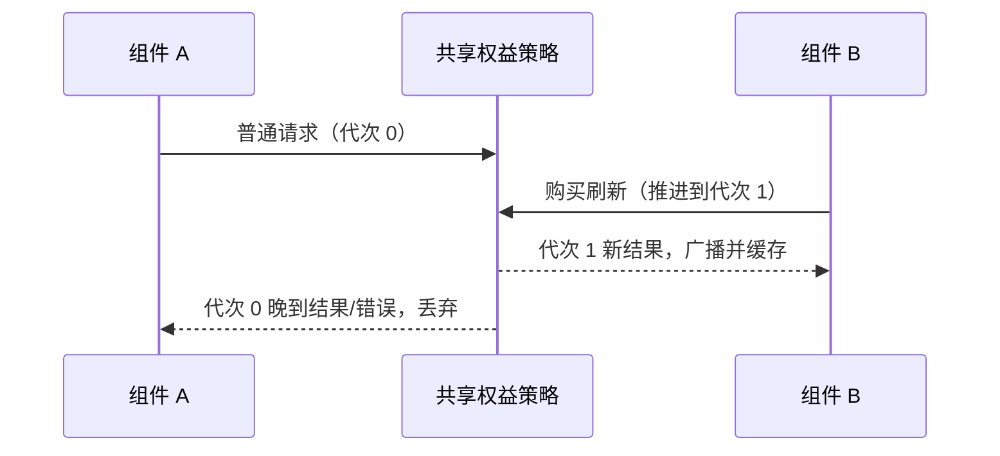

# Especificação de Exibição do Painel de Context do Coding Plan

## Contexto

O painel de context da área de entrada agrega os estados leves de Context window, Coding Plan e Start Plan. Este é um popover estreito, e não hospeda o detalhamento completo de usage.

## Limite de Exibição da Área de Entrada no V4

- O pequeno círculo de context do composer V4 e a antiga barra de entrada usam o mesmo componente de exibição `ChatContextUsage`; o painel de hover precisa agregar a capacidade de contexto atual, a cota restante do Coding Plan, o saldo de hoje do Start Plan e a taxa de acerto de cache.
- Antes de a primeira requisição ao modelo terminar, o painel pode exibir `0 / capacidade de contexto do modelo atual`. Esse valor é derivado apenas pela UI a partir da metadata do modelo efetivo atual e serve para ajudar o usuário a confirmar a capacidade do modelo; ele não pode ser gravado de volta no estado autoritativo de usage da sessão.
- Depois que a primeira requisição ao modelo termina, o painel usa `usage.contextWindow` do snapshot/delta da sessão v4 como autoridade da capacidade de contexto. `usedTokens` e `maxTokens` vêm da projection do Agent runtime, e a taxa de acerto de cache e o breakdown também são projetados junto com `usage.contextWindow`.
- A taxa de acerto de cache exibe apenas a taxa acumulada dos turnos da sessão principal; requisições sidecar como título, compact, prompt enhance e target completion, mesmo trazendo usage ou contextWindow, não podem sobrescrever o medidor de context da barra de entrada.
- Na recuperação de cold start, o transcript sintetiza eventos históricos e o seed de usage compartilham a capacidade do Registry consultada com precisão pela identidade do modelo em recuperação. A ausência do nível de pensamento não bloqueia a consulta de metadata; sem modelo correspondente/capacidade válida, projeta-se contextWindow=null e internamente se preserva o uso histórico real, sem forjar um denominador de 200 mil. O nível d'água final vem do runtime / mensagens persistidas (incluindo os limites de Compact) e não pode sobrescrever eventos novos ocorridos durante a recuperação.

## Cadeia de Estado no V4

```text
ModelComplete(main_turn)
  -> Agent runtime payload: usage + cacheHit + contextUsageBreakdown
  -> ProductProjection usage.contextWindow
  -> v4 snapshot / delta
  -> V4ComposerToolbar
  -> ChatContextUsage hover panel

Renderer modelProviders / settings / entitlements
  -> current Coding Plan or Start Plan source
  -> ChatContextUsage quota sections
```

- Desktop continuous e Web remote replayable consomem apenas a mesma cópia do snapshot/delta da sessão v4; desktop main e external relay não carregam estado de negócio de context, quota, cache ou breakdown.
- O `/remote` do celular reutiliza o host/session existente via shared-host attachment e, na recuperação, lê apenas snapshot/delta replayable, sem iniciar um runtime separado nem uma autoridade separada de consulta de cota para o painel de context.
- O BigModel Team Plan reutiliza o provider id do BigModel Coding Plan, mas a cota é vinculada à origem do projeto de equipe. Se a conexão atual na área de entrada for Team Plan, a quota do projeto de equipe correspondente deve ser exibida por sourceId, sem voltar à quota pessoal do Coding Plan.

## Saldo de Hoje do Start Plan

- O `Today's balance` do Start Plan e o Plan Card da página de Settings usam o mesmo `UsageEntitlementSnapshot`.
- O percentual restante e a barra de progresso usam `quota.limits[].remaining / quota.limits[].number`, em que `remaining` vem do backend `remaining_units`.
- A transição de largura da barra de saldo é igual à barra de cota do Coding Plan: `transition-[width] 500ms ease-out`, mantendo também o downgrade de acessibilidade `motion-reduce:transition-none`.
- À direita do título `Today's balance` no Plan Card de Settings é exibida a data de expiração do plano, vinda de `snapshot.subscription.details[0].expireTime`; esse horário expressa apenas a data de expiração do plano e não participa do cálculo de cota.
- O mini-card de saldo do Plan Card em Settings exibe na ordem "nome do modelo, percentual restante + horário de renovação, barra de progresso, restante/total", com restante/total no rodapé em número completo com separador de milhar, sem abreviação K/M; o painel de context da área de entrada continua exibindo apenas o percentual, o horário de renovação e a barra de progresso, sem mostrar a data de expiração do plano.
- `available_units` representa somente a quantidade disponível atual após descontar as reservas em andamento e não é usado na exibição do restante de `Today's balance`.

### Refresh e loading do context hover (simetria entre Start Plan e Coding Plan)

- Os modos de conexão de Start Plan e Coding Plan são mutuamente exclusivos; o gatilho de refresh silencioso de access aberto pelo hover de context precisa cobrir os dois trechos: `codingPlanUsageRemaining.onAccess ?? startPlanBalance.onAccess`, e a existência de qualquer um deles dispara `refreshCodingPlanEntitlements({ silent: true, reason: "access" })`. O Start Plan não pode depender apenas da sincronização passiva após o refresh da página de Settings/sidebar.
- No refresh silencioso, quando há snapshot em cache, não se define `entitlement.loading` como true; o spinner ao lado do título do Start Plan é decidido por `loading || refreshing`, em que `refreshing` acompanha a promise disparada por este hover (seq evita cruzamento), com a mesma semântica do ícone de refresh no header do trecho do Coding Plan.
- Quando `onAccess` existe, o gatilho de context é mantido mesmo sem snapshot ainda, garantindo que o primeiro hover possa disparar a primeira requisição de saldo (alinhado à semântica de fallback `onAccess && entitlements.length > 0` do trecho do Coding Plan).
- A janela compartilhada de access de 60 segundos e a mescla de requests in-flight valem igualmente para o Start Plan; hovers repetidos não podem ampliar a quantidade de requests de billing/balance.

## Horário de Reset da Cota de 5 Horas

- A cota de 5 horas do Coding Plan aparece no painel de context apenas com o horário de reset, sem a data.
- Mesmo que o horário de reset não seja hoje, continua exibindo apenas `HH:mm`.
- A dimensão de data fica reservada para a página de Usage e para painéis de uso mais completos, evitando que o painel de context fique congestionado no layout de três colunas de cota.
- A cota semanal e a cota mensal de ferramentas continuam exibidas com data.

## Snapshot de Balance Compartilhado do Start Plan (2026-09-17)

A verificação de disponibilidade da conta e a consulta de uso compartilham `zaiStartPlanBilling`, isolados por ApiClient, credenciais e URL.
A resposta completa é reutilizada por 1 segundo depois que a requisição é enviada (inclusive quando falha); requisições em andamento continuam sendo mescladas.
A consulta após uma compra/resgate bem-sucedido invalida explicitamente o registro correspondente, e requisições antigas que terminam não podem sobrescrever o novo registro.

```text
账号检查 ─┐
          ├─ balance 单一读取 owner ─ 请求/一秒快照 ─ plans + balances
用量查询 ─┘                              ├─ 账号可用性
                                        └─ 页面套餐与用量
```

Desktop e celular compartilham o serviço do Host; isso não altera os limites de sessão continuous/replayable.
Falhas de transporte como 429 devem preservar o erro e disparar backoff no front-end; assinaturas já confirmadas para a mesma identidade são preservadas quando o refresh falha, exibindo falha de refresh.
Sem resultados históricos, o Start Plan continua usando seu próprio título e oferece retry, sem mostrar cards de erro duplicados nem exigir novo login.
Aceitação: chamadas sequenciais ou concorrentes emitem apenas uma requisição, e é possível refrescar após um segundo; isolamento de credenciais; reutilização em caso de falha; nova consulta após invalidação; falha não sobrescreve assinatura já confirmada.

## Reutilização de Snapshot Quando o Refresh do Ponto de Entrada de Compra Falha

O ponto de entrada de compra decide se possui dados completos disponíveis, sem negar resultados históricos bem-sucedidos por causa do erro do refresh mais recente.
Snapshots autenticados pessoais/Start e o `no_plan` confirmado com sucesso podem continuar em uso; a exibição de loading ou retry só ocorre quando não há snapshot válido.
Resultados de equipe são isolados por family, identidade de login e credenciais de negócio; após a atualização da Provider view as credenciais são verificadas de novo; um refresh falho da mesma origem preserva o resultado bem-sucedido (inclusive lista vazia), enquanto um retorno bem-sucedido com lista vazia sobrescreve o plano antigo.
Mudança de identidade interrompe imediatamente o uso dos resultados antigos, e requisições assíncronas expiradas não podem escrever de volta. O erro continua registrado em log e no estado de entitlement original.

```text
个人/Start 权益 hook ─ 有效快照 ─┐
                              ├─ 购买入口：完整数据 ready，缺失数据 loading/error
团队查询 → 入口 hook 单一 owner ┘
           成功：替换；失败：同身份保留；身份变化：失效
```

A aceitação cobre a primeira falha, refresh em andamento/falho com snapshot existente, `no_plan`, resultado vazio de equipe, mudança de credenciais e troca de conta.
Desktop e celular compartilham este hook, sem alterar o serviço ou o protocolo de recuperação de sessão.

### Ordenação entre o Refresh de Compra e Requisições Antigas

A estratégia compartilhada de entitlement mantém request generations por instância de serviço e freshness identity. O refresh de compra/resgate avança a generation primeiro e só então chama o serviço e invalida o cache de balance. Sucessos e falhas de generations antigas não podem atualizar componente, snapshot compartilhado, cache persistente ou estado de backoff; requisições normais da nova generation não podem reutilizar requests in-flight da generation antiga. Identidades diferentes não se afetam. Desktop e celular usam as mesmas regras de hook, sem alterar o limite de recuperação remota.



Aceitação: os dois hooks compartilham a identidade; depois que o resultado de compra retorna primeiro, um `no_plan` antigo ou uma falha antiga não podem sobrescrever o novo resultado; requests pendentes de outra identidade continuam valendo normalmente; após a compra, um refresh normal não reutiliza o request anterior à compra.