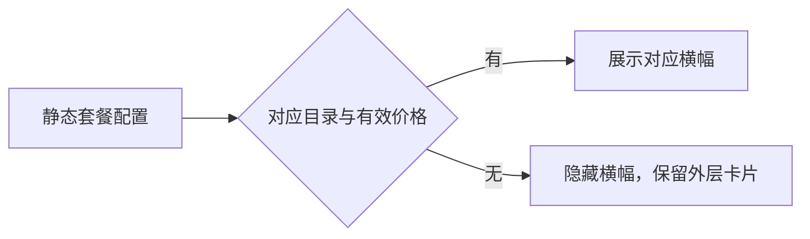

# Configuração Estática de Planos e Exibição de Banner de Compra

2026-09-14: a primeira fase remove apenas o fallback, sem adicionar compatibilidade de Provider ID.

- O banner pessoal é determinado pelo preço válido do produto do provider atual em `codingPlanStaticProducts`; não é exibido durante o carregamento, quando falta algum campo, quando as chaves não correspondem, quando a requisição falha ou quando não há preço válido. É preservada a semântica de exibição existente para itens explicitamente esgotados.
- Excluir os banners fixos de 49 元 (pessoal) e 598 元 (equipe genérica). Manter o cartão externo do plano, a entrada de login e os planos válidos de experiência.
- O banner de compra de equipe precisa ter o catálogo estático correspondente em `codingPlanStaticTeamProducts`; ele não pode ser substituído pelo catálogo de pricing em tempo real. A consulta do status de equipe já comprada continua usando o pricing em tempo real.
- O estado de configuração é mantido pelo hook existente; o Detail apenas deriva a exibição; não são introduzídos cache, temporizadores ou novas interfaces.
- Web desktop e mobile, temas claro e escuro, idiomas chinês e inglês usam a mesma condição de exibição; a cadeia continuous/replayable não é alterada.
- Nesta fase o `providerId` existente é correspondido de forma exata; a configuração do servidor não é modificada e não são adicionados aliases builtin/account nem migrações.

Verificação: os testes unitários cobrem catálogo vazio sem preço fixo, ausência de configuração sem renderizar os banners pessoal/de equipe, e a manutenção dos planos válidos de experiência; a regressão de navegador cobre os estados sem configuração em desktop/mobile e nos temas claro e escuro.

Caso de navegador: `packages/ui/test/browser/manual-review/pending/coding-plan-no-fallback.test.mjs`. Pré-condição: ZCode Dev sem login, com as configurações de modelo BigModel abertas e a configuração pública sem um catálogo de produtos builtin/account utilizável; executar `node --test <caminho-do-caso>`, cobrindo as larguras 390/1200 e os temas claro e escuro, verificando que a entrada de login continua presente e que os banners pessoal/de equipe e os preços fixos não existem. Este caso é uma regressão manual de desenvolvimento da aplicação e não é promovido automaticamente para a CI.

## Segunda fase: compatibilidade de chaves de configuração estática

A compatibilidade existe apenas na fronteira de desempacotamento client/configs do Service, e tanto o catálogo pessoal quanto o de equipe são mapeados por family. A leitura prioriza a chave própria `builtin:{family}-coding-plan`, e só quando essa chave não existe lê `account:{family}-individual-coding-plan`; a chave devolvida à UI é uniformemente a segunda (o contrato existente do catálogo de equipe também é o bucket de provider pessoal). Array vazio explícito tem prioridade; os dois catálogos não são mesclados e um produto desativado pelo catálogo antigo não é ressuscitado pelo novo. Não há compatibilidade com outros namespaces e a identidade de Provider em runtime não muda. Quando nenhuma das duas chaves existe, o bucket não é criado, mantendo a regra da primeira fase de esconder o banner.

Matriz de verificação: duas configurações × dois family × chave antiga exclusiva / chave nova exclusiva / conflito entre as duas chaves / array vazio na chave antiga / ambas as chaves ausentes; validado através da interface real do Service, verificando que OAuth não é necessário.

Verificação da segunda fase em produção: com app_version=3.12.1 e platform=darwin-arm64, a resposta real, após ser interpretada pelo Service, resulta em 9 itens para BigModel/Z.ai pessoal e 8 itens para equipe BigModel / 0 itens para Z.ai. A requisição de configuração padrão no ambiente de desenvolvimento retorna algo diferente da requisição indicada: a requisição padrão não possui os campos estáticos de produto, portanto não se pode afirmar com base nela que a validação de UI do banner de produto válido foi concluída.

## Correção do carregamento do catálogo de equipe sem login

Motivo: o `enabled` do hook de equipe depende de `soldOutVisible` (credenciais de login de compra), então sem login o catálogo estático sequer é lido. Depois da remoção do banner fixo de equipe, não há catálogo real que o substitua.

O banner de equipe na página de configurações, quando não há login, usa o modo staticOnly do hook existente: `getStaticTeamProducts` → bucket do provider atual → agrupamento por preço estático → banner; nenhuma requisição de pricing público ou autenticado é feita. Após o login, `staticOnly=false` e a cadeia original de catálogo estático + pricing em tempo real é mantida. Sem catálogo, nada é exibido; clicar no banner estático ainda exige login. O comportamento padrão dos demais chamadores não muda, e a transmissão de dados ou o cache de desktop/mobile não são alterados. A regressão de navegador precisa verificar que o banner sem login, o banner pessoal e o banner de equipe real são exibidos, e que os preços do catálogo estático são consistentes.

Confirmação do usuário: exibir apenas um banner de "Plano de Equipe". Todos os níveis de equipe do catálogo estático válido são mesclados, tomando o menor preço válido; não são exibidas entradas separadas para a versão padrão ou a avançada, e o clique transmite o público `team`, sem pré-selecionar um nível específico.

O banner de compra de plano não exibe o selo de promoção de cota de 150%; as entradas pessoal/equipe/experiência apresentam apenas nome, preço ou cota real e descrição. Os selos do cartão externo de status não fazem parte do escopo desta modificação.