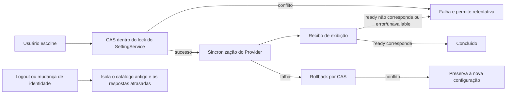

# Entrada unificada de modelo e nível de raciocínio do Composer

## Interação

O modelo e o Think do campo de entrada comum usam uma única entrada. A entrada não exibe o prefixo do Provider:

```text
[ GLM-5.3-Flash High ▾ ]  → [ GLM-5.3-Flash ▮ ] → [ ícone de modelo ▮ ]
```

O menu exibe o título da seção Models (em chinês, "模型"), usando text-ui-sm e a cor de texto secundária; o nome do modelo mantém o tamanho de fonte base, e as etiquetas de capacidade permanecem como são.

High usa a cor de texto secundária. A barra verde é sempre uma exibição dentro do mesmo botão, não responde a cliques isoladamente; exibe a intensidade conforme os níveis declarados pelo modelo, e fica vazia quando fechada ou com seleção inválida.

O menu de modelos é alinhado ao centro em relação à entrada (`align="center"`), preservando o desvio das bordas do viewport.

A entrada mantém o estilo de botão arredondado `rounded-lg` original, sem forma de cápsula. Enquanto o menu está expandido, mantém o fundo cinza de hover do tema, mesmo que o ponteiro já tenha entrado no menu; ao fechar, restaura o fundo ghost. Antes de expandir, mede a largura do botão; durante a expansão, usa o maior valor entre a largura original e a largura mínima de `8rem` e o fixa, evitando que nomes de modelo curtos ou o estado de ícone truncquem "Selecionar modelo"; enquanto expandido, oculta o modelo e o nível, trocando por Select model (em chinês, 选择模型) centralizado, sem seta para baixo; após fechar, libera a largura fixa e restaura o modelo e o nível, bem como a prioridade de compressão original. A largura é capturada apenas uma vez, antes de uma expansão, e não é remedida quando o nível ou o modelo mudam.

Quando nenhum modelo está selecionado, a entrada exibe "Selecionar modelo" na cor de texto secundária, tanto expandida quanto fechada, sem mostrar a linha de espaço reservado do nível de raciocínio nem a barra verde. Sem modelo selecionado, o nome acessível mostra apenas o texto de seleção de modelo, sem concatenar `· —`; após selecionar um modelo, o botão e o nome acessível exibem o modelo e o nível válido. O Tooltip comum sempre mostra o texto de ação "Selecionar modelo" (Select model) e o atalho, sem repetir modelo e nível; quando o menu está expandido, o Tooltip é ocultado, e a dica mantém o seu texto dedicado original.

O slider do Think usa trilho em cápsula, pontos discretos por nível e cursor circular branco. Abaixo do nível máximo, o trilho selecionado permanece em verde puro (success); somente quando uma seleção válida alcança o nível máximo é exibido o gradiente azul→verde da direita para a esquerda (azul à direita, verde à esquerda), com o azul usando a variável exclusiva do slider --composer-thought-max-accent (blue-500), mantendo alta saturação em ambos os temas, e o verde usando a cor de tema success; o gradiente usa interpolação OKLCH shorter hue, passando de verde, ciano a azul da esquerda para a direita, preservando a croma da transição e sem incluir roxo. Ao sair do nível máximo, o gradiente desvanece em 200ms e o trilho volta ao verde puro; a barra vertical da barra de ferramentas continua usando o verde success, e o trilho e os pontos não selecionados usam as cores neutras do tema; fechado ou com nível inválido, não há preenchimento. O contorno do trilho aparece apenas nas regiões cinzas não selecionadas: o contorno fica na camada inferior, e o preenchimento em gradiente cobre o contorno da região selecionada, sem recuar para dentro do contorno. O trilho tem 24px de altura, o cursor 28px e a área de operação 32px de altura; cada nível corresponde a um ponto, com posição consistente com o índice discreto do range nativo. Mantém o comportamento de teclado, ponteiro e toque do range nativo e a proteção de foco existente, customizando apenas o visual.

Ao clicar ou ajustar o nível pelo teclado, a posição do cursor e o preenchimento em gradiente mudam em sincronia com uma transição de 120ms ease-out. O arraste nível a nível também mantém a mesma transição curta, para que o cursor e o preenchimento em gradiente se movam de forma sincronizada e suave. Ao trocar de modelo, Provider ou catálogo de níveis, apenas a camada visual é reiniciada: não há interpolação entre modelos, nem reconstrução do input nativo, nem movimentação de foco. Com prefers-reduced-motion do sistema, as transições são canceladas.

Estrutura da camada: ícone do fornecedor, nome, etiqueta de acesso (seta à direita) → divisor → título Models e lista de modelos → divisor → título Effort (text-ui-sm) e nível atual (tamanho base, alinhado à esquerda na mesma linha, espaçamento inferior mb-1) → slider discreto. Não são exibidas etiquetas de nível mínimo/máximo, nem é reservado espaço para essa linha; desktop e Web em celular compartilham este layout, e as operações de teclado, ponteiro e toque do slider e o texto acessível dos níveis permanecem iguais. O acesso ao gerenciamento de modelos e a forma existente de conexão por provider family continuam acessíveis. Os divisores do menu principal e do submenu de fornecedores usam uniformemente border/50.

À esquerda da linha do Provider vêm, sucessivamente, o ícone do fornecedor atual, o nome e o indicador do modo de acesso, com a seta do submenu à direita, e o título de Provider não é mais exibido. Os ícones reutilizam o logo da configuração do fornecedor e os recursos de tema claro/escuro já existentes, usando o ícone genérico de modelo quando não há logo. No submenu do fornecedor, o indicador do modo de acesso acompanha de perto o nome (espaçamento de 8px), sem ser empurrado para o fim da linha; o marcador de seleção atual permanece à direita, e o Manage models é colocado depois do divisor final; a camada unificada não repete essa entrada no rodapé. Com o catálogo vazio, o submenu ainda pode ser aberto para acessar o gerenciamento de modelos. Outras interfaces que usam ModelConfigSelect mantêm o layout original.

O indicador de acesso reutiliza o `labelBadge` do catálogo: planos de conta exibem individual/equipe/gratuito, e o acesso por API Key exibe API; é gerado a partir do `access` da configuração, não inferido a partir do nome, e não expõe credenciais.

O submenu usa Portal para evitar o recorte do menu pai. Quando a largura estreita não oferece espaço lateral, o submenu pode sobrepor o menu pai e se afastar da linha gatilho do Provider, mantendo um nível acima do menu pai; isso não altera a lógica de seleção de Provider nem de troca de modelo.

Trocar de Provider seleciona imediatamente o primeiro modelo não bloqueado daquele grupo na ordem do catálogo, reutiliza o onSelectModel existente para atualizar o Composer, o Think é sincronizado para um nível válido pela lógica existente de troca de modelo, e a camada permanece aberta. Selecionar novamente o Provider atual mantém o modelo atualmente disponível daquele grupo. Um Provider sem modelos disponíveis ainda pode ser navegado e configurado, mas não sobrescreve o modelo atual, e o Think fica desabilitado. O slider seleciona graduadamente na ordem original do Option Spec, sem ordenar nem converter para Token Budget. Apenas o nível único Off oculta toda a área de Effort e o seu divisor; outros níveis únicos desabilitam o slider, mas exibem o nível; ausência de modelo ou de nível válido não cria uma seleção padrão. Selecionar um nível mantém a camada aberta; clicar fora ou pressionar Escape a recolhe. No desktop, fechar restaura o foco no campo de entrada; no celular, o teclado virtual não é aberto ativamente.

### Fechamento do menu de modelos

- Depois de confirmar um modelo disponível por clique ou teclado, o menu permanece aberto, inclusive ao reselecionar o modelo atual, para permitir continuar ajustando o nível de raciocínio; modelos bloqueados não são submetidos e não fecham o menu. Trocar de Provider e ajustar níveis também mantêm o menu aberto.
- O campo de entrada comum e o campo de entrada flutuante em plugins em tela cheia compartilham o mesmo estado de abertura do menu. Um único clique fora do menu fecha-o, incluindo a área ocupada pelo webview do plugin; esse clique apenas fecha o menu e não aciona a ação do plugin subjacente. O Escape mantém o comportamento de fechamento.
- Depois que o menu fecha, valem as regras de foco existentes: o desktop restaura o campo de entrada, o celular não abre ativamente o teclado virtual. Não são alterados o owner da seleção de modelo, o envio nem o protocolo.

```text
Confirmar modelo disponível → callback existente de seleção de modelo → menu permanece aberto
Ponteiro fora do menu → interação externa do menu hospedeiro → menu open=false
Operações de Provider / Effort → cadeia de seleção existente → menu permanece aberto
```

Motivo da regressão no clique externo: depois que o Radix abre um menu modal, ele define `pointer-events` do body como none, mas o webview do plugin define explicitamente auto e continua recebendo cliques; eventos dentro do guest não borbulham até o document hospedeiro, de modo que o menu não recebeu o pointerdown externo. A amostragem de eventos do Electron confirmou que aquele clique executou o botão do plugin, com o menu ainda aberto. Enquanto a camada unificada está aberta, é fornecida uma camada de ponteiro transparente, posicionada acima da página do plugin e abaixo do Composer e das janelas flutuantes, reutilizando a lógica externa de fechamento do Radix e preservando a alternância mútua entre os menus da barra de ferramentas. Essa camada compartilha o `open` com o menu e não mantém estado adicional.

Verificação de regressão: 47 testes unitários do componente de menu, 4 testes de interação do webview do Electron / iframe em largura de celular nos temas claro e escuro e 11 testes da barra de ferramentas completa do desktop passaram, cobrindo a permanência do menu aberto após selecionar um modelo e o subsequente fechamento por um único clique externo. O candidato de navegador foi executado com `node --test packages/ui/test/browser/manual-review/pending/composer-menu-dismiss.test.mjs`, com artefatos em `packages/desktop/.e2e-artifacts/composer-menu-dismiss/`. Não são cobertas janelas nativas Windows/Linux, aparelhos móveis reais e conexões de controle remoto; os recursos de plugin usam uma página de teste e não validam a instalação de plugin nem o handshake do Agent.

## Prioridade geral de compressão

Tudo é medido de forma unificada por useComposerToolbarFit, que considera todos os controles à esquerda e à direita e seus espaçamentos; só se passa para o próximo nível quando o nível atual ainda transborda:

1. Recolhe o texto de Computer.
2. Recolhe o texto e a seta de Mode.
3. Recolhe o texto de Plan.
4. Substitui High e a seta da entrada unificada pela barra verde, mantendo o nome do modelo por completo.
5. Substitui o nome do modelo pelo ícone do modelo, mantendo a barra verde.

Não existe um estágio intermediário de ocultar a barra verde, mostrar apenas o nome do modelo ou truncar o nome do modelo. Controles não renderizados são ignorados, e a expansão acontece na ordem inversa quando a largura é restaurada; os botões não são remontados por causa da compressão, de modo que menus abertos, foco e seleção não se perdem. O indicador dedicado e o controle de pensamento independente já existentes para modelos bloqueados Highspeed mantêm o comportamento atual.

## Estado e limites

```text
ModelSelectionView (modelos e níveis suportados)
                 ↓
Escolher Provider → modelo atual disponível ou primeiro modelo disponível → onSelectModel existente → rascunho do Composer
Camada unificada → onSelectModel / onSelectThought existentes → rascunho do Composer (único owner da seleção)
                                                     ↓ enviar
                                               Submission congelada
```

A camada possui apenas o estado de abertura e o Provider em navegação; ela não duplica o estado de modelo nem de nível. Não são alterados o mapeamento de requisições, o protocolo de serviço, a fila de aceitação nem o streaming em tempo real: o desktop `desktop-continuous` e o celular `web-remote-replayable` continuam usando as respective cadeias originais. Ctrl+M abre a entrada unificada e Ctrl+T mantém o ciclo de níveis.

## Verificação

- Interação de componentes: seleção automática de um modelo disponível pelo Provider, pulo de modelos bloqueados, reseleção do Provider atual, Provider sem modelos disponíveis, permanência do menu aberto após a seleção do modelo, etiquetas visuais, slider discreto, nível único/nível inválido, modo de conexão herdado e entrada de gerenciamento.
- Layout: contração em cada nível e restauração inversa, ausência de Computer/Plan, ícone＋barra verde final; navegador real nas larguras de desktop e celular, nos temas claro e escuro.
- E2E de Desktop: a modificação de modelo e de nível continua atualizando o Composer; o modo comum deixa de renderizar uma entrada de Think independente; o menu unificado e o Mode são mutuamente exclusivos.

Verificação desta rodada: 7 arquivos de testes relacionados, 155 casos no total, passaram; o E2E da barra de ferramentas do Desktop cobre a seleção automática de modelo por Provider e o salto para o gerenciamento de modelos no submenu; typecheck, lint (0 errors) e architecture:check --changed passaram. A janela real do desktop confirmou a contração nos três níveis; a verificação do componente no navegador foi feita em 320, 390 e 1200 pixels e nos temas claro e escuro, sem execução da cadeia `/remote` em aparelho móvel real.

## Foco durante o ajuste de nível

No E2E real do Desktop foi observado que, após ajustar o nível ou trocar de modelo, o Host View entra brevemente em loading; a implementação antiga limpava o catálogo junto, o que fazia a altura do menu piscar. O `disabled` nativo remove o foco do range de volta para o menu, e as setas do teclado deixam de ajustar o nível. O menu unificado usa `aria-disabled` e um bloqueio de eventos para pausar a interação, preservando o mesmo nó de range e o foco; durante a releitura de entrada do mesmo Host, o Hook mantém apenas a exibição do catálogo revision/providers, sem manter resultados de resolução antigos como effectiveSelection e preferredSelection; a Toolbar lê esse catálogo, e a seleção atual continua vindo do rascunho do Composer, com o envio ainda exigindo `ready`. Trocas rápidas continuam usando generation/requestId para evitar sobrescritas atrasadas. Na troca de Host, desabilitação ou indisponibilidade, o catálogo antigo é descartado imediatamente, sem alterar os limites do continuous do desktop nem do replayable do celular; não se usa tempo limite para recuperar o foco. Quando o novo catálogo retorna, a atualização ocorre na mesma posição. Quando nenhum nível está selecionado, a posição da primeira casa não significa que o usuário tenha escolhido; apenas uma mudança explícita, um evento de teclado liberado ou um ponteiro liberado executam o commit.

Essa regra também cobre a troca de Provider. Uma releitura que mantém o catálogo não desabilita a entrada do menu, evitando o piscar da opacidade do botão; o primeiro carregamento, os erros, a indisponibilidade e o bloqueio em execução continuam usando os bloqueios originais. Os testes de regressão monitoram o DOM real e exigem que a lista de modelos não tenha quadros vazios durante o ajuste de nível e as trocas de modelo e Provider, e que a entrada nunca fique instantaneamente desabilitada, cobrindo também a limpeza entre Hosts e as respostas atrasadas de trocas rápidas.

Pontos de nível: os pontos da região preenchida usam 30% de branco, igual nos dois temas, e não usam pontos pretos; a região não preenchida mantém o cinza original. Quando o mouse se aproxima a até 10px horizontalmente de um ponto, ele é ampliado para 1,75 vez com ease-out de 120ms e se torna totalmente opaco, voltando ao normal ao sair. Toque e estado desabilitado não acionam o hover; com a configuração de redução de efeitos, a transição é cancelada. Os pontos têm apenas função de exibição; o range nativo continua recebendo cliques e arrastes.

Bolha do nível máximo: o gradiente e as cores existentes são mantidos, e 12 pequenos pontos brancos de baixa opacidade são sobrepostos dentro do preenchimento, com tamanho de 2–4px e ciclo de 2,6–3,6s, com fases deslocadas que derivam da direita para a esquerda e desvanecem. A bolha é recortada dentro do trilho, fica abaixo dos pontos de nível e do cursor, e não recebe eventos de ponteiro. A bolha é renderizada apenas para o nível máximo ajustável e válido; descer de nível, mudar para um nível único ou um modelo inválido, ou fechar o menu a remove. Com prefers-reduced-motion, a bolha é ocultada e a animação desligada; não são adicionados Canvas, temporizadores nem estado próprio.

Recolhimento após a interação com o slider: o `pointerdown` do range nativo precisa borbulhar até o document, para que o DismissableLayer do Radix limpe a marca de clique interno; apenas o `click` que selecionaria um item de menu é bloqueado. Depois de ajustar o nível por clique ou arraste, o primeiro clique fora do menu já o fecha, sem necessidade de um segundo clique. No estado desabilitado, o preventDefault continua bloqueando o ajuste de nível.

Comportamento responsivo do estado aberto: a largura travada na abertura (mínimo de 128px) é usada apenas no estado de texto com espaço suficiente. A barra de ferramentas continua contraindo pela prioridade existente Computer → mode → Plan → think → ícone de modelo; ao chegar ao estado de ícone de modelo, a restrição de largura e de largura mínima é removida, exibindo o ícone do modelo e a barra de raciocínio, e ocultando o texto centralizado de seleção de modelo e a seta para baixo. Ao alargar novamente, a largura e o texto originais do estado aberto são restaurados, mantendo o mesmo botão gatilho e a mesma instância do menu, sem reiniciar opções, foco ou estado de chaves. O redimensionamento do painel do desktop e o Web em celular compartilham essa regra.

## Revisão de cobertura E2E (2026-09-28)

Esta rodada é um reforço dos casos CT já existentes na camada de apresentação, sem nova semântica de produto, requisições a provider ou spec candidata independente. Os limites confirmados vêm da especificação de interação acima e dos requisitos do usuário sobre a entrada unificada, o fechamento em um clique e o ícone＋barra de raciocínio.

- accepted: o clique e o arraste do slider partem do nível mínimo e alteram explicitamente o nível alvo; é afirmado que o range e a config do Composer chegam ao alvo, e que um clique externo encerra o menu sem reverter a seleção.
- accepted: com o mouse fora do menu e o slider focado por teclado, a largura do estado aberto é estreitada e depois restaurada, preservando o mesmo botão, menu, nó de range e foco do slider; modelo/Provider/nível não são reescritos pelo resize; no estado estreito o ajuste por End continua funcionando, com a barra de raciocínio e a config sincronizadas; fechar e reabrir continua mostrando ícone＋barra de raciocínio.
- pruned: tema/idioma/todas as larguras não são multiplicados em cruzamento com a suíte E2E de desktop; a evidência visual de navegador que compartilha CSS é registrada à parte e não conta como cobertura de `/remote` em aparelho móvel nem de arraste da barra lateral nativa. A configuração atual do E2E ajusta a largura do contêiner da barra de ferramentas para disparar de forma determinística um ResizeObserver real, sem forjar o atributo compact.
- Cobertura existente preservada: seleção automática de modelo pelo Provider, troca de modelo/Provider sem limpar o catálogo, texto de ação do Tooltip, gradiente e bolha do nível máximo, exclusão mútua do menu de modos, gerenciamento de modelos e reset de scope.

Superfície de impacto: must-inspect é V4ComposerToolbar → ModelConfigSelect/ComposerModelMenu e useComposerToolbarFit; a autoridade da seleção continua sendo o rascunho do Composer, e a medição de layout apenas projeta o DOM. AutomationEditView, OffPeakEditView, SubagentsSection e as configurações de workflow reutilizam ModelConfigSelect, mas possuem limites de persistência próprios e não habilitam composerOptions, constituindo limites isolados; desta rodada não modifica código de produto. O continuous do desktop e o replayable do celular não são afetados. O ambiente atual não possui codegraph invocável, de modo que não foi executada a varredura de profundidade 2 do grafo indexado; a verificação foi feita pelos pontos de chamada no código-fonte atual e pelos casos existentes, e não se declara concluída a varredura de impacto via codegraph; não há novos nós semânticos nem relações de owner. Reutiliza-se o fixture case-local já existente no CT, sem novas requisições de envio ou de fixture.

Resultado da revisão: os 11 casos do E2E Electron da barra de ferramentas reforçada passaram, a validação do fixture case-local, typecheck:e2e, o typecheck de todo o repositório, o lint (62 warnings existentes, 0 error) e a verificação de arquitetura passaram. A auditoria de cobertura de conversas de todo o repositório foi bloqueada por duas syntheticReason divergentes no fixture de card Highspeed não modificado, inconsistentes com o manifest (REQUEST_LEDGER_METADATA_MISMATCH), o que não é contabilizado como falha dos testes da barra de ferramentas desta rodada; não foram executados admission via Docker nem a verificação em aparelho móvel com controle remoto.

## Exibição do controle Effort conforme a quantidade de níveis

Dois ou mais níveis usam o slider discreto, incluindo Off/On, Low/High e Off/High; um único nível exibe o título e o texto de estado, e o nível vazio é ocultado. Os valores originais e a ordem do catálogo são preservados, e o controle não é decidido pelo texto traduzido. O slider reutiliza o onValueChange existente e as operações de teclado, ponteiro e toque, sem manter um segundo estado de seleção. Providers não selecionáveis proíbem o ajuste de nível; as regras de fechamento por Escape e pelo primeiro clique externo permanecem inalteradas.

A seguir estão os registros de validação histórica do anterior esquema de chave de dois estados; a regra de exibição vigente é a exibição unificada conforme a quantidade de níveis.

Verificação: a cobertura de componentes cobre o alias Off, o alias On e a ordem inversa, e confirma que Low/High e Off/High continuam sendo slider, que um único Off é ocultado e restaurado na troca de modelo; os E2E existentes do Turbo I37 foram estendidos com asserções da chave de dois estados e da sincronia com a config, e o helper de seleção de nível do menu unificado foi atualizado para ser compatível com a chave e com o Off não ajustável. A verificação do componente no navegador cobriu os dois temas e as larguras de celular/desktop; sem novas requisições a provider, fixture ou protocolo de estado de execução.

Resultado desta rodada: 42 testes unitários de componentes relacionados, 11 E2E Electron da barra de ferramentas e 3 E2E Electron do Turbo passaram; nos dois temas × 390px (toque)/1200px (desktop) no navegador, a verificação do clique na chave, do espaço, do fechamento por um clique externo, da ocultação de um único Off e da restauração ao voltar passou. typecheck, typecheck:e2e, lint (0 error), architecture check e Turbo fixture check passaram. Os casos do Turbo adicionam explicitamente candidatos de modelo já removidos do catálogo padrão atual e usam os valores originais disabled/enabled do catálogo atual, evitando depender do modelo padrão histórico e do valor original de off.

O texto do nível atual do Effort reutiliza `RollingToolbarLabel`: nas mudanças, ele rola para cima com 200ms e desvanece, animando apenas `{level}`, mantendo o título e a posição do slider inalterados. A primeira abertura não reproduz a animação de entrada; ajustes rápidos consecutivos seguem o rascunho atual, e com a redução de efeitos o texto é substituído diretamente. Reutiliza-se a regressão de ajuste de nível da barra de ferramentas do CT para validar a atualização do texto e a estabilidade do menu/slider, sem novo estado nem caminho de envio.

Verificação da rolagem: 28 testes unitários de componentes e a última rodada de 11 E2E Electron da barra de ferramentas passaram; a amostragem de quadros no navegador real em 390px / 1200px confirmou a animação com transform no modo normal e a ausência de animação com a redução de efeitos, com o texto final igual ao do slider e o foco preservado. typecheck, typecheck:e2e, lint (62 warnings existentes, 0 error) e a verificação de arquitetura passaram. Execuções de regressão anteriores apresentaram interferência do nível inicial de teste e falha de posicionamento do menu; o texto foi finalmente incorporado aos passos existentes de clique/arraste, e a regressão completa mais recente da barra de ferramentas passou.

Transição de fundo do slider: o fundo verde puro de success permanece inalterado, e o gradiente do nível máximo usa uma camada de pseudo-elemento permanente, alternando entre 0 e 1 com opacity de 200ms ease-out; ao entrar no nível máximo ele aparece, ao sair desaparece, e em um ajuste rápido na direção oposta continua a partir da opacidade atual. A largura do preenchimento e a posição do cursor continuam em 120ms; a bolha mantém a regra do nível máximo. Com a redução de efeitos, a transição de fundo é cancelada. Reutiliza-se o E2E existente do slider para verificar a opacidade nas duas pontas e as propriedades de transição, e a amostragem de quadros intermediários no navegador real confirma que o gradiente não muda mais de forma instantânea.

Verificação da transição de fundo: os 11 E2E Electron da barra de ferramentas passaram; a amostragem de quadros no navegador real nos dois temas confirmou opacidades intermediárias entre 0 e 1 ao entrar e ao sair do nível máximo, e nenhum quadro intermediário com a redução de efeitos. typecheck, typecheck:e2e, lint (62 warnings existentes, 0 error) e a verificação de arquitetura passaram.

Linha de título do slider de Effort: à esquerda, Effort e o nível atual; à direita, o ControlShortcutBadge compartilhado da barra de ferramentas exibindo o atalho cycleThoughtLevel vigente. Usa o thoughtShortcutLabel já existente na Toolbar, sem codificar Ctrl+T; quando não há atalho vinculado, nenhum keycap vazio é exibido. Com dois ou mais níveis, o slider e o atalho são exibidos; com um único nível, apenas o texto é exibido, sem novo tratamento de atalho ou estado.

Verificação da linha de título do atalho: 29 testes unitários de componentes e os 11 E2E Electron finais da barra de ferramentas passaram, incluindo vínculo personalizado/vazio, alinhamento à direita e asserções geométricas na mesma linha. typecheck, typecheck:e2e, lint (62 warnings existentes, 0 error) e a verificação de arquitetura passaram; sem nova verificação em aparelho móvel com controle remoto.

Regressão de animação da entrada de modo: o botão de modo de permissões do V4 recupera o RollingToolbarLabel compartilhado, reutilizando a rolagem para cima de 200ms com desvanecimento, a ausência de animação na primeira renderização e a regra de redução de efeitos. A marcação independente de Plan, a atribuição do rascunho de modo, os ícones, as cores e a compressão responsiva permanecem inalterados. A causa foi a reescrita do menu de Plan, que substituiu o ConfigSelect antigo por um span comum e omitiu a animação de texto.

Verificação da restauração da animação de modo: 5 testes unitários do componente de modo e 11 E2E Electron da barra de ferramentas passaram; a amostragem da troca real de modo capturou quadros intermediários de transform/opacity, validando a preservação do nó do botão, a atualização do texto e a chave independente de Plan. typecheck, typecheck:e2e, lint (62 warnings existentes, 0 error) e a verificação de arquitetura passaram.

Animação da chave da entrada unificada: com um modelo selecionado, abrir/fechar o menu executa uma rolagem para cima de 200ms com desvanecimento entre "nome do modelo＋nível de raciocínio" e o Select model centralizado; a primeira renderização não reproduz a animação, e com a redução de efeitos a troca é direta. A animação apenas representa o estado `open` já existente, sem manter uma segunda seleção nem atraso na chave; o botão original, a largura travada na abertura, o ícone＋barra de raciocínio em tela estreita, o foco e a regra de fechamento por um clique externo são preservados.

O texto no estado aberto não exibe seta: Select model permanece centralizado, e o estado fechado continua usando a seta e as regras de compressão originais; no estado aberto em tela estreita continua sendo ícone＋barra de raciocínio.

Verificação da animação da chave da entrada unificada: 45 testes unitários de componentes e os 11 E2E Electron finais da barra de ferramentas passaram, cobrindo a ausência de seta no estado aberto, o espaço reservado para o texto, a identidade do botão e a restauração da largura travada/estreitada. A amostragem no navegador real confirmou quadros intermediários de opacidade tanto na abertura quanto no fechamento, e nenhum quadro intermediário com a redução de efeitos; a largura de abertura tem no mínimo 128px, e o fechamento restaura a largura do conteúdo. typecheck, typecheck:e2e, lint (62 warnings existentes, 0 error) e a verificação de arquitetura passaram. A asserção de largura passou a medir o texto real de Select model, evitando contar o transbordo do texto que está saindo como truncamento do texto atual.

A aparência do atalho de Effort reutiliza o keycap do ControlHintTooltip: h-4, rounded-md, fundo tooltip-tag e cor de texto, text-ui-xs e a fonte de símbolos específica da plataforma. A referência genérica ao Kbd causava texto puro por usar um token muted indefinido, e isso deixa de ser usado no Effort; os demais pontos de entrada de Kbd não são modificados.

Verificação do estilo do atalho: 35 testes unitários e 11 E2E da barra de ferramentas passaram; capturas em 390px nos dois temas confirmam o fundo não transparente do keycap, a altura de 16px e o raio de 6px, com o Tooltip e o Effort compartilhando a mesma aparência. typecheck, typecheck:e2e, lint (0 error) e a verificação de arquitetura passaram.

O submenu do fornecedor usa a largura de conteúdo max-content, cancelando os 224px fixos; a largura é determinada pelo maior nome＋etiqueta de acesso＋espaço reservado para a marcação, continuando sujeita à largura de viewport disponível do Radix. Nomes longos em desktop comuns não quebram linha por causa da largura fixa; em tela estreita, o nome pode quebrar linha quando necessário, com a etiqueta logo após o nome e a marcação à direita; o Portal e o desvio em tela estreita são preservados.

Verificação da largura de conteúdo do fornecedor: os 11 E2E da barra de ferramentas passaram; no navegador real, o nome longo ZAPI (Chat Completions) é exibido em uma única linha no viewport de 1200px, com a largura natural do submenu em torno de 257px; nos viewports de 320/390px, o texto quebra conforme o espaço disponível, sem transbordo. typecheck, typecheck:e2e, lint (0 error) e a verificação de arquitetura passaram.

Limites de múltiplos modelos e arraste de janela: o contêiner externo do menu principal unificado não rola; o fornecedor, o título Models, os divisores e o Effort não encolhem, e apenas a lista de Models encolhe conforme a altura disponível e rola verticalmente (mantendo max-h-60). O menu principal e o submenu de fornecedores declaram explicitamente app-region:no-drag, continuando a receber eventos de mouse quando cobrem a área de arraste superior do Electron. A causa foi o overflow-y-auto e o flex shrink padrão do DropdownMenuContent compartilhado, que faz o menu inteiro rolar, combinada com a ausência da declaração de hit de no-drag nos menus em Portal.

Verificação de rolagem/arraste: os 11 E2E Electron da barra de ferramentas passaram, e o computed style real confirmou overflow-y:hidden no contêiner externo, overflow-y:auto em Models e app-region:no-drag no menu principal e no submenu. No navegador real, 42 modelos foram rolados 500px em viewports de 1200×720 e 390×360, com o scrollTop externo permanecendo em 0, as coordenadas do fornecedor e do Effort inalteradas e o fornecedor clicável. typecheck, typecheck:e2e, lint (0 error) e a verificação de arquitetura passaram; a automação valida o CSS do Electron e a interação de mouse do DOM, sem teste de acerto de arraste de janela nativa do sistema operacional.

## Margens de segurança do menu e navegação de fornecedores (2026-09-29)

O menu principal e o submenu de fornecedores mantêm 12px de margem de segurança do viewport e no-drag. Em telas largas, a moldura do submenu de fornecedores é alinhada ao topo do menu principal, com 4px de separação entre as molduras; em caso de colisão, a visibilidade tem prioridade. O realce do Provider usa menu-hover/50. A lista de fornecedores contrai e rola de forma independente, e o Manage models permanece fixo.

Abaixo de 640px, a página de fornecedores é exibida dentro do menu original, com uma entrada de retorno localizada no topo, sem sobrepor dois níveis laterais. O estado da página de menu é mantido exclusivamente por ComposerProviderMenu; ele é reiniciado naturalmente ao fechar, o retorno não modifica o modelo, e a seleção de fornecedor reutiliza a cadeia existente de seleção automática de modelo e retorna à página de modelos. Ao alargar o viewport, a navegação por submenu é restaurada. A página de modelos continua rolando apenas em Models, sem alterar as cadeias de dados do desktop/controle remoto.

Plano de verificação: estender o E2E existente de gerenciamento de modelos para checar as margens de segurança, o alinhamento e o estilo de rolagem dos fornecedores; validar em componentes o retorno e a seleção em tela estreita; validar no navegador real os dois temas, as larguras de desktop/cellular e a rolagem de listas longas. O acerto de arraste de janela nativa e o controle remoto em aparelho móvel são verificados separadamente.

Verificação desta rodada: 46 testes de componentes passaram; no Chrome real, com os dois temas em 320/390/1200px × 480px, foram verificados a rolagem de 500px de 32 fornecedores, a margem de 12px, o alinhamento no topo em tela larga e o espaçamento de cerca de 4px, com as coordenadas da entrada de gerenciamento inalteradas e o retorno e a seleção funcionando em tela estreita. O movimento contínuo do mouse entrando no submenu permite a rolagem normalmente; o hover automatizado por teleporte dispara as regras de saída/foco do Radix, e nenhum fallback por tempo limite foi adicionado com base nisso. typecheck, lint (62 warnings existentes/0 error), architecture check e typecheck:e2e passaram.
Os 11/11 E2E finais do Electron para a barra de ferramentas passaram; as asserções geométricas aguardam o término da animação de entrada do menu antes da amostragem, evitando interpretar quadros intermediários de escala como desalinhamento.

## Visual do nível máximo do GLM Highspeed

O estilo especial de nível máximo é ativado somente quando o modelo atualmente selecionado exibe um nome que contenha glm e contenha highspeed ou flashx (ignorando maiúsculas/minúsculas), sem adivinhar pelo nome do provider ou pelo value do modelo. No nível máximo, a cor vai de azul a roxo da esquerda para a direita, mantendo apenas dois marcadores de cor, 0% azul e 100% roxo, com uma transição suave por interpolação OKLab. Modelos comuns mantêm verde → ciano → azul, com verde no nível baixo; os níveis baixos que atingem GLM Highspeed / FlashX usam azul.

A bolha do GLM Highspeed no nível máximo é fixa em 32 pontos (12 nos comuns), com ciclo de cerca de 0,8–1,2s, da direita para a esquerda, mantendo 2–4px e no máximo 40% de opacidade; descer de nível remove a bolha, e a redução de efeitos oculta a bolha. A transição existente de opacidade de gradiente de 200ms e o reset da camada visual na troca de modelo permanecem inalterados. Nome do modelo → variante visual derivada → preenchimento/bolha do nível máximo, sem novo estado, temporizador ou protocolo.

Verificação: os componentes cobrem maiúsculas/minúsculas, apenas GLM, apenas Highspeed, a distinção entre nome e value, a descida de nível e a troca; o E2E existente da barra de ferramentas verifica que modelos comuns não ativam o efeito especial, e o navegador complementa com Highspeed nos dois temas, em tela estreita e com reduced-motion.

Resultado da verificação: 50 testes de componentes e 11 E2E Electron da barra de ferramentas passaram; no Chrome, com os dois temas × 390/1200px × padrão/redução de efeitos, foram verificados o gradiente verde-roxo, as 32 bolhas com 0,8–1,2s, o desaparecimento ao descer de nível e a restauração das 12 bolhas nos modelos comuns. typecheck, typecheck:e2e, lint (62 warnings existentes, 0 error) e architecture check passaram. Não foram executados o controle remoto em aparelho móvel nem a reprodução via Docker. Na primeira reprodução do Electron, a asserção de descida de nível por teclado no slider existente expirou e afetou o caso seguinte; a versão final foi reexecutada por completo, com 11/11 aprovados.

## Máscara de borda da rolagem de Models

Reutiliza-se a máscara de esmaecimento superior e inferior de 24px do ScrollFadeViewport, aplicada apenas à lista de Models. Sem transbordo, não há máscara; no topo, apenas a borda inferior esmaece, no meio, ambos os lados esmaecem, e na base, apenas a borda superior esmaece. Segue a atualização de rolagem/ResizeObserver do componente compartilhado, sem novo estado de modelo nem temporizador. Mantêm-se max-h-60, o encolhimento flex e o layout fixo de Provider/Effort; os dois temas, o desktop e o Web em celular compartilham o comportamento.

Aceitação: o E2E existente da barra de ferramentas encurta temporariamente o viewport real da lista, verificando as máscaras de topo/meio/base e a restauração após a remoção da restrição; os testes do componente compartilhado cobrem as bordas, e o navegador valida listas longas nos dois temas.

Resultado da verificação: 52 testes de componentes e 11 E2E Electron da barra de ferramentas passaram; no Chrome real, com os dois temas × 390/1200px, foi verificada a máscara calculada de topo (bottom), meio (both) e base (top) em listas longas, com o scrollTop externo sempre em 0. typecheck, typecheck:e2e, lint (62 warnings existentes, 0 error) e a verificação de arquitetura passaram. Não foram executados o controle remoto em aparelho móvel nem a reprodução via Docker.

Ajuste de cores: o nível máximo do GLM Highspeed passa a usar o gradiente OKLab de blue-500 → purple-500, removendo o ponto de partida verde; o gradiente dos modelos comuns e todos os parâmetros das bolhas permanecem inalterados. A verificação no navegador inspeciona o espaço de cores e os extremos do gradiente calculado, validando os dois temas e a tela estreita.

Verificação do ajuste azul-roxo: passou no Chrome com os dois temas × 390/1200px × padrão/redução de efeitos; os extremos azul e roxo, as 32 bolhas, a descida de nível e a troca para modelos comuns funcionam normalmente. typecheck, lint (0 error) e architecture check passaram; desta rodada foi apenas um ajuste de valor de cor/interpolação de CSS, sem reexecutar a suíte completa do Electron.

Níveis comuns do GLM Highspeed e barra vertical da entrada: o preenchimento dos níveis de raciocínio comuns usa blue-500; o nível máximo continua sendo o gradiente azul-roxo com 32 bolhas rápidas. A barra vertical da entrada usa blue-500 de forma unificada nos estados de menu aberto/fechado e de compressão em ícone, e Off continua sendo um espaço vazio. Os demais modelos mantêm o verde success. O menu e a entrada reutilizam a mesma determinação por nome (GLM + Highspeed ou GLM + FlashX), sem decidir por provider ou value e sem adicionar estado.

Verificação do preenchimento azul base: 50 testes de componentes passaram; no Chrome, com os dois temas × 390/1200px × padrão/redução de efeitos, o preenchimento dos níveis comuns e a barra vertical foram verificados como blue-500, com o nível máximo e a volta para modelos comuns funcionando normalmente. typecheck, typecheck:e2e, lint (0 error) e a verificação de arquitetura passaram.
Os 11/11 E2E Electron da barra de ferramentas passaram; não foram executados o controle remoto em aparelho móvel nem a reprodução via Docker.

MR !2820 CR-01: quando o catálogo de capacidades do modelo está vazio (levels=[]), toda a área de Effort e o seu divisor são ocultados, assim como no caso de Off único. Antes, apenas o Off único era excluído, o que fazia modelos sem capacidade de raciocínio exibirem um slider vazio desabilitado. Limite da correção: review source 71f5ed4731; apenas ComposerModelMenu e os testes/specs correspondentes; o grafo antigo indicava 66 affected files / 470 impacted nodes e, após a edição, não é considerado um retrato atual do grafo.

Limite de atualização do CR-01: o estado de catálogo não pronto com models já selecionado e groups=[] mantém o slider desabilitado para preservar o foco; apenas um catálogo que já contém o modelo e tem levels=[] indica ausência definitiva de capacidade de raciocínio e oculta a área. Continua-se usando a derivação a partir do catálogo de entrada, sem novo cache ou temporizador.

Verificação do CR-01: os novos testes reproduzem primeiro o Effort vazio; após a correção, 51 testes de componentes, 11 E2E Electron da barra de ferramentas, typecheck, lint (62 warnings existentes, 0 error) e architecture check passaram. No Chrome real em 390/1200px foram verificadas a ocultação por ausência de capacidade e a seleção normal de modelo. O fetch remoto não foi executado em duas tentativas por expiração da aprovação automática, e nada foi submetido/enviado nem o Ready invocado; o retrato antigo do grafo não serve como evidência de impacto pós-correção.

## Entrada de equipe na lista de fornecedores do Composer (2026-10-08)

Reutiliza-se o layout "fornecedor → Models → Effort" do menu principal, sem adicionar uma linha de modo de conexão. O submenu do fornecedor exibe, pela mesma marca, o Coding Plan individual e as equipes concretas: `BigModel [Individual]`, `BigModel [nome da equipe 1]`, `BigModel [nome da equipe 2]`; após os blocos de equipe, uma linha divisória fraca separa a lista original de fornecedores por API. As linhas Start Plan e de API mantêm seus comportamentos atuais, sem mesclar marca nem API. O topo do menu principal exibe a marca atual e a etiqueta individual/equipe atual.

A entrada de equipe vem dos produtos assinados da pricing empresarial existente, usando o nome real da organização, e a identidade contém family/productId/organizationId/projectId; uma identidade incompleta ou sem nome de organização não gera entrada, e identidades homônimas diferentes não podem ser deduplicadas. Uma cota de equipe não selecionada com status unknown não equivale a não comprada; a entrada segue o catálogo de compras, e o modelo em execução é validado após a seleção.

```text
Clicar na linha individual/equipe → as configurações da raiz salvam a identidade completa → refresh existente do Provider → modelos disponíveis no Host de destino
                                                        ↓
             manter o modelo disponível homônimo, senão o primeiro disponível → owner do modelo no Composer → marcação/título
Falha → restaurar as configurações originais e sincronizar → manter o modelo original e exibir um erro reexecutável
```

As configurações compartilhadas são a única fonte da identidade do plano, e o Composer continua sendo o dono da seleção de modelo. As múltiplas linhas de equipe são uma projeção do catálogo e não criam Provider nem runtime adicional. Durante a sincronização, as operações repetidas de fornecedor, modelo e Effort são desabilitadas, e o menu principal permanece aberto; a nova identidade do menu só é adotada após a sincronização completa. O resultado assíncrono é vinculado ao Host e a `workspaceIdentity.trim() || workspacePath`; no remoto, é preciso comparar a connectionKey do Provider da raiz/destino, para evitar que um modelo homônimo de equipe antiga seja julgado como sucesso. A escolha de API não escreve as configurações de plano. Fechar o menu e o retorno em tela estreita não modificam o modelo; usam-se a navegação de retorno em tela estreita, os tokens de tema e a internacionalização existentes. As cadeias de mensagens do continuous do desktop e do replayable do celular não mudam.

A aceitação cobre as linhas individual/múltiplas equipes e suas etiquetas, a deduplicação de identidade de equipe, a ordem inalterada da API, a troca para modelos homônimos, o rollback de falha, a seleção repetida, os resultados de Host obsoleto e a navegação em tela estreita; o E2E de desktop verifica individual→equipe→individual, a identidade persistida, a marcação e o título. A autenticação com contas reais e a verificação em outros platforms são reportadas separadamente.

Registro de verificação: 8 arquivos de testes unitários relacionados, 93 casos no total, passaram, cobrindo a marcação de modelos homônimos em múltiplas equipes, o unknown de equipe não selecionada, o filtro do formato Agent, o retorno em tela estreita, a recuperação de falha e o resultado de Host antigo. No macOS, os casos Electron CTP-02 e CTP-20 passaram; o CTP-20 foi executado novamente com sucesso, com a conferência completa de product/org/project e da etiqueta da linha principal. typecheck, lint (63 warnings existentes, 0 error), architecture:check e diff check passaram. O E2E usou uma conta mock isolada; ainda não foram verificados requisições com conta real, Windows/Linux nem o controle remoto em aparelho móvel.

Correção de regressão da troca de conexão (2026-10-08): o modelo homônimo do plano individual/da equipe da mesma conta de família é mapeado pelo resolver de Effective Selection existente e preserva as opções válidas de reasoning, sem acionar a reconstrução de intenção da seleção de modelo comum. A implementação anterior limpava o reasoning na seleção duplicada de modelo e, por causa da mudança na entrada, relia o catálogo, fazendo o Effort desaparecer brevemente e reaparecer como "—". Quando o modelo homônimo não existe no destino, o fluxo original de seleção de modelo continua sendo usado; não são introduzidos nível padrão máximo, memória extra de nível nem lógica de atraso. A reprodução no desktop reproduziu a queda de high para vazio; após a correção, individual→equipe→individual mantém high, e a verificação por amostragem do DOM durante todo o processo de troca checa o nível, os níveis candidatos e a existência dos controles; 87 testes unitários relacionados passaram.

Loading da troca de conexão: a linha principal do fornecedor reutiliza connectionSwitch.pending e exibe um ícone de carregamento no slot fixo size-4 da seta à direita, sem nova linha ou overlay e sem tempo mínimo de exibição. O nome selecionado, o modelo e o nível de raciocínio atuais são preservados; a linha principal recebe aria-busy e continua desabilitando trocas repetidas e operações de modelo e nível. Sucesso e falha encerram o loading pelo resultado real da sincronização, e a falha mantém o erro reexecutável. Desktop e tela estreita compartilham o estado; a etiqueta de loading usa a internacionalização common.loading existente, e o ícone segue motion-reduce.

Disponibilidade de equipes: quando o item de pricing indica explicitamente apiKeyStatus=unavailable, a linha correspondente é ocultada (quando o projeto não fornece status, herda o status do produto), sem renderizar itens desabilitados; unknown continua sendo descoberto pela identidade completa já comprada. Quando todas as equipes do catálogo carregado estão indisponíveis, também não se pode recair em uma linha genérica Team; apenas enquanto o catálogo ainda não chegou a entrada original da equipe executável atual é preservada.

Verificação desta rodada: 52 testes unitários relacionados passaram, e no macOS o caso Electron CTP-20 validou no mesmo cenário o ciclo de vida do loading, a ocultação de equipes indisponíveis e a manutenção dos níveis na troca bidirecional; os logs de execução confirmaram que o projeto ocultado retornou «暂无有效的团队套餐授权记录» (não há registro válido de autorização de pacote de equipe). typecheck, lint (63 warnings existentes, 0 error), architecture:check e diff check passaram. O loading em tela estreita de celular e a recuperação de falha têm cobertura de componentes; não foram testados em aparelhos móveis reais nem em Windows/Linux.

### 2026-10-08: perda do raciocínio ao selecionar o modelo ativamente durante a resolução

Após o ajuste de nível alterar a entrada de Selection, o estado de leitura se torna temporariamente loading; o menu mantém o catálogo do mesmo Host, mas o processamento do rascunho de seleção de modelo lê apenas a view pronta, de modo que a seleção ativa de modelo nesse momento grava uma Selection sem reasoningLevel e exibe "—" de forma permanente. A conclusão da seleção ativa de modelo precisa reutilizar loading.catalog; esse catálogo é usado apenas para construir a nova intenção e não serve como prova de effectiveSelection nem de prontidão para envio. O catálogo não é preservado entre Hosts. A regressão cobre a resolução pendente após o ajuste de nível, a seleção de modelo subsequente e a operação contínua no menu real do desktop.

Individual → API comum → equipe: quando a equipe não está ativa, ela não consta no catálogo de candidatos antigo do Renderer. O catálogo de destino retornado pela sincronização da conexão já contém os modelos de equipe, mas o callback de seleção de modelo comum ainda captura o catálogo de API antigo, fazendo a correção falhar. A troca de conexão deve construir a seleção completa de modelo a partir do catálogo de destino já sincronizado, passando o reasoningLevel de forma atômica ao owner do rascunho; não pode ser dividida em selecionar o modelo e depois ajustar o raciocínio, nem esperar por um atraso arbitrário. O mapeamento direto de modelos homônimos entre individual e equipe continua preservando os níveis existentes.

Regressão do limite horizontal da lista de fornecedores (2026-10-12): as listas individual, de equipe e de API permitem apenas rolagem vertical. O divisor entre planos/API dentro da lista não usa a margem horizontal negativa do contêiner raiz do menu; caso contrário, o divisor ultrapassa a borda direita em 4px e o `overflow-y-auto` faz o overflow horizontal ser calculado como auto, exibindo uma barra de rolagem horizontal. Apenas esse divisor cobre a margem horizontal, sem alterar o divisor global nem o pending de conexão. No Electron, em tela larga e estreita e nos dois temas, foi amostrada todo o processo individual→equipe→individual, e todas as listas montadas atendem a `scrollWidth <= clientWidth`, com a rolagem vertical ainda funcional.

### Escopo do loading de conexão (2026-10-08)

Nas trocas individual→equipe, equipe→individual, individual→API comum→equipe e equipe→API comum→individual, a troca de conexão do fornecedor entra no mesmo ciclo de vida de pending de connectionSwitch; a API comum deixa de contornar esse owner. A API continua não escrevendo as configurações de plano, apenas lendo o catálogo de modelos do Host de destino e gravando a seleção. Selecionar modelo e ajustar o raciocínio dentro da mesma conexão não exibe loading de conexão, e não há tempo mínimo de exibição. O E2E verifica separadamente os dois segmentos de loading da passagem pela API, reutilizando a regressão da troca direta individual/equipe.

Causa do piscar: a conclusão do RPC de conexão e o retorno da resolução de Selection no Renderer são dois eventos; antes, o retorno do RPC encerrava o loading, expondo um quadro com a nova configuração misturada ao catálogo antigo. O pending precisa durar até que a seleção de destino apareça na View pronta; durante esse período, o ModelConfigSelect fixa a exibição do último menu completo, preservando o pending/error do owner atual. A conclusão adota a nova exibição de uma única vez; erro/indisponibilidade liberam a espera, sem usar tempo limite ou duração mínima de animação. Esse snapshot é usado apenas para exibição e não pode participar do envio.

Verificação: 129 testes unitários relacionados e 4 casos no macOS Electron passaram; nos dois sentidos de passagem pela API houve 2 loadings cada, com 41 amostras de DOM durante o carregamento e a exibição da lista de modelos e dos controles de raciocínio inalterada. typecheck, lint (63 warnings existentes, 0 error), architecture e diff check passaram. O Web em celular compartilha os componentes e o owner de estado; aparelhos móveis reais, Windows/Linux não foram testados; a cadeia de mensagens continuous/replayable não foi modificada.

### Correção de internacionalização dos itens de plano complementares (2026-10-08)

Após a ativação de uma equipe, o plano individual pode não constar no catálogo de modelos executáveis do Host de destino, e o Composer complementa sua entrada a partir das ProviderSettings da raiz; esse caminho de projeção não passava a etiqueta de agrupamento e caía para o Individual em inglês. O catálogo comum e o complementar precisam reutilizar a mesma etiqueta gerada pelo intl atual: o chinês exibe "个人" (individual) e o inglês exibe Individual; o nome real da equipe não é traduzido. Desktop e Web em celular compartilham a projeção; não são modificados os estados de plano, modelo, conexão e nível.

### Verificação da espera por conexão homônima no MR !2820 (2026-10-08)

A hipótese CR-01 da linha de base de revisão `8f7a638cc4` supunha que a barra de ferramentas sempre lia o provider do rascunho original. A cadeia real é `composerDraft.modelSelection` original → `resolveEffectiveModelSelection` do Host → `useDraftConfigControl.draftConfig` → valor codificado da barra de ferramentas → apresentação da troca de conexão. A troca entre individual e equipe homônimos não reescreve a intenção original; a View pronta é mapeada para o provider da conta atual e preserva o reasoning válido, de modo que o valor codificado de destino consegue encerrar o pending. Não se pode confundir a intenção persistida com a escolha efetiva exibida, nem usar o provider original como condição de conclusão da apresentação.

A regressão parametrizada usa o resolver real de seleção efetiva, preservando modelos homônimos dos dois lados e os candidatos do provider antigo, cobrindo individual→equipe→individual e equipe→individual→equipe. Com `waitForPresentation` habilitado, é afirmado que cada pending termina, que high é preservado, que a seleção comum de modelo não é chamada e que o segundo comando de conexão é alcançável. O CTP-20 usa o `GLM-5.3` compartilhado pelos dois lados; no mock de uso, `glm-personal-e2e`/`glm-team-e2e` são nomes de relatórios de uso, não catálogos de candidatos de modelo. Esta verificação apenas complementa a evidência de regressão e não modifica a máquina de estados de produção; o estado pré-requisito da conta no E2E de desktop continua sendo um item de verificação independente.

Limite do snapshot do ciclo de correção: o review source é `8f7a638cc4`; desta rodada modifica apenas o teste unitário da troca de conexão e esta spec. O grafo antigo indicava 191 affected files / 489 impacted nodes / 0 related tests / 239 test gaps, e inclui nós fora do diff deste MR; após a edição, não é tratado como novo snapshot nem como impacto verificado.

### Exibição unificada conforme a quantidade de níveis

Dois ou mais níveis usam uniformemente o slider discreto, incluindo o estado Off/On; um único nível (ligado ou desligado) exibe apenas o título e o valor atual, sem slider, chave ou atalho de ajuste de nível. O catálogo de capacidades vazio continua ocultando a área, e o carregamento mantém a proteção de foco existente. São preservados os valores e a ordem originais do catálogo de modelos, o comportamento existente de teclado/ponteiro/toque e o layout compartilhado entre desktop e Web em celular. Esta regra substitui as regras anteriores deste documento sobre chave de dois estados e ocultação apenas do estado desligado.

### Filtro de Providers indisponíveis no Composer

O Composer usa `accountState.availability` de ProviderSettingsView como fonte do estado de disponibilidade: Providers não de equipe, como individual e API, são ocultos quando explicitamente unavailable, e unknown ou sem status ainda são preservados. As equipes compartilham o Provider ID, e sua availability descreve apenas a seleção de conexão atual; quando a equipe atual está explicitamente unavailable, apenas a linha de equipe com identidade completa product/org/project idêntica à atual é ocultada, e as demais equipes continuam sendo julgadas pelo próprio apiKeyStatus, com unknown preservado. Quando o catálogo de modelos não tem o Provider da equipe, ainda é possível complementar outras equipes a partir das configurações e dos registros de compra, sem restaurar a equipe atual já confirmada como indisponível nem uma linha genérica Team. Os detalhes na página de configurações permanecem visíveis. Desktop e celular compartilham essa projeção, sem novas requisições, tempos limite ou cache de estado.

O rollback em caso de falha da sincronização da conexão precisa conferir a marca, a versão e a identidade de conexão escritas nesta rodada; quando outra janela já alterou a marca ou a versão, a requisição antiga não pode restaurar a marca global nem sobrescrever a nova conexão.

### Não autenticado e configuração vazia

Quando não há autenticação mas já existe um Provider de API, o Composer seleciona a API e o modelo normalmente; erros de OAuth do catálogo de equipes não podem contaminar o menu de API. Quando o estado da conta indica explicitamente ausência de autenticação, o catálogo de equipes autenticadas não é solicitado. Quando o carregamento da configuração termina e não há Provider selecionável, o clique no botão de modelo entra direto nas configurações de Provider, sem abrir um menu vazio. Erros de troca de conexão são exibidos na área de seleção de Provider, e erros de carregamento de modelos permanecem na área de modelos; a situação normal de não autenticado e configuração vazia não exibe erros.

### Conexão concorrente, catálogo autenticado e estado final de exibição (2026-10-12)

- O owner único das configurações de conexão é o SettingService. Tanto o envio quanto o rollback de falha usam `update(patch, expectedAccountSettings)` para comparar, dentro do lock de escrita, a family, o mapeamento completo de conexões e a versão de operação `providerFamilyDomainUpdatedAt`. Uma versão persistente ausente é comparada como 0; toda escrita de mapeamento completo de conexões precisa fornecer a family esperada, o mapeamento completo e a versão de operação, e o SettingService rejeita escritas sem versão, incrementando a versão no envio bem-sucedido. A página de configurações, a inicialização/OAuth e o retorno, as sugestões de invalidez e o envio/rollback do Provisioning do Host usam a mesma regra de admissão. Patches de configuração comuns mantêm o contrato original. Um conflito de CAS falha explicitamente, sem retentativa automática, e o usuário pode escolher novamente. Em caso de conflito no rollback, a nova configuração é preservada e o catálogo restaurado não é publicado; outra operação que escolha a mesma conexão também precisa ser protegida pela comparação de versão.
- O catálogo de equipes é isolado por service, family, conta e sessão de login. O fechamento do menu comum pode manter um snapshot da mesma identidade; logout, troca de conta ou mudança de family ocultam imediatamente o snapshot antigo, e requisições atrasadas não podem republicar o catálogo antigo. O cache da origem de uso das equipes é igualmente vinculado a service, family, userId e authSessionSeq; o logout limpa a origem antes do refresh do Provider, oculta a cota antiga e desabilita a consulta de benefícios da equipe. Respostas atrasadas de benefícios não são gravadas em cache compartilhado ou local.
- O recibo de exibição usa a revisão do catálogo de destino para determinar a atribuição, e um ready antigo preservado não vale como recibo desta rodada; snapshots em loading ou abaixo da revisão de destino mantêm o pending. O ready atual é um estado final: se corresponde, é sucesso; se não corresponde, é falha e o bloqueio da operação é liberado; error/unavailable também são falha. Uma falha na exibição de um ready já existente mantém o catálogo antigo, mas precisa publicar simultaneamente um recibo de falha vinculado ao service/input atual e à revisão do evento; a falha da revisão de destino libera o lock de conexão, e a falha de uma revisão antiga ou de um owner antigo não pode encerrar a nova operação. Cada operação de conexão solicita explicitamente que o owner de exibição atual releia conforme a entrada atual, reutilizando o número de sequência da requisição para isolar respostas atrasadas; uma retentativa com a mesma revisão e sem evento ainda obtém um estado final independente, e uma releitura bem-sucedida limpa o recibo de falha. Mantém-se a mensagem de retentativa, permitindo escolher novamente a conexão atual após a falha, sem acrescentar tempo limite.



A regressão cobre dois requests deferred lendo antes de escrever, a escrita concorrente após a verificação de rollback, a falha de sincronização do request posterior, a retentativa após um ready não correspondente, o catálogo de equipes autenticadas até o logout e o pricing atrasado durante o logout. Desktop e celular compartilham o hook e o owner, sem alterar o transporte continuous/replayable.

Escopo da animação do FlashX (2026-10-12): GLM + FlashX reutiliza o azul de nível comum/barra vertical da entrada, o gradiente azul-roxo OKLab do nível máximo e as 32 bolhas rápidas do GLM + Highspeed. Somente FlashX, GLM comum e Highspeed de outras marcas não são ativados; a correspondência não distingue maiúsculas/minúsculas e lê apenas o nome exibido. A descida de nível, a volta a modelos comuns e a redução de efeitos seguem as regras existentes.

Verificação do FlashX: os novos casos de GLM FlashX com variação de maiúsculas/minúsculas reproduziram primeiro as 12 bolhas; após a correção, os 4.625 testes afetados relacionados passaram. No macOS Electron foram reproduzidos separadamente GLM FlashX, GLM Highspeed e o modelo comum, com 3/3 aprovados, validando as 32/12 bolhas, o ciclo rápido, o gradiente, a marcação da entrada e a saída na descida de nível. Os modelos nomeados são fornecidos pelos dados de teste formais do Personal Config, sem enviar requisições de modelo; a primeira rodada ainda usa o fixture gravado. O diretório de evidências do FlashX é `packages/desktop/.e2e-artifacts/desktop-e2e-20261012-094941-814/`. typecheck, typecheck:e2e, lint e a verificação de arquitetura passaram; desta rodada não validou aparelhos móveis reais, Windows/Linux.

Isolamento dos consumidores da leitura de exibição (revisão de MR): a refresh explícita retorna um recibo ready ou superseded; leituras substituídas por uma nova requisição do mesmo owner ou por uma nova input não podem, nem por sucesso nem por falha, determinar o estado final da conexão. A falha da requisição atual ainda recusa e publica um recibo de falha. O Composer só liquida a seleção após o término da releitura, conforme o estado de exibição atual e a revisão/seleção de destino. Após o sucesso da sessão OAuth, a inicialização do domínio de conexão é uma etapa auxiliar independente; um conflito de CAS preserva a configuração concorrente nova, registra a falha de inicialização separadamente e prossegue com o refresh do Provider e a marcação de login bem-sucedido, sem retentativa automática da inicialização.

Após um conflito de inicialização de conexão OAuth, a correção automática de conexão não é mais executada: essa operação de login perde a elegibilidade para escrita automática, apenas lê o snapshot mais recente das configurações do App e atualiza os fatos do Provider, concluindo em seguida a marcação de login bem-sucedido. Não se pode reler a nova versão para readquirir a elegibilidade de escrita CAS para a operação de login antiga; a inicialização normal continua executando o fluxo existente de seleção automática.
