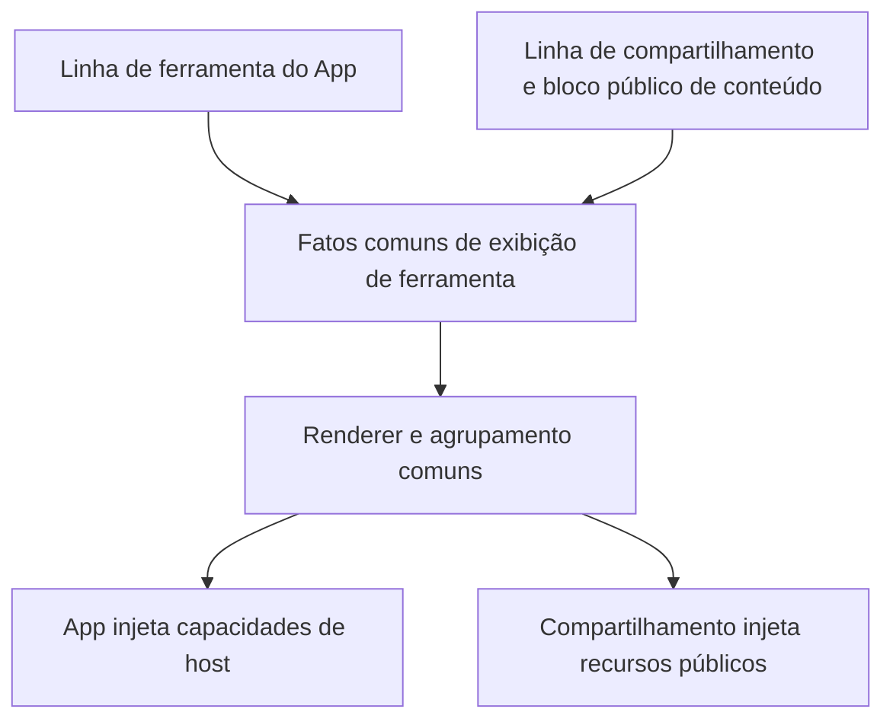

# Compartilhamento de Conversa e Continuação de Trabalho V1

## Status

- Spec de fatos atuais, data: 2026-08-31.
- Baseline de API: interface de compartilhamento de conversa revision 27, mais os acordos de
  integração de 2026-08-12.
- Este documento também restringe o lado de publicação, o lado de importação do Desktop e o contrato da
  página de share independente em `packages/web` no mesmo repositório.

## Limites de produto

O V1 suporta iniciar compartilhamento a partir de workspaces Desktop locais, SSH, WSL e Docker. O
`/remote` do celular e a Web comum não podem iniciar compartilhamento; o `/cn/share/:share_code` em
`packages/web` apenas consome a API de preview e invoca o Desktop por deep link. O Desktop Server Remote
não é suportado na primeira fase.

Uma sessão em execução pode compartilhar product turns concluídos anteriormente; um turn em execução pode
ser exibido, mas não selecionado. A seleção de compartilhamento tem `productTurnId` como identidade, e
`rowId` é usado apenas para localização no timeline. O título assume por padrão o título da tarefa atual e
pode ser editado apenas para este compartilhamento; um novo rascunho de compartilhamento abre o flutuante
de configurações com a permissão padrão `public_importable` (quem tiver o link pode importar e continuar);
após o usuário trocar explicitamente a permissão, ajustar o escopo do compartilhamento ou reabrir o mesmo
rascunho mantém essa escolha.

```text
Desktop UI
  -> workspace-scoped ConversationShareService
       |- JWT / Share API do Environment de destino
       |- local/remote Conversation Rows + fileChanges
       `- local/remote artifact staging
  -> prepare -> upload -> confirm -> share URL

Web preview
  -> https://zcode.z.ai/cn/share/<share_code>
  -> zcode://share/import?code=<share_code>
  -> Desktop continuation
  -> 当前本地 workspace 新 task/session + shared_context + 全部产物
```

A página de share é uma build estática independente: `pnpm run build:web-share` usa Vite `base=/cn/share/`
e é publicada por `Dockerfile.web-share` e `nginx.web-share.conf` nas duas entradas de idioma `/cn/share` e
`/share`. As duas compartilham a mesma SPA e os mesmos assets estáticos, e o prefixo de caminho decide a
locale de UI em chinês ou inglês; ela usa imagem, Deployment, Job de CI e versão de rollback independentes
de `/remote/v4`; o Preview público é de acesso anônimo e o Preview privado usa o OAuth Web de mesma origem.

A build recortada instala apenas a dependência transitiva de `@zcode/web-share`. Os arquivos de
Web/UI reutilizados não podem depender dos links de `node_modules` do workspace completo; o Vite usa um
alias de código-fonte com correspondência exata para a entrada raiz de `@zcode/shared`, evitando falha de
resolução a partir do diretório Web, e ao mesmo tempo não pode reescrever subcaminhos de
`@zcode/shared/*` para `index.ts/*`. Cada subcaminho de `@zcode/shared/*` usado pelo fechamento do Share
(como `test-ids` e `zcode-protocol-v4`) precisa registrar um alias de código-fonte exato em
`packages/web-share/vite.config.ts`. A regressão da build isolada cobre essa restrição.

A verificação manual da imagem e das rotas nginx usa `scripts/test-web-share-build.sh` (requer Docker
local, sem credenciais Git do CUA). Ele valida que o artefato de build fica em `/cn/share/assets`,
confirma que as entradas `/cn/share` e `/share` e o callback são acessíveis e, ao mesmo tempo, que
`/remote/v4` não é servido; esses paths base e o isolamento de rotas não são cobertos por testes
unitários, então vale rodar uma vez depois de alterar o Dockerfile ou a configuração nginx.

O callback OAuth é oferecido nas entradas por idioma como `/cn/share/callback` e `/share/callback`, e as
credenciais de login continuam sendo gravadas no `BrowserOAuthCredentialRepo` de mesma origem; assim, após
o login, as duas entradas de Share, o `/remote` e os demais caminhos Web compartilham a mesma sessão Web.
O JWT Web não entra no Deep Link nem é passado ao Desktop. As duas entradas não redirecionam uma para a
outra, evitando que a página em inglês seja trocada para a locale chinesa; assets estáticos e callback são
hospedados de forma independente pela imagem de share.

O mapeamento de permissões é fixo: `private` exige o OAuth Web do owner antes de Preview/import;
`public_readonly` e `public_importable` têm Preview totalmente aberto ao anonimo. Em requests anônimos a
um share private, tanto `401/3213` quanto `404/3211` sob política de ocultação podem mostrar apenas um
aviso genérico de login; se mesmo autenticado o resultado continuar `404`, não se pode revelar a existência
do compartilhamento nem informação do owner. A continuation do Desktop carrega um estado de login
opcional, e o cliente não pode pular a requisição por falta de JWT local; a permissão final de import é
decidida pelo servidor com base no share code, no modo de acesso e na identidade de usuário opcional.

### Página de "conteúdo não encontrado"

Quando o usuário está autenticado e o Preview retorna `not_found`, mantém-se o cartão de estado
centralizado, exibindo 「找不到分享内容」 e 「链接可能无效、分享已被移除，或当前登录账号无法访问。」; com um
parágrafo separado informando 「Z.ai 与 BigModel 的账号数据不互通。请检查是否选错了登录平台或使用了其他账号。」
A dica de conta é uma sugestão de diagnóstico e não infere se o compartilhamento existe, a qual plataforma
pertence nem quem é o owner. Chinês e inglês oferecem textos equivalentes.

Na área de ações, da esquerda para a direita, ficam o botão com contorno 「重试」 e o botão principal
「回到首页」. A página inicial reutiliza o endereço oficial existente `https://zcode.z.ai`, navega na
mesma aba e não limpa o estado de login. Os botões priorizam o layout lado a lado, permitindo quebra de
linha em telas estreitas ou textos longos; usam os tokens existentes de tema e de tamanho de fonte da UI,
sendo compatíveis com desktop, Web no celular e temas claro e escuro.

```text
Preview not_found → 现有 Loader
  ├─ 无 token → 登录选择页
  └─ 有 token → 找不到分享内容 + 账号排查提示
                   ├─ 重试 → 当前 token 再请求 Preview
                   └─ 回到首页 → 官网导航
```

O estado continua sendo mantido exclusivamente pelo `ConversationShareLandingLoader`; os componentes de
estado apenas exibem. Não se modificam o mapeamento de erros, o OAuth, as outras páginas de erro, o
Desktop continuous nem a cadeia de replay do remote no celular.

Caso de aceitação SHARE-NF01 (pending): depois de iniciar `pnpm dev:web-share:mock`, executar
`node packages/web/test/e2e/manual-review/pending/share-not-found.mjs`.
Verificar acesso anônimo ao fixture → login → checar a dica de conta → retry → navegação para a home na
mesma aba, validando os limites acima; cobrir também chinês e inglês, viewports de celular e desktop de
320px, temas claro e escuro, ausência de overflow horizontal e a garantia de que a página expirada não
apresenta conteúdo novo. O request da home é interceptado pelo teste de navegador, sem depender da rede
externa. Os testes unitários do componente complementam com asserções de isolamento para os outros estados
de erro.

Entrada local de verificação do Share: `pnpm dev:web-share:test` inicia a entrada Vite de
`@zcode/web-share` igual à de produção, conectada fixamente ao ambiente de testes; após iniciar, abrir
manualmente `http://localhost:5173/cn/share/<share_code>` ou `http://localhost:5173/share/<share_code>`, e o
share code é lido apenas do path da URL, sem necessidade de variáveis de ambiente; a primeira exibe
chinês e a segunda inglês. `pnpm dev:web-share:mock` usa os fixtures de desenvolvimento
`/cn/share/mock-private`, `/cn/share/mock-readonly`, `/cn/share/mock-importable`, `/cn/share/mock-expired`
e `/cn/share/mock-not-found`. Ambos iniciam apenas o Vite, sem Desktop, relay ou Agente independente.
Há ainda dois fixtures de compatibilidade entre versões: `/cn/share/mock-partial-unsupported` (linhas não
reconhecidas são puladas, com um aviso suave no topo) e `/cn/share/mock-outdated-client` (versão do payload
maior que esta build, mostrando 「需要更新 ZCode」 em vez de 「格式无效」).

O runtime de compartilhamento do Environment de destino sempre usa a Share API real, com o endereço da API
resolvido por `ZCODE_ENV`; não há mais chave de Mock em runtime. `ConversationShareMockApiClient` serve
apenas a testes unitários de serviço e a fixtures de protocolo, e não pode gerar links de compartilhamento
acessíveis de outro processo.

A exibição do corpo da página pública reutiliza a camada de apresentação somente-leitura de
`packages/ui`: por meio de `buildConversationTurnRenderUnits` mantém a ordem de turnos e blocos de
trabalho do Desktop, usando o mesmo conjunto de `ConversationUserInputBody`,
`ConversationUserInputContent`, `MessageResponse`, `Reasoning`, `ToolLayout` e `ToolSummaryRow`. O Share
apenas injeta locale, theme e code preview defaults, e não injeta Host, workspace nem file service; as
ações de Desktop, abertura de arquivo, edição, retry e feedback continuam existindo apenas no Desktop.
Ferramentas contínuas como Explore/Execute/CUA também passam antes pelo agrupamento
`buildAssistantWorkRenderItems` do Desktop, e a página pública exibe apenas resumo seguro e detalhes
somente-leitura, evitando que o resultado de cada ferramenta vire um cartão grande independente.

O Share assume o próprio scroll vertical da página, sem alterar a convenção Desktop/remote global de
`body/#root { overflow: hidden }`. A raiz de scroll também é marcada com
`data-markdown-table-layout-root`, mantendo independentes o scroll vertical da página e o scroll horizontal
interno das tabelas Markdown longas. O modo público do `MessageResponse` consiste em um `TooltipProvider`
efêmero, um handler de link externo somente-leitura e a limpeza de citations: citations locais não vazam
caminhos e diretivas de protocolo não são renderizadas quando não há correspondência com um artifact
público.

A barra fixa no topo da página pública de compartilhamento sempre mantém altura de linha única de 64px. A
marca `ZCode`, o título do compartilhamento e o CTA de continuação usam o mesmo trilho geométrico contínuo;
quando o CTA completo não consegue reservar a largura mínima visível para o título, ele troca por um CTA
de ícone que preserva o nome acessível e deixa o título encolher via CSS ellipsis. O título completo
permanece no nome acessível/`title`. `public_readonly` nunca mostra CTA; essa estratégia responsiva afeta
apenas a exibição da landing page Web e não altera Deep Link, permissões ou comportamento
Desktop/remote.

Quando o compartilhamento pode continuar por importação, o fim da linha do tempo do corpo também mostra um
botão “去 ZCode 继续” com o mesmo estilo e comportamento do CTA do topo, centralizado horizontalmente na
coluna de conteúdo do corpo e reutilizando o mesmo deep link `zcode://share/import`. Clicar em qualquer uma
das entradas, superior ou inferior, entra no mesmo fluxo automático de abertura; `public_readonly` continua
sem nenhuma entrada de continuação. O botão inferior faz parte do fluxo do corpo, não pode ocultar o
último conteúdo compartilhado e não altera a semântica somente-leitura do conteúdo compartilhado.

O "número de resultados" nos metadados públicos conta apenas linhas `kind: "artifact"` dentro dos `rows`
públicos, ou seja, os cartões de resultados do Assistant realmente exibidos no timeline.
`preview.artifacts` é o manifest completo de downloads, compartilhado entre resultados e
`userInput.attachments`, e não pode ser usado diretamente como contagem de resultados; anexos de entrada
do usuário continuam participando do mapeamento de URL/nome e do download, mas não contam como "resultados".

Os anexos de imagem do usuário são exibidos como miniatura conforme o `mime`, buscando a imagem primeiro
por `previewRef` e depois por `ref` no mapeamento existente de URL de artifact; clicar na miniatura abre a
imagem original pelo endereço correspondente ao `ref` do anexo. Em anexos comuns, sem endereço de imagem
disponível ou quando o carregamento da imagem falha, mantém-se o nome do arquivo, o tamanho e a entrada de
download do arquivo original. A prévia de compartilhamento somente-leitura do desktop e a página pública
reutilizam a mesma apresentação, quebrando a linha automaticamente e restringindo a largura em celular
estreito; os nomes acessíveis em dois temas e em chinês e inglês vêm das regras existentes, sem novo
canal de leitura ou upload pelo host.

## Prioridade de protocolo

Quando soluções históricas, exemplos de interface e este documento entrarem em conflito, aplicam-se as
regras abaixo:

1. O confirm envia apenas `selected_product_turn_ids`, `projection.rows`, os dois hashes de integrity e a
   confirmação de divulgação.
2. title, schema version, access mode, client request ID e payload hash são enviados apenas na preparation.
3. O integrity de Preview / Continuation tem apenas `projection_sha256` e `artifact_set_sha256`.
4. A resposta de sucesso do upload de artifact precisa conter um `safety_status` não vazio; o cliente não
   faz branch conforme o valor.
5. HTTP 409 / code `3215` é estado não terminal da verificação de segurança; para a mesma preparation e o
   mesmo DTO de confirm em termos de bytes, faz polling serial, preferindo um Retry-After legítimo, senão
   5 segundos, com espera total de no máximo 2 minutos.
6. TTL, limites e allowlist de produtos seguem estritamente as capabilities; PDF só é liberado após
   declaração explícita do servidor.

## Disciplina de compatibilidade entre versões

O conteúdo compartilhado flui entre **4 componentes que podem ser atualizados/revertidos de forma
independente**: o Desktop publicador, o backend Share API, a imagem da landing page implantada de forma
independente (ver "imagem, Deployment, Job de CI e versão de rollback independentes" acima) e o Desktop
importador. Eles não podem estar na mesma versão, então a projeção pública é de fato um **formato de
troca de dados entre versões**. As disciplinas abaixo não são sugestões:

1. **Resposta tolerante, requisição estrita.** Schemas de entrada (capabilities / preview / continuation /
   envelope de erro / eco de descriptor de artifact) nunca são strict, e campos desconhecidos passam;
   schemas de saída (preparation / confirm / continuation request) mantêm `.strict()`, e campos extras são
   bug local e precisam explodir na hora. Adicionar `.strict()` de volta a um schema de entrada equivale a
   fazer o próximo campo novo do backend matar todos os clientes já em uso.
2. **A integridade é validada apenas contra os valores enviados como vieram do servidor**, nunca contra o
   produto da análise do zod (`verifyConversationShareIntegrity`). O zod remove campos desconhecidos por
   padrão, e recalcular o hash sobre o produto da análise reportaria uma evolução de row puramente aditiva
   como 「分享文件校验失败」. Digest e conhecimento de schema precisam ficar permanentemente desacoplados.
3. **rows só podem ser aditivos.** Novos campos precisam ser `optional`; **nunca remova um campo, nunca
   estreite um enum, nunca mude a semântica de um campo** — remover campos e estreitar enums também fazem o
   outro lado perder conteúdo, apenas na direção oposta.
4. **Um novo row kind ou valor de enum significa que clientes antigos pulam aquela linha**
   (`decodeConversationShareRows` degrada linha a linha e a UI mostra um aviso suave de 「部分内容需要更新 ZCode 查看」).
   Antes de adicionar, pergunte: com essa linha pulada, o compartilhamento ainda é coerente? Só mudanças
   semânticas que não podem ser puladas chegam a justificar o item 5.
5. **`schema_version` só é incrementado quando rows sofreram uma mudança destrutiva que não pode ser
   pulada**, e antes de incrementar é preciso confirmar a proporção de versões dos clientes existentes e
   das imagens de landing page já implantadas — incrementar uma vez equivale a fazer todos eles não
   conseguirem ver os novos compartilhamentos. Quando a versão é superior ao conhecimento local, usa-se
   `unsupported_schema_version`(「请升级 ZCode」), sem misturar em `invalid_contract`(「分享格式无效」).
6. **O switch exaustivo de `projectRow` (`conversationSharePublicProjection.ts`) é uma barreira de
   compilação proposital; não adicione um `default` a ele.** Um novo row kind precisa fazer o build falhar,
   forçando o desenvolvedor a tomar a decisão do item 4 em vez de começar silenciosamente a emitir na projeção pública
   algo que clientes antigos não conseguem ler.

A cobertura de regressão está na seção "cross-version forward compatibility" de
`packages/shared/test/conversationShareContract.test.ts`, e no caso de ponta a ponta "importando um
compartilhamento publicado por uma versão mais nova" em `conversationShareImportService.test.ts`. Após
alterar um contrato de entrada, é preciso rodar os dois.

## Autoridade e fronteiras de segurança

### Autoridade de compartilhamento do Source Server R3 (2026-09-16)

O compartilhamento de um workspace remoto R3 é executado pelo Source Server de destino, lendo o OAuth/JWT,
a configuração de rede, as sessões e os arquivos do Environment de destino atual. O Desktop apenas
encaminha a requisição e fornece o contexto confiável do attachment; mesmo que a conta local seja diferente
da remota, isso não pode alterar o dono do compartilhamento. O Provisioning pode gravar antecipadamente
as credenciais remotas, mas cada compartilhamento lê apenas o Store oficial do remoto, não lê o JWT do
Desktop on-line e não recai para a conta local quando não está autenticado ou a credencial é inválida. Esta
regra substitui o antigo modo mixed-service de SSH, que combinava "arquivos remotos + JWT/API local";
workspaces locais continuam sendo executados na própria máquina.

```text
Desktop attachment (sobrescreve o contexto não confiável do caller)
  → SSH/WSL/Docker → Share RPC do Source Server
                    → OAuth remoto + HTTP remoto + Rows/File remotos
                    → reuso do mesmo trusted carrier V4 / conexão com handshake já concluído
  conexão direta ao server → permanece desabilitada na primeira fase
  attachment do celular / entrada Web comum do Source → recusar publicação e importação
```

O Source Share RPC só aceita o contexto downstream desktop-continuous sob o transporte Host confiável; as
consultas de Rows/File reutilizam o Agent scope existente desse transporte, que aplica namespace ao
connectionId downstream, e não podem criar outra conexão ou handshake. Os campos raw de renderer do
Desktop precisam ser sobrescritos pelo valor verdadeiro do attachment confiável, e clientes Web do Source
não podem forjar esse campo. O estado de publicação, o cache de preflight, os arquivos temporários e o
HTTP do Source são gerenciados pelo seu ShareService existente; reconectar reconstrói o attachment RPC, sem
adicionar stream, fila ou semântica de recuperação. As fronteiras de Desktop continuous e celular
replayable permanecem as mesmas.

Os dados de compartilhamento carregam `workspaceIdentity` e `remoteSessionId`; a key de isolamento continua
sendo `workspaceIdentity?.trim() || workspacePath`. A conversão de identidade do Source reusa o canonical
mapper existente. JWT, Signed URL, o corpo de Rows e o conteúdo de arquivos não podem entrar em logs.
`remote:server:...` é um formato de identidade e não permite tratar o SSH como uma conexão direta ao
Server escolhida pelo usuário.

Regressão: fábrica remota real → Share RPC → trusted Agent na combinação completa; com conta local A e
conta remota B, deve-se usar apenas B, e após a saída remota a publicação é recusada sem recair para A; o
acesso direto por Web/mobile e a conexão direta ao Server continuam recusados; o contexto de handshake
precisa ser consistente com as sessões existentes. SHARE18 roda isoladamente: primeiro, pelo Provisioning
existente, grava no remoto o Team profile explicitamente fornecido; depois o remoto acessa a Share API de
produção correspondente. O modelo usa replay case-local, precisa gerar arquivos de verdade e validar o
sucesso da publicação e os bytes dos produtos.

### Fronteira defensiva da página pública contra conteúdo de terceiros

A página pública de compartilhamento (`/share`, `/cn/share`) renderiza um **corpo controlado pelo
publicador**, e o visitante é anônimo, então nesse ponto de entrada o corpo precisa ser tratado como
conteúdo não confiável. As duas defesas precisam estar presentes, nenhuma pode faltar:

1. **Remoção no lado de renderização**: `normalizeConversationShareMarkdown`
   (`packages/ui/src/v4/conversationShareMarkdown.ts`) rebaixa a sintaxe de imagens remotas no corpo e na
   saída de ferramentas para links comuns (`` → `[alt](https://x)`). Trata apenas
   `http:` / `https:` / `//` relativo a protocolo; `data:` não sai pela rede e caminhos relativos caem na
   própria origin, então ficam como estão; escritas dentro de cercas de código são protegidas por
   `findMarkdownCodeRanges` e não são reescritas. Motivo: como o timeline somente-leitura não passa
   `workspacePath` / `sessionId` / `readAttachment`, o `MarkdownImage` cairia no fallback
   ``, e então qualquer visitante, ao abrir a página, dispararia
   automaticamente uma requisição para um terceiro especificado pelo publicador, vazando IP / UA / Referer
   — o equivalente a um tracking pixel controlável pelo publicador. Ficar no lado de renderização tem a
   vantagem de valer **imediatamente para compartilhamentos antigos já publicados**.

2. **CSP no lado de transporte**: `img-src 'self' data: blob:` em `nginx.web-share.security-headers.conf`
   cobre qualquer forma que tenha escapado da primeira defesa. Esse arquivo também fornece
   `X-Frame-Options` / `X-Content-Type-Options` / `Referrer-Policy`, e **precisa ser incluído
   explicitamente por cada `location`**: o `add_header` do nginx não é herdado, e qualquer `add_header` em
   um nível filho (por exemplo `Cache-Control`) descarta o conjunto inteiro de declarações do nível server.

Duas restrições rígidas do CSP (leia antes de mexer, senão a página em produção quebra silenciosamente):

- `script-src` precisa ter `'wasm-unsafe-eval'`: o realce de código do shiki usa por padrão wasm oniguruma
  (`createHighlighter` em `packages/ui/src/lib/shikiHighlighter.ts`), e dar apenas `'self'` quebraria todo
  o realce de código da página de share. Ele só libera compilação wasm; `eval` / `new Function` continuam
  bloqueados (já verificado empiricamente).
- `connect-src` permanece `https:`: a origin da API é injetada em tempo de build do vite conforme `ZCODE_ENV`
  (`packages/web-share/vite.config.ts`), e fixar uma origin concreta obrigaria test e production a terem
  um conf cada.

Artifacts são abertos apenas via `window.open`, sem ``, portanto não são afetados pelo
endurecimento de `img-src`.

## Projeção de publicação

A projeção pública é construída a partir de `ConversationRow[]` oficiais, nunca por inferência a partir do
DOM, de MessageWithParts legados ou de DTOs Web.

- Permitidos: `turnHeader`, `userInput`, `assistantText`, `reasoning`, `toolCall`, `timelineMarker`, `artifact`.
- Detalhes de `subagent` são filtrados, mas o toolCall do Agente correspondente e os demais Rows públicos do
  mesmo turno são mantidos.
- Cada classe de Row cria um objeto novo por allow-list, removendo actions, source/root command ID,
  client ID, approval ID, active progress e referências locais de artifact.
- Reconstrói deterministicamente os IDs públicos de product-turn, turn, row, entity, tool-call e artifact,
  preservando a ordem estável dos Rows e o fecho de referências.
- O descriptor não envia `original_path`. A referência de artifact é fixa em
  `zcode-artifact://share/<artifact_id>`.

A seleção precisa conter pelo menos um product turn terminal. Cada ID selecionado precisa ter exatamente um
`turnHeader` e o estado não pode ser `running`. Qualquer inconsistência de revision/log epoch entre
páginação precisa falhar antes da preparation.

### Exibição de ferramentas Workflow

`toolCall.display` suporta `create_workflow`, `get_workflow_run`, `list_workflow_runs`,
`eval_workflow_snippet`, `saved_workflow_list`, `list_models` e `resume_workflow_run`.
O cliente usa o `toolCallDisplaySchema` oficial para validar e copiar a exibição completa, e o servidor
espelha campo a campo seus objetos aninhados, enums, campos opcionais, limites de array e comprimento de
string em UTF-16; tipos desconhecidos, campos desconhecidos e valores inválidos continuam rejeitados.
Imagens continuam passando pela conversão de artifact já existente, sem abrir Base64 inline nem URI local.

Aqui o que é compartilhado é o snapshot de exibição no momento da execução da ferramenta: a linha da
ferramenta precisa estar em estado terminal, e o status de workflow dentro do snapshot pode ainda estar
`running`, sem exigir que o workflow em segundo plano termine. runId, os sites e os IDs de etapa dentro do
grafo são dados do snapshot e não constituem autorização de execução no lado do compartilhamento; o estado
ao vivo de workflowRuns não é publicado e nenhuma ação de executar, retomar ou assinar é adicionada.
A página de share reutiliza os componentes de exibição de workflow existentes: o grafo estático de etapas
e os diagnósticos de compilação de Create/Amend, o resumo de execução/etapas/subagentes/logs de Get, a
lista de execuções de List, os diagnósticos/resultados de Eval, a lista de workflows de Saved e a descrição
de resultado de Resume. A exibição representa apenas o snapshot do momento da chamada da ferramenta; não
injeta arquivos locais, sessão, edição, execução ou callbacks de retomada. Linhas históricas sem display
seguem o cartão de ferramenta genérico; ListModels usa o renderer compartilhado de catálogo de modelos. O
lado de importação preserva o display, e o `schema_version` permanece 1.
Em desktop/celular, nos temas claro e escuro e em chinês e inglês, o conteúdo é legível e os detalhes podem
ser expandidos; o cabeçalho do cartão em tela estreita permite quebra de linha, e o nome do workflow não
pode ser espremido a ponto de ficar invisível; a página não solicita serviços do host de desktop.

Aceitação: as 7 exibições fazem a projeção completa, a validação de confirm no servidor e a decodificação na
importação passam; campos aninhados desconhecidos, erros de tipo/enum, arrays/strings/inteiros fora do
limite e null explícito falham, e o erro inclui o caminho do row e do campo aninhado; ferramentas comuns,
conversão de imagens e a verificação de integridade do compartilhamento não regridem. Os testes dos dois
lados usam a mesma amostra de JSON de workflow display.
Aceitação no navegador SHARE-WF01 (pending): iniciar `pnpm dev:web-share:test` e rodar
`node packages/web/test/e2e/manual-review/pending/share-workflow.mjs`; o teste intercepta a preview API e
cobre desktop/celular, chinês/inglês, a exibição básica em Zai Light/Dark, a expansão de diagnósticos, o
fallback histórico, o modo somente-leitura e a ausência de overflow horizontal.

### Blocos de conteúdo somente-leitura extensíveis

A projeção pública permite, além de `rows`, `content_blocks` opcionais; cada bloco traz `type`, uma
`version` própria, a âncora pública de product-turn, `fallback_row_id`, `captured_at` e `resource_ids`. O
primeiro tipo é `workflow` v1: grafo de execução e status, notificação de conclusão e seis classes de
produtos do usuário. Não é um repasse do workflowRuns ao vivo; depois de publicado, é um snapshot imutável.
O publicador gera um Row de resumo do tipo assistantText já existente, que os leitores antigos conseguem ler;
os leitores novos só substituem o resumo por um cartão quando o bloco é reconhecido e renderizado com
sucesso. Blocos desconhecidos ou corrompidos mantêm o resumo e não afetam o corpo do mesmo turno.

O servidor declara a capacidade atual pelo `content_block_versions: { workflow: 2 }` opcional; a versão 1
continua compatível, e a versão 2 acrescenta a pré-visualização de texto congelado. Quando a capacidade está
ausente, publica-se apenas o resumo e os recursos comuns permitidos. O `schema_version` permanece 1. Os
novos campos de bloco são validados com allowlist estrita, e os recursos precisam estar fechados dentro do
manifest desta publicação; os blocos usam um `content_blocks_sha256` próprio, e os hashes existentes de
rows/artifact não mudam. preview, continuation e o arquivo de importação preservam os blocos, e a
integridade é verificada sobre os valores do wire antes da decodificação bloco a bloco.

```text
Turnos terminais selecionados → Share Service → leitura congelada dos eventos de journal do Agent original
                              → o mesmo reducer gera o estado do run e as versões dos produtos
                              → itens do quadro com os bytes da versão especificada / até a sequence de corte
                              → projeção de campos públicos + resumo + upload → snapshot imutável no Server
                                                           → exibição somente-leitura na Web / na importação
```

Os eventos de workflow são lidos paginados por `afterSequence`, e a sequence precisa crescer estritamente
entre páginas; uma página vazia e inacabada, um cursor repetido, uma falha de leitura ou um total acumulado
acima de 20000 itens marcam o run como indisponível. A leitura até `hasMore=false` forma um prefixo
append-only, e a sequence do último item é o ponto de corte desta publicação (não o momento da primeira
requisição); o acréscimo contínuo também respeita o limite total de itens. A paginação do quadro filtra os
itens posteriores a esse nível de água, e os arquivos são lidos pela artifact version registrada pelo
reducer. Não se pode usar a revision da conversation para fingir o nível de água do journal. Workflows em
execução em segundo plano não bloqueiam o compartilhamento de turnos de produto já concluídos; o cartão
deles indica explicitamente que é um snapshot do momento do compartilhamento. Quando a associação histórica
ou os dados de origem não podem ser lidos, mantém-se um resumo com o motivo, sem forjar sucesso, contagem
zero ou quadro vazio. Não são compartilhados transcripts de outras conversas/subagentes não selecionados, e
não são habilitados parar, retomar, aprovar ou operar diretórios locais. Os cartões e o quadro reutilizam
componentes e algoritmos puramente de exibição, e o bundle público não introduz Desktop service/store.

Preflight e publicação usam o mesmo coletor; a publicação recongela e não reaproveita o estado de execução
do preflight anterior. Os arquivos seguem a auditoria de upload já existente; o quadro estruturado entra na
conta de payload do bloco e participa da auditoria de conteúdo. Cada novo tipo de conteúdo precisa declarar
schema público, coletor, resumo, política de recursos e renderer somente-leitura; tipos desconhecidos ficam
só com o resumo e não executam código de plugin automaticamente.

O nome de arquivo de download do produto usa a extensão correspondente ao tipo de origem, e os pontos e
números de versão do título não alteram o tipo do arquivo. Só depois que a decodificação de texto e a
validação do schema público passam é que o bloco de conteúdo, a linha de artifact, os bytes e o orçamento
de recursos são registrados em conjunto; um produto que falha mantém apenas a explicação de não inclusão e
não entra no conjunto de upload. O resumo sintetizado de workflow serve só para exibição, e tanto o
preflight quanto a publicação não podem voltar a tratar o seu título ou texto de erro como referência a
arquivo do workspace. A descoberta de arquivos pelo assistantText real mantém o comportamento existente.

Os URLs de produto retornados pela API pública aceitam apenas HTTP(S). Quando a imagem da ferramenta não
tem capacidade de leitura do host nem recurso público correspondente, exibe-se o estado estático
“预览不可用”, sem Loading sem tarefa assíncrona. Erros HTTP desconhecidos não são classificados como
corrupção do contrato de resposta; um 403 sem código de negócio mantém a semântica de not_found de
compartilhamento oculto, e códigos de negócio conhecidos têm prioridade. Uma estrutura de resposta de
sucesso realmente inválida continua sendo invalid_contract.

Aceitação SHARE-WF02: cartão de execução completo, cartão de conclusão, board/table/chart/metrics, abertura
real de Markdown e de arquivos; seleção de turno concluído, snapshot em execução, resumo entre versões,
fechamento de recursos/tamper, ausência de dependência do Desktop, e layout em celular/desktop, Zai
Light/Dark e chinês/inglês. Dados ausentes de compartilhamentos antigos só podem ser completados
republicando.

## Descoberta e upload de produtos

Os candidatos de compartilhamento incluem os `userInput.attachments` do turno atual, os cartões de preview do
Assistant exibidos finalmente no turno atual, e as imagens embutidas em saídas de ferramentas concluídas. O
row `artifact` oficial deixa de ser uma fonte de descoberta independente; ele só entra no compartilhamento
pela via do cartão de preview, se tiver.formado um.

Os candidatos de cartão de preview precisam ser gerados uniformemente pelo shared candidate builder, e UI
e Share Service usam o mesmo conjunto de ordem, deduplicação e limite de quantidade visível. Caminhos
`~/...` no corpo comum, input/output de Bash, varreduras de workspace, `fileChanges` isolados e arquivos que
não formaram cartão de preview não são candidatos. `fileChanges` é usado apenas para a associação
active/reverted de cartões Markdown/HTML e não descobre arquivos de forma independente.

Os arquivos candidatos passam primeiro por stat no lado de execução dono e só então se obtém o conjunto
final de cartões visíveis; um arquivo de cartão do Assistant que não existe é tratado como "cartão não
exibido", não entra no compartilhamento e não gera warning. Anexos de entrada do usuário mantêm o warning
de anexo inexistente.

PDF, Office, Markdown/HTML, vídeo e áudio podem ser candidatos de preview, mas video/audio atualmente só
entram no warning "existe, mas o tipo não é suportado" e não entram no manifest de artifacts enviável. O
mesmo canonical path é enviado apenas uma vez.

```text
正式 attachment / assistant 文件引用
                 |
                 v
    PreviewableArtifactCandidate（文件预览候选集合）
                 |
       +---------+---------+
       |                   |
       v                   v
  UI preview card     Share Artifact Row
```

Os arquivos passam por realpath containment, arquivo comum, tipo, tamanho e mtime no lado de execução
dono. Arquivos remotos entram em staging temporário no Desktop por `readFileRange` em blocos, com cálculo
de SHA-256 durante a escrita; mudanças de size/mtime, chunk vazio, desconexão ou escrita fora dos limites falham de forma
fail closed. Depois do prepare só são enviados os bytes imutáveis do staging. O upload é serial na ordem
de um manifest estável; qualquer falha impede o confirm, e o finally limpa o staging.

`userInput.attachments` são autorizados para leitura pelo connection scope do Agente atual, via
`rowId + entityId + attachmentIndex`; não é permitido ao Renderer usar o caminho do anexo como alvo de
leitura. Texto longo colado mantém o tratamento de caminho existente
`~/.zcode/tmp/paste-attachments/<date>/<uuid>.txt` e não é reintegrado ao corpo no envio; no
compartilhamento, a mesma cadeia de leitura é reutilizada. Quando o arquivo já foi limpo, a leitura falha ou
os bytes mudaram, apenas aquele anexo é pulado e um warning `input_attachment_unavailable` é exibido no
estado de sucesso da publicação, sem gravar caminhos inválidos na projeção pública. Anexos disponíveis são
reescritos uniformemente como `zcode-artifact://share/<artifact_id>`, sem inserir um Row `artifact`
adicional e fechando diretamente pelo manifest.

O tipo de artifact de compartilhamento ganha `text`, correspondente a `txt` / `text/plain`; o servidor
faz a revisão de segurança síncrona de texto UTF-8 igual à de Markdown/HTML. O tipo `text` é habilitado
depois que cliente, servidor e landing page independente de share forem atualizados juntos.

## Máquina de estados da UI

O botão de compartilhamento no topo abre um flutuante não modal ancorado no botão (largura sugerida de
360px, com desvio automático das bordas), sem overlay de tela cheia e sem substituir o Composer. O
flutuante exibe o título, o botão de escopo do compartilhamento em linha inteira, a permissão, a confirmação
de informações sensíveis e 「生成分享链接」. O botão de escopo combina o resumo, o ícone de conversa e a
seta para a direita; clicar na linha inteira abre o painel de seleção existente, e o item 「调整」 separado
deixa de existir. Durante o preflight (inclusive stale) o botão exibe loading e 「正在检查分享内容…」 sem
ocupar uma linha extra; quando a verificação termina, o resumo do escopo é restaurado e a altura do botão
permanece a mesma.
A entrada de problemas do preflight usa uma dica compacta (como 「有内容无法分享，查看问题」), e a
explicação detalhada permanece na camada exibida após o clique. A dica usa fonte sm, alinhamento à
esquerda e ícone fixo de 16px alinhado à primeira linha; em janela estreita o texto permanece alinhado à
esquerda quando quebra.
As setas do escopo e do dropdown de permissão unificam-se em 14px, com 8px de padding à direita; os
detalhes de diagnóstico e as ações de correção mantêm as entradas existentes.
O título principal do flutuante usa text-ui-lg, os labels de campo usam text-ui-base e as descrições
auxiliares mantêm o tamanho de fonte secundário.
O flutuante usa padding compacto de 12px e espaçamento entre campos; o campo de entrada, o botão de escopo
e o seletor de permissão compartilham a especificação de controle lg; o botão principal 「生成分享链接」 no
rodapé usa 40px de altura isoladamente, o texto mantém text-ui-base e os controles de formulário acima
mantêm 32px.
A confirmação de informações sensíveis não usa fundo de cartão, borda ou linha lateral laranja, e é
apresentada como um checkbox comum com descrição secundária.
O texto de confirmação, os nomes das fases de publicação, o corpo do diagnóstico e os campos e o link da
página de sucesso usam text-ui-base; descrições, dicas de preflight e ações auxiliares usam text-ui-sm, sem
degradar as descrições auxiliares para text-ui-xs; o título principal do flutuante mantém o text-ui-lg já
confirmado.
O overlay de escopo de verificação reaproveita o offset, a borda e a sombra padrão do Popover compartilhado,
usa padding de 12px, corpo em base e agrupamentos/descrições em sm, e não sobrepõe ponta, separador, ponto
laranja ou rodapé com fundo próprio. Ao abrir, o foco vai para o flutuante sem selecionar automaticamente o
título.
Por padrão são selecionados todos os turnos concluídos, e a permissão padrão é public_importable. Turnos em
execução não são selecionáveis, e o título do compartilhamento não altera o título da tarefa.

```text
Compartilhamento no topo → flutuante de configurações → gerar → collecting → uploading → checking → published / failed
                    │
                    └ Ajustar → painel de seleção existente à esquerda (marcação temporária)
                                  ├ Confirmar → grava o escopo e fecha o painel de seleção
                                  └ Cancelar → descarta a marcação temporária e fecha o painel de seleção
```

O `ConversationShareSelectionStore` mantém por `sessionId`, de forma única, o escopo confirmado, a marcação
temporária, a visibilidade do flutuante e o estado de publicação. A visibilidade do flutuante é expressa
por `open`, e a edição de escopo por `pendingExcludedRowIds != null`; não se mantém mais o antigo
scope/stage/view nem um estado global de dropdown. O corpo do texto apenas faz a localização exibida, e a
marcação e a seleção de tudo são tratadas pelos comandos transacionais do painel de escopo;
`ConversationSharePreflightStatus` mostra apenas os problemas e as ações de retry/remoção do turno inteiro,
sem manter o antigo próximo passo nem os controles de seleção em lote.
「调整」 copia o escopo confirmado para a seleção temporária; a marcação por turno usa o `productTurnId`
como identidade, e várias queries do mesmo turno mudam juntas.
O painel de seleção reaproveita os resumos existentes de pergunta/resposta; clicar no item da lista (texto,
resumo ou área em branco) e no checkbox alterna a seleção temporária; o botão de localização independente à
direita apenas salta para o corpo, sem alterar a marcação. Enter/Space do teclado pode alternar o botão de
texto, e o botão de localização pode receber foco de forma independente; itens em execução não podem ser
marcados, mas ainda podem ser localizados.
Cada linha do painel de seleção usa 8px de padding vertical uniforme e 4px de espaçamento entre título e
resumo, e o recuo especial da primeira linha é removido; título em base com peso regular e resumo em sm.
Checkbox e prompt da primeira linha são centralizados verticalmente, e message e prompt são alinhados à
esquerda. O seletor tem 320px de largura, e em janela estreita não ultrapassa o viewport menos 16px; o
prompt permanece em uma linha, e a message tem no máximo duas linhas e é truncada. O viewport de rolagem usa
um mask de 32px de transparência acima e abaixo: ele só aparece quando ainda há conteúdo na direção
correspondente, e o gradiente correspondente é removido ao chegar ao topo/fim; sem overflow não há gradiente.
O mask não age sobre a barra de rolagem nem sobre a área de ações inferior. O checkbox fixo de selecionar
tudo no topo é alinhado à esquerda com os checkboxes da lista, com três estados (tudo selecionado, nada
selecionado, parcialmente selecionado); ao clicar no estado parcial completa a seleção, e ao clicar em
tudo selecionado limpa tudo, operando apenas sobre linhas concluídas e selecionáveis. Modificações em lote
escrevem apenas no rascunho de seleção atual, valem após a confirmação e são desfeitas ao cancelar; fica
desabilitado quando não há linhas selecionáveis.

O painel adota três camadas: selecionar tudo no topo, lista rolável no meio, e status e ações na base. A
base mostra por padrão o número de turnos selecionados; ao exceder o limite, é substituída pelo texto em
cor de warning 「超出上限 N 行」 e a confirmação é desabilitada. Durante o preflight o status de verificação
é exibido e a confirmação é desabilitada, e a seleção vazia também desabilita a confirmação. A contagem de
linhas e o limite vêm do preflight do serviço existente, não fixam 500 e não confundem turnos com linhas.

Fluxo de dados: marcação → rascunho `pendingExcludedRowIds` do selection store → reaproveitar o
cache/preflight por turno → agregar a contagem de linhas → estado do painel. Confirmar salva o rascunho,
cancelar descarta o rascunho e restaura o preflight da seleção original; quando não há rascunho, usa-se a
seleção confirmada. Mantém-se o isolamento por workspace/sessão e o tratamento de respostas expiradas. A
aceitação cobre tudo/nada/parcialmente selecionado, restaurar a seleção depois de reduzir o excesso ao
exceder o limite, rollback ao cancelar, efeito ao confirmar e desabilitação com seleção vazia, além de
desktop/janela estreita e temas claro/escuro.
A marcação é expressa pelo Checkbox compartilhado; desmarcado, o corpo do texto continua legível, e apenas
os itens desabilitados em execução ficam esmaecidos; no hover usa-se um fundo claro uniforme.
A base exibe fixamente 「已选 N 轮」「取消」「确认」, a contagem em sm, os botões uniformes de 32px, e a lista
rola internamente; sem nenhum turno selecionado, confirmar fica desabilitado.
A contagem no flutuante só é atualizada depois da confirmação; ao cancelar, o escopo original e a marcação
de informação sensível são mantidos, e mudar o escopo reinicia a marcação de informação sensível.
Durante o ajuste o flutuante permanece visível e a geração fica desabilitada; não são adicionadas páginas
de segundo nível, listas recolhíveis ou seletores.

Clicar fora dos dois painéis ou pressionar Esc cancela primeiro a seleção temporária e fecha apenas o painel
de seleção; um novo clique fora ou Esc recolhe o flutuante.
Clicar na localização do corpo do texto, no flutuante e nas suas camadas de permissão/diagnóstico não
fecha o painel de seleção por engano. Recolher o flutuante preserva o rascunho da sessão atual, e abri-lo de
novo o restaura.
Trocar de sessão não pode reaproveitar seleção, título, permissão, progresso de publicação ou resultado de
sucesso de outra sessão.

Antes da publicação, gerar é proibido quando o título está vazio, nada está selecionado, o escopo está sendo
ajustado ou o preflight não passou. Quando a confirmação de informações sensíveis não está marcada, clicar
em gerar apenas localiza e foca o checkbox, exibe o texto de confirmação na cor de warning e faz a linha
inteira do checkbox e do texto tremer levemente para os lados uma vez (280ms, no máximo 4px).
Não muda o fundo nem a borda do checkbox e não publica automaticamente; cliques repetidos reiniciam a
animação sem acumular, e marcar ou desmontar cancela imediatamente. Com a preferência por menos movimento,
apenas mantém a cor de warning.
Depois de marcar, o texto volta imediatamente à cor normal, e ainda é preciso clicar em gerar de novo.
Quando o item de confirmação já está visível, não há rolagem; quando é preciso localizar, apenas o corpo do
flutuante rola, e a página externa e o botão fixo no rodapé ficam estáveis.
Durante a publicação, modificações e fechamento ficam bloqueados; em caso de falha, a causa, o diagnóstico e
o retry são exibidos no lugar, preservando o rascunho.
O flutuante em geração mantém 12px de espaçamento, exibe no máximo duas linhas do título da tarefa, uma
barra de progresso fina e uma lista de três etapas; só a fase atual exibe a descrição auxiliar do progresso,
e o progresso da fase atual (como a quantidade enviada) é a informação principal, usando text-ui-base; o
resumo de turnos/permissão no rodapé usa text-ui-sm.
O tamanho da fonte escala com o ajuste de interface, e o tamanho dos ícones permanece fixo. Ícone em
andamento gira, o de conclusão é uma marca de verificação, e o de pendência é esmaecido. O texto de progresso
duplicado no topo e o botão de gerar inoperante no rodapé são removidos, mantendo o resumo de
turnos/permissão; após a falha, a entrada de retry é restaurada.
Em sucesso, exibe no lugar o título somente-leitura, o link real, copiar link e ver no navegador; após
copiar, mostra brevemente "copiado", e o flutuante continua aberto.
O flutuante de sucesso remove a descrição duplicada e o rótulo 「分享标题」, e o título da tarefa ocupa no
máximo duas linhas; a caixa do link tem 32px e mantém o texto selecionado para cópia.
Padding uniforme de 12px, removendo o separador inferior; as duas ações têm a mesma largura e 40px de
altura, ver no navegador como botão secundário e copiar link como botão principal, e o ícone de sucesso e o
título ficam centralizados.
Depois do sucesso, fechar e clicar de novo no compartilhamento do topo inicia uma nova rodada de configurações
de compartilhamento: título e permissão são mantidos, o escopo volta a ser todos os turnos concluídos
atualmente, o link de sucesso anterior, o diagnóstico, o progresso e o attempt de publicação são limpos, e a
confirmação de informações sensíveis é reiniciada como não marcada; é possível ajustar o conteúdo de novo e
gerar.
Um rascunho que não foi publicado com sucesso, ao ser fechado, ainda restaura as configurações originais, e
o retry após falha reaproveita o attempt original. Uma nova rodada apenas reinicia o estado local, sem
revogar o link antigo.
A posse do estado continua sendo do ConversationShareSelectionStore: published → closeShare (recolher) →
openShare (nova configuração) → publish (novo attempt).
Arquivos pulados mantêm warning não bloqueante. Sem um resultado de confirm real, não se pode mostrar o link.

O corpo do flutuante rola de forma independente e o botão de gerar permanece visível; os botões na base do
painel de seleção também não podem ser empurrados para fora pela lista. Quando a janela estreita não
comporta os dois lado a lado, durante o ajuste a altura do flutuante de configurações é limitada, o painel de
seleção é deslocado para baixo dele, e ambos mantêm as ações originais. Compatível com janela estreita,
Zai Light/Dark e chinês/inglês. O remote do celular e a Web comum continuam sem entrada de compartilhamento,
e as fronteiras de permissão/recuperação de Desktop continuous e celular replayable não mudam; a API de
publicação, a autoridade do Host e o mecanismo de retry idempotente não mudam.

Aceitação SHARE34: abrir/recolher preserva o rascunho; o ajuste da seleção temporária não altera o escopo
confirmado; rollback ao cancelar, efeito ao confirmar e desabilitação com seleção vazia;
clicar no texto localiza sem fechar o painel; Esc/clique externo fecham em camadas; turnos em execução não
são selecionáveis; publicação bloqueada, retry após falha, cópia em sucesso; isolamento entre sessões.
Os casos de integração de componente de browser ficam em manual-review/pending e não são considerados
publicação real no Desktop nem teste real de controle remoto pelo celular.

A fase de seleção do `SharePreflight` é uma verificação somente-leitura independente, que não envia
arquivos, não lê o conteúdo completo dos anexos e não altera o rascunho de seleção. Ele se liga ao
`sessionId` atual, a `workspaceIdentity/workspacePath`, ao `remoteSessionId`, à seleção, à
`revision/logEpoch` das rows, ao fingerprint de capabilities e ao fingerprint de candidatos; depois de
mudanças na seleção, no conjunto de candidatos, no status de alterações de arquivo ou no nível de água da
sessão, o resultado antigo precisa ser marcado como stale.

Os resultados do preflight são divididos em quatro categorias:

- **Bloqueante**: a seleção ficou inválida, falta product turn, há turno/corpo/ferramenta/subagente/compact/goal
  verification ainda em execução, URL local ou inline, referência de artifact não fechada, nível de água
  obsoleto, capacidade conhecida excedida ou não há nenhum conteúdo compartilhável. Itens bloqueantes são
  exibidos no flutuante de configurações e não permitem gerar o link.
- **Ignorável**: arquivo de cartão de preview que existe mas não é suportado, anexo de entrada do usuário
  explicitamente inexistente ou alterado. Permite continuar, pulando o arquivo correspondente na publicação
  e exibindo um warning no estado de sucesso.
- **Cartão desapareceu**: o candidato de preview do Assistant não existe no stat; é tratado como um cartão
  que a UI não exibe, não entra no compartilhamento e não gera warning.
- **Adiado para a confirmação**: permissão insuficiente, desconexão remota ou timeout de stat, ou seja,
  situações em que não é possível provar que o arquivo não existe. A fase de seleção apenas avisa que isso
  será reconfirmado na publicação, e a fase de publicação segue o resultado real da leitura.

  A classificação precisa se basear nos fault codes estáveis do lado do protocolo
  (`ZCODE_ATTACHMENT_FAULT_CODES`), e não em casamento de texto de erro. `conversationAttachmentStat` é
  uma sondagem metadata-only, e seu limite superior de `totalBytes` (`attachmentStatMaxBytes`) e o limite
  superior do canal de leitura que transporta bytes (`attachmentPreviewMaxBytes`) são duas fronteiras
  independentes: o stat precisa ser capaz de expressar o tamanho real de um arquivo além da capacidade de
  transporte, senão o bloqueio determinístico de "capacidade conhecida excedida" degenera em "adiado para
  confirmação" e o anexo é descartado silenciosamente na publicação. A determinação de tipo vem antes da
  determinação de tamanho — um tipo não suportado nunca será enviado, seu tamanho é irrelevante para o
  compartilhamento e não deve ser elevado a bloqueio.

- **Remoção silenciosa**: `forkNotice`, `forkCreated`, `checkpointRestored` e outros markers internos
  concluídos mas impossíveis de expressar em um timeline público linear são removidos diretamente da
  projeção pública, sem gerar warning, sem contar como ignorados e sem exigir que o usuário cancele o turno.
  Se, após a remoção silenciosa, a seleção inteira não tiver outro conteúdo compartilhável, aí sim ela é
  bloqueada como "sem conteúdo compartilhável".

O flutuante de compartilhamento exibe o estado `checking` durante o preflight; itens bloqueantes mostram o
turno específico e a ação "cancelar a seleção deste turno" (a remoção é do turno inteiro conforme o
`productTurnId` carregado pelo issue, e `turnOrdinal` é usado apenas no texto de exibição — as duas
numerações têm critérios diferentes, e usar o ordinal para consultar o diretório cancelaria o turno
errado); quando há arquivos ignoráveis, a linha de ações mostra a quantidade ignorada. A confirmação e a
publicação ainda precisam reutilizar o mesmo conjunto de validações e rechecar revision/log epoch, stat de
arquivo, tamanho e SHA-256, evitando mudanças por corrida no arquivo ou na sessão depois do preflight.

Os resultados do preflight são cacheados pelo owner renderer-local do fluxo de compartilhamento atual por
`productTurnId`, em vez de rechecar a seleção inteira repetidamente. Ao abrir pela primeira vez o flutuante
de compartilhamento, apenas os turnos ainda não atingidos são verificados em lote; seleções posteriores
verificam apenas as novas e ainda não atingidas. Cancelar turnos já verificados, reselecionar turnos já
verificados e a confirmação do escopo apenas leem o cache e não disparam novos RPCs de preflight. O cache
está ligado a `workspaceKey`, `remoteSessionId`, `sessionId`, `productTurnId`, revision/log epoch das rows,
fingerprint de turno/candidato, status de fileChanges e fingerprint de capabilities; quando o conteúdo do
turno atual, o conjunto de candidatos, o status de alterações de arquivo ou as capabilities mudam, apenas
os turnos afetados são invalidados.

O cache não entra no banco de dados nem no conversation snapshot, e é limpo ao cancelar/concluir o
compartilhamento ou ao trocar de session/workspace.

A interação do flutuante de compartilhamento passa a integrar o módulo gerenciado
`packages/ui/src/conversation-share-interaction/`. O módulo fornece o flutuante, as dicas de preflight, as
ações transacionais de escopo e os handlers de requisição e resposta de preflight; os chamadores acessam
tudo isso pelas entradas registradas. O selection store ainda é o único dono do rascunho de escopo, o
SessionPane ainda é o único dono do cache de preflight e do estado de publicação, e o módulo não adiciona
persistência nem estado de negócio próprio. O controle remoto pelo celular não ganha entrada de
compartilhamento.

O tratamento de exceção da resposta de preflight também precisa encerrar a verificação: os turnos não
atingidos pela requisição atual recebem um item de bloqueio de transporte retentável, a seleção é
preservada, a geração é proibida e os detalhes do problema oferecem 「重新检查」. Os logs de exceção são
registrados separadamente dos logs de falha do servidor. Só depois que todas as entradas da resposta foram
construídas com sucesso é que a metainformação e o cache são submetidos, evitando que o fingerprint de
capabilities de uma resposta com falha invalide imediatamente o resultado da recuperação; requisições
expiradas não escrevem nenhum estado.
Ordem de estados: `checking → ready（阻断）→ 重新检查 → checking → ready（成功或阻断）`.

## Contrato dos detalhes de erro de publicação

Uma falha de publicação não pode mostrar apenas o primeiro erro ou um Toast sem contexto. Antes do prepare,
o Host precisa executar um SharePreflight e, em caso de falha, retornar no máximo 5 `issues` desidentificados;
o excedente é retornado apenas como contagem. Cada issue pode conter o número do turno, o nome do arquivo
(apenas basename), o artifact type, a extensão, o MIME, o valor real e o limite de capacidade; é proibido
incluir caminho absoluto, URL, conteúdo do arquivo, hash, Token ou IDs internos de persistência.

Problemas estruturais precisam ser subdivididos pelo menos em: turno em execução, row em streaming, chamada
de ferramenta ativa, subtarefa ativa, compact/goal verification em execução, anexo de entrada do usuário,
URL local/inline, referência de artifact não fechada e revision obsoleta. Markers internos de
fork/checkpoint concluídos não são erros acionáveis pelo usuário e precisam ser removidos em silêncio;
imagens embutidas de ferramentas seguem as regras de conversão de produtos descritas abaixo. Itens
bloqueantes são agrupados por turno e oferecem a ação de cancelar aquele turno.

Problemas de allowlist de produtos precisam mostrar o nome do arquivo, o type/extension/MIME real e os
formatos permitidos pelas capabilities atuais; a combinação `html + text/markdown` do Markdown e a
combinação `html + text/html` do HTML precisam ser diferenciadas.

Contagem de linhas, quantidade de produtos, tamanho de arquivo único, tamanho total de produtos e tamanho do
payload JSON precisam reportar simultaneamente valor real e limite, sem degradar tudo para "excede o limite
de compartilhamento". Erros de rede, de upload e de verificação de segurança precisam marcar a fase da
falha; se o servidor não retornou informação localizável, mostra-se apenas o tipo de erro estável, a fase e
uma sugestão de retry segura, sem exibir o texto original do servidor.

A classificação de erros HTTP parte da fonte da falha: páginas de erro 5xx não-JSON devolvidas por
gateway/load balancer (502/504 em HTML) são falhas de infraestrutura e precisam ser classificadas como
`service_unavailable`, distinguindo-as da classe `network` de ausência de resposta, e não como
`invalid_contract` só porque o body não pôde ser interpretado (a semântica de `invalid_contract` é o
servidor violando o contrato da API, o que enganaria o troubleshooting e a mensagem ao usuário). O upload de
artifact é uma transmissão grande que o usuário espera ativamente, e o timeout de requisição única é ampliado
dinamicamente conforme os bytes do artifact (com uma estimativa de bandwidth mínima); ele não pode reutilizar
o timeout padrão das requisições JSON comuns. As regras de ampliação de timeout fora do confirm têm a mesma
origem.

O dock de compartilhamento permanece aberto, a falha de publicação continua no dock em estado de publicação e
os detalhes de erro são exibidos inline e roláveis abaixo das informações de progresso; a falha de publicação
não exibe mais o Toast de erro no topo. O estado de erro mantém 「调整」, o fechamento do flutuante e
「重试生成链接」, e os detalhes antigos são limpos quando o usuário muda seleção, título ou permissão. Todos
os textos de detalhe precisam suportar chinês e inglês, temas claro/escuro e layout estreito.

A publicação, a importação e a prévia web compartilham a classificação de códigos de negócio e de status
HTTP: 3216 indica que o conteúdo não passou na verificação de segurança e precisa ser ajustado; 3217 indica
que o serviço de verificação de segurança está temporariamente indisponível e é preciso tentar de novo mais
tarde; 5xx genérico indica que o serviço de compartilhamento está temporariamente indisponível. O code numérico
original precisa ser preservado, inclusive para códigos de negócio desconhecidos. Respostas vazias de
401/429 indicam respectivamente login e nova tentativa mais tarde, e páginas de erro em HTML também são
julgadas pelo status HTTP. 3211/3212 na fase de publicação indicam gerar o link novamente e limpam o attempt
antigo para gerar um novo request ID; na importação, 3211/3212/3214 e as versões não suportadas não
oferecem retry idêntico, indicando respectivamente verificar o link ou a conta, pedir ao compartilhador para
gerar de novo, que o compartilhamento somente-leitura não pode ser importado e atualizar o ZCode. 3210 não
afirma que o arquivo foi perdido e indica de forma unificada que o upload não foi concluído ou que o estado do
compartilhamento mudou. 3215 mantém o polling serial limitado já existente, preferindo um Retry-After-Ms
legítimo.

Os dados de falha de validação do servidor aceitam apenas os campos estruturais limitados
rule/path/field/row_index/row_kind, ignorando o conteúdo original e os demais campos; campos de diagnóstico
inválidos não afetam a classificação do erro. A mensagem principal mantém uma frase com a causa e o próximo
passo, e a localização técnica vai para os detalhes de erro. O request ID do servidor é preferencialmente
`x-request-id`, podendo ser o `logid` válido da resposta quando ausente; nunca se pode usar o request ID do
cliente no lugar dele.
A página de erro da web também oferece os detalhes de HTTP/code/request ID do servidor, e os logs de falha de
importação preservam esses campos para a localização.

```text
Resposta HTTP → classificação/diagnóstico compartilhados → erro do Host ou do cliente Web
                                 ├─ 3215 → polling serial limitado do owner de confirm existente
                                 └─ terminal → estado de erro de UI existente → causa/ação + detalhes sob demanda
                                      └─ 3211/3212 → UI limpa o attempt inválido → retry manual gera novo request ID
```

O `x-request-id` do servidor nos detalhes de erro não é exibido inline no dock de erro por padrão; o texto de
guia de erro coloca no fim um botão de detalhe de erro somente por clique, que exibe e copia o request-id
legítimo do servidor em um Popover que abre para cima. Quando não há request-id de resposta HTTP, a entrada
continua presente, com um aviso de ausência estável no Popover e sem ação de copiar; nunca se pode usar um ID
de request gerado pelo cliente para se passar por ID de servidor. Múltiplas issues compartilham uma única
entrada de detalhe, sem repetir o request-id depois de cada issue. O botão de erro e o texto de erro mantêm a
mesma coluna de conteúdo, usam uma área de clique de 24px e cor semântica destructive, e precisam suportar
ativação por teclado, fechamento por Esc/clique fora, ajuste de colisão em tela estreita e temas claro e
escuro. Quando o painel de escopo é cancelado, o rascunho pending é descartado, e o escopo confirmado, o
título, a permissão e o rascunho de erro são mantidos; clicar de novo no botão de escopo do flutuante abre
uma nova transação de edição. A localização no corpo do texto não fecha o painel.

O cartão de detalhes de erro usa layout compacto de linha única quando há apenas um texto acionável: o
texto, o botão de detalhe e a ação "Fechar" ficam centralizados verticalmente, com padding vertical
consistente, usando `p-2` menor e estreitando o espaçamento entre o cartão e a barra de ações para `mb-2`;
com múltiplas issues, o espaçamento extra exigido pela lista é restaurado, evitando que um aviso de erro de
linha única deixe espaço desnecessário na base.

O usuário precisa confirmar explicitamente que o sistema não identifica automaticamente informações sensíveis.
Durante a publicação o painel não pode ser fechado. O `share_url` real só aparece após o confirm bem-sucedido;
é proibido usar URL de demo ou loading simulado. Retentativas com o mesmo título, permissão, seleção e
conteúdo reutilizam o clientRequestId, e uma nova ID é gerada após mudanças na entrada.

A falha de publicação precisa exibir uma dica acionável por kind de erro estável, sem degradar tudo para
"请重试". O Host que executa o compartilhamento registra `operationId`, fase, kind, HTTP status/code e
contagens seguras; Server Remote e outras rejeições ativas registram um reason explícito. Logs não podem
conter JWT, Signed URL, corpo de Rows, nomes de arquivo ou caminhos absolutos. Falhas na projeção pública e no
staging de produtos registram ainda um `reasonCode` estável (como `input_attachment`, `running_turn`,
`artifact_changed`, `unsafe_url`) e campos de diagnóstico seguros `rowKind/rowId/artifactType/phase`; a UI
usa o reasonCode para sugerir a próxima ação e não exibe o texto de erro bruto da camada inferior.

Quando o parse da resposta HTTP de sucesso falha, o cliente HTTP registra `responseFormat` (`invalid_json` ou
`schema_mismatch`), o tamanho da resposta em bytes, o path da interface, o request ID e no máximo 10 problemas
de validação com caminho de campo e tipo seguros; não registra a resposta original, os valores de campo nem
as mensagens de erro originais do validador. Nomes de campo dinâmicos desconhecidos são ocultados por
placeholder. A interface explica que o ZCode não conseguiu ler o retorno do serviço de compartilhamento,
orienta a tentar de novo mais tarde e, em falhas persistentes, orienta a copiar o request ID pelos detalhes de
erro para contatar o suporte; não descreve um HTTP 200 como publicação bem-sucedida.

## Importação e continuação de trabalho

O CTA Web usa `zcode://share/import?code=<share_code>`, e o deep link só pode carregar o share code. O main
process apenas parseia, cacheia e entrega a intent; o Renderer não bloqueia antecipadamente conforme o
estado de login local e chama uniformemente o Host import service, com a continuation API retornando a
decisão final de acesso. A resolução da janela de destino do deep link de share é igual à de outros deep
links e precisa passar pelo `resolveApplicationWindow` injetado pelo chamador (excluindo janelas auxiliares
como o indicador CUA); quando a janela ainda não está pronta, o pending import cacheado precisa estar
vinculado ao webContents id da janela de destino e ser entregue apenas a ela, sendo limpo quando a janela
destino fechar — entregá-la a qualquer renderer que ficou ready primeiro significaria criar a sessão no
workspace errado, já que a importação escreve `.zcode-share` no workspace ativado na janela de destino.

A importação cria um novo conversation task/session no workspace local atual; um workspace remoto volta ao
conversation workspace local padrão. Os produtos são gravados fixamente em
`<workspace>/.zcode-share/<share-id>/shared-artifacts/`, com reuso idempotente pelo mesmo
`workspaceKey = workspaceIdentity?.trim() || workspacePath` e pelo share code, e workspaces diferentes
criam suas próprias sessions. Depois de criar o marker import-owned:

1. Chamar a continuation e validar o schema e os dois hashes;
2. Baixar todos os artifacts para um staging no mesmo sistema de arquivos, reconferindo size/MIME/SHA-256.
   O download precisa ter timeout por requisição (conexões travadas contam como falha de rede e não podem
   ficar indefinidamente no estágio downloading) e precisa fazer uma pré-verificação de `Content-Length`
   antes de ler o body: ao exceder o `size_bytes` declarado no manifest, interrompe imediatamente, sem ler
   uma resposta grande já conhecida para a memória — a verificação de integridade depois de um download sem
   limite só garante correção e não protege os recursos do cliente;
3. Fazer rename atômico para `shared-artifacts/`;
4. `SharedContextFormatterV1` gera Markdown determinístico na ordem original dos Rows e troca as referências
   de artifact por caminhos relativos;
5. O SQLite cria em uma única transação a session, a mensagem `shared_context` única apenas para o modelo e o
   provenance `v4/shared_context_import`, com estado inicial `pending`;
6. Apagar o marker, ativar o workspace/session e mostrar o handover do Share URL.

Restrições de integração (Todo103): a importação não executa modelo e não depende da disponibilidade atual
do Provider. A mensagem de contexto compartilhado segue o contrato de armazenamento estruturado de
`modelSelection` atual; quando há uma escolha explícita ela é preservada, quando não há vínculo não se
fabrica origem de modelo e não se reescrevem os campos antigos `model.providerID/modelID`. A importação
atômica e a validação de modelo da execução normal posterior são duas fronteiras distintas.

### Inicialização da seleção na primeira importação (Todo139)

Depois que o serviço de importação retorna `reused=false` e antes de ativar a Session, o Renderer prepara um
rascunho de Composer independente para aquela Session, com base no workspacePath/workspaceIdentity real do
resultado. Um rascunho Root já inicializado copia apenas mode/modelSelection (inclusive uma escolha
explicitamente vazia), não copia corpo, anexos ou menções e não limpa o Root. Quando o rascunho alvo já
existe, ele não é sobrescrito; `reused=true` não inicializa.

Sem Root já inicializado, a mesma gravação do rascunho guarda a marca `initializeFromNewTask` de inicialização
pendente, e a nova tarefa comum e essa marca compartilham a função de inicialização: a seleção completa e o
modo dos Recents têm prioridade, senão a seleção padrão pública / build. Se o Registry ainda não está
pronto, o conteúdo é aberto primeiro e a marca impede que um snapshot de Session vazio faça a inicialização
cedo demais; assim que a leitura pública estiver pronta, a inicialização é concluída uma única vez. Se o
usuário alterar antecipadamente modelo/modo, isso encerra a intenção de inicialização padrão e um resultado
tardio não pode sobrescrever; a edição do corpo não limpa a marca de inicialização pendente. Histórico
existente não infira primeira importação a partir de um modelo vazio.

```text
import result (reused=false) → seed independent draft → activate returned workspace/session
                                  ├─ initialized Root → copy selection only
                                  └─ pending marker → shared new-task initialization when View ready
reused=true → existing session/draft unchanged
user submission → existing context_refs + full modelSelection/mode → accepted updates Recent
```

Nenhum campo ou mecanismo de sincronismo novo de Host/CLI; o rascunho do Renderer continua separado da cadeia
autoritativa de mensagens desktop continuous / mobile replayable. A marca pertence apenas ao armazenamento
de rascunho existente, não é gravada no banco de dados da sessão e não é preenchida retroativamente em
registros de importação antigos.

A projection V4 carrega, por metadados de snapshot aditivos de `sharedContextImport`, o `contextId`, o
título, a Share URL canônica e o estado `pending/reserved/attached/discarded`. Excluir a sessão não exclui
arquivos comuns do workspace; depois que a importação termina, a expiração do compartilhamento não afeta a
cópia local.

Na importação, os rows públicos e os metadados dos produtos são gravados juntos em
`<workspace>/.zcode-share/<share-id>/shared-conversation.json`; com base nisso, o topo da sessão renderiza um
**bloco somente-leitura + linha divisória** (reaproveitando o `ConversationShareReadonlyTimeline` da página
de share), e tanto a forma clicável quanto a estática da divisória usam uniformemente o ícone Lucide
`SquareArrowRightEnter`, evitando confusão com o ícone de branch do Fork; tamanhos existentes, cor de tema e
layout multidispositivo são mantidos.

Abaixo da divisória está a conversa ao vivo do próprio usuário. O bloco somente-leitura não busca a origem,
então funciona offline mesmo com o compartilhamento expirado ou ainda não publicado; ele não é um row
`timelineMarker`, não entra na exportação de transcript e não participa de um novo compartilhamento.

Os cartões de artifact no bloco de importação do Desktop só oferecem ação de abrir quando a cópia local tem
um `workspaceRelativePath` legal: o botão principal reaproveita o `OpenSplitButton` da visualização normal para
abrir o PreviewPane, e o menu suspenso reaproveita o mesmo conjunto de escolha de editor e de cópia de
caminho absoluto/relativo. O caminho precisa continuar dentro de `.zcode-share/<share-id>/shared-artifacts/`;
a validação no lado de renderização é uma allowlist de forma (`.zcode-share/<dir>/shared-artifacts/<file>`
com exatamente quatro segmentos, sem `..`/`.`/caminho absoluto), sem cruzar com o shareId — os metadados são
gravados de forma autoconsistente pelo próprio serviço de importação, e copiar as regras de sanitização para
a UI só introduziria risco de drift; o trade-off está detalhado no comentário `resolveImportedArtifactPath` de
`ConversationShareReadonlyTimeline.tsx`; metadados ausentes, absolutos ou contendo `..` voltam à exibição
puramente somente-leitura. A página pública de Share continua usando apenas os `artifactUrls` do servidor
para baixar arquivos, e o botão do cartão de recurso exibe uniformemente 「下载文件」/「Download file」
(igual em navegador de desktop e de celular), sem injetar Host, workspace, file service ou menu local de
abertura.

`ConversationShareReadonlyTimeline` é o arquivo de fronteira de segurança compartilhado entre a landing page
pública e o Desktop, portanto `OpenSplitButton` e sua subárvore open-with (platform hooks, tab store,
modelo da árvore de arquivos, preferências de editor) **não são importados estaticamente por esse arquivo**;
em vez disso, são injetados como componente `artifactOpenAction` pelo consumidor do Desktop
(`ConversationShareImportNotice`); o arquivo do timeline mantém apenas `import type` para
`@/OpenSplitButton.js` (apagado em tempo de build). Isso garante que o bundle da página pública anônima
não contenha fisicamente essa subárvore, e que futuras adições de dependência ao timeline compartilhado
precisem considerar antes o tamanho do pacote da página pública e o ambiente sem host Desktop
(`window.zcode`, PlatformProvider). A restrição é guardada mecanicamente por
`packages/ui/test/conversationShareBundleBoundary.test.ts`: o guard normaliza de forma unificada os
import specifiers do arquivo de fronteira (caminhos relativos resolvidos pelo diretório do arquivo de
fronteira e reconvertidos para a forma do alias `@/`) e só então compara com a denylist, cobrindo quatro
formas de importação — `import`/`export ... from` com cláusula from (aceitando apenas a cláusula `type`),
`import "..."` de efeito colateral e `import("...")` dinâmico (as duas últimas não têm variante de apagamento
de tipo, então um acerto já falha). O extrator do guard traz um autoteste com fixture próprio, para evitar que
uma futura alteração de regex ou da lógica de normalização abra pontos cegos.

O lado do modelo continua recebendo o conteúdo apenas pela mensagem oculta `shared_context`: ela é anexada
junto com a primeira mensagem quando fica visível, e por isso não são mais oferecidos o Share URL Chip no
Composer, o empty state centralizado de handover nem a abertura automática da página de share na barra
lateral depois da importação; a página de share passou a ser aberta pelo usuário ao clicar na divisória. O
comando `discardSharedContext` e o estado `discarded` são mantidos, mas sem entrada de UI por enquanto. O
título da sessão é definido na importação para uma forma com prefixo (`来自分享：…` / `From Share: …`,
`titleSource: "custom"`).

O limpador de inicialização apenas varre markers com import ID correspondente sob `.zcode-share/<share-id>/`.
Diretórios de importação sem provenance são removidos; sessions com registro transacional mas ainda não
ativadas têm o índice reconstruído e são ativadas. Uma limpeza que falha só pode apagar o
importRoot/staging desta tentativa; é proibido apagar recursivamente o workspace do usuário.

## Invariantes de aceitação

### Notificações de status da importação

Uma operação de importação por Share Deep Link só pode ocupar um Toast global. Os estágios de progresso de
download, instalação e criação de sessão são atualizados no lugar dentro do mesmo Toast, sem poder anexar
vários Toasts por estágio. Na importação bem-sucedida, o Toast de progresso é substituído no lugar pelo
resultado final contendo o título da sessão; nenhum aviso separado de "compartilhamento importado" pode ser
exibido. Na falha, o Toast de progresso é substituído no lugar pelo erro e pela entrada de retry, sem deixar
um aviso de progresso já vencido na tela. Uma importação concluída muito rápido pode pular a exibição
intermediária de progresso, mas precisa preservar o aviso final de resultado.

A atualização de progresso por id do Toast funciona junto com a deduplicação existente por dedupeKey;
atualizações armazenadas antes da montagem também são mescladas primeiro no item final e só então
deduplicadas, e a integração do compartilhamento não pode fazer a página de configurações empilhar avisos
repetidos.

O aviso de progresso usa o contêiner de Toast existente, centralizado no topo, o `--color-toast` existente e
a hierarquia de fontes `text-ui-*`; em andamento e no fallback para o workspace usa semântica de informação
neutra, sem o yellow de warning. Essa restrição de exibição afeta apenas a orquestração de notificações do
renderer do Desktop e não muda os estágios de `ConversationShareImportProgress`, a Share API, a transação de
importação, o isolamento por `workspaceIdentity` nem a fronteira Desktop `desktop-continuous` / celular
`web-remote-replayable`.

- `private` só permite preview/import pelo owner; `public_readonly` permite preview anônimo, mas não
  import; `public_importable` permite preview anônimo. O Desktop usa JWT opcional na continuation e toma a
  resposta do servidor como base para a permissão de import; quando o servidor retorna
  `authentication_required`, exibe-se como restrição de login não retentável.
- Não existe entrada de publicação no celular, e o attachment mobile que chama o RPC diretamente continua
  sendo recusado.
- local/SSH/WSL/Docker usam a mesma projeção pública e o mesmo DTO de API; no remoto, apenas a autoridade de
  Rows/File é substituída.
- `shared_context` `pending/reserved/discarded` não é injetado no provider; `attached` é injetado exatamente
  uma vez após hydration/compact e não gera bolha de histórico visível.
- A primeira entrada de Share URL mantém a semântica de queue/guide: depois de aceita pela queue/guide ela
  entra em `reserved` e, no consumo real, é anexada atomicamente à user message; ao remover a entrada
  enfileirada, volta para `pending`.
- Restrição de integração da mesclagem: os `context_refs` do compartilhamento são enviados junto com a Submission
  completa atual; nenhum dos três caminhos — Session existente, primeiro envio com pré-aquecimento e criar
  Session antes de enviar sem pré-aquecimento — pode perder modelSelection/mode. O contexto compartilhado
  não escolhe outro Provider e não restaura a espera pelo Registry antes do envio.
- Apenas uma Aba de navegador é aberta por session/context; o renderer Web e o Browser embutido usam sessões
  OAuth diferentes.
- Falha na publicação ou na importação não deixa metade de um share, metade de um workspace visível localmente,
  diretório de artifact incompleto ou metade de uma session.
- "Se dá para previsualizar, dá para compartilhar" vale apenas para candidatos de preview baseados em arquivo
  e permitidos pelas capabilities; preview apenas de URL localhost não vira automaticamente um produto
  compartilhável.
- Não implementar escuta de todos os arquivos do workspace; arquivos intermediários de Python/Bash que o
  modelo não referenciou explicitamente e que nenhuma ferramenta registrou explicitamente não são exibidos
  nem compartilhados.

### Atribuição e diagnóstico de falhas de publicação

- Problema de conteúdo local, anomalia de contrato HTTP, falha de requisição de rede ou falha de leitura do
  corpo da resposta precisam ser apresentados separadamente; `invalid_contract` não pode ser mapeado para a
  sugestão de cancelar o turno em execução ou a imagem.
- `checking` significa confirmação de publicação e não permite, sozinho, afirmar rejeição da revisão de
  segurança. Após a falha, seleção e identidade idempotente de retry existente são preservadas.
- Falha de leitura do corpo da resposta é classificada como `network`; o status HTTP e o request ID do
  servidor são salvos antes da leitura. O request ID do cliente e o request ID do servidor são mantidos
  separadamente e passados pelos detalhes de RPC existentes até os detalhes do erro; o operationId serve
  para correlacionar a publicação inteira.
- O diagnóstico registra apenas método da requisição, path da interface, status HTTP, request ID, tipo de
  mídia da resposta, tamanho em bytes da resposta e se houve redirect; não registra o corpo da resposta,
  informações de autenticação nem URL com parâmetros de query.

### Imagens embutidas de ferramentas e consistência da fase de seleção

- `node_repl_images` de ferramentas concluídas são convertidos na ordem original em image artifacts
  existentes e inseridos após a ferramenta correspondente; o payload público não carrega base64, e o upload
  reaproveita o manifest existente, o SHA-256, o fluxo prepare/upload/confirm e a cadeia de download da
  importação.
- O preflight e a publicação compartilham a mesma entrada de conversão; o preflight processa apenas os
  dados embutidos já lidos junto com os rows e não lê arquivos de anexo adicionais. O tipo de imagem é
  determinado pelas capabilities do servidor; quando não suportado ou quando os dados da imagem estão
  corrompidos, o texto da ferramenta é mantido com um aviso explícito de que aquela imagem foi pulada, sem
  perda silenciosa.
- A contagem pública de linhas é cacheada por turno e recalculada conforme a seleção atual; ao cancelar um
  turno, o grupo antigo de erros de excesso de limite não é mantido; o fingerprint inclui o display da
  ferramenta, e uma mudança de imagem precisa invalidar o preflight antigo.
- Os limites conhecidos de arquivo único, tamanho total e quantidade para imagens suportadas são
  verificados na fase de preflight; a publicação ainda regenera o snapshot e reconfere. Ferramentas em
  execução continuam bloqueando, e imagens intermediárias não podem se passar por produto final.
- Falhas de interface e de rede não exigem cancelar o turno; a falha de publicação preserva a seleção e a
  identidade idempotente. Áudio/vídeo e formatos de arquivo arbitrários só são carregados quando o protocolo
  existente e a capacidade do servidor suportam, sem forjar MIME ou extensão para burlar limites.

Aceitação: turnos concluídos com imagens embutidas passam pelo preflight, sobem as imagens originais e geram
artifacts baixáveis/importáveis; imagens não suportadas ou corrompidas geram warnings precisos; o excesso de
capacidade de imagens é detectado na fase de seleção; HTTP 405 em HTML e corpo de resposta interrompido são
exibidos como erros de interface/rede, com os detalhes preservando os IDs de correlação.

### Consistência da exibição de Workflow no compartilhamento (SHARE-WF03)

A lista de seleção do compartilhamento é construída por product turn, incluindo turnos de fundo concluídos
sem bolha de realUser; a navegação de perguntas comuns permanece inalterada.
Um CreateWorkflow que falhou na compilação e não criou run mantém apenas o diagnóstico da ferramenta e não
gera cartão de execução indisponível.
O cartão de execução reaproveita o cabeçalho de cartão do cliente, o grafo de etapas e a barra de produtos; um
turno concluído mostra apenas o cartão de entrega final e as quatro estatísticas, sem repetir o grafo de
etapas.
Uma linha de artifact reivindicada por um bloco de conteúdo não exibe mais o cartão grande de download, e
blocos desconhecidos mantêm o resumo e os recursos originais.
O workflow na versão de conteúdo 2 acrescenta `preview_text` opcional para file/markdown (apenas text/plain e
text/markdown, com bytes e caracteres em UTF-8 de no máximo 64 KiB). O publicador só envia quando o
`capabilities.workflow>=2` do servidor permite; o texto vem dos mesmos bytes já congelados da versão e entra
no hash do bloco e na verificação de segurança já existente. Os recursos de download são preservados.
O lado de leitura prioriza o texto do snapshot e não depende de CORS do OSS; o compartilhamento v1 continua
compatível, e os turnos concluídos que ficaram de fora precisam ser republicados.

A visão somente-leitura do compartilhamento não exibe blocos de workflow sem status de execução, sem produtos
e marcados como indisponíveis, e também remove o resumo degradado e a dica de snapshot desse bloco; workflows
normais ou com dados parciais continuam sendo exibidos.
Não são gerados cards de site adicionais para localhost/127.0.0.1; o texto original no corpo da mensagem é
mantido. Esta regra também se aplica a compartilhamentos antigos.

O preflight do compartilhamento precisa preservar as classificações estáveis de erro de autenticação, de rede,
de serviço indisponível, de limitação de taxa, de função não liberada, de conexão de workspace, de contrato de
resposta e de declaração de autorização, reutilizando as dicas de ação explícitas. Bloqueios puramente de
transporte/autenticação usam o título "暂时无法检查分享", sem serem confundidos com problema de conteúdo; só
problemas reais de conteúdo exibem o título de bloqueio de conteúdo. Causas desconhecidas não exibem um
placeholder de fase vazio.

## Unificação da exibição de ferramentas (tool-presentation v1)

A timeline pública reaproveita todos os renderers de ferramenta do App, os resumos agrupados e os detalhes
publicáveis. Adota as configurações padrão de produto: agrupamento de exploração/terminal/CUA ligado,
agrupamento de alterações desligado, raciocínio visível, Todo oculto; as configurações pessoais não são
enviadas. A fronteira somente-leitura do compartilhamento permanece, sem novo child session, operação de
workspace ou aplicação de interação de plugin.

Novo `content_blocks` com `type=tool-presentation` e `version=1`, negociado por `content_block_versions`, com o
`schema_version` de topo ainda em 1. Vincula o `fallback_row_id` do toolCall e contém o display filtrado por
allowlist estrita, as referências de recursos de imagem e o tipo de agent; não contém resumo formatado,
tema, autorização de execução nem o `raw` original. Os workflows continuam usando os blocos de conteúdo
existentes. A mídia reaproveita o upload de artifact e o fechamento de recursos, e é exibida pela
atribuição da ferramenta e na ordem original.

Compartilhamentos antigos são restaurados a partir das linhas de ferramenta originais, sem adivinhar fatos
perdidos; o servidor antigo mantém a publicação V1 e informa que a exibição estruturada não foi preservada
por completo. Blocos desconhecidos ou corrompidos voltam à linha original e não podem impedir que o
compartilhamento inteiro abra. A ordem de lançamento do novo bloco é: servidor, site de compartilhamento, App.



### Falha de exibição de ferramenta e regressão de capacidade do host

- Imagem embutida com URL de recurso é exibida diretamente; caso contrário, é carregada pela capacidade de
  leitura. Sem capacidade ou com resultado vazio, exibe-se como indisponível; em exceção de leitura,
  exibe-se falha de carregamento e registra-se o log. Ao trocar o caminho ou a capacidade, a imagem antiga é
  invalidada imediatamente, e requisições tardias não podem sobrescrever o resultado atual.
- O pop-up de aprovação também precisa injetar a capacidade de exibição do App quando reutiliza diretamente
  o renderer de ferramenta. A aprovação apenas pré-visualiza o conteúdo pendente e não inicia a página de
  interação do plugin. Linhas de ferramenta do App com declaração legítima de UI de plugin e vínculo de
  sessão mantêm a entrada do plugin; sem declaração, continua usando o renderer dedicado. A timeline pública
  não recebe permissões de plugin.
- O preflight não lê os bytes dos arquivos de produto, usando apenas metadados e stat já existentes; arquivos
  de workflow verificam o orçamento de arquivo único, total de bytes e quantidade por `version.bytes`. Quando
  o tamanho declarado está ausente, o preflight não lê o arquivo extra, e a leitura com validação acontece na
  publicação. As linhas de produto independentes removidas não são materializadas de novo.
- Corrupção do contrato/integridade da importação não admite retry idêntico; falha de requisição de rede,
  interrupção da leitura do corpo da resposta, serviço indisponível e unknown são retentáveis, preservando o
  request ID da importação. Erros HTTP não podem ser classificados como corrupção de contrato apenas por não
  serem resposta JSON.

```text
Mudança na imagem de entrada → leitura atual → sucesso / indisponível / falha
             └→ cleanup invalida a leitura antiga → resultado tardio descartado
Host do App → Provider de capacidade de exibição → linha de ferramenta / prévia de aprovação
Requisição de importação → classificação HTTP → falha de transporte retentável / corrupção de contrato não retentável
```
