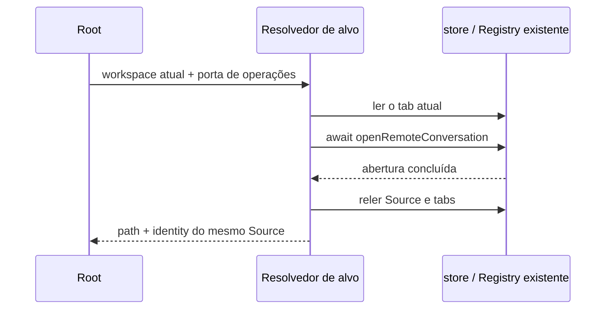

# Módulo de resolução do alvo de workspace da conversa

## Problema e escopo da correção

`resolveConversationWorkspaceTarget.ts` foi adicionado em 2026-09-13 ao módulo raiz `ui` não gerenciado, disparando `unmanaged-new-file` e fazendo `verify:pre-push` encerrar antes dos testes unitários de negócio.

O resolvedor foi movido para `packages/ui/src/conversation-workspace-target/`, registrado como módulo gerenciado com o nome `conversation-workspace-target`, completando contrato, exemplos e testes de contrato. A chamada original do Root passa a usar a entrada pública. Regras de arquitetura, limiar de data e baseline foram preservados.

## Decisões antes da implementação

- Camada: o contrato define a visão somente leitura do tab mínimo e a porta de operações; a camada app compõe a porta, sem importar diretamente a store Zustand, o Host ou implementações de plataforma.
- Único owner: a store de tabs da janela possui os tabs; o Registry / SourceManager possui as conexões remotas e a atribuição de Source. O módulo não mantém estado mutável nem dados persistidos.
- Caminho único: o Root injeta o `openRemoteConversation` já existente, a consulta de Source e a resolução de diretório local, sem introduzir novos comandos de abertura nem conexões.
- Temporização e falhas: mantém a implementação atual, aguardando primeiro a conclusão da abertura remota, depois lendo o Source e os tabs mais recentes; casa o tab de conversa pelo Source e retorna o path e a identity correspondentes. Quando o Source é desconhecido, o tab está ausente ou a porta falha, o erro é propagado para cima, sem retorno ao local.
- Retentativas e concorrência: reaproveita a admission da porta de abertura original; não acrescenta lease, timeout, cache de dedupe ou fila.



## Invariantes e limites de compatibilidade

Um tab de conversa existente retorna a si mesmo; projetos locais seguem a resolução de diretório local. Locais e remotos com o mesmo caminho, assim como Sources diferentes, continuam isolados por identity. O tab de configurações não participa da seleção de workspace. A migração altera apenas a perteniência do módulo e os imports, sem modificar banco de dados, protocolo, UI, tema ou textos; os links de desktop continuous e de celular web-remote-replayable/shared-host seguem os caminhos originais.

## Requisitos de verificação

Primeiro, migrar os seis casos de regressão existentes do tab store real para a entrada pública e confirmar que falham quando a nova entrada não existe; em seguida, migrar a implementação. Os testes de contrato acrescentam tab que não é de workspace, exceção na porta e releitura do Source após a abertura. Executar os testes unitários relacionados, typecheck, lint, a checagem de arquitetura no escopo da branch padrão e o `verify:pre-push` completo. Como não houve mudança de comportamento interativo, verificar a cobertura E2E existente; as validações de ambiente não executadas são listadas separadamente.

## Portão seguinte: expectativa dos testes de migração

Após a liberação do portão de arquitetura, a execução completa dos testes unitários revelou que a asserção de barreira de inicialização em `taskIndexRepoWorkspaceIdentity.test.ts` esperava apenas `0005_projects`, sem incluir a migração já registrada `0006_default_workspace_tasks`. O teste foi corrigido para validar as duas migrações ordenadas por ID e para verificar que o ledger permanece inalterado após a reabertura; a asserção de "não reimportar settings" foi preservada. Esta correção não altera a implementação das migrações, o SQL nem o checksum.

## Portão seguinte: referência padrão da linha de projeto

`reactStableReferences.test.ts` revelou que os valores padrão de `availability` e `additionalActions` de `ProjectNodeContent` criavam novas referências a cada renderização. Os valores padrão dos dois consumidores somente leitura foram elevados a constantes de módulo; continuam em uso o renderizador original da linha de projeto, o menu e o caminho de operações, sem alteração do owner de estado, da UI, da semântica padrão de online nem do conjunto de operações. Registra-se primeiro a falha do check original e, depois, executam-se a checagem de referências e os testes existentes de componente da linha de projeto.

## Portão seguinte: ordem das configurações e temporização do teste de arquivamento

- O repositório de projetos já devolve os projetos na ordem "novo primeiro entre os do mesmo Host", e a projeção compatível das configurações segue essa ordem. A expectativa de dedupe de root duplicado em `workspace-settings/contract.test.ts` foi atualizada para `/shared`, `/local`, preservando todas as asserções de não ressurreição após a remoção.
- `projectAutoArchiveSelection.test.ts` aguardava a segunda refresh para liberar a primeira; atualmente `docs/task-first-submit-visibility.md` determina que refreshes sobrepostos compartilham o mesmo flight, portanto o teste se auto-bloqueia. O cenário de resposta tardia passou a trocar de service: a árvore do novo service é aceita primeiro, e só então o resultado de arquivamento do service antigo é liberado, verificando que a resposta antiga não limpa tarefas nem sobrescreve a nova árvore; a implementação de refresh e de arquivamento não é alterada.

```text
Teste antigo: read A em trânsito → await refresh (reaproveita A) → libera A (nunca chega)
Correção: A do service antigo em trânsito → troca de service → aceita nova árvore → libera A → resultado antigo é rejeitado
```

## Registro de verificação (2026-09-16)

- Módulo de resolução, tab store real e hook existente de diretório local: 3 arquivos / 10 casos aprovados; após remover os tipos, o resultado da função de resolução coincide com o kind guard de workspace já embutido na implementação original.
- Barreira de inicialização das migrações e contrato do project-storage aprovados; checagem de referências React, interação dos componentes de linha de projeto online/offline e teste de download: 3 arquivos / 11 casos aprovados.
- typecheck final e checagem de formatação dos arquivos alterados aprovados; lint manteve 47 warnings existentes e 0 errors; checagem de arquitetura no escopo padrão origin/staging com 0 violations, sem ajuste do baseline.
- A primeira rodada completa expôs, antes das correções, problemas nas asserções de migração e nas referências padrão, além de falhas de temporização de escrita das configurações e de download; os dois casos de temporização passaram na repetição, sem alteração de sua implementação de produção ou do timeout dos testes. A rodada antiga foi interrompida e o resultado completo final foi registrado separadamente.
- A segunda rodada completa levou 504 segundos: 1.785 arquivos / 15.522 casos aprovados, 2 arquivos / 14 casos ignorados, com falha apenas na ordem das configurações e na temporização do arquivamento antigo. Depois de corrigir esses dois testes, a execução junto com a regressão de estreia aprovou 3 arquivos / 10 casos. Aqui se distingue a execução completa da verificação direcionada após a correção; o push real ainda executa o hook completo.
- Verificados os CWP13/CWP15 de `conversation-session-ssh-remote-project-conversation-scope.test.ts`; os casos permanecem como manual-review/pending. Nesta rodada não foram reexecutados SSH real, shared-host no celular ou GUI Windows/Linux, e o E2E histórico não é usado como evidência do commit atual.
