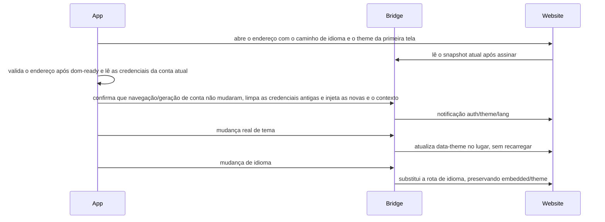

# Integração embutida do centro de recompensas Rewards

## Escopo e responsabilidade

A página de recompensas em Windows/Linux e sua entrada de login devem manter os botões de janela no topo; fechar a página web e fechar a janela são operações independentes.
`marketing-touch-rewards.test.ts` abre as recompensas e o login e então afirma que os controles da janela estão visíveis e não encobertos; no macOS os controles nativos de semáforo são mantidos.
A entrada do menu do centro de recompensas (Rewards) usa o ícone Lucide `Gift` de caixa de presente, mantendo `size-4` e herdando a cor do texto; o ícone `User` do avatar da conta permanece inalterado.
A entrada do centro de recompensas só é exibida quando o estado de login do usuário existente não está vazio; quando deslogado ou após logout, a linha inteira não é renderizada. Desktop e Web compartilham a mesma condição, sem criar uma cópia do estado de login.
O navigate de marketing com page=rewards compartilha o RewardsProvider. A página web só aceita /{cn|en}/rewards; tanto o antigo page=referrals quanto o antigo /{cn|en}/referrals são rejeitados. O Provider é o único detentor do attempt ID retomado após o login; cancelar/falhar/substituir descarta o ID, e em caso de sucesso com o usuário pronto ele abre apenas uma vez, independentemente da reconstrução por troca de conta da instância de marketing. Veja marketing-touch-actions.md.
A entrada do menu mantém 「邀请好友 [奖励] / Refer a friend [Rewards]」 e o título da página embutida é 「奖励中心 / Rewards」. O texto da entrada e o título usam chaves i18n de rewards independentes. A largura do menu se adapta ao conteúdo em chinês e inglês, preservando os temas claro/escuro e o suporte a mobile. A funcionalidade real de indicar amigo, link de convite e histórico de convites dentro da página continua usando a semântica de referral/invite.
O menu do avatar no canto inferior esquerdo exibe 「邀请好友 [奖励]」 abaixo de "assinar". O Rewards Provider de nível de janela é o único detentor do estado aberto, sem depender do estoque de planos, sem alterar a navegação de tarefas, modelos ou configurações. App e website compartilham o contrato de URL/bridge; os dados de indicação e as recompensas pertencem ao servidor, e o exemplo estático atual da página web não conta como conclusão da funcionalidade. A conclusão da compra do Coding Plan, os canais e o contrato original de tema permanecem compatíveis.

## Verificação da troca para Rewards em 2026-09-15

- 88 testes unitários relacionados do App, typecheck completo, lint e verificação de arquitetura aprovados; o menu mantém a indicação de amigo e o selo de recompensas.
- 3 E2E em Electron no macOS aprovados (navegação de marketing/relato único, menu/tema/idioma/fechamento, cancelamento de login). A execução final desktop-e2e-20260915-094821-908 reportou um timeout de processo na limpeza de saída, e o PID correspondente já havia encerrado; asserções funcionais aprovadas não equivalem a ausência de anomalias na etapa de saída.
- 5 testes unitários do Website, build de produção, verificação de tipos, lint dos arquivos afetados, verificação no navegador dos novos caminhos em chinês/inglês retornando 200 e da página inicial antiga retornando 404, verificação das subrotas reais de convite e do layout claro/escuro em 390/900/1440px aprovados. O lint completo do Website ainda tem erros pré-existentes em arquivos não relacionados, sem ampliação das modificações.
- Não foram verificados nesta entrega o deploy de produção, a emissão real de recompensas pelo servidor, nem a execução nativa em Windows/Linux; a cadeia em tempo real de tarefas e o protocolo do Coding Plan não são alterados.

## Endereços e modos

A entrada exibe o selo de recompensas, preservando o tamanho original do selo de plugin, o espaçamento de texto de 6px e o estilo do ícone de presente.

O EmbeddedWebsiteHeader compartilhado (página de indicar amigo e página de upgrade) tem padding inferior igual a 0, preservando py-4 no topo e px-6 nas laterais / max-sm:px-4.

Restrições de layout: o WebView do App ocupa toda a largura disponível da janela, com a barra de rolagem da página no lado direito da janela; dentro do site, a centralização e o limite de largura do conteúdo ficam a cargo da página web. A navegação do topo fica fixa fora da área visível de rolagem, sem adicionar um contêiner de rolagem externo no App. Esta correção não altera o Coding Plan nem os caminhos de abertura externa Web/mobile.

- Desenvolvimento/integração local explícita: http://localhost:3000; teste: https://zcode.z.ai; produção: https://zcode.z.ai.
- `pnpm dev:desktop:test` usa por padrão o domínio de teste; `pnpm dev:desktop` usa por padrão o domínio de produção, e o modo de desenvolvimento não muda automaticamente para localhost.
- Integração local explícita do Website: `VITE_REWARDS_WEBVIEW_ORIGIN=http://localhost:3000 pnpm dev:desktop:test`. Isso sobrescreve apenas o endereço da página web de recompensas; as APIs do App continuam usando o ambiente de teste; não altera idioma, tema ou protocolo de autenticação.
- URL: /{cn|en}/rewards?embedded=app&theme={zai-light|zai-dark}; zh-CN mapeia para cn, en-US mapeia para en.
- O endereço local só é permitido em desenvolvimento/E2E; os deploys de produção e de teste validam a origem HTTPS, o caminho exato e o marcador embedded. Rejeitam informação de usuário, subdomínios forjados e caminhos semelhantes.
- O Desktop usa um WebView isolado; Web/mobile usam páginas externas HTTPS e o login do site, sem colocar o token do App na URL nem passá-lo a um navegador externo. Não altera desktop-continuous / web-remote-replayable, host attachment nem o estado autoritativo de tarefas.

## Estado e sequenciamento

### Cabeçalhos de requisição da página de recompensas (2026-09-16)

Decisão final: acessar a página de recompensas não injeta os cabeçalhos comuns do App nem o Authorization. O plano anterior de cabeçalhos foi revogado; os cabeçalhos comuns completos e o Bearer JWT são usados apenas para o próprio `/event/report` do App, veja [Contrato de entrega de telemetria](monitoring/event-report-delivery-reliability.md).

```text
Abertura do WebView (requisição web comum) → dom-ready → injeção do bridge original/sincronização de estado (preservados)
```

Removem-se o IPC de contexto de requisição exclusivo da página de recompensas, o hook, o interceptador de rede do Main e o schema correspondente; o carregamento da página não espera mais pela preparação dos cabeçalhos.
O Bridge mantém a injeção do estado de login, tema, idioma e armazenamento necessário à página atual, além da validação de navegação/geração de conta. A abertura externa Web/mobile continua não repassando o token do App, sem alterar task continuous/replayable.

Aceitação REW-17: a primeira requisição/o refresh não carregam parâmetros comuns extras do App nem Authorization; o bridge original, o menu, o tema, o idioma e o link externo do celular permanecem inalterados. O registro de verificação inicial de cabeçalhos no fim deste documento é apenas evidência histórica do plano já revogado e não representa o protocolo atual.

Regressão final: Electron local `desktop-e2e-20260916-043702-139` com 3/3 aprovados, confirmando ao mesmo tempo os cabeçalhos de login/anônimo do `/event/report` do App; sem uso de Docker. Após a remoção do IPC/hook exclusivo, o passo prévio de "preparação do contexto de cabeçalhos" não ocorre mais.



## Bridge v1

### Decisão de troca direta em 2026-09-15

- Camadas alteradas: presentation / validation / commit-effect / persistence; a atribuição de estado existente não muda.
- Diretórios, componentes, funções, tipos, i18n, logs, identificadores de teste e entradas de build da página são unificados em Rewards/rewards; a configuração de ambiente local passa a ser VITE_REWARDS_WEBVIEW_ORIGIN, sem ler a variável antiga.
- A nova partição é persist:zcode-rewards e o novo evento de contexto é zcode-rewards-context; window.zcodeBridge e as chaves OAuth/JWT permanecem inalteradas.
- Não se migra, não se lê e não se limpa automaticamente a antiga partição persist:zcode-referrals, não se assina o evento antigo, não se exporta alias antigo, não há compatibilidade com caminhos antigos, e não se adiciona redirecionamento nem retorno à página antiga em caso de falha na troca. As validações de configuração inválida existentes, as rejeições de segurança e o comportamento de Web comum sem bridge não fazem parte de um fallback de migração e continuam mantidos.
- /invite, /invite/accept, /invite/unavailable e /referrals/unavailable no Website são a funcionalidade real de indicação e não pertencem à página inicial de recompensas removida, mantendo a semântica original; apenas a antiga página raiz /{cn|en}/referrals retorna 404.
- Upgrade, resgate, telemetria de marketing, tarefas/sessões, replayable no celular e continuous no desktop não mudam. Os dados do usuário e as recompensas continuam pertencendo ao servidor, o estado de exibição da página pertence ao Website e a retomada do login pertence ao Provider da janela.

| Item de aceitação | Configuração/ação | Asserção/evidência |
| --- | --- | --- |
| REW-13 | Construir e validar a URL nos três ambientes, cn/en, claro/escuro | Apenas o caminho exato rewards; caminhos antigos, semelhantes e configuração antiga rejeitados/não lidos, teste unitário |
| REW-14 | Após instalar o bridge, despachar eventos antigo e novo separadamente | O evento antigo não atualiza o estado, o novo tem efeito; a partição usa apenas o novo nome, teste unitário/E2E desktop |
| REW-15 | Abrir pelo menu de login e pelo botão de marketing | Gift + 邀请好友 [奖励] / Refer a friend [Rewards]; rota rewards, autenticação, idioma, tema e relato único funcionando, E2E real em Electron |
| REW-16 | Páginas inicial nova/antiga e de convite no Website, comum/embedded | Página nova 200, página inicial antiga 404; rotas de convite inalteradas, chinês/inglês, claro/escuro e 390/900/1440px, sem overflow horizontal, teste no navegador |

Os casos acima foram aceitos conforme a decisão do usuário; as combinações de migração/compatibilidade de versões antigas foram podadas, sem novos testes de migração. Reutiliza-se os IDs de caso originais de login/isolamento do bridge REF-01…12; os novos E2E iniciais permanecem pendentes, e a decisão de promoção de 2026-09-16 está abaixo, sem uso de Docker. O grafo mantém os capability IDs estáveis, ganha o alias Rewards e as relações de entrada de marketing; o codegraph não está disponível, adotando-se uma verificação estática de chamadas em dois níveis, sem reivindicar varredura completa do índice.

window.zcodeBridge oferece getTheme/onThemeChange, getLang/onLangChange, getAuthState/onAuthChange. A assinatura retorna uma função de cancelamento; a leitura retorna null quando ainda não está pronta. theme é zai-light/zai-dark, locale é zh-CN/en-US. AuthState é {status: ready|anonymous, provider: zai|bigmodel|null, revision: number}, onde ready indica apenas a conclusão da injeção e não equivale à validação de assinatura pelo servidor. Os eventos não carregam token. É proibido que a capacidade de conclusão de compra apareça na página de convite.

As chaves de credencial são as mesmas da página de compra: o canal atual oauth:zai:access_token ou oauth:bigmodel:access_token, além de zcodejwttoken. Valores antigos são limpos na troca de conta e no fechamento; antes de cada injeção e após a leitura assíncrona, verificam-se a URL atual, o ciclo de vida do componente e a geração da conta, e resultados antigos não podem ser escritos em uma nova página. Não se adiciona envio ativo de indicação nem nova retentativa automática de negócio em caso de falha de autenticação.

## Superfície de impacto (verificação estática)

| Camada | Entrada/implementação compartilhada | Responsabilidade/restrição |
| --- | --- | --- |
| must-inspect | Menu do avatar no WorkspaceSidebar, Root | Abertura de Rewards independente do inventário do Coding Plan |
| must-inspect | Casca da página web, Rewards Provider | Reutiliza controles de exibição, com autenticação e retorno separados |
| must-inspect | will-attach-webview do desktop, preload, limpeza de partições | Página confiável delimita as permissões do bridge, sem propagação ao navegador comum |
| should-inspect | CodingPlanEmbeddedWebviewDialog | Navegação de compra, fechamento, refresh e retorno mantêm o comportamento original |
| invariant-only | Controle remoto do celular, fluxo de tarefas | Não altera runtime, filas nem workspace identity |
| evidence-only | Testes unitários de UI, E2E de WebView no Electron, testes unitários do website | Asserções sobre configuração, ação e resultado, sem tomar o exemplo estático como integração com o servidor |

O codegraph não está disponível; o quadro acima é uma verificação estática do código-fonte, não uma varredura completa do grafo de chamadas; o grafo semântico já recebeu o nó Rewards e as relações de reuso de exibição na casca de compra e de fronteira do controle remoto.

## Aceitação e entrega

| Case | Configuração e ação | Asserção |
| --- | --- | --- |
| REF-01 | cn/en, três ambientes, claro/escuro construindo a URL | Domínio, caminho exato, embedded/theme corretos |
| REF-02 | Clicar no menu, abrir repetidamente, fechar | Entrada abaixo do upgrade; contêiner independente; tarefas originais inalteradas |
| REF-03 | Bridge antes/depois de pronto, troca de tema | Snapshot legível, notificado uma vez, sem recarregamento da página, cancelamento válido |
| REF-04 | Trocar idioma | Rota substituída preservando theme/embedded, sem token |
| REF-05 | Injeção/troca de conta/fechamento/atraso assíncrono | Limpa valores antigos, mantém apenas o canal atual, injeção antiga sem efeito |
| REF-06 | Domínio externo, caminho semelhante, URL maliciosa | Sem bridge/sem injeção de credenciais |
| REF-07 | Falha de carregamento, refresh, reabertura | Recuperável e eventos antigos não vazam para a nova página |
| REF-08 | Página web comum/celular | Sem bridge não quebra; não repassa o token do App |
| REF-09 | Regressão do Coding Plan | Bridge de compra e refresh de conclusão inalterados |
| REF-10 | Rolagem na página de convite em tema claro/escuro | Bordas esquerda/direita do WebView iguais às da janela; página rolável, posição da navegação do topo inalterada |
| REF-11 | Banner / popup independente despachando navigate rewards | Abre a página de convite existente, cada confirm gera um único relato e não dispara resgate |
| REF-12 | Navegação sem login bem-sucedida, cancelamento, falha, substituição da tentativa de login | Retomada apenas com o mesmo ID e usuário pronto; sem salto extra por outro login após cancelar/falhar/substituir; link externo do Web abre apenas uma vez |

Confirmação do usuário em 2026-09-16 sobre a promoção: os 3 E2E de Rewards foram movidos para `packages/desktop/test/e2e/ui-shell/marketing-touch-rewards.test.ts`, incluídos na varredura de spec padrão, sem uso de Docker. O dry run padrão de promoção não suporta ui-shell, mantendo-se a migração manual do domínio de marketing. A execução oficial é feita pelo runner iniciando antes da build uma fixture de página web isolada e configurando uma origem loopback aleatória, sem depender de localhost:3000 iniciado manualmente; a fixture implementa apenas o protocolo de consumo do bridge no lado da página web e a rolagem de páginas longas, sem substituir a funcionalidade real do Website ou a aceitação visual. As evidências anteriores de integração com o Website real são preservadas; validação de assinatura pelo servidor, deploy e emissão de recompensas não estão no escopo deste caso.

Verificação de promoção: Electron local no macOS `desktop-e2e-20260916-033102-475`, caminho oficial, sem flag MANUAL_REVIEW e sem sobrescrita manual do endereço da página, 3/3 aprovados, runner exit 0. Teste unitário da fixture HTTP 16/16, typecheck da raiz, typecheck:e2e do desktop, lint (47 warnings / 0 errors) e verificação de arquitetura aprovados. Não foi feita admissão com Docker nem execução do CI remoto, e as condições de corrida de conta, fronteiras de segurança e seleção de ambiente cobertas por teste unitário não são reivindicadas como novo E2E.

## Registro de verificação de 2026-09-15

- Incremento de navegação de rewards no marketing: 8 arquivos de teste unitário com 113 casos aprovados; 3 E2E de Electron no macOS aprovados, incluindo um confirm cada no Banner e no popup independente, login anônimo orientado/cancelado e sem Authorization no relato, além do fluxo embutido original. A retomada após login bem-sucedido, o sequenciamento de usuário pronto, cancelar/falhar/substituir e a abertura única no Web são cobertos por testes unitários do Provider, sem execução de autorização OAuth real. A limpeza de saída do E2E teve um aviso de timeout, e o processo correspondente já havia encerrado no momento da verificação.

- Incorporação real em localhost:3000 no Electron do macOS: entrada abaixo do upgrade, injeção de OAuth/JWT e limpeza do outro canal, troca claro/escuro sem recarregamento, ida e volta entre chinês e inglês, refresh e fechamento/reabertura aprovados; as capturas de tela estão nos artefatos locais do E2E.
- As duas E2E de notificação de conclusão de compra do Coding Plan existente com BigModel e Z.ai, fechamento e refresh do Provider passaram, sem execução de pagamento real.
- 85 testes unitários de URL/bridge/navegação de janela/autenticação de inicialização e Coding Plan relacionados, e 18 testes unitários de comandos de desktop e limpeza de partições aprovados; 3 testes unitários de protocolo do website e o build de produção aprovados.
- typecheck do App, lint e architecture check aprovados; o lint tem avisos pré-existentes no repositório. O grafo já tinha 4 arestas penduradas, nenhuma nova nesta entrega, e as novas sementes de código-fonte foram verificadas; o índice de runtime do codegraph não está disponível.
- Não verificado: Windows/Linux em aparelho real, navegador do celular em aparelho real, API real de indicação, resposta real de token inválido, deploy do site em produção/teste. O site hoje só assina o estado de autenticação pronta e não reivindica que o servidor já validou o login ou Liberou recompensas.

## Registro de verificação de cabeçalhos de 2026-09-16

- 6 arquivos de teste unitário relacionados com 22 casos aprovados: cobrem o escopo de aplicação dos cabeçalhos, o isolamento de identidade da janela, a revogação no redirecionamento, requisições sem janela proprietária, requisições anônimas, descarte de resultado tardio na troca de conta, releitura do JWT no refresh e o comportamento existente do bridge/navegação.
- 3 E2E de Electron no macOS aprovados, identificação da execução `desktop-e2e-20260916-024814-751`. As requisições realmente observadas no carregamento inicial e no refresh confirmaram os parâmetros comuns e o Authorization sem Bearer; também houve regressão de tema, idioma, fechamento/reabertura, navegação de marketing e cancelamento anônimo. O teste apenas registra a existência dos cabeçalhos, sem imprimir credenciais.
- `pnpm typecheck` na raiz, `typecheck:e2e` do desktop, `pnpm lint` (47 avisos, 0 erros) e `pnpm architecture:check --changed` aprovados. O módulo do desktop ainda não faz parte do contrato de arquitetura gerenciado, portanto isto não pode ser tratado como prova completa de fronteiras.
- Foi feita uma comparação HEAD adicional das configurações TypeScript separadas de main/preload/renderer: permanecem diagnósticos de configuração/tipos pré-existentes, sem surgir nenhuma combinação nova de arquivo, código de erro e mensagem; essa verificação adicional não é declarada como aprovada.
- Nesta rodada não foram verificados a validação real de assinatura pelo servidor, o deploy do site em produção/teste, Windows/Linux e o celular em aparelho real. As APIs de negócio da página web não estão no escopo de injeção de cabeçalhos da rota de página exata atual; o bridge mantém o comportamento original.