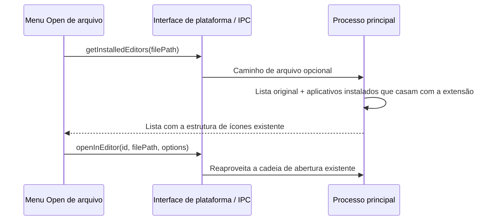

# Aplicativos externos para abrir na pré-visualização de arquivo

## Escopo

No menu suspenso Open existente, acrescentar os aplicativos instalados que correspondem à extensão do arquivo atual. A exibição e a ordem originais dos editores, terminais, Finder/QSpace/Explorer permanecem inalteradas; não são adicionados entradas, agrupamentos, item de aplicativo padrão nem "escolher outro aplicativo", e a cópia de caminho e o botão principal Open permanecem inalterados.

| Tipo | macOS                                                 | Windows                                                  | Linux                                 |
| ---- | ----------------------------------------------------- | -------------------------------------------------------- | ------------------------------------- |
| PDF  | Preview, Adobe Acrobat/Reader, PDF Expert, WPS Office | Adobe Acrobat/Reader, Foxit PDF Reader, WPS Office, Edge | Evince, Okular, Firefox               |
| DOCX | Word, Pages, WPS Office, LibreOffice Writer           | Word, WPS Office, LibreOffice Writer                     | WPS Office, LibreOffice Writer        |
| PPTX | PowerPoint, Keynote, WPS Office, LibreOffice Impress  | PowerPoint, WPS Office, LibreOffice Impress              | WPS Presentation, LibreOffice Impress |
| XLSX | Excel, Numbers, WPS Office, LibreOffice Calc          | Excel, WPS Office, LibreOffice Calc                      | WPS Spreadsheets, LibreOffice Calc    |
| MP3  | Music, QuickTime Player, IINA, VLC                    | Windows Media Player, VLC                                | VLC, mpv                              |
| MP4  | QuickTime Player, IINA, VLC                           | Windows Media Player, VLC, PotPlayer                     | VLC, mpv                              |

## Dados e fronteira de plataforma

`IPlatformService.getInstalledEditors(filePath?)` mantém a compatibilidade sem argumentos: quando nenhum caminho de arquivo é informado, retorna apenas a lista original, evitando alterar o menu do workspace. Quando um caminho é informado, o processo principal casa a nova lista pela extensão sem diferenciar maiúsculas/minúsculas e detecta de forma assíncrona os locais de instalação (Applications de sistema/global/usuário no macOS, locais de instalação comuns e registros App Paths no Windows, PATH no Linux). O processo principal é o único owner da detecção de instalação e do cache; a UI não mantém um segundo mapeamento de formatos.



O cartão de arquivo e o Preview Pane consultam usando o caminho do arquivo atual. Extensões desconhecidas, diretórios e consultas sem caminho não acrescentam aplicativos. Ao trocar o arquivo em pré-visualização, o resultado da consulta anterior não pode sobrescrever a lista do novo arquivo. Os novos aplicativos abrem o arquivo por meio de um array de argumentos, sem concatenação via shell.

SSH/WSL/Docker continuam usando o `resolveWorkspaceEditorSelection` existente para limitar os aplicativos disponíveis, e não repassam caminhos de arquivo remotos para os novos leitores locais. A Web no celular continua retornando lista vazia; os fluxos de mensagens desktop continuous / celular replayable, `workspaceIdentity` e o roteamento por owner permanecem inalterados.

## Verificação

Os testes unitários cobrem os seis tipos de extensão, caixa (maiúsculas/minúsculas) e caminhos com espaços, aplicativo ausente, compatibilidade sem argumentos, locais de instalação em múltiplas plataformas e a abertura parametrizada. O E2E existente do cartão de arquivo cobre o repasse por caminho e o conteúdo do menu/alvo de abertura; a instalação de aplicativos do sistema e o lançamento real exigem validação adicional em runtime de plataforma.

O processo principal valida o caminho absoluto local e o tipo real do arquivo antes de iniciar o aplicativo, sem confiar no `pathKind` do renderer.
No macOS usa o `open` do sistema; no Windows/Linux usa subprocesso próprio ignorando o stdio, retornando sucesso após receber o `spawn`,
sem esperar o leitor encerrar e sem deixar o log do aplicativo disparar o limite de buffer que encerra o processo. Falha na inicialização retorna o resultado de falha original.

```text
requisição de abertura do renderer → main valida o arquivo local → inicia o aplicativo → spawn / error → retorna o resultado
                                                └─ o aplicativo roda de forma independente, sem necessidade de reescrever estado ao fechar
```

## Falha na abertura e mudanças de instalação

Quando o retorno da abertura do aplicativo é falha ou a requisição lança exceção, ambos registram log e exibem o mesmo Toast de falha localizado. O menu remoto continua reaproveitando o filtro de capacidades do workspace: no SSH somente a família VS Code; no WSL o Explorer é permitido adicionalmente; alvos não resolvidos e alvos sem suporte não exibem aplicativos locais.

A detecção de aplicativos de arquivo só mantém em cache resultados bem-sucedidos e requisições em andamento; não instalado, ícone ausente e exceções liberam o cache. A próxima consulta de menu faz nova detecção, sem TTL e sem exigir reinício. A limpeza afeta apenas a requisição original e não pode apagar requisições mais novas.
