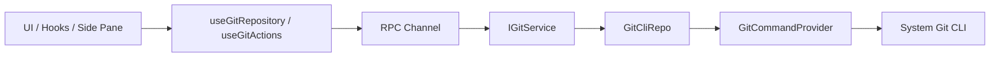

# Arquitetura de Git

## Documentos relacionados

- [Design das capacidades subjacentes de troca/criação de branch do Git](./branch-switching-service-design.md)

## Contexto

O projeto atual já possui um conjunto relativamente claro de camadas e de esqueleto de comunicação multiplataforma:

- A UI consome serviços por hooks, sem acessar diretamente as implementações subjacentes
- Desktop / Web / Remote acessam capacidades de negócio por meio de `IServiceAccessor` + cadeia de serviços via RPC
- `IPlatformService` carrega apenas ações que precisam obrigatoriamente passar pelo ambiente host, e não lógica de negócio comum

Se as funcionalidades de Git devem ser mantidas por longo tempo, o caminho certo é reutilizar a arquitetura de serviços existente, em vez de criar um novo caminho de conexão direta.

## Objetivos de design

- Manter uma abstração unificada para as capacidades de Git nos três modos de execução: local, remoto e web
- Manter estritamente a lógica de Git dentro da direção de dependência `Types -> Config -> Repo -> Service -> Runtime -> UI`
- Permitir que o Git leia a configuração real de Git do ambiente do usuário, em vez de manter uma configuração de Git fictícia própria do projeto
- Permitir que a UI reutilize o side pane à direita, a renderização de diff e os componentes de árvore de arquivos existentes, evitando recriar uma casca paralela

## Não objetivos

- A v1 não é um cliente Git completo
- A v1 não implementa rebase / cherry-pick / stash / gerenciamento de submódulos
- A v1 não assume o ciclo de vida da instalação global de Git do usuário, SSH, GPG ou credential helper
- Rollback em nível de sessão e capacidade de undo baseada em Git estão fora do escopo deste documento

## Julgamento central

### 1. Git deve ser um serviço de negócio padrão, e não algo dentro de `IPlatformService`

Recomenda-se adicionar um `IGitService`, usando a cadeia de serviços via RPC já existente.

Motivos:

- Git não é uma ação de host que só pode ser feita no main do Electron, e sim uma capacidade de negócio comum
- No modo Remote, o Git precisa ser executado no ambiente onde está o workspace remoto, e não pode ficar preso à camada de plataforma local
- O modo Web, na essência, também oferece capacidades de Git por meio do workspace do servidor, e portanto continua adequado à camada de service

Isso também está de acordo com o limite de responsabilidade atual de `IPlatformService`: ele só hospeda operações que "precisam atravessar a fronteira do host", como dialog nativo, controle de janela e abertura de link externo.

## Solução recomendada

### Opção A: adicionar um `GitService` independente, com local e remoto usando o mesmo protocolo de serviço

Esta é a opção recomendada.

#### Estrutura de alto nível

#### Por que é recomendada

- Encaixa perfeitamente na arquitetura orientada a serviços do projeto atual
- Local e remoto diferem apenas na origem da implementação do serviço, sem prender o design da UI a uma plataforma específica
- Comandos do Git, parsing, tolerância a falhas e logs podem ser centralizados na camada de serviço
- Extensões futuras como staged/unstaged, branch, commit e discard não se espalharão pela UI

## Design em camadas

### Types

Recomenda-se adicionar DTOs do domínio Git em `packages/shared/src/git.ts`, exportados em `packages/shared/src/index.ts`.

Recomenda-se incluir pelo menos:

- `GitRepositorySummary`
  - `workspacePath`
  - `repoRoot`
  - `workspaceInRepoPath`
  - `branchName`
  - `headRefType`
  - `ahead`
  - `behind`
  - `isDirty`
  - `isGitAvailable`
  - `isRepository`
- `GitFileChange`
  - `path`
  - `repoRelativePath`
  - `workspaceRelativePath`
  - `x`
  - `y`
  - `kind`
  - `isStaged`
  - `isUntracked`
  - `isConflicted`
- `GitDiffRequest`
- `GitDiffResult`
- `GitIdentity`
  - `userName`
  - `userEmail`
  - `nameSource`
  - `emailSource`

### Config

Recomenda-se adicionar uma camada de configuração do domínio Git, responsável por:

- Estratégia de resolução do binário do Git
- Argumentos padrão dos comandos
- Timeout, tamanho de saída e regras de mascaramento em log
- Estratégia de decisão da relação entre repo root e subcaminho do workspace

Arquivo sugerido:

- `packages/services/src/git/config.ts`

### Providers

Para seguir o princípio do projeto de que "questões transversais entram por Providers", recomenda-se introduzir explicitamente uma camada de Provider dentro do domínio Git.

Recomenda-se dividir em pelo menos dois providers:

- `GitCommandProvider`
  - Responsável por executar comandos `git` de forma unificada
  - Responsável por cwd, env, timeout, stderr, exit code e log
- `GitEnvironmentProvider`
  - Responsável por descobrir o binário do Git
  - Responsável por completar variáveis de ambiente seguras
  - Responsável por adaptar diferenças de plataforma

A camada de Provider cuida apenas de "como executar" e "como adaptar o ambiente", e não da semântica de negócio do Git.

### Repo

A camada de Repo é um encapsulamento fino sobre a Git CLI e não carrega semântica de UI.

Arquivo sugerido:

- `packages/services/src/git/repo/gitCliRepo.ts`

Responsabilidades sugeridas:

- `resolveRepository(workspacePath)`
- `getStatus(workspacePath)`
- `getDiff(workspacePath, path, staged)`
- `stage(workspacePath, paths)`
- `unstage(workspacePath, paths)`
- `discard(workspacePath, paths, stagedScope)`
- `commit(workspacePath, message)`
- `getIdentity(workspacePath)`

### Service

A camada de Service expõe semântica estável para a UI e oculta os detalhes da Git CLI.

Arquivos sugeridos:

- `packages/services/src/git/git.ts`
- `packages/services/src/git/gitService.ts`

Interfaces externas sugeridas:

- `getRepositorySummary`
- `getChanges`
- `getDiff`
- `getBranchComparison`
- `stagePaths`
- `unstagePaths`
- `discardPaths`
- `commit`
- `getIdentity`
- `refresh`

Se depois for necessário refresh por assinatura, adicionar eventos dinâmicos:

- `onDynamicRepositoryEvent(workspacePath)`

### Runtime / UI

A camada de UI consome `IGitService` apenas por hooks.

Hooks atuais:

- `packages/ui/src/hooks/useGitRepository.ts`
- `packages/ui/src/hooks/useGitActions.ts`
- `packages/ui/src/hooks/useGitAutoRefresh.ts`

Componentes de UI sugeridos:

- `GitPane`
- `GitRepositoryHeader`
- `GitChangeSourceSelect`
- `GitChangesTree`
- `GitDiffPanel`
- `GitCommitPanel`

### Troca da origem dos dados dentro do Git pane

Recomenda-se que o Git pane tenha à esquerda um dropdown de origem das mudanças, e que cada modo troque a origem dos dados.

Recomenda-se suportar quatro modos:

- `未暂存`
  - Origem dos dados: alterações do Git worktree em relação ao index
  - Interfaces principais: `getChanges` / `getDiff`
- `已暂存`
  - Origem dos dados: alterações do Git index em relação a `HEAD`
  - Interfaces principais: `getChanges` / `getDiff`
- `全部分支更改`
  - Origem dos dados: diferenças entre a branch atual e a branch de rastreamento remota
  - Interface principal: `getBranchComparison`
- `上一轮更改`
  - Origem dos dados: snapshot das alterações de arquivo da rodada mais recente da task ativa
  - Interface principal: preferir a reutilização dos dados de mudança de task/per-turn já existentes, sem forçá-los para dentro do `IGitService`

Aqui recomenda-se entender "Git pane" como um "painel unificado de revisão de mudanças", e não como a obrigação de transformar cada visão em responsabilidade do Git service.

Neles:

- Os três primeiros modos pertencem ao domínio Git e passam pelo `IGitService`
- `上一轮更改` pertence à revisão de mudanças em nível de sessão e apenas compartilha a mesma casca de árvore e de exibição de diff dentro do Git pane, mantendo-se somente leitura

Os benefícios dessa abordagem são:

- Manter as fronteiras do Git service claras
- `上一轮更改` não precisa se passar por dados de Git só por causa da posição de entrada na UI
- A árvore de mudanças, o painel de diff e a experiência de revisão à direita ainda podem reutilizar um conjunto de componentes

## Local de execução em local, remoto e Web

### Desktop local

- `createLocalServices()` registra o `GitService` local
- Os comandos de Git são executados no workspace da máquina local

### Desktop remoto

- O Git precisa vir do serviço remoto, assim como `file/system/terminal`
- Não é permitido executar Git no host local para o workspace remoto
- A janela remota mantém apenas setting / credential / broadcast locais; Git deve entrar no conjunto de serviços remotos

### Web

- O lado web não faz uma implementação de Git separada
- As capacidades de Git continuam sendo fornecidas pelo serviço de backend via websocket

Conclusão:

- O local de execução do Git precisa coincidir com o local real do workspace
- A atribuição do serviço de Git deve estar alinhada com `file/system/terminal`, e não com `setting`

## Estratégia de comandos

Recomenda-se usar a Git CLI do sistema em vez de introduzir uma implementação de Git em JS.

Motivos:

- Reutiliza naturalmente a instalação e a configuração de Git já existentes no usuário
- É compatível com ambientes reais como `includeIf`, caminhos padrão por plataforma e Git for Windows
- Ao encontrar mais adiante casos de SSH, credential helper ou política de fim de linha, é menos provável desviar do entendimento do usuário

Comandos sugeridos:

- Detecção de repositório
  - `git rev-parse --show-toplevel`
- Status
  - `git status --porcelain=v2 --branch -z`
- Leitura de identidade
  - `git config --get user.name`
  - `git config --get user.email`
  - quando for necessária a origem, usar `git config --list --show-origin --null`
- diff
  - `git diff --no-ext-diff -- <path>`
  - `git diff --cached --no-ext-diff -- <path>`
- Comparação de branches
  - `git diff @{upstream}...HEAD --`
- stage
  - `git add -- <path...>`
- unstage
  - `git restore --staged -- <path...>`
- Descartar alterações do worktree
  - `git restore --worktree -- <path...>`
- Commit
  - `git commit -m <message>`

## Repo root e caminho do workspace

`workspacePath` não é necessariamente igual a `repoRoot`.

Por exemplo:

- O usuário abriu a raiz do monorepo
- O usuário abriu um subdiretório de package dentro do monorepo

Por isso, o domínio Git precisa manter três tipos de caminho:

- `workspacePath`
- `repoRoot`
- `workspaceInRepoPath`

Comportamento recomendado:

- A camada de serviço sempre executa o Git com base em `repoRoot`
- A UI exibe por padrão os arquivos "dentro do escopo do workspace atual"
- Se for necessário depois, adicionar uma opção "mostrar o repositório inteiro"

Isso evita a confusão de, ao abrir um subdiretório do workspace, ver de imediato alterações de outras regiões do repositório inteiro.

## Log e observabilidade

Pelas restrições do projeto, capacidades que envolvem interação e troca de estado complexa precisam de log.

Sugestões:

- A camada de UI usa uniformemente `packages/ui/src/logger.ts`
- O `GitCommandProvider` não imprime cada comando de Git por padrão; a detecção de Git e as consultas de status são detalhes internos de alta frequência,
  e, quando for preciso investigar, prioritize logs delimitados no ciclo de vida de alto nível, nos ramos de falha ou em uma entrada de debug dedicada.

Não registrar:

- Variáveis de ambiente completas
- Tokens sensíveis
- Saídas sensíveis do credential helper

## Integração com o side pane existente

O pane compartilhado à direita já hospeda `browser` e `code-viewer` de forma unificada.

Recomenda-se estender para:

- `browser`
- `code-viewer`
- `git`

Em vez de adicionar mais uma grande área de navegação paralela às tasks na `WorkspaceSidebar` à esquerda.

Motivos:

- A barra à esquerda atual já tem a responsabilidade clara de navegação de workspace / task
- Git se parece mais com um "contexto operacional do workspace atual", adequado para ser expandido à direita
- Permite reutilizar diretamente a largura ajustável, a troca de painéis e a lógica de fechamento já existentes

## Ordem sugerida de implementação

### Fase 1

- Adicionar o `IGitService`
- Fazer o caminho local / remoto funcionar de ponta a ponta
- Detecção de repositório, status, diff, stage/unstage, discard, commit
- Git pane à direita na UI

### Fase 2

- Suporte a operações por hunk
- Suporte a trocas de escopo repo/workspace mais refinadas
- Suporte a refresh dinâmico e a assinatura de mudanças de arquivo

## Riscos e itens em discussão

- Quando o workspace abre um subdiretório, o escopo padrão de exibição do Git é a "subárvore atual" ou o "repositório inteiro"
- No modo remoto, a identidade de usuário do Git é a configuração efetiva remota exibida, ou também exibe as origens local e remota
- Se o lado web precisa de capacidade completa de commit, ou se começa apenas em leitura
- Se a v1 permite commit direto, ou se primeiro faz apenas visualização e staging

## TODO

- Limites e interação da capacidade de rollback em nível de sessão, a serem desenhados separadamente depois
- Se é necessária a capacidade de "undo baseado em Git", avaliada separadamente depois
- Se checkpoints de Git forem introduzidos no futuro, adicionar um documento de design independente
- Como os dados de `上一轮更改` são reutilizados no Git pane, refinado depois junto com o task store existente

## Conclusão recomendada atual

- Arquiteturalmente, adicionar um `GitService` independente
- O local de execução acompanha o ambiente onde o workspace está
- A UI de Git deve ficar prioritariamente no pane compartilhado à direita
- Fazer primeiro as capacidades básicas de nível de repositório no Git pane e depois expandir gradualmente funcionalidades de Git mais granulares