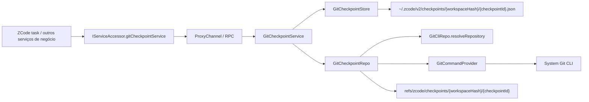

# Resumo da implementação da capacidade de base do Git Checkpoint

Data de atualização: 2026-04-13

## Objetivo desta rodada

Esta rodada implementa apenas a capacidade de base e a fiação de serviço do Git checkpoint, sem integrar a orquestração de task turn da camada superior do ZCode e sem integrar interações de UI.

Escopo concluído:

- Adicionar um `IGitCheckpointService` independente no domínio Git
- Adicionar os DTOs compartilhados de checkpoint e o canal RPC
- Implementar `service -> repo -> store` em `packages/services/src/git/`
- Abrir o caminho de acesso unificado de serviço local / remote / web
- Acrescentar testes de serviço baseados em repositórios Git reais

O que esta implementação resolve prioritariamente:

- Como criar snapshots imutáveis dos arquivos do workspace
- Como comparar as diferenças de arquivos entre dois checkpoints
- Como restaurar com segurança o workspace live atual de um checkpoint para outro sem introduzir worktree

## Estado atual da implementação

Faixa de capacidades concluída:

- `createCheckpoint`
- `diffCheckpoints`
- `restoreBetweenCheckpoints`
- `deleteCheckpoint`

Fiação de engenharia concluída:

- `ServiceChannels.GitCheckpoint`
- `IGitCheckpointService`
- Registro em `createLocalServices()`
- Exposição via `IServiceAccessor` / `RemoteServiceAccess`
- O renderer de workspace remoto passa a usar o `gitCheckpointService` remoto

A implementação atual pode ser caracterizada como:

- A base de checkpoint de arquivos genérica do domínio Git já está disponível
- É possível fechar o ciclo completo de create / diff / restore / delete em repositórios Git reais
- Ainda não entrou na orquestração de checkpoint em nível de task turn do ZCode, nem foi exposto para operação direta pela UI

## Arquivos-chave

### Shared

- [packages/shared/src/channels.ts](../../packages/shared/src/channels.ts)
  - Adiciona `ServiceChannels.GitCheckpoint`
- [packages/shared/src/git.ts](../../packages/shared/src/git.ts)
  - Adiciona os DTOs de checkpoint:
    - `GitCheckpointMeta`
    - `GitCheckpointDiff`
    - `GitCheckpointFileDiff`
    - `GitCheckpointConflict`
    - `GitCheckpointRestoreResult`

### Services

- [packages/services/src/git/gitCheckpoint.ts](../../packages/services/src/git/gitCheckpoint.ts)
  - Define `IGitCheckpointService`
- [packages/services/src/git/gitCheckpointService.ts](../../packages/services/src/git/gitCheckpointService.ts)
  - Orquestração na camada de service
- [packages/services/src/git/repo/gitCheckpointRepo.ts](../../packages/services/src/git/repo/gitCheckpointRepo.ts)
  - Implementação central na camada de repo
- [packages/services/src/git/repo/gitCheckpointHelpers.ts](../../packages/services/src/git/repo/gitCheckpointHelpers.ts)
  - Lógica utilitária pura relacionada a diff/path/tree
- [packages/services/src/git/repo/gitCheckpointStore.ts](../../packages/services/src/git/repo/gitCheckpointStore.ts)
  - Persistência do manifest

### Fiação

- [packages/services/src/node.ts](../../packages/services/src/node.ts)
- [packages/services/src/accessor.ts](../../packages/services/src/accessor.ts)
- [packages/services/src/index.ts](../../packages/services/src/index.ts)
- [packages/client/src/remoteServiceAccess.ts](../../packages/client/src/remoteServiceAccess.ts)
- [packages/desktop/src/renderer/src/main.tsx](../../packages/desktop/src/renderer/src/main.tsx)

### Testes

- [packages/services/test/gitCheckpointService.test.ts](../../packages/services/test/gitCheckpointService.test.ts)

## Diagrama de relações da implementação



Esse diagrama corresponde a dois princípios-chave da implementação atual:

- O local de execução sempre acompanha o ambiente onde o workspace está, sem distinguir a semântica de negócio entre local / remote / web
- O conteúdo real dos arquivos fica a cargo do object database do Git; a camada de negócio persiste apenas um manifest leve

## Responsabilidades por camada

### Service

`GitCheckpointService` é responsável por:

- Gerar o `checkpointId`
- Ler / validar o manifest
- Validar se dois checkpoints pertencem ao mesmo `repoRoot` e ao mesmo `scope`
- Chamar o repo para executar o create / diff / restore / delete de fato
- Chamar o store para gravar ou apagar o manifest

### Repo

`GitCheckpointRepo` é responsável por:

- Resolver o repositório Git correspondente a `workspacePath`
- Criar o commit de checkpoint oculto usando Git plumbing
- Fazer diff estruturado entre dois checkpoints
- Fazer detecção de conflitos no worktree atual
- Restaurar o disco atual de `fromCheckpoint` para `toCheckpoint`
- Apagar a ref oculta

### Store

`GitCheckpointStore` é responsável por:

- Gravar o manifest de checkpoint por `workspaceHash`
- Ler o manifest
- Apagar o manifest

## Interface atual

A interface exposta hoje é exatamente a de [gitCheckpoint.ts](../../packages/services/src/git/gitCheckpoint.ts):

```ts
export interface IGitCheckpointService {
  createCheckpoint(params: GitRepositoryRequest): Promise<GitCheckpointMeta>;
  diffCheckpoints(params: GitCheckpointDiffQuery): Promise<GitCheckpointDiff>;
  restoreBetweenCheckpoints(params: GitCheckpointRestoreQuery): Promise<GitCheckpointRestoreResult>;
  deleteCheckpoint(params: GitCheckpointRequest): Promise<void>;
}
```

Atualmente não foi incluído:

- Interface de listagem de checkpoints
- Interface de GC de checkpoints
- Capacidade de rename / annotate de checkpoint
- Campos semânticos de task/turn da camada superior

## Armazenamento e referências

### Manifest

Diretório padrão de manifest:

```text
~/.zcode/v2/checkpoints/{workspaceHash}/{checkpointId}.json
```

O manifest hoje guarda apenas:

- `checkpointId`
- `workspacePath`
- `repoRoot`
- `workspaceInRepoPath`
- `createdAt`
- `refName`
- `commitOid`
- `scope`

### Hidden Ref

Cada checkpoint cria uma hidden ref:

```text
refs/zcode/checkpoints/{workspaceHash}/{checkpointId}
```

Na implementação atual, o papel da hidden ref é:

- Dar aos objetos do Git uma âncora estável, que não seja removida antes pela GC
- Permitir que diff / restore / delete posteriores localizem o checkpoint de forma estável

## Fluxos principais de implementação

### 1. `createCheckpoint`

Pontos de entrada:

- [gitCheckpointService.ts](../../packages/services/src/git/gitCheckpointService.ts)
- [gitCheckpointRepo.ts](../../packages/services/src/git/repo/gitCheckpointRepo.ts)

Fluxo atual:

1. `GitCheckpointService.createCheckpoint()` gera um novo `checkpointId`
2. `GitCheckpointRepo.createCheckpoint()` chama `resolveRepository()` para resolver o repositório Git
3. Cria um diretório temporário e um `GIT_INDEX_FILE` temporário
4. Executa `git add -A -- <workspace pathspec>`, gravando no índice temporário o estado live do scope atual do workspace
5. Executa `git write-tree`
6. Executa `git commit-tree`
7. Executa `git update-ref refs/zcode/checkpoints/...`
8. Retorna `GitCheckpointMeta`
9. `GitCheckpointStore.save()` grava o manifest

As restrições mais importantes da implementação atual são:

- Usa apenas o índice temporário, sem tocar no `.git/index` real
- Não cria branch visível ao usuário
- Não troca o HEAD

### 2. `diffCheckpoints`

Pontos de entrada:

- [gitCheckpointService.ts](../../packages/services/src/git/gitCheckpointService.ts)
- [gitCheckpointRepo.ts](../../packages/services/src/git/repo/gitCheckpointRepo.ts)

Fluxo atual:

1. A camada de service carrega primeiro os dois manifests `from/to`
2. Valida que ambos têm:
   - `workspacePath` igual
   - `repoRoot` igual
   - `scope` igual
   - `workspaceInRepoPath` igual
3. A camada de repo executa:
   - `git diff --name-status --find-renames -z <from> <to> -- <workspace pathspec>`
   - `git diff --numstat --find-renames -z <from> <to> -- <workspace pathspec>`
4. Usa o helper para mesclar em um `GitCheckpointDiff` estruturado

Na implementação atual:

- `name-status` determina arquivos e tipo de alteração
- `numstat` fornece estatísticas de added / removed
- O diff final é voltado apenas para o scope atual do workspace, e não a saída do repositório inteiro

### 3. `restoreBetweenCheckpoints`

Pontos de entrada:

- [gitCheckpointService.ts](../../packages/services/src/git/gitCheckpointService.ts)
- [gitCheckpointRepo.ts](../../packages/services/src/git/repo/gitCheckpointRepo.ts)

Este é o método mais central da base atual.

A semântica atual não é "restaurar diretamente para um checkpoint", mas sim:

- O chamador declara: o disco atual deveria ainda estar em `fromCheckpoint`
- Alvo real: deseja-se restaurar para `toCheckpoint`

Fluxo atual:

1. A camada de service carrega e valida os manifests `from/to`
2. A camada de repo calcula primeiro o diff estruturado de `from -> to`
3. Colapsa o conjunto de paths afetados a partir do diff
4. Chama `collectWorkspaceConflicts()` para detecção de conflitos
5. Se houver conflito e `force !== true`, retorna diretamente `{ success: false, conflicts }`
6. Sem conflito, ou com `force === true`:
   - Para paths que não são deleção, executa
     - `git restore --source=<toCommit> --worktree -- <paths>`
   - Para paths de deleção e paths de origem de rename, executa a remoção local
7. Usa novamente `collectWorkspaceConflicts()` para validar o `toCheckpoint` após a restauração
8. Se a validação passar, retorna `{ success: true, restoredPaths }`

### 4. Estratégia atual de detecção de conflitos

O núcleo de `collectWorkspaceConflicts()` não é olhar se o repositório inteiro está sujo, mas apenas verificar os paths que o restore vai tocar.

Abordagem atual:

1. Primeiro usa `git ls-tree -r -z <fromCommit> -- <affected paths>` para obter as tree entries desses paths em `fromCheckpoint`
2. Para cada path afetado, julga individualmente:
   - Se não existe em `fromCheckpoint`, mas existe no disco
     - `unexpected-file-in-worktree`
   - Se existe em `fromCheckpoint`, mas não existe no disco
     - `missing-in-worktree`
   - Se os tipos não correspondem
     - `type-mismatch`
   - Se os tipos correspondem, mas o hash de conteúdo após `hash-object` difere
     - `content-mismatch`

Na implementação atual não se comparam sinais fracos como mtime e size, e sim diretamente o hash do blob.

### 5. `deleteCheckpoint`

A exclusão atual é dividida em duas camadas:

- A camada de repo apaga a hidden ref
- A camada de store apaga o manifest

Ordem de execução:

1. `GitCheckpointService.deleteCheckpoint()` carrega primeiro o manifest
2. `GitCheckpointRepo.deleteCheckpoint()` executa:
   - `git update-ref -d <refName>`
3. `GitCheckpointStore.delete()` apaga o arquivo de manifest correspondente

Os objetos do Git em si não recebem limpeza explícita do lado do negócio; isso fica a cargo do Git GC.

## Fiação entre ambientes

O serviço de checkpoint atual já trafega pelo RPC unificado, igual aos demais serviços de negócio:

### Desktop local

- `createLocalServices()` registra `IGitCheckpointService`

### Desktop remoto

- `RemoteServiceAccess` cria o proxy `gitCheckpointService`
- Ao registrar uma sessão de workspace remota, o `gitCheckpointService` remoto é trazido para o objeto de serviço do lado do renderer

### Web

- Passa naturalmente pelo encadeamento já existente `IServiceAccessor` / RPC / websocket

Portanto, a conclusão atual é:

- Protocolo unificado
- O local de execução acompanha o workspace
- A camada superior não precisa distinguir local / remote / web

## Cobertura de testes atual

Arquivo de teste:

- [gitCheckpointService.test.ts](../../packages/services/test/gitCheckpointService.test.ts)

Cenários-chave cobertos:

- Criar checkpoint de escopo de workspace
- O diff de checkpoint identifica corretamente:
  - Modificação
  - Adição
  - Deleção
  - Renomeação
- O diff atua apenas sobre o scope atual do workspace, sem afetar outros diretórios do monorepo
- `restoreBetweenCheckpoints()` consegue restaurar arquivos de changed para base
- O restore não altera o estado real de staged
- Quando há drift de path, retorna conflict por padrão
- Com `force=true` permite sobrescrever na restauração
- Acessar um checkpoint já apagado após `deleteCheckpoint()` gera erro

## Resultados de verificação atuais

Verificado:

- `pnpm vitest run packages/services/test/gitCheckpointService.test.ts packages/services/test/gitService.test.ts packages/services/test/gitCliRepo.test.ts`
  - Resultado: passou
- `pnpm typecheck`
  - Resultado: passou

Não passou completamente:

- `pnpm lint`
  - Resultado: não passou
  - Observação: as falhas atuais continuam sendo problemas globais já existentes no repositório, como `max-lines` / `no-unused-vars`, e não foram introduzidos por esta capacidade de checkpoint

## Limites e restrições atuais

A implementação atual promete explicitamente apenas os seguintes limites:

- Suporta apenas workspace em repositório Git
- Suporta apenas `scope = "workspace"`
- Processa apenas arquivos dentro do repo
- Não processa efeitos colaterais fora do repo
- Por padrão não garante arquivos ignorados
- Não processa semântica de session / task / turn do ZCode
- Não oferece isolamento por worktree

Ainda não implementado:

- Listagem / GC de checkpoints
- Estratégia para arquivos ignorados
- Suporte dedicado a submodule / nested repo / sparse checkout
- Orquestração de `baseFileCheckpoint/resultFileCheckpoint` em nível de turn do ZCode
- Uso direto da capacidade de checkpoint pela camada de UI

## Conclusão recomendada atual

- A capacidade de base do Git checkpoint já forma um ciclo reutilizável de service/repo/store
- `restoreBetweenCheckpoints(from, to)` já pode ser usado como base genérica de rollback de arquivos
- Se uma task futura do ZCode quiser suportar desfazer de arquivos de verdade, re-edit e restauração de arquivos após fork, deve reutilizar diretamente essa capacidade, em vez de continuar estendendo o esquema `beforeContent/afterContent`