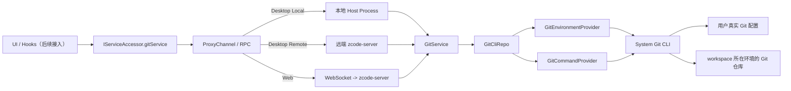

# Resumo da implementação do serviço de Git

Data de atualização: 2026-04-09

## Objetivo desta rodada

Esta rodada implementa apenas a camada de serviço de baixo nível do Git e a arquitetura de comunicação, sem integrar a interação real do painel Git de nível superior.

Escopo concluído:

- Completar os DTOs necessários para o RPC de Git em `packages/shared/src/git.ts`
- Registrar o canal de serviço `git` em `packages/shared/src/channels.ts`
- Materializar a estrutura `config -> providers -> repo -> service` em `packages/services/src/git/`
- Integrar `IGitService` nas três cadeias de serviço: local, remota e web
- Complementar os testes da camada de serviço validando a execução real da CLI do Git

## Diagrama de relações da implementação



Esse diagrama corresponde a dois princípios centrais:

- A camada superior sempre acessa as capacidades do Git apenas pelo protocolo unificado `IGitService`, sem perceber onde a execução acontece
- Quem executa de fato os comandos do Git é a instância de serviço do lado onde o workspace está, e não uma camada de plataforma presa à máquina local

## Estrutura de diretórios

```text
packages/services/src/git/
  config.ts
  git.ts
  gitService.ts
  providers/
    gitEnvironmentProvider.ts
    gitCommandProvider.ts
  repo/
    gitCliTypes.ts
    gitCliHelpers.ts
    gitCliRepo.ts
```

## Responsabilidades por camada

### Config

Responsável pelas regras estáticas do domínio Git e pelos métodos utilitários:

- Caminhos candidatos do binário do Git
- Timeout padrão / limite de tamanho da saída
- Variáveis de ambiente para execução de comandos
- Normalização de caminhos multiplataforma
- Verificação do escopo de caminho do repo e do workspace

### Providers

A camada `Providers` responde apenas por "como executar", e não pela semântica de negócio do Git.

#### GitEnvironmentProvider

Responsável por:

- Resolver o binário do Git disponível no ambiente atual
- Armazenar em cache o resultado da detecção, evitando repetir `git --version`
- Gerar as variáveis de ambiente unificadas de execução do Git

#### GitCommandProvider

Responsável por:

- Executar a CLI do Git de forma unificada
- Controlar `cwd`, `env`, timeout e tamanho da saída
- Registrar comando, tempo decorrido, exit code, stdoutBytes e stderrSummary

### Repo

`GitCliRepo` é um encapsulamento fino sobre a CLI do Git do sistema, com a responsabilidade de "transformar a saída bruta do Git em dados estruturados".

Atualmente coberto:

- Resolução do repositório
- status
- diff
- branch comparison
- stage / unstage / discard / commit
- identity

A lógica puramente de parsing foi extraída para `gitCliHelpers.ts`, incluindo:

- Parsing de `git status --porcelain=v2 -z`
- Parsing de `git diff --numstat -z`
- Verificação da usabilidade do resultado de diff
- Normalização de caminhos e verificação dos limites do repo

### Service

`GitService` expõe à camada superior uma semântica de RPC estável, sem deixar a UI perceber os detalhes da CLI do Git.

Responsabilidades principais:

- Aplicar filtro de escopo pelo `workspacePath` atual
- Mapear o estado bruto do repo para `GitFileChange`
- Centralizar as semânticas de alto nível como branch comparison, identity e refresh

## Fluxos principais de implementação

### 1. Resolução do repositório

O fluxo de `GitCliRepo.resolveRepository()`:

1. Buscar, via `GitEnvironmentProvider`, um binário do Git disponível
2. Executar `git rev-parse --show-toplevel --show-prefix` sob `workspacePath`
3. Obter:
   - `repoRoot`
   - `workspaceInRepoPath`
4. Se o Git não existir ou o diretório atual não estiver dentro de um repositório, retornar um resultado vazio estruturado, em vez de expor a exceção diretamente à camada superior

O objetivo é permitir que a camada superior obtenha de forma estável:

- Se o Git está instalado
- Se o workspace atual está em um repositório Git
- Se o workspace é a raiz do repo ou um subdiretório

### 2. Obtenção do status

O fluxo de `GitCliRepo.getStatus()`:

1. Executar `git status --porcelain=v2 --branch -z`
2. Executar os dois `git diff --numstat -z` (staged / unstaged)
3. Fazer o parsing de branch, ahead/behind, status dos arquivos e contagem de linhas
4. Para arquivos untracked, ler o conteúdo do arquivo para completar as linhas adicionadas
5. Retornar `GitStatusSnapshot`

Os pontos-chave aqui:

- `status --porcelain=v2` garante um formato estável, independente do idioma do sistema
- A contagem de linhas de staged / unstaged é feita de forma unificada na camada de repo
- A camada superior não precisa mais adivinhar se um arquivo é staged, unstaged, untracked ou conflicted

### 3. Filtro de subdiretório do workspace

`GitService.getChanges()` não repassa à UI todas as mudanças do repo como são, mas, com base em:

- `repoRoot`
- `workspacePath`
- `workspaceInRepoPath`

mantém apenas as mudanças dentro do escopo do workspace atual.

Assim, quando o usuário abre um subdiretório de um monorepo, o padrão exibido são as "alterações relacionadas ao workspace atual", sem interferência dos outros diretórios do repositório.

### 4. Diff de arquivo único

A estratégia de `GitCliRepo.getDiff()`:

- `staged`: usa `git diff --cached`
- `unstaged`: usa `git diff`
- `branch`: usa `git diff <upstream>...HEAD`

Para arquivos não rastreados há um fallback adicional:

- Um `git diff` comum não retorna arquivos untracked
- Portanto, nesse caso é executado mais uma vez `git diff --no-index`

Assim a camada superior não precisa de um caso especial ao obter o diff ("este arquivo é untracked").

### 5. Operações de escrita

A camada de repo já implementa as seguintes operações reais de escrita do Git:

- `stage` -> `git add -- <paths>`
- `unstage` -> `git restore --staged -- <paths>`
- `discard` -> `git restore ...`
- `commit` -> `git commit -m <message>`

Essas capacidades já são expostas via `IGitService`, mas a UI de nível superior ainda não foi formalmente integrada.

## Ligação da comunicação

O serviço de Git agora usa a cadeia de RPC unificada, assim como `file/system/terminal`.

### Desktop local

- `createLocalServices()` registra diretamente o `GitService` local

### Desktop remoto

- Do lado do renderer, o que se vê continua sendo `IServiceAccessor.gitService`
- A coleção de serviços do Remote Host da janela atual expõe o `gitService` remoto, e o renderer seleciona esse serviço conforme o remote session / workspace scope; a janela Local Host não é responsável por criar um proxy de Git para o workspace remoto
- Isso garante que o local de execução do Git siga sempre o workspace remoto, em vez de cair incorretamente na máquina local

### Web

- O navegador se conecta ao serviço remoto via websocket
- O remote bridge no lado do server repassa o `gitService`

Conclusão:

- Protocolo unificado
- Local de execução acompanha o workspace
- A UI não precisa diferenciar local / remoto / web

## Perguntas e respostas

### 1. Como o GitService obtém os comandos e a configuração Git locais do usuário

#### Comandos do Git

O `GitEnvironmentProvider` sonda, em ordem:

1. `ZCODE_GIT_BINARY`
2. `git`
3. Caminhos comuns de instalação do Git no Windows

A detecção é feita executando uma vez `git --version`; em caso de sucesso o resultado é cacheado e reutilizado depois.

#### Configuração do Git

Em vez de fazer o parsing de `~/.gitconfig` por conta própria, a leitura é feita sempre pela CLI do Git.

Por exemplo, para ler as informações de identidade:

- `git config --show-scope --show-origin --get user.name`
- `git config --show-scope --show-origin --get user.email`

Assim o que se obtém é a configuração efetiva que o próprio Git decidiu, naturalmente compatível com:

- escopo global / local / worktree
- includeIf
- lógica de carregamento de configuração padrão da plataforma

### 2. Como o GitService garante a compatibilidade entre plataformas

O núcleo da compatibilidade não é "escrever uma implementação de Git separada para cada plataforma", mas sim:

- Protocolo unificado: `IGitService`
- Camadas unificadas: `Service -> Repo -> Providers -> System Git CLI`
- Princípio unificado: o local de execução do Git acompanha o ambiente onde está o workspace

#### Compatibilidade local / remoto / web

- Local: o host process da própria máquina registra a implementação local
- Remoto: o server remoto fornece o serviço de Git, e a máquina local apenas faz proxy via RPC
- Web: o navegador consome, via websocket, o mesmo conjunto de serviços remotos

#### Compatibilidade com múltiplos sistemas operacionais

Já tratado:

- Caminhos candidatos do binário do Git no Windows
- Diferença entre `/dev/null` e `NUL`
- Diferença entre `\` e `/` como separadores de caminho
- Normalização por `realpath`, evitando que `/var` e `/private/var` no macOS causem falso positivo na comparação de caminhos

### 3. Quais interfaces de serviço o GitService oferece hoje, e o que cada uma faz

#### `getRepositorySummary`

Retorna o resumo do repositório:

- `repoRoot`
- `workspaceInRepoPath`
- Nome do branch
- ahead / behind
- Se está dirty
- Se o Git está instalado
- Se está dentro de um repositório

#### `getChanges`

Retorna a lista de alterações dentro do escopo do workspace atual.

Suporta hoje:

- `unstaged`
- `staged`

O retorno já é normalizado como `GitFileChange[]`.

#### `getDiff`

Retorna o diff de um único arquivo.

Suporta:

- diff unstaged
- diff staged
- diff de comparação de branches
- diff de fallback para arquivos untracked

#### `getBranchComparison`

Retorna a comparação do branch atual em relação ao upstream, incluindo:

- `baseRef`
- `headRef`
- `comparisonLabel`
- Lista de arquivos alterados

#### `stagePaths`

Adiciona arquivos à área de staging.

#### `unstagePaths`

Remove arquivos da área de staging.

#### `discardPaths`

Descarta as alterações de um arquivo, com suporte a descarte na área de trabalho e descarte de staged.

#### `commit`

Executa o commit e retorna:

- `commitHash`
- O resumo mais recente do repositório após o commit

#### `getIdentity`

Lê as informações de identidade Git atualmente efetivas:

- `userName`
- `userEmail`
- `nameSource`
- `emailSource`
- `scopeLabel`

#### `refresh`

Retorna de uma só vez:

- `summary` mais recente
- `identity` mais recente

Útil para a camada superior usar diretamente como ponto de entrada de refresh.

## Resultados da verificação

Verificado nesta rodada:

- `pnpm typecheck` passou
- `pnpm test:unit -- packages/services/test/gitService.test.ts` passou

O `pnpm lint` ainda não passa completamente, mas as falhas restantes são problemas históricos já existentes no repositório, e não erros introduzidos nesta rodada pelo serviço de Git de baixo nível.

## Limites atuais

O que já foi concluído:

- Capacidades do serviço de Git de baixo nível
- Comunicação multiplataforma e desenho do local de execução
- Integração real com a CLI do Git

O que ainda não foi feito:

- Fazer o painel Git de nível superior consumir o `gitService` real
- Ligar formalmente a UI das operações de escrita do painel Git
- Assinatura dinâmica de repositórios Git para atualização
- Operações em nível de hunk, mais granulares