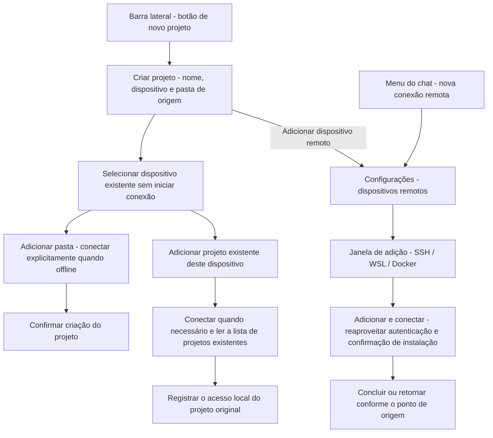

# 15 — Separação entre criação de projeto e gestão de conexão remota

Status: ready-for-agent

2026-10-12: as decisões de produto Q1–Q12 e o ponto de entrada de testes foram confirmados; a implementação e a verificação de cada subticket seguem o registro de conclusão de cada um. 2026-10-14: o contrato da entrada pelo chat foi atualizado conforme a nova confirmação, ver [#21: Seleção obrigatória de pasta remota após conectar no chat e entrada no projeto](21-chat-settings-round-trip.md). #21 foi marcado novamente como ready-for-agent; as evidências antigas de ida e volta pelo chat não representam o novo comportamento implementado.

## Problem Statement

A seguir permanece o contexto de criação de 2026-10-12; o problema da execução com alvo pouco claro após a conexão pelo chat, levantado em 2026-10-14, e o escopo da revisão estão em #21.

O usuário quer criar ou adicionar um projeto em um determinado dispositivo, mas hoje precisa primeiro escolher entre local e remoto, entrar na lista de conexões existentes e depois entrar em outro assistente de conexão que contém os dispositivos salvos e os candidatos descobertos. A seleção de dispositivo e a criação de projeto estão espalhadas por várias páginas, e fica difícil saber se o que está em curso é adicionar um dispositivo, estabelecer uma conexão ou criar um projeto.

Os pontos de entrada de conexão na barra lateral, no menu de projetos da caixa de chat e na página de configurações também têm caminhos de conclusão diferentes: na barra lateral, depois da conexão, escolhe-se um projeto remoto existente ou cria-se um novo; no chat e nas configurações, a nova entrada continua para a escolha de diretório depois da conexão. O usuário que quer apenas adicionar um dispositivo também entra no fluxo de projeto. A lista de conexões existentes e a origem dos candidatos descobertos são diferentes, e a interface não deixa clara essa diferença quando a primeira lista está vazia e a segunda tem muitos alvos.

Ao entrar na gestão de dispositivos a partir da criação de projeto ou do fluxo do chat, é preciso preservar o rascunho original e a posição de retorno. Caso contrário, depois de concluir a conexão o usuário precisa preencher o projeto de novo ou perde o que digitou no chat; e a conclusão em segundo plano, se pular de página automaticamente, interrompe o trabalho em andamento.

## Solution

Separar as operações de projeto da gestão de dispositivos, com SSH, WSL e Docker compartilhando o mesmo conjunto de entradas e as mesmas regras de conclusão.

- "Projeto +" abre diretamente o formulário de criação com nome do projeto, dispositivo e pasta de origem, sem passar pela escolha local/remoto nem por "Próximo".
- O dispositivo assume por padrão o dispositivo da tarefa atual no momento em que o formulário é aberto; sem tarefa atual, seleciona-se "Este computador". Dispositivos offline mantêm a seleção padrão e não podem voltar silenciosamente para o local.
- O menu suspenso de dispositivos mostra apenas "Este computador", todos os dispositivos adicionados e seus status, além de "Adicionar dispositivo remoto…". Configurações de conexão ainda não reconhecidas com sucesso e candidatos descobertos não entram nessa lista.
- Os resultados de descoberta de Host do SSH config, das distribuições WSL e dos contêineres Docker ficam na janela de adição das configurações. A janela é organizada por SSH/WSL/Docker, com SSH como padrão, e cada tipo mantém a capacidade de descoberta e o preenchimento manual, com as limitações de plataforma já existentes.
- Todas as novas entradas de conexão vão para "Configurações → Dispositivos remotos" e abrem a janela de adição, cuja ação principal é "Adicionar e conectar". Partindo das configurações, basta concluir a gestão de dispositivos; partindo de um novo rascunho de tarefa no chat, depois de cada conexão bem-sucedida o fluxo continua com a seleção de pasta remota e, conforme o #21, entra no projeto depois de determiná-lo, sem permitir enviar sem projeto.
- Selecionar um dispositivo existente não inicia conexão. Em dispositivos online, "Adicionar pasta" abre direto o seletor de diretório; em dispositivos offline, "Conectar e escolher pasta" inicia a conexão explicitamente, e o progresso, o complemento de credenciais e as confirmações de instalação necessárias permanecem no fluxo de projeto atual.
- O formulário de projeto remoto mantém a entrada secundária "Adicionar projeto existente deste dispositivo…", para evitar que criar um novo projeto no mesmo diretório seja confundido com restaurar o projeto e a tarefa originais.

Regras de conclusão em primeiro plano e de cancelamento:

| Ponto de origem  | Adicionar e conectar com sucesso                                                                            | Cancelar uma adição ainda não concluída                                                            |
| --------------- | ----------------------------------------------------------------------------------------------------------- | -------------------------------------------------------------------------------------------------- |
| Criar projeto   | Retorna ao rascunho de projeto original e seleciona o novo dispositivo; se já houver pastas, confirma primeiro a troca conforme a Q7, e ao recusar mantém o dispositivo e o diretório originais, com o novo dispositivo já adicionado | Retorna ao rascunho de projeto original, mantendo nome, dispositivo e diretório                      |
| Menu de projetos da caixa de chat | A cada vez, apresenta a seleção de pastas do dispositivo alvo; após confirmar o diretório, um único match é reutilizado, múltiplos matches exigem escolha explícita e zero matches cria com o nome padrão de pasta; quando a preparação termina, entra no novo rascunho de projeto | Cancela a troca remota desta tentativa, restaura e exibe explicitamente o alvo original do chat, preserva o rascunho original; dispositivos já conectados não são desconectados |
| Página de configurações | Permanece na página de dispositivos remotos e localiza o dispositivo correspondente                                      | Permanece na página de dispositivos remotos e não continua o fluxo de projeto                         |

"Continuar em segundo plano" recolhe a interação de conexão atual, e o progresso fica a cargo do cartão de dispositivo nas configurações ou do item de conexão inacabado. Uma conclusão em segundo plano apenas avisa que terminou e oferece uma entrada para continuar, sem forçar a troca de página. A falha mantém a configuração e o motivo, permitindo corrigir e tentar de novo; fechar, cancelar ou pressionar Esc na camada de interação da conexão cancela o fluxo ainda não concluído desta tentativa. Depois que o dispositivo está conectado, fechar a interface não desconecta o dispositivo.

## User Stories

1. As a desktop user, I want the project add button to open the project form directly, so that I can start with the project I intend to create.
2. As a desktop user, I want the project name, device, and source folder in one form, so that I can review the complete target before creating a project.
3. As a user working on a remote task, I want its device selected by default, so that I do not repeatedly choose the same environment.
4. As a user working locally, I want this computer selected by default, so that local project creation remains direct.
5. As a user without a current task, I want a local default, so that the form has a predictable starting point.
6. As a user whose task device is offline, I want that device to remain selected with a visible status, so that I do not accidentally create a local project.
7. As a user with saved devices, I want both online and offline devices in the selector, so that disconnection does not hide my targets.
8. As a user choosing a device, I want its name and connection status to be readable, so that I can distinguish devices without relying on color.
9. As a user choosing a project device, I want discovery candidates kept out of the saved-device list, so that I know which devices I have already added.
10. As a user adding a device, I want every add-connection entry to open the same settings section and dialog, so that the process is consistent.
11. As an SSH user, I want SSH selected initially in the add dialog, so that I can enter its settings immediately.
12. As an SSH user, I want to select a host from my existing configuration or enter it manually, so that I can use either setup method.
13. As an SSH user, I want existing authentication and advanced settings retained, so that the simplified entry still supports my connection.
14. As a Windows user, I want supported WSL distributions and a manual entry in the WSL section, so that I can add my development environment.
15. As a Docker user, I want discovered containers and manual configuration in the Docker section, so that I can select a suitable target.
16. As a user on an unsupported platform, I want controls to respect available capabilities, so that I do not enter a workflow the platform cannot complete.
17. As a user encountering discovery failure, I want a clear explanation and the available manual entry, so that discovery does not block other supported ways to connect.
18. As a user browsing discovery candidates, I want selection to prepare the configuration before I submit it, so that connection starts only after an explicit action.
19. As a user adding a device, I want an Add and connect action, so that I can tell whether the device is usable before selecting a project on it.
20. As a user managing devices, I want connection completion to finish the device operation, so that I am not forced to choose a folder or create a project.
21. As a user choosing an existing device, I want selection alone to avoid connecting, so that browsing the selector has no connection side effect.
22. As a user choosing an online device, I want Add folder to open its directory browser, so that I can proceed directly to the project location.
23. As a user choosing an offline device, I want Connect and choose folder to start the connection, so that the required network operation is explicit.
24. As a user connecting an existing device for a project, I want progress and required confirmations in that project flow, so that I retain the project context.
25. As a user whose connection needs credentials or installation, I want the existing prompts and details, so that the new navigation does not bypass required decisions.
26. As a user switching devices before selecting folders, I want the switch to be immediate, so that an empty form stays easy to change.
27. As a user switching devices after selecting folders, I want confirmation before clearing them, so that I do not lose my selection by mistake.
28. As a user confirming a device switch, I want my project name retained, so that only the device-specific folder selection changes.
29. As a user cancelling a device switch, I want the original device and folders retained, so that cancellation has no partial effect.
30. As a local project user, I want existing empty-project and multiple-folder support retained, so that the remote UI change does not reduce local capabilities.
31. As a remote project user, I want one required fixed root directory, so that project creation follows the existing remote project contract.
32. As a user with an existing remote project, I want to add that project to this computer, so that I can continue accessing its original tasks.
33. As a user with multiple remote projects using the same directory, I want to select the actual project, so that directory similarity does not merge their identities.
34. As a user returning from the existing-project list, I want my new-project draft retained, so that inspecting existing projects does not discard my work.
35. As a user with an older remote environment that only supports reading projects, I want to retain the existing-project entry, so that I can use its supported capability.
36. As a user adding a device from a project draft, I want to return to that draft after success, so that I can continue creating the project.
37. As a user whose project draft already has folders, I want returning with a new device to use the same switch confirmation, so that a settings round trip cannot bypass it.
38. As a user cancelling device addition from a project, I want the original draft restored unchanged, so that the cancelled prerequisite does not discard the project.
39. As a user adding a connection from a chat draft, I want to choose a remote folder after every successful connection, so that my next task runs on the device I chose.
40. As a user confirming a remote folder, I want to enter its selected or newly created project before sending, so that the message cannot run in a local projectless chat.
41. As a user adding a device directly in settings, I want its card located after success, so that I can inspect and manage the result.
42. As a user encountering a connection error, I want the configuration and reason retained with a retry action, so that I can correct the problem without starting over.
43. As a user cancelling an unfinished connection, I want the original project or chat draft preserved, so that cancellation affects only that connection attempt.
44. As a user with saved connection records, I want cancellation to keep those records, so that cancelling an attempt is not mistaken for deleting a device.
45. As a user with other projects on the same device, I want cancellation to leave their connections intact, so that one abandoned flow does not disrupt ongoing work.
46. As a user waiting for a connection, I want to continue in the background and inspect progress in settings, so that I can keep working elsewhere.
47. As a user whose background connection finishes, I want a completion notice and a continuation action, so that success does not unexpectedly change my page.
48. As a user closing an interface after connection success, I want the device to remain connected, so that dismissing a dialog does not undo completed work.
49. As a keyboard user, I want accessible device selection, confirmations, and focus restoration, so that I can complete the same workflow without a pointer.
50. As a user of either theme or supported language, I want readable and complete controls in narrow windows, so that state and actions remain understandable.
51. As a Web or mobile user, I want shared project UI to respect existing Host capabilities, so that the desktop redesign does not imply access to my browser device's filesystem or create a separate remote session.
52. As a user who has moved to another workflow, I want late results from a cancelled or superseded flow ignored, so that old requests do not reopen dialogs or overwrite new drafts.

## Implementation Decisions

### Decisões de produto confirmadas

| Decisão | Contrato de implementação                                                                                                     |
| ------- | ------------------------------------------------------------------------------------------------------------------------------ |
| Q1      | A entrada de projeto cuida da seleção de dispositivo, diretório e projeto; todas as novas entradas de conexão vão para as configurações; a adição de dispositivo tem um ponto de conclusão próprio |
| Q2      | SSH, WSL e Docker são implementados em conjunto, preservando as capacidades e as limitações de plataforma de cada um           |
| Q3      | Ao criar um projeto, o padrão é o dispositivo da tarefa atual; sem tarefa atual, usa o local; offline não substitui automaticamente o dispositivo padrão |
| Q4      | A seleção de dispositivo lista apenas os dispositivos adicionados, inclusive os offline; os candidatos de descoberta ficam na janela de adição |
| Q5      | A janela de adição é organizada por tipo, com SSH como padrão, e cada tipo mantém a descoberta e o preenchimento manual             |
| Q6      | Selecionar um dispositivo existente não conecta; em dispositivos offline, "Conectar e escolher pasta" inicia a conexão, e a espera e os erros são tratados no fluxo de projeto |
| Q7      | Com diretórios já escolhidos, trocar de dispositivo exige confirmação; após a confirmação, os diretórios são limpos e o nome preservado; ao cancelar, todos os valores originais são mantidos |
| Q8      | A ação principal é "Adicionar e conectar"; não há modo "apenas salvar"; configurações não reconhecidas permanecem nas conexões inacabadas das configurações |
| Q9      | O formulário de projeto remoto oferece a entrada de adicionar projeto existente, com a lista exibida na mesma janela, e o retorno preserva o rascunho de criação |
| Q10     | Ao adicionar um dispositivo a partir de um projeto, o sucesso em primeiro plano retorna ao rascunho e seleciona o novo dispositivo; diretórios já escolhidos ainda exigem confirmação; o cancelamento restaura o rascunho original |
| Q11     | O novo rascunho de tarefa do chat exige escolher a pasta remota depois de cada conexão, determina o projeto conforme o #21 e entra nele; o cancelamento no nível superior restaura o alvo original; a origem nas configurações continua nas configurações |
| Q12     | A falha mantém o estado e permite tentar de novo; fechar/cancelar/Esc cancela o fluxo inacabado; continuar em segundo plano não cancela, a conclusão em segundo plano não rouba a navegação; fechar depois de conectado não equivale a desconectar |

### Módulos e integração

1. Alterar os módulos de criação e de edição de projeto, integrando a escolha de tipo, a lista de Hosts e o formulário de projeto em um formulário de criação direta; reutilizar o seletor de diretórios existente e o seletor de projetos remotos existentes.
2. Alterar a entrada de projetos da barra lateral, o menu de projetos do chat, a navegação das configurações e o módulo de gestão de dispositivos remotos. O texto da entrada do chat usa "Nova conexão remota…"; a criação nas configurações entra na mesma interface de adição por categoria.
3. Reutilizar o formulário de conexão existente, o fluxo de conexão, o modelo de exibição de dispositivos e as capacidades de confirmação de autenticação e instalação. Unificar a integração da interação de conexão da barra lateral e a do nível do aplicativo, evitando manter dois assistentes de conexão que competiriam entre si.
4. Expressar o ponto de origem e a intenção de conclusão nas seams de navegação de UI e de conclusão de conexão já existentes: apenas concluir a gestão de dispositivos, continuar para a escolha de diretório, continuar para a escolha de projeto existente, ou restaurar o projeto original de forma explícita. Em caso de sucesso da conexão, o despacho segue essa intenção, sem cair de novo uniformemente na escolha de diretório.
5. O fluxo existente já permite que o chamador assuma após o sucesso da conexão. Priorizar a reutilização dessa seam; não criar uma nova cadeia principal de autenticação, instalação ou conexão para pular a tela de diretório, nem uma nova API de gestão para salvar apenas o Profile.
6. As ações de conexão das configurações são concluídas no escopo da gestão de dispositivos; as ações de projeto explícitas no cartão do dispositivo mantêm a intenção de projeto. A reconexão de projeto existente continua no projeto original e não pode ser assumida pelo novo formulário de criação desta rodada.

### Dados e posse do estado

7. Source representa o ambiente remoto e a conta já identificados; Connection Profile representa a forma de conexão que alcança aquela Source. Uma Source pode ter vários Profiles, e a lista de dispositivos não pode criar uma identidade de dispositivo paralela por endereço de conexão ou nome de exibição.
8. Os candidatos de dispositivos adicionados vêm do fato já existente da gestão de dispositivos e são independentes de o projeto daquele dispositivo já estar aberto neste computador. Candidatos de descoberta, Profiles ainda não identificados e dispositivos já identificados ficam separados; a reutilização de uma conexão da mesma Source não pode gerar dispositivos duplicados.
9. O nome do projeto, o dispositivo escolhido e a pasta de origem são mantidos por um único owner, o rascunho do projeto; na abertura, o dispositivo padrão é inicializado, e atualizações de status posteriores não sobrescrevem a escolha do usuário. A ida e volta pelas configurações preserva o mesmo rascunho, sem copiar o rascunho na barra lateral, nas configurações e no chat para depois sincronizá-los entre si.
10. O fluxo de conexão mantém a atribuição da requisição, o ponto de origem e a intenção de conclusão. O cartão em segundo plano e a janela projetam a mesma operação; o estado real da conexão, os logs e as credenciais continuam pertencendo ao serviço de Host já existente, e a UI não cria um cache de fatos de conexão paralelo.
11. A configuração de conexão e as credenciais seguem as fronteiras de envio já existentes. Em caso de falha, cancelamento ou reutilização de uma conexão online, não se pode salvar a senha desta tentativa nem sobrescrever credenciais existentes sem condição; uma adição que falha mantém um formulário corrigível, o que não equivale a afirmar que a informação de autenticação desta tentativa já foi persistida.
12. A restauração do rascunho do projeto cobre apenas as idas e vindas de página dentro desta interação; não há nova restauração de rascunho entre reinicializações. A intenção de retorno não salva senha nem passphrase de chave privada, nem altera as regras de armazenamento do serviço de credenciais existente.
13. Não há nova migração de banco de dados nem reescrita do formato de identidade de Source, Profile, projeto e workspace. A intenção de retorno da camada de interface não entra no protocolo de tarefas nem se torna owner de novas tarefas, conexões ou mensagens.

### Assincronia, cancelamento e fronteira de diretórios

14. A confirmação da troca de dispositivo deve preceder a limpeza dos diretórios e a troca de alvo; recusar a confirmação não produz modificação parcial. Quando uma seleção ou leitura assíncrona de diretório retorna, é preciso conferir que o rascunho, o dispositivo e a requisição ainda são válidos, e o resultado do dispositivo antigo não pode ser escrito no rascunho do novo dispositivo.
15. A seleção de dispositivo, a conclusão da conexão e a navegação de diretórios não criam projeto nem chat. A origem do chat resolve o projeto existente conforme o #21 depois de o usuário confirmar o diretório, usando o nome padrão quando não há match e mantendo a confirmação de criação compartilhada; as demais entradas continuam exigindo criação ou adição explícita. Diretório inválido, falta de permissão, falha de leitura ou de gravação não cria entradas fantasma, e a falha não pode ser tratada como zero match.
16. Projetos locais continuam permitindo zero ou múltiplos roots; projetos remotos exigem exatamente um root fixo. O diretório fixo, a identidade do projeto e a atribuição de tarefas históricas de um projeto remoto existente não mudam com o novo formulário.
17. Adicionar um projeto remoto existente usa a identidade do projeto original; a criação genérica de um novo projeto no mesmo diretório pode continuar produzindo outro projeto. A ação de confirmação de diretório da origem do chat faz, conforme o #21, a resolução exata de diretório no mesmo dispositivo: um único match é reutilizado, múltiplos matches exigem nova escolha, projetos não são mesclados e a deduplicação global salva não é alterada para deduplicação por diretório. A capacidade de projeto somente leitura dos remotos antigos continua disponível.
18. O cancelamento só revoga a requisição de interação ainda não concluída desta tentativa e os recursos temporários que ela segura; não apaga registros de conexão salvos, não desconecta a conexão de dispositivo compartilhada por outros projetos e não desfaz uma adição já concluída com sucesso. Fechar a janela de conexão e abandonar explicitamente o formulário de projeto original são operações distintas e não podem limpar junto o rascunho de quem originou.
19. Conexões, credenciais, confirmações de instalação e resultados de diretório que chegam atrasados após um fechamento ou cancelamento não podem reabrir a interface, criar projetos ou sobrescrever novos rascunhos. Reutilizam-se a identidade e o mecanismo de invalidação das requisições existentes, sem usar atraso de navegação, temporizadores ou polling para compensar a sincronização de estado.
20. O retorno de sucesso em primeiro plano só consome a intenção do fluxo original que ainda for válida; quando a tarefa, o rascunho ou o alvo original já expiraram, as páginas antigas não são ressuscitadas. A conclusão em segundo plano apenas notifica e oferece uma entrada explícita para continuar, mesmo que o usuário já tenha saído das configurações, e não pode roubar o foco; a falha em segundo plano e a necessidade de tratamento mantêm igualmente detalhes acessíveis.
21. Quando um menu suspenso ou uma camada de confirmação está aberto, o Esc segue primeiro a regra de fechamento de nível superior do componente compartilhado; somente na camada de interação da conexão ele significa cancelar a conexão desta tentativa, evitando que uma única tecla feche vários níveis ao mesmo tempo.

### Plataforma e visual

22. Reutilizar tipografia, cores, hierarquia, raio de canto, dimensões, componentes e modelo de estado do design system; o tipo de conexão e o status da conexão expressam cada qual o seu próprio significado, e não apenas com cor offline, falha ou pendência de tratamento.
23. Validar os temas claro e escuro atuais, os idiomas chinês e inglês, as janelas estreitas, a operação por teclado e o retorno de foco. Nomes de dispositivo longos, caminhos, erros e traduções não podem bloquear a ação principal.
24. A gestão de dispositivos remotos continua sujeita às capacidades de plataforma do Desktop já existentes; o WSL só é oferecido nas plataformas suportadas, e o estado de indisponibilidade do Docker continua distinto do estado sem candidatos. A falha de descoberta não bloqueia outras origens nem a entrada manual já disponível.
25. O formulário compartilhado no Web/no celular segue as capacidades já existentes e não pode oferecer novas entradas para páginas de configurações inexistentes. "Este computador" mantém a semântica já existente de controlar o host e não indica o sistema de arquivos local do dispositivo onde o navegador roda. O celular continua se anexando ao Host já existente do desktop e não cria uma sessão SSH, WSL ou Docker independente.
26. O continuous do desktop e o replayable do celular, a reconexão de projeto original e a restauração na inicialização, o owner das tarefas, o provisionamento pelo Provider e o isolamento de workspace seguem os contratos existentes; esta rodada apenas reorganiza as entradas do usuário e o destino de conclusão das interações.

## Testing Decisions

2026-10-12: o usuário confirmou o ponto de entrada dos testes: principalmente o E2E do aplicativo de desktop já existente, validando o fluxo completo a partir das três entradas reais (barra lateral, caixa de chat e configurações); testes de integração de UI são complements apenas para os resultados atrasados, o cancelamento e a temporização de restauração de rascunho, que são difíceis de controlar de forma estável; autenticação e instalação usam a cadeia de testes remotos reais já existente, sem novas interfaces de negócio exclusivas para teste.

### Princípios de teste e pontos de entrada existentes

- **O ponto de entrada principal é o comportamento externo do aplicativo.** A operação é feita por entradas reais e as asserções cobrem página visível, botões, foco, rascunho original, identidade do projeto, atribuição de tarefas e o estado real da conexão. Não basta verificar chamadas de métodos internos nem deixar o caso pular manualmente a navegação de configurações que está sendo testada.
- **O tempo é controlado pelas seams já existentes.** Os testes de integração de UI montam os componentes reais de projeto/conexão e atrasam o retorno nas portas de plataforma e de serviço já existentes, injetam falhas ou liberam o resultado; as asserções cobrem o resultado visível e os efeitos colaterais externos como a gravação do projeto, sem travar nomes de hook, campos de estado privado ou níveis de DOM.
- **Módulos sob teste.** Criação/edição de projeto, candidatos de dispositivo, seleção de projeto existente, entradas da barra lateral e do chat, navegação das configurações e gestão de dispositivos, despacho de conclusão do fluxo de conexão e ciclo de vida do rascunho. A conexão do Host e o serviço de projeto mantêm os contratos de teste existentes, com asserções complementares apenas nas fronteiras afetadas.
- **Precedentes existentes.** O teste de conexão nas três telas já cobre config do SSH, alvo offline, recolhimento, falha e fechamento; o teste dos campos de projeto já tem evidência de mesma origem na barra lateral, de seleção de projeto e entre layouts; o teste de passagem do projeto original já tem SSH real, barreira de vínculo do Host e resultado atrasado após a remoção da entrada; o teste de UI do fluxo de conexão já tem credencial atrasada, confirmação de instalação e restauração por cancelamento. Reutilizar essas organizações e ambientes, sem copiar as asserções de navegação nas três telas que esta especificação substitui.
- **A evidência de ambiente real é registrada separadamente.** As cadeias reais de SSH, WSL e Docker são validadas separadamente, e o caso de WSL no Windows não pode ser substituído por um PASS de SSH ou de mock. Captura de tela de janela estreita do desktop não equivale à validação real de shared-host no celular; a caixa de diálogo nativa de diretório pode reaproveitar o substituto de retorno do sistema, mas a fronteira do substituto deve ser indicada.
- **Teste antes da implementação.** Primeiro mapear os cenários de aceitação da tabela abaixo para os diretórios de casos existentes e para a matriz de cobertura, complementando com testes de interação que provem que o comportamento antigo não satisfaz o novo contrato, e só então alterar o código. Os helpers e as asserções dos E2E existentes que dependem da escolha de tipo, do fechamento genérico de diretório e do cartão recolhido na barra lateral são atualizados em conjunto.

### Cenários de aceitação e requisitos de evidência

Os IDs abaixo são a lista de aceitação desta rodada e não indicam que os testes já existam ou já tenham passado. Cada um precisa manter setup, operação, asserção e evidência de execução; ao cobrir temas, idiomas e plataformas, usar combinações representativas e de alto risco, sem expandir indiscriminadamente o produto cartesiano completo.

| ID        | Condição inicial e operação                                                                                   | Asserções observáveis                                                                                                              | Evidência principal                        |
| --------- | ------------------------------------------------------------------------------------------------------------- | ------------------------------------------------------------------------------------------------------------------------------------ | ------------------------------------------ |
| RDUX15-01 | Clicar no botão de novo projeto a partir de tarefa local, tarefa remota e sem tarefa atual                   | Exibe o formulário completo de imediato, com os dispositivos padrão local, remoto correspondente e local; sem tela de tipo anterior | Desktop E2E                                |
| RDUX15-02 | Dispositivo da tarefa atual está offline; abrir o formulário e esperar a atualização de status              | O dispositivo padrão é mantido e o status é legível; não volta para o local nem estabelece conexão                                    | Desktop E2E + temporização de UI           |
| RDUX15-03 | O dispositivo tem registros online, offline e sem projeto aberto, além de candidatos de descoberta e Profile não identificado | O menu suspenso contém todos os dispositivos identificados, sem misturar candidatos de descoberta nem conexões inacabadas; não descarta dispositivos pelo conjunto de projetos abertos | Integração de UI + Desktop E2E              |
| RDUX15-04 | Clicar em nova conexão a partir do projeto, do menu do chat e das configurações                           | Entra na mesma seção das configurações e na mesma janela de adição por categoria, sem escolher de novo um dispositivo existente entre tipos | Desktop E2E dos três pontos de entrada      |
| RDUX15-05 | Alternar SSH/WSL/Docker na janela de adição, escolher candidato descoberto ou entrada manual; simular falha de descoberta | SSH como padrão; campos de tipo e capacidades corretos; a escolha de candidato não disca, só o envio explícito conecta; a falha de descoberta não bloqueia outras entradas disponíveis | Integração de UI + E2E em plataforma suportada |
| RDUX15-06 | Escolher um dispositivo online no formulário de projeto e adicionar uma pasta                              | A escolha do dispositivo não tem efeito colateral de conexão e a navegação de diretórios reutiliza esse dispositivo; escolher a pasta ainda não cria o projeto | Desktop E2E                               |
| RDUX15-07 | Escolher um dispositivo offline no formulário de projeto e clicar em conectar e escolher pasta              | Não conecta antes do clique; o progresso e as confirmações necessárias acontecem dentro do fluxo de projeto e o sucesso entra na navegação de diretórios, sem saltar para as configurações de dispositivo | Desktop E2E remoto real                    |
| RDUX15-08 | O formulário já tem nome e pasta; trocar de dispositivo e confirmar e cancelar, respectivamente           | A confirmação limpa apenas as pastas e troca o dispositivo, preservando o nome; o cancelamento mantém todos os valores originais; o rascunho sem diretórios dispensa confirmação | Desktop E2E                               |
| RDUX15-09 | A seleção/leitura de diretórios do dispositivo A ainda não terminou; cancelar ou trocar para o dispositivo B e liberar a resposta de A | O resultado de A não é escrito no rascunho de B, não reabre a página antiga de diretórios e não salva o projeto | Integração de UI                           |
| RDUX15-10 | Adicionar e conectar com sucesso um dispositivo diretamente das configurações; verificar também a ação de conexão comum de um dispositivo existente | A operação de gestão de dispositivos é concluída de forma independente e localiza o dispositivo, sem abrir a página de diretórios e sem criar projeto ou chat | Desktop E2E remoto real                    |
| RDUX15-11 | Adicionar um dispositivo a partir de um rascunho de projeto com nome e concluir em primeiro plano           | Retorna ao mesmo rascunho, preserva o nome e seleciona o novo dispositivo; a quantidade de projetos não muda antes da criação explícita | Desktop E2E                               |
| RDUX15-12 | O rascunho original já tem pastas; adicionar um dispositivo, voltar e aceitar e recusar a troca de dispositivo | A passagem de retorno ainda exige a confirmação da Q7; a recusa mantém o dispositivo e o diretório originais, e o novo dispositivo continua na lista de adicionados | Desktop E2E                               |
| RDUX15-13 | Adicionar um dispositivo a partir de um rascunho de projeto e cancelar no formulário, na conexão e na espera de confirmação | Volta ao rascunho de projeto original; nenhum projeto novo é criado; os registros de conexão salvos e os outros projetos compartilhados não são apagados nem desconectados | Desktop E2E + temporização de UI           |
| RDUX15-14 | Adicionar um dispositivo em um novo rascunho de chat; o sucesso exige a escolha de diretório e a entrada no projeto, e o cancelamento restaura o alvo original | O novo contrato está detalhado em RDUX21-01–24; as restrições de envio, a identidade do projeto, o cancelamento e as proteções assíncronas devem ser reverificadas; a migração de rascunho entre dispositivos fica adiada e um PASS antigo não a cobre | Desktop E2E + temporização de UI/serviço necessária |
| RDUX15-15 | O dispositivo remoto tem projeto e tarefas originais; escolher esse projeto pela entrada secundária; testar também o rascunho de criação antes de voltar à lista | A entrada do projeto original é adicionada e a identidade das tarefas originais é preservada; não é criado um projeto novo no mesmo diretório; o retorno preserva o rascunho; a adição repetida não cria entradas duplicadas | Desktop E2E + contrato do serviço de projetos |
| RDUX15-16 | Existem projetos diferentes no mesmo dispositivo e diretório; executar a adição também em um remoto antigo somente leitura | Os projetos originais podem ser escolhidos separadamente; não são mesclados por caminho; o remoto somente leitura permite adicionar projeto existente e não pode criar de forma inválida | Contrato existente de serviço/UI + E2E         |
| RDUX15-17 | Criar projeto vazio e projeto com múltiplos diretórios no local, projeto de diretório único no remoto e depois escolher um diretório indisponível | As capacidades locais são preservadas; o contrato de diretório remoto é válido; falha de leitura ou gravação não cria projeto fantasma | Desktop E2E + contrato do serviço de projetos |
| RDUX15-18 | Encontrar complemento de credenciais, falha de autenticação e confirmação de instalação/upgrade, corrigir e tentar de novo | A intenção de conclusão original não se perde, a configuração e o erro compreensível são mantidos; as confirmações necessárias não são puladas; credenciais novas não usadas não sobrescrevem valores existentes | E2E remoto real + contrato de credenciais existente |
| RDUX15-19 | Clicar em continuar em segundo plano durante a conexão e sair manualmente das configurações; deixar a conexão ter sucesso, falhar ou ficar aguardando tratamento | O item das configurações assume o mesmo progresso; o primeiro plano não é roubado; o sucesso tem entrada para continuar, e a falha/pendência tem detalhes acessíveis; sem operação duplicada | Desktop E2E + temporização de UI              |
| RDUX15-20 | Liberar credenciais, instalação ou resultado de conexão antigos depois que a conexão foi fechada, cancelada ou o originador expirou | Resultados antigos não ressuscitam a janela, não saltam de página, não criam projeto e não sobrescrevem novos rascunhos; apenas os recursos temporários exclusivos desta tentativa são limpos | Integração de UI + E2E de passagem do projeto original |
| RDUX15-21 | Um projeto existente no mesmo dispositivo está usando a conexão; adicionar uma conexão que a reutiliza ou cancelar outra requisição | Continua sendo o mesmo dispositivo; o projeto original pode continuar usando a conexão; credenciais novas que não participaram da autenticação não sobrescrevem os valores antigos; fechar a interface depois do sucesso não desconecta | E2E remoto real + contrato do Host             |
| RDUX15-22 | Um projeto remoto existente está offline; clicar no projeto original e passar por complemento de credenciais/instalação; executar também a restauração na inicialização | O sucesso ainda entra no projeto e no diretório originais, sem cair por engano no novo formulário; a restauração não exige escolher diretório de novo | E2E de reconexão do projeto original            |
| RDUX15-23 | Operar apenas por teclado o menu suspenso de dispositivos, a adição, a confirmação de troca e o fechamento; cobrir nomes longos e erros | O Esc vale conforme a semântica da interação de nível superior, o foco é visível e retorna de forma razoável; o estado tem texto; nenhuma ação é cortada | Desktop E2E + asserções de acessibilidade      |
| RDUX15-24 | Temas claro/escuro, chinês/inglês, janelas normais/estreitas; capacidades correspondentes de macOS/Windows/Linux | Usa o design system existente; o layout, a seleção de diretório do sistema e as capacidades de tipo estão corretos; o WSL aparece apenas em plataformas suportadas | Evidência visual + E2E da plataforma correspondente |
| RDUX15-25 | Usar a interface de projeto do Host existente na Web/no celular e restaurar um workspace remoto já existente | Os portões de capacidade valem, sem entrada para configurações inexistentes, sem uso errado de diretório local do navegador e sem sessão remota independente; o Host compartilhado e a restauração replayable não regridem | Regressão Web/celular + contrato de Host existente |

### Portão de conclusão da implementação

- A implementação de código precisa passar pela checagem de tipos, pelo lint, pelo portão de arquitetura, pelos testes unitários afetados no escopo da tarefa e pelo Desktop E2E correspondente; a UI compartilhada e a fronteira remota exigem a regressão Web/celular aplicável.
- Registrar a faixa de evidência real de SSH, WSL, Docker, sistemas operacionais e celular. Bloqueios de ambiente devem listar os cenários não verificados, e não podem ser substituídos por testes de componente ou por registros de aprovação de versões antigas.
- Os novos E2E entram como candidatos a revisão manual pelo fluxo de trabalho já existente; a execução bem-sucedida não equivale à admissão formal/CI, e a promoção formal segue o processo original.
- Esta entrega é apenas de documentação: verificar a estrutura do documento, as referências, a consistência das regras, a formatação e as restrições de open source; não registrar testes funcionais não executados como aprovados.

## Out of Scope

- Reescrever as máquinas de estado de transporte, autenticação, instalação, upgrade ou reconexão de SSH, WSL e Docker; não adicionar capacidades não confirmadas como ssh-agent ou chaves padrão.
- Introduzir um modo "apenas salvar, sem conectar", ou oferecer configurações de conexão ainda não reconhecidas como dispositivos adicionados para a seleção de projeto.
- Múltiplos diretórios remotos, tarefas remotas sem projeto, alteração do diretório fixo de um projeto remoto já criado, mesclagem de projetos por caminho ou migração de tarefas históricas.
- Refazer todo o visual dos cartões de dispositivo, a ordenação e os agrupamentos da barra lateral, ou criar um sistema de filtragem para grandes listas de dispositivos.
- Nova restauração de rascunho de projeto/conexão entre reinicializações, ou incluir a senha na intenção de retorno de página.
- Ampliar as capacidades de gestão de dispositivos remotos no celular ou na Web comum, criar um owner de conexão remota independente no celular, ou alterar a fronteira continuous/replayable.
- Refazer a entrada de conexão direta do Server de desenvolvimento, o provisionamento pelo Provider, o protocolo de tarefas, a identidade de workspace e as migrações de armazenamento.

## Further Notes

- Esta entrega traz apenas a especificação, sem alteração de código de funcionalidade e sem execução de testes funcionais; a implementação subsequente tem esta como referência, e ready-for-agent não significa implementado nem verificado.
- As Q1–Q12 e o ponto de entrada de testes desta rodada foram confirmados; a revisão da entrada do chat de 2026-10-14 e as regras de cancelamento e de correspondência de diretórios também foram confirmadas. Antes de implementar, começar pelos cenários de aceitação deste Issue e do #21, sem rediscutir decisões já confirmadas; a migração de rascunho/anexo entre dispositivos não está no escopo do #21.
- O ready-for-agent da [convenção local de Issues](../../agents/issue-tracker.md) é expresso pelo Status deste documento; este arquivo serve ao mesmo tempo como especificação completa, sem duplicar o corpo em outro arquivo e sem publicar uma Issue remota.
- O [índice de UX de conexão remota](01-remote-connection-ux-optimization.md) registra a relação deste ticket com os lotes já concluídos. Em 2026-10-14 apenas o #21 foi reaberto para implementar o novo contrato da entrada do chat; os status dos demais subtickets e as evidências históricas são preservados, e a avaliação pendente do ssh-agent não é avançada.
- Na implementação deste ticket, as formulações da [especificação de UX de conexão](../../architecture/remote-device-connection-ux-spec.md) sobre a entrada genérica nas três telas, a lista de descoberta mista, a obrigatoriedade de entrar no diretório após o sucesso, a posição do progresso recolhido na barra lateral e a limpeza de todos os rascunhos ao fechar são substituídas pelos contratos correspondentes deste documento. Os cinco estados, a classificação de erros, os logs, a confirmação de instalação, o salvamento de credenciais e a identidade de dispositivo seguem o contrato original.
- Na implementação deste ticket, as regras da [especificação de navegação de projetos](../../remote/project-first-remote-navigation-spec.md) sobre a entrada do botão de novo projeto e a seleção unificada de diretório na conexão manual sem diretório são distinguidas conforme a intenção de projeto/gestão de dispositivos deste documento; a reconexão de projeto existente, a restauração na inicialização, o isolamento de identidade e as regras de dados históricos continuam válidos. As marcações de implementado e as evidências de teste antigas do documento anterior não representam a conclusão deste ticket.
- As fronteiras de domínio continuam baseadas na [especificação principal R3](../../architecture/r3-source-server-remote-architecture.md) e nos [limites de runtime](../../agents/runtime-boundaries.md); a UI segue o [guia de design](../../../DESIGN.md), e a seleção de diretórios locais segue o [contrato existente](../../ui/project-local-directory-picker.md).
- Na implementação, associar os cenários de aceitação ao [catálogo de casos](../../conversation-session-case-catalog.md) e à [matriz de cobertura](../../testing/conversation-session-e2e-coverage-matrix.md), mantendo as evidências conforme o [fluxo de trabalho de E2E](../../testing/conversation-session-e2e-development-workflow.md). Aqui são dados apenas os objetivos de aceitação, sem forjar arquivos de caso ou PASS.
