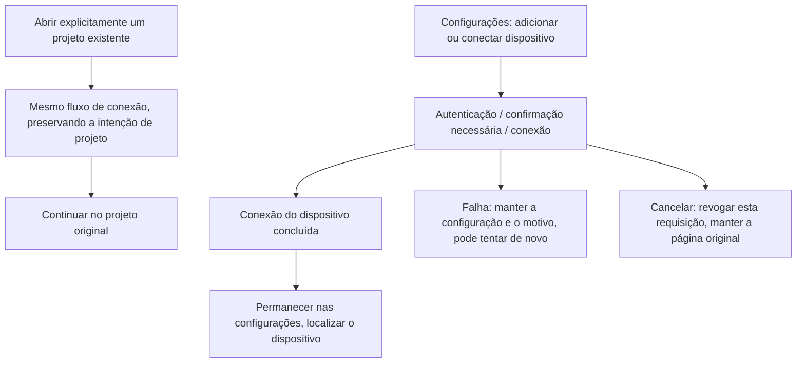

# 16: Conclusão independente da conexão nas configurações

Status: done

**Parent:** [#15 — Separação entre criação de projeto e gestão de conexão remota](15-project-device-selection-and-connection-management.md)

**O que construir:** quando o usuário adicionar ou conectar um dispositivo pelas configurações, após a autenticação, a confirmação de instalação necessária e a conexão bem-sucedida, ele permanece na página de dispositivos remotos e o dispositivo fica localizado, sem mais ser obrigado a escolher um diretório ou criar um projeto. A ação explícita de abrir um projeto existente continua retornando ao projeto original. Concluir primeiro esse caminho executável e verificável, para que a classificação de adições posteriores e a entrada de projeto reutilizem o mesmo fluxo de conexão.

**Bloqueado por:** None (pode começar imediatamente).

**Cobertura da spec:** Q1, Q8, Q12; RDUX15-10, RDUX15-18, RDUX15-21, RDUX15-22, e a proteção de invalidação do fluxo de conexão de RDUX15-20. RDUX15-23/24/25 cobrem as interações de configurações, o visual e os limites de capacidade envolvidos nesta ticket.

## Critérios de aceitação

- [x] Primeiro organizar as seams (costuras) existentes de conclusão de conexão, distinguindo as intenções de conclusão: gestão de dispositivos, continuar para a seleção de diretório, continuar para a seleção de projeto existente e restaurar o projeto original. Preservar as capacidades existentes de autenticação, instalação, upgrade e conexão, sem criar outra cadeia física de conexão nem outro owner de tarefa; os chamadores antigos ainda conseguem concluir com a intenção original antes da migração.
- [x] A partir das novas entradas de adição e de conexão comum de dispositivo existente nas configurações, após o sucesso o usuário permanece na página de dispositivos remotos e o dispositivo é localizado; o seletor de diretórios e o editor de projeto não são abertos automaticamente, e a quantidade de projetos e chats não aumenta.
- [x] A ação explícita de projeto no cartão de dispositivo das configurações, a reconexão do projeto original na barra lateral e a restauração na inicialização continuam usando o projeto e o diretório originais; complemento de credenciais, instalação, upgrade e nova tentativa não os transformam em conclusão de gestão de dispositivos nem em novo projeto.
- [x] Na falha, a configuração atual e um erro compreensível são mantidos, permitindo corrigir e tentar de novo; fechar, cancelar ou pressionar Esc na camada de interação da conexão cancela somente o fluxo ainda não concluído desta tentativa. O dropdown e a camada de confirmação continuam consumindo o próprio Esc primeiro, sem fechar várias camadas de uma vez.
- [x] Cancelar não apaga registros de conexão salvos nem fecha a conexão de dispositivo compartilhada por outros projetos; após a conexão bem-sucedida, fechar a interface mantém o dispositivo online. O attachment temporário exclusivo desta execução é liberado conforme o ciclo de vida já existente.
- [x] Depois que a intenção foi cancelada ou invalidada, credenciais, confirmações de instalação e resultados de conexão atrasados não podem reabrir a interface, trocar de projeto ou submeter navegações antigas; isso é determinado pela atribuição da requisição, sem compensação por timeout.
- [x] Falha, cancelamento ou reuso de uma conexão online não salvam incondicionalmente a senha desta tentativa nem sobrescrevem credenciais existentes; o reuso da mesma Source não produz dispositivos duplicados.
- [x] Os estados de sucesso, falha e "requer ação" das configurações são coerentes com os fatos do dispositivo; foco de teclado, texto de estado, chinês/inglês e o tema claro/escuro atual são utilizáveis. O portão de capacidade de gestão de dispositivos da Web/do celular não é liberado.
- [x] Escrever os testes antes de alterar o código, concluir as verificações descritas abaixo e registrar as evidências reais; as specs e asserções de teste relacionadas são atualizadas junto com o comportamento concluído por esta ticket, sem registrar como já implementados os objetivos que ainda pertencem a tickets posteriores.

## Verificação

- Executar a partir das entradas reais das configurações a adição, a conexão de Profile existente e a abertura explícita do projeto original, e afirmar a página final, o estado do dispositivo e a quantidade de projetos/tarefas. Usar a cadeia de teste remoto real já existente para provar o sucesso da conexão, o complemento de credenciais, a confirmação de instalação e a restauração do projeto original.
- Controlar o cancelamento e os resultados atrasados nas seams de UI/serviço existentes, e afirmar a navegação observável e os efeitos colaterais em projetos; reaproveitar o contrato de credenciais e de conexão compartilhada para verificar que credenciais não utilizadas não sobrescrevem valores existentes.
- Cobrir o tema claro/escuro atual, chinês/inglês e janela estreita, e registrar o escopo real de execução de SSH, WSL, Docker e sistema operacional. Substitutos de componente ou resultados de execuções antigas não podem substituir as evidências da cadeia real.
- A implementação precisa passar pela checagem de tipos, pelo lint, pelo portão de arquitetura, pelos testes unitários afetados no escopo da tarefa e pelo Desktop E2E correspondente. Módulos compartilhados que tocarem a Web/o celular exigem a regressão aplicável; em caso de bloqueio de ambiente, listar os itens não verificados e não marcar como done.

## Escopo e handoff

- A organização necessária das intenções de conclusão é feita nesta ticket e validada pelo caminho completo de conexão das configurações; não entregar à parte uma nova abstração sem chamadores reais, nem criar API "somente salvar Profile", migração de banco de dados ou formato de identidade de workspace.
- A interface de adição por classificação é entregue por [#17](17-typed-remote-device-addition.md), e a criação direta de projeto por [#18](18-direct-project-creation-and-device-selection.md). Durante a migração, manter as entradas existentes utilizáveis e não remover de uma vez os fluxos de que as tickets posteriores ainda dependem.
- A posição do progresso em segundo plano e a interação de continuação explícita são entregues por [#22](22-background-connection-and-explicit-resume.md); o cancelamento em primeiro plano, a proteção de credenciais e o isolamento de resultados atrasados desta ticket devem ser concluídos de forma independente, sem adiamento para aquela ticket.

## Limites de implementação e pendências

- O histórico de diretórios do cartão de dispositivo nas configurações contém hoje apenas Source e caminho, e não uma lista de projetos existentes com o ID do projeto original. Esta ticket mantém seu caminho de diretório compatível; a reconexão explícita do projeto original continua usando o `preferredProjectEntryId` / `preferredWorkspaceTabId` já existente. Não inferir o projeto pelo mesmo diretório; a seleção formal de projeto existente é entregue pela #19.
- TODO: por autorização do usuário nesta rodada, WSL e a cadeia real do celular ficam sem verificação por enquanto. Preservar a regressão do portão de capacidade; não reportar isso como cadeia real aprovada.

## Registro de verificação (2026-10-12)

- E2E de Desktop nativo em macOS: `conversation-session-settings-connection-completion.test.ts` 2/2 aprovados. A adição via SSH, a reconexão de Profile comum, o reuso de conexão online com senha nova incorreta, o ambiente de usuário independente em Docker, o cancelamento por Esc, a localização do dispositivo e a restauração da identity do projeto original passaram por conexões reais. A interface pública de leitura do Host confirmou que, antes e depois das operações de cada dispositivo, havia 1 projeto local e 0 tarefas.
- Evidências de dispositivo e cancelamento: `packages/desktop/.e2e-artifacts/desktop-e2e-20261012101254815-p39412-0d279d20ad5c072b/`. Contém 8 capturas de tela em chinês/inglês × tema claro/escuro × 1440/480px, com as capturas representativas verificadas. A execução final usou artefatos de build conferidos arquivo a arquivo contra o código-fonte; não houve substituição de conexão, instalação ou Host.
- Regressão de credenciais existentes: `conversation-session-ssh-remote-wizard-credentials.test.ts` 1/1 aprovado, cobrindo o preenchimento de credenciais ausentes após recarga a frio e o reuso de conexão já online. Evidência: `packages/desktop/.e2e-artifacts/desktop-e2e-20261012101356498-p39966-214ee0d1c7e9b02c/`.
- Testes unitários: 659 arquivos de teste e 6358 casos aprovados conforme a baseline `e98b230336`, com 34 verificações de script Node também aprovadas; em seguida, a nova configuração de inicialização sem conta passou na verificação afetada executada por arquivo. Regressões direcionadas de 32 itens do fluxo de conexão e 24 itens de credenciais de inicialização passaram.
- `pnpm typecheck`, checagem de tipos do Desktop E2E, `pnpm lint`, portão de arquitetura, verificação de fixture, formatação do código alterado e verificação de diff passaram. O lint manteve as 208 warnings da baseline, sem novos erros.
- O escopo real de execução nesta rodada foi macOS Desktop + SSH/Docker em contêiner Linux. WSL e celular ficaram suspensos por autorização do usuário; E2E reais de Desktop em Windows/Linux não foram executados e não contam como aprovados.
