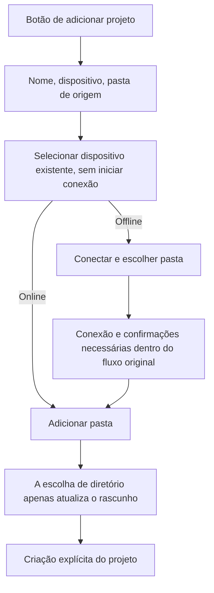

# 18: Criação direta de projeto e seleção de dispositivo existente

Status: done

**Parent:** [#15 — Separação entre criação de projeto e gestão de conexão remota](15-project-device-selection-and-connection-management.md)

**What to build:** Ao clicar em "Projeto +", o usuário preenche diretamente o nome, escolhe o dispositivo e a pasta de origem e conclui a criação do projeto. Quando há dispositivos remotos existentes online, a navegação de diretórios é direta; quando estão offline, o usuário inicia a conexão explicitamente e, após as confirmações necessárias dentro do fluxo de projeto, continua a escolha do diretório.

**Blocked by:** [#16 — Conexão concluída de forma independente dentro das configurações](16-settings-connection-completion.md). Esta ticket reaproveita o fluxo de conexão que continua a operação de projeto conforme a intenção, sem manter um segundo caminho concorrente de conclusão de conexão.

**Spec coverage:** Q1, Q3, Q4, Q6, Q7; RDUX15-01, RDUX15-02, RDUX15-03, RDUX15-06, RDUX15-07, RDUX15-08, RDUX15-09, RDUX15-17; RDUX15-18／20／21 cobrem a espera de conexão e o cancelamento desta ticket; RDUX15-23／24／25 cobrem o formulário de projeto compartilhado.

## Acceptance criteria

- [x] Remover a tela inicial de escolha de tipo local／remoto e o "Próximo" da criação de projeto. A primeira tela contém o nome do projeto, o dispositivo, a pasta de origem e a ação de criação; tanto projetos locais quanto projetos remotos existentes podem ser salvos a partir desta entrada.
- [x] Na abertura, o dispositivo atual da tarefa é o padrão; sem tarefa atual, usa-se o local. Se o dispositivo da tarefa atual estiver offline, a seleção é mantida e o status é exibido; atualizações posteriores do snapshot de dispositivos não sobrescrevem a escolha já feita pelo usuário.
- [x] O menu suspenso de dispositivos exibe "Este computador", todos os dispositivos adicionados e seus status; inclui dispositivos offline e dispositivos identificados que nunca abriram projeto nesta máquina, sem depender do open set de projetos e sem misturar candidatos de descoberta nem Profiles não identificados. A identidade do dispositivo não é adivinhada pelo nome de exibição ou pelo endereço.
- [x] Selecionar o dispositivo em si não conecta, não cria projeto nem tarefa. Em dispositivos online, "Adicionar pasta" reaproveita a capacidade de diretórios daquele dispositivo; em dispositivos offline, exibe-se "Conectar e escolher pasta", e somente o clique estabelece a conexão.
- [x] O progresso de conexão de dispositivos existentes, o complemento de credenciais, as confirmações necessárias de instalação／upgrade e os erros são tratados dentro do fluxo de projeto, sem abrir a janela de adição das configurações; em caso de sucesso, abre-se a navegação de diretórios do dispositivo escolhido; em caso de falha, o rascunho do projeto é preservado e pode ser retomado.
- [x] Um rascunho com diretório vazio permite trocar de dispositivo diretamente; com diretório já escolhido, confirma-se antes: aceito, o diretório é limpo e o dispositivo trocado, preservando o nome; recusado, nem o dispositivo nem o diretório mudam. A confirmação e o retorno assíncrono do diretório não podem produzir modificações parciais.
- [x] A leitura de diretórios de um dispositivo antigo ou a resposta da seleção de diretório do sistema não podem, após a troca de dispositivo, o cancelamento ou a invalidação do rascunho, escrever no novo rascunho, reabrir a interface antiga ou disparar o salvamento.
- [x] O local continua suportando zero ou mais diretórios; o remoto deve selecionar exatamente um root fixo, e editar um projeto remoto existente não pode trocar seu root. Se o diretório estiver indisponível ou o salvamento falhar, permanece-se no formulário, sem criar projetos fantasma.
- [x] A escolha de diretório apenas modifica o rascunho; somente a criação explícita salva o projeto. Encerrar esta conexão não equivale a abandonar o rascunho original de projeto, não remove dispositivos salvos e não afeta a conexão compartilhada por outros projetos.
- [x] O formulário compartilhado mantém a capacidade de diretórios injetada pela plataforma; Web/celular não tratam o dispositivo onde o navegador roda como sistema de arquivos local acessível, não abrem entradas de gestão de dispositivos inexistentes nem criam uma session remota independente.
- [x] O formulário, o menu suspenso de dispositivos, a confirmação de troca e a escolha de diretório seguem o design system, cobrindo teclado, foco, nomes de dispositivo／caminhos longos, chinês e inglês, tema claro e escuro atuais e janela estreita.
- [x] Atualizar e executar primeiro os testes de interação desta ticket antes da implementação, preservando as entradas ainda não migradas utilizáveis; na conclusão da aceitação, não contar a ida e volta de adicionar dispositivos e a entrada secundária de projeto existente de tickets posteriores como já entregues por esta ticket.

## Verification

- Validar a partir da entrada real de adicionar projeto na barra lateral: valores padrão, amplitude de candidatos, seleção de dispositivo online／offline, confirmação de troca e salvamento de projeto local／remoto; para dispositivos "identificados mas que nunca abriram projeto", verificar que o projeto de fato pode ser criado, e não apenas que a lista está visível.
- Com uma ligação remota real, verificar a conexão explícita offline, o complemento de credenciais／instalação e a continuação para a escolha do diretório; usando o atraso de resposta de diretório da porta de UI existente, verificar o isolamento do rascunho e o cancelamento.
- Associar os cenários desta ticket aos testes existentes de entrada de projeto, seleção de diretório local e contrato de projeto remoto, cobrindo zero／vários diretórios locais, diretório único remoto e caminho inválido. Afirmar apenas o comportamento externo, sem fixar a estrutura interna de estado dos componentes.
- A implementação exige checagem de tipos, lint, portão de arquitetura, testes unitários afetados, E2E de Desktop correspondente e regressão Web/celular aplicável da UI compartilhada; as evidências do sistema operacional, do tema e do tipo de remoto são registradas separadamente.

## Scope and handoff

- Esta ticket consome apenas dispositivos já adicionados e pode avançar em paralelo com [#17](17-typed-remote-device-addition.md).
- [#19](19-add-existing-remote-project.md) conecta a capacidade de projeto remoto existente ao novo formulário; até sua conclusão, não remover a entrada de projeto existente que o usuário tem à mão.
- A entrada de adicionar dispositivo nas configurações e a ida e volta do rascunho são responsabilidades de [#20](20-project-draft-settings-round-trip.md); durante a migração, manter a capacidade existente de adicionar conexão utilizável, sem deixar botões de ação vazia.
- Reaproveitar um único rascunho de projeto e o fluxo de conexão existente, sem criar armazenamento de rascunho entre reinícios, banco de dados de projetos ou owner de conexão.

## Implementation notes

- Quando Web/celular não têm capacidade de gestão de Source, os candidatos de dispositivo projetam apenas os Hosts do diretório `remoteProjectService` existente; a ausência da capacidade de gestão não pode ser interpretada como ausência de dispositivos, e por isso não se abre permissão para adicionar dispositivos. O desktop continua usando o conjunto completo de Sources identificados.
- A página de diretório remoto do fluxo de projeto compartilha a dica de primeira execução contínua com a antiga página de diretório de conexão; a versão original `remoteBoundaryOnboardingVersion` só é gravada depois que a dica é exibida, e exibição não ocorrida, leitura falha e resultado tardio não marcam a dica como lida.
- `ProjectEditor` é o único owner do rascunho de nome, dispositivo e diretório; `ProjectCreation` mantém apenas a passagem da conexão e o registro de membro local. O dispositivo padrão é amostrado na primeira abertura do formulário, e a atualização do snapshot de Source não altera o valor selecionado.
- Os candidatos de dispositivo usam o conjunto completo de Sources identificados, e a leitura e escrita de diretórios seguem o serviço de projeto do Host escolhido. Somente a criação explícita registra membro para um Source sem membros de projeto; membros existentes têm a geração reconferida. Após sucesso na criação remota, uma falha no registro da entrada permite reenviar reutilizando o ID de projeto original.
- Os resultados de diretório são validados pela geração do rascunho. Conexão, complemento de credenciais, instalação e confirmação de upgrade reaproveitam os fluxos existentes; a liberação de um attachment temporário não afeta o attachment compartilhado por projetos existentes.
- Antes de o #22 conectar o owner unificado de continuação em segundo plano, a conexão de projeto usa `SSHDialog.allowBackground=false`. Este é um portão de capacidade, para evitar que a camada externa antiga trate recolher como cancelamento; após a conclusão do #22 ele é liberado, e esse portão não pode ser considerado como aceitação do cenário em segundo plano.
- A fixture antiga de Direct URL do VP08 não pertence ao seletor de Source; usar um serviço dedicado de metadados de projeto para preparar a entrada, preservando as regressões posteriores de UI de projeto／execução remota. Ela não prova o novo comportamento do menu suspenso de Source.
- TODO (adiado por confirmação do usuário): verificação real de WSL e de controle remoto por celular; não substituir por SSH em macOS nem por testes unitários de componentes compartilhados.

## Verification result — 2026-10-12

- `pnpm typecheck`, `pnpm --filter @zcode/desktop typecheck:e2e` e `pnpm architecture:check --changed` passaram. `pnpm lint` passou (208 warnings existentes, 0 erros).
- Com base em `26778bf6b4`, `pnpm test:unit:affected --base` passou: 692 arquivos afetados; Vitest comum 688 arquivos, 6516 casos; Vitest isolado 1 arquivo, 1 caso; grupo de testes Node passou. Depois, o teste de exclusão de candidatos com `--files packages/ui/test/projectCreation.test.ts` passou (11 casos).
- E2E nativo de Desktop `conversation-session-project-device-selection.test.ts` 2/2 passou, runId `desktop-e2e-20261012104747134-p27975-f98ece7e94e167c8`. Cobre a barra lateral real, o teclado, o dispositivo padrão sem tarefa／com tarefa local／com tarefa remota online／com tarefa remota offline, a atualização de snapshot, o contrato de componente de exclusão de Profile desconhecido, zero／vários diretórios locais, diretório inválido, dispositivo SSH identificado sem membros de projeto, reconexão explícita, confirmação de troca de dispositivo e resposta tardia de diretório.
- As capturas nos dois idiomas, nos temas claro e escuro e em 1440px／480px passaram, com amostragem após o fim real da transição CSS; o botão de criação permanece visível. As evidências foram guardadas no workspace de integração `packages/desktop/.e2e-artifacts/<runId>/`.
- Os artefatos de execução remota reaproveitam os releases de CLI／shared／services／server／rpc／provider／client／CUA já verificados pelo #16 e com a mesma árvore Git; a UI desta ticket foi construída primeiro a partir do código atual, e depois apenas as reexecuções dos testes alterados comparam item a item o conteúdo do source map de 5 UIs centrais.
- O dispositivo padrão adicional foi verificado por criação de tarefa real via importação de histórico público, sem enviar requisição de modelo; a preparação remota usa o ScopedServicePort real, e não se pode tomar a porta de serviço local com workspaceIdentity como comando remoto.
- Não verificado: WSL real e controle remoto por celular, explicitamente adiados pelo usuário; os demais E2E históricos da migração não foram executados um a um e não contam como aprovados. O #22 continua responsável pela conclusão／restauração unificada em segundo plano e pela regressão cruzada final; esta ticket não aceitou antecipadamente capacidades de tickets posteriores.

## Review regression verification — 2026-10-12

- O diretório de dispositivos existentes e a conexão de projeto existente continuam reaproveitando o flow único de Root; o retorno de `connect-device` mantém a aba de projeto original, e apenas o `add-device` faz a ida e volta às configurações. Erros de snapshot atrasado na continuação em segundo plano são descartados por `entryEpoch` conforme o resultado obsoleto; entradas válidas ainda exibem o erro.
- O formulário de projeto e a lista de projetos existentes traduzem na fronteira de exibição a remoção de dispositivo e os erros de indisponibilidade de conexão; os códigos de erro internos e os demais erros de serviço são preservados. A regressão de componente cobre o texto visível em chinês e inglês, a falha tardia após cancelar／substituir a entrada e o erro na entrada válida.
- Com base em `08b88d058f`, `pnpm test:unit:affected --base` passou: 658 arquivos Vitest, 6410 casos; 4 arquivos Node, 34 casos. `pnpm typecheck`, a checagem de tipos do E2E de Desktop, lint (208 warnings existentes, 0 erros), checagem de formatação, portão de arquitetura e a checagem de fixtures dos dois E2E modificados passaram.
- `conversation-session-project-device-selection.test.ts` 2/2 passou, runId `desktop-e2e-20261012-115251-590`. Durante a conexão offline real, foi afirmado que as duas intenções — diretório e projeto existente — mantêm a aba ativa original e não exibem as configurações; inclui capturas nos idiomas chinês e inglês, nos temas claro e escuro e em janelas larga／estreita.
- `conversation-session-project-settings-return.test.ts`, `conversation-session-chat-device-return.test.ts` e `conversation-session-background-connection.test.ts` passaram 1/1 cada, runId `desktop-e2e-20261012-114912-766`. Cobrem o adicionar dispositivo ainda fazendo ida e volta às configurações, a preservação do rascunho original e a continuação／cancelamento em segundo plano de SSH／Docker. Os dois casos de selection desse lote falharam por causa do estado de idioma em inglês remanescente dos testes; após corrigir as asserções de idioma, todos passaram na execução independente acima; não se reporta o lote inicial como totalmente verde.
- As evidências foram copiadas para o workspace de integração `packages/desktop/.e2e-artifacts/<runId>/`. O E2E final reconstruiu o Desktop após a checagem de tipos; os 5 sourcemaps de UI-chave são idênticos ao código atual, e as árvores Git dos 10 pacotes remotos são idênticas aos artefatos de execução verificados e reaproveitados.
- Os dois casos de Office do teste afetado inicial falharam porque o WASM externo foi rejeitado pelo Vite fora do worktree independente; após corrigir o assentamento das dependências locais, a execução direcionada 15/15 e a reexecução completa do afetado passaram, sem modificar produto ou asserções para contornar o problema. O WSL real e o controle remoto por celular continuam como TODO por decisão do usuário, não contados como aprovados.
- Reverificação do reparo desta rodada de revisão: `conversation-session-r3-boundary-ack.test.ts` 1/1 PASS em Desktop nativo do macOS + contêiner Linux SSH independente; a conclusão do dispositivo não consome a dica antecipadamente, a primeira navegação de diretório de projeto exibe a dica, e fechar, um segundo projeto e o reinício do aplicativo não a repetem. Evidências em `packages/desktop/.e2e-artifacts/r3-server-review-20261012-boundary/`, com as capturas da dica de diretório verificadas.
- Regressão de Host compartilhado por celular 1/1 PASS em Desktop do macOS + viewport de celular no Chrome, evidências em `packages/desktop/.e2e-artifacts/r3-server-review-20261012-mobile-r3/`. O dispositivo offline registrado é selecionável no canal restrito, a entrada de projeto existente é preservada, não há entrada de adicionar dispositivo, e a criação de projeto／persistência de tarefa／recarga do rascunho continuam passando. Conta e relay externo usam a fixture de loopback existente, com Main／Host／WebSocket／RPC do aplicativo reais; não representa relay em produção nem celular real. As duas primeiras execções localizaram respectivamente o portão de pareamento sem conta e um erro de tipo de retorno de scenes da fixture, ambos corrigidos apenas em pré-requisitos de teste, sem modificar os portões do produto.
