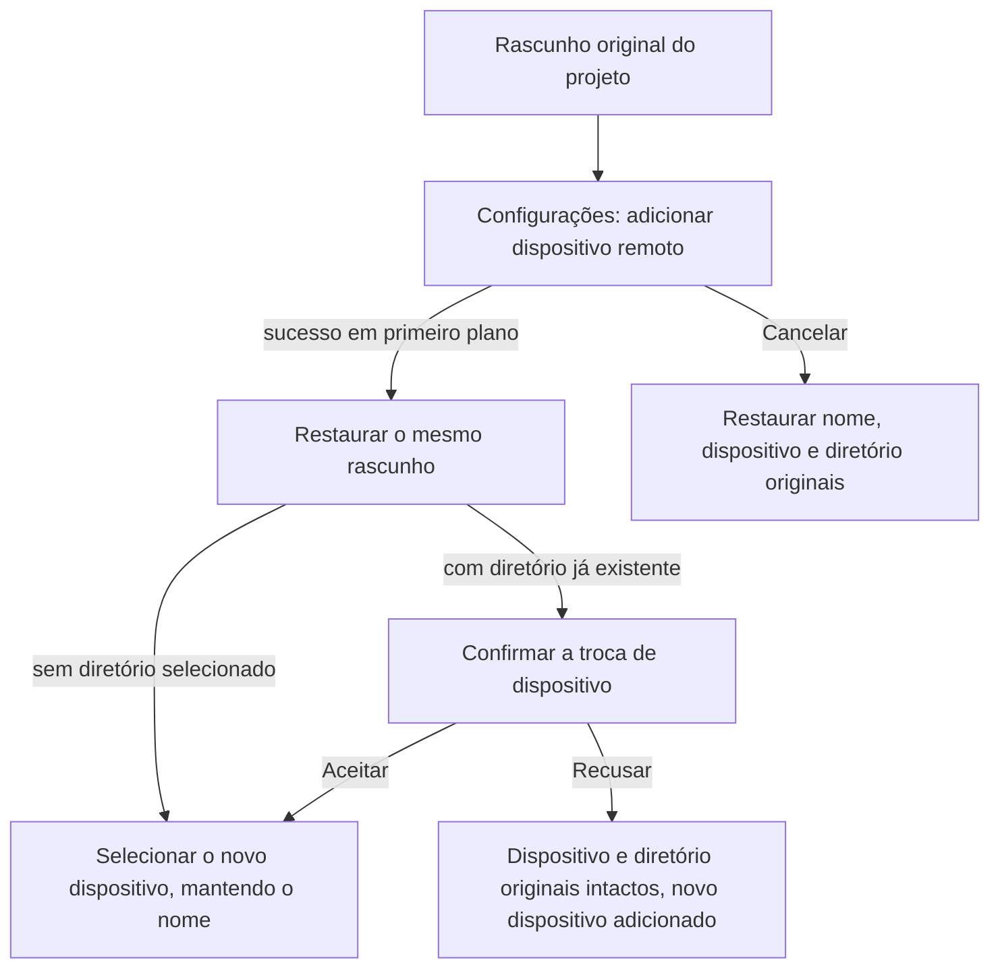

# 20: Criar projeto com ida e volta às configurações e restaurar o rascunho

Status: done

**Parent:** [#15 — Separação entre criação de projeto e gestão de conexão remota](15-project-device-selection-and-connection-management.md)

**O que construir:** o usuário, no menu suspenso de dispositivos da criação de projeto, clica em «Adicionar dispositivo remoto…» e entra na janela de adição categorizada das configurações; depois do sucesso em primeiro plano, volta ao mesmo rascunho de projeto e seleciona o novo dispositivo; ao cancelar, restaura a seleção original. O nome e o diretório do projeto não se perdem na troca de página, e um diretório já existente ainda passa pela confirmação de troca de dispositivo.

**Bloqueado por:**

- [#17 — Adicionar SSH/WSL/Docker por tipo](17-typed-remote-device-addition.md): fornece o caminho completo de adição dentro das configurações.
- [#18 — Criação direta de projeto e seleção de dispositivo existente](18-direct-project-creation-and-device-selection.md): fornece o formulário a ser restaurado, o rascunho único e a confirmação de troca de dispositivo.

**Cobertura da spec:** Q1, Q7, Q10, Q12; a entrada de projeto de RDUX15-04, RDUX15-11, RDUX15-12, RDUX15-13, além da proteção do rascunho entre páginas de RDUX15-20; RDUX15-23/24/25 cobrem o foco, o layout e o portão de capacidade.

## Acceptance criteria

- [x] A nova entrada do menu suspenso de dispositivos do projeto fecha o menu original e entra em «Configurações → Dispositivos remotos», abrindo diretamente a janela de adição categorizada do #17; quando as configurações já estão abertas ou são remontadas, a intenção de navegação atual é consumida apenas uma vez.
- [x] Durante a troca de página, um único owner do rascunho original do projeto mantém o nome, o dispositivo e a pasta de origem; a navegação carrega apenas a posição de origem e a referência do rascunho, sem duplicar outro rascunho gravável e sem guardar senha na intenção de retorno.
- [x] Quando a conexão em primeiro plano tem sucesso e a intenção original ainda é válida, volta-se ao mesmo formulário de criação, mantendo o nome; quando o rascunho original não tem diretório, seleciona-se o novo dispositivo, e a quantidade de projetos e de tarefas não aumenta antes da criação explícita.
- [x] Quando o rascunho original já tem diretório, o retorno precisa passar pela mesma confirmação de troca de dispositivo comum. Após aceitar, o diretório é limpo e o novo dispositivo é selecionado; após recusar, o dispositivo e o diretório originais são mantidos, e o novo dispositivo continua adicionado e pode ser selecionado mais tarde.
- [x] Cancelar no formulário de adição, durante a conexão ou enquanto se aguarda a confirmação de credenciais/instalação retorna sempre ao rascunho original do projeto e restaura os valores originais; não apaga registros de conexão salvos, não desconecta a conexão compartilhada por outros projetos e não interpreta o cancelamento como abandono do rascunho do projeto.
- [x] Quando a adição falha, permanece-se no fluxo de adição, com a configuração e um erro compreensível preservados para correção e nova tentativa; o sucesso ou o cancelamento final volta sempre à mesma intenção de origem válida.
- [x] Depois que o rascunho original é explicitamente abandonado ou substituído, ou que o fluxo original já está inválido, resultados tardios de conexão e de navegação nas configurações não podem reabrir o formulário antigo nem sobrescrever o novo rascunho; a limpeza afeta apenas os recursos exclusivos desta execução.
- [x] Uma ida e volta restaura apenas uma vez; não se corrigem problemas de temporização de página com salto atrasado, timeout ou polling, nem se persiste adicionalmente um rascunho entre reinicializações.
- [x] Com teclado, a semântica de topo do Esc, o foco de retorno, os idiomas português e inglês, os temas claro e escuro atuais e janelas estreitas, a ida e volta em primeiro plano e a confirmação de troca podem ser concluídas; plataformas sem capacidade de gestão de dispositivos não expõem saltos impossíveis de concluir.
- [x] Primeiro são adicionados o E2E da entrada real e os testes de integração de temporização necessários, e só então a navegação é conectada; antes de remover a ligação antiga de «nova conexão» substituída por esta entrada, confirma-se que seus outros chamadores continuam funcionando.

## Verification

- A partir do formulário real de projeto, adicionar um dispositivo, respectivamente, com rascunhos de diretório vazio e de diretório já existente, executando sucesso, recusa da troca de dispositivo, aceitação da troca de dispositivo, nova tentativa após falha e cancelamento em cada etapa de espera, conferindo item a item os valores originais, o estado do dispositivo e a quantidade de projetos.
- Não se abre a janela de adição diretamente para contornar a navegação em teste; verifica-se ao mesmo tempo a primeira montagem das configurações e a troca de seção com as configurações já abertas, impedindo o consumo duplicado e o retorno incorreto.
- No ponto de integração de serviço já existente, atrasar os resultados de conexão/credenciais e liberá-los depois de abandonar ou substituir o rascunho original, afirmando que o formulário antigo não é revivido e que o novo rascunho ou o projeto compartilhado não são afetados.
- A implementação precisa passar pela checagem de tipos, pelo lint, pelo portão de arquitetura, pelos testes unitários afetados, pelo E2E de Desktop correspondente e pela regressão aplicável de plataforma/tema; registrar as evidências remotas reais e os itens não verificados.

## Scope and handoff

- Este ticket é responsável pela ida e volta do rascunho do projeto em primeiro plano, sem depender da lista de projetos existentes do #19 nem da ida e volta do chat do #21; basta cumprir os pré-requisitos para avançar.
- O ramo em que o sucesso em segundo plano apenas avisa e exige que o usuário continue explicitamente é entregue pelo #22. Este ticket não migra a intenção de conclusão da conexão para o protocolo de tarefas nem modifica a máquina de estados de conexão do Host.

## Notas de implementação

- `ProjectEditor` mantém a instância original e o rascunho único; `ProjectCreation` guarda apenas a referência de retorno desta execução e o estado recolhido. A navegação das configurações não copia nome, diretório nem credenciais.
- A Root usa `returnTarget` para guardar a referência do owner original e a identidade exata de aba/workspace; o sucesso e o cancelamento explícito consomem primeiro a referência e só então retornam. Owner, aba ou workspace inválido não é restaurado. Recolher a conexão não é tratado como cancelamento; a continuação em segundo plano é integrada pelo #22.
- O novo dispositivo retornado continua chamando o `changeDevice` original, reutilizando a confirmação de diretório. Depois que o rascunho antigo é descarregado, resultados tardios de dispositivo e de registro da entrada de projeto não podem afetar o novo rascunho.
- O novo candidato usa o contrato de inicialização de E2E sem conta; o OAuth falso dispara o diálogo real de login expirado do plano de controle, que oculta a entrada de projeto. O teste de retorno do projeto espera apenas a conclusão da janela de conexão, sem interpretar a confirmação de troca de dispositivo que aparece em seguida como falha de conexão.
- TODO (adiado pelo usuário): validação real de WSL e do controle remoto pelo celular, sem substituir por SSH da própria máquina ou por testes de componentes compartilhados.

## Resultados da verificação

- O `pnpm typecheck`, o `pnpm lint` (0 errors, 208 warnings já existentes), o portão de arquitetura (0 violations) e a checagem de tipos do E2E e de fixture passaram.
- A partir da baseline de implementação, os testes afetados rodaram: 405 arquivos e 4589 testes passaram; a suíte auxiliar do seletor de testes passou. Passaram os 26 novos testes de regressão de inicialização sem conta e os testes dirigidos de rascunho de projeto e de temporização da conexão.
- O E2E de SSH real no macOS nativo passou: `desktop-e2e-20261012110624292-p87138-e361604dfca379e7`. Cobriu a entrada real de projeto, o cancelamento do formulário, o cancelamento durante o handshake, a correção de senha errada, a recusa e a aceitação da confirmação de troca de dispositivo após o retorno bem-sucedido, o rascunho sem diretório e a ausência de criação implícita de projeto.
- As 8 combinações de português/inglês × temas claro/escuro × 1440/480px de ida e volta em primeiro plano, foco e acessibilidade dos botões passaram; as capturas foram coletadas e verificadas após o fim da transição. Os testes ainda estão como pending, não promovidos nem incluídos no CI.
