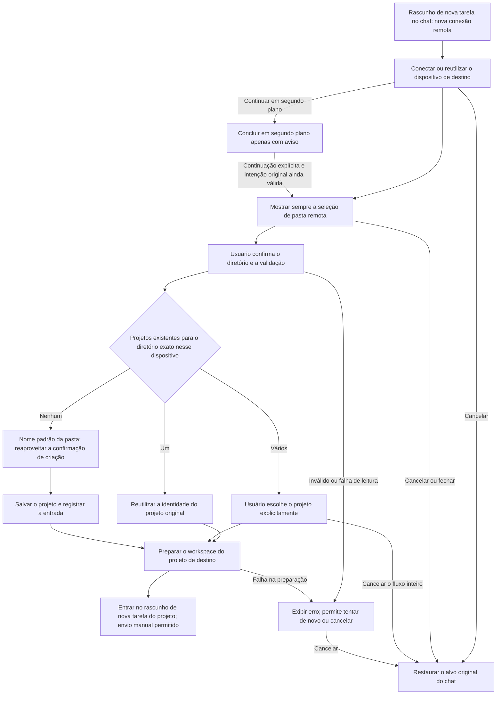

# 21: Seleção obrigatória de pasta remota após conectar no chat e entrada no projeto

Status: done

**Parent:** [#15 — Separação entre criação de projeto e gestão de conexão remota](15-project-device-selection-and-connection-management.md)

2026-10-14: implementação e verificação de integração concluídas conforme #23–#26. O registro anterior de "após a conexão bem-sucedida, voltar ao chat original, oferecendo apenas o botão de criar projeto" é preservado como histórico; o resultado desta rodada e o escopo real de plataforma estão nos registros de verificação mais recentes abaixo, e um PASS antigo não cobre o novo contrato.

## Problem Statement

Na caixa de chat, no menu de projetos, o usuário clica em "Nova conexão remota…" e, após a conexão bem-sucedida, vê "Selecionar projeto" e "Criar projeto neste dispositivo". Mesmo depois de digitar texto, ainda é possível enviar, e o que acaba sendo criado é um chat local sem projeto. O usuário entende que o dispositivo recém-conectado é o alvo de execução a seguir, mas a interface não deixa claro que o chat continua pertencendo ao local.

Esse caminho corresponde ao contrato antigo: adicionar o dispositivo com sucesso apenas devolve a identidade do dispositivo, e o alvo do chat original não muda. Portanto, o problema é a incompatibilidade entre o fluxo de produto após a conclusão da conexão e a intenção do usuário; ele não pode ser descrito apenas como um fallback para local após uma falha no envio remoto. O chat remoto sem projeto foi desativado, enquanto o chat local sem projeto continua suportado.

Pasta e projeto não são uma correspondência de um para um: o mesmo dispositivo e o mesmo diretório podem pertencer a vários projetos. Selecionar uma pasta não pode ser resolvido adivinhando a identidade do projeto apenas pelo caminho; apenas registrar a entrada do projeto, sem entrar no projeto de destino, também não completa a intenção de trabalho remoto desta vez do usuário.

## Solution

Depois de concluir uma conexão remota pela opção "Nova conexão remota…" da caixa de chat, abrir sempre o diálogo "Selecionar pasta" do dispositivo de destino. Reaproveitar a capacidade já existente de navegação de diretórios, incluindo entrada de caminho, salto, listagem de diretórios e exibição de diretórios ocultos. Não é permitido abrir automaticamente o projeto mais recente, o único projeto ou um projeto de rascunho antigo antes de o usuário confirmar a pasta.

Vale para rascunhos de nova tarefa sem projeto na tela inicial, rascunhos de nova tarefa com projeto local já selecionado e rascunhos de nova tarefa com projeto remoto já selecionado. Identidades de sessão existentes não são migradas; a adição de dispositivo nas configurações e a reconexão do projeto original mantêm suas respectivas regras de conclusão anteriores.

Após o usuário confirmar a pasta, o projeto é determinado pelo dispositivo de pertencimento e pelo diretório exato:

| Condição                                      | Comportamento de conclusão                                                                                      |
| --------------------------------------------- | --------------------------------------------------------------------------------------------------------------- |
| Corresponde exatamente a um projeto existente, não excluído | Abre o rascunho de nova tarefa do projeto original, preservando o ID do projeto e o vínculo das tarefas históricas  |
| Corresponde a vários projetos existentes, não excluídos  | Exibe esses projetos para o usuário escolher explicitamente um e então entra no seu rascunho de nova tarefa      |
| Não corresponde a nenhum projeto                       | Usa o nome da pasta como nome de projeto padrão, cria o projeto remoto de diretório único nesse diretório, reaproveita a confirmação de criação existente e entra no seu rascunho de nova tarefa |
| Diretório inválido, sem permissão, dispositivo desconectado ou falha de leitura | Exibe o motivo real, permite tentar de novo ou cancelar; não cria projeto substituto e não volta para o local |

O envio só é permitido depois que a seleção de pasta, a determinação do projeto, a criação e o registro necessários e a preparação do workspace de destino estiverem concluídos. O botão de envio e o envio pelo teclado seguem a mesma restrição; a conclusão da preparação não envia nenhuma mensagem automaticamente.

Cancelar ou fechar o fluxo de seleção de nível superior significa desistir desta passagem para o remoto, restaurando o alvo do chat anterior à conexão e exibindo explicitamente o estado de dispositivo/projeto restaurado. O rascunho original é retido pelo owner existente. A conexão de dispositivo estabelecida com sucesso é mantida, e as demais tarefas não são afetadas. Não é permitido deixar um estado de "remoto sem projeto, mas enviável", nem oferecer uma saída para continuar um chat remoto pulando o projeto.



### Feedback de carregamento na confirmação do diretório

Após clicar em "Selecionar pasta", reaproveitar `ChatRemoteFolderSelection.busy`, exibindo o spinner e "Abrindo…" (inglês `Opening…`) dentro do próprio botão de confirmação. Preservar o conteúdo do diretório e o caminho selecionado; reservar espaço no botão para as duas variantes textuais, de modo que a troca de estado não altere a largura do botão nem a altura do diálogo, e não acrescentar mais um "Carregando…" abaixo do seletor de diretórios. O botão em execução mantém a cor de primeiro plano do botão principal, e o spinner para quando a redução de efeitos está ativa. Em caso de falha, reaproveitar a área de erro existente e o botão volta a ser operável. A camada pai continua responsável por single-flight, validação do diretório, preparação do projeto e isolamento de resultados expirados; o navegador de diretórios recebe apenas o estado de exibição. A etapa de escolha entre vários projetos mantém o feedback de carregamento existente, e as demais entradas de seleção de diretório não ativam este parâmetro de exibição.

```text
Escolher diretório → confirm / busy=true → validar o diretório, casar e preparar o projeto → navegar com sucesso ou exibir erro
                      └─ Botão de confirmação do DirectoryBrowser: spinner + Abrindo…
```

Aceitação: enquanto a leitura do projeto estiver bloqueada, o diretório e o caminho continuam visíveis, há apenas a indicação de carregamento dentro do botão, e o botão de confirmação não pode ser submetido em duplicidade; após a falha, o texto do botão é restaurado, o erro fica visível e é possível tentar de novo. Verificar a estabilidade do layout no desktop e em tela estreita, nos temas claro e escuro e em português e inglês.

2026-10-14 verificação: o teste original reproduziu primeiro que "o estado de carregamento não fica dentro do botão"; após a correção, as regressões de UI relacionadas passaram; o escopo final affected foi de 503 arquivos/5.471 itens, e passaram a checagem de tipos, a de tipos de E2E, o lint (0 erros), a arquitetura e a checagem de formatação do código alterado.
Os cenários principais do Desktop macOS até um contêiner SSH Linux arm64 independente passaram (`desktop-e2e-20261014-094915-820`);
os cenários adjacentes de criação de projeto, escolha entre vários projetos e conexão em segundo plano passaram (`desktop-e2e-20261014-095322-224`).
O componente real de diretório passou nas oito combinações de verificação no navegador a 1200px/390px, em português/inglês e nos temas claro/escuro, incluindo estabilidade de dimensões e redução de efeitos;
celular shared-host, celular físico e desktop Windows/Linux não foram executados de fato nesta rodada. Candidatos não são promovidos automaticamente.

## User Stories

1. As a user starting a projectless draft, I want a remote folder picker after connecting, so that my next task runs in the environment I chose.
2. As a user with a local project draft, I want the same remote folder selection flow, so that the entry has a consistent meaning.
3. As a user with a remote project draft, I want to choose a folder on the newly connected device, so that the old project is not mistaken for my new target.
4. As a user reusing an online device through this chat entry, I want the folder picker, so that connection reuse does not bypass my choice.
5. As a user whose device has one project, I want to confirm a folder first, so that uniqueness does not replace my decision.
6. As a user whose device has several projects, I want no automatic recent-project selection, so that a previous task does not determine the new task's location.
7. As a user browsing remote folders, I want the device and current path to be clear, so that I can distinguish remote directories from local ones.
8. As a user who knows a path, I want the existing path input and jump action, so that I can reach it directly.
9. As a user working in hidden folders, I want the existing hidden-directory control, so that those folders remain selectable.
10. As a user selecting an existing project's folder, I want that project's identity reused, so that its history remains accessible.
11. As a user with multiple projects sharing a folder, I want to choose the actual project, so that their identities and tasks remain separate.
12. As a user selecting an unregistered folder, I want a project named after the folder, so that I can continue without a separate naming step.
13. As a user creating a project, I want the existing folder and recovery confirmations retained, so that this entry follows the same creation contract.
14. As a user repeating the same folder selection, I want the existing project reused, so that routine reconnection does not create duplicates.
15. As a user with identical paths on different devices, I want matching limited to the chosen device, so that the wrong project's history is never selected.
16. As a user whose project is still preparing, I want both button and keyboard submission blocked, so that my message cannot run in the old environment.
17. As a user whose project becomes ready, I want to send explicitly, so that readiness does not submit a message on my behalf.
18. As a user choosing an invalid or inaccessible folder, I want the actual error and a retry option, so that I can correct the choice.
19. As a user whose project list cannot be read, I want a loading error, so that a failed read does not create a duplicate project.
20. As a user whose device disconnects during selection or preparation, I want to remain in the unresolved remote flow, so that sending cannot silently switch to local execution.
21. As a user cancelling remote folder selection, I want the original chat target restored visibly, so that I know where a later message will run.
22. As a keyboard user, I want closing and Escape to respect the active dialog layer, so that one action does not accept a folder or submit chat unexpectedly.
23. As a user with another task on the same device, I want cancellation to preserve its connection, so that abandoning this flow does not interrupt that task.
24. As a user retrying after project registration fails, I want the already-created project reused, so that the retry does not create another project.
25. As a user who changes drafts or starts another connection, I want late results ignored, so that an old operation cannot replace my current target.
26. As a user continuing a connection in the background, I want completion to remain a notice, so that it does not interrupt my current page.
27. As a user explicitly resuming a completed background connection, I want the folder picker for that device, so that resumption follows the same selection requirement.
28. As a user managing devices in settings, I want that operation to remain independent of project selection, so that managing a connection does not start a task.
29. As a user working locally without a project, I want local projectless chat to remain available, so that this remote rule does not remove the local capability.
30. As a user of a supported platform, language, or theme, I want readable folder selection and error controls, so that I can complete the flow with the available device capabilities.

## Implementation Decisions

1. **Entrada e intenção de conclusão.** O menu de projetos do chat continua reaproveitando a adição unificada de dispositivo, a autenticação e a cadeia de instalação, mas sua intenção de conclusão passa a ser "após conectar, é obrigatório selecionar um diretório remoto e entrar no projeto". Substitui-se a ligação deste ponto de entrada de "apenas gerenciar o dispositivo com sucesso e depois exibir o botão de criar projeto"; não se cria um assistente de conexão paralelo. A adição nas configurações, a adição de dispositivo no formulário de projeto e a reconexão do projeto original mantêm, respectivamente, suas semânticas existentes.
2. **Vocabulário e identidade.** Source é o ambiente remoto e a conta já identificados; Connection Profile é a forma de conexão que chega ao Source; o projeto é determinado pelo Host de pertencimento e pelo ID do projeto; o diretório é a raiz do projeto, não a identidade do projeto. Uma conexão bem-sucedida só prova que o dispositivo está disponível, não que um projeto foi selecionado.
3. **Origem do diretório.** A navegação, a validação de caminho e a comparação de diretórios usam o serviço e as regras de caminho existentes do Host de destino; não usam o sistema de arquivos local nem a normalização de caminhos do sistema operacional local para 판단 o remoto. O casamento fica restrito ao mesmo dispositivo, com correspondência exata no mesmo root fixo, sem adivinhar por nome, prefixo de caminho, diretório pai ou caminho homônimo de outro dispositivo.
4. **Resolução do projeto após a confirmação.** Somente depois de o usuário confirmar o diretório é que o resultado autoritativo dos projetos é lido/conferido e o despacho de um, múltiplos ou zero casos é executado. O casamento único reutiliza o ID real do projeto; múltiplos casamentos continuam com a escolha do usuário; falha na leitura da lista não equivale a zero casos. Projetos excluídos não são abertos automaticamente como casamento existente; quando uma criação nova atinge um projeto excluído, valem as regras existentes de recuperação ou de prosseguir com a criação, sem restauração silenciosa.
5. **Escopo da criação.** No caso de zero itens, este fluxo preenche o nome padrão da pasta e um único root fixo, reaproveita a criação compartilhada, a confirmação de diretório, o salvamento e o registro da entrada local, sem exigir que o usuário preencha o mesmo diretório outra vez. A resolução por diretório deste ponto de entrada não modifica o salvamento genérico de projeto para um get-or-create global nem acrescenta a restrição de "cada diretório só pode ter um projeto". As outras entradas que criam explicitamente outro projeto no mesmo diretório mantêm o contrato original.
6. **Limites da criação existente.** A criação e a recuperação continuam passando pela confirmação de confiança de diretório já existente; a seleção de pasta não substitui essa confirmação. Quando o remoto antigo suporta apenas leitura, os projetos existentes podem ser escolhidos, mas a limitação de capacidade de criação não pode ser contornada por este ponto de entrada. Falha de salvamento mantém o erro; quando o remoto já foi salvo e o registro local falha, o ID do projeto retornado é preservado e o registro é refeito, sem recriar. A semântica de cancelamento por nível e de permissões da confirmação de criação existente continua válida.
7. **Entrega completa.** Após selecionar ou criar, o Host real, o ID do projeto e o diretório precisam ser entregues à cadeia existente de seleção de projeto e de preparação de workspace, entrando no rascunho de nova tarefa desse projeto; apenas atualizar a lista ou registrar a entrada não é suficiente. O histórico de tarefas dos projetos existentes é preservado, nenhuma sessão antiga é restaurada automaticamente e sua identidade não é migrada.
8. **Restrição de envio.** Enquanto a intenção de troca em primeiro plano estiver pendente ou tiver sido cancelada, o rascunho de origem não pode enviar para o alvo antigo pelo botão, pelo Enter ou por qualquer outra entrada de envio existente. As condições normais de envio só valem depois de o projeto de destino, o attachment e a preparação de execução terem sido bem-sucedidos. O segundo plano não impõe um bloqueio global de envio a chats não relacionados; as regras de mensagem e de fila das tarefas existentes não mudam. Não é permitido remover a restrição de envio por atraso.
9. **Limites de cancelamento e envio.** O cancelamento, o fechamento e o Escape correspondente no cancelamento de nível superior da seleção de pasta/projeto cancelam esta troca, restaurando o alvo do chat original ainda válido e o foco, e exibindo seu vínculo de dispositivo/projeto. "Escolher depois" não pode se tornar uma saída de envio remoto sem projeto. Camadas aninhadas de dropdown, de recuperação ou de confirmação de confiança de diretório são tratadas primeiro conforme a semântica do nível original, e a conclusão do fluxo inteiro continua sendo requisito para enviar. Um projeto já salvo com sucesso não é apagado automaticamente por causa do fechamento; ao cancelar antes de salvar, nenhum projeto é criado.
10. **Posse dos recursos.** Libera-se somente o attachment temporário exclusivo desta vez; o cancelamento não apaga o registro do dispositivo, não desconecta o Source já conectado e não libera a session compartilhada por outros projetos. Confirmações repetidas, continuações repetidas e novas tentativas de registro não podem gerar projetos ou entradas duplicados, valendo os resultados em trânsito existentes e os limites de idempotência, sem prometer uma nova unicidade global de diretório distribuído.
11. **Assincronia e owner único.** O fluxo de conexão mantém o solicitante, o dispositivo de destino, a identidade da requisição e a intenção de conclusão; o owner do rascunho existente mantém o corpo e os attachments. Cada resultado assíncrono revalida, antes de navegar ou escrever, a requisição atual, a membership do Source/Host, o diretório selecionado e o projeto. Trocar de rascunho, substituir a requisição, remover a membership, cancelar ou desinstalar invalidam os resultados antigos; não se duplica um rascunho, não se cria um cache de estado de conexão paralelo e não se sincroniza estado por timeout.
12. **Continuidade em segundo plano.** Valem o contrato de notificação em segundo plano e o de continuação explícita já existentes. Um sucesso em segundo plano não abre a janela de diretórios nem altera o projeto atual; a seleção de pasta só é alcançada quando o usuário continua explicitamente e a intenção original ainda é válida. Continuações expiradas e repetidas não podem roubar a navegação nem repetir o envio. Um resultado antigo de conexão não pode ressuscitar um fluxo que o usuário já abandonou.
13. **Escopo e compatibilidade.** SSH/WSL/Docker usam a mesma regra de conclusão e respeitam as capacidades de plataforma existentes. A conexão direta do Server para uso de desenvolvimento não é estendida. A UI compartilhada segue o design system, a internacionalização, os temas claro/escuro e as regras de teclado; Web/celular mantêm o gate de capacidade de shell e os limites existentes de Host e desktop-continuous/web-remote-replayable.
14. **Armazenamento e protocolo.** Reaproveitam-se o serviço de projetos, a navegação de diretórios, a entrada remota e o contrato de identidade de workspace; este requisito não precisa de nova migração de banco de dados, novo formato de identidade, novo protocolo de tarefas, novo modelo de persistência de rascunhos nem um segundo owner de mensagens. A migração de rascunhos e attachments entre dispositivos mantém o comportamento existente, e esta rodada não implementa migração nem resolução de conflitos.

## Testing Decisions

O casamento de diretórios é compatível com a forma antiga de escrever o caminho preservada pelos clientes antigos: o adaptador antigo deriva um `directoryMatchPath` somente-leitura conforme a platform remota, usando as mesmas regras de normalize de `readDirectory`. Ele participa apenas do casamento de diretório único, não grava no banco de dados nem no cache de entradas, e não altera os roots originais, os IDs sintéticos de projeto, o vínculo de tarefas ou o cwd de `prepareSession`. Quando múltiplas identidades históricas normalizam para o mesmo diretório, ainda é preciso escolher o projeto explicitamente; não se acrescentam regras de equivalência por realpath ou link simbólico.

A continuação explícita após a conclusão em segundo plano precisa restaurar de forma síncrona a visibilidade em primeiro plano antes de consultar o Source ou a membership, e o owner do chat original restaura imediatamente o bloqueio de envio. Cancelar antes da conclusão, recolher novamente ou invalidar a intenção original seguem as regras de limpeza existentes, sem criar um segundo estado de envio.

```text
Segundo plano libera o bloqueio de envio → continuação explícita → notificação de visibilidade em primeiro plano/bloqueio do rascunho original → validação do Source/membership → escolha de diretório
root histórico → valor de casamento normalizado do Host de pertencimento → casamento de diretório; ID/root/cwd de tarefa originais preservados
```

A costura principal é o E2E da entrada de chat do Desktop real já existente: iniciar a conexão a partir do menu de projeto visível, concluir a seleção de diretório, a entrada no projeto e o primeiro envio, verificando o vínculo real da tarefa e o diretório de execução. Reaproveitar as capacidades de teste do ida-e-volta de dispositivos no chat, da adição de projeto remoto existente, da conexão em segundo plano e da confirmação de diretório na criação de projeto. Usar apenas as portas de UI/serviço já existentes para complementar os resultados tardios, as identidades invalidadas e as falhas de registro que são difíceis de controlar de forma estável; não criar API de produto nova para testes.

Bons testes de asserção verificam o alvo visível ao usuário, as identidades reais de Host/projeto/tarefa, o diretório, o resultado do envio e a quantidade persistida, e não tomam state local, contagem de callbacks ou "passou por aquela página" como comportamento correto. O pré-aquecimento do rascunho pode já ter um runtime em execução, então "nenhum runtime local foi iniciado" não pode substituir "aquela mensagem não foi enviada para o local". Antes da correção, provar que o caminho original sem projeto enviava incorretamente para o local e então fazer o E2E correspondente passar.

Abaixo está o contrato de aceitação já confirmado. O mapeamento entre implementação e testes está em #23–#26, no diretório de cases e na matriz de cobertura; as conclusões de aprovação valem apenas para as costuras de teste registradas e para o ambiente real, e não significam que todas as plataformas foram executadas de fato:

| ID        | Setup → Action                                             | Deve-se afirmar                                                                              |
| --------- | ---------------------------------------------------------- | --------------------------------------------------------------------------------------------- |
| RDUX21-01 | Rascunho local sem projeto, conexão real a um remoto pelo menu do chat | A seleção de pasta do dispositivo de destino aparece automaticamente; antes da confirmação, nem o botão nem o Enter conseguem enviar para o local |
| RDUX21-02 | Remoto com um único projeto, ou com projeto recente; conectar em cada caso | A seleção de pasta continua aparecendo sempre, sem abrir nenhum projeto automaticamente          |
| RDUX21-03 | Reaproveitar um dispositivo já online, incluindo conectar de novo pela mesma entrada do chat | Ainda é preciso escolher o diretório explicitamente, e a identidade do dispositivo e a lista estão corretas |
| RDUX21-04 | Rascunho de projeto local e rascunho de projeto remoto entrando neste fluxo | Idêntico ao rascunho sem projeto; o projeto original não é o alvo padrão do novo dispositivo, e a identidade das tarefas antigas não é migrada |
| RDUX21-05 | Diretório com casamento único em um projeto existente; confirmar e entrar | Usa o ID, o Host e o root do projeto original; o histórico de tarefas é preservado; a primeira mensagem é de fato enviada para o remoto de destino |
| RDUX21-06 | Mesmo dispositivo e mesmo diretório correspondendo a dois projetos existentes | É preciso escolher o projeto explicitamente; não é possível enviar antes da escolha; após escolher, o histórico não é mesclado e nenhum projeto duplicado é criado |
| RDUX21-07 | Diretório sem projeto existente, concluindo a confirmação de criação existente | Nome padrão da pasta e root único e fixo; após salvar/registrar, entra no rascunho do novo projeto; o vínculo do primeiro envio está correto |
| RDUX21-08 | Conectar de novo e confirmar o mesmo diretório já usado | Reaproveita o projeto existente; cliques repetidos na confirmação não geram projeto nem entrada duplicados |
| RDUX21-09 | Dois dispositivos com o mesmo caminho; há também projetos com prefixo de nome igual ou diretório pai | O casamento considera apenas o dispositivo de destino e o diretório exato, sem escolher o projeto de outro dispositivo ou do diretório pai |
| RDUX21-10 | Caminho inválido, que não é diretório, sem permissão; diretório invalidado durante a confirmação | Exibe o motivo real, permite tentar de novo/cancelar; sem diretório substituto, sem projeto e sem mensagem local |
| RDUX21-11 | Falha na leitura da lista de projetos; depois um novo tentativo bem-sucedido | A falha não é tratada como zero casos para criar; o novo tentativo continua no mesmo dispositivo/diretório |
| RDUX21-12 | Desconexão ou falha durante a seleção de diretório, a escolha do projeto ou a preparação do workspace | Não é possível enviar e não há retorno ao local; nem após a recuperação o envio é automático |
| RDUX21-13 | Cancelamento, fechamento e Escape da seleção de pasta | Restaura o alvo original, o rascunho original e um foco razoável, com a identificação do alvo explícita; não restaura um chat remoto sem projeto |
| RDUX21-14 | Cancelamento na escolha entre vários projetos; Escape em seleção aninhada ou na confirmação de confiança | O cancelamento de nível superior cancela toda a troca; o aninhado fecha apenas a camada atual, sem envio indevido e sem fechar várias camadas ao mesmo tempo |
| RDUX21-15 | Cancelar antes ou durante a conexão; o dispositivo tem outra tarefa em execução | Não é criado projeto não enviado; o chat original pode ser restaurado; os registros de conexão existentes e as tarefas compartilhadas não são afetados |
| RDUX21-16 | Liberar resultados antigos após cancelar, trocar de rascunho, trocar de dispositivo ou invalidar a membership | Resultados antigos de conexão/diretório/salvamento/preparação não navegam nem sobrescrevem o novo alvo; recursos compartilhados não são liberados indevidamente |
| RDUX21-17 | Salvamento remoto bem-sucedido, mas registro da entrada local falha; novo tentativo | O ID real do projeto é preservado; apenas o registro é refeito, sem recriar; não é possível enviar antes da conclusão |
| RDUX21-18 | Após a conclusão em segundo plano o usuário está em outro chat; então continua explicitamente | A conclusão não abre janela nem rouba o foco; uma continuação válida entra na seleção de diretório; continuações expiradas ou repetidas não têm efeito colateral |
| RDUX21-19 | Alvo original sendo local sem projeto, projeto local ou projeto remoto; cancelar a troca | Exibe e restaura o alvo original, preservando o rascunho atual; o local sem projeto continua podendo enviar normalmente após um cancelamento explícito |
| RDUX21-20 | Adição de dispositivo nas configurações, reconexão do projeto original, continuação de uma sessão existente | As regras de conclusão originais são preservadas, e a reconexão do projeto original não exige repetir a escolha de diretório por causa deste ponto de entrada |
| RDUX21-21 | Sem projeto existente, mas com projeto excluído; remoto antigo apenas com capacidade de leitura | Valem a confirmação de recuperação/criação; sem restauração silenciosa; um remoto somente-leitura não pode contornar a restrição de criação |
| RDUX21-22 | Português/inglês, temas claro/escuro, caminho longo, janela estreita e operação por teclado | Dispositivo/diretório/erro legíveis, confirmação e cancelamento acessíveis, foco razoável; o Enter não vaza para o envio do chat |
| RDUX21-23 | SSH/WSL/Docker e as capacidades do sistema operacional correspondente | As plataformas suportadas seguem a mesma regra de conclusão de diretório; as evidências são registradas conforme o ambiente real |
| RDUX21-24 | Web/celular comuns com a UI compartilhada e projetos remotos existentes | O gate de capacidade é válido; não introduz diretórios locais do navegador, Host/session extras nem fallback replayable |

- O escopo de testes desta rodada dá continuidade direta ao casamento de diretórios, ao casamento de projeto, ao cancelamento com retorno, à restrição de envio e à proteção assíncrona já confirmados, sem nova entrevista nem ampliação para migração de rascunhos. A troca entre dispositivos bem-sucedida usa um rascunho vazio para isolar esse escopo; o conteúdo do rascunho original serve apenas para a regressão de preservação em cancelamento/falha.
- Na implementação, complementam-se primeiro os E2E e os testes de porta existentes necessários, e só então se altera o código; sincronizar o diretório de cases, a matriz de cobertura e as asserções antigas relacionadas. Tema/linguagem usam combinações representativas, sem produto cartesiano completo com todos os tipos de falha.
- Concluir a checagem de tipos, o lint, o portão de arquitetura, os testes unitários afetados, o E2E de Desktop correspondente e a regressão de UI compartilhada/celular aplicável. Registrar o tipo de conexão real e o escopo de sistemas operacionais; uma janela de desktop estreita não substitui a evidência de celular.
- Os candidatos seguem o processo existente de pending, revisão manual e promoção; a aprovação desta especificação, a conclusão da implementação e a execução bem-sucedida não autorizam a admissão formal/em CI.

## Out of Scope

- Abrir automaticamente o projeto único, o mais recente, o padrão ou o projeto do rascunho original antes de o usuário confirmar a pasta.
- Chat remoto sem projeto, projeto remoto com múltiplos diretórios, migração de sessões existentes, fusão de múltiplas identidades de projeto por diretório.
- Migração do texto do rascunho e dos attachments entre dispositivos, novo armazenamento temporário de attachments, tratamento de conflitos do rascunho de destino ou fusão de conteúdo; vale o comportamento existente.
- Reescrever as regras gerais de gestão de dispositivos nas configurações, da entrada de criação de projeto e da recuperação do projeto original; apenas este ponto de entrada do chat adota as regras de casamento/criação após a confirmação do diretório.
- Novo transporte de conexão, autenticação, instalação, máquina de estados de reconexão, conexão independente do celular, migração de identidade/banco de dados/protocolo de tarefas, unicidade global de diretório ou novo mecanismo de confiança persistente.
- Envio automático, salto de página automático em segundo plano, ampliação das capacidades de gestão de dispositivos de Web/celular, ou registrar como aprovado uma plataforma que não foi executada.

## Further Notes

- A ordem das decisões desta rodada já está consolidada: primeiro cancelar a "abertura automática de projeto após a conexão"; depois, sempre escolher a pasta explicitamente; em seguida, aplicar a regra de um/múltiplos/zero casos após a confirmação do diretório; o cancelamento de nível superior desfaz esta abertura remota e volta ao alvo original; a migração de rascunhos fica adiada. Não se adota mais o "estado remoto pendente preservado após o cancelamento" que havia sido descartado na discussão.
- Este arquivo é a issue local e a spec completa; o ramo de chat da spec-pai segue este arquivo. #23–#26 estão concluídos, o botão de sucesso antigo e as asserções de E2E antigas foram atualizados; o escopo concluído é o determinado pelas evidências desta rodada.
- O domínio e a identidade continuam baseados na [R3 spec principal](../../architecture/r3-source-server-remote-architecture.md), nos [limites de runtime](../../agents/runtime-boundaries.md) e na [spec de projeto virtual](../../superpowers/specs/2026-09-09-virtual-project-design.md). Vários projetos no mesmo diretório são um estado suportado, não dados duplicados a limpar.
- Reaproveitar [#17 adição tipada de dispositivo](17-typed-remote-device-addition.md), [#19 adição de projeto remoto existente](19-add-existing-remote-project.md) e [#22 conexão em segundo plano e continuação explícita](22-background-connection-and-explicit-resume.md); a criação/recuperação segue a [confirmação de diretório de projeto](../../specs/project-creation-folder-confirmation.md), sem tratar a escolha de diretório como confiança automática.
- O visual segue a [especificação de design](../../../DESIGN.md). Os IDs de aceitação estão registrados no [diretório de cases](../../conversation-session-case-catalog.md) e na [matriz de cobertura](../../testing/conversation-session-e2e-coverage-matrix.md); a implementação dos cases segue o [workflow de E2E](../../testing/conversation-session-e2e-development-workflow.md).

### Implementação e verificação desta rodada: 2026-10-14

Verificação complementar das correções de revisão:

- A continuação explícita em segundo plano restaura a notificação e o bloqueio de envio em primeiro plano antes da consulta ao Source/à membership. O RED de Desktop da implementação original foi `desktop-e2e-20261014080117758-p36079-9dfb8d5ab50a47fa`: com a consulta ao Source retida, o botão de envio continuava disponível. O candidato final em segundo plano `desktop-e2e-20261014081704935-p58111-926b13e33297f1e3` passou 1/1, cobrindo o bloqueio de envio pelo Enter/form no campo direcionado, o primeiro envio remoto, a restauração por cancelamento e SSH/Docker; as capturas da etapa de espera foram revisadas.
- O adaptador antigo deriva o valor de casamento de diretório conforme a plataforma remota, preservando o ID, o root, o cwd da tarefa e a restrição de somente-leitura. A regressão com adaptador/UI reais cobriu POSIX, Windows e identidades históricas equivalentes única e múltiplas; as duas regressões da cópia antiga da UI foram RED. O candidato de diretório do chat passou em `desktop-e2e-20261014081447158-p54737-f7abcbb92e9dd5c6`, com nova reprodução do RPC de projeção do cliente antigo e conferência dos dois IDs de projeto originais; as capturas da escolha de projeto foram revisadas. Não se trata de execução real do binário antigo do Server.
- `pnpm test:unit:affected --base c81f9736d7ccb83dc77203a43d7b2582b9bbecdd` selecionou 312/2623 arquivos. A primeira rodada passou 311 arquivos; o teste de Host antigo faltava a porta de informações de sistema necessária para a nova projeção de caminho e, após a complementação, aquele arquivo passou 18/18. Total de 4095 testes aprovados e 1 skip já existente; a suíte unitária completa não foi executada. O arquivo final de flow passou 104/104.
- A checagem de tipos da raiz, a de tipos de E2E, o lint (209 warnings já existentes, 0 erros), o portão de arquitetura (0 violation), a checagem dos dois fixtures candidatos e as checagens de formatação e de diff do código passaram. A marca de falha de leitura de membership do fixture continua sendo um warning não-provider já existente.
- O diretório de projeto no Web do celular passou nas 4 combinações de 390px × português/inglês × temas claro/escuro, com as evidências em `.tmp/chat-review-fix-mobile`; as capturas dos temas claro/escuro foram revisadas. O escopo real foi macOS Desktop e o fixture SSH/Docker Linux arm64 exclusivo; Windows/Linux Desktop, WSL, o binário remoto antigo e o celular físico não foram executados. Os candidatos permanecem pending.
- O E2E corrigiu duas condições de observação: após a continuação, a janela de conexão foca "recolher", e o Enter global pode legitimamente liberar o bloqueio, de modo que a asserção de teclado foi direcionada ao campo original; na volta, aguarda-se a animação de saída do Dialog original, e a ação do menu de projetos foi movida para fora da camada de identidade flutuante. Nenhum timeout de produto ou lógica de sincronização foi acrescentado.

- [#23](23-chat-remote-folder-existing-project.md), [#24](24-chat-remote-folder-project-choice.md), [#25](25-chat-remote-folder-create-project.md) e [#26](26-chat-remote-folder-background-resume.md) estão todos como `done`, integrados em `feat/chat-remote-folder-integration`. A escolha explícita de diretório ocorre sempre, e o casamento de um/múltiplos/zero compartilha a entrada no projeto, a restrição de envio e as regras de cancelamento; o rascunho original continua sendo retido pelo owner existente.
- Os problemas da revisão de dois eixos foram corrigidos e reconferidos: o contrato do módulo removeu a semântica de conclusão antiga; a falha na leitura da membership passou a ser tratada pelo fluxo existente de erro/nova tentativa/cancelamento da conexão, com bloqueio de envio mantido em primeiro plano; cancelar durante a espera não aceita resultados tardios, e uma falha tardia após recolher novamente não reabre a janela. Não restou nenhum finding nos eixos Standards e Spec.
- A checagem de tipos da raiz e de E2E, o lint, a arquitetura, os testes unitários afetados e a checagem dos fixtures passaram. A árvore final de integração, executada a partir do início da tarefa com `pnpm test:unit:affected --base 833e6dcb4b`: 615 arquivos e 6966 testes aprovados, com 1 skip já existente. O lint mantém 209 warnings já existentes, a arquitetura com 0 violations; a suíte unitária completa não foi executada.
- O projeto único, os múltiplos projetos e o primeiro envio com SSH real no desktop passaram; o candidato em segundo plano inclui também uma conexão Docker real. O diretório em falha e o candidato em segundo plano após as correções de revisão passaram 2/2: `desktop-e2e-20261014062429307-p3874-62dc81c125bcbc6d`. As evidências de execução conferem o Host/projeto/tarefa/cwd/identity reais, bem como o botão, o Enter e o form não submetendo ao alvo local antigo durante a falha.
- O diretório de projeto Web após a integração e o candidato shared-host do celular passaram 2/2: `desktop-e2e-20261014060018735-p87993-7a832ba2b1b8d036`. Foram usados a página Web deste repositório, um viewport/toque de celular em Chrome independente e o fixture de relay local, verificando o projeto remoto, o gate de capacidade de gestão de dispositivos, a confirmação de diretório/confiança, o retorno ao local e os limites existentes de Host/tab; as capturas dos temas claro/escuro foram verificadas. Isso é simulação de celular em navegador e não pode ser registrada como verificação em celular físico.
- O escopo realmente executado foi macOS Desktop, alvo SSH Linux arm64 e o ramo de Docker em segundo plano. Windows/Linux Desktop, WSL, celular físico e o binário remoto antigo não foram executados; o somente-leitura do cliente antigo e as regras de caminho de remoto Windows são cobertas por testes de contrato de serviço/UI, e os ramos de criação e de múltiplos casamentos do Docker não foram executados separadamente. Todos os candidatos permanecem em `manual-review/pending`, sem promoção nem admissão em CI.

### Implementação e verificação históricas: 2026-10-12, contrato antigo

Os registros de conclusão originais abaixo provam apenas a implementação antiga de "voltar ao chat original após adicionar o dispositivo e continuar explicitamente para criar", e não substituem a evidência de execução independente do contrato obrigatório de pasta de 2026-10-14.

2026-10-12: concluído. O menu de projetos do chat reaproveita o `returnTarget` do Root e a adição por categoria das configurações; o corpo, os attachments e a seleção de projeto continuam sendo retidos pelo owner existente. O sucesso exibe apenas a ação explícita de criação, usando o ID de Source real retornado para pré-selecionar o mesmo formulário de projeto. Trocas de chat, novos rascunhos ou o desmonte do owner rejeitam resultados antigos e continuações antigas, sem criar ou migrar tarefas.

- `pnpm typecheck` passou; `pnpm lint` com 0 errors (o repositório já tinha warnings); portão de arquitetura com 0 violations; os testes afetados selecionados pela lista de arquivos deste ticket passaram (Vitest 6481 tests, Node 34 tests). Após a correção de foco, mais 12 testes de UI de menu passaram.
- E2E 1/1 com SSH real nativo no macOS: `desktop-e2e-20261012111702883-p10383-3368148f2ba7a92f`. Primeiro foi criada e selecionada uma tarefa real de projeto local por meio da importação de histórico público, e depois houve o ida-e-volta pelo menu do mesmo projeto até as configurações; cancelamento, correção e nova tentativa após falha de autenticação, sucesso e continuação explícita verificaram o Host/project/cwd/identity reais da tarefa original e o corpo, os attachments e o projeto do rascunho inalterados. A continuação explícita conferiu o ID de Source real, e não houve nova entrada de projeto ao abrir o formulário.
- Chinês/inglês × tema claro/escuro atual × 1440/480px: 8 grupos de verificação de foco e de rascunho no ida-e-volta de cancelamento real das configurações, mais 8 grupos de capturas de operação bem-sucedida/menu, totalizando 33 imagens; as imagens representativas de tela larga e estreita, idioma e tema foram revisadas. A espera das capturas aguardou o fim real da transição CSS, sem sleep fixo.
- O traço de foco em runtime confirmou que: o foco de retorno na fase de layout era puxado de volta pelo bloqueio de foco da janela de conexão, que ainda não havia sido liberada. Mudou-se para focar na mesma rodada, na limpeza com efeito passivo, e o E2E completo passou; não foi adicionado nenhum temporizador de sincronização. A evidência original de localização permanece em `desktop-e2e-20261012111543445-p8782-332fe6402e28ae3a`.
- Os candidatos permanecem em `manual-review/pending`, sem alegar admissão formal/em CI. WSL e celular real ficaram como TODO conforme pedido do usuário; não se substituiu a verificação em celular por uma janela de desktop estreita. O gate de capacidade para a UI comum de Web/celular, que não tem entrada de gestão, continua sendo fornecido pelo shell e tem cobertura de regressão de UI.
