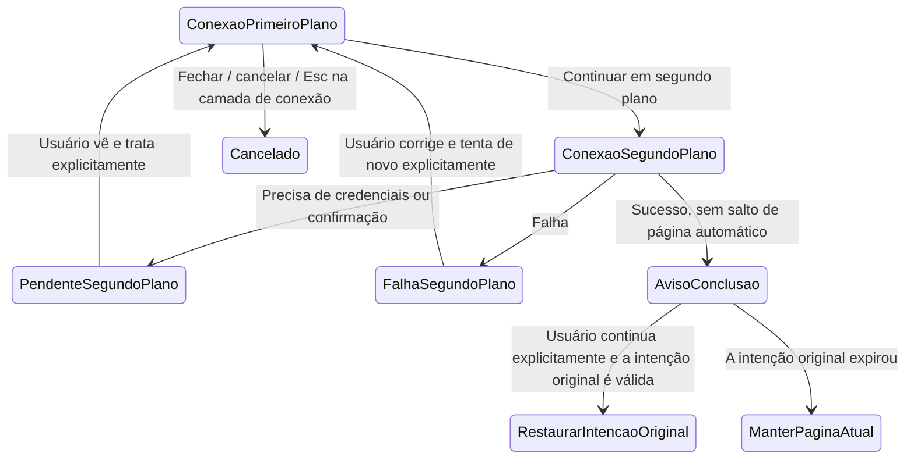

# 22: Conexão em segundo plano e retomada explícita

Status: done

2026-10-14: este ticket preserva o contrato de ciclo de vida em segundo plano já concluído. O alvo após a continuação explícita da origem do chat passa a ser o da [revisão pendente de implementação do #21](21-chat-settings-round-trip.md): exibir a seleção de pasta remota, e só então entrar no projeto após determinar o projeto; as evidências antigas deste ticket não cobrem esse novo fluxo de alvo. A conclusão em segundo plano não rouba a navegação, a invalidação de requisições e a proteção da conexão compartilhada continuam válidas.

**Parent:** [#15 — Separação entre criação de projeto e gestão de conexão remota](15-project-device-selection-and-connection-management.md)

**O que construir:** quando o usuário conectar um dispositivo, ele pode escolher «Continuar em segundo plano» e acompanhar o progresso, os erros e os itens pendentes dessa mesma operação no cartão de dispositivo das configurações ou no item de conexão inacabado. O sucesso apenas avisa que terminou e oferece uma entrada para continuar, sem roubar a página atual; quando o usuário continua explicitamente, o projeto, a lista de projetos existentes ou a ação seguinte do chat são restaurados conforme a intenção original que ainda for válida.

**Bloqueado por:**

- [#19 — Adicionar projeto remoto existente](19-add-existing-remote-project.md): a retomada em segundo plano precisa preservar a intenção de continuar a lista de projetos existentes, sem voltar indevidamente para a criação de um novo projeto.
- [#20 — Criar projeto com ida e volta às configurações e restaurar o rascunho](20-project-draft-settings-round-trip.md): fornece o retorno do rascunho do projeto e a confirmação de troca de dispositivo.
- [#21 — Pasta remota obrigatória após a conexão no chat e entrada no projeto](21-chat-settings-round-trip.md): fornece o alvo de conclusão da origem do chat; o registro de conclusão original deste ticket corresponde à versão antiga dele, e o novo alvo precisa ser verificado separadamente.

**Cobertura da spec:** Q12, além da continuidade em segundo plano de Q9/Q10/Q11; RDUX15-19, RDUX15-20, e reverificação dos ramos em segundo plano de RDUX15-13/14/15/18/21. RDUX15-23/24/25 cobrem o encadeamento do progresso, a retomada explícita e o limite entre múltiplos dispositivos.

## Acceptance criteria

- [x] «Continuar em segundo plano» apenas recolhe a interação: não cancela a requisição, não limpa a configuração nem a intenção de origem; os dispositivos já identificados ficam a cargo do cartão de dispositivo das configurações, e as conexões ainda não identificadas ficam a cargo do item de conexão inacabado, sem forjar a identidade do dispositivo.
- [x] O diálogo, o cartão de dispositivo e o item de conexão inacabado exibem o progresso real, os erros e os estados que exigem tratamento da mesma operação. Depois da identificação ou do reaproveitamento do dispositivo, ele é corretamente agrupado no dispositivo correspondente, sem estabelecer a conexão de novo nem duplicar o owner de logs/estado.
- [x] Depois que o usuário sai manualmente das configurações, o sucesso em segundo plano não abre a página de diretórios, o formulário de projeto nem o chat original, e não altera o dispositivo da tarefa atual; apenas avisa que terminou e oferece a entrada explícita para continuar adequada à origem.
- [x] Quando a intenção original ainda é válida, a continuação explícita pelo usuário pode restaurar a seleção de diretórios, a lista de projetos existentes, o rascunho do projeto original ou a ação de continuação da origem do chat; quando o projeto já tem diretório, a confirmação de troca original ainda é exigida, sem contornar a proteção do #20 e sem criar projeto ou tarefa automaticamente.
- [x] Quando um fluxo em segundo plano já ocupa a entrada de conexão, reabrir a partir de «Nova conexão» nas configurações ou do botão de conexão comum de outro dispositivo retoma o mesmo fluxo. Se a conexão estiver em andamento, a marcação de segundo plano é removida e o resultado subsequente é tratado como conclusão em primeiro plano; se a conexão já tiver sido concluída, a ação de conclusão original é consumida uma única vez, sem parar em uma página de progresso de conexão vazia e sem discar de novo. Fechar, cancelar e a retomada expirada continuam sendo tratados conforme a atribuição original da requisição.
- [x] Uma conexão em segundo plano iniciada diretamente das configurações pode voltar ao estado de gestão de dispositivos correspondente, sem ser levada à criação de projeto; concluir o segundo plano, fechar o aviso ou a interface não equivale a desconectar o dispositivo.
- [x] A falha em segundo plano e os estados que exigem credenciais complementares/confirmação permanecem acessíveis, e o usuário pode ver os detalhes, corrigir, tentar de novo ou cancelar; nenhuma janela de falha é forçada, e nenhuma falha real é reescrita como cancelamento voluntário.
- [x] Fechar ou cancelar esta conexão ainda não concluída mantém a semântica original de invalidação da requisição; o comportamento de continuar em segundo plano e o de cancelar são claramente distinguidos. Cancelar não apaga registros já salvos, não afeta a conexão compartilhada por outros projetos, e os recursos temporários são limpos apenas conforme a atribuição desta execução.
- [x] Quando o rascunho do projeto/chat original foi abandonado, a entrada original expirou, ou a requisição foi cancelada ou substituída, um resultado tardio não revive a interface antiga, a ação antiga de continuação não sobrescreve um rascunho novo nem rouba a navegação. Ver ou clicar em continuar repetidamente não repete a conexão, o salvamento do projeto nem o envio do resultado de conclusão.
- [x] A sequência da passagem de primeiro para segundo plano, da identificação do dispositivo, da retomada do pendente e do aviso de sucesso é toda conduzida pelas requisições e pelos eventos de conclusão já existentes, sem adicionar temporizadores, polling independente ou armazenamento de rascunho entre reinicializações para compensar a sincronização de estado.
- [x] O item de progresso, os erros, os pendentes e a ação de continuação são acessíveis por teclado, em português e inglês, nos temas claro e escuro atuais e em janelas estreitas; os avisos não se apoiam na cor, o foco após a retomada é razoável e nomes longos de dispositivo e erros não ocultam a ação principal.
- [x] Desktop e celular continuam usando o Host e os limites continuous/replayable já existentes; a conexão em segundo plano não cria uma session separada para o celular e não amplia as capacidades de gestão de Web/celular por causa da UI compartilhada.
- [x] Os testes do caminho completo em segundo plano e da temporização de invalidação são escritos antes da implementação, com a aceitação de retomada explícita concluída para cada origem; depois de substituir a antiga entrada de progresso recolhido na barra lateral, confirma-se que não sobraram cartões duplicados, entradas de retomada repetidas ou conexões antigas sem consumo.

## Verification

- Iniciar a conexão a partir das rotas de configurações, criação de projeto, chat e seleção de projeto existente, e passá-la para segundo plano; depois que o usuário sai das configurações, deixar a operação ter sucesso, falhar ou exigir tratamento, e afirmar que a página atual e a entrada permanecem inalteradas e que o estado tem um local de acompanhamento acessível.
- Para origens válidas, continuar explicitamente e conferir o alvo restaurado, o rascunho original e a confirmação de troca de dispositivo; para origens já expiradas e para continuações repetidas, afirmar a ausência de navegação antiga, de novo projeto e de efeito colateral de conexão repetida.
- Com o cancelamento controlado pela UI/porta de serviço já existente, cobrir sucesso após cancelamento, credencial tardia, confirmação de instalação tardia e origem expirada, reutilizando as cadeias reais de SSH/WSL/Docker para verificar o progresso real e a espera de instalação; registrar a faixa real de execução de cada tipo e sistema operacional.
- A implementação deve passar pela checagem de tipos, pelo lint, pelo portão de arquitetura, pelos testes unitários afetados, pelo E2E de Desktop correspondente, pela regressão aplicável de Web/celular e pela checagem visual/de teclado. Os novos E2E mantêm as evidências pelo processo de revisão de candidatos original, e a conclusão deste ticket não equivale à admissão em formal/CI.

## Scope and handoff

- Este ticket é a entrega completa do comportamento em segundo plano, não uma unification ticket de reteste das anteriores. O cancelamento em primeiro plano, o isolamento de credenciais, a proteção contra resultados tardios, o tema e a regressão das plataformas aplicáveis de #16–#21 devem ser concluídos na aceitação de cada um.
- Apenas integra a continuação em segundo plano e a retomada das origens já aceitas nesta rodada; não refaz a máquina de estados da conexão física, a execução remota de tarefas, o protocolo de recuperação de mensagens nem todos os visuais do cartão de dispositivo.
- O registro de conclusão lista apenas as evidências realmente implementadas e executadas neste ticket; não fecha nem altera automaticamente o ticket pai #15, nem considera o PASS antigo das tickets anteriores como validação do novo caminho em segundo plano.

## Registro de conclusão (2026-10-12)

### Implementado

- O diretório do projeto, a lista de projetos existentes, o novo dispositivo do projeto, o novo dispositivo do chat e as configurações compartilham o fluxo de conexão da Root. Foram removidos o `ProjectConnection` sem chamadas em produção e o slot antigo da barra lateral; o `dep:refs` estático é 0, e os testes temporários de attachment antigos migraram para o fluxo unificado.
- O segundo plano mantém apenas a requisição original e a ação de conclusão de uso único. O sucesso da gestão de dispositivos libera imediatamente o attachment exclusivo desta execução; as demais origens mantêm a session necessária. A continuação explícita valida por `entryEpoch` e pelo estado real do Source; cancelar, substituir, a expiração da origem ou a continuação repetida não entregam o resultado antigo, e a session reaproveitada de outro projeto não é liberada.
- O cartão das configurações e o item de conexão inacabado leem a mesma projeção de UI sem credenciais. O contexto de publicação e o de assinatura são separados, evitando que a write-back da projeção dispare o próprio render; não são adicionados owner de conexão, cache de logs ou polling temporizado. O aviso de sucesso oferece continuar e fechar, e fechar o aviso não desconecta o dispositivo.
- O cancelamento em segundo plano não ativa a tab original; o portal do projeto permanece oculto até o usuário retornar à tab original, e o cancelamento no chat não rouba o foco. Depois da conclusão assíncrona da continuação, o portão de entrada da Root é liberado, e as adições seguintes não ficam bloqueadas pela requisição antiga.

### Verificação real e evidências

| Execução real                   | Resultado e escopo                                                                                                                                                                                                             | Diretório de evidências (`packages/desktop/.e2e-artifacts/`)                                 |
| ------------------------------- | ------------------------------------------------------------------------------------------------------------------------------------------------------------------------------------------------------------------------------ | ------------------------------------------------------------------------------ |
| Candidato nativo em macOS       | 1/1 PASS: configurações, novo projeto, diretório offline, lista de projetos existentes e chat — cinco entradas/ramos de continuação; SSH real com sucesso/falha de autenticação e Docker com instalação pendente/com sucesso; sem roubo de navegação, continuação explícita, identidade de projeto e tarefa/rascunho preservados, cancelamento sem ressurreição; zh/en, dois temas, 480px, notificação em janela larga e cartão de dispositivo | `desktop-e2e-20261012113752972-p61904-ed5d187f22de48de`                        |
| Regressão de primeiro plano #20/#21/#19 | 1/1 PASS cada: confirmação de troca de diretório no rascunho do projeto original, anexo de texto do chat/projeto e foco, identidade de projeto existente/cancelamento da lista antiga. O quarto item do handoff do projeto original foi interceptado por um pré-requisito OAuth falso e não foi registrado como PASS                                                                 | `desktop-e2e-20261012113931623-p66484-a0568e0c04891939`                        |
| Reexecução dirigida do handoff do projeto original | 1/1 PASS: correção do pré-requisito de inicialização somente-Personal, depois linha padrão, falha alternativa e remoção da entrada durante o bind sem submeter navegação antiga                                                                                                                             | `desktop-e2e-20261012114148131-p72672-335281107679ef8c`                        |
| Testes de temporização e de componentes de UI/flow | Falha em segundo plano/falta de credenciais/instalação/espera de atualização, confirmação e resultado tardios, desconexão do Source, continuação repetida, liberação de session compartilhada, ciclo de publicação e portão assíncrono, expiração da origem; escopo afetado de 669 arquivos / 6488 testes PASS; 30 testes dirigidos de pré-requisito de inicialização PASS                               | Log de testes do workspace deste ticket; capturas de diagnóstico do #185/portão salvas em `project-device-22-diagnostics` |

- O `pnpm typecheck` final, o `pnpm lint` (0 error; 208 warnings já existentes no repositório), o `pnpm architecture:check --changed` padrão, o fixture checker, a formatação e a checagem de diff passaram. A baseline dos testes afetados é `9c94409bca387d129516500cb9b60ee18c2b948f`. Não se contam as falhas da execução inicial nem o PASS de tickets antigos no resultado dos novos caminhos deste ticket.
- As evidências de sucesso e regressão foram copiadas para o diretório acima do worktree de integração. Foram conferidas 10 árvores de código-fonte antes do reaproveitamento dos assets remotos; a UI foi reconstruída a partir do código-fonte desta rodada. O candidato continua em `manual-review/pending`, sem promoção nem inclusion em CI.
- TODO (adiado explicitamente pelo usuário): WSL real, celular/relay reais. A interface nativa de Windows/Linux não foi executada nesta máquina; os limites de Host/continuous/replayable entre múltiplos dispositivos são cobertos pela regressão do protocolo existente e dos testes unitários afetados, o que não pode ser tratado como PASS real nessas plataformas.
- O status do ticket pai #15 não foi modificado; apenas commit local, sem push e sem criação de MR.

2026-10-12 reverificação das correções de revisão desta rodada: o candidato em segundo plano passou 1/1 no Desktop nativo em macOS com contêiner Linux SSH/Docker independente, com verificação adicional da entrada comum das configurações retomando a mesma operação durante a conexão e após a conclusão, e com o resultado de conclusão consumido apenas uma vez; evidências em `packages/desktop/.e2e-artifacts/r3-server-review-20261012-background/`. O candidato antigo de três telas migrou em sincronia para o cartão de progresso dentro das configurações e para o cancelamento explícito seguido de nova criação, 1/1 PASS, evidências em `r3-server-review-20261012-threescreen-r4/`; a execução real encontrou ainda que o helper genérico de desconexão retorna à barra lateral, enquanto a asserção antiga esperava o cartão de configurações — foi alterado para operar no cartão do Source e verificar o estado offline, sem modificar o timeout do produto.

A lista de regressão remota completa foi ampliada com cinco candidatos desta rodada, ainda pendentes, o que não indica admissão em formal/CI. A regressão da lista ficou vermelha antes de ficar verde, 12/12 PASS. O Desktop final foi construído a partir do código-fonte atual, e o sourcemap das cinco interfaces críticas coincide palavra por palavra com o código-fonte; foram conferidas as dez árvores de código-fonte remotas e o descriptor SHA/size do archive Linux. As credenciais de build estão em `packages/desktop/.e2e-artifacts/r3-server/review-final-build-source-verification.json`. As falhas de validação de parâmetros do runner no início, o timeout de início de session do Electron sob carga e as falhas de migração omitidas foram mantidas separadamente e não contadas como PASS.

Na primeira execução dos testes afetados desta rodada, apenas os casos da lista excederam o limite original de 30 segundos sob a carga de build/checagem de tipos em paralelo; os outros 408 arquivos e 4688 itens passaram; após o fim da carga, o comando original de forma dirigida e serial passou 12/12, sem alteração de código ou de timeout. A checagem de tipos da raiz, o lint, o portão de arquitetura e a checagem de tipos do E2E final de Desktop passaram; os quatro fixtures de E2E, a formatação de todo o código alterado e os novos fixtures de autenticação 2/2 passaram. O lint final do código ficou com 0 error, mantendo o warning max-lines já existente do fluxo de conexão.
