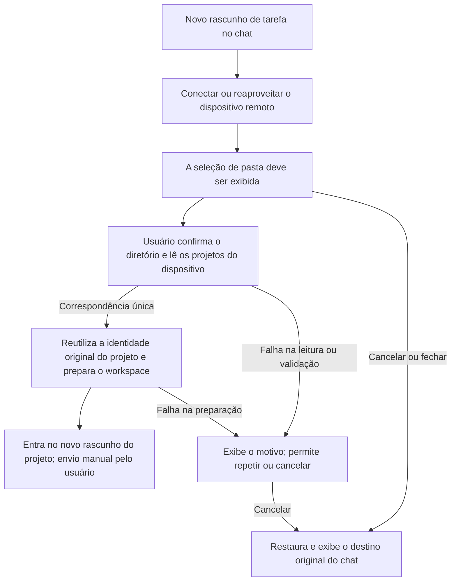

# 23: Selecionar pasta e entrar no projeto existente com correspondência única

Status: done

**Parent:** [#21 — Pasta remota obrigatória após a conexão no chat e entrada no projeto](21-chat-settings-round-trip.md)

**O que construir:** quando o usuário conecta um dispositivo remoto a partir de um novo rascunho de tarefa no chat, ele escolhe a pasta no dispositivo de destino a cada conexão. Quando o diretório confirmado pertence exatamente a um projeto existente, entra-se no novo rascunho de tarefa desse projeto e a primeira mensagem é enviada no remoto. Não se pode enviar para o destino original enquanto a seleção e a preparação não forem concluídas; cancelar a troca por completo restaura e exibe claramente o destino original do chat.

**Bloqueado por:** Nenhum (pode começar imediatamente).

**Cobertura da spec:** RDUX21-01–05, RDUX21-08–13, RDUX21-15–16, RDUX21-19–20; pastas e níveis aninhados de RDUX21-14, compatibilidade somente leitura com projetos existentes de RDUX21-21. RDUX21-22–24 são verificadas pelo caminho desta ticket.



## Acceptance criteria

- [x] A página inicial sem projeto em rascunho, o rascunho com projeto local existente e o rascunho com projeto remoto existente entram no mesmo fluxo a partir do menu real de projetos do chat; o antigo «voltar ao chat original, mostrando apenas a criação de projeto neste dispositivo» deixa de ser um destino de sucesso.
- [x] A seleção de pasta é exibida a cada conexão bem-sucedida ou reaproveitamento de dispositivo online; ela não abre automaticamente quando o dispositivo tem apenas um projeto, quando há projetos recentes ou quando o rascunho original já tem um projeto. A entrada de caminho, o salto, a navegação de diretórios e o controle de diretórios ocultos reaproveitam as capacidades existentes, com o dispositivo de destino e o caminho claramente visíveis.
- [x] Depois de confirmar o diretório, os projetos existentes, não removidos, são casados pelo Source／Host real e pelo root fixo exato; o julgamento remoto não usa o sistema de arquivos local, o nome de exibição, o diretório pai, o prefixo do caminho nem o caminho homônimo de outro dispositivo.
- [x] No caso de correspondência única, o ID real do projeto, o root e a atribuição das tarefas históricas são preservados; após o registro necessário da entrada e a preparação do workspace de destino, entra-se no novo rascunho de tarefa daquele projeto; não basta apenas atualizar a lista, e nenhuma sessão histórica é aberta automaticamente.
- [x] Enquanto a troca em primeiro plano ainda não for concluída ou for cancelada, o botão de envio do rascunho, o Enter e as demais entradas de envio existentes não podem submeter mensagens ao destino antigo. A preparação concluída apenas restaura a capacidade de envio normal, sem submeter automaticamente; no primeiro envio manual, o Host, o projeto e o diretório de execução reais são os do remoto selecionado.
- [x] Caminho inválido, elemento que não é diretório, falta de permissão, falha de leitura do projeto, diretório invalidado após a confirmação e desconexão durante a preparação exibem o motivo real e permitem repetir ou cancelar; a falha não conta como zero correspondências, não cria projeto substituto e não volta ao envio local.
- [x] O cancelamento, o fechamento e o Escape da seleção de pasta de nível superior desfazem esta troca remota, restauram o destino original ainda válido, o rascunho original e o foco razoável, e exibem claramente o destino. O menu aninhado apenas fecha o nível atual; «escolher depois» não pode deixar um estado remoto sem projeto em que o envio seja possível.
- [x] Cancelar antes／durante a conexão e os casos de destino original local sem projeto／projeto local／projeto remoto retornam corretamente. Após um cancelamento explícito, o chat local sem projeto continua utilizável.
- [x] Apenas o attachment temporário exclusivo desta execução é liberado; a conexão de dispositivo já estabelecida, o registro de dispositivos e a session compartilhada por outros projetos são mantidos. Confirmações ou registros repetidos não geram entradas duplicadas.
- [x] Após a troca de rascunho, a substituição da requisição de conexão, o cancelamento, a remoção de um membro ou a desinstalação, resultados tardios de conexão, de diretório, de leitura de projeto e de preparação de workspace não podem reabrir a interface antiga, sobrescrever o novo destino nem liberar recursos compartilhados; a identidade da requisição e o owner são reaproveitados, sem depender de timeout para sincronizar.
- [x] A adição de dispositivo nas configurações, a reconexão do projeto original e a continuação de uma tarefa existente mantêm as regras de conclusão originais; um remoto antigo somente leitura pode continuar usando os projetos existentes. O Web／celular comum não exibe entradas além da capacidade da camada de shell, e os limites existentes de Host e continuous／replayable não mudam.
- [x] Completar o E2E a partir do menu real e provar primeiro que o caminho original sem projeto submeteria incorretamente para o local, só então implementar a correção; os testes conferem a atribuição real da primeira mensagem, a quantidade de projetos e a identidade histórica, e não apenas a aparência dos botões ou um callback local.
- [x] Esta ticket completa a validação em chinês e inglês, nos temas claro e escuro, com caminho longo, janela estreita e teclado; SSH／WSL／Docker e sistemas operacionais são registrados conforme o suporte e o escopo de execução reais, sem substituir a evidência de celular por uma desktop estreita.

## Verification

- A principal costura reaproveita o Desktop E2E de ida e volta de dispositivo do chat que já existe, usando conexão remota real e dados reais de projeto; a troca bem-sucedida usa um rascunho vazio, e o cancelamento／falha usa o rascunho original com conteúdo para verificar a preservação.
- Reaproveitar os cenários de projeto remoto existente para verificar a reabertura duplicada, o mesmo caminho em dispositivos diferentes, o prefixo de mesmo nome e o diretório pai sem casamento indevido. Usar as portas de UI／serviço existentes para controlar resultados tardios e falhas de preparação, sem adicionar API de produto exclusiva para testes.
- O pré-aquecimento do rascunho pode já ter criado um runtime; a asserção deve ser «a mensagem não foi submetida ao destino local original», e não pode ser substituída por «nenhum runtime local foi iniciado».
- Concluir a checagem de tipos, o lint, o portão de arquitetura, os testes unitários afetados, o Desktop E2E desta ticket e a regressão aplicável da UI compartilhada, atualizando os cenários e as evidências de cobertura. O candidato mantém o fluxo de revisão existente; ambientes ausentes são registrados com honestidade, sem reaproveitar o PASS antigo da ticket pai.

## Scope and handoff

- Se for necessário organizar a entrega do resultado de conclusão, primeiro fazer com que, dentro desta ticket, a intenção existente possa entregar o resultado real de dispositivo, diretório e projeto, e só então conectar o caminho completo do usuário; não criar uma segunda cópia do rascunho, do owner da conexão, de migração de banco de dados ou de um framework amplo.
- [#24](24-chat-remote-folder-project-choice.md), [#25](25-chat-remote-folder-create-project.md) e [#26](26-chat-remote-folder-background-resume.md) assumem respectivamente múltiplas correspondências, zero correspondências e a continuação em segundo plano. O que se entrega a elas é o mesmo resultado de confirmação de diretório, a atribuição válida da requisição, as restrições de envio, o cancelamento e a capacidade de entrar no projeto; não se duplica outra cadeia de conexão／envio.
- Múltiplas e zero correspondências não contam como funcionalidade concluída nesta ticket; durante a passagem, é preciso manter o estado não-enviável e a possibilidade de reselecionar ou cancelar, sem preenchimento por escolha automática nem por criação temporária de projeto para tickets posteriores. A especificação pai exige as quatro tickets concluídas.
- A migração de rascunho／attachment entre dispositivos e o tratamento de conflitos seguem o comportamento existente e não são implementados nesta ticket. Não se modifica nem se fecha a Issue pai; esta ticket apenas registra o próprio estado de implementação e verificação.

## Implementation notes

O menu do chat mantém a intenção desta troca e a seleção de diretório; a Root continua sendo dona da conexão e da preparação do workspace. O Composer recebe apenas a projeção de bloqueio de envio vinda do menu, sem copiar o rascunho. `CreateTaskOptions` ganha uma costura de validade dentro do renderizador e de retorno de falha: a Root reverifica a intenção de origem antes da preparação e da navegação, e o erro devolvido ao fluxo de diretório ainda permite repetir. Os membros do dispositivo são validados por membership; o casamento de projetos lê a lista autoritativa do Host de destino, usando o caminho exato do root fixo, sem chamar as regras de caminho da máquina local.

```text
Intenção do chat → Conexão → Confirmação do diretório → Casamento autoritativo de projetos → Registro da entrada → Preparação na Root → Novo rascunho do projeto
   │                  │              │               │
   └─cancelar/trocar rascunho─┴─resultado antigo inválido─┴─não navegável──────┘
```

### #23 Implementação e verificação (2026-10-14)

- Candidato `manual-review/pending/conversation-session-chat-remote-folder.test.ts`: menu real do chat, conexão SSH e reaproveitamento online, cancelamento de rascunho sem projeto／com projeto remoto, diretório obrigatório, bloqueio de envio por botão／Enter／submissão do form, erro de caminho longo inválido, primeiro envio em projeto único, nova seleção de diretório preservando a identidade do projeto e das tarefas históricas, e ausência de registro duplicado de entrada.
- Atualização de `manual-review/pending/conversation-session-chat-device-return.test.ts`: repetição da falha de conexão a partir de um rascunho com projeto local, cancelamento antes／depois da conexão, atribuição do corpo／anexo／tarefa original, e o diálogo de diretório e o foco em zh/en × tema claro／escuro × 1440／480px.
- RED real `desktop-e2e-20261014044755117-p28723-fd57f544f073042f`: `old-local-submission.json` prova que o fluxo antigo submetia aquela mensagem a uma tarefa local sem projeto após a conexão. GREEN `desktop-e2e-20261014050039448-p42395-acef074fec4b900a`: os dois candidatos passaram 2/2; o Host／projeto／tarefa／cwd／identity do primeiro envio remoto estão em `remote-first-submission.json`; as capturas representativas foram revisadas.
- A regressão das portas de UI／serviço cobre Host diferente, diretório pai, prefixo e projetos já removidos sem casamento indevido; erros de listagem e falhas de preparação não liberam o portão; resultados tardios após o cancelamento e requisições antigas são invalidadas antes da renderização do React; a membresia e o projeto são reverificados antes da vinculação do attachment, e a falha libera apenas os recursos exclusivos. A navegação de diretórios de remotos antigos somente leitura continua pelo serviço de arquivos remoto, e as regras de caminho do Windows são determinadas pela plataforma remota.
- Escopo real: cliente macOS → SSH real para Linux arm64. O Docker funcionou nesta rodada como fixture SSH exclusivo e não conta como aceitação de transporte Docker; WSL／Windows／Linux cliente e celular físico não foram executados. O portão de capacidades da camada compartilhada Web／celular mantém a regressão de UI, e a regressão compartilhada de celular integrada é registrada pela tarefa matriz.
- A seleção de múltiplos projetos, a criação／restauração de zero itens e a continuação explícita em segundo plano são assumidas por #24／#25／#26. O candidato continua pending, sem alegar revisão manual, formal ou admissão em CI.

- Checagens de código necessárias: `pnpm typecheck`, `pnpm lint` (209 warnings já existentes, 0 error), `pnpm architecture:check --changed` (0 violation), checagem de fixture do candidato, e diff e verificação de formatação aprovados. O escopo afetado foi de 607/2615 arquivos: 606 arquivos passaram primeiro; as novas asserções do intervalo entre submissão／renderização falharam em um teste em trânsito com o componente antigo já carregado e, depois da correção, apenas aquele arquivo foi reexecutado com 16/16 aprovados. O resultado da mesclagem foi de 6841 testes aprovados e 1 skip já existente; não foi ampliado para a suíte completa.
