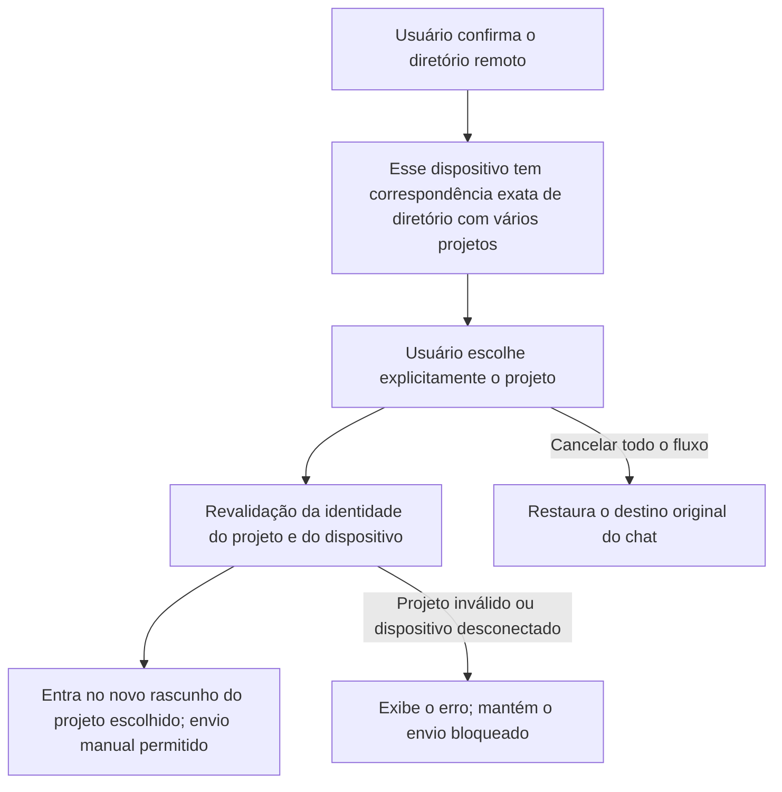

# 24: Escolha explícita quando há vários projetos no mesmo diretório

Status: done

**Parent:** [#21 — Pasta remota obrigatória após a conexão no chat e entrada no projeto](21-chat-settings-round-trip.md)

**O que construir:** quando o usuário conecta um dispositivo remoto a partir do chat e confirma a pasta, se aquele diretório corresponder a vários projetos existentes, ele vê esses projetos e escolhe explicitamente um. Depois de concluído, entra-se no novo rascunho de tarefa do projeto escolhido, e a primeira mensagem usa a identidade e o diretório originais dele; cancelar todo o fluxo restaura o destino original do chat.

**Bloqueado por:**

- [#23 — Selecionar pasta e entrar no projeto existente com correspondência única](23-chat-remote-folder-existing-project.md): fornece a entrada real do chat, a confirmação do diretório remoto, a entrada no projeto e as restrições de envio／cancelamento.

**Cobertura da spec:** RDUX21-06; o ramo de múltiplos projetos de RDUX21-09, RDUX21-11–12, RDUX21-14 e RDUX21-16. RDUX21-22–24 são verificadas pelo caminho desta ticket.

## Acceptance criteria

- [x] Usa o mesmo fluxo de conexão e de seleção de diretório do #23; somente depois de o usuário confirmar o diretório, os projetos existentes e não removidos que correspondem são exibidos com base no dispositivo de destino real e no root exato.
- [x] Vários projetos no mesmo dispositivo e no mesmo diretório mantêm identidades distintas; os candidatos exibem informações que os diferenciam, e a seleção é feita pelo ID real do projeto; não se seleciona, funde nem cria automaticamente um projeto por nome, uso recente, ordem da lista ou igualdade de caminho.
- [x] Depois que o usuário escolhe, a requisição, o membership do Host, o projeto e o diretório são revalidados como ainda válidos, e só então o novo rascunho de tarefa daquele projeto é aberto pelo caminho comum de registro e de preparação. O ID do projeto, as tarefas históricas e sua atribuição permanecem inalterados, e a primeira mensagem real é enviada ao projeto remoto escolhido.
- [x] Enquanto o projeto não foi escolhido ou o workspace ainda não está preparado, o botão e o teclado não podem enviar para o destino original; depois de concluído, nada é submetido automaticamente. Duplo clique na escolha e respostas repetidas não podem registrar, abrir ou enviar em duplicidade.
- [x] Cancelar, fechar ou pressionar Escape no nível superior da seleção de projeto desfaz a troca remota por completo, restaura o destino do chat e o rascunho original enquanto ainda forem válidos, e exibe a atribuição do destino; o nível aninhado segue antes as regras de fechamento originais, sem submeter por engano.
- [x] Falha na leitura do projeto, candidato removido／alterado, diretório invalidado, remoção de membro ou desconexão do dispositivo exibem erro e permitem reler／escolher novamente ou cancelar; não se escolhe automaticamente outro candidato e a falha não é tratada como criação com zero itens.
- [x] Depois que o usuário cancela, troca o rascunho, troca o dispositivo ou inicia uma nova requisição, resultados tardios da lista antiga e da escolha antiga não podem navegar, sobrescrever o novo destino nem limpar a conexão de outras tarefas.
- [x] Projetos com o mesmo caminho e o mesmo nome em dois dispositivos, e projetos de diretórios pai／filho, não são misturados aos candidatos correspondentes; projetos existentes de remotos antigos somente leitura continuam selecionáveis conforme as capacidades atuais e não podem acionar uma criação inválida.
- [x] Complementa com E2E o caso de «dois projetos no mesmo diretório» a partir do menu real do chat, escolhendo projetos diferentes e conferindo a identidade do projeto original e das tarefas históricas; cobre cancelamento e candidatos inválidos. Escrever o teste primeiro e só então implementar este ramo.
- [x] Esta ticket completa a validação com nome longo, teclado, foco, chinês e inglês, temas claro e escuro e janela estreita; a UI compartilhada respeita os portões Web／celular existentes, e as evidências são registradas conforme o tipo de remoto e a plataforma reais.

## Verification

- Reaproveitar os dados de dois projetos e o histórico de tarefas já existentes para a seleção de projeto remoto existente, conectando a nova entrada do chat; validar o resultado com projeto, tarefa e diretório de execução reais, e não apenas conferindo as linhas da lista ou a contagem de chamadas.
- Quando o timing for difícil de controlar, como lista tardia ou troca de membro após a escolha, usar as portas de UI／serviço existentes; comparar a quantidade de entradas e a disponibilidade da conexão compartilhada antes e depois do cancelamento.
- Concluir a checagem de tipos, o lint, o portão de arquitetura, os testes unitários afetados, o Desktop E2E desta ticket e a regressão aplicável da UI compartilhada; manter os case／a matriz de cobertura consistentes. Ambiente não executado não é registrado como aprovação, e candidato não é promovido automaticamente.

## Scope and handoff

- Apenas estende o ramo de múltiplas correspondências do #23; não modifica a criação com zero correspondências, a unicidade global de projetos nem as regras de armazenamento de vários projetos no mesmo diretório.
- Não depende do #25 ou do #26; se a retomada em segundo plano já estiver conectada ao fluxo comum de diretório, ela passa a usar naturalmente o mesmo resultado de seleção de projeto, sem manter um segundo seletor de fundo.
- A migração de rascunho／attachment entre dispositivos e o tratamento de conflitos estão fora do escopo. Não se modifica nem se fecha a Issue pai; apenas se registra a evidência de conclusão desta ticket.

## Implementação e evidências — 2026-10-14

- Depois da confirmação do diretório, candidatos múltiplos exibem apenas os projetos não removidos com root único e exato daquele Host; nome e ID real do projeto ficam visíveis ao mesmo tempo, e o foco do teclado entra na lista de candidatos. Reaproveita-se a membership, a revalidação de diretório e de projeto e a preparação de workspace do `enterProject` comum, sem criar outro caminho de registro ou de navegação.
- A seleção de projeto usa um lock síncrono em trânsito. Falha na leitura ou na preparação mantém o envio bloqueado; após a releitura, se restar apenas um item, a escolha explícita continua sendo exigida e o projeto restante não pode substituir a escolha original do usuário. Reselecionar o diretório e o cancelamento no nível superior mantêm o owner e a atribuição de recursos existentes.
- TDD: `chatRemoteFolderChoice.test.ts` — o primeiro teste falhou sob a implementação original por não haver candidatos de múltiplos projetos; após a implementação, 9 testes de portas de UI／serviço passaram. Cobre a distinção de IDs com nomes iguais, o duplo clique, a remoção do candidato／mudança de root／offline, o cancelamento／requisição expirada／troca de membro, o Host e o root exatos, a capacidade somente leitura, a releitura sem troca automática da escolha e o foco.
- Desktop E2E GREEN: `desktop-e2e-20261014053401905-p70011-e4130be481e13bf0`, candidato `conversation-session-chat-remote-project-choice.test.ts` 1/1 passou. O menu real do chat foi conectado via SSH, escolhendo dois projetos do mesmo diretório e enviando a primeira mensagem em cada um; foram conferidas as tarefas, o projeto, o Host, o cwd e a workspace identity de cada um, preservada a atribuição das tarefas existentes e evitada a duplicidade de registro. Os nomes reais de projeto seguem as regras de desambiguação já existentes no serviço; candidatos com nomes totalmente iguais são verificados pelo teste de portas da UI.
- O mesmo E2E verifica que projetos de diretórios pai／filho e projetos removidos logicamente não se misturam, o bloqueio de envio do rascunho original e a restauração por Escape, a exibição de erro quando o projeto é removido antes da escolha, chinês／inglês × temas claro／escuro × 480px e 1440px de desktop. `choice-identities.json` guarda o resultado das identidades, e as capturas representativas foram revisadas. A primeira tentativa de ambiente não passou por causa da checagem de tipos concorrente sobrescrevendo o artefato de build e dos dados antigos do Source do fixture exclusivo inconsistentes; após reconstruir em sequência e resetar os dados de teste, a execução foi refeita. O teste expande explicitamente a barra lateral conforme a regra existente de janela estreita.
- Checagens necessárias: `pnpm typecheck` da raiz, `typecheck:e2e`, lint (209 warnings já existentes, 0 error), portão de arquitetura (0 violation), checagem de fixture, formatação e autoverificação de diff aprovadas. `pnpm test:unit:affected --base 833e6dcb4b` — a seleção oficial de 608/2616 arquivos, 6850 passaram e 1 skip já existente; a suíte completa de testes unitários não foi executada.
- O escopo real foi macOS Desktop → SSH para Linux arm64; o Docker serviu apenas como fixture SSH e não representa o transporte por Docker. Windows／Linux Desktop, WSL, transporte por Docker e celular físico não foram executados; o portão de capacidades da camada de shell compartilhada é coberto pela regressão afetada, e a evidência do caminho de celular após a integração é registrada pela tarefa matriz. O candidato permanece pending, sem promoção automática nem inclusão no CI em contêiner.
