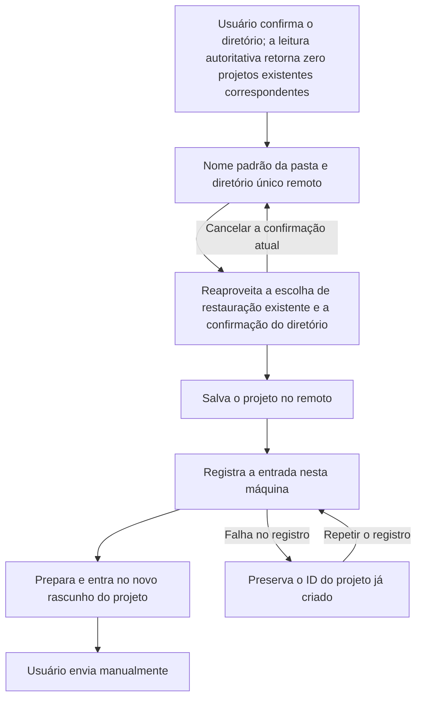

# 25: Criar e entrar quando não houver projeto correspondente

Status: done

**Parent:** [#21 — Seleção obrigatória de pasta remota após conectar no chat e entrada no projeto](21-chat-settings-round-trip.md)

**O que construir:** quando o usuário conectar um dispositivo remoto a partir do chat e confirmar uma pasta que não tenha projeto existente correspondente, usa-se o nome da pasta como nome de projeto padrão, reaproveitando o fluxo existente de criação/restauração e de confirmação de diretório. Depois de salvar o projeto, registrar a entrada e preparar o workspace, entra-se no novo rascunho de tarefa desse projeto; em caso de falha, é possível repetir ou cancelar, sem criar duplicata e sem enviar para o local.

**Bloqueado por:**

- [#23 — Selecionar pasta e entrar no projeto existente com correspondência única](23-chat-remote-folder-existing-project.md): fornece a confirmação de diretório, o resultado de correspondência autoritativo, a atribuição válida das ações e o caminho completo até o projeto de destino.

**Cobertura da spec:** RDUX21-07, RDUX21-17, RDUX21-21; o ramo de criação/restauração de RDUX21-08, RDUX21-10–12, RDUX21-14, RDUX21-16. RDUX21-22–24 são verificadas pelo caminho desta ticket.

## Acceptance criteria

- [x] O ramo de criação só é atingido quando o usuário já confirmou o diretório e a leitura autoritativa de projetos do dispositivo de destino foi bem-sucedida com zero correspondências de projetos existentes não removidos; falha de leitura, diretório inválido ou mudança de identidade não podem ser tratados como zero correspondências.
- [x] O nome padrão vem do nome da pasta selecionada, e o dispositivo de destino e o root fixo único vêm desta confirmação; não se exige que o usuário preencha novamente o mesmo diretório, e não se usa o diretório local nem um diretório substituto recém-gerado.
- [x] Reaproveita a criação compartilhada de projeto existente e a confirmação de diretório; escolher a pasta não equivale a confiar no diretório. Ao atingir um projeto removido, mantém-se a escolha entre restaurar ou continuar criando; a restauração usa o ID do projeto original, sem restaurar silenciosamente nem sobrescrever outro projeto.
- [x] O dispositivo, o diretório, o nome e o alvo de restauração exibidos e salvos na etapa de confirmação são consistentes. O cancelamento/fechamento/Escape da confirmação de diretório aninhado retorna ao fluxo atual e preserva a seleção, sem submeter e sem vazar para o envio do chat; o cancelamento no nível superior ainda revoga toda a troca remota e restaura o alvo original.
- [x] Depois de salvar e registrar com sucesso, entrega-se o ID real do projeto, o Host e o root, prepara-se o workspace de destino e entra-se no novo rascunho de tarefa do projeto; apenas adicionar a entrada na barra lateral não conta como conclusão. O primeiro envio manual usa de fato esse projeto remoto, e o alvo antigo não recebe mensagens.
- [x] Durante toda a criação, o registro e a preparação, mantêm-se as restrições de envio por botão e teclado; a conclusão não envia mensagem automaticamente. Confirmações repetidas ou clique duplo não podem criar projeto, registrar entrada ou iniciar o chat em duplicata.
- [x] Ao conectar novamente a partir do chat e escolher o mesmo diretório, o projeto existente é reaproveitado pelo caminho de correspondência de #23, sem criar um novo projeto para o mesmo diretório por causa da reconexão; a interface genérica de salvamento não é alterada para deduplicação global por diretório.
- [x] Quando o diretório está sem permissão, foi removido durante a confirmação, o dispositivo se desconectou ou o salvamento falhou, exibe-se o erro original e preserva-se a seleção repetível, sem gerar diretório substituto nem entrada fantasma; ao cancelar, preservam-se o rascunho original do chat e a conexão compartilhada do dispositivo.
- [x] Quando o remoto já retornou sucesso no salvamento mas o registro local falhou, preserva-se o ID de projeto retornado; a repetição registra apenas o resultado já criado, sem criar de novo nem solicitar novamente a confirmação de diretório já concluída nesta tentativa. Um projeto salvo com sucesso não é apagado automaticamente por fechar.
- [x] Depois que a requisição original é cancelada, substituída, ocultada ou desinstalada, ou que o membership do Host fica inválido, resultados tardios de consulta, confirmação, salvamento e registro não navegam, não sobrescrevem o novo alvo e não iniciam escritas obsoletas; apenas os recursos pertencentes a esta tentativa são tratados.
- [x] Quando o remoto antigo só tem a capacidade de leitura de projetos, exibe-se a limitação atual de criação; não é possível contornar a verificação de capacidade por essa entrada. Outras entradas explícitas de criação de projeto no mesmo diretório, a identidade do projeto e o contrato das tarefas históricas permanecem inalterados.
- [x] Complementa o E2E de criação por zero correspondência e de primeiro envio remoto a partir da entrada real de chat, testando antes de implementar; cobre também a restauração/confirmação compartilhadas, a falha de salvamento e a repetição do registro. Verifica a contagem real de projetos, o ID, o root único e a atribuição da primeira mensagem.
- [x] Esta ticket conclui a verificação de idioma, tema, caminho longo, janela estreita, foco e teclado da confirmação de criação; registra os resultados conforme a plataforma real e o ambiente SSH/WSL/Docker, mantendo o gate de capacidade de Web/celular.

## Verification

- O caminho principal reaproveita o E2E da entrada de chat e a capacidade compartilhada de confirmação de diretório de projeto; a restauração por exclusão suave e a compatibilidade somente leitura seguem o contrato de testes do serviço de projeto.
- O sucesso de salvamento com falha de registro é construído pelas portas de serviço existentes, provando que após a repetição continua sendo o mesmo projeto; não se contorna o problema com API nova só para teste nem com repetição de rede infinita.
- A troca bem-sucedida usa rascunho vazio; o texto/anexo original é verificado apenas quanto à preservação no cancelamento e na falha, sem migração entre dispositivos nesta ticket.
- Concluir checagem de tipos, lint, gate de arquitetura, testes unitários afetados, o E2E Desktop desta ticket e a regressão de UI compartilhada aplicável, sincronizando case e evidência de execução. Plataformas ausentes são registradas explicitamente, PASS antigo não é herdado e o candidato não recebe admissão automática no CI.

## Scope and handoff

- Não depende de #24 nem de #26; reaproveita as restrições públicas de conclusão, envio e cancelamento de #23. Compartilha o resultado real de projeto com o ramo de múltiplas correspondências, sem reescrever a identidade global de projeto por diretório.
- Não adiciona confiança permanente de diretório, autorização de Hook, migração de banco, unicidade de diretório distribuída, migração de rascunho nem mecanismo de repetição de rede global.
- Não modifica nem encerra o Issue pai; esta ticket registra apenas a implementação e a verificação do caminho de criação/restauração por zero correspondências.

## Implementation decisions

- `ChatRemoteFolderSelection` mantém o Host/diretório confirmado e a requisição válida; o caso de zero correspondências é delegado ao `ProjectEditor` compartilhado. O formulário fixa o diretório desta tentativa e exibe o nome padrão da pasta; a confirmação de confiança exibe o nome desta tentativa, e a restauração exibe o nome do projeto de restauração já confirmado, sem novo owner de criação.
- O `ProjectEditor` mantém a escolha de restauração, a confirmação de confiança, o mutex de requisições em trânsito e o cache do resultado já criado. Antes de salvar, revalida a requisição, o membership do Host, o diretório e as capacidades remotas; depois de salvar, usa o `enterProject` existente para registrar, preparar e entrar no rascunho. Falha no registro repete o mesmo ID.
- Os testes de porta usam o serviço de projeto existente e o serviço de entrada remota existente; o candidato real de Desktop valida a criação e o primeiro envio a partir da entrada de conexão do chat, permanecendo como pending.

## Verification evidence

- Primeiro complementa-se o teste vermelho de UI/porta de serviço do caso de zero correspondências, e só então se implementa a criação compartilhada; a invalidação de consulta tardia e a exibição do nome na restauração mantêm regressões vermelhas e verdes separadas. As 11 asserções de `chatRemoteFolderCreation.test.ts` cobrem Host/root fixos, confiança explícita, restauração ou continuar criando, falha de salvamento, falha de permissão, confirmação repetida, capacidade somente leitura, repetição de registro e resultado obsoleto.
- `typecheck` da raiz, `typecheck:e2e` do Desktop, lint (0 errors, 209 warnings existentes), gate de arquitetura (0 violations) passam. Com base no affected no ponto de partida desta tarefa: 608 arquivos, 6852 passando, 1 skip existente. Após integrar #24, a dispensa de diretório e a confirmação compartilhada passam em 4 arquivos com 47 asserções.
- O novo manifest de candidato e a verificação de provider fixture passam; o candidato permanece como `manual-review/pending`, sem promoção automática nem inclusão no CI.
- A primeira execução real por SSH, `desktop-e2e-20261014051020488-p50885-83b993467e37b894`, foi considerada falha pelos helpers de espera existentes na etapa de instalação/atualização e não chegou ao ramo de criação; essa execução não conta como prova de vermelho nem de sucesso da criação.

- O candidato de criação por SSH de macOS Desktop → Linux arm64 passou 1/1: `desktop-e2e-20261014055401059-p80988-2f9ef70df764ec75`. Verifica o nome padrão da pasta em zero correspondências, o root fixo único, o Escape na confiança sem salvar, o Host/project/task/cwd do primeiro envio remoto real, a ausência da mensagem no local original, o reuso do mesmo projeto ao conectar de novo com entrada única, e a preservação do rascunho remoto no cancelamento.
- Após integrar #24 e #26, a dispensa de diretório, a atribuição em background e a confirmação compartilhada passam em 4 arquivos com 52 asserções, e a checagem de tipos da raiz passa novamente. Foram revisadas as capturas da confirmação de confiança em inglês claro a 1440px e em chinês escuro a 480px: nome, dispositivo, caminho longo e botões legíveis, sem cortes; a janela estreita de Desktop não conta como evidência de celular.
- Esta ticket não executou Windows/WSL, o ramo de criação por transporte Docker nem o celular físico; o gate de capacidade de conexão remota Web/celular comum segue o shell, com regressão de UI afetada. Esta rodada não altera o contrato de shared-host nem de continuous/replayable, e plataformas não executadas não são registradas como PASS.
