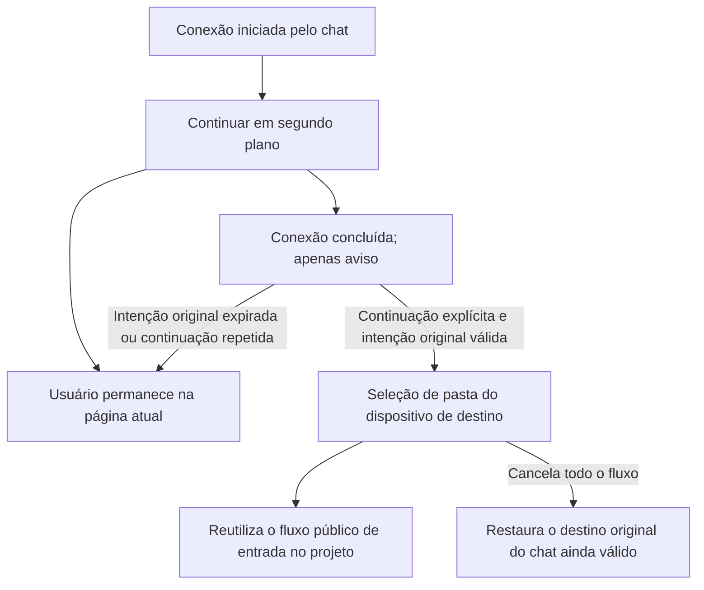

# 26: Continuação explícita para a seleção de pasta após a conclusão da conexão em segundo plano

Status: done

**Parent:** [#21 — Seleção obrigatória de pasta remota após conectar no chat e entrada no projeto](21-chat-settings-round-trip.md)

**O que construir:** quando o usuário inicia uma conexão remota a partir do chat e escolhe continuar em segundo plano, ele pode permanecer em outras páginas trabalhando. A conclusão da conexão apenas avisa; quando o usuário continua explicitamente e a intenção original ainda é válida, exibe-se a seleção de pasta do mesmo dispositivo de destino, e em seguida ele entra no projeto e envia manualmente. Uma continuação expirada ou repetida não pode roubar a navegação, repetir operações nem afetar outras tarefas.

**Bloqueado por:**

- [#23 — Selecionar pasta e entrar no projeto existente de correspondência única](23-chat-remote-folder-existing-project.md): fornece o fluxo de diretório do chat reutilizável, a validação da intenção original, as restrições de envio e a capacidade de entrada no projeto.

**Cobertura da spec:** RDUX21-18; os ramos de continuidade em segundo plano de RDUX21-03, RDUX21-12–13, RDUX21-15–16 e RDUX21-19–20. RDUX21-22–24 são verificados pelo caminho desta ticket.



## Acceptance criteria

- [x] Reaproveita o ciclo de vida da conexão em segundo plano já concluído e o owner único da operação. Continuar em segundo plano apenas recolhe a interação; o cartão de dispositivo das configurações e o item inacabado continuam exibindo o progresso e o estado da mesma requisição, sem criar outra conexão nem um fluxo de recuperação independente.
- [x] Depois que o usuário sai das configurações ou muda para outro chat, o sucesso em segundo plano não abre a seleção de diretório, não troca de dispositivo ou projeto, não altera o rascunho atual e não impõe uma restrição global de envio a chats não relacionados.
- [x] Antes da continuação explícita, revalida a intenção original do chat, a identidade da requisição, o Source real e o estado atual da conexão; quando válida, entra no fluxo de seleção de diretório do #23, exigindo sempre a confirmação do diretório pelo usuário, sem pular por causa do projeto mais recente, do único projeto ou do reaproveitamento de um dispositivo online.
- [x] Após a confirmação do diretório, reusa o handover comum do resultado de projeto, a preparação do workspace e as regras de envio; com um único projeto existente, prova por completo a cadeia «conexão em segundo plano → continuação explícita → seleção de diretório → entrada no projeto → primeiro envio remoto», não considerando a conclusão como a simples abertura de um diálogo.
- [x] Quando o rascunho original foi abandonado, a requisição foi cancelada ou substituída, ou o membro expirou, um sucesso tardio e uma continuação antiga não revivem a interface antiga nem sobrescrevem o novo destino. Uma continuação repetida consome a mesma ação de conclusão válida apenas uma vez, sem repetir a conexão, o registro ou o envio da mensagem.
- [x] Quando há falha em segundo plano, são necessárias credenciais/confirmação de instalação, ou o Source se desconecta antes da continuação, mantém-se o erro original e a entrada explícita de tratamento; não se falsifica sucesso, não se troca automaticamente para o local e não se força um diálogo que interrompa o usuário.
- [x] Cancelar a seleção de diretório/projeto depois da continuação revoga, pelas regras comuns, esta troca remota, restaura o destino original ainda válido e mostra a atribuição. Quando o usuário ainda está em outras páginas, cancelar a operação em segundo plano não retoma o chat original.
- [x] O cancelamento limpa apenas os recursos temporários exclusivos desta execução; os dispositivos já conectados e a session compartilhada por outros projetos permanecem utilizáveis. Uma continuação expirada ou repetida também não pode limpar por engano recursos compartilhados.
- [x] A adição de dispositivo originada nas configurações continua na gestão de dispositivos; a ida e volta do formulário de projeto e a reconexão explícita ao projeto original preservam suas respectivas intenções de conclusão e não são assumidas pela regra de seleção obrigatória de diretório do chat.
- [x] Complementa o E2E completo do caminho em segundo plano pela entrada real do chat, escrevendo os testes antes da implementação; usa as portas de UI/serviço já existentes para cobrir a falha tardia, o resultado expirado, a continuação repetida e os limites de recursos compartilhados, sem adicionar polling temporizado nem saltos compensatórios.
- [x] O aviso, a ação de continuar e a seleção de diretório são acessíveis em foco, teclado, português e inglês, nos temas claro e escuro e em janelas estreitas; cada tipo de conexão e plataforma é registrado conforme a execução real. Web/celular continuam usando os limites existentes de Host e replayable, sem novo owner de conexão no celular.

## Verification

- Reaproveita as entradas reais do candidato de conexão em segundo plano e da ida e volta do dispositivo no chat, validando o resultado pela página atual, pelo rascunho original, pela identidade real de projeto/tarefa e pelo destino da primeira mensagem.
- Cobrir separadamente o caso em que, após a conclusão em segundo plano, o usuário ainda está no rascunho original, já mudou para outro chat, a intenção original expirou e a continuação é repetida; a conclusão normal em segundo plano apenas avisa, e só a restauração explícita entra no fluxo visível de diretório.
- Revalidar o comportamento existente da entrada comum das configurações ao retomar a mesma operação em segundo plano, evitando validar apenas o novo botão de aviso e omitir a entrada original de continuação.
- Concluir a checagem de tipos, o lint, o portão de arquitetura, os testes unitários afetados, o E2E de Desktop desta ticket e a regressão de UI compartilhada aplicável; sincronizar os cases e as evidências de cobertura. Listar explicitamente as insuficiências de ambiente; o status de revisão do candidato não muda automaticamente.

## Scope and handoff

- Não depende de #24 ou #25: esta ticket entrega a continuidade do segundo plano até a entrada comum de diretório e a valida a fundo pelo caminho de projeto existente do #23. Concluídas as outras tickets, usar o mesmo despacho comum, sem copiar o seletor de múltiplos projetos nem o formulário de criação.
- [#22 — Conexão em segundo plano e retomada explícita](22-background-connection-and-explicit-resume.md) é a base de comportamento já concluída, não um novo item bloqueante; esta ticket apenas atualiza o destino após a continuação originada no chat e as evidências correspondentes.
- Não altera a máquina de estados da conexão em segundo plano, a autenticação, a instalação, a fila de mensagens de tarefa ou a migração de rascunho entre dispositivos; não modifica nem fecha a Issue pai.

## Implementation notes

- O ciclo de vida da conexão continua sendo mantido exclusivamente por `remote-connection-flow`. O Root notifica o owner de retorno original sobre a visibilidade da conexão; quando o chat é recolhido, o bloqueio de envio do rascunho original é removido, e, após a continuação explícita entregar o Source real, o fluxo comum de diretório é iniciado e o envio é bloqueado novamente. O callback de conclusão marca de forma síncrona a intenção de retorno como em verificação, e só a marca como consumida depois de uma entrega bem-sucedida; um membro que já existia revalida o membership via readDirectory; após o await, relê a identidade do rascunho original e da tab, e a entrada de substituição invalida o retorno antigo. O membership já validado é repassado ao fluxo de diretório, para que uma remoção durante a janela de montagem não seja tratada como primeiro registro.
- Pontos de teste: a porta de retorno da UI do Composer já existente, o hook real do flow de conexão e a cadeia real chat → SSH → diretório → projeto → primeiro envio do candidato em segundo plano.

```mermaid
sequenceDiagram
    participant Chat as owner do chat original
    participant Root as owner da intenção de retorno
    participant Flow as owner da conexão
    participant Host as membro Host original
    Flow->>Root: Recolhe a camada de conexão
    Root->>Chat: onVisibilityChange(false)
    Note over Chat: Remove o bloqueio de envio do rascunho original
    Flow->>Flow: Concluído em segundo plano; apenas avisa
    Flow->>Flow: Usuário continua; valida o Source online e a geração da requisição
    Flow->>Root: Resultado de conclusão do Source real
    Root->>Root: Sincroniza checking, impedindo continuação repetida; delivered após a entrega
    Root->>Chat: canFinish(result)
    Chat->>Host: readDirectory, confere o membership original
    Host-->>Chat: Membro autoritativo atual
    Chat-->>Root: Intenção atual e membro válido
    Root->>Root: Relê a tab e a identidade do chat original
    Root->>Chat: Retorna ao owner original, abre a seleção comum de diretório
    Note over Chat: Herda a qualificação de membro original; bloqueia o envio antes de concluir a preparação de diretório/projeto
```

## Evidence (2026-10-14)

- UI vermelho/verde: a asserção de que o envio continua bloqueado após o recolhimento em segundo plano falhou primeiro; as asserções de qualificação para remoção de membro, troca de membro e rascunho tardio também falharam primeiro. Após a conclusão, 21 itens do Composer passaram; após a mesclagem de #24, Composer, seleção de projeto e flow de conexão somaram 128 itens aprovados. A regressão existente da porta do flow cobre a continuação repetida, a falha tardia após cancelamento/substituição, o Source offline antes da continuação e o attachment compartilhado que não é cancelado.
- E2E real de Desktop: `desktop-e2e-20261014054619416-p77568-1b2f973228b64db0`, candidato em segundo plano 1/1 PASS (61 segundos). Cobre o recolhimento em segundo plano via SSH liberando o bloqueio do rascunho original, a conclusão que apenas avisa, a continuação explícita pelo cartão de configurações e pelo aviso, a seleção obrigatória de diretório, o cancelamento que preserva o corpo e os anexos originais e o Source online, a invalidação da continuação quando o rascunho original foi abandonado e o primeiro envio no projeto único; mantém também as entradas de configurações/formulário de projeto/projeto existente, a falha de autenticação em segundo plano e a regressão de transferência via Docker.
- `background-remote-first-submission.json` confere o Host real, o ID do projeto, a task, o cwd e a workspaceIdentity; após o primeiro envio, a lista local de tarefas não aumentou, a quantidade de projetos remotos não aumentou e a entrada local continuou sendo uma só. Foram conferidas 7 capturas de tela, incluindo o aviso de conclusão, o diretório, o estado das configurações a 480px em português/inglês nos temas claro e escuro e a conclusão do Docker.
- As três rodadas anteriores foram atribuídas, respectivamente, a um hash inconsistente do arquivo de desenvolvimento do fixture desta tarefa, a um candidato antigo que não tratava a nova apresentação remota e a testes que adicionavam novamente um anexo já preservado. Todas corrigiram as precondições/asserções dos testes, sem alterar a semântica de produto da conexão e sem excluir o Source nem o banco de dados de negócio; as evidências de falha de cada rodada foram preservadas. A terceira rodada passou pelo primeiro envio remoto, e a rodada final vale a PASS acima.
- `pnpm typecheck`, `typecheck:e2e` do Desktop, lint (209 warnings preexistentes, sem error), portão de arquitetura e validação do fixture passaram. `test:unit:affected --base 833e6dcb4b` selecionou oficialmente 607 de 2615 arquivos: na primeira rodada, 597 arquivos passaram e 10 falharam pela ausência do caminho do Electron no worktree independente; depois de completar o caminho da dependência local, somente esses 10 arquivos foram reexecutados, com 160 testes aprovados. Não foi executada a UT completa.
- O escopo em máquina real foi o Desktop em macOS e o SSH e a transferência via Docker em Linux arm64 exclusivo desta tarefa; não foram executados Desktop em Windows/Linux, WSL nem aparelho físico. Web/celular não ganharam novo owner, e os portões de capacidade existentes e as costuras shared-host/replayable foram mantidos; a regressão compartilhada de celular é registrada pela tarefa mãe. O candidato permanece pending, sem promoção automática nem inclusão no CI.

## Correção de revisão: falha na leitura da qualificação de conclusão

A falha na leitura da qualificação do membro é separada da invalidação explícita: o Root mantém a mesma intenção de retorno, restaura a elegibilidade para nova tentativa e o flow de conexão aguarda o callback de conclusão. Uma falha de IO mantém a causa real, a nova tentativa explícita e o cancelamento na interface de erro da conexão; a requisição em primeiro plano continua bloqueada para envio, e, sem diretório escolhido e sem cancelamento, não se pode enviar ao destino original. O cancelamento revoga o resultado de qualificação em trânsito, enquanto o segundo plano continua liberando o bloqueio do chat original pelo aviso de visibilidade já existente.

```text
flow de conexão conclui → Root checking → canFinish
                     │ sucesso e em primeiro plano → delivered → seleção de pasta
                     │ falha de IO → mantém o owner → erro/nova tentativa/cancelamento do flow original
                     │ recolhido durante a espera → o flow mantém a conclusão em segundo plano → continuação explícita
                     └ cancelamento explícito → revoga a referência de retorno → resultado tardio sem direito de navegar
```

- TDD de revisão: a rejeição de IO da qualificação de conclusão antes encerrava sem erro; a rejeição ao recolher novamente após uma continuação explícita em segundo plano pedia a reabertura do diálogo. Ambas permaneceram em RED; ao final, o flow de conexão passou em 103/103 testes, cobrindo ainda o sucesso/falha tardios após cancelamento durante a espera, a continuação explícita após o recolhimento durante a espera e a continuação repetida.
- Regressão de falha real e regressão de segundo plano, 2/2 PASS: `desktop-e2e-20261014062429307-p3874-62dc81c125bcbc6d`. Pela porta RPC já existente, a leitura de qualificação de um Host existente falha; verificou-se que a causa original pode ser expandida, que o botão/Enter/form não enviam ao destino local original, que o resultado tardio após um cancelamento explícito durante a espera não abre o diretório, que a nova tentativa entra no diretório e que o cancelamento restaura o rascunho original; em seguida, confere-se o primeiro envio remoto real. O candidato original de segundo plano continua cobrindo SSH/Docker e as intenções de conclusão de configurações/projeto. `membership-read-failure.png` foi revisado.
- A primeira rodada de falha e o primeiro envio remoto passaram, mas o clique seguinte no menu foi encoberto pelo overlay de hover da identidade do projeto existente; o teste fecha primeiro o overlay pela interação existente com Escape, e a rodada final vale a PASS acima, sem alteração do comportamento de hover do produto.
- A checagem final de tipos da raiz, o lint (209 warnings preexistentes, 0 error), a arquitetura (0 violação), o fixture, a formatação e a verificação de diff passaram. A seleção de testes afetados com `--base 833e6dcb4b` no início de toda a tarefa escolheu 615 arquivos, com 6965 passed / 1 skip preexistente; depois disso, apenas a regressão de rejeição ao recolher novamente em segundo plano foi adicionada e a condição foi corrigida, com o arquivo de flow afetado terminando em 103/103 aprovados, sem repetir os outros 614 arquivos já aprovados.
