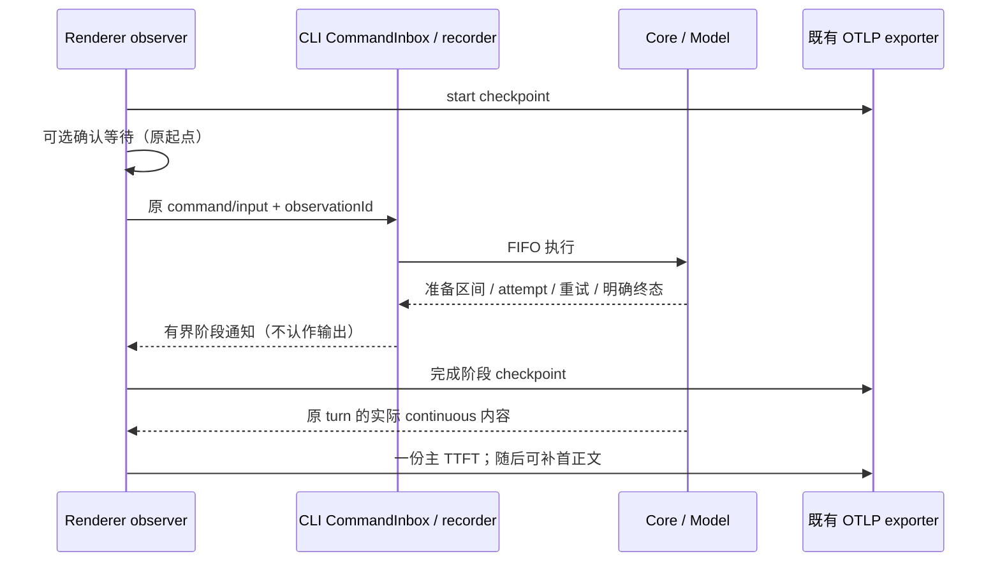

# 02 — Atribuição de estágios para envio em fila, retry e falhas

**O que construir:** na cadeia completa de observabilidade do envio normal, permitir que quem analisa performance explique mensagens realmente lentas: expandir as subfases de preparação da requisição, distinguir fila, retry, confirmação do usuário, cancelamento por falha e o efeito de primeiro plano versus segundo plano, verificar mensagens não fechadas e a qualidade dos dados, e realizar no ARMS a análise de percentis, proporção de resultados e waterfall desses cenários.

**Bloqueado por:** [01 — Métricas de estágio e waterfall do TTFT do envio local](01-local-send-stage-observability.md). Sua correlação estável, contrato de tempo, schema de exportação e receptor de teste OTLP final são pré-requisitos reais deste ticket; só começar depois do 01.

**Status:** in-progress

**Pai:** [Telemetria de TTFT por estágio para mensagens locais do desktop](../../monitoring/ttft-stage-telemetry.md)

## Critérios de aceitação

- [x] Dar continuidade ao contrato de observação e exportação do ticket 01, fazendo com que os cenários complexos também passem por envio real, ciclo de vida autoritativo da CLI, retorno de conteúdo e dados OTLP finais; não criar outro conjunto de filas, chave primária de correlação ou exporter paralelo para contornar as fronteiras existentes.
- [x] Expandir os hooks, o carregamento de contexto, a persistência, a compactação, a preparação de MCP/ferramentas e a montagem da requisição que realmente ocorrem antes da primeira saída, fornecendo distribuição de duração das subfases e detalhe em waterfall. Concorrência, repetição e subfases não executadas aparecem conforme a realidade; a soma das subfases não é tratada como tempo de relógio da fase principal.
- [x] Distinguir corretamente chamadas de modelo de preparação, como a compactação interna, das chamadas de modelo que geram a primeira resposta do usuário; quando preparação e retry se intercalam, manter a ordem real, sem registrar o primeiro conteúdo interno do modelo como primeira saída do usuário.
- [x] Depois que um envio enfileirado é promovido, reutilizar a correlação original do envio; edições na fila e a operação send-now não substituem a atribuição da entrada original. Apresentar separadamente o TTFT total incluindo a fila, a espera na fila e o tempo da início da execução até a primeira saída, permitindo estatística independente das mensagens ociosas e das enfileiradas.
- [x] A reconfirmação da fila continua usando o ponto de partida do primeiro envio, sem criar um registro de envio duplicado; a espera do usuário no diálogo é marcada separadamente, para que a análise de processamento puramente do sistema possa remover essa parte. A entrada imediata guiada registra o resultado do envio ou é classificada à parte, não preemptando a saída de outras entradas e não é misturada aos percentis de TTFT normal.
- [x] Quando há retry após falha do modelo, o attempt físico e a espera de retry são associados ao mesmo envio, e cada mudança de requestId não reinicia o ponto de partida principal. Múltiplos attempts produzem apenas um TTFT principal, e as requisições de ciclos posteriores de ferramentas não entram na estatística da primeira resposta do usuário.
- [x] Falha, rejeição, cancelamento ou interrupção explícitos antes da primeira saída registram o resultado, a duração já aguardada e as fases concluídas, com quantidade e proporção por tipo. Amostras sem primeira saída não entram na distribuição de duração bem-sucedida com 0 ou -1; falha após a primeira saída não inverte o TTFT principal.
- [x] Submeter de forma assíncrona checkpoints limitados no início do envio e na conclusão das fases, para que estágios já exportados continuem consultáveis mesmo quando o registro raiz ainda não foi fechado. Não depender do fim de todo o Span raiz para deixar o primeiro registro, nem enviar checkpoint por token.
- [x] Registros com apenas início ou fases parciais são exibidos como não fechados, podem ainda estar em execução ou ter sido interrompidos; sem evidência clara não podem ser julgados como falha ou timeout por exceder a janela de consulta. Um kill forçado do processo não promete perda zero nem fabricar fases ausentes.
- [x] Estados terminais e fases fora de ordem, transmissões duplicadas e fatos legítimos tardios são mesclados por identidade estável, sem gerar amostras de Metric duplicadas. Testes com múltiplas sessões, janelas, workspaces e instâncias de processo provam que não há vínculo errado com turnos antigos, outras entradas ou saídas de subtarefas.
- [x] Continuar coletando após ir para segundo plano, salvar as mudanças de estado necessárias durante o salvamento e distinguir com precisão foreground contínuo de retorno ao primeiro plano após passar por segundo plano; a consulta de experiência padrão usa apenas amostras continuamente em primeiro plano e com temporização confiável, e a consulta de diagnóstico pode ver todas.
- [x] Suspensão da máquina, pausa, salto de relógio ou erro de alinhamento entre processos acima do limite marcam a qualidade dos dados, sem fabricar duração negativa nem forçar ozeramento. Fases de um mesmo processo que continuam confiáveis podem ser mantidas separadamente, e amostras de processo cruzado não confiáveis não entram na distribuição precisa de estágios.
- [x] O waterfall consegue apresentar paralelismo, ausência, truncamento e intervalos não atribuídos; reconciliar com a união real dos intervalos e o tempo total, sem forçar a diferença para o modelo ou para a rede.
- [x] Estender as consultas e os dashboards do ticket 01, oferecendo visões de subfases de preparação, ocioso/fila, primeiro/segundo plano, resultado de retry, resultado sem primeira saída, não fechamento e classificação de qualidade. Os percentis mostram também a contagem de amostras, e a unidade estatística de observação acumulada, de estágios e de attempts fica explícita.
- [x] O detalhe de estágios limitado e as estatísticas da coorte de rollout gradual mantêm a coleta em escala total; primeiro e segundo plano e caminhos excepcionais não são descartados por configurações antigas de amostragem; verificar que a combinação de labels e o número de series são limitados, e que mensagem, Trace, workspace ou usuário não entram nas labels de métrica.
- [x] O E2E real de desktop cobre fila e promoção, reconfirmação, isolamento da entrada imediata guiada, primeira saída após retry, cancelamento por falha, atraso em subfases de preparação e retorno do segundo plano, validando a atribuição a partir dos dados OTLP finais; reutiliza o receptor do 01 e o replay de modelo, sem criar interfaces de negócio exclusivas de teste por camada.
- [x] Usar testes controlados de processo/integração de baixo nível ou testes controlados apropriados para cobrir saída, kill forçado, estado terminal ausente, duplicatas fora de ordem, intervalos paralelos e erro de alinhamento; distinguir evidência de execução real de resultado simulado, sem descrever sucesso de mock como verificação em máquina real.
- [x] Validar que o negócio continua e os recursos permanecem limitados sob timeout do exporter, fila cheia, descarte e truncamento; os cenários estendidos não alteram as contagens de negócio/RUM antigas nem afetam o comportamento de negócio da restauração remota, móvel ou replayable.
- [ ] Concluir uma coleta de evidência em execução real de desktop, alinhando envio, recebimento real de conteúdo, registros de estágio e exportação final, e medir latência de mensagem, carga da main thread, memória, volume de eventos e cardinalidade de labels. A validação central cobre macOS, Windows e Linux, e as validações de plataforma não concluídas ficam explicitamente como pendências.
- [x] Verificar no ARMS as consultas completas de percentis, a correlação de mensagens, a exibição do waterfall e a latência de visibilidade dos dados. Em 2026-09-15 a verificação do lado da API foi concluída: percentis de experiência padrão, P95 das subfases de preparação e `records`/`excluded`/`attempt`/`no_output.wait` estão todos consultáveis, com detalhe e agregação disponíveis já no fim da execução (limite superior <5s). A confirmação visual do waterfall na interface do console ainda não foi feita; ver a seção abaixo.
- [ ] Conferir as permissões, capacidade, custo e retenção reais no ARMS, com alvo de 7 dias para o detalhe e pelo menos 30 dias para as agregações; configurações existentes que já atendem ao objetivo são mantidas. Enquanto a verificação não for concluída, manter o item pendente e não expandir unilateralmente para uma liberação total a todos os usuários.
- [ ] Passar pelos E2E/testes unitários relevantes, verificação de tipos, lint e portões de arquitetura, completando as instruções de uso de estágios e consultas deste ticket. Comparar item a item com a matriz de aceitação do spec pai e deixar explícitos os resultados reais de teste local, validação de plataforma e condições de lançamento.

## Fronteira de conclusão

Com este ticket concluído, os dois tickets cobrem juntos o escopo de desktop local do spec pai. TTFT de desktop remoto, móvel/Web, estágios internos do serviço de modelo, tempo de renderização na tela e novas páginas de diagnóstico dentro do produto continuam fora de escopo; não existe lacuna de entrega que dependa de um terceiro ticket de “fiação” ou “teste”.

Se permissões de plataforma, política de retenção ou validação multiplataforma não puderem ser concluídas agora, este arquivo deve manter o critério de aceitação não marcado e o motivo específico. Não se pode equivale “código de implementação concluído” a “todas as condições de aceitação satisfeitas”.

## Contrato de implementação (2026-09-14)

O usuário autorizou seguir com base na implementação existente do 01; a aceitação de plataforma do 01 e as falhas preexistentes da CLI não são consideradas concluídas.

- O limite de teste segue os critérios de aceitação: Composer real → CLI → conteúdo real → OTLP final; testes controlados cobrem as interfaces públicas de recorder/observer/exporter. Executar apenas os testes unitários afetados.
- O Renderer é o único owner do relógio do clique, da espera de confirmação, do histórico de primeiro/segundo plano e do recebimento do primeiro conteúdo; o recorder da CLI apenas assina os fatos de execução da command/input original, sem manter fila de negócio. Edição na fila e send-now não substituem o ID de observação.
- Adicionar, sobre a cadeia V4 stdio/service já existente, notificações de estágio limitadas e de schema estrito, usadas apenas como checkpoint e que nunca disparam a primeira saída. A primeira saída real continua determinada pelos quadros de conteúdo continuous. remote identity e replayable não habilitam o TTFT local; o comportamento de owner/lease/queue não é modificado.
- O Core publica intervalos reais pela interface opcional de observação de preparação por entrada definida em contracts; sem assinantes, não cronometra. Preparação repetida/paralela usa stage ID próprio, a chamada interna de modelo é separada do attempt principal e a coleta de preparação para após a primeira saída.
- Raiz, fase principal, intervalo de preparação, attempt e mudança de primeiro/segundo plano usam identidades estáveis; checkpoints e fatos legítimos tardios podem completar a estatística de Trace/estágio, mas não podem duplicar o TTFT principal. Saída bem-sucedida antes do estado terminal não é invertida; sumiço desconhecido ou observação vencida apenas marca não fechado, nunca falha por timeout.
- A exportação permanece limitada e assíncrona; a conclusão de uma fase gera Trace/Metric de forma independente e pode ser consultada antes do fim da raiz. A união dos intervalos é usada para reconciliação de tempo, e ausência/sobreposição/truncamento/anomalia de relógio são marcados explicitamente.

Escrita/permissões/retenção/custo no ARMS, máquina real Windows/Linux e ampliação da gradual (rollout) têm aceitação mantida de forma independente e não podem ser substituídas por um receptor local aprovado.

## Implementação e verificação (2026-09-14)

A implementação local está concluída, mas o status permanece **in-progress**: a máquina real Windows/Linux do item 19, a aceitação de plataforma dos itens 20–21 e as falhas preexistentes da CLI do item 22 não satisfazem as condições completas de conclusão. A marcação dos 18 primeiros itens indica que o código local e a automação/contrato de dados correspondente estão concluídos, e não que a exibição na plataforma ARMS foi aceita.

- [Consultas/unidade estatística/contrato de recursos](../../monitoring/local-ttft-queries.md), [modelo de dashboard](../../monitoring/dashboards/local-ttft.json), [evidência real de saída e performance deste ciclo](../../monitoring/local-ttft-diagnostics-evidence.json).
- E2E real de desktop TTFT02 **6/6**: promoção da fila e retorno do segundo plano, cancelamento, primeira saída após retry de 503, falha 400, isolamento do guide, reconfirmação e send-now; atribuição real de Hook de 300ms, cerca de 409,6ms de espera do usuário do primeiro envio até o fim da confirmação, e o requestId raiz apontando para o attempt realmente bem-sucedido.
- OTLP final com **6 raízes bem-sucedidas/6 amostras totais de Histograma/36 amostras de fase principal** e 8 observações de attempts físicos antes da primeira saída; as 532 identidades de Span são todas únicas, o maior erro de alinhamento medido foi **3,379ms**, e as 6 raízes bem-sucedidas têm qualidade complete. As labels de métrica não têm mensagem, workspace, usuário ou ID de correlação de requisição.
- Regressão de compatibilidade do 01 em desktop real **3/3**: texto/pensamento/ferramenta chegando primeiro, início vazio, primeira saída antes do ACK, texto tardio e reconciliação das seis fases — todas passaram. Os dois conjuntos de casos continuam em manual-review/pending e não foram promovidos por conta própria para a suíte oficial/Docker.
- Testes unitários afetados no nível raiz: primeiros 19 arquivos com 393 casos passando; depois apenas os observer/transport/exporter relacionados e as novas fronteiras foram reexecutados, não a suíte completa. O escopo direcional final inclui isolamento de exceção na saída original, unavailable entre workspaces, identidade do attempt mais recente, isolamento do primeiro vínculo de sessão, isolamento multi-janela/instância de CLI e qualidade completa tardia.
- Escopo afetado da CLI na primeira execução: 7 arquivos, 122 casos passando e 1 falha. A única falha foi “Core admission ACK não espera TurnStarted projection; retry/file rewind antigo só stale” em `v4-gateway.test.ts`: esperado `stale/proto.staleRevision`, real `failed/fault.command.executionFailed`. Foi reproduzido o resultado exatamente igual carregando em isolamento, no mesmo ambiente, o gateway, o recorder e o código de teste do commit inicial `a77a09bb3e`; o arquivo original não foi sobrescrito e os arquivos temporários foram limpos. Não se afirma que a CLI passa inteira, nem se altera esse teste de negócio preexistente neste ticket.
- Integração de processo controlada em macOS passou: SIGSTOP real de cerca de 5,2s seguido de SIGCONT gerou clockInvalid; após SIGKILL nenhum terminal foi fabricado. A verificação de baixo nível confirma que a truncagem da preparação limitada ainda preserva a saída principal, que duplicatas fora de ordem, união de intervalos paralelos, deriva de relógio e observação vencida apenas marcam unclosed; é um teste controlado, não uma suspensão real da máquina nem a recuperação completa de falha do desktop.
- Teste de saída controlada final do OTLP: um receptor de Trace que não responde por 5s disparou o timeout de 3s; 100 enqueues síncronos não aguardaram a rede, e fila cheia/timeout com descarte são consultáveis; checkpoints de preparação ficaram visíveis antes do fim da raiz; raízes e fases duplicadas não aumentam as amostras; intervalos sobrepostos e intervalos abertos reconciliam corretamente.
- Typecheck raiz, typecheck do Desktop E2E, tsc do Bootstrap, lint, portões de arquitetura e a verificação de fixture deste case passaram. Os warnings preexistentes do lint foram mantidos em separado e não contados como erros novos; nenhuma violação de arquitetura nova.

### Coleta de evidência de execução e condições restantes de lançamento

Execução de evidência: `desktop-e2e-20260914084007773-p85037-a1acc63987c6fc6e`. Os 6 TTFT bem-sucedidos ficaram entre cerca de 1,7–14,9s, incluindo espera sintética explícita de modelo e espera em segundo plano/fila, e não podem ser tomados como latência de modelo em produção. Durante os testes o Renderer registrou 5 tarefas longas, somando 513ms; a amostragem de CPU do Browser do Electron teve máximo de cerca de 0,99% e working set máximo de 193344KiB, e a Tab teve máximo de cerca de 4,05% e 302128KiB. O JS heap quantizado do Chromium ficou em cerca de 97,4MB. Não foi feito um controle A/B de desligar/ligar, e portanto esses valores de execução não podem ser declarados como overhead líquido da telemetria nem como prova de ausência de vazamento de memória.

Uma nova consulta somente-leitura no ARMS para a última hora deu 0 para o novo service; o logstore existente é consultável, o que não equivale a ter permissão de escrita, de configuração de dashboard, de capacidade/custo ou de gestão de política de retenção. Nesta rodada não se obteve a configuração de escrita OTLP do alvo de produção e não se validaram P50/P95 completos, waterfall de mensagem individual, latência de visibilidade, retenção de detalhe por 7 dias e de agregação por 30 dias. Mantém-se a chave atual de rollout gradual desligada por padrão, sem ampliar o público. A máquina real Windows/Linux, o E2E completo de controle remoto do celular e a validação de plataforma ficam explicitamente como pendências.

### Aceitação de plataforma (2026-09-15)

O trecho anterior "novo service = 0" foi substituído. Depois que os valores de integração foram lidos das variáveis de CI `ZCODE_PACKAGED_AGENT_OTEL_ENDPOINT`/`_HEADERS`, os casos de diagnóstico deste ticket (`conversation-session-ttft-diagnostics`, 6/6 passando) e as amostras dos casos de estágios do 01 totalizaram 12 envios gravados no ARMS de Pequim e became consultáveis.

- Todo o recorte de diagnóstico foi implantado: `records` completo por kind (start 16 / first_output 12 / first_text 12 / excluded 4 / checkpoint 442); `excluded` distingue cancelled 2 / failed 1 / guided 1; `attempt` distingue por role+outcome response/failed 2 e response/first_output 12, e o TTFT principal não foi ampliado pelo retry; `no_output.wait` registra cancelled 2 / failed 1.
- Os intervalos de preparação e de espera estão completos: context, hooks, persistence, mcp, tools, request_assembly, user_confirmation e retry_wait têm amostras e P95.
- O filtro de experiência padrão (`quality="complete",visibility="foreground"`) retorna 4 mensagens idle e 1 enfileirada; a distribuição `quality × visibility` mostra foreground 5 / background_returned 6 / background 1, e as amostras de segundo plano não se misturaram à visão padrão.
- As labels são controladas e de baixa cardinalidade, sem ID de correlação vazando para labels de métrica; nesta rodada não foi observada nenhuma série `dropped`.
- Ainda não concluído: confirmação visual do waterfall na interface do console, caminho de escrita injetado na compilação do pacote empacotado, verificação de capacidade/custo/retenção, máquina real Windows/Linux e ampliação da gradual (rollout). A chave de rollout gradual permanece desligada por padrão.

Detalhes em [lista de lançamento](../../monitoring/local-ttft-rollout-checklist.md) e [evidência de aceitação de plataforma](../../monitoring/local-ttft-platform-evidence.json).

### Standards

A primeira revisão encontrou arquivos da CLI acima de 400 linhas e o risco de desempenho de varrer linhas de publicação mesmo sem TTFT. Já foram separados por responsabilidade os fatos de compactação, a amostragem de relógio e a projeção Span/estágio; antes de ler o snapshot completo, verifica-se primeiro se aquela sessão possui observação. A reverificação não encontrou achados em aberto. Não se escreveu uma avaliação estática de desempenho como se fosse um retrocesso já medido.

### Spec

A primeira revisão encontrou que uma saída explícita da CLI não era fechada por workspace e que congelar a qualidade missing na primeira saída bloqueava a estatística de fases tardias. Depois de adicionar o ciclo red→green e a regressão de integração de transport, isso foi corrigido. Em seguida foram complementados a atualização do requestId da revision mais recente, o isolamento do primeiro vínculo de sessão do rascunho e o fato de que uma interrupção após o primeiro pensamento fecha apenas a observação do texto; a reverificação passou. O resultado e o ponto de partida da raiz não são invertidos nem duplicados.

### Trilha de investigação

- Depois que o checkpoint de prepping vinculou a sessão mais cedo, a lógica antiga misinterpretou o snapshot initial normal como recovery; o resultado de recovery do OTLP final ajudou a localizar, e initial e recovery passaram a ser distinguished conforme o protocolo.
- O callback de Electron reaproveitado nos testes desestruturava o primeiro parâmetro formal, mas o wdio-electron-service remove o primeiro formal, fazendo com que a operação de janela fosse silenciosamente ignorada; passou-se a ler electron dentro do corpo da função, e a regressão final verifica o foco real e minimizar/restaurar.
- A parada pode ocorrer antes da requisição ao provider; uma fixture de PAUSE não consumida chegou a casar antes com o user content do CONFIRM que seria combinado em seguida. Com base no network capture final, corrigiu-se a condição de exclusão local do case e deu-se à geração do título em segundo plano uma fixture comum independente, evitando que re-tentativas de Missing Fixture não relacionadas poluíssem a observação de performance. Não se alterou a lógica de envio de negócio para acomodar o replay.

Revisão de arquitetura: os módulos alterados são `ui / shared / services / desktop / zcode-cli`, o Renderer é exclusivo do clique/visibilidade/ponto final do conteúdo, o recorder da CLI é exclusivo dos fatos de execução, e a Main faz apenas a exportação limitada. A ordem dos estados segue o diagrama de sequência deste arquivo, sem novo owner nem fila aceita. Antes do commit, a checagem de arquitetura teve baseline=0 e new=0; o código de produção ganhou 1269 linhas, removeu 299 e teve net de +970 linhas (sem testes, dashboards e evidências).