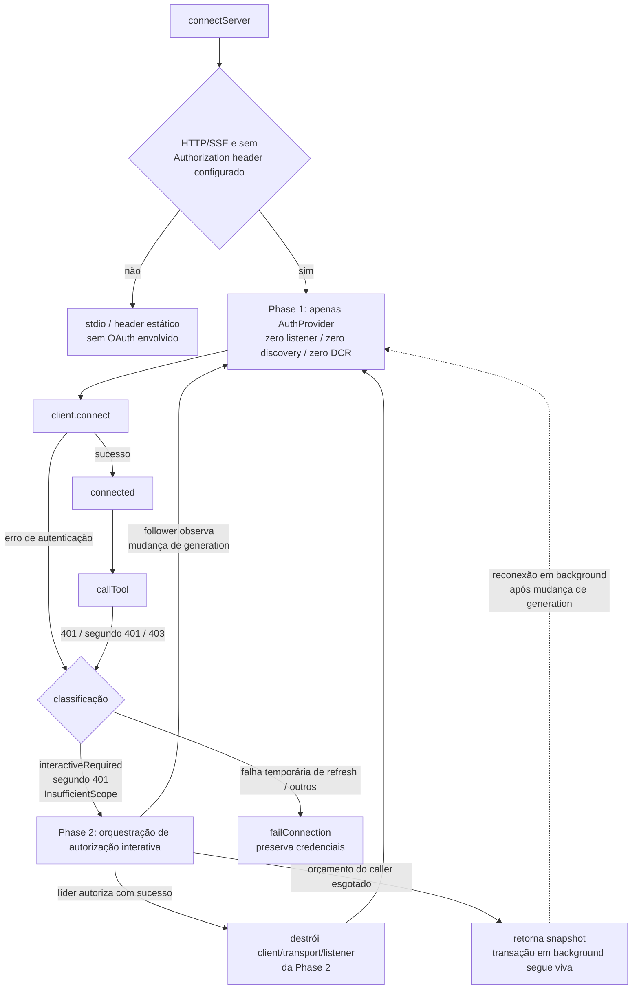
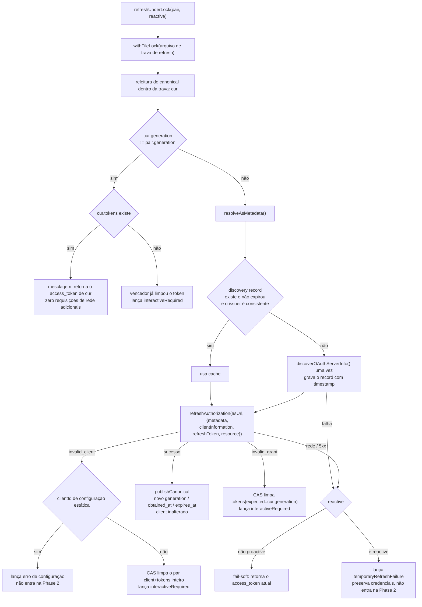
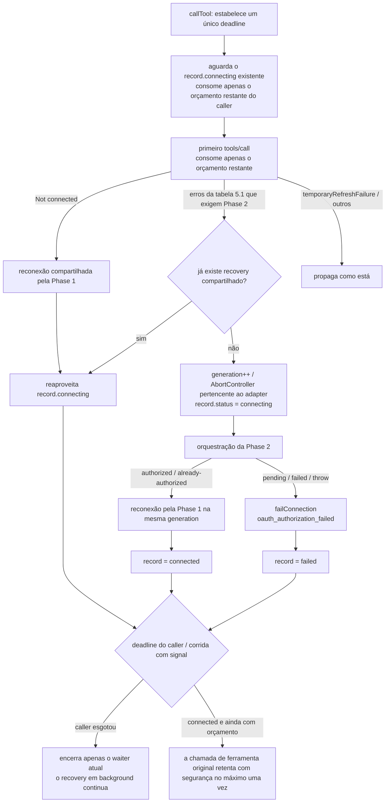

# Especificação de Conexão OAuth MCP em Duas Fases (v4)

> Status: design final, implementado em PR1-PR3.
> Data: 2026-08-14.
> Revisão: 2026-08-24, complementando o orçamento do tool caller em tempo de execução, a propriedade compartilhada da recuperação e a convergência de exceções.
> Baseline: `exa-oauth-analysis` / `bfc91c54a9`.
> SDK de produção: `@modelcontextprotocol/client@2.0.0` (`apps/zcode-cli/packages/adapters/package.json:105`).
> O repositório também contém `@modelcontextprotocol/sdk@1.29.0`; esta especificação e a implementação usam apenas `client@2.0.0`.
> Análise de causa raiz: `docs/analysis/exa-oauth-reauth-analysis.md`.
> Especificação prévia: `docs/mcp-oauth-client-auth.md` (configuração, integridade de credenciais, limites da página de configurações).

## 1. Problema e objetivos

### 1.1 Duas causas raiz já decididas

| Causa raiz                | Mecanismo                                                                                                                                                                                                                                                                         | Evidência de campo                                                                             |
| ------------------------- | ----------------------------------------------------------------------------------------------------------------------------------------------------------------------------------------------------------------------------------------------------------------------------------- | --------------------------------------------------------------------------------------------- |
| **R1 corrida no refresh** | Múltiplos processos CLI compartilham `~/.zcode/v2/credentials.json`. O `withFileLock` cobre apenas leitura/escrita de credenciais, não a troca de token de rede. Quando o access token expira, cada processo renova concurrentemente usando o mesmo refresh token, aciona a detecção de reuso por rotação do servidor de autorização e todo o token family é revogado; o SDK então invalida os tokens, degradando para reautorização          | Conexão bem-sucedida às 8-12 `08:54:49Z`, `09:00:13Z` já entrava na autorização interativa |
| **R2 laço de reautorização** | O client registrado por DCR fixa `redirect_uris` na porta aleatória de callback no momento do registro; o servidor de callback troca de porta a cada `listen(0)`. Em caso de divergência do redirect_uri o servidor de autorização, por RFC 6749 §4.1.2.1, proíbe o retorno e renderiza uma página de erro no local; o callback nunca chega, a retentativa nunca se auto-cura                                          | Porta de registro do client `54735`, autorizações seguintes usam `58670`/`58676`/`61820`    |

Fator de amplificação de R2: o lease da página de configurações e o lease da sessão criam transações OAuth independentes, gerando múltiplos clients, múltiplos states e múltiplas URLs de autorização; o orçamento de 15 segundos do início da sessão foi implementado incorretamente como "a transação de autorização só pode viver 15 segundos".

### 1.2 Princípios de design

1. Conexão passiva: zero listener, zero discovery, zero DCR.
2. Somente autorização interativa cria listener; single-flight entre processos; transação de client DCR mantida em memória.
3. Todos os refreshs (proativos e reativos) convergem para uma única trava de arquivo entre processos.
4. Erros OAuth determinísticos invalidam por CAS de generation; apenas erros não determinísticos usam fail-soft.
5. O orçamento de espera do caller é separado da duração da transação de autorização: 15 segundos é o orçamento de espera do caller, a duração global da transação de autorização é de 300 segundos.
6. Tempo de execução (`callTool`) e período de conexão usam o mesmo conjunto de orquestração Phase 2 → Phase 1; não é permitido auto-cura apenas no caminho de startup.
7. A recuperação compartilhada é mantida pelo ciclo de vida do adapter/sessão; o timeout ou cancelamento de qualquer tool caller só pode encerrar o próprio waiter,
   não cancelar a autorização compartilhada. A Promise de recuperação deve ser uma operação total, convergindo o record para connected ou failed.

### 1.3 Defeito atual: conexão passiva também abre listener

`resolveAuthorizationCodeOAuthConfig()` retorna `{ type: "authorization_code" }` para qualquer MCP HTTP/SSE sem header `Authorization` (`mcp/index.ts:1012-1025`). Em seguida `createTransport()` cria incondicionalmente uma sessão OAuth, e `createMcpAuthorizationCodeOAuthSession()` já executa `listen(0)` antes de retornar (`mcp/oauth.ts:67-80`, `auth/localhost-callback.ts:69-83`).

Resultado: **todo MCP HTTP ocupa um HTTP listener em porta aleatória a cada conexão, mesmo que as credenciais estejam completamente válidas e nenhuma autorização seja necessária.**
Isso é tanto a origem das portas de R2 quanto o problema de recursos que a Phase 1 precisa resolver primeiro.

## 2. Arquitetura geral



Limites rígidos entre as duas fases:

- O provider da Phase 1 tem **somente** `token()` e `onUnauthorized()`. Ele não é um `OAuthClientProvider`, portanto `_oauthProvider` do transport permanece vazio (branch `isOAuthClientProvider` em `client/dist/index.mjs:4977-4980`), e `auth()` / discovery / DCR do SDK não participam de forma alguma.
- A Phase 2 **não cria nenhum transport MCP**. Ela chama diretamente a função `auth(provider, options)` exportada pelo SDK para conduzir discovery → DCR → authorize → code exchange. Portanto o risco de "o transport autenticado da Phase 2 sobreviver até o tempo de execução com `_oauthProvider` e, em um 401, seguir `handleOAuthUnauthorized()` → `auth()` do SDK contornando a trava de refresh" (`index.mjs:245-276`) não existe estruturalmente: não há transport que possa sobrar por engano. Após a autorização bem-sucedida, o chamador reconecta diretamente usando o AuthProvider puro da Phase 1.
- O transport usado para sondagem na Phase 1 é sempre fechado antes da entrada na Phase 2: quando a negociação falha, o SDK já executou `transport.close()` (`index.mjs:3283-3287`); um transport consumido não pode ser reutilizado.

## 3. Phase 1: AuthProvider puro em tempo de execução

### 3.1 Forma do provider

```ts
{
  async token() {
    const pair = await loadCanonical();
    if (!pair?.tokens) return undefined;                 // → 401 → onUnauthorized
    if (!isNearExpiry(pair)) return pair.tokens.access_token;
    return await refreshUnderLock(pair, { reactive: false });
  },
  async onUnauthorized() {                               // nova tentativa automática pelo transport depois
    const pair = await loadCanonical();
    if (!pair?.tokens?.refresh_token) throw interactiveRequired();
    await refreshUnderLock(pair, { reactive: true });
  },
}
```

Contrato do SDK (`index.d.mts:186-201`): `onUnauthorized()` retorna `Promise<void>`, e o valor de retorno é ignorado; sua responsabilidade é "fazer com que a próxima chamada a `token()` retorne um token utilizável". Portanto `refreshUnderLock` precisa publicar o resultado no canonical e fazer com que a próxima leitura do provider contorne o cache.

Semântica do assento de 401 (`index.mjs:4848-4866`, `5103-5120`, `5340-5358`):

- `onUnauthorized` é chamado no máximo uma vez por requisição (`!isAuthRetry`).
- O erro que ele lança se propaga como está através de `markAuthSeamEscape()`, preservando a identidade.
- Se a nova tentativa ainda resultar em 401, lança `SdkHttpError(SdkErrorCode.ClientHttpAuthentication, "Server returned 401 after re-authentication")`.

### 3.2 Estrutura de credenciais canonical

```ts
interface McpOAuthCanonicalCredentials {
  client_information: OAuthClientInformationMixed;
  expires_at?: number; // novo: epoch ms, derivado de obtained_at + expires_in
  generation?: string; // novo: id aleatório de 128 bits, único por publicação
  issuer?: string; // novo: apenas armazenado, não participa da chave por keyPrefix nesta rodada
  obtained_at?: number; // novo: epoch ms
  published_by: string; // mantido: id de transação, apenas para diagnóstico
  tokens: OAuthTokens;
  version: 1 | 2; // sem bump
}
```

**Todos os campos novos são opcionais e não há bump de version.** Acrescentar campos opcionais é retrocompatível com leitores antigos (basta ignorar campos desconhecidos); por outro lado, bumpar a version faria com que CLIs/desktops não atualizados passassem a ignorar inteiramente os novos registros como versão desconhecida, voltando ao espelho legacy e perdendo a garantia do par canonical — e "versão desconhecida deve preservar o valor original" é justamente uma restrição existente.

`generation` deve ser um id aleatório que muda a cada publicação e **não pode reutilizar `published_by`**: `published_by` é um id de transação derivado do state, e múltiplos refreshs da mesma transação não o alteram (`oauth.ts:223-228`), portanto ele não pode assumir o papel de CAS nem de observação pelo follower. Um id aleatório também elimina o ABA. Durante a migração, registros antigos (sem `generation`) usam como generation baseline o hash estável do JSON original do canonical.

`OAuthTokens` tem apenas `expires_in`, sem horário de obtenção, então `obtained_at` precisa ser registrado por nós; caso contrário o ponto real de expiração não pode ser calculado entre processos. A verificação de nearing expiration mantém o skew de 30 segundos.

### 3.3 refreshUnderLock



Restrições-chave:

- **O arquivo de trava é independente do arquivo de credenciais.** Dentro da trava é chamado `publishCanonical()`, que por sua vez usa `withFileLock(credentials.json)`. Travas de caminhos diferentes não geram deadlock por reentrância.
- **O basename do arquivo de trava contém apenas hash e hifens.** `keyPrefix` tem a forma `mcp:oauth:<hash>`, e dois-pontos são ilegais em nomes de arquivo no Windows; deve ser transcrito como `mcp-oauth-<hash>.refresh`, no mesmo diretório das credenciais.
- **O orçamento de aquisição da trava deve cobrir o orçamento de rede.** O `lockMaxWaitMs` padrão de `withFileLock` é 8 segundos (`privateFilePersistence.ts:9`), enquanto as duas requisições de rede (discovery + refresh) podem exceder 8 segundos; portanto passamos explicitamente 45 segundos. Após o timeout do waiter, **primeiro relemos o canonical**: se houve troca de geração e há token, usamos diretamente; caso contrário reportamos `temporaryRefreshFailure` (falha ao obter a trava não é invalidação de grant).
- **O limite fail-soft distingue proactive/reactive.** Em proactive (caminho de expiração iminente em `token()`), a falha de rede pode retornar o valor atual: o token ainda não foi rejeitado pelo servidor de recursos. Em reactive (`onUnauthorized()`), a falha de rede **não** pode retornar o valor atual, pois esse token acabou de ser rejeitado; retorná-lo necessariamente produziria um segundo 401 e lançaria `ClientHttpAuthentication`, além de interpretar erroneamente uma falha temporária do AS como necessidade de autorização interativa. A falha de rede reativa lança um `temporaryRefreshFailure` independente, e a camada de orquestração preserva as credenciais e não entra na Phase 2.
- **Mudança de generation sem token do vencedor não é sucesso.** Não se pode retornar `undefined` como se fosse "sem credenciais"; é preciso fazer join / entrar na Phase 2.
- **Não se inventa refresh quando não há refresh token.** `token()` retorna diretamente o access token existente até o 401, e `onUnauthorized()` unicamente passa a exigir autorização interativa.

### 3.4 resolveAsMetadata

Retorna uma tripla; Phase 1 e Phase 2 compartilham o mesmo discovery record:

```ts
interface ResolvedAsMetadata {
  authorizationServerUrl: string;
  metadata?: AuthorizationServerMetadata;
  resource?: URL; // validado por selectResourceURL
}
```

- O discovery record tem `fetched_at`, com TTL de 24 horas; ao expirar ou quando o `issuer` diverge do `issuer` do canonical, uma nova descoberta é feita. **O timestamp fica em uma chave separada (`discovery_state_fetched_at`) e não envolve o próprio `discovery_state`**: a forma do valor deste último deve continuar sendo um `OAuthDiscoveryState` puro; mudar para uma estrutura embrulhada `{fetched_at, state}` faria com que leitores não atualizados lessem um objeto sem `authorizationServerUrl` e perdessem silenciosamente o cache de discovery. A ausência de timestamp é tratada como expiração, e uma nova descoberta se auto-cura.
- O `resource` precisa ser resolvido e passado a `refreshAuthorization()` (RFC 8707). O refresh do próprio SDK passa o resource validado (`index.mjs:690-697`); como contornamos `auth()`, precisamos fornecer por conta própria, caso contrário a vinculação ao audiência se perde.
- O `discoveryState()` do provider interativo da Phase 2 lê o mesmo record, evitando que a Phase 1 tenha atualizado o metadata e a Phase 2 ainda use um cache antigo sem TTL (o estado atual `oauth.ts:288-294` retorna o cache diretamente, sem TTL).
- A Phase 2 também mantém uma cópia em memória dentro da transação: a SEP-2352 exige que a perna de code exchange consiga reler o issuer registrado na perna de authorize, caso contrário o SDK lança `AuthorizationServerMismatchError` (`index.mjs:682-687`). O record compartilhado pode ser reescrito por outro processo ou estar simplesmente expirado; a cópia em memória garante que a vinculação de issuer dentro da mesma transação seja estável.

### 3.5 Invalidação de credenciais deve ser uma transação condicional por generation

O `deleteIfValues()` existente compara chave a chave e apaga chave a chave (`shared-credentials.ts:104-121`): quando o canonical não casa, o espelho legacy ainda pode ser apagado, e vice-versa, o que não permite expressar "só invalida o conjunto inteiro se o canonical casar".

Por isso adicionamos uma transação condicional ao store de credenciais compartilhado:

```ts
deleteManyIfValue(
  guardKey: string,
  expectedGuardValue: string,
  keysToDelete: readonly string[],
): Promise<boolean>;
```

Semântica: dentro de uma única região crítica de RMW do arquivo de credenciais, todas as `keysToDelete` só são apagadas se o valor atual de `guardKey` for igual a `expectedGuardValue`; caso contrário nenhuma é apagada e `false` é retornado. A chamada do lado OAuth usa a chave canonical como `guardKey` e o **JSON original do canonical lido pelo solicitante** como valor esperado (o valor original é o portador da generation, sendo mais estrito do que comparar apenas o campo generation), com o seguinte conjunto de remoção:

- `invalid_grant` → canonical + tokens legacy (preservando o client legacy como semente para reautorização);
- `invalid_client` → canonical + tokens legacy + client legacy (descartar o par inteiro).

Assim, uma transação obsoleta nunca pode apagar o canonical do vencedor nem qualquer metade espelhada dele.

### 3.6 As regras de compatibilidade devem ter uma única implementação

Os ramos de compatibilidade entre o canonical e o espelho legacy (qual mudança pode ser provada como pertencente à mesma autorização) são extraídos para a função pura `deriveCredentialPair({canonicalRaw, legacyClientRaw, legacyTokensRaw})`; `loadCredentialPair()` é o wrapper "ler uma vez + derivar".

O provider antigo `authorization_code` que permanece também delega à mesma função pura, derivando a partir do próprio snapshot que já leu: escrever essa lógica duas vezes inevitavelmente a faria divergir, e reler o arquivo de credenciais duplicaria o I/O de cada leitura do provider. Esse provider não é mais usado em tempo de execução e permanece apenas como superfície de teste das regras de compatibilidade, sendo removido junto com a janela do espelho legacy.

## 4. Phase 2: orquestração da autorização interativa

### 4.1 Sequência

```mermaid
sequenceDiagram
    participant S as Lease da sessão
    participant T as Lease das configurações
    participant L as Lease de autorização
    participant C as Credenciais canonical
    participant B as Navegador / AS

    S->>C: lê a generation baseline G0
    S->>L: tryAcquire(attemptId=A)
    L-->>S: adquiriu → líder
    T->>C: lê a generation baseline G0
    T->>L: tryAcquire(attemptId=B)
    L-->>T: não adquiriu → follower

    S->>C: releitura dentro da trava; continua só se generation ainda for G0
    S->>S: listen(0) cria o listener
    S->>B: DCR novo (redirect_uri = listener vivo atual)
    B-->>S: novo client_id (escrito só na memória da transação)
    S->>C: publica pending{attemptId=A, url, state, G0, expiresAt}
    T->>C: lê pending(A) → projeta a mesma URL de autorização no próprio estado
    S->>B: abre a URL de autorização (disparado pelo usuário)
    B-->>S: callback code (validação de state)
    S->>B: finishAuth → token exchange
    B-->>S: tokens
    S->>C: publicação com fencing do canonical generation=G1
    S->>C: CAS delete pending(A)
    S->>L: libera o lease
    S->>S: destrói client/transport/listener da Phase 2 → reconexão pela Phase 1
    T->>C: polling detecta generation G1 != G0 e há token
    T->>T: reconexão pela Phase 1
```

### 4.2 Contrato líder / follower

```text
G0 = generation canonical atual (baseline)
tryAcquire(lease de autorização, attemptId)
 ├─ não adquiriu → follower
 │    lê pending: attemptId válido e não expirado → exibe a mesma URL de autorização
 │    faz polling do canonical: generation != G0 e tokens existem → volta à reconexão da Phase 1
 │    orçamento do caller (sessão 15s / configurações 300s) esgotado → reporta "a autorização está em andamento em outro lugar" e retorna o snapshot
 │                                                  a tarefa compartilhada em background continua observando e não termina o líder
 └─ adquiriu → líder
      releitura dentro da trava: generation != G0 (outro já concluiu durante a espera) → libera a trava e encerra, volta à Phase 1
      listen(0) em porta aleatória (abandona o reuso de porta: o listener vive por muito tempo durante a conexão, e o reuso necessariamente colide)
      OAuthClientProvider interativo (state novo, scope = unionScope calculado pela camada de orquestração)
        clientInformation()      clientId de configuração estática → retorna; caso contrário undefined
                                 → o SDK necessariamente refaz o DCR com a URL do listener vivo atual
                                 → a divergência de redirect_uri é eliminada na raiz
        saveClientInformation()  escreve só na memória da transação, não em disco
        tokens()                 undefined (não dispara refresh)
        saveTokens()             publica atomicamente canonical + espelho legacy com saveMany dentro da trava
        discoveryState()         lê o discovery record compartilhado (com TTL)
      publica pending{attemptId, authorizationUrl, state, baselineGeneration, expiresAt}
      aguarda o callback até o TTL global de 300s
      ao desistir, o AbortController realmente cancela listener / fetch / finishAuth
      finally: aguarda todas as promises in-flight assentarem → CAS delete pending → libera a trava
               → fecha o listener → destrói o transport → volta à reconexão da Phase 1
```

### 4.3 Por que uma trava de autorização dedicada em vez de um marker

O `maxWaitMs` do `withFileLock` limita apenas a aquisição, não a posse (`privateFilePersistence.ts:51-75`); a trava de um PID vivo não é recuperada como stale (`atomicFileLock.ts:69-87`); o commit `67666ea256` corrigiu o cleanup incorreto após timeout do waiter, o que não tem relação com|longa posse da trava. **A própria trava é o fencing**: quando um líder atrasado libera a trava, sua tentativa já perdeu o direito de publicar.

### 4.4 tryAcquire precisa ser uma implementação dedicada

Não se pode usar diretamente `withFileLock(..., { lockMaxWaitMs: 0 })`, por dois motivos independentes:

1. **Deadlock não recuperável.** `acquireFileLock`, em caso de competição, verifica primeiro `elapsed >= maxWaitMs` e só depois tenta recuperar um lock abandonado (`atomicFileLock.ts:238-253`). Com espera zero ele dá timeout imediatamente e nunca executa a verificação de owner morto; após o travamento do processo que detém a trava, a autorização ficaria permanentemente indisponível. Por isso tryAcquire usa um orçamento **curto mas não nulo** (250 ms, com intervalo de retentativa de 25 ms), garantindo ao menos uma execução da verificação de recuperação de owner morto antes de falhar, e ao mesmo tempo limitando a latência adicional do follower a uma faixa imperceptível no fluxo humano.
2. **A FIFO in-processo do `withFileLock` bloquearia o follower.** Ela faz fila por filePath (`privateFilePersistence.ts:58-64`), e a fila ocorre antes da aquisição da trava, então um segundo caller do mesmo processo esperaria até o primeiro liberar (até 300 segundos) em vez de se tornar follower imediatamente. Por isso tryAcquire chama `acquireFileLock` diretamente, contornando essa fila.

**Não é necessário um registro in-processo adicional.** A exclusão mútua é fornecida por `mkdir`, uma semântica de sistema de arquivos independente de processo: um segundo caller do mesmo processo também recebe `EEXIST` e, em seguida, lê um owner PID que é o próprio processo e está vivo, portanto não há recuperação indevida e a degradação correta para follower acontece. O basename do caminho da trava também contém apenas hash e hifens (`mcp-oauth-<hash>.authz`).

### 4.5 A chave pending deve estar vinculada à tentativa

O pending contém no mínimo `attemptId`, `baselineGeneration`, `authorizationUrl`, `state` e `expiresAt`. A remoção precisa ser um CAS por `attemptId`; caso contrário o `finally` de um líder antigo apagaria o pending recém-publicado pelo novo líder, e o follower perderia imediatamente a URL de autorização. O TTL serve apenas para decidir expiração na exibição e **não pode** servir como base de propriedade da trava.

### 4.6 O cancelamento precisa aguardar o assentamento das promises in-flight

Entrar no `finally` e liberar a trava logo após `AbortController.abort()` não é suficiente: a resposta de token pode já ter retornado, e o code exchange / `saveTokens()` da transação antiga ainda está em andamento. A promise de callback existente não aceita signal, e fechar o listener também não a rejeita (`localhost-callback.ts:24-30`, `83-90`); o `withTimeout` existente apenas ignora resultados atrasados e não cancela a operação subjacente (`mcp/timeout.ts:1-53`), portanto não pode assumir a responsabilidade de cancelamento.

**A implementação é estrutural, e não consiste em adicionar um rastreador de in-flight: somente o trecho "esperar o usuário autorizar" tem timeout; o code exchange é sempre `await` até assentar, sem competir com o timeout.**

```text
auth(provider, {...})                     ← sem timeout (construção da URL + DCR, rede local/acotada)
withTimeout(waitForCallback(), 300s)      ← o único ponto de timeout: esperar o usuário
auth(provider, {authorizationCode})       ← sem timeout, await até assentar
finally: fecha o listener → CAS delete pending → libera a trava
```

O timeout só pode ocorrer no momento em que o code ainda não foi obtido, quando o token exchange nem começou; não existe requisição in-flight capaz de publicar após a liberação da trava, e o fencing se fecha de forma natural. O custo é: quando o callback chega em 299,9 s e o exchange leva 5 s, a trava permanece retida ligeiramente além dos 300 s — isso é mais correto do que descartar um code válido.

### 4.7 A implantação independente do PR2 exige uma seam de transição

Na implantação do PR2 a Phase 1 ainda é o provider completo atual, e o provider atual já faz `listen(0)` antes da criação do transport e permite que o SDK siga sozinho o DCR / redirect (`oauth.ts:67-103`); o adapter só verifica `hasPendingAuthorization()` depois de uma falha (`index.ts:570-599`). Sem a seam, o PR2 implantado sozinho ainda abriria uma URL de autorização com "client antigo + novo redirect_uri", e R2 não seria corrigido.

Contrato da seam (dois pontos, ambos obrigatórios):

1. `redirectToAuthorization()` **não** projeta mais a URL de autorização como estado pending nem abre o navegador; em vez disso lança `interactiveRequired()`, e a camada de orquestração transiciona para a nova transação da Phase 2.
2. `clientInformation()`, quando não há clientId de configuração estática nem client armazenado, também lança `interactiveRequired(reason: "no_credentials")`, **em vez de retornar `undefined`**. Retornar `undefined` faria o SDK executar imediatamente um registro dinâmico próprio, mas a titularidade do DCR já foi transferida por completo para a Phase 2; esse registro nunca seria usado e só deixaria clients lixo no servidor de autorização. Sem client não há refresh token, portanto só a autorização interativa é possível — lançar diretamente é o correto.

Na fase do PR2 o provider antigo mantém apenas a semântica `token()` / refresh, e a única saída para autorização interativa é a Phase 2.

## 5. Classificação de erros e recuperação em tempo de execução

### 5.1 Tabela de classificação de erros de autenticação

| Erro                                                                            | Origem                                              | Ação da camada de orquestração                                                       |
| ------------------------------------------------------------------------------- | --------------------------------------------------- | -------------------------------------------------------------------------------------- |
| `interactiveRequired` (nosso code estável + marca `Symbol.for`)                   | Provider da Phase 1                                 | Entra na Phase 2                                                                       |
| `SdkHttpError{code: ClientHttpAuthentication}`                                  | Ainda 401 após nova tentativa (`index.mjs:4862`, `5117`, `5354`) | Entra na Phase 2                                                    |
| `UnauthorizedError`                                                             | Caminho defensivo sem `onUnauthorized`              | Entra na Phase 2                                                                       |
| `InsufficientScopeError{requiredScope}`                                         | 403 em Streamable HTTP (`index.mjs:5010`)           | Calcula o unionScope e depois entra na Phase 2                                        |
| `temporaryRefreshFailure`                                                       | Rede / 5xx no refresh reativo                       | Preserva credenciais, failConnection, **não** entra na Phase 2                        |
| `invalid_client` com clientId estático                                          | Refresh da Phase 1                                  | Reporta erro de configuração, **não** entra na Phase 2 (a Phase 2 reutilizaria o mesmo client estático, gerando ciclo) |

`interactiveRequired` é identificado por code estável + marca `Symbol.for`, sem depender de `instanceof`, para resistir a carregamento duplicado de bundle. O `markAuthSeamEscape()` do SDK preserva a identidade (`index.mjs:2270-2277`) e não substitui o objeto de erro. A camada de orquestração precisa completar a classificação **antes** de `failConnection()` (perto de `index.ts:570`).

### 5.2 Fórmula de unionScope do 403

O algoritmo do próprio SDK é a união de três itens (`index.mjs:5021-5024`, `computeScopeUnion` já é exportado):

```text
unionScope = scope das requisições históricas ∪ token.scope ∪ challenge.scope
```

Não é a união de dois itens "`token.scope ∪ requiredScope`". A razão é que o próprio `scope` da resposta de token pode estar ausente, e depender apenas do scope do token perderia scopes declarados na configuração que o servidor não ecoou.

Após capturar o challenge, a camada de orquestração: relê o canonical mais recente → calcula `config/effective_requested_scope ∪ token.scope ∪ requiredScope` → passa o scope final **junto com** o `resourceMetadataUrl` para a Phase 2 → a Phase 2 não calcula mais nada com base no snapshot antigo. Tanto o `clientMetadata.scope` do DCR quanto a requisição de authorize usam esse scope final; caso contrário haveria um ciclo infinito de 403.

### 5.3 O 403 de SSE não suporta step-up (limitação conhecida)

O step-up tipado só é implementado pelo Streamable HTTP. O transport SSE antigo lança um `Error` HTTP comum em POST 403 (`index.mjs:4867-4869`), não produzindo `InsufficientScopeError` e não permitindo obter o `requiredScope`.

Esta rodada não adiciona step-up para SSE. O 403 de SSE é tratado como erro não classificável: `failConnection` preservando as credenciais e **sem** entrar na Phase 2. A razão é que uma retentativa de autorização sem conseguir calcular o unionScope necessariamenteTOMARÁ 403 de novo com o mesmo scope, formando um ciclo.

### 5.4 Recuperação em tempo de execução

`callTool()` hoje só refaz a conexão, com uma única retentativa, para a string crua "Not connected" (`index.ts:307-328`); erros de autenticação se propagam como estão. Quando o token expira, é revogado ou o scope é insuficiente após a conexão estabelecida, o usuário vê um erro cru e não há auto-cura.

A recuperação em tempo de execução mantém a regra de "a chamada de ferramenta original retenta no máximo uma vez", mas a Phase 2 não pode ser mantida inline pelo caller que disparou o erro. O primeiro erro de autenticação precisa criar atomicamente — ou reaproveitar — uma tarefa de recuperação compartilhada no record do servidor:



A tarefa compartilhada possui por completo a sequência "Phase 2 → reconexão pela Phase 1" e é armazenada em `record.connecting`. Callers concorrentes do mesmo adapter reutilizam essa única Promise; entre adapters/processos, o lease de autorização continua garantindo single-flight. A tarefa usa um `AbortController` pertencente ao adapter, e só pode ser cancelada por um `disconnectServer` explícito, pelo `close` do adapter/sessão ou pela troca de generation. Não se deve passar `McpCallToolOptions.signal` para a Phase 2, pois o executor de ferramentas do core, ao estourar o tempo e fazer abort, fecharia o listener de callback e invalidaria a autorização ainda em curso no navegador.

`callTool()` estabelece um deadline uma única vez na entrada. Espera por um connecting existente, a primeira requisição, a espera pela recuperação compartilhada, a reconexão e a retentativa final só podem consumir o orçamento restante; cada fase não pode receber novamente um `timeoutMs` completo. Quando o caller esgota o tempo, ele retorna `McpTimeoutError`/erro de cancelamento, mas a recuperação compartilhada continua observando a generation canonical e, após a autorização ser concluída, reconecta o record para connected por conta própria. A ferramenta já está registrada no core, portanto as chamadas seguintes podem reutilizar diretamente a conexão recuperada.

A recuperação compartilhada não pode reconectar recursivamente pelo `connectServer()` existente: `connectServer()` chama primeiro `closeRecord()`, o que abortaria o recovery controller do record atual, produzindo um auto-cancelamento. A implementação deve entrar diretamente na Phase 1 dentro da mesma generation/controller, ou extrair uma função interna de transição de estado que não execute `closeRecord()`.

### 5.5 As exceções da Phase 2 precisam convergir

O resultado público de `runInteractiveOAuthAuthorization()` já contém `{status: "failed", error}`, portanto a orquestração de produção precisa normalizar as seguintes exceções em um resultado failed, em vez de deixar a Promise rejeitar:

- leitura de credenciais canonical/legacy corrompida, EACCES ou EPERM;
- exceção na obtenção do lease de autorização;
- exceção na leitura de credenciais durante o cálculo de scope do step-up;
- rejeição pelo callback do宿主 quando o follower projeta `onAuthorizationRequired`;
- conversão da URL de resource metadata e outras exceções da orquestração interativa, como discovery/DCR.

Tanto a conexão quanto a recuperação compartilhada em tempo de execução, ao receberem um resultado failed, precisam chamar `failConnection({failureKind: "oauth_authorization_failed"})`. Em caso de sucesso, o record connected substitui o record connecting; em caso de falha, o record failed substitui o record connecting. É proibido manter um `record.connecting` rejeitado, e também não se deve usar `Promise.allSettled` para esconder um estado de servidor único que não convergiu.

A liberação do lease no nível inferior é atualmente best-effort, e as exceções de remoção de arquivo já são engolidas dentro da implementação da trava; ela não é o gatilho do defeito desta rodada. Mesmo que a implementação da trava mude no futuro, uma falha de cleanup não pode sobrescrever um outcome de autorização já determinado.

### 5.6 Projeção do pending no duplo lease settings / session

O adapter de configurações e o adapter de sessão são leases independentes (`zcode-protocol-entrypoint.ts:115-133`), e `connectionKey` usa `leaseId` para servidores que não são isolados por workspace (`pool.ts:317-328`). Portanto, quando a sessão se torna líder, o follower de configurações precisa ler a chave pending compartilhada e projetar a URL de autorização no próprio estado; as atualizações de estado atuais acontecem apenas no callback `onAuthorizationRequired` do próprio adapter atual (`index.ts:770-785`) e são invisíveis entre leases.

## 6. Sequência de PRs (a ordem não pode ser invertida)

| PR      | Conteúdo                                                                                                                                                                                                                                                                                       | Corrige                 |
| ------- | ----------------------------------------------------------------------------------------------------------------------------------------------------------------------------------------------------------------------------------------------------------------------------------------------- | ----------------------- |
| **PR1** | `localhost-callback`: state divergente retorna 400 mas **não** rejeita a própria promise de callback; state correspondente com `error=access_denied` assenta imediatamente como falha. Logs de nível warn nos vários ramos de `invalidateCredentials` de `oauth.ts` e nos eventos de autorização / refresh (sem texto puro de token) | Observabilidade + robustez do callback |
| **PR2** | Trava de autorização dedicada (tryAcquire dedicado + registro in-processo) + transação de DCR novo mantida em memória + publicação atômica dentro da trava + chave compartilhada `pending_authorization` vinculada à tentativa + separação do orçamento do caller e da duração da transação + abort real + **seam de transição do provider antigo para a Phase 2**                                           | **R2**                  |
| **PR3** | Phase 1 passa a AuthProvider puro + `refreshUnderLock` + `generation` e CAS `deleteManyIfValue` + migração de `obtained_at`/`expires_at` + TTL/issuer/resource de discovery + passagem do unionScope do 403 + handover Phase2→1 + recuperação de `callTool` em tempo de execução                                                                    | **R1**                  |

O PR3 precisa vir depois do PR2: depois que a Phase 1 passa a usar um AuthProvider puro, o SDK não inicia mais autorização interativa por conta própria, e sem o PR2 em posição o usuário não consegue autorizar.

## 7. Migração

| Estado existente                             | Comportamento                                                                                                                                                                                                                     |
| -------------------------------------------- | ----------------------------------------------------------------------------------------------------------------------------------------------------------------------------------------------------------------------------------- |
| canonical v3 (com `generation`/`obtained_at`) | Caminho normal                                                                                                                                                                                                                      |
| canonical v1/v2, com refresh token           | Tratado como perto da expiração, entra na trava e tenta **exatamente uma** refresh (releitura dentro da trava evita disparos duplicados por múltiplos processos). Sucesso → publica v3; `invalid_grant` → CAS limpa os tokens e entra na Phase 2 (a família antiga já estava morta; é exatamente o caso de campo do exa); falha temporária → mantém o par antigo e trata como erro reativo temporário |
| canonical v1/v2, sem refresh token           | Não inventa refresh; continua usando o access token até o 401 e então entra na Phase 2                                                                                                                                              |
| version desconhecida mais alta               | Preserva o valor original e recua; proibido apagar como dados corrompidos (mantém a restrição existente)                                                                                                                            |

Levar todos os usuários atualizados diretamente para a Phase 2 causaria um incomodo de autorização desnecessário; por isso não é adotado.

## 8. Matriz de verificação

Todas as 19 asserções e2e OAuth existentes são mantidas. O e2e existente importa diretamente de `@modelcontextprotocol/sdk@1.29` e precisa passar para o pacote de produção `@modelcontextprotocol/client@2.0.0`. Novos casos:

### PR1

1. A requisição com state incorreto chega primeiro e a requisição com state correto chega depois → a autorização ainda tem sucesso (a requisição errada não pode envenenar a promise de callback).
2. State correspondente com `error=access_denied` → falha imediata, sem esperar o timeout.

### PR2

3. Dois subprocessos reais disputam a liderança → exatamente um listener, um DCR, uma URL de autorização.
4. A esgota o tempo e B assume: asserção de que o `finishAuth`/`saveTokens` de A assentou completamente antes de liberar a trava, e que o `saveTokens` atrasado de A necessariamente falha (fencing); A nunca sobrescreve B.
5. Recuperação de morte da trava de autorização: sob competição de espera zero, um owner morto pode ser recuperado; o `finally` da tentativa antiga não pode apagar o pending da nova tentativa; o caminho da trava é legal no Windows (basename sem dois-pontos).
6. **Seam de transição**: ainda usando o provider completo antigo, a primeira autorização / a autorização inválida é transicionada pela seam para uma nova Phase 2, e a URL de redirect antiga não pode ser aberta.
7. No caminho `ServerError`/403 com o canonical antigo ainda presente, o líder não pode tratar o token antigo como uma nova generation.
8. Duplo lease settings/sessão: a sessão se torna líder primeiro e o follower de configurações vê a mesma URL pending; o orçamento de 15 segundos da sessão não encerra a autorização compartilhada de 300 segundos; após o líder concluir, ambos os adapters voltam à Phase 1.

### PR3

9. Primeira conexão sem credenciais: asserção de zero discovery, zero DCR e zero listener.
10. Servidor com rotação estrita + barreira com dois processos: apenas uma requisição de refresh (ver a abordagem de `22ba5d86c4` em `mcp-oauth-proactive-refresh.test.ts`; o layout do arquivo já divergiu, portanto não é possível fazer cherry-pick). Sobre esse teste, adicionar os dois ramos de discovery expirado com single-flight e de falha de rede reativa.
11. `invalid_client`: asserção de que o par client + tokens inteiro foi invalidado; `invalid_client` com clientId estático reporta erro de configuração em vez de entrar na Phase 2.
12. Canonical antigo sem campos de tempo → exatamente uma tentativa de refresh, sem repetição.
13. generation/CAS: com refresh, autorização e invalidação concorrentes, cada publicação troca a generation; um `invalid_client` obsoleto não pode apagar o canonical do vencedor nem o espelho legacy.
14. Recuperação em tempo de execução: após estar conectado, `callTool()` dispara respectivamente 401, segundo 401 e 403 → conclui a Phase 2, destrói o transport interativo, reconecta pela Phase 1, e a chamada de ferramenta original retenta com segurança no máximo uma vez.
15. scope/resource: resposta de token sem `scope` e challenge com um novo scope → asserção de que a nova requisição preserva o scope de configuração/histórico e transmite o `resourceMetadataUrl` do challenge. Para SSE 403, asserção de "step-up explicitamente não suportado".
16. Quando `callTool()` espera um connecting de startup, o timeout/abort do caller encerra imediatamente o waiter atual, e a conexão em background junto com o listener de callback continuam vivos.
17. Depois que o tool caller dispara a Phase 2 em tempo de execução e esgota o tempo, quando o usuário conclui a autorização no navegador, o record entra automaticamente em connected sem precisar que o caller original sobreviva.
18. Dois tool callers concorrentes criam apenas um recovery pertencente ao adapter; o cancelamento de qualquer caller não afeta o outro caller nem o listener de callback.
19. Exceções da orquestração da Phase 2, como credential load, EACCES/EPERM no lease e rejeição do callback do follower → o record entra em `failed/oauth_authorization_failed`, e uma conexão posterior com a mesma configuração pode tentar de novo, sem reutilizar a Promise rejeitada.
20. Deadline único: a primeira chamada, a espera pela recuperação e a retentativa final não excedem no total o orçamento do caller; após a autorização bem-sucedida, a chamada de ferramenta original retenta no máximo uma vez.

## 9. Limitações conhecidas (não corrigidas nesta rodada)

- O `issuer` é mantido apenas como campo do canonical e não participa da chave por `keyPrefix`. Ao trocar de servidor de autorização sob a mesma chave de credenciais (`serverName + serverUrl + scope + redirectPath`), as credenciais ainda são reutilizadas conforme a chave de cinco dimensões existente.
- Em cenários de SSH remoto / contêiner, o callback de localhost é inalcançável entre hosts. Esse é um problema pré-existente e o design em duas fases não o altera.
- O 403 do transport SSE não suporta step-up (ver 5.3).
- A URL de autorização continua sendo aberta explicitamente pelo usuário na página de configurações; por padrão o navegador do sistema não é aberto automaticamente.
- **Uma autorização tardia não injeta ferramentas em uma sessão já em execução.** Depois que o orçamento do caller esgota, a transação de autorização continua viva e grava as credenciais, mas `registerMcpTools` só é chamado uma vez, em `startMcpStartup` (`core/src/runtime/methods/mcp.ts:105`). Após o sucesso do líder, a sessão já em execução não passa a ter automaticamente as ferramentas daquele MCP; pela janela de polling de pending/follow-up existente, a página de configurações exibe o servidor como conectado, e o lado da sessão precisa de uma nova conexão ou de um refresh. Tornar o registro de ferramentas reprocessável no meio da sessão é uma alteração do core runtime e está fora do escopo desta rodada.
- Durante a janela do PR2 a Phase 1 ainda é o provider antigo, portanto cada conexão ainda cria um callback listener para MCP HTTP/SSE (ver 1.3). Esse custo de recursos desaparece no PR3, com a troca pelo AuthProvider puro.

## 10. Fundamentos normativos

- MCP Authorization: https://modelcontextprotocol.io/specification/2025-11-25/basic/authorization
- RFC 6749 §4.1.2.1 (proibição de retorno em caso de divergência de redirect_uri)
- RFC 8252 (exceção de porta para clients nativos em loopback; este design não depende de o servidor implementar essa exceção)
- RFC 8707 (Resource Indicators)
- RFC 9728 (OAuth Protected Resource Metadata)