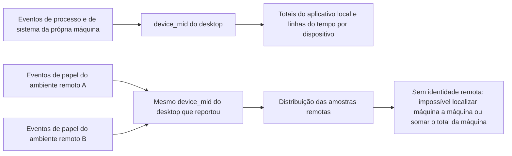

# Revisão de SQL do dashboard de recursos por processo

Data: 2026-09-15. Objeto da revisão: 32 painéis de dados, 1 consulta de lista de versões e 8 filtros em `6829792905`.

## Conclusão

A organização em sete seções é razoável e deve ser mantida. As consultas existentes conseguem mostrar escala de recursos, distribuição por versão, diferenças por papel, ranking de plugins e situação do envio; mas ainda há lacunas quando são usadas para 판단 de regressão por versão, localização de um dispositivo específico e identificação de falhas de coleta.

Priorize corrigir a contagem de amostras válidas, o truncamento de tendências, o critério dos filtros e as consultas de qualidade de coleta, e só então completar as visões correlacionadas de dispositivo único e Bash lento. Aumentar a quantidade de painéis por si só não resolve esses problemas.

Este foi um revisão de SQL e de contrato de campos; as recomendações ainda não foram implementadas. Não há base em amostras de produção para avaliar a saúde dos recursos, a estabilidade das distribuições, o desempenho das consultas ou o grau de poluição visual. A configuração de produção e os arquivos de consulta atuais permanecem na versão entregue.

## Método e limites de evidência

- Conferência item a item da [lista de consultas SQL](./process-resource-queries.json) e do [JSON do dashboard](./process-resource-dashboard.json): as 33 consultas estão consistentes, `query` e `tokenQuery` são iguais e os 13 gráficos de linha usam `classify(time, series, value)`.
- Conferência da [spec de instrumentação](../process-resource-telemetry.md), da allowlist de atributos do shared, da projeção de eventos de papel/sistema do main e da implementação de agregação MCP.
- Execução da segunda metade de agregação das consultas originais em SQLite em memória, com `base` usando dados construídos e agregação de quantis determinística no lugar de `approx_percentile`. Esses exemplos validam agrupamento, contagem, ordenação, LIMIT e lógica de NULL; não representam validação de compatibilidade com o motor da Alibaba Cloud nem dados de produção.
- `pnpm typecheck` e `pnpm lint` passaram; o único produto desta revisão é Markdown.

## Consultas e expressões a corrigir com prioridade

### 1. A elegibilidade de amostra não é aplicada a cada métrica nem a cada bucket de tempo

Local: tendências de população como `cpu-trend`, `rss-trend`, `role-rss`, `role-background-cpu`, `mcp-rss`, `mcp-cpu`; e as colunas de leitura de `mcp` / `remote-mcp`.

- As tendências retornam apenas `time, series, value`, sem o número de dispositivos válidos daquele ponto. A tabela de versões ao lado agrega todo o intervalo e não substitui o volume de amostra de cada bucket; a tabela de papéis também não substitui a amostra válida da janela de background.
- A leitura de MCP usa `count(*) < 100`, mas o que realmente participa do quantil de CPU de background é `count(bgcpu)`. Embora a tabela liste o número de dispositivos válidos de CPU de background, ainda pode sair uma leitura geral contraditória.
- O mesmo vale para heap: o total de dispositivos por papel pode ser grande, mas apenas poucos têm heap válido, e o total de dispositivos não pode servir como critério estatístico do heap.

Validação construída: a versão tem 100 dispositivos o dia inteiro, o primeiro bucket de CPU é 1%, e o segundo bucket tem apenas 1 dispositivo com CPU de 50%; a tabela de versões mostra comparável, enquanto a tendência vai de 1% a 50% sem nenhuma dica de volume de amostra. Com MCP em 101 dispositivos e apenas 1 dispositivo válido de CPU de background, a saída ainda diz "distribuição comparável; sem conclusão causal".

Sugestão: cada métrica deve exibir seu próprio número de dispositivos válidos; as tendências devem calcular o número de dispositivos válidos por `time × version × role/MCP`, exibido por ponto ou acompanhado de um gráfico de volume de amostra. Abaixo de 100, manter o valor junto do aviso "amostra insuficiente", obedecendo às regras de exibição já confirmadas. Esse limiar é apenas uma barreira de exibição e não significa que a composição populacional já seja comparável.

### 2. Tendências com mais de 10.000 linhas descartam os dados mais recentes

Local: todas as consultas de tendência com bucket de tempo fixo, em especial `role-rss`, `mcp-rss` e `mcp-cpu`.

As consultas usam `ORDER BY time, series LIMIT 10000`. Ao ultrapassar o limite, os pontos mais antigos são mantidos e os dados mais recentes são descartados; em um bucket de fronteira ainda é possível restar apenas parte das séries.

Validação construída: 7 dias, um bucket a cada 30 minutos, 4 versões e 9 papéis dão 12.096 linhas. A consulta original retorna apenas 10.000 linhas, e o último bucket de tempo devolvido fica 29 horas antes do último bucket real. Com mais MCPs, mesmo 24 horas podem atingir o limite.

Sugestão: ajustar o bucket de tempo conforme o intervalo; para MCPs de alta cardinalidade, selecionar Top N antes de agregar e exibir explicitamente o escopo selecionado. Estimar ou detectar o tamanho do resultado e avisar quando houver truncamento. Apenas aumentar o LIMIT ou inverter a ordem ainda descarta silenciosamente parte do intervalo.

### 3. As contagens de visão geral e os cartões de recurso não são a mesma população

Local: `coverage` e `events` comparados com `app-cpu` e `app-rss`.

Os dois primeiros cartões consomem três tipos de evento, aplicando apenas os filtros de ambiente do aplicativo, de versão nativa e de variável de plataforma; os dois últimos consomem apenas eventos de sistema, aplicando também variáveis de arquitetura, número de núcleos, memória e foreground/background.

Por isso, ao escolher um determinado hardware, as métricas de recurso mudam enquanto a contagem de dispositivos e de eventos ao lado pode não mudar. A contagem ainda inclui desktops que reportaram apenas eventos remotos ou de Bash, e não serve como denominador das métricas de recursos de sistema da própria máquina.

Sugestão: na home, mudar a contagem de dispositivos para o número de dispositivos válidos do grupo de recursos de sistema atual; mover o total dos três tipos de evento para a área de qualidade de coleta, ou marcá-lo claramente como "cobertura total de novos eventos, não afetada pelos filtros de hardware/foreground". Os cartões de recurso, quando há várias versões selecionadas, fazem uma média ponderada por dispositivo e devem indicar "soma das versões selecionadas", para não serem lidos como valores de comparação entre versões.

### 4. As consultas de qualidade de coleta escondem justamente o problema que deveriam ajudar a descobrir

Local: condições base de `sample-quality`, `event-quality` e `latest-observation`.

- `sample-quality` agrupa apenas por `role, surface`, misturando por padrão várias versões, e assim uma anomalia de um grupo pequeno depois de uma atualização fica encoberta pela versão antiga.
- Olhar apenas o P50/P95 do sample_count reflete sobretudo as janelas normais e mais completas, faltando a cauda baixa e a proporção de baixa amostragem.
- A base comum exclui antes o `device_mid` vazio, então, mesmo com novos eventos já chegando, se todos os identificadores de dispositivo estiverem ausentes a área de qualidade continua exibindo "sem novos dados de instrumentação".
- Falha de `try_cast` vira NULL; as tabelas de qualidade não têm colunas separadas para ausência, valor inválido ou fora de faixa de CPU/RSS.
- A cobertura de papéis é apenas uma contagem, sem uma comparação de cobertura dos papéis obrigatórios no mesmo dispositivo que enviou dados e em janunas próximas. Os campos atuais não têm um ID de janela preciso, então não é possível chamar a ausência diretamente de falha.

Validação construída: a versão antiga tem 198 janelas main com sample_count 30, e a nova versão tem 2 janelas com valor 1; a tabela atual só entrega o P50=30 e o P95=30 combinados, tornando a anomalia da nova versão invisível.

Sugestão: agrupar por versão/superfície de execução/papel e acrescentar P05, proporção de baixa amostragem e taxa de validade dos campos de métrica. A base de qualidade dedicada deve manter os registros com identificador ausente e mostrar separadamente o número bruto de eventos, o número de dispositivos utilizáveis e o número de eventos sem identificador. Quando janelas completas e janelas residuais de saída não puderem ser distinguidas com precisão, tratar isso como pista de investigação e não como falha direta.

### 5. Valores de recurso ausentes são tratados como abaixo do limite na tabela de nível de memória

Local: `pressure`.

Hoje a consulta exige apenas `total_memory_gb > 0` e em seguida usa `CASE WHEN metric / total > threshold THEN 1 ELSE 0 END`. Quando a métrica está ausente ou a conversão falha, o caminho ELSE 0 coloca o registro no denominador de "não cruzou o limite".

Validação construída: 100 dispositivos têm memória total, 1 deles tem dados de recurso e está acima do limite, e os outros 99 têm métrica NULL; hoje as duas proporções dão 1%, quando a amostra válida é de apenas 1 dispositivo. O contrato normal do cliente deveria fornecer esses valores; esse contraexemplo mostra que, assim que a cadeia de campos se quebra, o dashboard subestima a proporção.

Sugestão: manter denominadores válidos separados para CPU, RSS e memória livre; o que estiver ausente permanece NULL e é contado na área de qualidade. A tabela de nível de memória deve mostrar o número de dispositivos válidos de cada item, e não decidir apenas pela existência da memória total.

### 6. Dois nomes ou ordenações divergem do significado real do SQL

- `bash-duration` ordena pela string do label, e a ordem real é `15–30s → 1–2min → 2–5min → 30–60s → ≥5min`. Deve ser adicionado um número de sequência do bucket para ordenação.
- O "pico de instância única" de `mcp` / `remote-mcp` vem de `rss_kb_max_process_peak`. A origem MCP toma, entre as instâncias, o maior RSS de um único processo do SO, e não o pico da árvore de processos de uma instância MCP. Deve ser renomeado para "maior pico de processo único"; o campo atual não permite recuperar o total máximo da árvore de uma instância.

## Informação mais valiosa a acrescentar

### Diagnóstico por dispositivo: completar totais do aplicativo, MCP e entradas de anomalia

Hoje as quatro linhas do tempo têm apenas CPU/RSS de papéis não MCP, CPU da máquina inteira e memória livre da máquina inteira. `device-rss` e `device-cpu` filtram explicitamente `role <> 'mcp'`, e a seção dedicada de MCP não recebe a variável de device. Portanto não é possível localizar, no dashboard atual, o consumo de MCP de um determinado dispositivo.

Faltam também, nos eventos de sistema, a CPU/RSS total do aplicativo, o pico por papel e a linha do tempo de heap. Não se pode somar os quantis por papel nem as médias de janela para substituir o total do aplicativo; os tempos de amostra e a cobertura de sobrevivência variam entre papéis.

Sugestões de prioridade:

1. na seção de dispositivo único, exibir diretamente CPU/RSS do aplicativo a partir dos eventos de sistema, alinhados aos indicadores da máquina inteira;
2. acrescentar CPU/RSS do dispositivo por `mcp_id`; o CPU de MCP no Windows continua exibindo indisponível;
3. fazer a lista de dispositivos suportar ordenação por valor alto de CPU/RSS, mostrando dispositivo, versão, tempo mais recente e pico; hoje são 100 linhas por último envio, e é difícil encontrar um dispositivo anômalo a partir de uma anomalia populacional;
4. só quando for preciso um posicionamento mais detalhado, fornecer pico por papel, heap, contagem de processos e uptime. O total de RSS e o maior heap de processo único não podem ser subtraídos diretamente para obter a memória nativa.

### Bash lento: completar a combinação de recursos dentro do mesmo evento

Hoje as tabelas calculam de forma independente o P95 de duração, o P95 de RSS da árvore de processos, o P50 de equivalente de CPU, o P95 de RSS do CLI e o P50 de memória livre. Esses valores podem vir de comandos diferentes, então só descrevem distribuições e não respondem "o comando mais demorado também consome memória".

Sugestão: manter o resumo e acrescentar uma tabela de detalhes de eventos com limite ou uma tabela de buckets conjuntos, em que a mesma linha inclui horário do evento, dispositivo, versão, plataforma de execução, exit_kind, duração, RSS da árvore de processos, equivalente de CPU, RSS do CLI, memória livre do sistema e sample_count. Ordenar por duração, ou olhar a distribuição de recursos do mesmo grupo por bucket de duração, sem precisar do texto do comando nem de novos campos de privacidade.

O histograma de duração deve mostrar a proporção e a contagem de comandos por versão; hoje, selecionar várias versões as junta, e usar as contagens brutas depende sobretudo do volume de usuários. A tabela de tipos de saída pode acrescentar a proporção dentro dos comandos lentos da mesma versão, mas completed ainda não significa código de saída igual a zero.

### Versão e papel: acrescentar faixas altas de CPU e agrupamentos válidos

Hoje a CPU usa principalmente `custom.value`, ou seja, a média da janela. O P95 de dispositivos significa "cauda alta da carga média do dispositivo", e não pico de CPU de curta duração. `cpu_percent_p95`, `cpu_percent_peak` e `app_cpu_percent_p95` já são analisados, mas ainda não usados na exibição.

Manter o critério de média e, ao mesmo tempo, acrescentar uma faixa alta de CPU por janela claramente rotulada ou a proporção de janunas com CPU alta só depois disso é que ajudam a detectar ociosidade de curta duração em background. A tabela de uptime serve como pista de crescimento, mas não prova vazamento sozinha; e o número de dispositivos válidos de heap também precisa de coluna própria.

### Remoto: os limites de informação atuais devem continuar explícitos

Os três painéis remotos servem para ver a "distribuição das amostras remotas sob a versão de desktop que reportou". Hoje a agregação é pela média do desktop que reportou, sem somar os recursos de várias máquinas remotas, o que está de acordo com os campos visíveis atuais.

Mas `device_mid` não é o ID da máquina remota, e app.version é a versão do desktop; `background_ratio` vem da contagem de foreground/background do aplicativo de desktop e não representa o idle remoto. Quando o CLI antigo não tem campos de hardware, o código de envio ainda pode recorrer campo a campo ao hardware do desktop. O SQL não consegue deduzir de forma confiável a identidade da máquina remota, a versão do agente remoto ou distinguir o hardware de fallback; essas fronteiras devem ser explicadas na interpretação.

## Conclusão item a item das 32 painéis

"Correção" indica um defeito claro de critério ou de exibição; "melhoria" indica algo já valioso, mas insuficiente para responder à pergunta alvo; "manter" ainda exige respeitar os limites estatísticos comuns.

| Seção   | ID do painel             | Conclusão | Informação que oferece e ajuste principal                                                               |
| ------ | ------------------- | ---- | ------------------------------------------------------------------------------------ |
| Visão geral   | coverage            | corrigir | a cobertura de novos eventos é valiosa; não pode ser tratada como a contagem de amostras de recursos de sistema após o filtro de hardware da mesma tela.                         |
| Visão geral   | events              | corrigir | o total de envio é valioso; é preciso deixar claro que não acompanha hardware/foreground e que inclui remoto/Bash.                           |
| Visão geral   | app-cpu             | manter | mostra o nível de CPU de longo prazo do grupo selecionado; a soma das versões e o número de dispositivos válidos precisam ficar explícitos.                          |
| Visão geral   | app-rss             | manter | mostra a escala de memória do grupo selecionado; a soma das versões e o número de dispositivos válidos precisam ficar explícitos.                               |
| Visão geral   | version-summary     | manter | é a comparação de distribuição por versão mais direta do ciclo; ainda precisam ser considerados os dispositivos válidos por campo e as diferenças de hardware e de perfil de usuário.               |
| Visão geral   | cpu-trend           | corrigir | mostra a variação da CPU por versão ao longo do tempo; acrescentar válidos por bucket e controle do tamanho do resultado.                                |
| Visão geral   | rss-trend           | corrigir | mostra a variação da memória por versão ao longo do tempo; acrescentar válidos por bucket e controle do tamanho do resultado.                                 |
| Visão geral   | system-cpu          | manter | mostra o cenário de fundo de carga alta da máquina; é o P95 entre dispositivos de médias P95 de janela, e não pode ser atribuído diretamente ao aplicativo.                |
| Visão geral   | free-memory         | manter | o P05 permite observar a cauda de memória livre baixa; ao comparar MiB absolutos entre especificações de memória, é preciso filtrar o hardware.                        |
| Visão geral   | pressure            | corrigir | a proporção de dispositivos acima do limite é valiosa; corrigir o denominador de valores ausentes e deixar claro que já cruzou o limite dentro do escopo selecionado.                       |
| Papéis   | roles               | manter | permite comparar papéis, contagem de processos e pico de processo único; acrescentar os válidos de heap.                                   |
| Papéis   | role-rss            | corrigir | permite localizar papéis que mudam com a versão; controlar a quantidade de curvas, a amostra por bucket de tempo e o LIMIT.                           |
| Papéis   | role-background-cpu | corrigir | permite descobrir consumo contínuo de CPU em background; acrescentar os dispositivos válidos de background e esclarecer que a seleção global de foreground e a condição fixa de background são mutuamente exclusivas.         |
| Papéis   | uptime              | manter | oferece pistas de como os recursos variam com o tempo de execução; grupos de dispositivos diferentes e o uptime do processo mais antigo não podem ser tratados como curva de crescimento do mesmo processo. |
| MCP    | mcp                 | corrigir | permite encontrar plugins com alto consumo de memória; corrigir o nome de maior processo único e separar a elegibilidade de RSS/CPU de background.                     |
| MCP    | mcp-rss             | corrigir | mostra a variação da memória dos plugins; filtrar Top N antes e acrescentar os válidos por bucket.                                       |
| MCP    | mcp-cpu             | corrigir | permite encontrar plugins que continuam consumindo CPU mesmo com o desktop em background; acrescentar os válidos de background, Top N e controle do tamanho no tempo.                  |
| Bash   | bash                | melhorar | mostra a distribuição de comandos lentos; incluir a combinação de recursos do mesmo comando para apoiar o diagnóstico.                                   |
| Bash   | bash-exits          | manter | mostra a composição de completed/timeout/killed/error; acrescentar a proporção dentro da mesma versão facilita a comparação.               |
| Bash   | bash-duration       | corrigir | mostra a distribuição de duração dos comandos lentos; corrigir a ordenação dos buckets e permitir comparação de proporção por versão.                                 |
| Remoto   | remote-roles        | manter | mostra a distribuição de amostras de papéis remotos; não pode ser tratada como distribuição das máquinas remotas nem como regressão da CLI remota.                      |
| Remoto   | remote-mcp          | corrigir | tem valor de ranking de plugins remotos; herda os problemas de elegibilidade/nome do MCP e as limitações de identidade remota.                           |
| Remoto   | remote-bash         | melhorar | tem valor de resumo dos comandos lentos remotos; também precisa de correlação dentro do evento, respeitando os limites dos campos de hardware.                         |
| Dispositivo único | device-rss          | melhorar | mostra a média de RSS dos papéis não MCP; acrescentar MCP, total do aplicativo e pico.                                   |
| Dispositivo único | device-cpu          | melhorar | mostra a média de CPU dos papéis não MCP; acrescentar MCP, total do aplicativo e faixas altas de janela.                               |
| Dispositivo único | device-system       | manter | fornece contexto de CPU da máquina inteira; ganha valor quando comparado ao total do aplicativo.                                    |
| Dispositivo único | device-free         | manter | fornece a camada inferior de memória livre do sistema; precisa de comparação com o RSS do aplicativo.                                        |
| Dispositivo único | device-list         | melhorar | permite copiar os 100 identificadores mais recentes; mudar para encontrar dispositivos por valor alto de recurso, formando uma entrada de diagnóstico.                        |
| Qualidade   | event-quality       | corrigir | mostra os novos eventos e a Mezcla de versões; manter os eventos sem identificador e explicitar o escopo de filtro.                             |
| Qualidade   | sample-quality      | corrigir | traz informação de cobertura de samples/heap; acrescentar a dimensão de versão, a cauda baixa e as estatísticas de campos inválidos.                             |
| Qualidade   | self-cost           | manter | mostra o custo de relógio de parede da agregação de amostragem dentro da janela main; não é o custo de toda a sonda, e janela residual não equivale a janela completa.           |
| Qualidade   | latest-observation  | corrigir | fornece o estado de sem dados/só aceitação/com amostras; não descrever ausência de identificador de dispositivo utilizável como ausência de eventos.                 |

## Filtros e limites comuns

- A seleção única de env com prod como padrão, a multi-seleção nativa de versões e o filtro de plataforma estão na direção certa; a lista de versões retorna só as versões com eventos novos, o que está de acordo com o escopo confirmado.
- Número de núcleos e memória são valores candidatos estáticos, e faltam configurações que possivelmente existem, como 14 núcleos e 18/36 GB. Sugere-se ler dinamicamente dos eventos de janela, para evitar que não seja possível selecionar a máquina real.
- O gráfico dedicado a background fixa `background_ratio >= 0.9`, e portanto necessariamente não retorna nada quando a cena global seleciona foreground/mixed; é preciso avisar explicitamente que as condições de filtro são mutuamente exclusivas, ou fazer o gráfico dedicado declarar que não é afetado por essa variável.
- A entrada de device só afeta as quatro linhas do tempo de dispositivo único, e o desenho independente da lista de dispositivos tem fundamento; as novas visões de MCP/Bash por dispositivo também precisam ser conectadas explicitamente à mesma variável de device.
- Todos os `avg(window_mean)` atuais são de peso igual por janela, e janelas completas e janelas residuais de saída pesam igual, o que está de acordo com a implementação entregue de "média das médias de janela", mas não equivale a uma média ponderada por tempo online. Se no futuro for preciso responder ao "consumo médio durante o tempo online", CPU/RSS podem usar um peso de sample_count aplicável; o heap não tem contagem de amostras própria e não pode receber o mesmo tratamento às cegas.
- `spanNulls=false` controla apenas o NULL explícito. O SQL não gera buckets de tempo ausentes, e se uma lacuna de uma série isolada chega a quebrar a linha precisa ser verificado na renderização seguinte; não se pode garantir apenas com essa configuração que todo um período ausente não será conectado por linha.
- A ausência de alarmes e de avaliação automática verde/vermelho continua valendo como escopo já definido. Atingir 100 amostras no grupo também não elimina as diferenças de hardware, comportamento de uso e perfil de usuários por versão.

## Ordem de implementação recomendada

1. Corrigir as amostras/elegibilidade válidas, o truncamento do resultado das tendências, o critério dos filtros de contagem, as consultas de qualidade, o denominador de NULL e os problemas definidos de título e ordenação de buckets.
2. Completar o total do aplicativo e o MCP por dispositivo, a entrada de dispositivos com valores altos de recurso e a correlação de Bash lento dentro do evento; manter as sete seções e priorizar o reaproveitamento/ajuste dos painéis existentes.
3. Calibrar Top N, buckets de tempo, limiar de baixa amostragem e a densidade visual real depois que os dados chegarem; depois validar multiversão, Windows, MCP e amostras remotas reais.