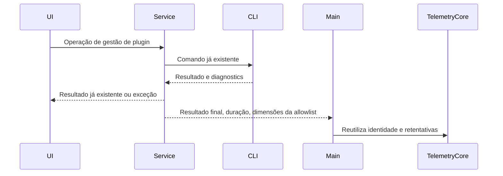

# Telemetria de negócio do ciclo de vida de plugins

## Visão geral dos eventos

| Evento                   | Ponto de disparo                                                                 | Principais dimensões                                                              |
| ---------------------- | ---------------------------------------------------------------------- | ------------------------------------------------------------------------- |
| `plugin_lifecycle`     | Resultado final de instalação, desinstalação, atualização, restauração, configuração, ativação/desativação, mudança de origem e sincronização remota por plugin | action, result, plugin_id/marketplace, entry, trigger, scope, duration_ms |
| `plugin_discovery`     | Loja ou detalhes ficando visíveis, envio de busca                                           | action, entry, plugin_id (detalhes), client_kind; sem o termo de busca                |
| `plugin_usage`         | Interface do plugin solicita abertura, inicialização concluída, liberação de instância, chamada de ferramenta iniciada pela interface               | action, plugin_id, plugin_component; chamada de ferramenta inclui result/duration_ms        |
| `plugin_runtime_error` | Interface do plugin entra em estado de erro na inicialização                                             | plugin_id, plugin_component, error_category; sem o erro bruto                 |
| `agent_step` (existente) | Estado final de uma chamada real do modelo a Skill/MCP                                          | Novo plugin_id, plugin_component; preserva os campos de Skill antigos e a deduplicação existente             |

## Critério de implementação

Operações de gestão de plugins reportam `plugin_lifecycle` depois de obter o resultado final da CLI; não há
evento de início e nenhum `operation_id` de negócio é adicionado. Retentativas de rede reutilizam o `event_id`
gerado pelo TelemetryCore. O `operationId` já existente no protocolo de operações continua sendo usado para
cancelamento/progresso e não serve como campo de correlação da telemetria de negócio. `plugin_intent` é removido.

Cada chamada é cronometrada de forma independente. O contexto de entrada é passado por um proxy de encapsulamento,
preservando os métodos dinâmicos do RPC sem expandir cópias dos objetos de serviço. Falhas de Telemetry não podem
atrasar, rejeitar nem repetir a operação de negócio. A CLI é a única fonte de verdade sobre instalação,
configuração e ativação/desativação; a atualização da lista e os avisos da UI não decidem o sucesso. `dryRun` não é
reportado. A aceitação de uma requisição de cancelamento não equivale a cancelamento da operação; somente o erro
de cancelamento explícito da chamada original é registrado como `cancelled`.

## Escopo

- `plugin_lifecycle`: install, uninstall, update, restore, configure, reset_config, enable, disable, source_add, source_remove, source_refresh。A sincronização remota usa o resultado de conclusão da importação no destino; não se pode substituir o sucesso pela exportação.
- `plugin_discovery`: visibilidade real da loja e dos detalhes; a busca é reportada no envio e o texto original da busca não pode ser enviado. O limiar de exposição de cards ainda não está definido e não é implementado.
- `plugin_usage`: abertura, prontidão, fechamento e chamadas de ferramenta da própria interface do plugin, separados dos detalhes da loja e da execução de ferramentas pelo modelo.
- `agent_step` existente: Skill preserva os campos antigos e recebe o `plugin_id`/`plugin_component` genéricos; MCP recebe a atribuição real do `ToolEntry` no momento da execução, e é proibido adivinhar pelo nome da ferramenta.
- Autorização, agregação de Hook/LSP, atribuição de uso por Agent/Command e snapshots existentes continuam como planejamento posterior; não se criam eventos antes de um ponto de conclusão definido.

O resultado é success/failure/cancelled/noop/partial. Em `diagnostics`, o `error` tem precedência sobre o resolve do
RPC; alvo de desinstalação inexistente é `noop`; quando um lote retorna alvos bem-sucedidos e há erros, é `partial`.
Quando o resultado por plugin está ausente, não se inventa um plugin com falha. A versão usa apenas o registro
realmente retornado, é omitida quando ausente e nunca é substituída por `latestVersion`.

## Allowlist e limites de dados

Campos comuns, dispositivo e identidade de usuário são injetados pelo TelemetryCore existente. `event_extra_detail`
permite apenas schema_version, action, result, plugin_id, marketplace, source_type, publisher_type, entry, trigger, scope, client_kind, workspace_kind, remote_kind, version_before, version_after, duration_ms, error_category, batch_id, target_count, plugin_component, remove_cache, preenchidos conforme a necessidade de cada evento. `source_type`, `batch_id` e `target_count` permanecem na allowlist por enquanto e não são preenchidos sem dados autoritativos; `publisher_type` só é preenchido quando o registro retornado o carrega. Validação por enumeração fixa e limitação de comprimento para identificadores textuais; não se enviam configurações, credenciais, URLs, caminhos, prompts, erros brutos nem conteúdo de ferramentas.

O Host local do Desktop é responsável pelo reporte do resultado das operações de gestão; as requisições de
gerenciamento pelo celular reutilizam esse Host e não reportam o resultado em duplicidade no celular. Os eventos de
descoberta do celular são encaminhados por uma allowlist estrita. O owner do reporte de execução de Agent do
`desktop continuous` e do `replayable` do celular permanece inalterado; a reprodução não adiciona `agent_step`.

## Impacto e verificação

must-inspect: PluginStorePage → pluginManagementStore → IPluginManagementService → CLI; Host → Main → TelemetryCore; CLI tool terminal → V4 fact → conversationTelemetrySupervisor → agent_step; provider/bridge da UI de plugin.

must-preserve: resultado real de negócio, repasse de scope/identidade remota, `operationId` de cancelamento/progresso, atualização da lista, não duplicar a contagem de execuções de Agent, isolamento do conteúdo bruto. Não há índice do codegraph, então as chamadas são rastreadas pelo código-fonte existente; acertos no grafo `capability.plugin-market-ui` e `capability.data-observability`, com as novas arestas de observação mantidas como `graph-drift-candidate`.

Cobertura de testes: RPC bem-sucedido mas `diagnostics` com falha, sucesso parcial, `dryRun`, `noop`, cancelamento
explícito, isolamento de duração em concorrência, falha de reporte síncrono/assíncrono, allowlist, atribuição real de
Skill/MCP, encaminhamento de requisições do desktop e do celular. O E2E é a verificação direcionada da entrada real de
gestão de plugins até o reporte de negócio, sem promoção automática para o CI oficial.

O rascunho antigo de Feishu com o diagrama de sequência e o SQL não é modificado por enquanto, a pedido do usuário;
este documento registra o contrato de implementação e não toma o SQL antigo como base de aceitação.
