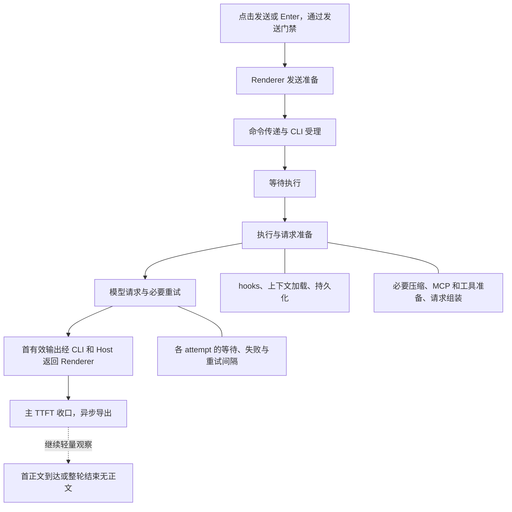

# Telemetria de TTFT em fases para mensagens locais do desktop

Status: ready-for-agent

Issue-Tracker: local-markdown

## Problema

O usuário precisa analisar em profundidade quais etapas de encadeamento ocorreu entre clicar em enviar uma mensagem e o cliente receber a primeira saída válida, quanto tempo cada etapa levou, e usar P50, P95 de cada etapa mais o waterfall de uma mensagem lenta para localizar gargalos.

Atualmente o TTFT geral está espalhado por eventos de negócio e ARMS RUM; o funil de envio registra ACK e tempo de exibição da mensagem do usuário; o OpenTelemetry do CLI registra o primeiro evento, o primeiro conteúdo e o primeiro texto da tentativa de requisição ao modelo. Esses registros têm pontos de início e fim, amostragem e escopo de aplicação diferentes, e não formam uma cadeia completa e verificável do clique à primeira saída.

Em especial, a espera antes do aceite pelo CLI, a fila de execução, os hooks, a preparação de contexto, a compactação e o retorno do primeiro conteúdo ao cliente ainda não podem ser contabilizados como fases contínuas da mesma mensagem. O `first_content` atual do modelo ainda pode aceitar o evento de início de um bloco de conteúdo, portanto não pode ser equiparado diretamente a uma saída não vazia e exibível. Subtrair diretamente os P95 de métricas diferentes não permite recuperar o P95 de uma certa fase.

## Solução

Adicionar telemetria de TTFT dedicada ao workspace local do desktop, reutilizando a capacidade de exportação OpenTelemetry/OTLP existente e a integração ARMS, oferecendo duas formas de observação relacionadas entre si:

- Métricas por fase: ver a contagem de amostras, a distribuição de duração, P50 e P95 de cada fase, filtrando e comparando por dimensões controladas.
- Trace por mensagem: usar um ID de correlação estável para ver a árvore de fases, as retentativas, as esperas, o resultado e o waterfall de um único envio, explicando amostras lentas específicas.

O TTFT principal começa ao clicar em enviar ou ao submeter com Enter e passar pelo gate de envio, e termina quando o Renderer que originou o envio recebe, pelo caminho real de conteúdo, o primeiro corpo de texto, pensamento ou tool call não vazio e exibível. Eventos vazios, heartbeats e notificações de status não constituem primeira saída; notificações de bypass de telemetria ou o momento de pintura pelo React não são o ponto final. O tempo do clique até o primeiro corpo de texto é observado separadamente.



O diagrama representa as principais fronteiras que precisam ser observadas; preparação e retentativas podem se entrelaçar e suboperações podem ser paralelas. A implementação deve registrar pela linha do tempo real, sem forçar concorrência real ou operações repetidas a uma execução serial única do diagrama.

## Histórias de usuário

1. As a analista de performance, I want ver o tempo total do clique até a primeira saída válida, so that eu possajudicar quanto tempo o usuário realmente esperou.
2. As a analista de performance, I want ver o P50 e o P95 de cada fase principal, so that eu possa identificar gargalos geralizados e de cauda longa.
3. As a analista de performance, I want ver a contagem de amostras de cada quantil ao mesmo tempo, so that eu não confunda flutuação de pouca amostra com regressão.
4. As a analista de performance, I want filtrar por fase, modelo e provider, so that eu possa distinguir problemas de processamento local dos relacionados à requisição ao modelo.
5. As a analista de performance, I want comparar por versão do app e sistema operacional, so that eu possa localizar regressões de release e diferenças de plataforma.
6. As a analista de performance, I want ver separadamente envios ociosos e enfileirados, so that o enfileiramento normal de negócio não mascare a velocidade real de processamento.
7. As a analista de performance, I want ver simultaneamente o TTFT total com enfileiramento e o tempo após o início da execução, so that eu possa avaliar a espera do usuário e a eficiência de execução separadamente.
8. As a analista de performance, I want marcar separadamente a espera do usuário no diálogo de confirmação da fila, so that eu não confunda a permanência do usuário com tempo de processamento do sistema.
9. As a analista de performance, I want separar o direcionamento imediato de entrada dos envios comuns atribuíveis de forma independente, so that saídas já existentes em execução não sejam atribuídas à mensagem errada.
10. As a pessoa de troubleshooting, I want encontrar o waterfall pelo ID de correlação de um envio, so that eu possa explicar uma mensagem lenta específica.
11. As a pessoa de troubleshooting, I want ver a duração da preparação de envio no Renderer, so that eu possa descobrir latências locais antes do envio.
12. As a pessoa de troubleshooting, I want ver a passagem do comando, o aceite pelo CLI e a espera antes do aceite, so that eu possa localizar contestações de comunicação e de admission.
13. As a pessoa de troubleshooting, I want ver o tempo desde a mensagem até o início da execução, so that eu possa distinguir espera de fila de preparação de execução.
14. As a pessoa de troubleshooting, I want expandir hooks, carregamento de contexto e persistência, so that eu possa localizar gargalos específicos de preparação antes da requisição.
15. As a pessoa de troubleshooting, I want identificar compactação de contexto antes da primeira saída, so that o tempo de compactação não seja contabilizado como primeira resposta do modelo principal.
16. As a pessoa de troubleshooting, I want ver MCP, preparação de ferramentas e montagem da requisição, so that eu possa analisar o impacto da inicialização de extensões na primeira resposta.
17. As a pessoa de troubleshooting, I want ver cada tentativa ao modelo e sua espera de retentativa, so that eu possa distinguir uma requisição lenta de múltiplas falhas acumuladas.
18. As a pessoa de troubleshooting, I want ver a duração da primeira saída válida retornando do CLI ao Renderer, so that eu possa descobrir gargalos no caminho de retorno.
19. As a pessoa de troubleshooting, I want ver operações paralelas, ausentes e intervalos não atribuídos, so that o waterfall não preencha a duração total com fases fictícias.
20. As a analista de performance, I want distinguir se a primeira saída é corpo de texto, pensamento ou tool call, so that experiências com tipos de saída diferentes possam ser comparadas corretamente.
21. As a analista de performance, I want ver separadamente o tempo do clique até o primeiro corpo de texto, so that eu possa distinguir o início de feedback do início de resposta textual.
22. As a analista de performance, I want que o registro principal seja concluído assim que a primeira saída chegar, so that eu não precise esperar o fim do turno para observar a primeira resposta.
23. As a analista de performance, I want ver a contagem, a proporção e a duração já esperada de falhas e cancelamentos antes da primeira saída, so that a pior experiência não desapareça das estatísticas.
24. As a pessoa de troubleshooting, I want encontrar os checkpoints do início do envio e das fases concluídas, so que ainda possam restar pistas após uma saída anormal do processo.
25. As a analista de performance, I want distinguir não-concluído, interrupção explícita e falha explícita, so that a ausência do registro final não seja interpretada erroneamente como timeout.
26. As a analista de performance, I want continuar coletando em primeiro e segundo plano e preservar as mudanças de estado, so that mensagens lentas não se percam por troca de sessão.
27. As a analista de performance, I want ver por padrão amostras de primeiro plano contínuo e identificar suspensão ou pausa, so that o agendamento em segundo plano não contamine as estatísticas da experiência normal em primeiro plano.
28. As a analista de performance, I want não amostrar ativamente o detalhe de TTFT para a população de canário, so that amostras lentas não fiquem inacessíveis por amostragem independente de Trace.
29. Como pessoa de operações, I want reutilizar a integração existente no ARMS e obter configuração de consultas e dashboards dedicada, so that não seja preciso criar outro produto de diagnóstico.
30. Como pessoa de operações, I want controlar canário, volume de eventos, cardinalidade de labels e retenção, so que o custo de observabilidade possa ser validado antes de ampliar a cobertura.
31. Como usuário, I want que falhas de rede de telemetria ou fila cheia não afetem envio e recebimento, so que a funcionalidade de diagnóstico não reduza a experiência normal de uso.
32. Como usuário, I want que a telemetria contenha apenas duração, status e informações de correlação necessárias, so que o corpo das mensagens, o conteúdo de arquivos e credenciais não entrem neste encadeamento.
33. Como pessoa de testagem, I want injetar atrasos de fase conhecidos e verificar os dados finalmente exportados, so that eu possa provar que a atribuição de fases corresponde à execução real.
34. Como pessoa de testagem, I want verificar desordem, duplicação, saída anterior ao ACK e concorrência de múltiplas sessões, so que os registros não sejam ligados errado nem contados em duplicidade.
35. Como pessoa de manutenção, I want que os novos pontos de instrumentação não alterem os eventos de negócio e a métrica RUM existentes, so que dashboards históricos e outros clientes continuem compatíveis.

## Decisões de implementação

### Cobertura e limites de compatibilidade

- A primeira versão estabelece registros de TTFT apenas para envios do usuário no workspace local do desktop. Workspace remoto do desktop, celular e controle remoto por Web não entram na coleta da primeira versão; seus comportamentos atuais devem permanecer compatíveis.
- O desktop mantém a cadeia de conteúdo real desktop-continuous, sem introduzir semântica de snapshot, gap ou recuperação do replayable do celular. Hydration histórico, replay e tarefas automáticas em segundo plano não devem fabricar registros de clique local do usuário.
- Reservar pontos de extensão para tipo de cliente, ambiente de execução e origem das fases, sem implementar antecipadamente medição de tempo entre máquinas, conexão remota ou atribuição de reconexão móvel.
- Preservar os eventos existentes de completion de negócio, TTFT de RUM e funil de envio; o novo modelo não altera definições, amostragem nem contagens antigas, nem exige enviar todas as novas fases em duplicidade para as interfaces de negócio ou para o RUM.

### Responsabilidades de módulo e interfaces

- O Composer cria o contexto de observação de um envio depois que o gate real de submissão passa; a confirmação secundária da fila reaproveita o mesmo envio e não reinicia o ponto de início.
- O ciclo de vida de observação dedicado do Renderer responde pelo relógio total do clique, o estado de primeiro/segundo plano do cliente, o recebimento real do primeiro conteúdo, o fechamento do registro principal e a observação complementar do primeiro corpo de texto.
- O CLI registra fatos autoritativos de fase nas fronteiras existentes de admission, enfileiramento, preparação de execução e chamada ao modelo. O Host mantém as responsabilidades de agendamento e transporte, não introduz uma segunda fila de entrada aceita e não se torna uma segunda fonte de dados do ciclo de vida de negócio.
- Se for necessário passar fatos de fase do CLI e o contexto de observação entre processos, isso é feito por meio de um protocolo compartilhado com tipagem estrita, schema de runtime e uma ponte controlada; a compatibilidade das chamadas antigas é mantida. A Main responde apenas pelo agendamento da exportação de telemetria controlada e não carrega estado de negócio de task, queue ou modelo.
- Reutilizar as interfaces de serviço existentes, a injeção de plataforma e as instalações de exportação OTLP. O Renderer não acessa diretamente o Repo nem a implementação do CLI, e não coloca chamadas de rede de exportação no caminho bloqueante de envio ou saída.
- `workspaceIdentity` continua expressando isolamento de identidade, `workspacePath` expressa o caminho de execução de arquivos; localmente continua permitido o fallback de caminho, sem criar outro formato de identidade de workspace local. O isolamento da telemetria deve cobrir workspace, sessão e instância de processo, e não exportar o caminho bruto do workspace.

### Correlação, primeira saída e ciclo de vida

- Um envio tem um ID de correlação de observação estável, que pode ser estabelecido já na fase de preparação antes do envio, e é correlacionado com commandId, inputId, queryId, turnId, o ID lógico de chamada ao modelo e o requestId de cada tentativa física.
- No V4, a relação existente entre inputId, queryId e o commandId do envio original é usada para correlação. Uma edição de fila ou um comando send-now não pode substituir a atribuição do input original. O requestId muda a cada retentativa e não pode servir de chave primária de todo o envio.
- O contexto de observação e a decisão de habilitação propagam de forma consistente entre processos, para que Renderer e CLI não façam amostragem aleatória independente gerando fragmentos. Os novos registros de TTFT podem ser correlacionados ao Agent Trace existente, mas não dependem da amostragem de Trace de 10% já existente para obter completude, nem alteram a atribuição pai-filho dos traces de negócio antigos.
- A primeira saída só aceita corpo de texto, pensamento ou tool call não vazios e exibíveis que cheguem ao Renderer de origem pelo caminho real de conteúdo da sessão. Apenas text_start, reasoning_start, tool_input_start, bloco vazio, status, heartbeat ou notificação de bypass não são suficientes para determinar. Registrar `first_output_kind`.
- Não atribuir antecipadamente a esta mensagem o progresso de bypass de turnos anteriores executados, de outras sessões, outros inputs ou subtarefas; a atribuição da saída deve ser verificada com a causalidade real de input e execução. Inputs que não podem ser atribuídos de forma única recebem uma marcação explícita, sem fabricar um TTFT independente.
- ACK não representa início de execução nem início de requisição; a primeira saída também pode chegar antes do ACK. Correlação, deduplicação e fechamento devem aceitar desordem legítima e não podem sincronizar estado de negócio com tempo de espera fixo.
- Depois de fechar o TTFT principal, continua-se observando de forma leve o primeiro corpo de texto; quando o primeiro corpo de texto chega atrasado, uma métrica complementar é gerada; se o turno inteiro terminar sem corpo de texto, marca-se como sem corpo de texto. Depois que o registro principal é fechado com sucesso, erros posteriores não podem reverter seu resultado de primeira saída.
- O início do envio e as fases concluídas geram checkpoints assíncronos, sem depender apenas do fim do Span raiz para exportar. Não fabricar etapas de preparação ou fases de retentativa ainda não concluídas após a primeira saída.

### Fases e contrato de tempo

| Fase principal             | Fronteira a explicar                                                | Observações expansíveis                                                                                     |
| -------------------------- | -------------------------------------------------------------------- | ----------------------------------------------------------------------------------------------------------- |
| Preparação de envio no Renderer | Do ponto de submissão até a distribuição do comando ao Host       | Preparação local realmente ocorrida; a espera por confirmação do usuário é marcada separadamente            |
| Passagem do comando e aceite pelo CLI | Da distribuição até o aceite autoritativo pelo CLI                | Encaminhamento pelo Host, recebimento pelo CLI, espera do admission gate, persistência de aceite necessária; o retorno do ACK é registrado como observação de ida e volta |
| Espera de execução         | Do aceite até o início da execução deste input                      | Tipo ocioso ou enfileirado, espera de fila; não acumular em duplicidade com a ida e volta do ACK           |
| Execução e preparação da requisição | Do início da execução até a requisição ao modelo da resposta principal, preservando intervalos realmente repetidos | hooks, carregamento de contexto, persistência, compactação necessária, preparação de MCP/ferramentas e montagem da requisição |
| Requisição ao modelo e retentativas | Do fim da preparação da requisição até o CLI formar a primeira saída válida deste input | Falhas ou saída de cada tentativa, intervalos de retentativa; requisições internas de compactação ao modelo são atribuídas separadamente da requisição principal |
| Retorno da primeira saída   | Da geração da primeira saída válida pelo CLI até o recebimento real pelo Renderer | Envio pelo qual o conteúdo real do protocolo passou, encaminhamento pelo Host e fronteira de recebimento no cliente |

- As fases principais devem ser divididas, tanto quanto possível, em intervalos de tempo contínuos e mutuamente exclusivos seguindo o caminho real; as fronteiras devem ser conferidas antes da implementação e nos pontos de captura reais. Fases ausentes, repetidas e subfases paralelas são permitidas; não preencher com duração zero fases que não foram executadas.
- O recebimento do comando pelo CLI e o aceite após obter o admission gate são fronteiras diferentes; não se pode usar apenas `admittedAt` no lugar de todas as fases de aceite.
- A execução após o aceite pelo CLI pode ocorrer em paralelo com o retorno do ACK. Observações acumuladas como envio até ACK e apresentação da mensagem do usuário não são fases principais seriais diretamente somáveis.
- O TTFT end-to-end usa o mesmo relógio do Renderer de origem. Dentro de cada processo, a duração é registrada com relógio monótono; o alinhamento de tempo entre processos precisa ter um limite de erro medido e não pode misturar diretamente relógios monotônicos de processos diferentes nem relógios de parede não validados.
- A meta de precisão da primeira versão é distinguir de forma confiável pontos lentos de dezenas de milissegundos, centenas de milissegundos e segundos, sem prometer medição de submissegundos. Fases curtas usam bucketing dedicado em milissegundos e não podem reutilizar o bucketing antigo de TTFT com mínimo de 250ms.
- Erro de alinhamento fora do limite, intervalos negativos, suspensão ou anomalia de relógio são registrados explicitamente como estado de qualidade. Não mascarar erros zerando por clamping e não misturar amostras não confiáveis entre processos nas distribuições precisas de fase; observações ainda confiáveis dentro do mesmo processo podem ser mantidas separadamente.
- O detalhe preserva interval, duration, causalidade e informação de ausência de fase. A união dos intervalos explicáveis é conferida em relação à duração total, sobreposições não são acumuladas em duplicidade e a diferença é exibida como não atribuída ou ausente, sem ser forçada para o modelo ou para a rede.
- Enfileiramento interno e inferência do serviço de modelo, assim como DNS/TLS/network TTFB, não são detalhados na ausência dos fatos correspondentes; o primeiro evento do SDK não pode se passar pelo primeiro byte da rede.

### Estatística, resultados e consultas

- Um envio independente é a unidade estatística do TTFT principal. Tentativas de modelo e subfases de preparação têm suas próprias unidades estatísticas, que as consultas devem indicar, evitando misturar requisições de ciclos de ferramentas posteriores na estatística da primeira resposta do usuário.
- Envios ociosos e enfileirados são agrupados; são fornecidos simultaneamente o TTFT total contado a partir do clique, o tempo do início da execução até a primeira saída e a espera de fila. O direcionamento imediato de input entra apenas no resultado de envio ou em uma classificação independente, e não nos quantis de TTFT comuns.
- Falhas, rejeições, cancelamentos e outros resultados explícitos antes da primeira saída registram a duração já esperada e as fases existentes, e são contabilizados separadamente em número e proporção; amostras sem primeira saída não podem entrar na distribuição de TTFT bem-sucedido com valor 0 ou -1.
- Registros com apenas início ou checkpoints de fase são exibidos como não fechados, e ainda podem estar em execução ou ter sido interrompidos. A ausência de estado final ou o exceder de uma janela de consulta não bastam para determinar falha; só com evidência explícita de saída ou interrupção o resultado correspondente é apresentado.
- A coleta continua em primeiro e segundo plano. É preciso salvar o estado no envio, no recebimento e as mudanças necessárias no meio do caminho para determinar primeiro plano contínuo; comparar apenas os estados inicial e final não basta para descartar uma ida temporária para segundo plano. O dashboard de experiência padrão filtra amostras de primeiro plano contínuo com temporização confiável, e o dashboard de diagnóstico pode ver todas.
- Suportar filtro e agrupamento por fase, modelo/provider, versão do app, sistema operacional, ocioso/enfileirado e estado de primeiro/segundo plano. Usar labels controlados e combinações predefinidas comuns, sem construir o produto cartesiano de todas as dimensões; informações de mensagens, Trace, workspace e usuário, de alta cardinalidade, não entram em Metric labels.
- Os mesmos fatos de fase geram Metric e Trace, com schema version, aplicativo e versão do CLI explícitos. A estatística usa as amostras brutas de fase válidas ou seu Histogram, exibindo a contagem de amostras e a granularidade dos buckets; não se somam P95 nem se usa o P95 total menos o P95 do modelo para derivar outras fases.
- Os entregáveis no ARMS incluem TTFT total, P50/P95 de cada fase principal e subfase de preparação, contagem de amostras, proporção de resultados, visões de não fechamento e qualidade de dados, além do waterfall de fases de uma mensagem única aberto pelo ID de correlação ou consulta correlacionada. As capacidades de consulta, navegação e exibição de waterfall da plataforma real devem ser verificadas; não se pode considerar a entrega concluída apenas porque o Span local foi gerado.

### Exportação, canário e armazenamento

- O novo TTFT usa um modelo de dados próprio de OTel Metric e Trace, reutilizando o exportador OTLP existente, a injeção de configuração e o mecanismo de envio em lote. Eventos customizados de ARMS RUM e os event/report de negócio não são o caminho principal de armazenamento desses novos dados de fase.
- Na primeira etapa, coleta em volume total os detalhes e estatísticas de TTFT limitados apenas para a população de canário, sem herdar a amostragem aleatória independente do Renderer antigo nem o head sampling de 10% do CLI antigo. A cobertura da cadeia principal se estende apenas até a primeira saída, e o primeiro corpo de texto é um complemento leve; não se expande para coleta em volume total de todos os spans de negócio do turno inteiro.
- Os checkpoints de início e de fase devem poder ser submetidos de forma assíncrona e independente antes do fechamento do registro principal. Quando o estado final chega primeiro, a fase chega depois ou há transmissão duplicada, a mesclagem é feita por identidade estável de registro e de fase, sem contagem em duplicidade; os checkpoints não precisam emitir evento para cada token nem para cada iteração do loop.
- A chegada da primeira saída conclui imediatamente o registro principal e o entrega ao exportador assíncrono, sem exigir envio síncrono de requisição de rede item a item. Em operação saudável, o objetivo é que os detalhes sejam consultáveis de segundos a dezenas de segundos, e as métricas agregadas podem atualizar em cerca de 5 minutos.
- Fila, quantidade de registros de fase e memória têm limites, e falhas de exportação, acúmulo ou fila cheia não podem aplicar contrapressão sobre envio e saída. Em caso de descarte ou truncamento, preserva-se um sinal observável de qualidade de dados, sem alegar entrega de rede exactly-once nem zero perda em encerramento forçado.
- Retenção de 7 dias para os detalhes e pelo menos 30 dias para as métricas agregadas são metas de requisito; antes do lançamento, verificar a integração real, permissões, capacidade, configuração de retenção e custos no ARMS. Onde a configuração existente já atende à meta, reutilizá-la, e itens não verificados devem ser marcados como pendentes de validação no lançamento.
- A telemetria registra apenas duração, nome de fase controlado, resultado, versões e informações de correlação necessárias; não coleta prompt, corpo de resposta, conteúdo de arquivos, caminho bruto, credenciais ou Header/Body de requisição. Reutilizar as restrições de privacidade e autenticação existentes do projeto, sem assumir que hoje existe um interruptor geral de privacidade que controle todos os exportadores.

## Decisões de teste

### Principais fronteiras de teste

A fronteira máxima de teste é "do input de envio pelo Composer real do desktop até o Trace e a Metric decodificados pelo receptor OTLP final". Passa pelo Renderer, pelo Host da janela, pelo CLI e pelo retorno do conteúdo da sessão, usando replay de modelo controlado e um receptor OTLP de teste local, verificando a linha do tempo observável externamente e o contrato final de exportação, em vez de afirmar quantas vezes alguma função privada foi chamada.

Priorizar a reutilização da organização de testes E2E de conversation-session existente, dos testes de captura da saída final de telemetria e da decodificação gzip/protobuf e das asserções de Trace/Metric do receptor HTTP OTel existente. Os captadores de RUM/event-report existentes não podem servir diretamente como aceitação do novo canal OTLP; se for preciso adicionar capacidade de teste, deve-se fornecer um receptor reutilizável na fronteira final de exportação OTLP, em vez de adicionar interfaces de negócio exclusivas para teste em cada camada.

Na camada baixa, só complementar testes de fronteira de relógio, desordem, deduplicação, estatística e protocolo que o E2E real tem dificuldade de fabricar de forma estável. Reutilizar os padrões de injeção dos testes existentes de telemetry runtime, model-api recorder, supervisor e composer send-funnel, sem criar camadas de teste duplicadas para detalhes de implementação.

### Cenários de aceitação

| Cenário                                    | Resultado externo esperado                                                                                                   |
| ------------------------------------------ | ------------------------------------------------------------------------------------------------------------------------------ |
| Primeiro envio de corpo de texto comum      | Uma correlação de envio, um TTFT principal, fases corretas e primeiro corpo de texto; sem necessidade de esperar o terminal do turno inteiro |
| Pensamento ou ferramenta chegando primeiro   | `first_output_kind` correto; o TTFT principal fecha primeiro e o primeiro corpo de texto é complementado depois; eventos start vazios não disparam |
| Latência conhecida injetada em uma fase    | A duração da fase e o TTFT total variam na ordem real, e as outras fases não absorvem essa latência; o desvio está dentro do limite de erro verificado |
| Contenção de admission no CLI              | A espera entre o recebimento do comando e o aceite autoritativo é visível e não fica escondida na fila de negócio ou no tempo do modelo |
| Enfileiramento, liberação e confirmação secundária | A correlação do envio original é preservada; dá para distinguir o tempo com enfileiramento e o tempo após a execução; a espera de confirmação do usuário é marcada separadamente |
| Direcionamento imediato                     | Não rouba a saída do input anterior e não se mistura aos quantis de TTFT comuns                                         |
| hooks, compactação e preparação de MCP      | As subfases de preparação realmente ocorridas são visíveis; as chamadas internas de compactação ao modelo não se passam pela requisição ao modelo da resposta principal |
| Primeira saída após retentativas            | Múltiplas tentativas e esperas são correlacionadas ao mesmo envio; o TTFT principal não é contado em duplicidade pelo número de tentativas |
| Primeira saída antes do ACK, fases fora de ordem ou duplicadas | A correlação principal e o fechamento estão corretos, fases legítimas atrasadas são mescladas e não há Metric duplicada nem Trace de mensagem duplicada |
| Múltiplas sessões, janelas ou workspaces     | Mensagens, instâncias de execução e contextos de observação não se cruzam; saídas de bypass de turnos antigos e de subtarefas não roubam a primeira resposta |
| Falha ou cancelamento antes da primeira saída | A contagem de resultados e a duração já esperada estão corretas, sem TTFT bem-sucedido fictício nem poluição por valor zero |
| Falha após a primeira saída, fim sem corpo de texto | O TTFT principal mantém o fato da primeira saída bem-sucedida; o estado do primeiro corpo de texto está correto e independente           |
| Saída do processo, encerramento forçado ou estado final ausente | Os checkpoints exportados são consultáveis; sem evidência de fim, o registro permanece não fechado, sem fabricar timeout ou fases restantes |
| Ir a segundo plano e voltar, pausa da máquina ou anomalia de relógio | A determinação de primeiro plano contínuo é precisa; amostras anômalas de qualidade podem ser filtradas, sem criar duração negativa nem forçar clamping em zero |
| Paralelismo, preparação duplicada e fases ausentes | O waterfall apresenta os intervals reais; a união é reconciliada, sem soma duplicada e sem atribuir rigidamente as lacunas                |
| Canário desligado, habilitado e amostragem por correlação | Desligado não há nova coleta; na população habilitada a cadeia é consistente e a amostragem de 10% do Trace antigo não cria trechos faltantes de TTFT |
| Timeout, rejeição ou fila cheia do exporter | Envio e saída continuam; memória/fila são limitadas, o descarte é observável e o fechamento normal não depende do sucesso da exportação |
| Contrato final de dados                    | Schema estrito, unidades, versões, labels de baixa cardinalidade e regras de mascaramento corretos, com Trace/Metric reconciliáveis conforme definido |
| Canais antigos e cenários excluídos        | As contagens antigas de negócio/RUM não mudam; remoto, celular, replay e tarefas automáticas não geram TTFT de usuário local           |

Na implementação é obrigatório escrever primeiro os testes apropriados e depois o código; o encadeamento interativo precisa ter E2E. Concluir a verificação de tipos, lint, os gates de arquitetura e os testes relevantes, mantendo os casos de E2E consistentes com a implementação. A verificação principal cobre macOS, Windows e Linux; validações de plataforma que não puderem ser concluídas devem ser listadas com honestidade, sem passar sucesso de mock como conclusão em máquina real.

Antes do lançamento, fazer uma verificação forense em uma execução real do desktop, alinhando o envio pelo usuário, o recebimento real do conteúdo, os registros de fase e o resultado final da exportação; e medir a latência de mensagem, a carga na thread principal, a memória e o volume de eventos causados pela coleta. No ambiente ARMS é preciso validar consultas de quantis, correlação de registros, exibição de waterfall e latência de visibilidade dos dados. O status de conclusão da aceitação no lado da plataforma e o dos testes locais são registrados separadamente.

## Fora de escopo

- Coleta de TTFT para workspace remoto do desktop, controle remoto por celular/Web e implementação de sincronização de relógio entre máquinas.
- Criar um Host ou Agent separado para o celular, ou alterar a semântica de entrega de negócio continuous/replayable.
- Rastreamento de fases no lado do servidor para enfileiramento interno e inferência do serviço de modelo, bem como a divisão de DNS/TLS/primeiro byte de rede sem fatos que a sustentem.
- Métricas de performance de commit do React, paint do navegador e a chegada real da primeira saída à tela.
- Atribuição de TTFT comum independente para o direcionamento imediato de input; novas medições para entradas sem clique do usuário, como automação, tarefas ociosas e subtarefas em segundo plano.
- Rastreamento em volume total de todos os tokens, chamadas ao modelo e execuções de ferramentas do turno inteiro; após a primeira saída, apenas complementar a observação do primeiro corpo de texto.
- Criar novas páginas de diagnóstico dentro do produto ZCode, ou migrar/substituir a instrumentação de negócio/RUM existente.
- Precisão de temporização de submissegundos, telemetria com zero perda em encerramento forçado e lançamento em volume total para todos os usuários sem validação de capacidade.

## Observações adicionais

- Os requisitos e o escopo acima foram confirmados nesta discussão; este documento é uma spec a implementar e não representa instrumentação, E2E, consultas no ARMS ou configuração de armazenamento já em vigor.
- A ordem de entrega é spec e contrato de protocolo/fases, testes, implementação, verificação em execução real, aceitação no ARMS e avaliação de capacidade do canário. Antes de implementar, conferir a especificação de telemetria existente; novos contratos dedicados não podem reescrever silenciosamente as fronteiras das especificações antigas de ui_action ou Agent Trace.
- A revisão de implementação deve registrar explicitamente os pontos de captura de fase, o esquema de alinhamento de relógio com seus limites de erro, a capacidade de fases e a estratégia de truncamento, os buckets de Metric e as combinações de labels. Esses são itens de engenharia detalhados sob a restrição desta spec e não devem regredir para uma nova entrevista do escopo de produto já confirmado.
- Retenção, permissões e capacidade do ARMS ainda são condições de deploy a verificar; não se pode tomar a existência de exemplos de integração no documento como evidência de que a configuração já está em produção.

## Contrato de implementação do Ticket 01 (2026-09-14)

O Renderer é o único owner da observação de um envio; o CLI registra apenas fatos de fase limitados e sem corpo, transportados pelo frame de conteúdo continuous real. A Main apenas verifica e exporta em lote os fatos concluídos, sem guardar estado de negócio. O contexto opcional `ttft` do comando congela a decisão de habilitação e o ID de correlação; chamadas antigas têm omissão, ou seja, desligado. O contexto e a amostragem do Agent Trace não são alterados.

```text
Composer gate → Renderer prepare → command dispatch → CLI received → admitted
                                                            → execution → request → content
Renderer actual continuous content receipt ← Host passthrough ← content frame + timing facts
  └→ bounded async OTLP export; continue observing first text
```

Os seams de teste seguem as Testing Decisions desta spec: do Composer real até o OTLP final; apenas protocolo, relógio e fronteiras de duplicidade ganham testes unitários. A base de revisão é o HEAD inicial `5cc3713d3a35a404157b0ac513fba30cce18b08c`.

CLI e Renderer usam `performance.timeOrigin + performance.now()` para expressar um epoch monotônico; a consulta de comando retorna a instância do processo e o relógio de amostragem, dando o offset e o erro máximo pelo intervalo de ida e volta do Renderer, no máximo 10ms, com validade de 60 segundos. A calibração não espera o envio do usuário; o handshake de transporte, os checkpoints do CLI e a chegada do frame de conteúdo real re-sondam se a calibração já expirou. Sem calibração confiável, preserva-se o TTFT total e os intervals dentro do mesmo processo, e as fases entre processos não entram na distribuição de sucesso, com qualidade registrada como missing em vez de clock_invalid. Cada interval verifica ordem e qualidade, sem clamping em zero.

A configuração de canário é independente, `localTtftEnabled`, com omissão false; a verificação local pode definir explicitamente `ZCODE_LOCAL_TTFT_ENABLED=1`. A configuração é injetada pelo Desktop no Renderer e carregada até o CLI no mesmo envio, sem amostragem aleatória independente. O Renderer mantém no máximo 128 observações em voo; o CLI mantém no máximo 128 fatos ativos e 128 fatos de estado terminal, cada um com no máximo 6 fases principais; expiração de 5 minutos é registrada explicitamente como expired e não como failed; no máximo 32 itens por lote, no máximo 32 lotes na saída e timeout de rede de 3 segundos. Os limites do Histogram em milissegundos são 1, 5, 10, 20, 50, 100, 200, 500, 1000, 2000, 5000, 10000, 30000, 60000, 300000.

O Ticket 01 suporta apenas envio local ocioso de primeiro plano contínuo sem retentativas. Enfileiramento/direcionamento, retentativas, cancelamento, falha, segundo plano, recuperação e correlação ausente são marcados separadamente, sem se passar por amostra completa. A aceitação de consulta na plataforma ARMS é registrada separadamente; a aprovação do OTLP local não permite marcar a aceitação da plataforma como concluída.

Compatibilidade de protocolo: apenas requisições `commands/query` que carregam explicitamente `clock:true` recebem resposta de calibração anexada; respostas de consulta antigas, o formato e a contagem dos fatos antigos de telemetria de conversa permanecem inalterados. O `executionStartedAt` dos eventos de origem do CLI é capturado antes dos hooks/persistência e é consumido apenas pelo novo observador de TTFT. O signal de Metrics tem endpoint/header próprios, capturados de forma privada como o Trace e removidos do tool env.

Pontos de entrada de implementação e verificação: [contrato de consultas](local-ttft-queries.md), [evidência de saída](local-ttft-evidence.json). A aceitação de plataforma das novas amostras no ARMS desta vez e os itens não aprovados do CLI em cobertura total estão no Ticket 01; não se pode marcar todo o requisito como concluído com base no sucesso local.

A requisição de calibração com `clock:true` aceita apenas a chave de sondagem de sessão null, não consulta o ledger de comandos nem o admission gate, e não sequestra a vinculação de workspace de command query do Host; consultas de comandos comuns continuam executando as verificações de isolamento de workspace existentes.

### Suplemento de implementação do Ticket 02

O contrato de detalhamento, as unidades estatísticas, as janelas, a qualidade de relógio e os limites de recursos do canário estão unificados em [contrato de consultas e diagnóstico](local-ttft-queries.md#ticket-02排队准备重试和未收口). Mantém-se a correlação e o owner de CommandInbox do accepted input existente, e o Core observa o intervalo real de preparação através do contrato opcional `observeLocalTurnPreparation`; sem assinatura de observação, o cronômetro de preparação não é iniciado. O novo checkpoint V4 `localTtftFacts` usa o stdio/service existente e não participa da projeção de negócio nem da decisão de primeira saída. O snapshot inicial `initial` é apenas ignorado; `recovery` é explicitamente excluído, e a semântica de recuperação do celular não pode ser trazida para o desktop. O online snapshot do desktop continuous, gerado por overflow do buffer de assinatura ou reconstrução de projeção, também não permite atribuir unicamente a primeira saída e é excluído como resultado independente `resync`, sem ser registrado como `recovery`.

O resultado de primeira saída raiz é fechado apenas uma vez, e fases que chegam depois recalculam a qualidade das fases; Metrics já emitidas não são reescritas nem duplicadas. Eventos dentro de toda a observação usam identidade estável, e a deduplicação da saída limitada retém o conjunto inteiro por observation. O frame de conteúdo real pode carregar fatos de vários inputs originais, para cobrir no mesmo lote a coexistência de saída de turno antigo e liberação da fila. Uma saída explícita do CLI é fechada como interrupted por workspace, e registros sem exit/terminal recebido continuam unclosed. A implementação e a aceitação na plataforma são registradas separadamente em [Ticket 02](../issues/ttft-stage-telemetry/02-queued-retry-and-failure-diagnostics.md).