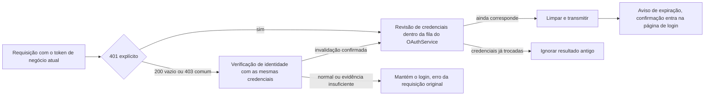

# Invalidação de credenciais de login do ZCode e novo login

## Recuperação local do cache de localização de projeto

`project-key-location:v1:*` é um cache reconsultável de organização, projeto e Key ID, e não um fato de login.
Ao ler esse cache, quando ocorre explicitamente um erro de descriptografia, o owner de Token de projeto tenta uma reconstrução local única na resolução atual:
primeiro valida a geração da requisição e depois, pela porta de recuperação de cache privado do Host, relê o registro alvo dentro do lock compartilhado do arquivo de credenciais.
Se o registro já foi reparado, o valor novo é reutilizado; se foi removido, trata-se como cache miss; só quando continua impossível descriptografar é que a entrada é removida.
Erros comuns de IO, corrupção de arquivo ou erro de permissão não executam a remoção e também não podem ser tratados como cache miss.

```text
falha na descriptografia da localização → valida a geração atual → revisão / remoção condicional dentro do lock compartilhado
                              → já reparado: reutilizar; ausente ou ainda corrompido: consultar a localização → emitir Token
falha na consulta de localização ou na emissão → classificação de erro existente
                    ├─ rede / timeout / falha do serviço / permissão do projeto → mantém o login válido, retorna falha
                    └─ login atual confirmado como inválido → verificação de autenticação existente / entrada de recuperação de login
```

A porta de recuperação modifica apenas o cache alvo, sem ler nem limpar OAuth, Bot, Key manual, outras contas ou registros de projeto.
Uma recuperação bem-sucedida não transmite expiração de login, não encerra o login e não reinicia o App. Depois de uma falha, não há nova tentativa recursiva nesta resolução.
O cliente individual mantém a consolidação de pending já existente; entre janelas, o lock compartilhado de arquivo protege a "releitura e a remoção", proibindo remover um registro que já foi reparado por outra escrita. Tanto o caminho de sucesso quanto o de falha precisam verificar a geração antes dos efeitos colaterais da recuperação e antes do commit do armazenamento; o salvamento da localização e a remoção por 404 também passam a mesma verificação para o armazenamento local, e a verificam dentro do lock compartilhado, evitando que uma invalidação ocorrida durante a espera pelo lock ainda seja submetida.

A porta pertence à capacidade de armazenamento local do Host e não estende o contrato Renderer/RPC do ICredentialService;
consumidores sem porta de recuperação mantêm a semântica de falha original. Token de curta duração não vai para disco, e o namespace da localização, o algoritmo de criptografia e
as credenciais de login permanecem inalterados. Desktop e celular shared-host usam o mesmo owner de Token, sem nova fonte de estado de UI.

Observabilidade: depois de confirmar a geração atual e haver porta de recuperação, registra-se primeiro `project_token_location_unreadable`,
e só então a porta é chamada; quando a porta retorna e a geração ainda é válida, mantém-se `project_token_location_recovery`.
O último evento indica apenas que a revisão dentro do lock retornou, e não que a consulta de localização ou a troca de credencial teve sucesso. Uma falha de IO dentro da recuperação mantém o evento anterior;
uma falha posterior na consulta mantém os dois eventos e o código de falha existente. Erros comuns de leitura, ausência de porta de recuperação e requisições já invalidadas não registram
o evento de início da recuperação. Os eventos contêm apenas family, stage e code fixo, sem conta, cache key, texto cifrado ou exceção original.

Aceitação: recuperação concorrente em arquivo criptografado real, reparo submetido primeiro, invalidação da geração durante a espera do lock; reconstrução automática quando há OAuth válido e localização quebrada coexistindo; o login é preservado quando a reconstrução falha; depois do clear da requisição antiga não pode haver recuperação. Os testes unitários existentes de login inválido permanecem.
Esta correção trata de uma lacuna de recuperação de cache já confirmada e não afirma ter determinado a causa original da anomalia do usuário.

## 2026-10-12: recuperação de credencial de negócio revogada

Quando o access_token de negócio do active provider atual de BigModel/ZAI é explicitamente recusado, reutilizam-se a saída condicional do OAuthService, a limpeza das credenciais derivadas e o broadcast do Host; o Renderer limpa a exibição do usuário, mostra o aviso existente de "login expirado" e, após a confirmação, entra direto na entrada de login do Welcome, sem reiniciar o App nem recarregar o Web.

A recuperação de cache no startup verifica ao mesmo tempo o exp do JWT compartilhado e o exp do JWT do access_token de negócio atual; qualquer expiração explícita é reconferida dentro da fila de sessão original e retorna reauthentication-required. Quando o token de negócio não tem exp ou não é parseável, não se sai por causa dele, e a revogação remota é confirmada por requisições seguintes; não há nova requisição de rede no startup nem verificação periódica de expiração.

O escopo das requisições de negócio é o ambiente atual e a plataforma atual: `/api/biz/`, `/api/pay/` e a URL de userinfo configurada, e o Authorization precisa corresponder exatamente ao token de negócio atual (compatível com token nu e Bearer). Key/PAT de modelo comum, outras plataformas/ambientes e tokens antigos não pertencem à invalidação da autenticação de negócio.

Evidência de invalidação: HTTP 401 ou HTTP 200/403 com JSON completo de code=401 numérico. Uma resposta HTTP 200 de corpo vazio em requisição de negócio e um HTTP 403 comum exigem antes uma verificação de identidade somente leitura do customerInfo da plataforma atual, usando as mesmas credenciais da requisição; só a verificação que retorna 401 explícito, ou a semântica de logout já verificada do customerInfo do BigModel (HTTP 200, corpo de zero bytes), entra na saída condicional. Corpo vazio do ZAI, HTML, JSON corrompido, rede/timeout e 5xx não provam invalidação de credencial. Quando o próprio customerInfo retorna 403 comum, não se repete a sondagem.

A verificação de identidade usa o transport de rede existente, um request ID próprio e timeout limitado, sem passar pela cadeia recursiva de observação. Verificações concorrentes da mesma identidade mantêm apenas uma Promise em voo, removida ao final, sem cachear a validade do login; não se registram token, Cookie, resposta bruta de conta ou Key derivado. A resposta de negócio original continua indo ao chamador, e a leitura da cópia não consome o corpo. Após a confirmação, o próprio OAuthService reconfere as credenciais da requisição original e limpa dentro da fila de mutação de sessão; respostas e verificações antigas não podem limpar um login novo com token trocado ou plataforma trocada.

A checagem local de token no startup passa pela classificação unificada de erros de descriptografia do OAuthCredentialRepo e pela limpeza de sessão corrompida, e entra na fila de mutação de sessão do OAuthService. Confirmada a corrupção, retorna-se signed-out, limpando as credenciais OAuth registradas e o estado de autenticação derivado, preservando credenciais independentes como Bot/PAT; exceções comuns de IO/RPC continuam sendo lançadas. A admission na fila reconfere a generation da recuperação, e uma recuperação antiga não pode limpar um novo login já submetido. A migração de dados antigos do BigModel só é iniciada depois que a checagem local de credenciais tem sucesso.

O repositório de credenciais em background do Host pode detectar corrupção dentro do próprio resolver de refresh do Account Source; concluída a remoção local de OAuth, seu callback submete o refresh derivado da conta e observa o erro, sem esperar a conclusão desse refresh, evitando o ciclo "refresh lê credenciais → limpa → espera a próxima rodada de refresh". A saída normal do OAuthService continua aguardando o callback de limpeza derivado original, e o Account Source continua sendo dono e executando em série suas rodadas de refresh.

A observação da cópia da resposta, a requisição de identidade e a leitura do corpo de identidade são todas controladas pelo signal/timeout da requisição original. No cancelamento, o contrato de ApiError existente encerra imediatamente, liberando timers e assinaturas de observação, sem submeter notificação de invalidação tardia. Cada chamador cancela a verificação compartilhada de forma independente; o transport só é cancelado quando o último assinante sai, evitando que o cancelamento de uma requisição afete as demais. O desktop continuous e o celular shared-host/replayable continuam reutilizando o owner de autenticação existente, sem mudar a semântica de recuperação de mensagens.

O customerInfo da verificação de identidade usa, em BigModel/ZAI, a convenção de token nu das interfaces de login de negócio já existentes, alinhada a createBigModelLoginAuthHeaders / createZaiLoginAuthHeaders. A compatibilidade da classificação da requisição original com Bearer não significa que o endpoint de verificação também aceite Bearer; não se pode interpretar como invalidação de credencial o 401 gerado por um prefixo errado adicionado pelo cliente. As regressões cobrem as duas plataformas, o header nu/Bearer da requisição original e o caso de identidade válida com 200 vazio/403 comum, em que não há limpeza nem broadcast.



O owner do estado continua sendo o OAuthService do Local Host, e a verificação não mantém uma segunda cópia do estado de sessão. O celular shared-host continua consumindo o broadcast existente e a entrada de login atual; não há novo Host, RPC, polling periódico ou troca automática de token. O ciclo de vida de sessão do site e do emissor de OAuth não é modificado.

O Renderer lê o active provider do owner ao exibir o aviso e ao encerrá-lo; se um novo login já foi submetido, o evento de expiração antigo é ignorado, sem limpar o novo avatar nem abrir a página de login de novo. O aviso mantém apenas a marca de em voo deste componente, para deduplicação, sem manter um segundo estado de autenticação.

Aceitação: 401 explícito nas interfaces de negócio e de emissão de PAT de BigModel/ZAI limpa e avisa; a resposta vazia gerada pelo logout do site BigModel entra no mesmo fluxo pela verificação de identidade; resposta de negócio vazia ou 403 de permissão com identidade normal não desloga; o ZAI não julga invalidez a partir de uma resposta vazia; verificações concorrentes executam uma única vez, e o resultado antigo não limpa a sessão nova; o Electron cobre a invalidação explícita nas duas plataformas e o 200 vazio do BigModel, vendo a entrada de login após a confirmação e sem enviar RelaunchApp.

## Fronteiras de compatibilidade e motivos históricos

As correções anteriores acrescentaram o 401 de negócio numérico em HTTP 200 para três interfaces de identidade/plano, mas não cobriram a entrada de emissão de PAT nem a resposta vazia de customerInfo após o logout do BigModel. Por isso o avatar era mantido e as requisições de plano continuavam falhando. O comportamento atual segue as regras de recuperação por revogação descritas acima.

A leitura da cópia da resposta é limitada a 64 KiB e espera no máximo 1 segundo por requisição; timeout, excesso de limite ou falha de parsing cancelam a cópia observada e devolvem a resposta original. SSE não é lida nem espera o fim. O teste de isolamento de ambiente injeta explicitamente endereços neutros de produção/teste, sem depender de os domínios reais de ambiente serem diferentes; token nu e Bearer são cobertos.

Reutiliza-se o popup original, a internacionalização e o tema, sem alterar o protocolo de broadcast, o formato do credentials.json ou a semântica de mensagens de desktop-continuous / web-remote-replayable. CLI independente, requisições dentro do WebView e o transport MCP oficial do Agent que contorna o NodeApiClient não recebem interceptadores.

## SG-01: proteção de submissão da sessão para 401 atrasado (2026-09-09)

Motivo: depois que o classificador lê um access token antigo, o mesmo provedor pode concluir um novo
login; apenas reconfirmar o provider ativo ainda deixaria a resposta antiga passar. O resultado da
classificação é apenas um candidato e não pode servir diretamente como autorização para limpar o login
atual.

O Host entrega a URL/Authorization da requisição ao `logoutIfCurrentCredentialRequest` local do
OAuthService. Esse método reclassifica dentro do `sessionMutationQueue` existente e limpa as credenciais
na mesma tarefa da fila; somente quando a limpeza realmente tem sucesso é que os providers derivados são
notificados e o popup de expiração é transmitido; se a limpeza da configuração derivada falhar, um
warning é registrado e o aviso da sessão encerrada é mantido. Cada candidato entra na fila, evitando que
um 401 de uma credencial nova seja descartado enquanto um candidato antigo aguarda. O logout manual, a
verificação de JWT e a whitelist de interfaces permanecem compatíveis, e nenhum método de UI/RPC é
adicionado. A fábrica retorna um OAuthService concreto para a montagem do Host no mesmo módulo, e o
método local não entra no contrato cross-platform de IOAuthService.

```text
HTTP 401 -> classificação preliminar -> a credencial da requisição entra na fila de mutação de sessão do OAuthService
                           |
              novo login/refresh é submetido primeiro -> credencial não bate -> ignorar, sem broadcast
              o 401 antigo é submetido primeiro     -> conferir e limpar -> transmitir
                           |
              um novo login posterior ainda é escrito pela mesma fila e não é sobrescrito pela limpeza antiga
```

A troca de rede do refreshToken permanece fora da fila, enquanto a escrita de volta entra na mesma fila e
valida a generation da sessão, o provider e o access token de antes da troca; um refresh expirado não
pode ressuscitar credenciais depois do logout nem sobrescrever um novo login. Nenhuma capacidade de
refresh é adicionada e os adapters atuais de BigModel/ZAI não oferecem troca de refreshToken.

O state owner continua sendo o OAuthService do Host atual; essa fila serializa login, logout e escrita de
refresh nesta instância, sem introduzir transações entre processos nem mudar o formato do
credentials.json. As operações de arquivo concorrentes entre Hosts/CLI continuam respeitando as
fronteiras existentes do credential store. As fronteiras de attachment e broadcast de desktop continuous /
replayable do celular permanecem inalteradas; após a confirmação, o aviso atual entra na entrada de login.

### Restrição de integração do Todo103: preservar a identidade da conta encerrada

A saída condicional, assim como o logout manual, lê o accountIdentity da conta original dentro da fila de
sessão e antes de limpar as credenciais, e então entrega provider + accountIdentity ao callback de
limpeza derivado existente. Não pode voltar a ser a entrada antiga que passava apenas a plataforma, nem
adivinhar a identidade depois que as credenciais foram esvaziadas. A limpeza derivada fora da fila
continua seguindo a fronteira de serviço existente de limpeza por identidade de conta; isso não refaz a
sincronização de estado de conta nem transações entre Hosts. É preciso cobrir a passagem de identidade nos
dois lados BigModel/ZAI, a semântica de erro do logout manual, o 401 duplicado concorrente e a regressão
em que uma requisição antiga que retorna depois de um novo login/refresh não faz limpeza indevida.

Regressões: o classificador lê um token antigo e o mesmo provedor troca por um novo token; novo login do
mesmo provedor antes do candidato entrar na fila; uma nova escrita de sessão aguarda durante a checagem de
invalidez; o resultado do refresh retorna depois do logout; um 401 do token atual normal continua
disparando apenas a limpeza e o aviso originais. A fronteira da fila é provada por testes da camada de
serviço com temporização controlada, a cadeia de 401 normal é reconfirmada pelo AUTH-06 do Electron, e a
condição de corrida do token antigo sem broadcast é coberta por testes controlados da camada de serviço.

## CR-01: exceções na configuração isolada de URL (2026-09-09)

Motivo: quando os endereços candidatos são construídos de forma centralizada, uma exceção no business
base URL bloqueia um outro userinfo válido; e construir a configuração completa da plataforma só para
obter o userinfo também introduz exceções em endereços de autorização/login sem relação.

O endereço da requisição é resolvido com segurança apenas na fase de classificação do access token, e os
candidatos de customerInfo e de userinfo são construídos e resolvidos separadamente; endereços
inválidos (incluindo endereços relativos e protocolos não HTTP(S)) apenas pulam a si mesmos, sem
bloquear candidatos válidos. Quando todos os candidatos são inválidos ou o endereço da requisição é
inválido, retorna-se false e a resposta HTTP é entregue normalmente ao chamador. Overrides em branco
continuam seguindo a regra de endereço padrão da configuração original. A resolução do endereço de
userinfo é compartilhada entre a configuração da plataforma e o classificador, sem alterar a validação de
configuração existente no startup da plataforma e sem imprimir a configuração ou as credenciais brutais.

Aceitação: userinfo inválido em BigModel/ZAI não afeta um customerInfo válido; business base inválido não
afeta um userinfo válido; exceções de configuração sem relação não participam da classificação; override
em branco, requisição inválida e todos os candidatos inválidos têm regressão; o ramo original de JWT não
depende da nova resolução de URL.
