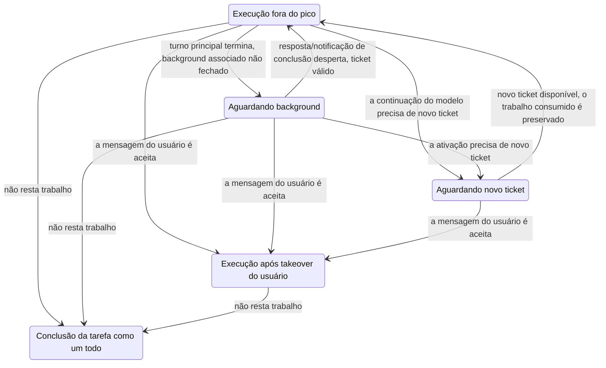

# Plano de execução em background fora do pico e separação de responsabilidades da Seleção

Status: a implementação principal e as correções apontadas no review — cancelamento tardio e race de perda da confirmação de troca de ticket — já foram corrigidas. Este documento preserva o design alvo, o rastro de implementação e os limites de verificação.
A linha de base da implementação atual está na [spec de tarefas fora do pico](./spec.md); os comportamentos-alvo tratados aqui são primeiro preenchidos de volta na spec correspondente antes da implementação, e, ao final, a spec final prevalece.

## 1. Objetivos e limites

As tarefas fora do pico conseguem iniciar subagents em background, chamar SendMessage e iniciar Bash em background; depois de o agente principal terminar de forma natural, a resposta em background ou a notificação de conclusão conseguem continuar conduzindo o agente principal. O ciclo de vida do ticket e o ciclo de vida da tarefa como um todo são gerenciados separadamente, e o loop de execução principal reutiliza os mecanismos do agente comum.

| Item confirmado         | Comportamento-alvo                                                                                |
| ----------------------- | -------------------------------------------------------------------------------------------------- |
| Capacidade de background | Suporta a inicialização explícita em background já existente e a passagem para background do agente comum, não apenas a remoção das restrições de visibilidade de ferramentas |
| Mensagens              | SendMessage suporta entrega em execução e retomada de agente em estado terminal; RespondToCoordinator reutiliza a fila de respostas existente |
| Encerramento natural do turno principal | Com trabalho em background associado, respostas/notificações pendentes ou continuação à espera de um novo ticket, a tarefa como um todo não é concluída |
| Takeover pelo usuário  | Quando uma mensagem real do usuário é aceita pela entrada autoritativa, o takeover assume a tarefa como um todo; falha de envio, troca apenas de modelo e resposta de aprovação não disparam takeover |
| Subagent já em execução | No takeover, o turno corrente do subagent mantém o modelo original até o fim; as ativações e retomadas seguintes usam a escolha do usuário |
| Expiração de ticket    | O Bash local pode terminar e salva o resultado; a continuação do modelo aguarda um novo ticket e não reexecuta ferramentas já concluídas |
| Parada do chat         | Reutiliza o escopo de parada e as regras de notificação do agente comum, sem diferenças exclusivas de fora do pico |
| Cancelamento do cartão de tarefa | Mantém a semântica terminal de cancelamento existente; eventos tardios de background associados não podem reexpedir execuções fora do pico |
| Reinício              | Não restaura processos em background, notificações pendentes de ativação nem estado temporário de execução fora do pico; não adiciona fila de restauração |
| Migração              | Não requer migração de configuração nem de banco de dados; reutiliza campos, registros e formatos existentes |

Não amplia os limites de capacidade existentes de Workflow, criação recursiva de OffPeakCreate/CronCreate, subagent aninhado ou Bash em background dentro de um child runtime. A extração automática de memória de projeto fora do pico continua sendo ignorada e não modifica a configuração de Memory da sessão. A persistência do agendamento existente de tarefas fora do pico e o trabalho em background que não será restaurado nesta rodada são tratados separadamente, e esta mudança não cancela a capacidade de agendamento original.

## 2. Responsabilidades e armazenamento da Seleção

| Conceito                       | Responsabilidade única                                                     | owner / armazenamento                                                                                                                    |
| ------------------------------ | ------------------------------------------------------------------------- | --------------------------------------------------------------------------------------------------------------------------------------- |
| Configured Default             | Preferência de inicialização da escolha do usuário para uma nova sessão de CLI | `config.defaultModelSelection` da configuração do Personal Provider; por padrão `~/.zcode/v2/provider_config.json`, permitindo sobrescrita pelos caminhos existentes |
| `cliDefaultSelection`          | Valor padrão da entrada do usuário sem escolha explícita na sessão de CLI/TUI atual | Memória no nível da sessão no bootstrap; a restauração reaproveita o registro de escolhas comuns por sessão |
| App Composer Selection         | Escolha da próxima mensagem do usuário no App                              | Rascunho existente do renderer e localStorage; sem nova cópia de estado no CLI                                                        |
| `sessionModelSelection`        | Escolha usada pelas execuções seguintes da sessão, pelas ativações em background e pela rodada automática do Goal | CLI Runtime; a escolha fora do pico só vale no ciclo de vida desta execução |
| Submission Selection           | Escolha de modelo fixada por uma entrada aceita                            | Intent canônico existente; durante a fila não se relê o valor padrão mutável                                                          |
| Active Model                   | Instância de modelo efetivamente usada no turno corrente                 | Turno de execução corrente; a atualização de uma escolha comum não altera o modelo de outros turnos já em execução |
| `highspeedFallbackSelection`   | Escolha de modelo comum usada nos cenários de fallback previstos pelo cartão de aceleração | Snapshot de execução fixado na inicialização do turno acelerado; exclusivo do cartão de aceleração, não é troca de ticket fora do pico nem configuração geral de degradação |

O registro `runtime/model_selection` do SQLite existente em `session_entry` continua guardando a escolha comum do usuário, preservando o id, o type e o formato de dados originais. Interfaces explícitas de leitura e escrita o distinguem da escolha temporária de continuação do Runtime, e a escolha fora do pico não é gravada nesse registro. App Recent e Configured Default também não podem ser sobrescritos por uma execução fora do pico.

### 2.1 Regras de entrada do CLI

1. Uma nova sessão inicializa `cliDefaultSelection` pelas regras existentes de resolução do padrão global; uma sessão antiga lê a própria escolha do usuário e não é sobrescrita pelo padrão global alterado por outra sessão.
2. `/model` e `/effort` atualizam a escolha padrão de entrada do CLI e seu registro de sessão, preservando o comportamento existente de salvar sincronamente a preferência de padrão global; enquanto nenhuma mensagem comum foi enviada, a escolha de continuação em background não muda.
3. Quando uma mensagem de usuário do CLI chega sem Seleção, ela é completada na entrada de admissão e fixada na Submission. O App continua submeter explicitamente a Composer Selection.
4. Seleção ausente, indisponível ou incompleta gera erro conforme a validação existente, sem recorrer à escolha fora do pico da Session nem a qualquer primeiro item do Registry.
5. A leitura de compatibilidade de entradas omissas do protocolo antigo precisa vir explicitamente da preferência de entrada do usuário; contratos de submissão já independentes, como o do Bot, são revisados à parte e sua semântica de `/model` não muda mecanicamente.

### 2.2 Ordem de atualização e concorrência

Depois que uma mensagem real do usuário é aceita pela admissão serial do CLI, a escolha de continuação da sessão é atualizada e o takeover é disparado; candidatos não aceitos não podem produzir esses efeitos colaterais. Quando uma entrada já aceita começa a executar, ela usa apenas o próprio snapshot de Submission e não pode reescrever uma escolha mais antiga como a Selection mais recente da Session. O Guide continua valendo sobre o turno corrente conforme a fronteira original de model-step.

```mermaid
sequenceDiagram
    participant Input as Padrão de entrada do usuário/rascunho
    participant Queue as Admissão do CLI e fila existente
    participant Session as Session Selection do Runtime
    participant Life as Ciclo de vida fora do pico
    participant Loop as Turno de execução
    Life->>Session: fora do pico começa, define I (não salva preferência do usuário)
    Input->>Input: muda para B, ainda não enviada
    Note over Session: continua I, as ativações em background seguem a execução fora do pico
    Input->>Queue: envia a mensagem e B
    Queue->>Queue: valida e aceita, fixa a Submission
    Queue->>Session: atualiza B conforme a ordem de aceitação
    Queue->>Life: takeover do usuário, para as expedições fora do pico seguintes
    Queue->>Loop: executa este snapshot pelas regras originais de fila/Guide
    Note over Loop: o turno corrente do subagent já em execução não faz troca a quente
```

Após a liberação do ciclo de vida da tarefa, não pode restar uma escolha fora do pico sem ticket que possa ser usada por engano por uma execução comum. A restauração/limpeza parte da escolha comum de usuário já aceita ou do estado não vinculado, e não lê rascunhos não enviados; um callback de fim fora do pico tardio não pode sobrescrever a Session Selection depois do takeover.

## 3. Ciclo de vida fora do pico e owner

| Fato                                                | owner                                            | Estado duplicado proibido                                  |
| --------------------------------------------------- | ------------------------------------------------ | ---------------------------------------------------------- |
| Turno principal, tarefas em background, comandos e notificações | CLI RuntimeTaskRegistry, fila de comandos existente | O Host manter uma segunda accepted queue ou uma tabela de contagem de background |
| Pertencimento do trabalho fora do pico, takeover e ciclo de vida local | Coordenação de ciclo de vida independente no lado do CLI, usando fatos de execução genéricos | Espalhar branches exclusivos de fora do pico por cada passo do loop principal |
| Pedido, troca e liquidação de ticket                 | OffPeakTaskService existente                    | O handler da ferramenta pedir/renovar ticket por conta própria |
| Estado persistido do cartão de tarefa               | Serviço e Repo existentes, consumindo eventos explícitos | Inferir a conclusão da tarefa como um todo pelo terminal da primeira rodada ou pelo loading da UI |
| Active Model do turno principal                     | Turno corrente                                   | Deduzir o modelo em execução a partir da Session Selection mutável |



A conclusão natural exige que esta tarefa não tenha turno principal em execução, nem trabalho em background associado por encerrar, nem respostas/notificações a consumir, nem continuação à espera de ticket. Só é contado o trabalho pertencente a esta tarefa; tarefas sem relação ou históricas da sessão não podem ser misturadas. O estado terminal do registro, o enfileiramento da notificação, o claim da fila e o evento de fechamento precisam ter uma ordem explícita, para evitar o falso ocioso entre o estado terminal em background e o enfileiramento da notificação. Não se deve corrigir race com atraso de polling nem com uma segunda fila de pendências.

A espera por background pode ser um estado interno, e o cartão continua exibindo em andamento; a espera por novo ticket reaproveita a exibição de fila fora do pico já existente. Falha, cancelamento e conclusão natural fecham cada um conforme o seu resultado, e "não resta trabalho" não equivale a sucesso.

## 4. Execução em background e tickets

- Reutiliza a task-notification existente, os comandos de subagent-message e o active-loop drain. Enquanto o turno principal está em execução, a convergência segue as regras originais; quando se inicia um novo turno principal, usa-se a Session Selection.
- A inicialização explícita de subagent em background, a passagem de foreground para background e a retomada de SendMessage em estado terminal transmitem o pertencimento de execução e a dependência de requisição corretos; não se pode corrigir apenas o primeiro caminho.
- Ticket e autenticação são fornecidos por um ciclo de vida independente e pelas fronteiras existentes de dependência de requisição/admissão; notificações e entradas persistidas comuns não podem cristalizar credenciais ou tickets antigos.
- Na expiração do ticket, preservam-se o Bash local, o artifact de resultado e os comandos pendentes existentes; a execução do modelo aguarda um ticket válido e continua. Vários eventos de expiração concorrentes reutilizam o mesmo processo de troca de ticket.
- Após o takeover do usuário, param-se as expedições fora do pico seguintes; o turno corrente do subagent que ainda usa o contexto antigo de execução fora do pico encerra conforme as regras já confirmadas. Eventos tardios de expiração/falha precisam validar a versão de pertencimento e não podem re-enfileirar uma tarefa já sob takeover.
- Depois que um ticket antigo não tem mais usuários, ele é liquidado conforme o contrato de serviço existente. Liberar o ticket não significa concluir a tarefa, e o fim do turno principal não significa que ele pode ser liberado imediatamente.
- A parada segue o comportamento comum; cancelamento, invalidação de ramo e teardown de runtime continuam usando a supressão de notificação e as fronteiras de idempotência originais. O reinício não reentrega resultados de background, e o razão existente só deixa rastro e fecha conforme as regras originais.

Seleção descreve apenas provider/model/options. Ticket, se é executável e status da tarefa não entram na Seleção; o Core recebe apenas contexto de execução genérico, admissão de requisição e notificações de fatos de trabalho, sem introduzir um segundo loop de execução principal.

## 5. Superfície de impacto e pontos de código

### Correção de review: requisição de título e limpeza de stream (2026-10-12)

- Na entrada na fila, o título congela a escolha de modelo e o pertencimento de execução, obrigatoriamente antes das leituras assíncronas como o session store. O título que herda a execução fora do pico mantém de forma independente o lease do turno de modelo e usa a mesma autoridade de ticket; o fim do turno principal não pode liberar o ticket que o título ainda usa, e 3102 continua pelo caminho de troca de ticket existente. Sucesso, falha e as saídas antecipadas sem necessidade de geração liberam o lease.
- O modelo de título explicitamente configurado mantém uma chamada independente; chamadas comuns/externas de título não podem herdar o modelo fora do pico só porque a Session tem temporariamente uma escolha fora do pico. Após o takeover do usuário, um novo título executa conforme a escolha do usuário; títulos já iniciados mantêm o pertencimento da requisição original.
- Cada tentativa de requisição de stream tem um sinal de cancelamento próprio. Ao sair de uma tentativa, cancela-se primeiro a requisição subjacente e depois fecha-se o iterator em best-effort; uma falha no fechamento não pode sobrescrever o erro original da requisição, e um fechamento incompleto não pode bloquear a troca de ticket, o cancelamento ou o fechamento da tarefa como um todo. Não se adicionam timeout de limpeza nem replays automáticos de conteúdo já entregue.

```text
Título entra na fila e retém o lease → lê a sessão → gera o título (expirado, troca de ticket) → salva/saída antecipada/falha → libera o lease
Falha na tentativa de stream → cancela a tentativa + fecha o iterator de forma assíncrona → preserva o erro original ou aguarda um novo ticket para tentar de novo
```

Cobertura de regressão: autenticação padrão do título, turno principal encerrando antes, troca de ticket do título, liberação em saída antecipada/erro, isolamento do modelo de título explícito; iterator.return rejeitando/não encerrando, preservação do erro original e do cancelamento, stream já entregue não é repetido. O OP10 do desktop mantém o caminho de título padrão e valida seu ticket fora do pico; a fronteira de entrega de mensagens continuous/replayable não muda.

| Prioridade | Módulo/entrada                                                          | Mudança esperada                                                                 |
| ---------- | ----------------------------------------------------------------------- | ------------------------------------------------------------------------------- |
| Obrigatório | CLI command-center, facade de sessão/entrada do bootstrap              | Escolha padrão de entrada do CLI, troca de modelo/nível, Submission explícita, regra de omissão de requisições antigas |
| Obrigatório | Core turn-model, admissão, interfaces de restauração e persistência    | Separar a atualização da escolha aceita, a criação do modelo de um turno e o salvamento da preferência do usuário, tratando as races de FIFO/Guide |
| Obrigatório | fallback de selection do cartão de aceleração                           | Fixar na inicialização o fallback exclusivo do cartão de aceleração, sem ler a Session mutável em caso de falha |
| Obrigatório | Visibilidade de ferramentas, handler de Bash/SendMessage, runner de subagent | Remover as restrições correspondentes de forma sincronizada; manter Workflow, criação recursiva e outras restrições |
| Obrigatório | Porta de subagent, inicialização em background/passa para background/retomada de mensagem | Passar de forma consistente a escolha de modelo, o pertencimento de execução e a dependência de requisição |
| Obrigatório | Notificações de background do CLI, fila de comandos, residência do runtime | Reutilizar o caminho de notificação; acrescentar eventos de ciclo de vida do trabalho, sem perder trabalho à espera de ticket |
| Obrigatório | dispatch/track/finalize do Host, OffPeakTaskService, adaptador de tarefa | Substituir o fechamento pelo terminal da primeira rodada pelo ciclo de vida da tarefa como um todo; troca de ticket, takeover, liquidação e invalidação de callbacks antigos |
| A verificar  | settings do App/protocolo e projeção de modelo                          | A escolha exibida na entrada é a escolha do usuário; o modelo realmente executado vem dos fatos de execução |
| A verificar  | Título, memória, sampling, Compact                                      | Distinguir explicitamente configuração independente de execução pertencente; não pode herdar apenas o model id fora do pico e perder a autenticação da requisição |
| A verificar  | Cron, Fork, restauração a frio de sessão, pin de modelo de Workflow    | Impedir que escolhas temporárias fora do pico entrem em execuções comuns futuras; preservar os contratos explícitos de modelo de cada função |
| Invariante   | Background comum, Goal, resposta de permissão, limpeza de Bash filho   | Não ampliar a semântica de produto de parada, aninhamento, permissão e visibilidade de resultados |

Os contratos novos ou modificados de App/Agent precisam de tipos estritos e schema em runtime. Exportar pelo ponto de entrada do protocolo existente; o Host consome fatos do CLI e nenhum Service importa implementações do Runtime. Todo o isolamento de identidade de workspace continua usando `workspaceIdentity`; caminhos reais continuam usando `workspacePath`.

Desktop e celular acessam o mesmo owner existente: o desktop mantém continuous, o celular mantém replayable, e o FIFO de comandos é decidido pela admissão do CLI. Não se pode criar um runtime novo para o celular nem espalhar a lógica de restauração do celular para a cadeia principal do desktop. O rascunho do App mantém o isolamento existente por terminal; o padrão global não substitui a escolha de outras sessões.

## 6. Preenchimento de volta das specs e do mapa de capacidades

| Arquivo                                                                                                                          | Atualização antes/durante a implementação                                                 |
| ----------------------------------------------------------------------------------------------------------------------------- | ---------------------------------------------------------------------------------------- |
| [Spec de fora do pico](./spec.md), [design técnico](./tech-design.md)                                                          | Abrir a capacidade de background, o fechamento da tarefa como um todo, a troca de ticket, o takeover e a fronteira entre implementação atual e design alvo |
| [Design de estado da Seleção](../working-memory/provider-refactor/design/interaction/selection-state.md)                          | cliDefaultSelection, atualização na aceitação, semântica de armazenamento; remover a descrição obsoleta de arquivo de padrão separado |
| [Design de seleção de execução](../working-memory/provider-refactor/design/execution/execution.md)                                 | Seleção de continuação da Session, turno corrente do subagent, fallback exclusivo do cartão de aceleração, chamadas auxiliares independentes |
| [Matriz de cobertura de background](../testing/conversation-session-background-e2e-coverage-matrix.md)                            | Adicionar cenários representativos de fora do pico e vincular a verificação específica do celular; manter o escopo original da matriz do desktop |
| [Catálogo de casos de sessão](../conversation-session-case-catalog.md), [matriz de cobertura geral](../testing/conversation-session-e2e-coverage-matrix.md) | Registrar novos cenários; atualizar as asserções de rejeição de background do OP10; casos planejados não podem ser marcados como cobertos |
| [Mapa de capacidades](../../.agents/skills/feature-boundary-planner/references/zcode-feature-graph.yaml)                              | Marcar o design a implementar; na implementação, substituir a invariante antiga "fora do pico não escreve na Runtime Session, rejeita background" |

A análise de impacto desta rodada se baseia nas cadeias de chamada do código-fonte e nas specs existentes; não há codegraph disponível, e varredura textual não foi passada por consulta de grafo. As assinaturas de interface, os nomes de evento e a divisão de arquivos de teste ainda não determinados são detalhamento de implementação e não alteram as fronteiras de produto já confirmadas.

## 7. Cenários de aceitação

| Número | Cenário e ação                                             | Asserções-chave                                                                | Camada de evidência              |
| ------ | ---------------------------------------------------------- | ------------------------------------------------------------------------------- | -------------------------------- |
| IL01   | Agente em background explícito fora do pico, turno principal termina antes | O background continua; a notificação que desperta segue fora do pico; o cartão não conclui antes | Core + E2E do desktop/registro de requisições |
| IL02   | Bash em background fora do pico, cobrindo o timeout explícito e o convertível para background | O comando executa só uma vez, o artifact é preservado; a conclusão consegue despertar | adapter/Core + E2E |
| IL03   | SendMessage para agente em execução e para agente já encerrado | Entrega/retomada válidas, escolha de execução e autenticação corretas, a resposta consegue despertar | Core + E2E representativo |
| IL04   | Notificação de background chega durante o turno principal ou após o fim dele | A convergência/o novo turno seguem as regras existentes; sem perda nem duplicação | Teste de sequenciamento do Core |
| IL05   | Bash termina após a expiração do ticket, e o novo ticket chega depois | O Bash não reexecuta, o resultado não se perde, o modelo continua após aguardar o ticket | Serviço + integração do Core |
| IL06   | Vários backgrounds enfrentam a expiração de ticket ao mesmo tempo | Troca de ticket única, trabalho não duplicado, evento do ticket antigo não sobrescreve o novo | Teste de concorrência do serviço |
| IL07   | Usuário envia B enquanto se espera background/novo ticket | Após a aceitação a Session é B; o turno corrente do subagent mantém I, as ativações/retomadas seguintes usam B | CLI + E2E desktop/celular |
| IL08   | Após o takeover, o ticket antigo expira ou chega o callback ready | Não re-enfileira, não retoma a seleção, não reenvia a tarefa original | Teste de serviço/protocolo |
| IL09   | CLI /model, menu do App muda para B mas não envia             | Só muda a escolha de entrada do usuário; o background continua usando I na continuação | CLI + teste de UI |
| IL10   | Aceitações consecutivas de B e C, e o B mais antigo começa depois | O turno de B usa B, a seleção de continuação mais recente permanece C | Teste de admissão/fila/Guide |
| IL11   | A sessão B muda o padrão global e a sessão A envia depois     | A mantém o seu próprio padrão de entrada; só uma nova sessão usa o novo padrão | Teste de múltiplas sessões do CLI |
| IL12   | Após a inicialização do cartão de aceleração, a escolha do usuário muda e depois dispara o fallback previsto | Usa o fallback do cartão de aceleração fixado na inicialização | Regressão do Core |
| IL13   | Parada do chat, parada de um item em background, cancelamento do cartão de tarefa | Cada entrada mantém o contrato original de escopo, e não há ressurreição fora do pico após o cancelamento | Core + serviço + E2E representativo |
| IL14   | Reinício/invalidação de ramo/teardown                            | Não restaura escolhas temporárias fora do pico nem ativações pendentes, e a escolha do usuário pode ser restaurada normalmente | Teste de armazenamento/protocolo |
| IL15   | Estado terminal em background, enfileiramento de notificação e fechamento intercalados | A tarefa como um todo fecha de fato apenas uma vez; não conclui por causa de um falso ocioso intermediário | Teste de concorrência determinístico |
| IL16   | Resposta de permissão e chamada de modelo auxiliar               | A aprovação não dispara takeover do usuário; a escolha da chamada auxiliar corresponde ao pertencimento da requisição | Regressão de Core/protocolo |

Não se enumera o produto cartesiano de todos os fornecedores de modelo e de todas as quantidades de background; usam-se comum/fora do pico/cartão de aceleração, um/múltiplos itens, antes/depois do takeover, ticket válido/expirado para representar as diferenças relevantes. O Bash aninhado mantém apenas a fronteira existente de limpeza do filho; a recuperação de background entre reinícios fica explicitamente excluída.

O E2E usa streams controlados e fixtures de ticket para criar o sequenciamento, sem comprovar a sincronia por meio de sleep arbitrário. Novos candidatos seguem o fluxo existente de revisão manual e, sem evidência de admissão, não se pode afirmar replay oficial nem cobertura pelo conjunto em contêiner. A promoção para caso oficial segue o processo existente de revisão manual e promoção.

## 8. Ordem de implementação e pontos de verificação

- [x] P0: a partir do staging atual, estabelecer um contêiner de desenvolvimento isolado; verificar a linha de base do código-fonte, o toolchain e as dependências; reproduzir e classificar as falhas de teste existentes.
- [x] P1: atualizar as specs, o catálogo de casos e as matrizes acima; escrever primeiro os testes de padrão do CLI/separação da Session, ordem de aceitação e fallback do cartão de aceleração, e só então implementar a separação da Seleção.
- [x] P2: escrever primeiro os testes de pertencimento de trabalho, fechamento de background, troca de ticket, takeover e race de callbacks antigos, e só então implementar o ciclo de vida independente e os contratos genéricos.
- [x] P3: escrever primeiro os testes de Agente/Bash/SendMessage em background e de retomada, e só então ligar a passagem de contexto e remover as restrições correspondentes.
- [x] P4: conectar o fechamento da tarefa como um todo no Host/serviço; as três variantes do OP10 no desktop e a regressão das fronteiras continuous/replayable existentes foram concluídas. A interação completa do navegador do celular não foi verificada e permanece como limitação de verificação.
- [x] P5: concluir a verificação pertinente e a autoverificação de diff, atualizar a spec e fazer o commit local; as falhas de linha de base completas e as plataformas não verificadas ficam registradas explicitamente. Push/MR só após solicitação do usuário.

O desenvolvimento e as verificações de execução usam um contêiner de desenvolvimento isolado. O contêiner passar apenas na verificação do toolchain não significa suportar E2E de Electron; é preciso confirmar separadamente as dependências gráficas, os recursos de replay e a entrada de teste em contêiner, registrando explicitamente as capacidades ausentes, sem substituir por testes unitários.

Verificação necessária para o código comum: `pnpm typecheck` na raiz, `pnpm lint`, `pnpm architecture:check --changed` e os testes unitários afetados; o CLI faz typecheck/lint/testes próprios conforme o seu AGENTS; a interação do App executa o E2E correspondente. Ao falhar a verificação, distinguir a linha de base do que foi introduzido nesta rodada e não enviar código pulando o hook.

Na investigação inicial apareceram duas falhas a localizar: a asserção de system-reminder no batch de snapshot de notificações de background, e o teste de foreground child com escopo de execução, que esperava três execuções mas obteve zero. São pistas de falhas existentes e não significam que este design foi verificado; é preciso obter evidência de novo no contêiner/na linha de base atual.

A fase de documentação faz apenas checagem de links, formatação, terminologia, consistência de restrições e verificação de código aberto, sem registrar a verificação do código de produto como aprovada.

### Registro de implementação

A separação da Seleção já entrou em implementação e regressão: a montagem do CLI mantém `cliDefaultSelection`, a aceitação da entrada atualiza a escolha de continuação, e entradas antigas na fila não escrevem de volta; o fallback do cartão de aceleração fixa um snapshot na inicialização. A instância de modelo continua sendo criada na execução efetiva, a aceitação apenas salva a intenção da escolha, e `ModelSelected` continua expressando a troca efetiva de execução. Os pontos de entrada de configuração comum e a Session entry são reutilizados, sem nova migração.

Foram executados o typecheck/lint da raiz, o typecheck completo do CLI e a checagem de arquitetura. Passaram os testes representativos de padrão do CLI/TUI, restauração a frio, aceitação de protocolo e fila de aceleração. A regressão completa do Core encontrou um problema de criação duplicada de modelo desta rodada, já corrigido; seis falhas históricas foram reproduzidas numa cópia isolada da linha de base original: a lista de fronteiras de I/O, o mock de âncora de mensagem, o orçamento padrão do compact, o trace cacheControl, o teste de unbound padrão e a antiga asserção de wrapper de notificação de background. A entrada de teste completa do CLI ficou bloqueada por uma condição de ambiente (falta o repositório do producer CUA). A entrada de lint original do CLI foi afetada pelas regras de ignore da raiz, e a varredura explícita e a linha de base deram os mesmos 58 erros max-lines e 31 avisos; não foi registrada como aprovada. A asserção do wrapper de notificação de background foi depois corrigida conforme a semântica vigente de notificação do sistema, e o arquivo correspondente passou em 29 itens.

A implementação do ciclo de vida adota um componente independente, com entrada sendo o snapshot de trabalho fornecido pela camada de execução existente; o componente não guarda uma segunda tabela de tarefas em background nem uma fila de entradas. Mantém apenas a versão do ticket, o número do pedido de renovação, o pertencimento fora do pico/do usuário, a referência do turno de modelo portador do ticket e o estado terminal da tarefa. Quando o turno principal termina de forma natural, o snapshot decide entre aguardar background ou concluir; quando o usuário é aceito, o pertencimento muda, e o recibo de renovação antigo é rejeitado pela identidade de execução e pelo número de renovação. O ticket só é liberado quando não há mais turno de modelo fora do pico em uso, e a liberação em si não produz a conclusão da tarefa como um todo. O Stop do chat apenas relata o resultado original do turno principal, e só o cancelamento do cartão de tarefa encerra explicitamente o ciclo de vida.

Fronteiras de integração: `modelExecution.offPeak` carrega apenas o ID de execução, o ID do ticket inicial e o código de negócio de expiração do ticket; as credenciais dinâmicas continuam sendo fornecidas pela autenticação da requisição de execução.
O CLI emite uma notificação em memória `v4/offPeak/lifecycle` com validação estrita, consumida pelo Host; ela não pertence às linhas de chat, à telemetria nem aos eventos de restauração a frio.
O Host envia troca de ticket/cancelamento por `v4/conversation/offPeakControl`, validando por session, executionId e renewalId; a requisição de controle apenas atualiza o ciclo de vida existente, não cria Session, não reenvia prompt nem entra na entrada persistida comum.
As mensagens reais do usuário continuam sendo aceitas pelo CommandInbox existente. As regras de entrega de conversa do desktop continuous e do celular replayable não mudam.
O Host mantém apenas a correlação de requisição de ticket, e a condição de conclusão é sempre decidida pelo CLI. Essas notificações não são reenviadas entre reinícios de App/CLI.

### Complemento da conferência de implementação

- A entrega de renovação é confirmada por `executionId + renewalId + ticketId`, e a instalação mais recente permite confirmação duplicada; uma expedição tardia em estado terminal apenas libera o ticket e não reenvia o prompt.
- As restrições de Workflow cobrem as entradas dinâmicas existentes `CreateWorkflow`, `AmendWorkflow`, `ResumeWorkflowRun` e `EvalWorkflowSnippet`; esses runners ainda não estão integrados aos tickets fora do pico, e as definições de consulta e salvamento continuam com as permissões existentes.

O fixture de execução do OP10 ganha a variante `ZCODE_E2E_OFFPEAK_EXPIRE_WAKE=1`: a primeira requisição de ativação em background retorna 3102, e, depois de instalar um novo ticket, a mesma requisição de modelo é tentada de novo; a asserção verifica que a instrução inicial e o Bash executam apenas uma vez e que o resultado salvo do Bash é consumido.

A variante `ZCODE_E2E_OFFPEAK_TAKEOVER=1` do OP10 envia a mensagem do usuário antes de a barreira de background liberar, verificando que o subturno existente ainda é concluído pela requisição fora do pico, enquanto as ativações posteriores em background do agente principal usam o modelo do usuário; a variante padrão apenas troca a barra de ferramentas sem enviar e continua usando o modelo fora do pico. As duas variantes são executadas separadamente, sem combinação.

### Registro de verificação final (2026-10-08)

- OP10 com Electron/Xvfb local + Host/CLI reais + replay HTTP: as três variantes — ativação comum em background, troca de ticket 3102 e takeover do usuário durante a espera por background — passaram 1/1 cada. As requisições reais das quatro classes de foreground e duas classes de Agent em background usaram o modelo fora do pico; o Bash real em background iniciou só uma vez e a saída ficou salva no arquivo indicado pela notificação. Apenas trocar a barra de ferramentas continua indo pela ativação fora do pico; depois que o usuário envia, as ativações seguintes vão pelo provider comum.
- A variante 3102 conferiu ticket novo diferente do antigo, corpo da requisição repetida idêntico e tarefa inicial e Bash não reexecutados. O cenário de teste controla o sequenciamento por barreira de requisição. O caso continua em `manual-review/pending`, sem promoção para admissão oficial e sem afirmar que o conjunto oficial em contêiner cobriu.
- Os testes unitários pertinentes desta rodada passaram 270/270 (138 da raiz, 132 do CLI), e o CLI/TUI passou 13/13. Foram acrescentadas ainda regressões determinísticas: o controlador em estado terminal não pode sobrescrever a Selection do usuário persistida depois, a ativação em background comum e o cancelamento durante a preparação da sessão, e o cancelamento antes do admission da primeira rodada.
- O typecheck da raiz e do CLI, o lint da raiz, a checagem de arquitetura e o typecheck do E2E passaram. A execução paralela de typecheck já saiu com 137, e a execução serial foi concluída; não se alterou a configuração do projeto para contornar a checagem.
- O Core completo teve 3895 passed / 21 failed (incluindo 15 sem recursos de Browser Use e 6 falhas históricas); a antiga asserção de notificação de background modificada nesta rodada já foi corrigida. O Bootstrap completo teve 2923 passed / 34 failed; as duas asserções afetadas de restrição antiga/fila de aceleração foram corrigidas. O restante inclui problemas de fixture antiga de Provider, adapter de PDF, eventos de inicialização e timeouts, e não pode ser chamado de verde total. As três falhas de cold-resume relacionadas a esta aceitação, uma de stale-revision e uma de unbound-default foram reproduzidas no código-fonte isolado do Bootstrap no HEAD; passaram os testes representativos de restauração normal e de novo padrão do CLI.
- O lint explícito do Core/Bootstrap/código-fonte do CLI e a linha de base do mesmo escopo tiveram 52 erros max-lines e 31 avisos, sem novos diagnósticos; não se alteraram as regras de todo o repositório nem se pulou o hook. A verificação de vocabulário de código aberto não encontrou problemas; a superfície de impacto usou varredura textual, sem varredura de impacto por codegraph.

Limites de verificação: não há verificação completa em navegador de celular, macOS ou Windows em máquina real; o pertencimento de trabalho do shared-host do celular continua sendo assumido pela mesma admissão do CLI, sem nova fila de entrada do Host e sem mudança na fronteira de entrega continuous/replayable. A regressão de protocolo representativa executada não substitui o E2E de UI do celular. O re-despertar entre reinícios de processo fica excluído por requisito.

Evidências do desktop após a reconstrução final: padrão `desktop-e2e-20261008-162457-528`, troca de ticket `desktop-e2e-20261008-162734-140` e takeover `desktop-e2e-20261008-162815-060`, todos passaram 1/1. Os relatórios ficam no contêiner de desenvolvimento, em `packages/desktop/.e2e-artifacts/`. A linha de base já estava sincronizada e verificada no início; a checagem de frescor no encerramento passou. O branch de functionality em andamento não foi reaplicado automaticamente sobre os commits remotos adicionados durante o desenvolvimento.

### Reverificação do merge em staging e do gate de MR (2026-10-08)

Após um novo fetch de staging foi executado o merge, e o alvo já estava contido no branch de funcionalidade em andamento, sem nova divergência de merge. O conjunto relacionado do gate de push deu 13,854 passed / 3 failed na primeira vez; os três se reproduzem igualmente numa cópia isolada do código-fonte do staging. Dois casos CUA forçavam `native.captureApp` do Linux a ser um método assíncrono, encerrando a ação com erro cedo demais; agora o portão é colocado na interface de captura de tela com await real, fornecendo um PNG decodificável. O caso de substituição de diretório apagava antes de fazer mkdir, e o sistema de arquivos pode reutilizar o inode; agora o diretório antigo é preservado antes de criar o novo, construindo de forma determinística a substituição de identidade de diretório. Os dois arquivos passaram em 78 itens, sem redução das asserções nem do escopo de cobertura de plataforma, e sem alteração da implementação de produto. A cópia de trabalho de release recebeu ainda os artefatos de build do CLI, para satisfazer a resolução da entrada de pacote exigida pelos testes relacionados.

### Correção e verificação de races de review (2026-10-09)

- Cancelamento tardio: o controlador fora do pico em estado terminal retorna diretamente; o cancelamento ativo captura o ID da execução foreground corrente antes de atualizar o registro e para por esse ID. Isso evita que um callback de conclusão síncrono ou um cancelamento duplicado interrompa um turno do usuário iniciado depois na mesma sessão.
- Perda do recibo de troca de ticket: o Host mantém em memória a mesma execução/renovação/ticket e as credenciais da requisição, reutilizando o ciclo de sincronização existente para a confirmação. Enquanto o resultado é desconhecido, não se volta à fila para buscar um ticket novo; confirmações concorrentes da mesma entrega são fundidas em um único RPC. Quando a nova renovação chega primeiro, o ACK antigo não pode escrever de volta; apenas uma rejeição explícita libera o ticket candidato e solicita um novo. Após o takeover do usuário ou a conclusão, o ticket candidato ainda não instalado precisa ser liberado.
- Primeiro se reproduziu com testes novos, e só depois se implementou. Os testes unitários relacionados da raiz passaram 50/50 e os do CLI 18/18; o typecheck da raiz e do CLI, o typecheck do E2E, o lint da raiz e a checagem de arquitetura passaram. O lint de todo o repositório do CLI ainda tem os erros max-lines históricos; o lint explícito dos arquivos de Core modificados nesta rodada deu 0 erros e 0 avisos.
- A variante de falha do OP10 passou 1/1: `desktop-e2e-20261009-082511-005`. A fronteira real Host/CLI via stdio substituiu a primeira confirmação do ticket instalado por um erro de protocolo, mantendo a notificação de conclusão até que a mesma entrega tentasse a confirmação de novo; verificou-se que o cartão finalmente conclui e que o prompt inicial e o Bash real executam só uma vez. O caso continua como manual-review/pending.
- Diagnóstico de teste: a falta inicial de parâmetros do contêiner causou falha de carregamento de recursos do renderer; a disputa de agendamento entre duas janelas e a incompatibilidade do frame injetado com o protocolo estrito foram corrigidas no helper de teste e os testes reexecutados. Essas tentativas com falha não são contadas como aprovação.
- Não houve novos timers de produção, campos de protocolo, filas persistidas ou migrações; o loop de execução principal e a fronteira replayable do celular não mudaram. Navegador de celular, macOS e Windows em máquina real seguem sem verificação, e a restauração por reinício continua excluída.

## Verificação das correções de review (2026-10-12)

- Primeiro reproduzido com testes novos: o título sem ticket, e iterator.return rejeitando, sobrescrevendo o erro original ou não encerrando e bloqueando a troca de ticket; antes da correção havia 6 falhas; depois da correção passaram 134/134, incluindo os testes existentes de fora do pico, de escolha de modelo e de persistência de título.
- O título padrão retém um lease de modelo independente na entrada na fila; foram cobertos o turno principal encerrando antes, a troca de ticket 3102, a falha do título, a saída antecipada por leitura assíncrona do banco, o takeover do usuário e o modelo de título explicitamente independente. Rejeição/não encerramento no fechamento do stream não bloqueia a continuação, e o erro de negócio original e a causa do cancelamento permanecem inalterados.
- O typecheck/lint completo da raiz e do CLI passaram (os avisos de lint existentes foram preservados); 0 novas violações de arquitetura, e a auditoria de cobertura de conversation passou.
- Electron no Linux + Host/CLI reais + replay HTTP: o OP10 com título padrão consistente em ticket/modelo do turno principal, a ativação em background e a conclusão da tarefa como um todo passaram, run `desktop-e2e-20261012-105708-319`; a variante de perda do recibo de troca de ticket passou, run `desktop-e2e-20261012-105924-792`. Os dois casos continuam como manual-review/pending.
- O design de Seleção/execução e o feature graph foram atualizados, removendo as descrições de linha de base antigas de "a implementar" e de "rejeita background". Não houve nova migração de configuração ou de banco de dados; navegador de celular, macOS, Windows e a máquina completa com workspace remoto seguem sem verificação.
