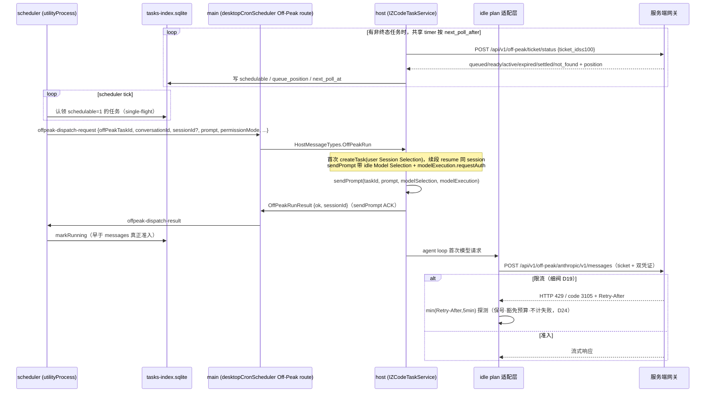
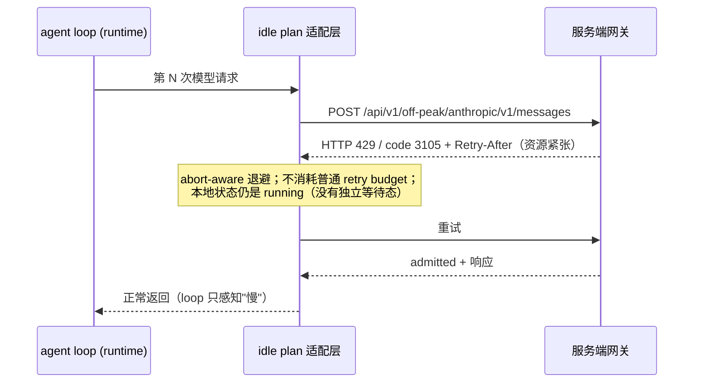
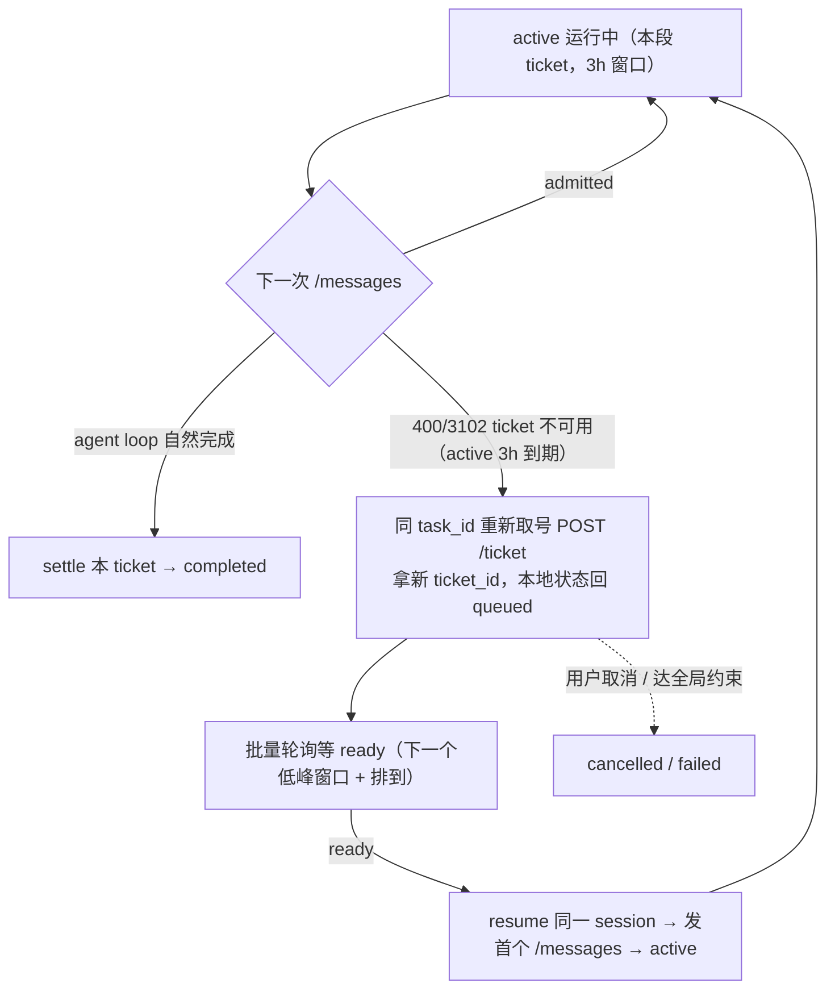
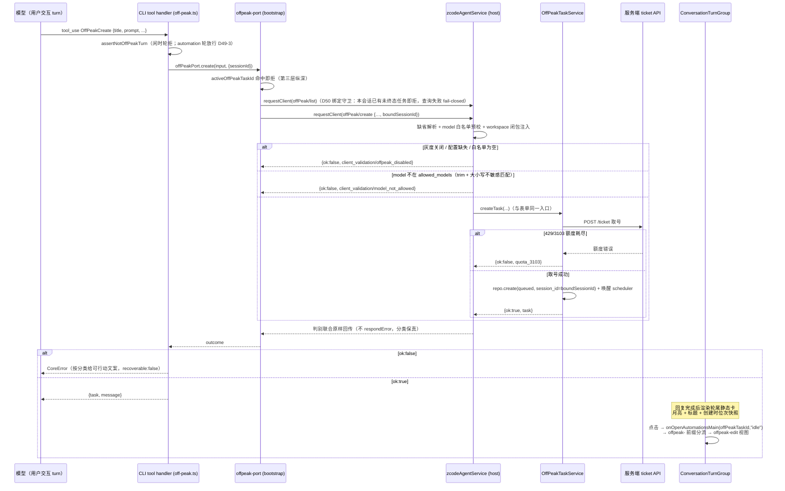
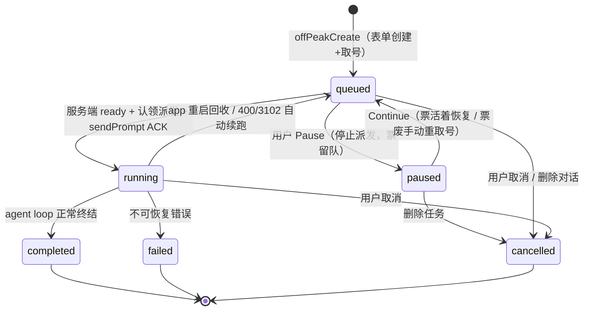
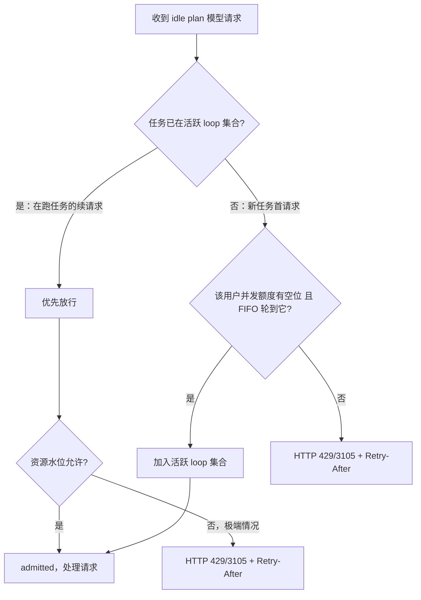
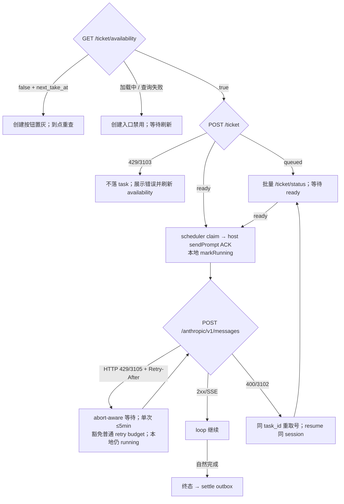
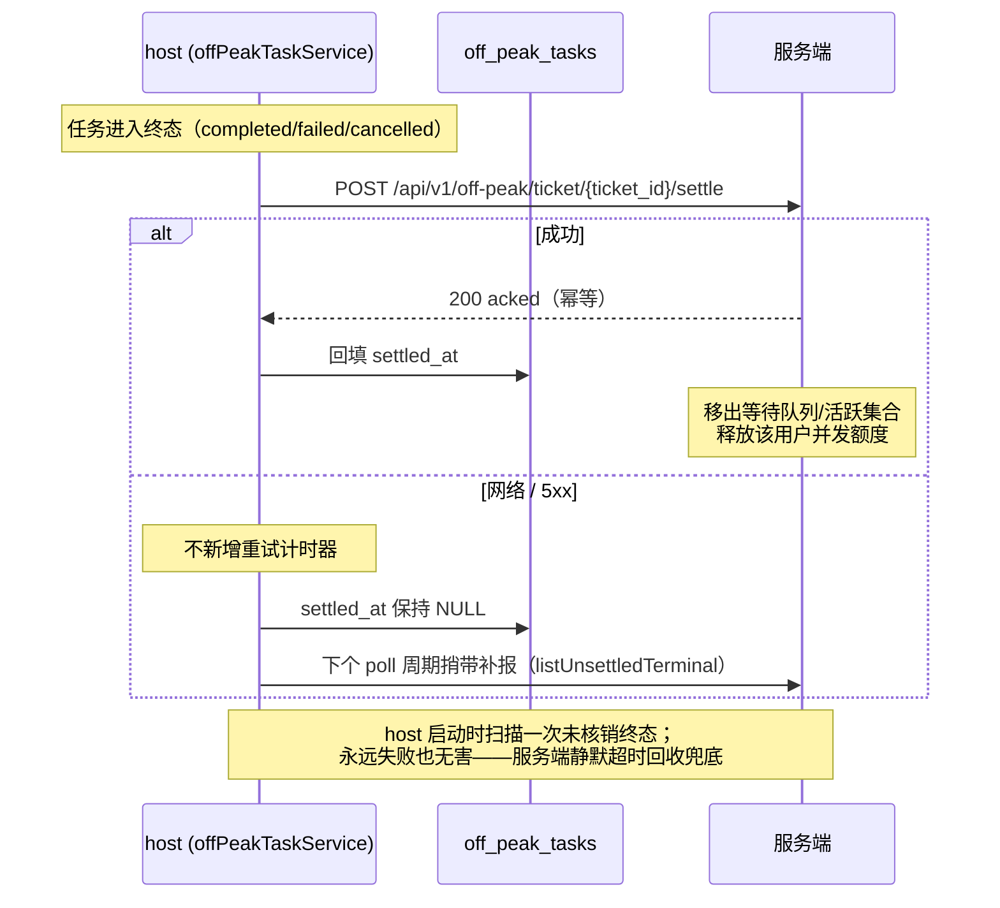

# Tarefa Fora do Pico (Off-Peak Task) — Design Técnico

> **Status: implementada; em 2026-08-24 os fatos de execução do Provider Refactor M4 foram sincronizados.** O repositório atual já contém os tipos de domínio `offPeak`,
> o Repo SQLite, o Service, o despacho scheduler/main/host, a cadeia de execução padrão de Provider/Model, a UI e o mock.
> Scheduled Automation continua sendo um domínio independente; os limites estão em [Scheduled Tasks Main View](../ui/scheduled-tasks-main-view.md).
>
> **2026-08-24 — Fechamento do Provider Config / Model Execution:** `client/configs.offPeak` controla apenas a exposição; o Built-in oculto
> `builtin:offpeak-idle-plan` fornece os fatos estáticos de Provider, e o Effective Model Config fornece os fatos estáticos de modelo.
> Os turnos automáticos enviam uma Model Selection padrão, e `modelExecution` carrega apenas o Request Auth desta requisição e a política de Child; o antigo
> `turnRuntimeModel`, o overlay temporário de Registry e a cadeia de restore de model de Session foram removidos.

> Documentos complementares: `spec.md` (semântica atual de produto), `decisions.md` (registro histórico de decisões D1–D44),
> `glossary.md` (terminologia atual), `implementation-notes.md` (mapa do código). Os esquemas iniciais no registro de decisões devem ser lidos conforme
> as marcações de superseded; o comportamento atual é o do código, deste documento e das notas de implementação.

## 0. Guia de leitura e decisões-chave

**Definição em uma frase**: tarefa fora do pico = uma tarefa em background de uso único dentro do sistema Automations (D28) — o usuário cria no formulário de Automations (title/instructions/projeto/permissões/modelo), ao enviar tira número e entra na fila, e o servidor, quando há capacidade ociosa, admite por FIFO global e controla a concorrência; no despacho, uma nova session é criada e executada sem supervisão na máquina do usuário, passando por um idle plan provider invisível, e ao chegar ao estado terminal o usuário é notificado.

**Estratégia de espera (o núcleo se apoia no Retry-After): o cliente nunca faz uma espera longa programada — cada resposta de fila limita a espera única a `min(Retry-After do servidor, 5 minutos)` e cobre qualquer lacuna arbitrária de recurso com um número ilimitado de sondagens idempotentes (3 horas de espera = ~36 sondagens de cinco minutos); se o recurso vagar antes, a próxima sondagem captura; as sondagens de fila são isentas do orçamento de retry e nunca contam como falha (D19/D24).**

> O D1–D44 completo (com as alternativas e os motivos de rejeição de cada item) está em `decisions.md`. Abaixo estão os itens que determinaram a forma final da arquitetura:

| Decisão                                              | Em uma frase                                                                                                                                                                                                              |
| ---------------------------------------------------- | ------------------------------------------------------------------------------------------------------------------------------------------------------------------------------------------------------------------------- |
| **Essência da tarefa** (D28, substitui D5/D23)      | **Tarefa em background de uso único** dentro do sistema Automations: criada em formulário, gerenciada na lista, com nova session no despacho; toda a UI segue o Figma final, e o switch da lua no composer/o paradigma de bloqueio são invalidados                                                          |
| **Fila e concorrência pertencem ao servidor** (D18/D20) | FIFO global e cota de concorrência por usuário ficam todas no servidor; o cliente não hospeda nenhuma estratégia de agendamento                                                                                              |
| **Cinco interfaces do ciclo de vida** (D39)        | availability → retirada de número `POST /ticket`(→ticket_id) → `POST /ticket/status` em lote → `POST /messages` → settle; o ready do servidor é gravado como schedulable local; o running local é gravado após o ACK de sendPrompt e não pode ser estritamente igualado ao active por tempo |
| **Segmentação de 3h + retomada automática** (D26 corrige D3/D15) | Cada active ticket dura no máximo 3h; ao expirar com `3102`, troca-se o ticket e faz-se resume da mesma session, e cada turno de continuação reinjeta o idle plan                                             |
| **Reenfileiramento por requisição** (D19)          | O protocolo de fila é concentrado na camada adaptadora do idle plan provider; a espera não conta como falha e não tem limite, e o agent loop não percebe nada                                                                 |
| **idle plan** (D11/D16/D33/D44)                    | O turno despachado automaticamente seleciona exatamente o Built-in oculto `builtin:offpeak-idle-plan` e cria o Active Model pelo Registry/ModelFactory padrão; permission é tratada na session comum e o estado agregado permanece running, sem troca de provider no meio após aprovação                |
| **Limite de faturamento** (D23/D33)                | A idle Model Selection e o Request Auth pertencem apenas a esta execução, não modificam Session Selection e não são gravados em Config/Registry View/session/queue; interjeições e conversas após o estado terminal criam o modelo conforme a Session Selection do usuário                     |
| **Liquidação de estado terminal** (D22)            | settle idempotente reportado + outbox de reforço, com o timeout silencioso do servidor como rede de segurança                                                                                                                   |
| **Switch de gradual rollout** (D31)                | A exposição da entrada é enviada pelo `offPeak.enable_offpeak_task` do `GET /api/v1/client/configs` compartilhado; a lista de modelos vem do Built-in `builtin:offpeak-idle-plan`. Habilitado de forma efetiva = switch true e lista de modelos do Built-in não vazia; a admissão continua sendo do servidor |
| **Snapshot de cota** (D39)                         | `GET /ticket/availability` dedicado retorna `can_take_number` e `next_take_at`; a UI esmaece antecipadamente e reconsulta no horário, mas o `POST /ticket` real continua sendo a autoridade final em caso de corrida                     |
| **Cortes e aberturas** (D1/D8/D17)                 | O pool gratuito não tem conceito de saldo nem sandbox (mapeia os modos de permissão existentes); o ciclo de vida do ticket e a capacidade de messages são exclusivos do Off-Peak, e o cliente também fornece mock                                      |
| **Criação dentro da sessão** (D49, derruba D30-4)   | `OffPeakCreate`/`OffPeakList` ficam lado a lado com a família de ferramentas `Cron*` (entrada de criação unificada, o agente roteia por semântica); são pontes para o `OffPeakTaskService.createTask` existente pelos novos métodos de protocolo `offPeak/create`/`offPeak/list`, na mesma cadeia de retirada de número do formulário; a superfície de ferramentas é controlada pelo host via `offPeakToolEnabled` (ausente por padrão = não registra) |

**Limite de Provider/faturamento (implementação atual)**: a barra de modelo da session sempre exibe o modelo permanente do usuário do workspace; o idle plan
apenas é o Active Model dos turnos despachados automaticamente. Não se pode mais usar a antiga generalização de "sempre que for um disparo humano, troca para a key do usuário":

| Momento                                       | Ação → resultado                                                                                                                                                                |
| --------------------------------------------- | -------------------------------------------------------------------------------------------------------------------------------------------------------------------------------- |
| Não criar tarefa fora do pico                 | Conversa/tarefa comum, sem relação com fora do pico                                                                                                                                 |
| Despacho automático/continuação automática    | O turno automático atual usa `builtin:offpeak-idle-plan` e não restaura o provider do usuário antes de o turno terminar                                                                |
| Usuário complementa um prompt enquanto o turno automático está ocupado | A mensagem entra na session queue existente e é drenada ao fim do turno, criando o modelo do usuário conforme a Submission comum e a Session Selection daquela mensagem |
| Aprovação de permissão                        | A session comum exibe/responde permission ou elicitation; o agregado Off-Peak permanece running. Se aprovar/rejeitar no turno atual, continua-se usando o mesmo idle Active Model, sem troca para o provider do usuário e sem reenviar notificação Off-Peak |
| Qualquer「取消」em estado não terminal seguido de retomada | A automação termina, os arquivos são preservados e a continuação manual ocorre inteiramente com a key do usuário                                                     |
| Conversa após o estado terminal               | Cria-se um novo Loop Model comum, usando o provider do usuário apontado pela Session Selection                                                                                |

A Session Selection nunca foi modificada pela execução fora do pico e, portanto, não existe ordem de restauração de modelo. Quando o idle Loop atual termina, primeiro encerra o ciclo de vida do seu
Active Model/Request Auth e só então entra no drain de ready/queue. O projeto de D11/D27 "trocar explicitamente para o provider do usuário após a aprovação" foi
cortado de forma explícita pelo D44. ~~queued「立即执行」~~ foi removido na v1 (D32).

**Linha de base do contrato atual do servidor**: em `zcode-server/main@ec2b18daa01b8e1b801f0691ac22153c2e56c6db`
está confirmado que os cinco endpoints exigem que o cliente envie `X-Coding-Plan-Api-Key`; a conexão BigModel Team também precisa enviar em par `bigmodel-organization` / `bigmodel-project` a partir do mesmo
selected credential snapshot, e é proibido depender de o servidor descobrir isso por busca reversa a partir da access key. availability, take e messages
validam; status/settle hoje leem apenas o JWT. O verificador suporta ZAI / BigModel conforme o provider de login JWT e trata a
Coding Plan key como credencial opaca para validar o plano e a titularidade do usuário; o JWT do Start Plan não é essa credencial e é
explicitamente excluído. **Correção com base nos fatos de execução do ambiente test em 2026-07-22**: os planos pessoais ZAI/BigModel funcionam ponta a ponta; a resolução e o transporte da runtime key de projeto BigModel Team pelo cliente já estão
estabelecidos, mas a dependência de subscription do verificador rejeita essa key com
`3101 coding plan is required`, que o servidor embrulha como `500/2007`, e portanto o Time Team ainda está
bloqueado pelo backend de teste ponta a ponta. O cliente não pode fazer fallback para a key pessoal. Os valores concretos de limite de produção, admitted global e afins continuam sendo configurados dinamicamente pelo servidor. Duas exigências estritas não podem ser esquecidas: tarefas já admitidas seguem até o estado terminal (3h); loops ativos são recuperados por timeout silencioso (após um crash do cliente, é isso que libera a cota de concorrência).

**Limite de selected connection / credential (fonte de verdade da implementação)**:

```text
AppSettings snapshot
  providerFamilyDomain
  modelProviderFamilyModes[family]
  modelProviderFamilySelectedKeys[family]
OAuth credential identity
  activeProvider + zcode JWT
             |
             v
  exact supported-connection matrix
     |-- ZAI Coding personal ---------> cached selected provider apiKey
     |-- BigModel Coding personal ----> cached selected provider apiKey
     |-- BigModel Team org/project ---> shared Team runtime-key helper
     `-- Start/API Key/identity mismatch/missing/stale --> typed permanent rejection
             |
             v
  OffPeakCredentialSnapshot { metadata + jwt + codingPlanApiKey }
      |                    |                       |
      |                    |                       `-- modelExecution.requestAuth
      |                    `-- availability/take/status/settle client
      `-- sanitized support over RPC --> gray-enabled UI creation gate
```

A causa raiz do bug era a UI varrer todos os providers em cache, enquanto o ticket client e o turno do host liam cada um apenas a key pessoal da
BigModel; os três pontos não compartilhavam a selected connection e ainda podiam misturar snapshots diferentes em uma única operação. Depois do ajuste,
todas as entradas usam o mesmo resolver: segredos ficam apenas na memória do host/service e a UI recebe só o support anonimizado; a falha da Team key proíbe
fallback para a key pessoal; o active OAuth provider precisa ser consistente com a família selecionada, e após mudança de seleção ou de identidade de login a próxima operação resolve novamente.

A causa raiz da falha do tester difere do bug de cliente já corrigido acima: o mesmo selected Team snapshot já chegou com sucesso ao servidor; a
falha ocorre depois que o verificador do servidor chama a dependência externa de subscription. O `429` cru sem código de negócio é outro caminho de
limite HTTP global e não pode ser interpretado como cota `3103`. O cliente apenas completa os headers padrão de origem/request-id, o log de diagnóstico
do service sem dados sensíveis e o mapeamento de erros legíveis, sem forjar sucesso de Team na retirada de número.

## 1. Contexto e objetivos

O usuário envia tarefas sem urgência para a "fila fora do pico", e o servidor admite por FIFO global quando há capacidade ociosa (o cliente não tem conceito de janela, apenas sonda autorização, D21); a tarefa é executada sem supervisão na máquina do usuário, por um provider exclusivo de fora do pico (idle plan, invisível ao usuário), com custo menor.

**Objetivo**: entrada de envio (formulário de Automations/cartão de template, gate de gradual rollout D31) → fila → execução após autorização e admissão do servidor → notificação de estado terminal, com toda a cadeia recuperável (reinício do app/sono não perde tarefas).

**Não objetivo (explicitamente não feito na v1, ver spec §7)**: guarda de saldo, pausa de janela/retomada por snapshot, cotas de tier, sandbox de sistema de arquivos, baseline git automático, ETA preciso, disparo/aprovação pelo celular, liga/desliga automático de keep-awake por número de tarefas ativas. Atualmente o keep-awake é uma configuração global e, quando ligado, impede imediatamente o app de ser suspenso por inatividade, independentemente do número de tarefas em execução.

## 2. Arquitetura geral

```mermaid
flowchart LR
  subgraph Client["z.code 桌面客户端"]
    subgraph Renderer["renderer (packages/ui)"]
      Automations["AutomationsSection<br/>Idle-time tab + 创建表单 + 模板卡<br/>（灰度门控 D31）"]
      TurnCard["ConversationTurnGroup<br/>会话内创建轮尾静态卡（D49）"]
      Sidebar["侧栏 Group 分组<br/>Idle-time task（跨项目 + 计数徽章）"]
      Detail["任务详情页 / run session 对话"]
      Store["offPeakStore (zustand)"]
    end
    subgraph Main["main 进程"]
      OPRouter["desktopCronScheduler<br/>OffPeakRun/Result 路由"]
      Notif["renderer notification hook<br/>系统通知"]
    end
    subgraph Sched["scheduler utilityProcess（常驻，已有）"]
      OPTick["offPeak tick：认领 schedulable 任务"]
    end
    subgraph Host["window Local Host utilityProcess<br/>按 workspaceKey 路由"]
      TaskSvc["IOffPeakTaskService<br/>create/pause/continue/cancel/list"]
      OPTool["offPeak/create · offPeak/list handler（D49）<br/>缺省解析 + 白名单预校 + workspace 注入"]
      RunSvc["IZCodeTaskService<br/>createTask / resume / sendPrompt"]
      Adapter["idle plan provider 适配层<br/>HTTP 429/3105 + Retry-After"]
      PollSync["OffPeakTaskService sync<br/>批量 POST /ticket/status → 写 sqlite"]
    end
    DB[("tasks-index.sqlite<br/>off_peak_tasks（含 schedulable 列）")]
  end

  subgraph Server["Off-Peak 服务端"]
    PollAPI["任务生命周期 API<br/>availability / ticket / ticket/status / settle"]
    Gateway["idle plan 网关<br/>全局 FIFO 排队 + 准入<br/>HTTP 429/3105 + Retry-After"]
    Pool["LLM 闲时资源池"]
  end

  Automations -->|IOffPeakTaskService RPC| TaskSvc
  TurnCard -->|onOpenAutomationsMain(id,"idle")| Automations
  Store <-->|broadcast/订阅| TaskSvc
  Sched <-->|读写| DB
  Host <-->|读写| DB
  Sched -->|offpeak-dispatch-request| OPRouter
  OPRouter -->|HostMessageTypes.OffPeakRun| Host
  Host -->|OffPeakRunResult| OPRouter --> Sched
  TaskSvc --> RunSvc
  OPTool -->|复用同一取号链路| TaskSvc
  Adapter -->|POST /messages| Gateway --> Pool
  PollSync -->|availability / 取号 / 批量状态 / settle| PollAPI
  Store -->|任务状态边沿| Notif
```

Pontos principais:

- **O scheduler só toca no tasks-index** (mantendo o esquema de proprietary do automation): o `OffPeakTaskService` do domínio do host é responsável por
  `POST /ticket` de retirada de número e pela sincronização em lote `POST /ticket/status`, gravando `schedulable`/`queue_position` de volta na linha da tarefa;
  o scheduler reivindica tasks schedulable do banco, sem enviar HTTP e sem deter as credenciais. A sincronização usa um timer compartilhado, e
  `next_poll_at` é um snapshot, e não um timer por tarefa.
- **O retry de fila é tratado de forma especial apenas na camada adaptadora do provider**: apenas o HTTP `429/3105` de `providerId=builtin:offpeak-idle-plan`
  é isento do orçamento comum de retry; o 429 de providers comuns mantém sua semântica.
- Compartilha o processo de scheduler e o pipeline de despacho com o automation, mas **a tabela de dados, os tipos de mensagem e a máquina de estados são totalmente independentes**, sem adicionar campos em `ZCodeAutomation`.

## 3. Modelo de domínio e armazenamento

### 3.1 Tipos TS (`packages/shared/src/off-peak-types.ts`, implementados)

```ts
export type ZCodeOffPeakTaskStatus =
  | "queued"
  | "paused"
  | "running"
  | "completed"
  | "failed"
  | "cancelled"; // paused 为 D30-10 新增

// D29-4：权限四档全开放（Ask/Edit automatically/Plan/Full access），直接复用现有 ZCodeTaskMode；
// 现产品词表为 build/edit/plan/yolo（automationAgentConfigOptions 同源），默认 "build"（Ask for
// approval）。旧稿的 "bypassPermissions" | "default" 两值类型作废。

export interface ZCodeOffPeakTask {
  offPeakTaskId: string; // 本地主键，同时用作服务端 task_id（稳定，跨多个 ticket）
  serverTicketId?: string; // 服务端取号返回的 Snowflake ticket_id；每次重新取号更新（D26）
  title: string; // 表单 Task title（D28）
  conversationId?: string; // 宿主对话 taskId；D30-8 创建不预建对话，首次派发 createTask 后回填
  sessionId?: string; // 首跑后回填；续跑/中断恢复 resume 用
  prompt: string; // 表单 Instructions
  permissionMode: ZCodeTaskMode; // 权限四档（D29-4），默认 "build"（Ask before changes）
  model?: string;
  thoughtLevel?: string; // 推理强度（D34，与 automation 对齐）；缺省走 workspace 默认
  workspaceKey: string; // resolveWorkspaceKey 规则
  workspacePath: string;
  workspaceIdentity?: string;
  status: ZCodeOffPeakTaskStatus;
  queuedAt: number; // 本地 scheduler FIFO/展示排序；服务端 FIFO 以 ticket 创建序为准
  startedAt?: number;
  endedAt?: number;
  failureReason?: string;
  filesChanged?: number;
  settledAt?: number; // 终态核销服务端 ack（D22）
  historyDeletedAt?: number; // 仅控制本地 History 可见性
  registeredAt?: number; // POST /ticket ack 时间
  schedulable?: boolean; // 服务端 ready 快照
  queuePosition?: number;
  nextPollAt?: number; // 服务端建议时间快照；共享 sync timer 消费
  createdAt: number;
  updatedAt: number;
}

// 批量 POST /ticket/status 的同步快照写回任务行，供 scheduler 跨进程读取：
// registeredAt(取号成功) / schedulable(服务端 ready) / queuePosition / nextPollAt。
// 创建额度不从 client/configs.limit 或本地计数推导；D39 availability 只做 UI 快照，
// POST /ticket 的 429/3103 始终是最终准入权威。
```

Pontos de extensão do protocolo (obedecendo ao AGENTS.md: alterar `packages/shared/src/zcode-protocol/index.ts` + o schema de runtime `validation.ts`):

- `HostMessageTypes.OffPeakRun` / `HostResponseTypes.OffPeakRunResult` (modelados a partir de CronRun/CronRunResult).
- `schedulerProtocol.ts` ganha o par de mensagens `offpeak-dispatch-request` / `offpeak-dispatch-result`.
- O renderer usa o RPC `IOffPeakTaskService` independente com `getTakeNumberAvailability` / `createTask` /
  `updateTask` / `cancelTask` / `pauseTask` / `continueTask` / `deleteTask` / `deleteHistory` /
  `list` / `get`. A retirada de número, a sincronização em lote, a retirada de número novamente e o outbox de settle são dirigidos internamente pelo service;
  ~~`offPeakRunNow`~~ foi removido pelo D32.
- **D49 Criação dentro da sessão**: novos métodos de protocolo agent→host `offPeak/create` (params
  `zcodeOffPeakCreateParamsSchema` = title/prompt obrigatórios + permissionMode/model/thoughtLevel opcionais;
  result é uma **união discriminada** `{ok:true,task} | {ok:false,failureStage,errorCategory,errorCode}`,
  com a classificação de falha preservada ao longo do protocolo e proibida a degradação para string) e `offPeak/list` somente leitura. O schema de snapshot da tarefa
  `zcodeOffPeakTaskSnapshotSchema` é a superfície mínima: não expõe `serverTicketId` (proibido atravessar fronteira) nem
  `providerName` (dimensão puramente de telemetria). O workspace não entra nos parâmetros de protocolo e é injetado pelo host a partir da session atual
  (simétrico a `automation/create`).
- **Flag de superfície de ferramentas (D49)**: os params `session/create` e `session/resume` ganham cada um
  `offPeakToolEnabled?: boolean`, e ele é registrado em `SESSION_CREATE/RESUME_OPTIONAL_COMPAT_FIELDS` —
  quando o schema `.strict()` do app-server antigo não reconhece, há nova tentativa com degradação (omitir o campo = ferramentas não registradas, direção segura).
  O resume precisa enviá-lo igualmente: caso contrário, a reconstrução do runtime na recuperação a frio perderia a superfície de ferramentas (mesma causa de `toolAllowlist`).

### 3.2 sqlite (tasks-index, `OffPeakTaskRepo` modelado a partir de `AutomationRepo`)

```sql
CREATE TABLE IF NOT EXISTS off_peak_tasks (
  off_peak_task_id   TEXT PRIMARY KEY,
  server_ticket_id   TEXT,
  title              TEXT NOT NULL DEFAULT '',  -- 表单 Task title（D28）
  conversation_id    TEXT,                 -- 宿主对话 taskId；D30-8 派发时 createTask 后回填
  session_id         TEXT,
  prompt             TEXT NOT NULL,
  permission_mode    TEXT NOT NULL,        -- ZCodeTaskMode 权限四档（D29-4），默认 'build'
  model              TEXT,                 -- 仅存量选择迁移；新版写入 NULL
  thought_level      TEXT,                 -- 仅存量选择迁移；新版写入 NULL
  model_selection    TEXT,                 -- 完整冻结 ModelSelection JSON；执行不得回读旧两列
  workspace_key      TEXT NOT NULL,
  workspace_path     TEXT NOT NULL,
  workspace_identity TEXT,
  status             TEXT NOT NULL,        -- 七态（含 paused，D30-10），见 §5
  queued_at          INTEGER NOT NULL,
  started_at         INTEGER,
  ended_at           INTEGER,
  failure_reason     TEXT,
  files_changed      INTEGER,
  settled_at         INTEGER,           -- 终态核销服务端 ack 时间；NULL=未核销（7.7/D22）
  history_deleted_at INTEGER,           -- 仅隐藏本地 History 行，不删除 task/session
  registered_at      INTEGER,           -- POST /ticket ack 时间
  schedulable        INTEGER NOT NULL DEFAULT 0, -- 服务端 ready 快照
  queue_position     INTEGER,
  next_poll_at       INTEGER,           -- 服务端建议轮询时间快照；当前由共享 timer 驱动
  -- 调度认领（single-flight，复用 automation 的 BEGIN IMMEDIATE + running 0→1 模式）
  claim_running      INTEGER NOT NULL DEFAULT 0,
  claimed_at         INTEGER,
  attempt_count      INTEGER NOT NULL DEFAULT 0,
  last_error         TEXT,
  created_at         INTEGER NOT NULL,
  updated_at         INTEGER NOT NULL
);
CREATE INDEX IF NOT EXISTS idx_off_peak_pick   ON off_peak_tasks(status, queued_at);
CREATE INDEX IF NOT EXISTS idx_off_peak_ws     ON off_peak_tasks(workspace_key, status);
```

Principais métodos do `OffPeakTaskRepo`: `create` / `claimDue(now)` (reivindicação transacional com `BEGIN IMMEDIATE` de
`queued + schedulable=1`, com reivindicação stale de 10 minutos recuperável) / `markRunning` / `markTerminal` /
`releaseClaim` / `recoverInterrupted()` / `requeueForContinuation` / `setPaused` /
`delete` / `markHistoryDeleted` / `markSettled` + `listUnsettledTerminal` /
`updateSchedulingSnapshot`. A inicialização migra para `running` o valor reservado legado `awaiting_approval` de bancos antigos.
`countNonTerminal/countActive` servem para estatísticas e já não respondem pela decisão de cota de criação local do D36.

## 4. Fluxo de dados ponta a ponta

### 4.1 Envio (a qualquer momento)

```mermaid
sequenceDiagram
  participant U as 用户
  participant UI as Automations 创建表单 (renderer)
  participant Svc as IOffPeakTaskService (host)
  participant Repo as OffPeakTaskRepo
  U->>UI: 入口（Automations 按钮 / 模板卡预填）
  UI->>Svc: GET /ticket/availability（进入页面时）
  alt can_take_number=false
    Svc-->>UI: 创建按钮置灰 + next_take_at Tooltip；到点重查
  else loading / 查询失败
    Svc-->>UI: 创建入口禁用；等待手动或自动刷新
  else can_take_number=true
  U->>UI: 填 title/instructions/项目/权限/模型 → Create Idle-time task
  UI->>Svc: offPeakCreate({title, instructions, permissionMode, model, workspace...})
  Svc->>Svc: POST /ticket 取号（task_id=offPeakTaskId）
  alt 429/3103 超限（D39：查询后的并发竞态兜底）
    Svc-->>UI: 展示 "Free tier limit reached"；不落 task；刷新 availability
  else 取号成功
    Svc->>Repo: create(status=queued, server_ticket_id, position)
    Svc-->>UI: 列表新卡片 #N in queue，侧栏 Group 分组 +1
  end
  end
end
```

Decisão-chave (D30-8, revisando a decisão antiga D25): **a criação grava apenas os dados do formulário + a retirada de número, sem pré-criar nenhuma conversa**. No despacho, `createTask` cria a session (o mesmo caminho do CronRun do automation) e preenche sessionId; a recuperação de interrupção/a continuação faz resume da mesma session. As entradas do agrupamento Group da barra lateral levam à página de detalhes da tarefa quando não há session e vão direto para a conversa quando há session.

### 4.2 Fluxo de agendamento + admissão (após autorização)



- Falha de despacho (sem host disponível / host lança erro) tem retry com backoff transient igual ao do automation (a série de constantes `DISPATCH_RETRY_BASE_MS` é independente).
- **Não há janela a ser perdida (D21)**: nada acontece durante o sono da máquina / app fechado, e após a retomada a busca e o despacho voltam desde que ainda existam tarefas queued (a semântica antiga do D9 se sustenta naturalmente). ⚠ Não reutiliza a lógica de skip `MISFIRE_GRACE_MS` do automation.
- A concorrência é controlada pelo servidor (D20): durante a fase de autorização o cliente inicia todas as tarefas queued na ordem de entrada na fila, e quanta concorrência cada usuário efetivamente recebe é decidido pela admissão do gateway; as tarefas não admitidas permanecem exibidas como "já enfileiradas". O risco de conflito de arquivos em tarefas concorrentes no mesmo workspace é o mesmo de o usuário rodar várias conversas manualmente ao mesmo tempo, sem isolamento adicional.

### 4.3 Fluxo de re-enfileiramento durante a execução (D19, pode ocorrer em toda requisição)



Regras da camada adaptadora (implementadas em `apps/zcode-cli/packages/adapters/src/model/offpeak-retry.ts` e chamadas pelo
runner de generate/stream; só valem para `providerId=builtin:offpeak-idle-plan`):

- **Clamp da espera única**: a duração da espera = `min(Retry-After do servidor ou 60s padrão, 5 minutos)`;
  esperas longas são cobertas pelo clamp curto × sondagens idempotentes ilimitadas, e a espera pode ser interrompida por abort.
- **Isenção do orçamento de retry**: HTTP 429 ou código de negócio 3105 são classificados como `ModelRetryReason.OffpeakQueued`, e o
  runner mantém/rola back a attempt, para que a espera de capacidade não consuma o orçamento comum de retry; outros providers não entram neste ramo.
- **Limite seguro do stream**: só retenta antes de haver saída visível do provider; depois de cruzar o limite visível, não há replay.
- **Abandono no primeiro despacho (regra 1, a decisão final de implementação passou a usar o TTL do ticket)**: a lógica de abandono não é implementada separadamente na camada adaptadora — quando o primeiro request do estado queued fica pendurado no gateway, o TTL de 5min do ready expira naturalmente, dispara `400/3102` → retoma a execução e volta para a fila (§4.6), e o limite superior da espera é ≈ TTL + uma sondagem com clamp de 5min ≤ 10min, o que atende à intenção da regra (não deixar o agent loop pendurado) com menos uma máquina de estados; o novo despacho reutiliza a semântica de resume da recuperação de interrupção.
- Cancelamento da tarefa pelo usuário → aborta os timers em espera e as requisições em trânsito.
- A injeção de headers acompanha a configuração do provider de escopo do run: `X-Off-Peak-Ticket-ID` / credenciais duplas (JWT + `X-Coding-Plan-Api-Key`, pontos de injeção D23/D26 feitos naturalmente).

### 4.4 Limite de Permission / elicitation (D44)

D11/D27 já cravaram "pausar operação sensível → estado de espera dedicado → trocar para o provider do usuário após aprovação e avisar de cota". No runtime atual, o idle Active Model cobre todo o turno automático, e permission/elicitation não encerram o turno; por isso o código final apenas
reutiliza a confirmação da session comum, sem criar um segundo conjunto de estados e notificações do Off-Peak.

```text
自动 turn（active turn model = builtin:offpeak-idle-plan）
  └─ permission_request（走既有通用 permission 链路）
       ├─ 普通 session 展示并收集批准/拒绝
       ├─ 本地 Off-Peak task 保持 running
       └─ 响应后：同一个 turn 继续
            ├─ 仍使用 builtin:offpeak-idle-plan
            └─ 不触发 Off-Peak 专用通知或配额提示

自动 turn terminal
  └─ 结束 idle Active Model/Request Auth → ready / drain 用户排队消息
```

A run session é uma conversa comum, e um prompt enviado pelo usuário durante running passa pela busy queue existente. Cada despacho automático envia uma idle
Model Selection exata e anexa em `modelExecution` o Request Auth desta execução e a política de Child: os fatos estáticos entram no Registry permanente pela Config/Rules do Built-in,
e o ModelFactory cria o Active Model para o Loop atual; Session Selection nunca
muda, e o material dinâmico não é gravado no cache do app, no record do CLI, no catálogo do workspace, no snapshot de Session nem na Queue comum. Após o turno
terminar, encerra-se o ciclo de vida do idle Active Model/Request Auth e só então se entra no drain de ready/queue, de modo que mensagens de usuário enfileiradas
e conversas após o estado terminal usam o provider do usuário.

### 4.5 Recuperação de interrupção (reinício do app / máquina acorda)

Caminho de inicialização: quando o processo de scheduler (singleton do app, antes de qualquer despacho) inicia, chama `OffPeakTaskRepo.recoverInterrupted()` — tarefas `running`/com reivindicação vencida voltam para `queued` (preservando queued_at, continuando naturalmente perto do início da fila) → o próximo tick é despachado novamente quando autorizado → host faz `session/resume` da mesma session → continua com o prompt de retomada. Se o banco antigo tiver o valor reservado histórico `awaiting_approval`, o Repo migra primeiro para running na inicialização. Prompt de retomada (decisão final de implementação): instrução fixa em inglês "Continue the previous task from where it left off…do not start over", sem reenviar o prompt original (evita refazer do zero); a distinção entre primeira execução e continuação = se a linha já tem conversationId.

### 4.6 Fluxo de retomada automática ao expirar 3h (D26)

O servidor tem um teto rígido de 3h para active, e tarefas longas precisam ser segmentadas: um segmento = um ticket, o mesmo `task_id` atravessa vários segmentos e a session é reutilizada durante todo o processo.



Pontos principais:

- O gatilho é a message que recebe `400/3102` (active expirado, o servidor já marcou o ticket como expired), e não um cronômetro local do cliente — vale o do servidor, evitando erros por deriva de relógio.
- A nova retirada de número usa o **mesmo `task_id`** (o servidor permite várias), troca por um novo `ticket_id`; a coluna `server_ticket_id` é atualizada e o ticket antigo é invalidado.
- O segmento de continuação ainda passa pelo caminho completo "esperar ready → resume → primeiro message garante a janela de 5min", igual ao primeiro segmento (reaproveitando o pipeline de despacho da §4.2).
- O estado visível ao usuário volta a "aguardando computação ociosa" durante o intervalo de continuação (running→queued na exibição), e volta a running quando começa a rodar; para o usuário é uma tarefa que termina sozinha.
- A session não se perde entre segmentos: `session/resume` + prompt de retomada (item 2 a verificar do spec).

### 4.7 Fluxo de criação dentro da sessão (D49)

#### Decisão de integração do Todo103: religação da configuração de modelo da ferramenta

Mantêm-se os padrões da ferramenta — yolo, o último modelo da lista e o nível de raciocínio mais alto —, além do vínculo com a sessão, da proteção contra recursão e da anonimização de erros.
Os fatos de modelo passam a vir do `OffPeakClientConfig.modelSelectionView` atual, sem restaurar o antigo `allowedModels`,
`allowedModelConfigs`, `reasoning.levels/defaultLevel` nem os ramos que adivinham o nível pelo modelo.

```text
工具创建请求
  -> 已有 getCodingPlanSupport 确认当前账号 Family
  -> 当前闲时 Selection View 中该 Family 的精确 Off-Peak Provider
  -> 解析模型（显式：大小写匹配；缺省：名单末位）
  -> 缺省档位复用 completeNewModelSelection（values 从低到高，取末位）
  -> 结构化 ModelSelection + workspace + boundSessionId
  -> 原有 createTask 取号和持久化
```

Não é possível completar o modelo a partir dos candidatos de outra Family; sem conta suportada/sem modelo nesse domínio, retorna-se de forma estável a classificação de "cliente não pode criar",
sem retirar número e sem gravar seleção vazia. O nível explícito é entregue à validação existente do createTask e não é sobrescrito pelo nível padrão.
Essa regra vale apenas para novas tarefas pela ferramenta, não religa Tickets existentes e não modifica a seleção de execução já fixada.
O gate continua sendo enviado pela entrada existente de prontidão/criação do cliente, sem refazer o sistema de sincronização por causa da consolidação.

A chamada de ferramenta e a criação pelo formulário **compartilham a mesma cadeia de retirada de número** (`OffPeakTaskService.createTask`), e a diferença está apenas na entrada e na resolução do padrão: a ferramenta mantém o padrão yolo/o último modelo da lista do domínio da conta/o nível mais alto (D49-4, voltada a "falar e sair" na semântica sem supervisão).
O formulário mantém a interação do Selection View atual e o envio da seleção completa, sem restaurar o nível padrão histórico do workspace por causa da introdução da interface de ferramenta.



**Três camadas de profundidade no limite de turno** (a direção é oposta à do cron e é a maior armadilha de cópia):

```text
                        ┌─ 普通用户 turn ──────── OffPeakCreate ✅  OffPeakList ✅
本轮身份判定 ───────────┼─ cron automation turn ─ OffPeakCreate ✅（D49-3 组合玩法） ✅
                        └─ 闲时派发 turn ──────── OffPeakCreate ❌            ✅

闲时轮的三层拦截（任一层独立成立）：
  L1 provider 请求边界   buildTurnDisallowedTools / buildTurnToolDisallowlist
                         ← host 派发 toolDenylist:["CronCreate","OffPeakCreate"]（D45+D49-2）
                         ← isOffPeakCreateRestrictedTurn 三信号：
                            显式 offPeakTaskId（主）∥ queryId "offpeak-" 前缀（resume 兜底）
                            ∥ denylist 已含 OffPeakCreate（busy 合并路径）
  L2 handler 执行边界    assertNotOffPeakTurn(context.offPeakTurn) → PermissionDenied
                         同一 offPeakTurn 还关闭 Bash 后台面（D51）：run_in_background → recoverable
                         ToolExecutionFailed；超时自动转后台禁用；Agent 后台由 runner BACKGROUND_UNAVAILABLE 拒
  L3 协议端口边界        offpeak-port 读 record.activeOffPeakTaskId → 拒绝，不发协议请求
  （D50 绑定守卫三级：端口读 offPeak/list top-20 快速拒绝 → service createTask 取号前
    repo.hasActiveBoundTask 精确预检 → 部分唯一索引 idx_off_peak_bound_active 在 INSERT 关闭 TOCTOU，
    后两级均回 session_bound，机审 CR-02）

⚠ OFF_PEAK_MUTATION_TOOL_NAMES 必须独立于 AUTOMATION_MUTATION_TOOL_NAMES（共 4 份副本：
  services/automationToolPolicy、core/turn-loop-state、bootstrap/prompt-turn、adapter 内联）。
  混入任何一份都会让 cron automation 轮误 deny OffPeakCreate，违反 D49-3。
```

**Separação entre registro de ferramentas e admissão de criação (3.12.2)**:

```text
Host 服务装配 + 本地 workspace（不联网）
  -> workspace 策略 / legacy create-resume / V4 createSession flag
  -> createRecord 注入 OffPeakPort -> 主 Runtime 注册工具
工具 OffPeakCreate -> 审批/调用守卫 -> Host 读取灰度/套餐/模型 -> createTask/取号
工具 OffPeakList -> Host 本地列表，按 workspaceKey 过滤
```

As condições de capacidade local verificam apenas a montagem de dependências, remoteSessionId e a workspaceIdentity remota; não usam o client config.
A política por workspace é mantida para cobrir a recuperação a frio do V4 subscribe, sem novos Host ou canais de recuperação.
Rollout desligado/falha de leitura afeta apenas a chamada real de criação; a entrada de página continua controlada pelo rollout. Quando o Host antigo não fornece a flag, continua sem registro, e
o method-not-found do CLI antigo continua degradando. Runtimes já ativos não reconstroem dinamicamente o conjunto de ferramentas.

**Despacho para sessão vinculada (D50, três ramos de `dispatchOffPeakRun`, função pura `resolveOffPeakDispatchKind`)**:

```mermaid
flowchart TD
  A[scheduler 认领 → host OffPeakRun] --> K{conversation_id?}
  K -- 非空 --> R[resume：resumeTask 同 session<br/>setMode → 续跑提示词 + 单次执行完整 Selection]
  K -- 空 --> B{session_id?}
  B -- 空 --> I[init（表单）：createTask 新 session<br/>盖章 offPeakTaskId → 任务 prompt]
  B -- 非空 --> P[bound-first-run（会话内创建）]
  P --> D{listDeletedTaskIds 含该会话?}
  D -- 是 --> PERM[OffPeakBoundSessionDeletedError<br/>permanent → failed]
  D -- 否 --> S{tasks-index status === running?}
  S -- 是 --> BUSY[OffPeakBoundSessionBusyError<br/>transient → releaseClaim + 退避<br/>⚠ 未写任何会话配置]
  S -- 否 --> RES[resumeTask（盖章 offPeakTaskId → 侧栏闲时组）<br/>setMode(yolo 缺省)<br/>sendPrompt 任务原 prompt + 单次执行完整 Selection, toolDenylist]
  RES --> MR[markRunning: conversation_id = session_id]
  MR -.任务轮结束.-> T{outcome}
  T -- succeeded --> C[completed]
  T -- stopped（用户点 Stop）--> X[cancelled，票作废]
  T -- 其他 --> F[failed]
```

Detalhes da colisão com sessão ocupada: o CLI `session/send` só olha `record.activeAbortController`, e se houver devolve -32010 imediatamente (a entrada de usuário pela interface passa pela fila v4 e não colide com isso);
`setMode` não tem essa checagem, então a sondagem precisa acontecer antes de escrever a configuração. O host reporta erros não permanentes uniformemente como transient; o scheduler faz `releaseClaim` de volta para queued, `attempt_count+1`, com backoff de 30s·2^(n-1) limitado a 15min e
sem limite de tentativas; se a janela ready do ticket expirar durante o retry, a sincronização retira um novo número com o mesmo task_id e o coloca no fim da fila.

Restrições de integração: nem a primeira execução vinculada nem a continuação podem chamar setConfigOption(thought_level) isoladamente. O nível entra na seleção congelada de ModelSelection com selectionScope=execution, pertencendo a esta execução assim como o Request Auth do Ticket; não se pode gravar o nível idle na Session existente do usuário. Mantêm-se as sondagens de sessão ocupada/excluída, o ajuste de mode e a marca de pertença, sem adicionar sincronização de conta antes do envio.

**Sinal de prontidão para o salto do cartão**: a criação dentro da sessão é persistida diretamente pelo agente, sem passar pelo `offPeakTaskStore` da UI; e o
`loading` do store tem valor inicial false ("não carregado" e "carregado" são indistinguíveis). Ao receber uma navegação com prefixo `offpeak-`, `AutomationsSection` força primeiro um `refresh()`, usando "o refresh deste id de navegação terminou" como único sinal de prontidão e só então resolvendo found/missing;
`refresh()` com falha não faz reject e apenas escreve `store.error`; nesse caso a lista não é confiável → resolve como `unavailable`: cai na tab de fora do pico e exibe
「列表加载失败」, sem reportar targetNotFound indevidamente (review CR-01);
o effect de navegação de tab não consome de forma preventiva quando existe navegação de detalhe offpeak (`onOpenAutomationConsumed` limpa o id e a tab ao mesmo tempo).

## 5. Máquina de estados



Tabela de transições (quem dispara, quem persiste, efeitos colaterais):

| Transição                  | Quem dispara                                                            | Persistência                                    | Efeito colateral                                          |
| -------------------------- | ----------------------------------------------------------------------- | ----------------------------------------------- | --------------------------------------------------------- |
| →queued                    | Formulário de criação de Automations → RPC (grava no banco após sucesso da retirada de número) | Repo.create                                     | novo cartão #N in queue na lista, agrupamento Group da barra lateral +1 |
| queued→paused              | Pause do usuário (D29-3)                                                 | Repo.setPaused                                  | interrompe o despacho; o ticket continua na fila do servidor |
| paused→queued              | Continue do usuário (restaura com ticket vivo / retirada manual se o ticket morreu) | Repo.setPaused                      | retoma a busca e o despacho                                |
| queued→running             | ready do servidor + despacho por scheduler/host, `sendPrompt` retorna ACK | Repo.markRunning + preenchimento de conversation/session | a barra de status muda para "运行中"; nesse ponto messages ainda pode estar esperando 429/3105 |
| queued→cancelled           | cancelamento/exclusão do usuário (diálogo de confirmação)                | Repo.markTerminal                               | remove do agrupamento da barra lateral (~~execução imediata da fila~~ removido pelo D32) |
| running→completed/failed   | host observa o evento de estado terminal da task                        | Repo.markTerminal                               | notificação + remoção do agrupamento + preenchimento de files_changed |
| running→queued             | recoverInterrupted ou o host reconhece `off-peak-ticket-expired`        | recuperação pelo Repo / `requeueForContinuation` | preserva a mesma session e retira um novo número           |

Pontos de validação de invariantes (guardas no nível do Repo): estados terminais são irreversíveis; a reivindicação de uma única tarefa é single-flight (evita despacho duplicado), e não há limite local de concorrência entre tarefas (D20).

Limites de interação (D30/D44): queued tem Pause/Delete/editar, paused tem Continue/Delete/editar, running tem cancelar,
e estados terminais têm Delete/somente leitura. permission/elicitation só são tratados dentro da session comum; o envio de mensagens dentro da run session não bloqueia,
e as mensagens são drenadas depois que o turno automático restaura o modelo do usuário.

## 6. Pontos de design dos módulos

| Módulo                                                   | Mudança                                                                                                                                                                                                                                                | Referência                                                            |
| -------------------------------------------------------- | --------------------------------------------------------------------------------------------------------------------------------------------------------------------------------------------------------------------------------------------------------- | --------------------------------------------------------------------- |
| `packages/shared`                                        | Novo `off-peak-types.ts`; extension de protocol/validation/channels com o par de mensagens OffPeakRun                                                                                                                                                        | `automation-types.ts`                                                  |
| `packages/services/src/session/offPeakTaskRepo.ts`       | Implementado, ver §3.2                                                                                                                                                                                                                                 | `automationRepo.ts`                                                    |
| `packages/services/src/session/offPeakTaskService.ts`    | Criação com retirada de número, cancelamento, Pause/Continue, edição, tombstone de History, sincronização de tickets em lote, retirada de número novamente, wake do scheduler e outbox de settle                                                                    | `automationService.ts`                                                 |
| `packages/desktop/src/scheduler/`                        | `index.ts` ganha o ramo de tick offPeak (reivindicar tarefas schedulable + mensagem de despacho); `schedulerProtocol.ts` ganha o novo par de mensagens                                                                                             | tick de cron existente                                                 |
| `packages/desktop/src/main/desktopCronScheduler.ts`      | Já integrado ao roteamento existente: encaminha OffPeakRun/Result e o wake do scheduler                                                                                                                                                                    | Roteamento CronRun                                                     |
| `packages/desktop/src/host/index.ts`                     | Montagem preguiçosa do runtime Off-Peak; na primeira execução cria a task com a seleção exata salva na tarefa (resume se for sessão vinculada), na continuação faz resume; envia idle Model Selection + `modelExecution.requestAuth`, assina o outcome terminal e reconhece o marker 3102                                   | Bloco de tratamento CronRun                                            |
| idle plan provider                                       | Config Built-in oculta guarda Endpoint/models/access; o despacho só constrói o Request Auth com JWT + Coding Plan Key + header de Ticket, vinculado ao Model de escopo de execução atual, sem gravar em Config/Registry View/session/workspace catalog; a camada adaptadora implementa o protocolo de retry 429/3105 (§4.3) | Provider Config + `offpeak-retry.ts` + runner de generate/stream      |
| `packages/ui`                                            | Extensão do AutomationsSection: tab/formulário/cartões de lista/History de Idle-time; barra de manter acordado + cartões de template na página New task; agrupamento de sistema Group na barra lateral; switch de manter acordado (três entradas espelhadas); `offPeakStore`                          | `AutomationsSection` / `automationManagementStore` (extensão direta)  |
| Notificações                                             | `useOffPeakTaskNotifications.ts` faz polling das tarefas e emite notificação de desktop nas bordas completed/failed/awaiting; a variante awaiting não dispara por enquanto, pois o estado é inalcançável em produção                                                                        | —                                                                      |
| i18n                                                     | A tabela de textos do PRD §8 vai para `en-US.ts` / `zh-CN.ts` (removendo entradas de campos já cortados)                                                                                                                                                  | —                                                                      |
| **Ferramenta dentro da sessão (D49)**                   | `contracts/src/tools/off-peak.ts` + `interfaces/off-peak.port.ts` (espelho zod v3, proibido importar shared); `core/src/tool/handlers/off-peak.ts` (handler + tool entry, `needsApproval:true`); `isOffPeakCreateRestrictedTurn` e a constante independente em `core/runtime/methods/turn-loop-state.ts`; o gate `includeOffPeak` em `registerBuiltInTools` | `tools/automation.ts` / `handlers/cron.ts` (**direção defensiva oposta, não copie inteiro**) |
| **Ponte de protocolo (D49)**                            | `bootstrap/zcode-protocol/offpeak-port.ts` (mais simples que o automation-port: sem checkTaskBinding, sem injetar estado de execução da sessão, sem congelar o título); `server-operations.ts` só injeta a porta quando `offPeakToolEnabled=true`; `prompt-turn.ts`/`session-flow.ts`/caminhos legados mantêm `activeOffPeakTaskId` | `automation-port.ts`                                                 |
| **Orquestração no host (D49)**                           | handler `offPeak/create|list` em `zcodeAgentService.ts`, `isOffPeakToolSupported`, resolução do padrão (`resolveOffPeakToolSelection`); injeção por holder de referência antecipada em `node.ts` (o singleton do service é criado depois do agent service)                          | handler de `automation/create`                                        |

Regras de UI: leia `DESIGN.md` antes de mudar `packages/ui`; logs passam por `packages/ui/src/logger.ts`; logs da camada de serviço usam `createServiceLogger("off-peak")` — retry de fila é registrado com `debug` a cada tentativa (alta frequência), e reivindicação/despacho/admissão/estado terminal usam `info`, conforme as regras de nível de log do AGENTS.md.

## 7. Contrato do servidor e coordenação com o cliente (interfaces reais + mock em processo)

### 7.1 Visão geral das responsabilidades do servidor

| Módulo                      | Responsabilidade                                                                                                                      | Ponto de integração com o cliente                                                    |
| --------------------------- | ------------------------------------------------------------------------------------------------------------------------------------- | ------------------------------------------------------------------------------------ |
| API de ciclo de vida do ticket | Snapshot de `availability`, retirada de número `POST /ticket`, `POST /ticket/status` em lote, settle por ticket; o servidor avança queued→ready por conta própria e o polling do cliente só observa | Sincronização em lote pelo `OffPeakTaskService` do host → grava schedulable/posição; a UI exibe a queue position |
| Gateway de fila e admissão   | **Única fonte de verdade da fila**: mantém o FIFO pela ordem de criação de tickets no servidor e faz a admissão de capacidade das requisições de messages; quando falta capacidade, devolve HTTP 429/3105 + Retry-After      | Camada adaptadora do idle plan provider (o único módulo de retry especial)           |
| Lado de serviço do idle plan provider | Autenticação por JWT + Coding Plan Key; recebe requisições quando o ticket está ready/active; active tickets têm um teto rígido de 3h                      | provider id em memória `builtin:offpeak-idle-plan`, sem escrita em provider store/session/workspace catalog |

### 7.2 Estado que o servidor precisa manter

- **Fila de espera FIFO**: o conjunto de tickets aguardando admissão e sua ordem de criação no servidor.
- **Conjunto de loops ativos**: as tarefas já admitidas e não terminais de cada usuário, como base de julgamento de "priorizar quem já está rodando". **Deve haver recuperação por timeout**: depois que o cliente crasha a tarefa para de enviar requisições, e o servidor deve removê-la do conjunto ativo após N minutos de silêncio e liberar a cota de concorrência, caso contrário há vazamento de cota. O objetivo de design da fila prioritária é: **garantir que as requisições da mesma session sejam executadas da forma mais contínua possível**, evitando que o loop sofra inanição por muito tempo no meio da execução.
- **Nível de água dos recursos → ready e cota de concorrência**: o servidor decide quando um ticket sai de queued e é promovido a ready; o cliente só consome
  o resultado do status em lote e não calcula janelas localmente.
- **Intervalo de polling**: o servidor envia `next_poll_after`; o cliente limita entre 5 segundos e 5 minutos e agenda com um timer compartilhado.

### 7.3 Contrato da API

Cinco interfaces do ciclo de vida (D39): **snapshot de cota → retirada de número → consulta de status em lote → chamada de modelo → liquidação**, com prefixo `/api/v1/off-peak`. O cliente envia um `task_id` estável, o servidor gera um Snowflake `ticket_id` e, a partir daí, usa-se sempre o ticket_id.

```http
# 0. 鉴权（全部接口通用；settle 仅需 JWT）
Authorization: Bearer <zcode-jwt>
X-Coding-Plan-Api-Key: <coding-plan-api-key>     # 原始 key，服务端校验 coding plan 资格；settle 不需要
bigmodel-organization: <organizationId>          # 仅 BigModel Team；与 project 成对发送
bigmodel-project: <projectId>

# 0. 查询能否创建新 ticket（调用时快照；已有未 expired ticket 的幂等取号不受该结果限制）
GET /api/v1/off-peak/ticket/availability
→ { can_take_number: true }
→ { can_take_number: false, next_take_at: 1783908000000 }  # Unix 毫秒

# 1. 取号（客户端 task_id → 服务端 Snowflake ticket_id；同 task_id 过期后可重新取号，计一次额度）
POST /api/v1/off-peak/ticket   { "task_id": "task_xxx" }
→ { ticket_id, task_id, state, accepted, position, next_poll_after, queued_at | ready_deadline }
→ 429/3103 + data.next_take_at # 取号额度耗尽；最终准入兜底

# 2. 批量查状态（用 ticket_id；有非终态任务才轮，间隔按 next_poll_after；只观察服务端已推进的状态）
POST /api/v1/off-peak/ticket/status   { "ticket_ids": ["…"] }   # ≤100
→ { next_poll_after, tickets:[{ ticket_id, task_id, state, position, active_deadline }] }
#    state ∈ queued|ready|active|expired|settled|not_found；ready → 客户端 schedulable
#    注意：客户端 running 在 sendPrompt ACK 后写入，时间上可能早于服务端 active
#    不存在/非本人 → { ticket_id, state:"not_found" }（HTTP 200）

# 3. 调模型（= Anthropic /messages；ready 后 5min 内发首个即 ready→active，获 3h 窗口）
POST /api/v1/off-peak/anthropic/v1/messages
X-Off-Peak-Ticket-ID: <ticket_id>                # body 原生 Anthropic Messages
#    429/3105 模型并发满 → 带 Retry-After，按 D24 退避（注意吃 3h active 预算）
#    400/3102 ticket 不可用（过期/settled/不存在/非本人）→ 触发自动续跑（§4.6）
#    400/3006 模型不在 allowed_models；499/3011 客户端取消（预期）；上游 状态/SSE 直接透传

# 4. 结算（仅 JWT，无 body）
POST /api/v1/off-peak/ticket/:ticket_id/settle
→ { ticket_id, task_id, state:"settled", settled_at }   # 幂等
```

### 7.4 Decisão de admissão do gateway (ilustrativa)



### 7.5 Matriz de coordenação (quem faz o quê em cada fase do ciclo de vida)

| Fase                    | Cliente                                                                              | Servidor                                            | Limite/falha                                                                  |
| ----------------------- | ------------------------------------------------------------------------------------ | --------------------------------------------------- | ------------------------------------------------------------------------------- |
| Envio                   | Consulta primeiro a availability (só libera com retorno true bem-sucedido) → `POST /ticket`; só grava no banco se a retirada de número tiver sucesso | Gera o ticket e devolve state/position; a cota do servidor é a autoridade | Bloqueia em caso de falha de consulta/carregando; `429/3103 + next_take_at` → não grava a task e atualiza a availability |
| Sincronização em lote   | Só faz `POST /ticket/status` quando há tickets não terminais; timer compartilhado conforme nextPollAfter | Devolve o state e a position dos tickets             | Falha com backoff exponencial a partir de 10 segundos; `not_found` hoje não faz retake automático |
| Início da execução       | A task com `schedulable=1` é reivindicada pelo scheduler; o host grava markRunning após o ACK de `sendPrompt` | A primeira requisição de messages de um ticket ready ativa como active | Se messages retornar `429/3105`, a camada adaptadora espera; a UI ainda mostra running nesse momento |
| Em execução             | Cada requisição carrega o ticket id; a espera por capacidade não consome o orçamento comum de retry | Após 3h active, messages devolve `400/3102`         | O host reconhece um marker estável, troca o ticket no mesmo task e faz resume da mesma session |
| Estado terminal         | Grava o estado terminal local (liquidação ver em 7.7/D22)                            | Remove do conjunto ativo e libera a cota (liquidação explícita ou recuperação por timeout silencioso) | Crash do cliente: o servidor recupera a cota por timeout; o cliente usa `recoverInterrupted` para reenfileirar |
| Aprovação de permissão  | Nenhum estado/lógica de troca exclusivo do Off-Peak; após a aprovação o mesmo turno automático continua | Nenhuma ação extra no ticket                        | Continua usando o mesmo idle Active Model; o aviso de cota não foi implementado |

### 7.6 Snapshot de criação, válvula grosseira do ticket e válvula fina de messages

A cadeia atual tem três pontos de verificação distintos: availability apenas otimiza a interação de criação, `POST /ticket` é a autoridade de criação;
o estado `ready` do ticket decide se o scheduler despacha; e o HTTP 429/3105 de messages decide se uma requisição de modelo espera.



**Limite de exibição de estado**: o `running` é gravado após o ACK de `sendPrompt`, antes de messages passar de fato pela válvula fina. Portanto, quando
a primeira requisição já recebe 429/3105, a tarefa também é exibida como running, e não como queued. Hoje não existe um estado persistente adicional de "aguardando recurso ocioso".

**Limite de cota**: o `client/configs.limit.max_tasks/sliding_window` do D36 e a contagem local por createdAt foram removidos.
O cliente só consome o snapshot de availability do D39; a corrida entre o snapshot e a retirada de número é coberta pelo 3103 do `POST /ticket`.

**Limite (de propósito)**: na v1 não há mecanismo de timeout de fila/expiração de tarefa, e com sobrecarga contínua a tarefa espera indefinidamente, com saída apenas pelo「取消」ou「Pause」 manual do usuário (~~execução imediata~~ removido pelo D32). Se depois do lançamento a espera longa se tornar um fenômeno comum, pode-se adicionar a notificação "a fila está há mais de X horas" (é só uma notificação, não se faz agora).

### 7.7 Liquidação de estado terminal (D22)

Objetivo: fazer o servidor **imediatamente** tirar a tarefa da fila de espera FIFO / do conjunto de loops ativos e liberar a cota de concorrência e a posição na fila — mais rápido que a recuperação por timeout silencioso e com posição de fila mais precisa. A liquidação não é uma ação de faturamento (o pool gratuito autentica pela criação), é apenas contabilidade de recursos.

```http
POST /api/v1/off-peak/ticket/{ticket_id}/settle   # 无 body
→ { ticket_id, task_id, state:"settled", settled_at }
```



Semântica do cliente (outbox com dupla segurança):

- **Gatilho**: quando a tarefa entra em estado terminal, o host (offPeakTaskService) reporta, e após o sucesso preenche `off_peak_tasks.settled_at`.
- **Reforço**: tarefas terminais sem preenchimento são retentadas de carona no ciclo de polling (sem novos timers); o host faz uma varredura na inicialização (`listUnsettledTerminal`).
- **Tratamento de 4xx**: considerado como o servidor já não ter ticket a liberar; o cliente chama `markSettled` localmente; rede/5xx preserva o outbox.
- **Risco de exclusão**: o Delete faz cancel/settle em best-effort antes de apagar fisicamente a linha da task; se o settle falhar por rede/5xx, a exclusão também remove a base do outbox e o reforço posterior fica impossível.
- **Rede de segurança de falha**: linhas não excluídas podem ser reportadas repetidamente no ciclo de sync; a recuperação por timeout silencioso do servidor é a rede de segurança final.

### 7.8 Pendências de alinhamento com o servidor (o resto já está decidido)

O FIFO de tickets, a liquidação de estado terminal e o formato das interfaces já estão definidos. Ainda merecem atenção os limites de contrato:

1. **A documentação do 429/3105 precisa declarar explicitamente o retorno de `Retry-After`** (confirmado verbalmente em 2026-07-14, o documento de design v2 ainda não lista).
2. ~~**Expor `allowed_models` ao cliente**~~ o esquema histórico foi substituído pelo Provider M3 de 2026-08-22: os membros de modelo do cliente vêm do Built-in `builtin:offpeak-idle-plan`.
3. **Os valores operacionais de `take_number.limit/window` internos do servidor** não são enviados ao cliente; o cliente não pode restaurar por causa disso a contagem local do D36. Use apenas availability e 3103.
4. **O 429 de fila não pode trazer `x-should-retry: false`**: o parser de retry-after do cliente descarta o Retry-After quando esse header está como false (spike ④, `failure-inspection.ts:205`).
5. **Se o rollout for atingido por conta, o client/configs precisa de Authorization**: todos os consumidores atuais do cliente enviam esse header de autenticação e só distinguem por app_version/platform (spike ⑥); se o rollout do offPeak precisar de liberação por usuário, o servidor precisa confirmar a semântica e o cliente precisa passar a enviá-la.
6. **Confirmação da unidade de `next_poll_after`**: o cliente implementa considerando "segundos" (mesma convenção do Retry-After, ×1000 para milissegundos); se o servidor enviar milissegundos, é preciso avisar.

A nomenclatura final dos campos segue o servidor v2: `X-Coding-Plan-Api-Key` / `X-Off-Peak-Ticket-ID` / `Bearer JWT`; re-enfileiramento/limite usa HTTP 429 (3105 com Retry-After; 3103 hoje significa apenas cota de retirada de número esgotada), sem header customizado `X-OffPeak-Queue`.

### 7.9 Switch de gradual rollout do cliente (servidor §11.1, D31)

A exposição da entrada é enviada pela **interface de configuração compartilhada já existente**, com zero requisições novas do Off Peak:

```http
GET /api/v1/client/configs        # Authorization 可选；Common Params 走现有统一 Header，无新增字段
→ data.configs.offPeak: { "enable_offpeak_task": true }
```

- **Reuso do canal**: lido por `bigmodelCodingPlanSubscriptionProvider.ts`; ao entrar em Automations/nas entradas fora do pico é forçado um refresh, evitando ficar bloqueado por um snapshot antigo de TTL.
- **Critério de habilitação efetiva**: `enable_offpeak_task === true`; quando o rollout não é atingido a chave `offPeak` nem é enviada e tanto isso quanto false são tratados como desligado. A lista de modelos vem do Built-in `builtin:offpeak-idle-plan`, e quando vazia o formulário não pode ser enviado.
- **Duas camadas de exposição**: rollout desligado → tab/botão de criação/cartões de template/agrupamento da barra lateral não são renderizados; rollout ligado → bloqueio esmaecido para quem não tem coding plan (D29-5) → coding plan disponível.
- **Virada no meio**: apenas esconde a entrada de criação; tarefas não terminais já existentes são exibidas normalmente e rodam até o estado terminal (a admissão de tickets do servidor é a autoridade real) e sem estoque a tudo é ocultado. O estoque cujo modelo foi removido da allowlist não é pré-julgado, e um despacho que bate em `400/3006` segue o tratamento de falha.
- **Limite de responsabilidade**: essa configuração controla apenas a exposição e não contém fatos estáticos de modelo nem o `limit` estático do D36; a cota de criação vem do snapshot `/ticket/availability`, e o `POST /ticket` continua sendo a autoridade final de admissão. O endpoint de messages do servidor ainda usa 3006 para a verificação final da allowlist.

## 8. Tolerância a falhas e consistência

| Ponto de falha                                    | Impacto                                    | Mecanismo de recuperação                                                                                       |
| -------------------------------------------------- | ------------------------------------------- | -------------------------------------------------------------------------------------------------------------- |
| Sono da máquina/app fechado                       | A tarefa não roda                           | Permanece queued no lugar, e busca e despacho continuam após a retomada (D21), sem skip                        |
| App sair em execução (tarefa running)              | agent loop interrompido                     | Diálogo de confirmação no fechamento avisa; após reiniciar, `recoverInterrupted()` devolve para queued e a session é retomada |
| Crash do processo de scheduler                     | Reivindicação pendurada                     | Recuperação por timeout de `CLAIM_STALE_MS` (reaproveitando o padrão de recuperação de zumbis do automation); o lado main pode relançar o processo |
| Janela Local Host do workspaceKey alvo indisponível | Falha no despacho                         | Recibo transient → retry do scheduler com backoff (reaproveitando o caminho existente de no-host)               |
| Fila no gateway/sem rede                            | Requisição pendurada                       | Retry com backoff na camada adaptadora, sem contar como falha e sem limite; erros de rede reais seguem a decisão de falha de API existente → failed |
| Falha em `POST /ticket` / falha no batch status     | Sem número retirado ou impossível determinar schedulable | Falha na retirada → não grava no banco e reporta erro à UI; falha de sincronização usa backoff exponencial a partir de 10s, sem despacho no período e sem afetar o que está rodando |
| Deriva de relógio                                    | — (não há mais julgamento de janela)        | Busca e admissão seguem a resposta do servidor, e o cliente não faz julgamento de tempo local                    |
| Vários dispositivos na mesma conta                 | Limite local contornado                     | Aceito (D18): a fila global do servidor cobre naturalmente                                                    |
| Idempotência                                         | Despacho duplicado                          | offPeakTaskId é a chave de idempotência; a reivindicação transacional é single-flight; um OffPeakRunResult tardio é liquidado pelo id como fallback (modelado a partir do automation) |
| app-server antigo que não reconhece `offPeakToolEnabled` (D49) | Ferramenta dentro da sessão indisponível | Retry com degradação de compat em `session/create|resume` omitindo o campo → a porta não é injetada → a ferramenta não é registrada; direção segura (fail-closed), e o usuário ainda pode criar pelo formulário de Automations |
| Cota esgotada/sem elegibilidade ao criar pela ferramenta (D49) | Falha de uma única chamada de ferramenta | A união discriminada do host atravessa o protocolo sem alteração → o handler traduz por classificação para um erro estável `recoverable:false`, que o modelo repete ao usuário; não grava task nem boolean de cota local (o 3103 do servidor é a única autoridade) |
| Rollout desligado no meio (D49)                    | Superfície de ferramentas de uma session aberta não recolhida | Não recolhe a superfície de ferramentas existente; a entrada de criação do Host consulta a configuração atual e, se desabilitada, retorna offpeak_disabled, com a retirada de número do servidor ainda como autoridade final de admissão. Sessions locais criadas/retomadas continuam recebendo a flag de capacidade local, e o rollout é verificado no momento da criação real |

## 9. Testes e cobertura atual

**Testes unitários e de integração de serviço já implementados**: schema/reivindicação/recuperação/guardas de estado terminal/History/outbox do Repo; criação,
Pause/Continue, sincronização em lote, retake, cancel/settle do Service; availability,
ticket/status, 3103, 3105, 3102 do server client e do mock; isolamento da Selection/Request Auth de escopo de execução em relação à Session Selection; liquidação do despacho do scheduler;
UI store, History, project options, toast e ocultação no mobile remote.

**Testes unitários de criação dentro da sessão (D49)**: schema do contracts (strict rejeita chaves desconhecidas, glossário de quatro níveis de permissionMode,
snapshot mínimo rejeita serverTicketId); handler do core (rejeição no turno de fora do pico / **liberação no turno de automation** com asserção inversa /
tradução do padrão e das classificações / ConfigurationError por porta ausente) e os três sinais de `isOffPeakCreateRestrictedTurn`;
port do bootstrap (rejeição recursiva por activeOffPeakTaskId, título não congelado, união discriminada repassada) e
asserções bidirecionais de `buildTurnToolDisallowlist`; **trava de isolamento de constantes** nos services
(`OffPeakCreate` não está em `AUTOMATION_MUTATION_TOOL_NAMES`), resolução do nível padrão e projeção do snapshot de protocolo;
parser de saída da UI, três estados da linha de status e da navegação; propagação de `offPeakToolEnabled` pelo createSession v4 do bootstrap. Total de 44 casos.
**Testes unitários de sessão vinculada (D50)**: guarda de vínculo da porta do bootstrap (recusa não terminal / liberação para estado terminal e para outra sessão / falha de consulta com fail-closed /
propagação de `boundSessionId`); `create` do repo gravando `session_id`, `list` com join na tabela tasks para preencher `sessionTitle`,
`markRunning` preenchendo `conversation_id`; os três ramos de `resolveOffPeakDispatchKind` no host e
`assertBoundSessionDispatchable` (deleted → permanent, running → transient busy).
**E2E WDIO (manual-review/pending)**: `conversation-session-offpeak-create.test.ts` (OP-CHAT-01)
cobre prompt → OffPeakCreate entrando na superfície de ferramentas do provider → aprovação → cartão de fim de turno (título + posição) → gravação com padrões
(yolo / GLM-5.2 / nível mais alto) → clique no cartão indo direto ao offpeak-edit → alteração do título e salvamento → eco na lista; o fixture deepseek
com o mesmo nome e o manifest do caso já estão no lugar, e a gravação de tela dentro do Electron gera webm para aceitação.
`conversation-session-offpeak-create-existing-session.test.ts` (OP-CHAT-02) cobre a conversa existente: primeiro um turno que grava em disco →
reinício completo do Electron (barreira de saída do processo) → reabertura da sessão antiga pela barra lateral (recuperação a frio do v4) → criação dentro da sessão → cartão → acesso direto à edição → renomear com eco;
ele é a trava de regressão de `workspace/updateOffPeakToolPolicy` (falha no ponto "contrato de requisição ao provider contendo OffPeakCreate" quando a sincronização falta).
Esse spec foi adicionado à lista de opt-out da janela pequena (240/80) do wdio manual-review: o histórico da recuperação a fria + tool_result dispara um auto compact não relacionado a esta semântica.
As duas ainda não foram promovidas ao diretório formal nem ao preset do Docker.

**WDIO**: já existem duas specs, de criação/gerenciamento e de availability pre-gate, e o catálogo OP01–OP09 está registrado.
A coverage matrix ainda marca parte da execução de GUI/ambiente alvo como planned/pending. A regressão focada de permission/elicitation continuando no mesmo idle
Active Model já está implementada; E2E desktop representativo continua registrado conforme o estado de revisão manual/promoção da matrix.

## 10. Status de implementação

> Em 2026-07-15, acordado com o usuário: não revisar em lotes de MR, fazer tudo de uma vez do lado do cliente (o servidor continua por mock conforme o contrato, ver etapa 3);
> um commit por unidade lógica. Os antigos MR1–MR5 foram rebaixados a numeração de etapas.

1. **Base de dados: concluído.** Tipos no shared, protocol/validation, `off_peak_tasks`, Repo e testes.
2. **Cadeia de agendamento: concluído.** Tick do scheduler, roteamento no main, OffPeakRun no host, recuperação de interrupção e backoff transitório.
3. **Cadeia de Provider/ticket: concluído.** Server client, mock, Built-in Provider oculto, Model padrão de escopo de execução, sincronização em lote, outbox de settle, 429/3105 e 3102.
4. **UI: concluído e em fechamento contínuo conforme feedback de design.** Automations, criação/edição, cartões, History, New task, barra lateral, gradual rollout, availability, keep-awake e i18n.
5. **Notificações/E2E: parcialmente concluído.** Notificações de completed/failed e duas WDIO já existem; permission/elicitation reutilizam a session comum; a execução real no ambiente alvo ainda tem pendências.
6. **Criação dentro da sessão (D49): código, testes unitários e E2E pending concluídos.** Métodos de protocolo, ferramentas CLI e a fronteira de turno em três camadas,
   handler no host e flag de exposição (caminhos duplos legacy + v4 createSession), cartão de fim de turno e salto para a tab idle foram implementados e
   passaram por typecheck/lint/testes unitários; o WDIO OP-CHAT-01 (nova sessão) e o OP-CHAT-02 (recuperação a frio da sessão antiga após reinício) passaram com gateway mock +
   replay e foram gravados; a superfície de ferramentas na recuperação a fria do v4 foi completada por `workspace/updateOffPeakToolPolicy`. Restante: promoção do E2E.
7. **Execução na sessão vinculada (D50): código e testes unitários concluídos.** Guarda de vínculo da porta e `boundSessionId`, gravação no repo com join de `sessionTitle`,
   três ramos de despacho no host (sondagem de ocupada/excluída), título da sessão no cartão e na página de edição, dica no cartão de chat. OP-CHAT-01 acrescentou asserções de gravação do vínculo e do título da sessão no cartão; o
   despacho para dentro da sessão vinculada ponta a ponta (exige mock de ticket ready e espera pelo agendamento) não foi feito e é um item de verificação pendente.

## 11. Questões em aberto (após a consolidação)

A semântica de v1 da aprovação de permissão foi consolidada pelo D44: a session comum é responsável pela confirmação, o agregado Off-Peak permanece running e o
turno atual não troca de provider. Se no futuro a troca de faturamento após a aprovação for reaberta, é preciso primeiro criar o contrato de mid-turn provider handoff e fazer
validação ponta a ponta, e não basta restaurar campos de estado e UI.

**Pendente de confirmação do servidor/integração** (ver §7.8): ① a documentação de 429/3105 declarar o Retry-After; ② o 429 de fila não pode trazer
`x-should-retry: false`; ③ se o rollout precisar ser atingido por conta, a semântica de Authorization do client/configs; ④ a unidade de `next_poll_after`. O take limit/window interno só afeta availability/3103 e não é um contrato de configuração do cliente.

### Conclusões dos spikes de código antes do início e a implementação final

Os pontos abaixo preservam as restrições levantadas na investigação pré-início, mas formulações do tipo "é preciso adicionar/não existe hoje" já foram reescritas conforme o código final; eles não são uma lista de trabalho pendente.

**① Mecanismo subjacente de `session/resume` para continuação entre tickets + troca de provider no meio — ✅ confirmado.**
O mecanismo de recuperação a frio e de resume está disponível, e os segmentos de continuação do Off-Peak o usam para reutilizar a mesma session; a gravação única é garantida pelo despacho single-flight.
O runtime genérico tem a capacidade de troca de provider entre turnos, mas o D44 não troca o provider do turno atual durante a espera de permissão;
se isso for reaberto no futuro, é preciso provar primeiro que a ordem de eventos do mid-turn handoff e a limpeza de credenciais são seguras.

**② Execução de Provider/Model de escopo do run — ✅ os invariantes do D33 foram consolidados pelo Provider Refactor M4.**
O `sendText` do V4 envia uma Model Selection padrão e um `modelExecution` mínimo; o CLI cria o idle Active Model pelo Registry/ModelFactory permanente,
e o Request Auth dinâmico fica vinculado apenas à execução atual. Session Selection nunca mudou e, portanto, não há
overlay de workspace/turn, restauração de modelo nem ordem de hot update temporário do Registry; o material dinâmico não é gravado no record do CLI, no snapshot de Session,
na Queue comum nem no catálogo do workspace.

**③ Resolução da credencial de Coding Plan atualmente selecionada — ✅ implementada conforme o D40.**
host/services leem primeiro a família atual e a selected connection e então resolvem o material desta execução pelo Account Request Auth Service, seguindo o padrão
`zhipu-account` Access. Os fatos estáticos de Provider/Model vêm do Registry do Environment atual;
API Key Individual/Team, JWT e headers dinâmicos ficam vinculados apenas a este `modelExecution` e não entram no Provider Config, no Registry
Snapshot nem na Session Selection. Start Plan, modo API Key, identidade de login inconsistente, não seleção e conexões incompatíveis são todos
rejeitados na fronteira do resolver; a falha na resolução da Team key não pode fazer fallback para o plano pessoal.

O D41 apenas adiciona à página inicial New Task um gate de navegação de "qualquer Coding Plan": ele lê o id/enabled/systemDisabledReason do snapshot de providers já existente no renderer, sem ler nem selecionar API Key. Depois de entrar no formulário de criação, o envio, o ticket e o runtime
seguem o resolver de selected-connection do D40 acima; sem provider/conexão selecionada o envio é proibido.

**④ 429/3105 + Retry-After — ✅ implementado com ramo ciente do provider.**
`offpeak-retry.ts` valida primeiro `providerId=builtin:offpeak-idle-plan` e só então mapeia o 429/3105 cru para
`OffpeakQueued`; o runner de generate/stream isenta o orçamento de tentativas apenas para essa razão e usa a espera abort-aware de
`min(Retry-After ?? 60s, 5min)`. Depois de cruzar o limite de saída visível do stream, é proibido retentar.

**⑤ Reaproveitamento de `files_changed` a partir do diff da task — ✅ confirmado (o MR4 copiou diretamente o precedente dos bots).**
A fonte autoritativa é o snapshot `fileChanges` da session (escrito em disco pela ferramenta, não um git diff), com `getTaskSnapshot({taskId,...})` + `buildTaskChangeSummary(snapshot.fileChanges).fileCount` no domínio do host (`taskChangeSummary.ts:80`); a notificação de conclusão dos bots já usa isso no estado terminal (`botsService.ts:4875`). Atenção: **não leia `meta.changeSummary` no host** (é apenas um cache mesclado no renderer); mudanças geradas pelo Bash não são contadas (fica a menos em relação ao git status, e isso é aceito); em uma nova session exclusiva do off-peak, o nível de task é igual ao nível de run. A coluna `off_peak_tasks.files_changed` já foi criada no MR1 e basta o preenchimento no estado terminal.

**⑥ Fetch de `client/configs` — ✅ mantém apenas a flag de exposição de produto.**
`bigmodelCodingPlanSubscriptionProvider` só faz o parse de `enable_offpeak_task`, e a UI solicita um refresh forçado ao entrar nas entradas relacionadas;
os membros de modelo passam a vir do Built-in `builtin:offpeak-idle-plan`, e as capacidades de modelo são resolvidas pelo Effective Model Config. Depois do D39 o `limit` também não é mais fazer parse.
Se o servidor exigir no futuro um rollout por conta, a semântica do Authorization ainda precisa ser confirmada separadamente.