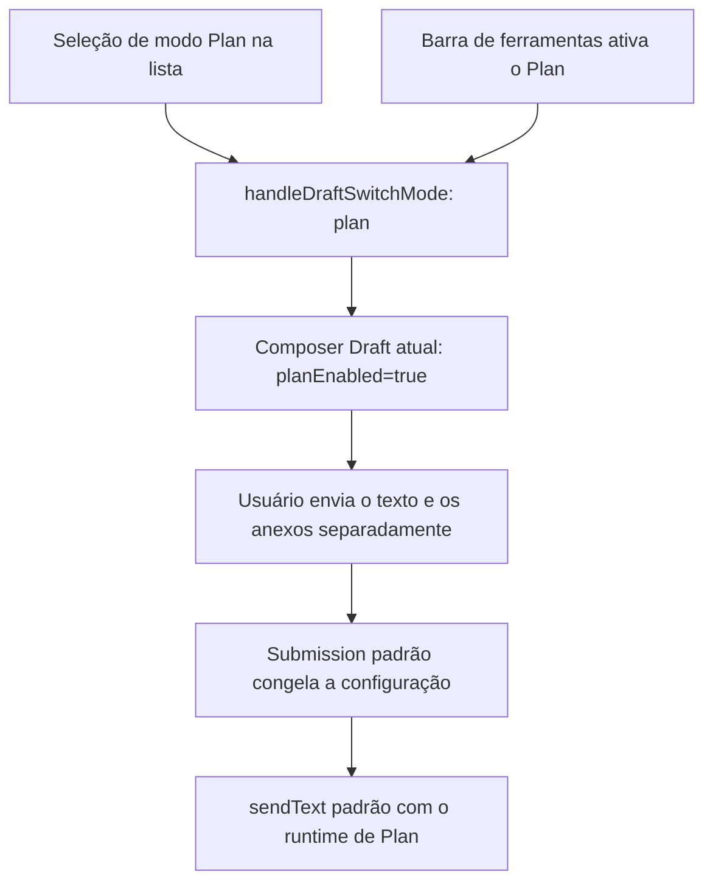

# Entrada de atalho do modo Plan no Composer

## Objetivo e interação

`/plan` é o termo de busca da ação «modo Plan» na lista do campo de entrada. Selecioná-la equivale a ativar o interruptor padrão de Plan da barra de ferramentas.
A lista exibe o nome localizado «modo Plan / Plan mode» e a descrição «Ativar o modo Plan / Enable Plan mode», e não exibe a sintaxe de parâmetros do comando.

| Operação | Resultado |
| --- | --- |
| Digitar `/plan` | exibe a ação de modo Plan, sem alterar o modo atual. |
| Selecionar com Tab, Enter ou clique | ativa o Plan padrão; remove apenas o token de busca slash atual, fecha a lista e mantém o foco da entrada. |
| Selecionar de novo com o Plan já ativo | continua ativo, sem alternar para desligado. |
| Haver outro texto, anexo ou contexto estruturado | preservado como está, sem envio automático. |
| Escape fecha a lista ou não há seleção | não altera o modo. |
| Enviar o `/plan` ou `/plan <text>` original depois de fechar a lista | enviado como texto comum, preservando o texto original e o modo atual, sem parsing oculto. |
| Sair do Plan | usar o interruptor existente da barra de ferramentas ou o botão de fechar da marca de Plan. |

## Estado único e cadeia de execução

A seleção da lista só edita o Composer Draft atual, preservando o modo de permissão; não envia prompt, não cria user row e não muda antecipadamente o Agent em execução.
Seleções consecutivas são idempotentes. Novo draft, session existente, desktop e celular usam a mesma ação; interfaces somente leitura não oferecem uma entrada executável.
Envio, fila, recuperação de falha, limitações de ferramentas de Plan e ExitPlanMode continuam obedecendo ao contrato padrão de Plan.

## Catálogo e limites entre plataformas

O modo Plan é oferecido pela ação local da lista do App e não é mais propagado pelo CLI como `/plan [task]`.
`plan` continua sendo um nome reservado, para impedir que comandos personalizados assumam essa entrada; comandos antigos de mesmo nome propagados pelo Agent não devem sombrear a ação local.
Skills e subagents continuam usando os itens de lista do próprio tipo, e a busca precisa por plan prioriza a ação de modo Plan.
Não são adicionados wire command, campo de protocolo, cópia de configuração ou ramo de envio exclusivo de Plan.
Desktop continuous e mobile remote replayable reutilizam este comportamento do Composer, com as fronteiras de transmissão e recuperação inalteradas.

## Aceitação

- As três formas de seleção apenas ativam o Plan, sem enviar; texto, anexos, contexto e foco são preservados.
- Novo draft, session existente, seleção repetida, Escape e envio de texto original têm evidência de regressão.
- O envio padrão carrega planEnabled; o provider recebe o texto e os anexos e entra no runtime padrão de Plan.
- O catálogo do CLI não oferece mais o comando de Plan, e um comando customizado de mesmo nome não pode assumir a entrada.
