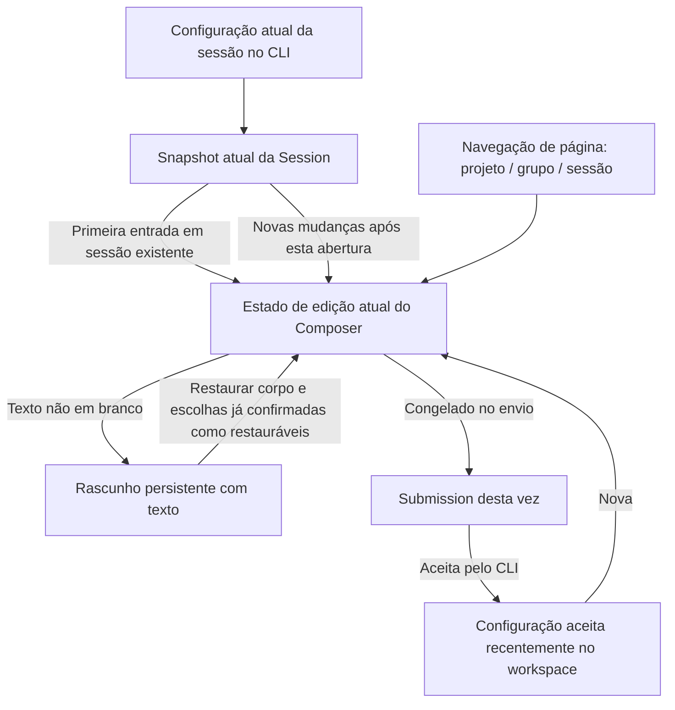

# Simplificação do estado do Composer e limites do rascunho de texto

Estado: implementado e validado dentro do escopo; o usuário confirmou que R1 usa as permissões/Plan mais recentes e explicitou que o projeto mobile não será modificado nesta rodada. Complementado em 2026-10-14 após a review do reparo do rascunho de texto; implementado conforme o escopo confirmado abaixo. O comportamento original e o registro de validação estão em [spec do rascunho de texto](../ui/composer-text-draft-persistence.md).

## Feature Summary

| Item             | Conteúdo                                                                                                                             |
| ---------------- | ------------------------------------------------------------------------------------------------------------------------------------ |
| Intenção         | Preservar "branco não persiste", eliminar replay de autorização histórica e a transferência (handoff) de configuração sem dono; navegação mobile fica para depois |
| Capacidades      | Configuração do Composer, sincronização de permissões/Plan, primeiro envio e importação via compartilhamento, navegação de criação de projeto |
| Camadas / Modos | draft-default, persistence, recovery; implementation                                                                               |
| Sementes         | useDraftConfigControl, composerDraftStore, newTaskDraft, SessionPane, useRootPlatformEffects, WebRemoteControlMobileShell, web/main |
| Não objetivos   | Modificar definições de permissões de execução do CLI, fila já aceita, formato de eventos do protocolo, pré-aquecimento do runtime, candidatos de modelo e política de Recent entre workspaces |

## Problemas confirmados

O diagnóstico temporário por Hook foi executado nos commits atuais do MR: das quatro asserções de correção, duas falharam e as duas asserções de diagnóstico passaram:

1. O Session Snapshot atual está como build e carrega junto um permissionGrant antigo; o resultado da inicialização do Composer em branco virou incorretamente yolo.
2. O Snapshot atual tem planEnabled=false e carrega junto um planTransition=true antigo; a inicialização ficou incorretamente como true.
3. Depois que a New Task já foi renderizada, o callback antigo de promote capturado antes do envio foi bloqueado pela guarda de scopeKey, e o novo texto da Root não foi removido. Não se pode tratar todas as inferências de corrida da review como confirmadas.
4. A seed de sessão sem receptor montado continua existindo depois que o Hook original é desmontado; quando o Hook abre aquela Sessão mais tarde, a seed tem precedência sobre o Snapshot. A cadeia real de disparo no desktop ainda precisa de verificação.

A análise estática da cadeia de chamadas confirmou ainda: `readDraftFile` grava em localStorage durante a renderização; a recuperação a frio do projeto mobile lê o projectId do rascunho de texto e perde essa fonte quando o rascunho está em branco. Isso não equivale a ter verificado que o projeto errado será criado; é preciso validar a admission do Host e a entrada mobile.

## Posse do estado e estrutura alvo

- CLI/projeção possui a configuração de sessão em vigor. IDs de autorização histórica são informação de correlação e não podem reexecutar a autorização na inicialização.
- O Composer atual possui as escolhas locais do próximo envio; mudanças de menu não reescrevem diretamente a tarefa em execução. Apenas novas autorizações/mudanças de ferramentas do próprio scope podem atualizar os campos correspondentes.
- O rascunho de texto guarda apenas os dados necessários para restaurar a entrada, não marcas de consumo de eventos de autorização, estado de assinatura nem flags temporárias de inicialização.
- Recent continua sendo atualizado apenas por Submission aceita, isolado por workspaceKey.
- Projeto/grupo são alvos de navegação e criação, não podem servir para persistir registros de um Composer em branco; a recuperação de páginas no mobile usa a entrada de navegação já existente.

## UI Surface Matrix

| Cenário / Entrada        | Implementação compartilhada e dono da edição | Origem padrão / de recuperação       | Validação / submissão                                      | Autoridade e persistência                       | Multi-dispositivo e isolamento                        |
| ------------------------ | -------------------------------------------- | ------------------------------------ | ---------------------------------------------------------- | ---------------------------------------------- | ----------------------------------------------------- |
| Nova caixa de entrada    | useDraftConfigControl                       | Rascunho de texto ou Recent do workspace | ModelSelectionView → Submission congelada              | Local do Composer; após aceitar, Recent        | desktop/web compartilhado; isolamento por identity    |
| Session existente        | O mesmo Hook                                 | Texto/modelo do rascunho; permissões/Plan do Snapshot | Idem                                         | O fato de execução do CLI não é reconstruído pelo rascunho | Trocar de Session reconstrói a linha de base observada |
| Autorização online / ferramenta de Plan | Snapshot → Hook atual    | Projeção observada neste scope e projeção mais recente | Sincroniza apenas os campos correspondentes, preserva corpo/modelo | Linha de base observada só em memória     | Nenhuma nova fila de replay                            |
| Primeiro envio vira Session | SessionPane → dono do pane atual | Configuração de submissão congelada e texto ainda não enviado | source scope + draft generation + target session | Migração do mesmo dono de edição; sem seed global | Isolamento por pane em tela dividida |
| Primeira importação por compartilhamento | Root após importação → entrada de navegação | Regras de inicialização do receptor na criação | Distinção entre imported/reused, prontidão do modelo | Parâmetros de inicialização de uma navegação | reused não sobrescreve a edição existente              |
| Nova/atualização de projeto mobile | web/main → Root / MobileShell | Alvo de navegação de projeto, não configuração de rascunho | Revalidação de host / workspace / project | Contexto de histórico de página existente | Mobile não altera o estado selecionado no desktop |
| Exibição offline / leitura de registros antigos | composerDraftStore | Somente texto válido em leitura | Submissão não permitida offline | Limpeza na fase de escrita/migração explícita | Renderização sem efeito colateral de escrita |

## Shared And Divergent Behavior

| Preocupação       | Compartilhado                        | Distinção mantida                                                        |
| ----------------- | ------------------------------------ | ------------------------------------------------------------------------ |
| Controles / candidatos | toolbar existente, ModelSelectionView | Automação e Subagent têm configuração própria e não entram no Composer |
| Padrão            | Ponto único de inicialização         | Nova lê Recent; sessão existente lê o próprio Snapshot; importação explica explicitamente a primeira inicialização |
| Escolha / submissão | Estado de edição atual → Submission congelada | A caixa de entrada atual, as mensagens aceitas e a tarefa em execução não se reescrevem |
| Recuperação      | Salva apenas quando há texto         | Desktop direct continuous; mobile replayable gap/snapshot               |

## Feature Relationships

| Nível            | Início → relação → destino                                  | Motivo / evidência                                                         |
| ---------------- | ------------------------------------------------------------ | -------------------------------------------------------------------------- |
| must-inspect     | Composer → initializes-from → Snapshot / Recent / texto      | useDraftConfigControl hoje mistura inicialização e aplicação de eventos históricos |
| must-inspect     | SessionPane → promotes → scope do Composer                  | handleDraftSessionCreated, promoteComposerDraft; é preciso manter a proteção contra callbacks tardios |
| must-inspect     | Root → initializes → Session importada                      Transferência (handoff) de um Map sem dono em seedImportedSessionDraft                   |
| must-inspect     | Navegação mobile → recovers → intenção de projeto da Root  | initialTaskDraft de web/main passa apenas como parâmetro em memória       |
| should-inspect   | Superfície desconectada → reads → persistência de texto     | A chamada de render em RemoteConversationDisconnected                     |
| invariant-only   | Submission → admission / fila do CLI                        | Não altera modo de execução, FIFO, owner/lease                             |
| evidence-only    | Testes de Hook / storage / bootstrap / E2E                  | Provam os limites, sem tratar a alcançabilidade dos testes como dependência de produto |

## State Owners And Commit Sinks

| Estado                      | Dono único                          | Limite de escrita / ciclo de vida                             |
| --------------------------- | ----------------------------------- | -------------------------------------------------------------- |
| Configuração atual da sessão | CLI + Session Snapshot somente leitura | Comandos aceitos, autorizações reais, conversão de ferramentas |
| Configuração / texto atual   | Scope atual do Composer             | Menu, edição de texto, novas mudanças de configuração ao vivo  |
| Rascunho de texto persistente | composerDraftStore                  | Salva quando não vazio, remove quando esvazia; não carrega cursor de consumo de eventos |
| Recent                       | Callback de submission aceito       | Registra apenas a escolha aceita nesta ocasião                 |
| Linha de base observada      | Memória do scope atual do Composer | Estabelecida pela primeira Snapshot correspondente; descartada ao trocar de scope / desmontar |
| Alvo de criação por navegação | workspace/pane/navigation owner    | Seleção de projeto, troca de sessão, New Task, recuperação de página |
| Handoff do primeiro envio    | Uma migração de scope do pane atual | Encerra após o recebimento; invalida ao sair/trocar de geração; sem TTL |

## Estratégia de simplificação e lista de remoções

### 1. Separação entre inicialização e atualização online

A primeira Snapshot correspondente é o "estado atual" e é usada apenas para inicializar/estabelecer a linha de base observada. Não se pode chamar a lógica de "aplicar autorização histórica".
Quando as associações de autorização/ferramenta de uma Snapshot posterior tiverem novas mudanças, atualizar os campos correspondentes com os valores atuais da Snapshot mais recente; não é possível derivar um yolo fixo ou um planEnabled vencido a partir de eventos antigos.
Uma nova autorização com o mesmo valor também pode ter significado: quando o usuário troca a caixa de entrada atual para build enquanto o estado de execução ainda é yolo, uma nova autorização explícita precisa responder conforme a semântica de autorização já existente. Portanto não se pode comparar apenas o valor de mode, nem remover sem distinção os IDs de correlação do protocolo.
A linha de base observada pertence apenas ao ciclo atual de abertura e não é gravada em localStorage; projeções repetidas ou re-renderizações comuns não sobrescrevem a escolha do usuário. A ausência temporária de Snapshot não reseta a linha de base; só a troca do scope real a reseta.

Remover a persistência de lastPermissionGrantId / lastPlanTransitionId em V4ComposerDraft e a lógica especial de preservação no replace; fundir ou remover os dois helpers responsáveis apenas pela aplicação histórica. Campos com o mesmo nome dentro de CLI/runtime continuam com a responsabilidade real de recuperação de autorização e não são removidos por causa da simplificação do Renderer.

### 2. O primeiro envio reutiliza o dono de edição atual e cancela o Map global de seeds

O primeiro envio é o vínculo, pelo pane atual, do endereço de criação a um sessionId real. A configuração é passada por migração explícita do dono atual, sem colocar em um Map global à espera de que algum componente futuro a busque.
A Submission congelada no envio é a configuração da mensagem enviada; o texto/configuração que o usuário continuar editando depois do envio ainda pertence ao ciclo de edição atual. Os dois não podem ser misturados, senão "congelar todos os rascunhos e só então fazer promotion" perderia a nova digitação ocorrida durante o envio.
Antes da migração, verificar workspaceKey, a draft generation de origem e o sessionId de destino. Um ACK tardio ainda pode concluir o trabalho de organização de uma tarefa já aceita, mas não pode trocar a nova página do usuário, limpar o novo texto ou sobrescrever suas escolhas.
A primeira importação por compartilhamento passa explicitamente o motivo/configuração de inicialização por uma ação de navegação; disponível apenas para aquela ativação, encerrando ao trocar de página, cancelar ou receber. reused mantém as regras de Session históricas. Remover sessionSeeds e suas APIs de read/seed/clear; não adicionar limpeza por timer como rede de segurança.

### 3. Purificação da leitura de armazenamento

read apenas faz parse e filtra registros antigos em branco, sem escrever em disco. Registros em branco, por serem filtrados, não sobrescrevem mais Recent; a remoção física fica para a fase de escrita explícita ou de migração após a montagem.
Registros de texto antigos permanecem legíveis, e marcadores históricos desconhecidos deixam de participar do comportamento. As degradações já existentes para modelo/opção inválidos não podem apagar o texto junto. Falhas de leitura mantêm a política de log existente, de disparo único.

### 4. Recuperação independente da navegação de projeto no mobile (excluído nesta rodada, candidato futuro)

Reaproveitar a entrada existente de recuperação de página via browser history para guardar a informação mínima de navegação necessária ("dispositivo atual/workspace/projeto/grupo/sessão de destino"), sem guardar corpo em branco, modelo e permissões.
A reconstrução da Root consome apenas alvos de navegação que passaram por verificação de identidade e de validade do projeto; ao trocar de dispositivo, quando o projeto foi deletado ou quando a workspace identity não corresponde, a intenção antiga não pode ser aplicada. Quando o projeto não puder ser recuperado, é preciso voltar explicitamente à entrada de seleção, sem adivinhar o projeto pelo caminho nem criar em "sem classificação".
Isso é recuperação de estado de navegação, não recuperação de rascunho em branco, e não introduz novo estado de negócio no Host/relay. Antes da implementação é preciso validar a fiação completa dos itens de history existentes com o bootstrap do bridge.

## Must-Preserve Invariants

- A identidade é sempre workspaceIdentity?.trim() || workspacePath; o caminho é usado apenas para execução/exibição.
- Branco/somente espaços não persiste; não se adiciona chave oculta de configuração em branco.
- A edição atual do usuário não é sobrescrita por Snapshot comum, por atualização do catálogo de modelos nem por eventos repetidos.
- A entrada aceita e a configuração de execução existem apenas no CLI; o Renderer não cria uma segunda fila.
- Desktop continuous e mobile replayable continuam consumindo o mesmo estado autoritativo, sem introduzir a semântica de recuperação um do outro.
- Não usar timers para tratar transferências de estado; não remover verificações de concorrência como se fosse "simplificação".

## Codegraph Evidence

O codegraph não ofereceu ferramenta utilizável e não foi executado. A busca de referências precisas cobriu store → Hook → SessionPane/Root, importação por compartilhamento, bootstrap mobile e superfície desconectada, com profundidade 2; a nova entrada de history mobile foi conferida à parte pela cadeia de navegação. A checagem de baseline de arquitetura passou e o pacote de leitura controlado do project-sidebar foi gerado. A busca estática não prova a alcançabilidade de toda a cadeia pela GUI; as evidências de execução estão na primeira seção.

## Graph Drift Candidates / Graph Delta

state.composer-text-draft foi atualizado para recuperação de texto, permissões/Plan da Session atual, linha de base observada dentro do scope, migração do primeiro envio no mesmo pane e inicialização explícita por navegação. A navegação mobile não cria relações novas; o browser history não é definido como autoridade de tarefa.

## Unresolved Questions / Clarification Log

Confirmado: sem texto não persiste; ao reentrar em uma sessão existente em branco lê-se o Snapshot atual; autorizações históricas não podem ser replayed; esta rodada exige simplificação estrutural.

R1 confirmado: restaurar corpo e escolha de modelo; permissões/Plan usam o estado mais recente da sessão. Isso descarta mudanças de permissão/Plan antes não submetidas e pode também restaurar um yolo já aprovado pelo usuário em outra ponta; não se afirma que apenas as permissões serão restringidas.

O usuário também deixou explícito "não mexer no projeto mobile por enquanto": CS09 não está no escopo de implementação e aceitação desta rodada, e a análise estática correspondente fica apenas como candidato futuro.

## Dimensions / Pruning

Dimensão principal: em branco/com texto; nova/existente/primeira importação; primeira Snapshot/repetição com o mesmo valor/novo evento/Snapshot de recuperação; atual/trocado; desktop continuous/mobile replayable; mesmo caminho com identity diferente.
Candidatos de modelo, tema e idioma seguem os controles já existentes, cobrindo apenas combinações representativas; não se enumera a matriz não relacionada de automação/Subagent/execução de ferramentas. A falha de pré-aquecimento no primeiro envio é registrada como bloqueio independente, sem ampliar nesta rodada as modificações em Host/CLI.

## Accepted Cases / E2E Handoff

| ID   | Cenário                                                          | Asserção                                                          | Plano de evidência                        |
| ---- | ---------------------------------------------------------------- | ---------------------------------------------------------------- | ----------------------------------------- |
| CS01 | build atual em Session em branco + autorização histórica de acesso total; reentrada/refresh | Permanece build; rascunho sem registro persistente         | Teste vermelho do Hook reproduzido; E2E pendente |
| CS02 | Plan atual desligado + registro histórico de ligado           | Não reabre                                                    | Teste vermelho do Hook reproduzido; interação no navegador |
| CS03 | Mount atual recebe nova autorização/mudança de ferramenta; depois o usuário troca a escolha e há projeção repetida | Responde uma vez à mudança; repetição não sobrescreve; outros campos inalterados | Hook + interação no navegador |
| CS04 | Primeira Snapshot tardia/reconexão/StrictMode                 | Não trata histórico como evento novo; sem escrita cruzada entre scopes | Hook                                 |
| CS05 | Continuar digitando durante o primeiro envio; vínculo com Session após aceitar | Preserva nova digitação não submetida; configuração submetida permanece congelada | Hook + integração de submission |
| CS06 | Após o primeiro envio, criar/trocar/desmontar e só então chegar o ACK | Não limpa o rascunho novo; sem seed remanescente; mantém o limite de cancelamento por navegação | Hook; verificação estática da cadeia de navegação |
| CS07 | Primeira importação, reused, diretório tardio, troca de sessão | Uma inicialização com dono; reused não sobrescreve; sem vazamento | Regressão de importação + interação no navegador |
| CS08 | Render lê registros antigos em branco/inválidos                | Não escreve no storage; texto preservado; registros em branco limpos após migração explícita | storage + StrictMode |
| CS09 | Refresh de página de projeto mobile em branco, reconstrução em background, troca de dispositivo | Recupera alvo de navegação válido; sem persistir configuração em branco; identity divergente não é usada indevidamente | bootstrap + E2E mobile; plano de navegação ainda a implementar |
| CS10 | Rascunho com texto inconsistente com as permissões atuais     | Restaura texto/modelo, adota permissões/Plan atuais            | Hook + interação no navegador |

## Planning Handoff / Ordem de implementação

1. Atualizar, conforme o R1 confirmado, a spec do rascunho de texto, o catálogo, a cobertura e o grafo.
2. Adicionar primeiro os testes vermelhos de CS01–04, separando inicialização de observação online, e remover as marcas de evento do rascunho.
3. Para CS05–07, completar primeiro as regressões de concorrência, fundir as entradas de inicialização de primeiro envio/importação e remover o Map global de seeds.
4. Purificar o caminho de read; nesta rodada não modificar o projeto mobile nem a recuperação de navegação.
5. Executar os testes unitários afetados, typecheck, lint, architecture, verificação de fixtures e os fluxos de UI pendentes. O caso completo de primeiro envio A→B tem hoje um bloqueio de baseline por pré-aquecimento já registrado, que deve continuar sinalizado e não pode ser substituído pela aprovação do Hook.
6. Manter commits revisáveis na mesma MR a cada passo, atualizando a descrição e o escopo de validação; sem autorização, não responder pelo usuário nem resolver comentários de review.

O rollback é feito por commit; os rascunhos de texto antigos continuam legíveis e os registros históricos em branco removidos não são restaurados. O escopo de implementação e validação desta rodada está na spec do rascunho de texto; o candidato de navegação mobile não foi implementado.

## Veredito final

R1 confirmado com as permissões e o Plan mais recentes; restaurar texto e escolha de modelo. CS10 passa a accepted. CS09 e a recuperação de projeto/navegação mobile saem desta rodada; a análise correspondente é mantida como referência futura e não amplia esta implementação.

## Resultado da implementação

Foram removidas as marcas de evento persistentes, os dois helpers de evento histórico e o Map global sessionSeeds. O primeiro envio passou a ser mantido pelo mesmo pane e a importação passa por parâmetro de navegação; a leitura não escreve em disco. As novas regressões verificaram adicionalmente que, após o vínculo do primeiro envio e antes da troca no React, a nova digitação é escrita diretamente na Session já criada, sem reconstruir o rascunho da Root. Os limites validados e ainda não cobertos de envio completo/mobile em dispositivo real estão no [registro de validação da spec](../ui/composer-text-draft-persistence.md).
