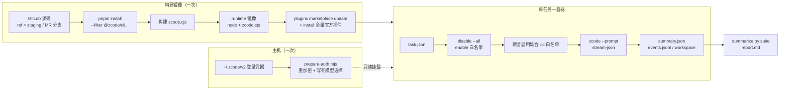
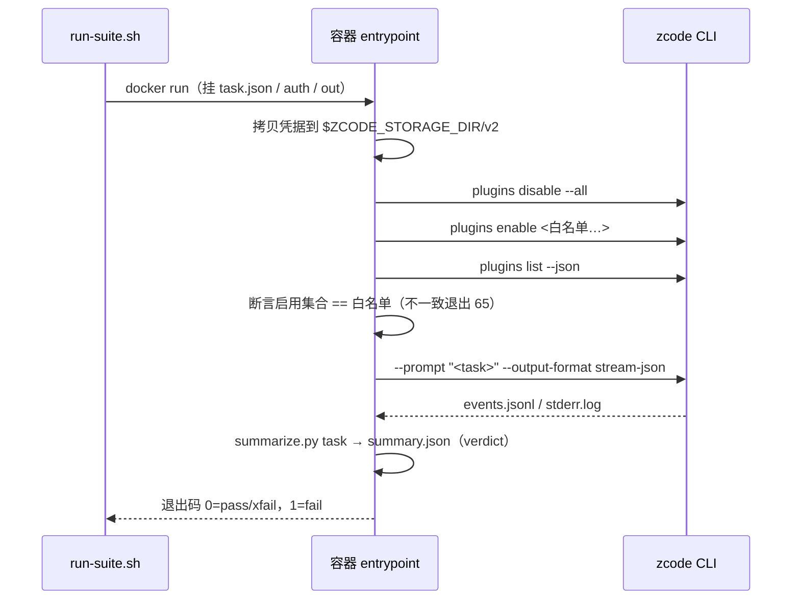

# Tutorial de Avaliação de Plugins em Docker totalmente automatizada (a partir do código-fonte no GitLab)

> Status: acompanha o MR do subcomando `zcode plugins` (`docs/cli-plugins-command-parity.md`).
> Diretório: `docker/plugin-eval/`. A orquestração da avaliação e o critério de pontuação ficam aqui; o núcleo do CLI não tem ciência da avaliação.

## Objetivo e Limites

- Avaliar plugins de forma totalmente automatizada dentro do Docker usando o CLI headless (`zcode --prompt ... --output-format stream-json`):
  plugins embutidos + todos os plugins do mercado oficial do zcode, um container descartável por tarefa, modelo real.
- A imagem é construída a partir do código-fonte no GitLab, e na fase de build todos os plugins do mercado oficial são instalados na imagem; em tempo de execução, apenas os plugins avaliados são habilitados, conforme a allowlist da tarefa.
- O que não é feito: conversa de múltiplos turnos, pontuação manual, armazenamento de resultados em banco. A pontuação chega apenas ao nível de “o skill foi chamado, o arquivo foi produzido, a resposta contém a palavra-chave”;
  uma pontuação de qualidade mais fina fica a cargo de quem, por fora, ler o `events.jsonl` e estender por conta própria.

## Fluxo Geral



## Pré-requisitos

| Item | Requisito |
|---|---|
| Docker | 20.10+, com BuildKit habilitado (padrão); precisa conseguir baixar `node:24-bookworm-slim` e acessar o GitLab, o npm registry e `cdn-zcode.z.ai` |
| Ferramentas no host | bash, jq, node ≥ 20 (para rodar `prepare-auth.mjs`), python3 (para consolidar o relatório) |
| Acesso ao GitLab | repositórios privados exigem um PAT somente leitura (`read_repository`); sem `--token-file`, o script tenta, nesta ordem, a variável de ambiente `GITLAB_TOKEN` → o PAT de quem já está logado no `glab` → `git credential fill` para pegar as credenciais já salvas na máquina |
| Estado de login do ZCode | o ZCode local já está logado e com um provider/modelo utilizável escolhido; o container de avaliação reaproveita essas credenciais |
| Código sob teste | o ref precisa já conter os subcomandos `zcode plugins install / disable --all` (o staging após o merge do MR dos subcomandos, ou o branch desse MR) |

## Primeiro Passo: construir a imagem

```bash
# 默认 ref=staging，镜像 tag = zcode-plugin-eval:<ref>
docker/plugin-eval/bin/build-image.sh

# 指定分支、走代理、显式给 token 文件
docker/plugin-eval/bin/build-image.sh --ref feat-cli-plugins-parity \
  --proxy http://127.0.0.1:7890 --token-file ~/.secrets/gitlab-ro-token
```

O que a construção faz:

1. O estágio `source` executa `git clone --depth 1 --branch <ref>`. O PAT entra pelo secret do BuildKit, na forma de um cabeçalho Basic (`oauth2:<token>`) em `git config http.<host>/.extraheader`,
   presente apenas naquele RUN e nunca em uma camada da imagem; após o clone, `.git` e `.gitconfig` são removidos.
2. O estágio `builder` executa `pnpm install --frozen-lockfile --filter "@zcode/cli..." --filter zcode` e depois constrói, na ordem do script do repositório
   `scripts/build-desktop-agent-cli.mjs`: shared-types → contracts → core → adapters → i18n → telemetry → bootstrap → cli.
3. O estágio `runtime` traz apenas `node + zcode.cjs + jq/python3/git/ripgrep`, rodando com o usuário `zcode` de uid 10001;
   `HOME=/data`, `ZCODE_DATA_BASE_DIR=/data`, `ZCODE_STORAGE_DIR=/data/.zcode`, `ZCODE_BASE_URL=https://zcode.z.ai`.
   Os plugins embutidos não ficam dentro do `zcode.cjs`; o CLI procura o diretório raiz em `packages/<name>-plugin`, no mesmo nível do arquivo de entrada, então o estágio builder faz stage
   dos quatro plugins embutidos puramente de conteúdo — document-skills, zcode-guide, skill-creator, restore-legacy-sessions — em `/opt/zcode/packages/`;
   pelo mesmo motivo, o diretório de provider embutido que o CLI lê obrigatoriamente na inicialização, `config/provider/zcode-builtin.json`, fica em `/opt/zcode/provider/`.
4. Na fase de build é executado `zcode plugins marketplace update zcode-plugins-official` e, em seguida, cada entrada de `list --available --json` com
   `installed == false` é instalada via `plugins install`; a lista de base fica em `/data/plugins-baseline.json`.

Ao final da construção o script imprime o ref@sha do código sob teste e a quantidade de plugins assados na imagem (atualmente 19 do mercado CDN + 4 embutidos = 23).

## Segundo Passo: preparar o diretório de credenciais

```bash
# 看本机有哪些 provider 可选
node docker/plugin-eval/bin/prepare-auth.mjs --list-providers

# 生成容器用凭据目录；provider 可写名字或 id，模型 id 与 reasoning 档位必须显式给
node docker/plugin-eval/bin/prepare-auth.mjs --out ./.zcode-eval-auth \
  --provider ZAPI --model GLM-5.3-Highspeed --reasoning max
# 末尾会打印：export ZCODE_EVAL_CREDENTIAL_SECRET=...   （复制执行）
```

Por que não é possível simplesmente copiar `~/.zcode/v2` para o container:

- Os valores de `credentials.json` são cifrados com aes-256-gcm, e a chave padrão é derivada de `platform:homedir:username`. No container os três mudam, então a cópia direta falharia ao descriptografar.
  O script descriptografa no host com a chave local e recifra com `ZCODE_EVAL_CREDENTIAL_SECRET`; em tempo de execução o container recebe o mesmo valor em `ZCODE_CREDENTIAL_SECRET`.
- A escolha de modelo no headless só lê o `config.defaultModelSelection` de `provider_config.json`, e ele precisa estar na forma completa
  `{providerId, modelId, options.reasoningLevel}`. Sem `reasoningLevel`, o CLI volta silenciosamente para o primeiro modelo do primeiro provider,
  o que se manifesta como um 422 inexplicável ou um nome de modelo errado. O script fixa a escolha, eliminando essa classe de deriva.
- No `provider_config.json`, a API key de providers auto-hospedados fica em texto puro. O diretório de saída é gravado com 0700/0600 e montado somente para leitura em um container descartável; não comite e não faça `COPY` para dentro da imagem.

## Terceiro Passo: escrever os arquivos de tarefa

Um JSON por tarefa, colocado em um diretório (exemplos em `docker/plugin-eval/tasks/`):

```json
{
  "id": "finance-budget-variance",
  "plugins": ["run-fpa"],
  "prompt": "使用 run-fpa 插件的 budget-variance skill 做一次预算差异分析：……",
  "timeoutSeconds": 600,
  "expect": {
    "skills": ["run-fpa:budget-variance"],
    "responseContains": ["价格差"]
  }
}
```

| Campo | Significado |
|---|---|
| `id` | id da tarefa, que também é o nome do subdiretório de resultado e o sufixo do nome do container |
| `plugins` | allowlist. `name` puro ou `name@marketplace`; o container faz `disable --all` e depois `enable` item por item, e assere que o conjunto realmente habilitado corresponde exatamente a esta lista |
| `prompt` | o texto da tarefa passado para `zcode --prompt` |
| `timeoutSeconds` | timeout rígido de uma execução (padrão 900); ao estourar, conta como falha |
| `expect.skills` | chamadas de `Skill` esperadas em `tool.updated` (`payload.input.skill`) |
| `expect.mcpTools` | substring dos nomes de ferramentas MCP que se espera ver sendo chamadas |
| `expect.files` | arquivos que se espera ver produzidos no diretório de trabalho (caminhos relativos) |
| `expect.responseContains` | strings que a resposta final deve conter |
| `xfail` | se houver um motivo informado, a falha é registrada como `xfail` (falha esperada) e não conta como falha da suíte |

Quando existe um diretório homônimo `<id>.workspace/`, ele é montado somente para leitura em `/task/workspace` e copiado para `/work` no container como cwd do modelo, para servir de espaço de fixtures como Excel e PDF.

## Quarto Passo: rodar a suíte

```bash
export ZCODE_EVAL_CREDENTIAL_SECRET=...   # 第二步打印的值
docker/plugin-eval/bin/run-suite.sh \
  --tasks docker/plugin-eval/tasks \
  --out ./eval-results \
  --auth-dir ./.zcode-eval-auth \
  --image zcode-plugin-eval:staging \
  --jobs 2                       # 可选并行度；--filter 'finance-*' 只跑一部分
```

Dentro de cada container (`docker/plugin-eval/entrypoint.sh`):



## Quinto Passo: ler os resultados

Estrutura do diretório `--out`:

```text
eval-results/
├── report.md            # 套件汇总表（任务 / 插件 / 结果 / 耗时 / skill / MCP 工具 / 未通过检查）
├── suite.json
└── <task-id>/
    ├── summary.json     # verdict、checks、skillsInvoked、mcpToolsInvoked、finalResponse、source ref@sha
    ├── events.jsonl     # 完整 stream-json 事件流
    ├── stderr.log
    ├── plugins.json     # 启用断言时的 plugins list --json
    ├── container.log
    └── workspace/       # 模型工作目录快照（排除 node_modules/.git）
```

Critério de veredito: `exitCode == 0` e haver um `turn.completed`; depois disso, conferir item a item `expect.*`. Qualquer falha resulta em `fail`; em tarefas com `xfail`, a falha é registrada como `xfail`.
Para saber se o plugin foi realmente usado, veja `events.skillsInvoked`, no formato `run-fpa:budget-variance`.

## Limitações Conhecidas

- **MCP oficial indisponível no headless (pendente do lado do CLI)**: o `image_search` do conjunto financeiro e do document-skills declara o
  MCP autenticado `zcode_official`, e hoje apenas o agent iniciado pelo host desktop injeta o registro de fontes confiáveis e os cabeçalhos de identidade; o CLI independente falha de forma fechada em todos os casos.
  O resultado é que esses plugins têm no container apenas a capacidade de texto do skill, sem ferramentas de mercado/dados corporativos. Por isso a tarefa de exemplo `finance-close-recap-mcp` está marcada como `xfail`.
- **O modelo contorna as restrições**: as permissões yolo são o padrão no headless. Em um smoke test, ao não conseguir as ferramentas MCP, o modelo descriptografou por conta própria o
  `credentials.json` dentro do container com Bash e chamou a API de dados via curl na mão. O container de avaliação precisa ser tratado como um ambiente capaz de ler todas as credenciais injetadas: injete apenas a conta de avaliação, descarte-a depois do uso e
  não reutilize contas de produção; ao pontuar, use `mcpToolsInvoked` em vez da resposta final para julgar se a capacidade do plugin foi realmente usada.
- **`ZCODE_BASE_URL` precisa ser definido explicitamente**: o endereço MCP no manifest do plugin é escrito como `${ZCODE_BASE_URL}/api/v1/mcp/...`;
  quando o CLI independente não injeta essa variável, `plugins list --json` mostra `plugin_variable_missing` e o MCP correspondente é descartado. A imagem já traz o valor de produção embutido;
  ao apontar para um ambiente de testes, sobrescreva com `docker run -e ZCODE_BASE_URL=...`.
- **Proxy**: a rede do próprio CLI só reconhece `ZCODE_HTTP_PROXY` e não lê `http_proxy`; na construção use `--proxy` e na execução `run-suite.sh --proxy`.
- **Plugins embutidos que dependem da base desktop ficam de fora**: browser-use, computer-use, ios-simulator e android-emulator precisam do WebView desktop, de um MCP runtime independente ou de emulador, e não há essa base no container headless; a imagem não faz stage deles e eles também não aparecem no `plugins list`.
- **`--plugin-dir` (carregamento de plugin local em nível de sessão) ainda não existe**: para avaliar um plugin ainda não publicado, use antes `zcode plugins marketplace add <diretório local>` e só então `install`.

## Diagnóstico de Problemas

| Sintoma | Onde olhar | Causa comum |
|---|---|---|
| A construção trava no clone / 401 | saída de `build-image.sh` | sem PAT, ou o PAT não tem `read_repository`; passe explicitamente com `--token-file` |
| O `pnpm install` falha ao buscar dependências git | log do estágio builder | dependências git+https do catálogo em `pnpm-workspace.yaml` também exigem credenciais do GitLab |
| Container sai com 64 | `container.log` | task.json sem `id`/`prompt`, ou caminho montado errado |
| Container sai com 65 | `plugins.json`, `plugins-enable.log` | nome de plugin digitado errado na allowlist, ouplugins de mesmo nome em vários mercados exigindo `name@marketplace` |
| 422 / modelo errado | `stderr.log`, `summary.json.source` | `defaultModelSelection` incompleto; rode `prepare-auth.mjs` de novo passando `--model --reasoning` explicitamente |
| Tudo retornando 401 / auth_failed | `stderr.log` | `ZCODE_EVAL_CREDENTIAL_SECRET` diferente do usado na geração, ou o estado de login local expirou |
| `plugin_variable_missing` | diagnostics em `plugins.json` | em tempo de execução `ZCODE_BASE_URL` foi sobrescrito com valor vazio |
| O skill não foi chamado | `tool.updated` em `events.jsonl` | o prompt não cita o plugin/skill, ou o plugin não está na allowlist |

## Registro de Validação

2026-09-14, macOS arm64 + OrbStack Docker 29, código sob teste `feat-cli-plugins-parity@bf05821832`:

| Passo | Resultado |
|---|---|
| `build-image.sh --ref feat-cli-plugins-parity` | sucesso; pnpm install levou cerca de 12 minutos, imagem de 427 MB, 23 plugins assados (19 do CDN + 4 embutidos), `plugins list --json` sem diagnóstico de erro, 121 skills |
| `prepare-auth.mjs --provider ZAPI --model GLM-5.3-Highspeed --reasoning max` | 23 valores de credencial recifrados, escolha de modelo gravada com sucesso |
| `run-suite.sh --jobs 3` (três tarefas em paralelo) | `finance-budget-variance` pass 22s, `builtin-docx-smoke` pass 38s (smoke.docx de 9.4 KB gravado), `finance-close-recap-mcp` xfail 32s |

Na resposta do modelo da tarefa xfail ficou explícito que a ferramenta MCP de dados de mercado estava indisponível e o modelo parou, sem contornar com Bash/curl; `toolCalls` contém apenas Skill e Agent, sem ferramentas MCP, o que é coerente com a limitação conhecida de que o MCP oficial não funciona no headless.

## Reuso dos Scripts de Avaliação

A superfície de comandos dentro da imagem é compatível com `claude plugin`: `zcode plugins install|uninstall|enable|disable --all|update|validate|marketplace ...`,
e `zcode plugin` é um alias. A descrição dos argumentos e do comportamento está em `docs/cli-plugins-command-parity.md`. O mesmo conjunto de task.json pode ser reaproveitado trocando o binário do CLI;
a única diferença é o nome dos campos dos eventos stream-json.