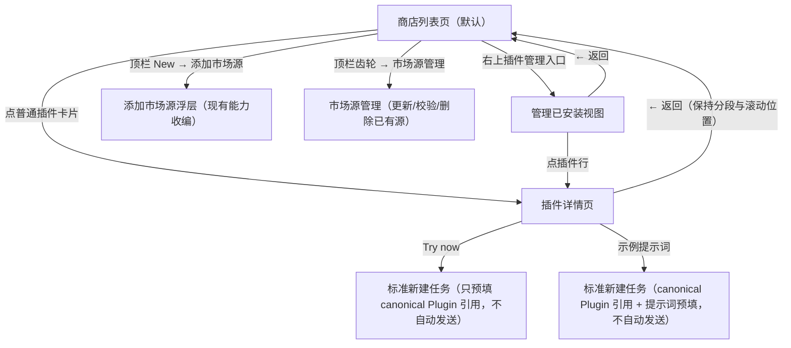
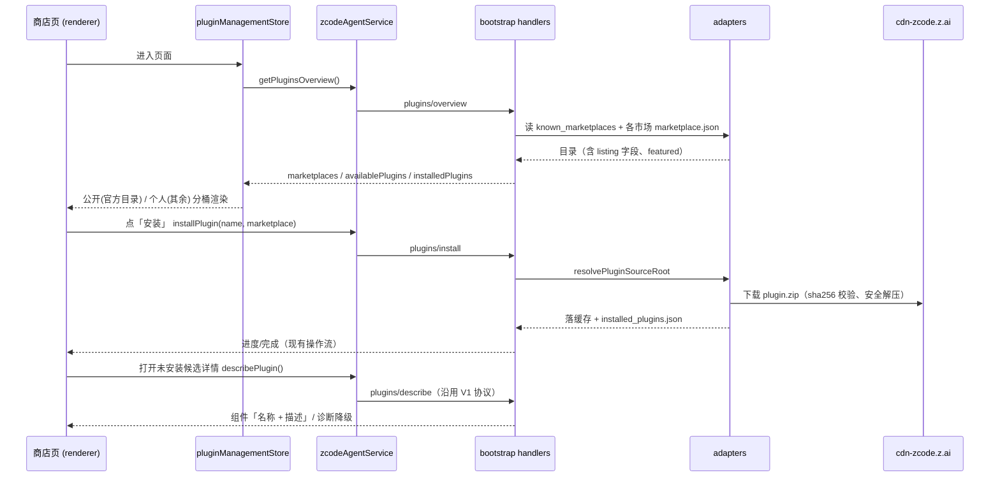

# Especificação de UI/UX do Plugin Marketplace V2 —— Redesenho da loja de plugins

> Reescrita completa em 2026-07-14. Esta versão refaz a página de configurações de plugins como uma "página de loja de plugins" de exibição,
> substituindo a arquitetura de informação da versão de 2026-06, com「Installed / Marketplace」em duas tabs e barra lateral de troca de mercado.
> A IA antiga, a estratégia de limite por agrupamento de mercado, o layout da página de navegação e afins estão integralmente revogados (conteúdo no git history);
> As especificações ainda válidas e herdadas por esta versão são: o protocolo de detalhes de componentes sob demanda `plugins/describe`, a enumeração autoritativa de componentes do CLI
> (`ZCodePluginInfo.components`), o princípio de degradação honesta e a renderização em duas linhas「nome — descrição」.
>
> Os termos seguem o [CONTEXT.md](../CONTEXT.md) na raiz; decisões-chave em
> [ADR-0001(listing fica na camada de catálogo)](./adr/0001-store-listing-in-marketplace-catalog.md) e
> [ADR-0002(desvio deliberado do estilo contido do DESIGN.md)](./adr/0002-plugin-store-style-deviation.md).

> Atualização de 2026-10-12: o mercado ganhou o segmento de comunidade, a área de capacidades de UI e a entrada no Side Pane; o gerenciamento é concluído dentro do mercado e preserva a configuração por projeto. Os limites de implementação e a verificação atuais estão em [escopo de interações](./plugins/plugin-market-interactions-scope.md).

## Contexto e objetivos

Visual e interação das páginas de listagem e de detalhe:

- Página de listagem: título e ações do topo (incluindo a entrada de gerenciamento de plugins) na mesma linha, segmentação público/comunidade/pessoal e caixa de busca na mesma linha,
  grande seção Featured + fluxo de cartões em duas colunas por blocos de categoria, todos os grupos expandidos por padrão, com recolhimento manual.
- Página de detalhe: icon grande + nome + descrição de uma linha,「…」e「立即试用」no canto superior direito, cápsulas de prompt de exemplo embutidas na imagem hero,
  descrição longa, seções de componentes como「MCP 服务器」「技能」, seção「信息」(desenvolvedor/categoria/versão/site/
  política de privacidade/termos de serviço).

A segmentação pública e a de comunidade usam em conjunto o mercado oficial `zcode-plugins-official` (plugins embutidos + plugins zip do CDN, fonte de catálogo
`https://cdn-zcode.z.ai/zcode/official-plugin/marketplace.json`), distinguindo a atribuição de manutenção pelo `publisherType` da entrada publicada; a segmentação pessoal abriga todas as demais
fontes pessoais (claude-plugins-official, mercados adicionados pelo usuário, inline).

### Identidade única do mercado oficial e contrato de merge

`zcode-plugins-official` é o único id do mercado oficial da ZCode. Plugins embutidos e plugins do CDN não são dois mercados,
mas duas fatias de catálogo do mesmo mercado; não se deve mais registrar, exibir ou gerar o mercado `zcode-plugins` nem
ids de plugin `<name>@zcode-plugins`.

```text
应用内置目录分片 ─┐
                  ├─ 按 name 合并（CDN 优先）─> zcode-plugins-official/marketplace.json
CDN 目录分片 ─────┘                    └─ 所有插件 id: <name>@zcode-plugins-official
```

Decisões de limite (confirmadas pelo usuário em 2026-07-15):

| Limite           | Decisão                                                                               | Poda / não objetivo                                             |
| ---------------- | ------------------------------------------------------------------------------------- | --------------------------------------------------------------- |
| Identidade do mercado | Embutidos e CDN usam uniformemente `zcode-plugins-official`                         | Não se mantém alias `zcode-plugins` nem se migram dados de teste antigos |
| Semântica de refresh | O refresh do mercado oficial substitui apenas a fatia do CDN e a remergeia com a fatia embutida atual do app | O refresh do CDN não pode apagar nem reescrever o cache de plugins embutidos |
| Conflito de nome    | A entrada de mercado do CDN tem prioridade e a entrada de diretório embutida homônima é ignorada | Isso altera apenas a escolha do catálogo mesclado, sem apagar nem reescrever o cache embutido do app |
| Fonte de atualização | A fatia embutida muda com a versão do app; a fatia do CDN muda com o refresh do mercado | Não se transforma o binário de plugin embutido em hot update via CDN |
| UI                 | O gerenciamento de fontes de mercado mostra apenas um mercado oficial da ZCode, com refresh | Não se exibe uma linha de source embutido nem uma linha de source do CDN |

Propriedade do estado e persistência:

| Estado                        | Fonte autoritativa                                                  | Projeção local                                            | Evidência de verificação     |
| ----------------------------- | -------------------------------------------------------------------- | --------------------------------------------------------- | ---------------------------- |
| Fatia de catálogo embutida    | bundle do app atual / assets SEA                                     | snapshot da fatia embutida no catálogo do mercado oficial | teste unitário de seed, cache marker |
| Fatia de catálogo do CDN      | manifesto do CDN oficial                                              | snapshot da fatia do CDN no catálogo do mercado oficial   | teste unitário de refresh, resposta de rede |
| Catálogo mesclado             | as duas fatias acima mescladas por name                             | `marketplaces/zcode-plugins-official/marketplace.json`     | testes de overview / install |
| Fonte de mercado e hora de refresh | o único registro `zcode-plugins-official` em `known_marketplaces.json` | resumo de marketplace na UI                    | resultado de protocolo, página de configurações |

Casos de regressão aceitos:

| Caso                         | Setup                          | Ação                      | Asserções                                                   | Evidência               |
| ---------------------------- | ------------------------------ | ------------------------- | ----------------------------------------------------------- | ----------------------- |
| `official-merge-initial`     | novo storage, apenas fatia embutida do app | abrir a página de plugins | mercado oficial único; plugins embutidos visíveis; source apontando para o CDN | manifest + overview     |
| `official-merge-refresh`     | fatia embutida existente, CDN devolve plugin novo | atualizar o mercado oficial | o plugin novo usa `@zcode-plugins-official`; os plugins embutidos ainda existem | manifest + protocolo    |
| `official-merge-conflict`    | o CDN contém uma entrada com o mesmo nome de uma embutida | atualizar o mercado oficial | a entrada do CDN é mantida e a entrada de diretório embutida homônima é ignorada | manifest + teste de adapter |
| `official-merge-reseed`      | fatia do CDN já em cache       | reiniciar / reseed dos plugins embutidos | as entradas do CDN ainda existem; o catálogo mesclado é reconstruído com a nova fatia embutida | teste de filesystem     |

Desktop, web e celular compartilham o `IPluginManagementService` e o mesmo contrato de storage do CLI; esta rodada não adiciona
client mode, workspace identity ou ramo replayable. Testes unitários de UI representativos cobrem os componentes compartilhados, e o runtime usa
CDP do desktop para verificar a interação de refresh. O espaço de estados do E2E de conversation não é afetado e, portanto, o catálogo de casos de conversation não é modificado.

## Não objetivos (não feitos nesta rodada, YAGNI)

| Item                                                                                 | Motivo / âncora futura                                                                                                                                                  |
| ------------------------------------------------------------------------------------ | ----------------------------------------------------------------------------------------------------------------------------------------------------------------------- |
| Interruptor individual de ligar/desligar MCP server / skill (Switch por linha e engrenagem na linha de MCP) | O backend só tem `plugins/setEnabled` em nível de plugin. Nesta rodada a seção de componentes **apenas lista, sem interruptores**; o interruptor individual exige nova configuração de desativação por componente + método de protocolo + efeito no runtime (merge de MCP, descoberta de skills), em outra iteração. |
| Pills duplas「插件 / 技能」no topo | Skills são uma área de configuração independente e não são mescladas nesta rodada.                                                                                        |
| Dropdown「本地 / 远程」no topo | A entrada existente de sincronização remota SSH é recolhida na visão de instalados gerenciados, sem troca de visão.                                                       |
| Scaffold「新建插件」                                             | O botão New do topo abre diretamente「添加市场源」nesta rodada.                                                                                                            |
| Ícones de filtro/ordenação à direita da linha de segmentação público/comunidade/pessoal | A semântica não está definida e os blocos de categoria já cobrem a navegação; omitido por enquanto.                                                           |
| Avaliações, número de downloads, renderização de README       | Sem fonte de dados.                                                                                                                                                        |

### Lacunas conhecidas do E2E de Lifecycle

O caso de lifecycle de gestão de plugins de 2026-07-15 só estabelece contratos verdes para as entradas hoje existentes e com semântica de produto já confirmada.
As entradas abaixo são inconsistentes com a especificação ou com a capacidade subjacente e são registradas como bug candidates; nesta rodada de E2E elas não são mascaradas
contornando a UI ou afrouxando as asserções:

| Bug candidate                    | Fato atual                                                                       | Limite do teste nesta rodada                        |
| -------------------------------- | -------------------------------------------------------------------------------- | -------------------------------------------------- |
| Entrada de cancelamento de instalação ausente | O botão de instalar só mostra loading/disabled; o protocolo tem capacidade de cancelar, mas a UI da loja não tem ação de cancelar | Verificar o estado busy da instalação, sem alegar cobertura de cancelamento |
| Entrada Validate/Diagnose de origem ausente | Adicionar origem faz validação; a página de gerenciamento de origens só expõe atualização e remoção | Cobrir adição com validação, atualização e remoção, sem alegar cobertura de diagnóstico independente |
| Uninstall exposto para plugins inline | O menu genérico da loja renderiza a remoção, mas inline não tem registro de instalação de marketplace para um uninstall normal | Cobrir apenas exibição e disponibilidade de inline, sem executar a remoção |

### Semântica dos plugins instalados ao remover uma Personal Source

Remover uma origem remove apenas a descoberta de catálogo e a relação de atualização, sem cascatear a remoção de plugins já instalados, configurações ou dados. Depois que um plugin entra no
estado `Orphaned Installed Plugin`, ele continua presente nos cartões do mercado, na página de detalhe e na página de gerenciamento, e continua suportando configuração, ligar/desligar,
execução e remoção; a entrada de atualização precisa ser ocultada ou desabilitada, com um aviso honesto de origem ausente. Depois de adicionar a mesma origem novamente,
o plugin recupera os detalhes de catálogo e a capacidade de atualização. A decisão completa está em
[ADR-0003](./adr/0003-marketplace-source-removal-keeps-installed-plugins.md).

## Arquitetura de informação

A área de conteúdo da página de configurações de plugins é totalmente substituída pela **página de loja de plugins** (o hospedeiro permanece: continua em Settings → seção 插件,
sem mexer na navegação global nem no contêiner `SettingsPage`). Três visões:



A alternância entre visões ocorre dentro do mesmo contêiner (mantendo o padrão existente de troca no local list↔detail), sem novas rotas.

## Especificação da página de listagem

De cima para baixo:

### 1. Barra superior

- Título e grupo de ações na mesma linha: título à esquerda, grupo de ações à direita; em largura estreita, quebra de linha. Todos os botões usam `secondary`, botões só com ícone usam `icon-lg` e botões de texto usam `lg`. Ordem:
  - **Refresh**(Manual Refresh): dispara `plugins/marketplace/update(null)` (todos os mercados), reutilizando o estado de loading existente; não é afetado pelo throttling do refresh automático.
  - **Catalog Auto-Refresh**(refresh automático de catálogo): após entrar na página da loja, atualiza apenas `zcode-plugins-official`,
    com o critério `now - max(lastUpdated, lastAttemptAt) >= 10 minutos`. `lastUpdated` vem da persistência de catálogo em nível de usuário do Host;
    `lastAttemptAt` é o horário de tentativa dentro do módulo do Renderer, com placeholder ao iniciar, preservado ao remontar a página entre navegações
    e zerado ao reiniciar o processo. Falhas dentro da janela e requisições em voo não são reiniciadas ao reentrar na página; um refresh manual bem-sucedido atualiza o tempo persistido.
    Não se adiciona polling por timer, nem busca automática de `claude-plugins-official` ou de origens pessoais, evitando que mercados Git ainda não carregados executem requisições com timeout longo a cada entrada. O refresh automático não mostra toast de atualização disponível e mantém o feedback de loading/erro existente.
    Desktop e Web compartilham esta UI e este serviço, sem alterar user inventory, workspaceIdentity ou o roteamento de requisições.
  - **Engrenagem**: entra em **gerenciamento de fontes de mercado** — a capacidade existente de gerenciamento de marketplace source muda de lugar (lista origens existentes:
    atualizar/validar/remover/diagnosticar).「Adicionar」não fica aqui.
    As linhas de origem de mercado são ordenadas pelas regras a seguir: `zcode-plugins-official` e `claude-plugins-official` ficam fixos no topo;
    as demais origens customizadas são ordenadas por `lastUpdated` decrescente; origens customizadas sem `lastUpdated` vão para o fim; em caso de empate de horário, ordenação estável pelo nome de exibição localizado.
  - **Adicionar**: menu suspenso, contendo a criação de plugin e a adição de fonte de mercado, recolhendo as capacidades existentes do AddMarketplacePopover de
    github / git / URL / caminho local (incluindo arrastar e soltar). Zero adição de backend.
  - **Gerenciamento de plugins**: botão de texto `secondary + lg + font-medium`, que entra na visão de gerenciamento dentro do mercado.

O diálogo「添加插件市场」e o diálogo「市场源」usam uniformemente título `text-ui-lg`, corpo `text-ui-base` e informação auxiliar.
Os botões de ação de texto do diálogo de adição usam `size="lg"`; as ações só com ícone dentro da linha de origem de mercado usam `size="icon-lg"`.
As caixas de entrada mantêm a altura padrão do componente com `size="lg"`, sem sobrescrever a altura.

As ações à direita do título na página de detalhe seguem o tamanho unificado da página de configurações: o menu "mais" usa `outline + icon-lg` e hospeda
as ações de habilitar/desabilitar; a linha do título não exibe um `Switch` separado. Try now e o botão de instalar usam `size="lg"`. Try now
usa o raio padrão do botão e não herda o raio de cápsula do prompt do Hero; a ação de prompt na área do Hero mantém o raio de cápsula.
O grupo de ações é alinhado verticalmente ao centro e os cartões da lista continuam usando o tamanho compacto.

### 2. Área de título

- O título「插件市场」usa `text-ui-xl` (título de nível 1 do DESIGN.md). Não exibe subtítulo, comprimindo a densidade de informação do cabeçalho.

### 3. Caixa de busca

- Na mesma linha da segmentação de origem: a segmentação à esquerda e a caixa de busca alinhada à direita, com largura máxima `max-w-xs`; quando a largura não é suficiente, quebra para a linha seguinte. Bordas arredondadas, prefixo de lupa, placeholder「搜索插件」.
- Nomes em chinês suportam pinyin sem tom e iniciais (feishu, fei shu, fs), e a interface em inglês também usa o nome em chinês presente no listing. Compartilha o matcher com a página de gerenciamento, sem correspondência aproximada de erros de digitação nem alteração de ordenação.
- A busca fica limitada à segmentação de origem atual, preservando as entradas de troca entre público, comunidade e pessoal. Quando a entrada não está vazia, são exibidos os cartões correspondentes daquela segmentação; limpar restaura os agrupamentos e a área de UI.

### 4. Entrada de gerenciamento de plugins

- A faixa de ícones de plugins instalados foi removida; a entrada「插件管理」no grupo de ações do topo entra na visão de gerenciamento dentro do mercado.
- Reaproveita o PluginsSection, separando a instalação global da configuração por projeto; a sobrescrita por projeto pode restaurar a herança.
- 「浏览全部插件」volta do gerenciamento para o mercado, preservando a origem, a busca e o escopo de gerenciamento.
- O menu de mais ações contém apenas pausar/habilitar e desinstalar. A atualização é mantida como operação independente no cartão, na linha de gerenciamento e no detalhe; restaurar a herança fica no detalhe.

### 5. Segmentação público / comunidade / pessoal

- Público por padrão. Entradas external do catálogo oficial aparecem na comunidade; outras fontes pessoais só entram na pessoal, mesmo que decliquem por conta própria a atribuição de manutenção.
- Origem, categoria de uso e capacidade de UI são independentes entre si. `ui.surfaces` legítimo é publicado como `ui` em `componentTypes`, e é julgado pelo manifesto real depois da instalação. Pausar não altera a classificação de UI.
- A área「应用插件」de cada segmentação compartilha o expandir/recolher por grupo com as categorias de uso: exibe tudo por padrão, acima de 6 itens pode ser recolhido manualmente para os 6 primeiros e expandido no lugar de origem. O「查看全部」e a lista de UI independente foram removidos, e não é mais necessária uma entrada de retorno da área; a seleção manual é salva por segmentação de origem, e a busca ou o ato de limpar a busca não alteram essa seleção. Cartões de UI instalados abrem a interface, no estado pausado são habilitados com sucesso antes de abrir, e cartões não instalados entram no detalhe ou na instalação.
- O detalhe de UI exibe a capacidade de interface e a imagem ampliada. No desktop local a sessão existente é reaproveitada; em outros clientes a abertura informa que não é suportado por enquanto; em ambos os casos a instalação e o gerenciamento são preservados.

### 6. Conteúdo da segmentação pública

- **Grande seção Featured**: a lista vem do `featured: string[]` de nível superior do catálogo do CDN (na ordem). O título da seção é
  "Featured" (i18n). Cartões em duas colunas.
- **Blocos de categoria**: os demais plugins são agregados por `category`, todos expandidos por padrão. Acima de 6 cartões, a entrada "recolher" é mantida;
  depois que o usuário recolhe manualmente, apenas os 6 primeiros são exibidos e o restante é recolhido em uma linha no rodapé: `[小 icon do 前 3 个] 查看 A、B，以及另外 N 个`,
  e o clique expande novamente. Nesta rodada não há recolhimento automático por quantidade, e os grupos recém-criados também aparecem expandidos por padrão; a escolha manual do usuário é preservada na página atual. Plugins sem `category` vão para a seção「其他」(por padrão no final).
- Categorias e plugins dentro de cada categoria suportam ordenação enviada pelo servidor conforme o modo de interface; veja
  [contrato de ordenação por modo](plugins/plugin-store-mode-order.md). O modo de programação usa `code` e o modo geral usa
  `work`; itens não configurados são adicionados na ordem original, e a configuração explícita permite reposicionar「其他」. Destaques e as demais listas não são afetados.
- O Divider de título do bloco de categoria usa a cor semântica `surface`; o padding superior e inferior soma 32px (16px cada), formando um espaçamento estável de 32px entre categorias vizinhas. Esse espaçamento vale apenas para as categorias de catálogo e não altera o layout da busca
  ou do controle de segmentação.
- Plugins **embutidos** desinstalados (recuperáveis) aparecem normalmente na segmentação pública, e o botão do cartão é「安装」(via
  `plugins/restoreBuiltin`).
- O nome de exibição de categoria segue um mapeamento conhecido de i18n (como `productivity` → 生产力/Productivity),
  e category desconhecida é exibida como está.
- A categoria de guias já foi fundida em utilitários, e o cache do antigo diretório `guides` também foi fundido em `utilities`. `legal` aparece como
  Legal/Legal, seguindo a regra de exibir o bloco apenas quando há plugins; nenhuma Legal plugin nova é adicionada agora.

### 7. Conteúdo da segmentação pessoal

- Exibição agrupada por mercado dos plugins candidatos de cada fonte pessoal (título do grupo = nome de exibição do mercado), com grupos em `lastUpdated`
  decrescente — o mercado atualizado/adicionado mais recentemente fica no topo (ao chegar aqui após adicionar, ele é a primeira coisa vista); mercados sem horário de atualização
  vão para o fim e, em caso de empate ou ausência, a ordenação alfabética pelo nome de exibição é o fallback. Cartões em duas colunas dentro do grupo, todos expandidos por padrão, com o mesmo comportamento manual de recolher/expandir das categorias públicas.
- Plugins inline e mercados de diretório local são exibidos igualmente em grupo.
- A seção de recomendados (Recommended) foi desativada: a segmentação pessoal não coloca mais no topo a lista curada interna.

### 8. Cartões

- Estrutura: ícone (40px, cantos arredondados) · nome de exibição (negrito) · descrição truncada em uma linha · ações à direita.
- Ações à direita: não instalado → botão de cápsula「安装」(virando spinner durante a instalação, cancelável, mantendo o fluxo de operações existente);
  instalado → menu「…」: habilitar/pausar, remover
  (a remoção passa pelo diálogo de confirmação existente).
  > Revisão de 2026-10-11: os cartões e o detalhe ligam/desligam pelo menu「…」, e o cartão exibe o estado efetivo no projeto atual; a lista de gerenciamento mantém o switch de nível de plugin original.
- Quando instalado e com atualização disponível: o canto「可更新」é acrescentado à direita do título (ícone `Download` `size-3` +
  `settings.plugins.list.updateAvailable`, cápsula com cor semântica success, `text-ui-sm`, lado a lado com a especificação do badge de plano); a área de ações à direita ganha um botão de cápsula「更新」antes do menu「…」(virando spinner durante a atualização),
  e a atualização não é repetida dentro do menu「…」. A condição de exibição do canto e do botão é exatamente a mesma da entrada de atualização da página de detalhe.
- Clicar no corpo do cartão de um plugin comum ou de um plugin de UI não instalado → página de detalhe; plugin de UI instalado → abrir, e no estado pausado é habilitado com sucesso antes de abrir. A entrada de detalhe independente continua disponível para ver informações e configuração.

## Especificação da página de detalhe

De cima para baixo, coluna única centralizada (max-width conforme o design):

1. **Cabeçalho**: após o ícone grande (64px), o nome de exibição e as ações permanecem na mesma linha horizontal:
   `显示名 | 「…」菜单 | 打开 / Try now / 安装`. O nome de exibição pode encolher e truncar,
   a área de ações não encolhe; a descrição de uma linha e o aviso de origem ausente ocupam a linha seguinte sozinhos e não podem ficar entre o nome e as ações.
   - Menu「…」: igual ao menu do cartão (habilitar/pausar, remover). Restaurar a herança é uma operação de detalhe independente.
   - Botão principal: plugin comum instalado →「立即试用 / Try now」; plugin de UI instalado no mercado à direita da sessão →「打开」(no estado pausado,「启用」), no mercado da navegação principal →「立即试用」; não instalado →「安装」。
     Cartões e linhas da página de gerenciamento: a linha inteira entra no detalhe, sem botão「详情」independente; apenas o mercado à direita da sessão acrescenta um「打开 / 启用」no fim da linha do cartão e da linha de gerenciamento.
     Clicar em「立即试用」reaproveita a ação padrão de nova tarefa do Root, preenchendo apenas
     a mention estruturada `[@Plugin](plugin://stable-id)`, sem anexar texto de exemplo e sem enviar automaticamente.
2. **Área do Hero**(renderizada apenas se houver `heroImage`): imagem de banner arredondada, sobre a qual são empilhadas verticalmente as **cápsulas de prompt de exemplo**
   (de `examplePrompts`, cada uma: ícone do produto de documentos + prefixo com o nome do plugin + prompt + botão →). Os exemplos de Document Skills
   usam `documents@2x.png`, `pdf@2x.png`, `spreadsheets@2x.png` empacotados com a UI: DOCX/Word mapeia para documents, PDF mapeia para pdf e XLSX/Excel/CSV mapeia para spreadsheets; quando não reconhecido, há fallback para documents,
   sem exibir novamente o avatar do plugin.
   O banner no desktop adota uma proporção baixa e larga de cerca de `3:1` com cantos muito arredondados, e no celular mantém uma altura mínima; por baixo, reaproveita o gradiente colorido com pontos de luz, sensível ao tema, do `ThemeHeroVisual` do diálogo de onboarding, com a imagem sobreposta de forma semitransparente e uma máscara escura leve.
   Sem imagem, com imagem transparente ou em caso de falha de carregamento, o fundo colorido é mantido e não degrada para uma lista comum de botões.
   Os prompts são dispostos no centro visual com a largura natural do conteúdo. As cápsulas usam fundo escuro semitransparente e raio grande, o corpo permite quebra de linha
   e não é truncado em linha única; o nome do plugin usa uma cor enfraquecida, o prompt usa branco principal e a seta fica em uma superfície circular fraca independente.
   Clicar em uma cápsula → a mesma ação padrão de nova tarefa do Root usada por「立即试用」, que sai de Settings e preenche
   `[@Plugin](plugin://stable-id) + espaço + prompt de exemplo` na caixa de entrada, **sem envio automático**.
   O link canônico precisa reutilizar o construtor do Picker `@` do Composer, e o lado do Agent continua reconhecendo apenas o destination stable ID,
   sem criar um segundo estado de referência de Plugin. Quando o plugin não está instalado, clicar na cápsula primeiro orienta a instalação (equivalente a clicar em「安装」),
   permanecendo na página de detalhe e sem criar sessão; depois de concluída a instalação, um novo clique entra no rascunho.
   Sem `heroImage` mas com `examplePrompts` → lista apenas de cápsulas sem imagem; sem nenhum dos dois → a área inteira não é renderizada.
3. **Descrição longa**: `description` do listing (por locale, pega `description_i18n`, com fallback `description`).
4. **Seções de componentes**: na ordem「MCP 服务器」「技能」「命令」「子智能体」「Hooks」,
   renderizando apenas grupos não vazios. Cada seção: título + contador + divisor + linhas de itens (avatar de ícone pequeno/iniciais + nome +
   descrição truncada), com o mesmo estilo de linha aplicado às cinco categorias. **Nesta rodada não há interruptor individual nem engrenagem na linha**(ver não objetivos).
   Os ícones de recurso devem manter a mesma semântica das listas de configurações: servidores MCP usam `Server`, skills usam
   `WandSparkles`, comandos usam `Terminal`, subagentes usam `Bot` e Hooks usam `Anchor`;
   a página de detalhe não pode criar um conjunto próprio de ícones aproximados e inconsistentes.
   - A fonte de dados não muda: instalado → `ZCodePluginInfo.components` (enumeração autoritativa do CLI);
     candidato não instalado → busca sob demanda com `plugins/describe` (regras de loading / degradação por falha / cache mantidas da V1:
     em caso de falha, fallback para rótulos de componentTypes + aviso honesto, nunca inventando).
5. **Seção de informações**: duas colunas rótulo-valor: 开发者 · 类别 · 版本 · 网站 ↗ · 隐私政策 ↗ · 服务条款 ↗.
   Os links usam ícone de link externo, abrem no navegador do sistema e só permitem https. Os valores seguem a "prioridade de listing"; se uma linha não tiver valor, a linha inteira é omitida.
6. Detalhes de Hook, itens de configuração de userConfig, rootPath e afins: seção recolhida「更多详情」,
   reaproveitando o `PluginConfigControls` existente e a renderização de detalhes de hook, fora da camada visual principal. Havendo atualização e origem ainda existente,
   a área recolhida exibe acima dela o aviso e o botão de atualização; plugins órfãos não podem exibir essa entrada de atualização.

Plugins de fontes pessoais seguem o mesmo layout de detalhe e convergem naturalmente pela matriz de degradação (normalmente sem hero/área de prompts, com avatar de iniciais e
seção de informações reduzida ao fallback de manifesto com desenvolvedor/site/versão).

## Modelo de dados e extensões de schema

### Completude de ícones do mercado oficial da Claude

O catálogo upstream de `claude-plugins-official` não garante `icon` para cada plugin. Ao atualizar esse mercado, o Agent
pode obter um mapeamento opcional de ícones a partir do CDN da ZCode em
`https://cdn-zcode.z.ai/zcode/official-plugin/assets/icon-sources.json` e, pelo `name` do plugin, completar as entradas de catálogo sem `icon`:

- Vale apenas para `claude-plugins-official`; mercados adicionados pelo usuário, plugins inline e instalações órfãs não aplicam o mapeamento por nome,
  evitando que plugins homônimos entre mercados usem o ícone errado.
- O `icon` próprio da entrada do marketplace tem prioridade e o mapeamento não pode sobrescrevê-lo.
- O mapeamento consome apenas `name`, `icon`, `mimeType` e `sha256`; campos de proveniência de material não podem entrar no protocolo, nos logs ou na UI.
- O `icon` precisa ser um caminho PNG relativo e seguro, e a URL final sempre cai sob
  `https://cdn-zcode.z.ai/zcode/official-plugin/assets/`.
- O manifesto do mercado é o dado mestre e o mapeamento de ícones é um aprimoramento opcional. Falha no download ou no parse do mapeamento não pode fazer a atualização do mercado falhar;
  havendo cache antigo, ele continua em uso e, sem cache ou sem acerto, há degradação para o ícone Blocks padrão.
- O mapeamento é obtido e cacheado na etapa de atualização do marketplace; `plugins/overview` não inicia uma requisição de rede de ícone por entrada.
- Migração de dados existentes: quando o processo do Agent processa pela primeira vez o `plugins/overview` de um determinado plugin storage, ele dispara um enriquecimento icon-only em background, best-effort, para o catalog `claude-plugins-official` existente. O overview retorna imediatamente o
  catalog atual; a migração não rebaixa o marketplace do Git, não modifica `lastUpdated`, não mantém o lock do plugin storage durante a obtenção pela rede, e só o trava brevemente antes de gravar, relendo o manifesto. Falhas não afetam o overview e são retentadas no próximo início do processo do
  Agent; o resultado da completude fica visível a partir dos overviews seguintes.

```text
update claude-plugins-official
  ├─ fetch marketplace manifest
  └─ fetch icon-sources.json（失败可降级）
            ↓
     校验并缓存 name → icon
            ↓
     仅补齐缺失 listing.icon
            ↓
     plugins/overview → PluginStoreAvatar

existing catalog after upgrade
  → first plugins/overview returns current catalog immediately
  → background fetch/cache icon-sources.json（网络阶段不持锁）
  → acquire plugin storage lock
  → re-read + enrich cached claude-plugins-official/marketplace.json
  → later plugins/overview → PluginStoreAvatar
```

### Novos campos nas entradas de catálogo do CDN / do mercado (todos opcionais)

O `marketplace.json` de nível superior já tem `name` / `description(_i18n)` / `owner` / `plugins[]`; adiciona-se:

| Campo                                     | Nível     | Tipo                                     | Uso                                                   |
| ---------------------------------------- | --------- | ---------------------------------------- | ----------------------------------------------------- |
| `featured`                                | superior  | `string[]`(plugin name)                | lista e ordenação do Featured da segmentação pública  |
| `displayName` / `displayName_i18n`        | entrada   | `string` / `Record<locale,string>`       | nome de exibição no cartão/detalhe(fallback `name` slug) |
| `icon`                                    | entrada   | `string`(URL https ou caminho relativo no pacote) | ícone do cartão, da faixa de instalados e do cabeçalho de detalhe |
| `homepage`                                | entrada   | `string`(URL https)                   | seção de informações·site                              |
| `privacyPolicy`                           | entrada   | `string`(URL https)                   | seção de informações·política de privacidade           |
| `termsOfService`                          | entrada   | `string`(URL https)                   | seção de informações·termos de serviço                 |
| `heroImage`                               | entrada   | `string`(URL https ou caminho relativo no pacote) | banner hero da página de detalhe                       |
| `examplePrompts` / `examplePrompts_i18n`  | entrada   | `string[]` / `Record<locale,string[]>`  | cápsulas de prompt da área hero                       |
| `requiresPaidPlan`                        | entrada   | `boolean`(só `true` tem efeito)        | badge cor de damasco do plano de programação à direita do título no cartão/detalhe |

Os campos já disponíveis continuam sendo repassados: `category`, `author{name,url?}`, `description_i18n`, `keywords`.

- Aviso de plano pago: `requiresPaidPlan` só tem efeito com o booleano explícito `true`, e formas ambíguas como
  `"true"` / `1` são sempre tratadas como sem plano, evitando que um erro no catálogo acouple um aviso pago a um plugin gratuito. O campo descreve a "condição de uso"
  (é preciso ter um plano pago para que funcione bem) e não significa que o próprio plugin seja um produto pago — é uma marca puramente de exibição e não participa de gate de instalação
  nem de faturamento. O nome é deliberadamente não ligado a nenhum nome comercial de plano, para que uma mudança de nome ou de redação do plano não obrigue a mudar o campo.
- Cartão e título de detalhe usam o visual de cápsula cor de damasco, com um pequeno ícone de coroa `size-3` antes do texto; no tema claro usa-se como referência o fundo `#FFE3C8` com texto `#4B280F`,
  e no tema escuro um fundo escuro e texto claro do mesmo matiz; as cores precisam vir de um token específico do badge de plano do plugin. O texto do badge usa
  `text-ui-sm`, exibindo「编程套餐」em chinês e「Coding Plan」em inglês; a explicação completa da condição permanece em
  Tooltip de hover/foco, sem ler a configuração da campanha de 150%.

- Campos de imagem: entradas do CDN usam URL https absoluto; **plugins embutidos** completam metadados de listing isomórficos no `official-plugin-definitions.ts`
  dentro do repositório. Para plugins embutidos oficiais que precisam cobrir caches antigos ou ainda não possuem material publicado no CDN, um parser de ícones compartilhado
  pode selecionar o ícone empacotado no cliente pelo id oficial completo do plugin; hoje Documents, PDF,
  Presentations, Spreadsheets, Image Search e Plugin Creator usam esse caminho, e plugins pessoais homônimos não podem reutilizá-lo. Os demais icon/hero são distribuídos como recursos empacotados junto com o app (gravando um caminho local resolvível no marketplace.json ao gerar o seed). Apenas https e recursos locais controlados são aceitos como origem; os demais schemes são descartados.
- A regra de leitura do i18n é unificada da seguinte forma: `x_i18n[locale] ?? x`.

### Propagação dos tipos de wire

Os campos de listing são repassados desde a camada de parse do adapter (`PluginMarketplaceEntry`):

- `AvailablePluginSummary` / `InstalledPluginSummary` (overview) e `ZCodePluginInfo`
  (plugins/list) ganham campos opcionais de listing (displayName/icon/category/author/homepage/
  privacyPolicy/termsOfService/heroImage/examplePrompts).
- Os registros de marketplace de `PluginsOverviewResult` ganham `featured?: string[]`.
- **Fallback de manifesto**: do lado do CLI, quando é possível obter a raiz do plugin (instalado/embutido/já resolvido por describe),
  o `author` / `homepage` do plugin.json também são levados; na exibição da UI **o listing tem prioridade e o manifesto é o fallback**
  (ADR-0001). Candidatos pessoais não instalados e não descritos não têm valor de fallback e são normalmente omitidos.

### Fluxo de dados



Regra de bucketing público/comunidade/pessoal: o mercado oficial distingue público e comunidade pelo `publisherType` do catálogo publicado, com omissão significando público;
todo o resto (incluindo `claude-plugins-official`, `inline` e os adicionados pelo usuário) → pessoal.

## Matriz de degradação

| Ausente                                             | Página de listagem                                                     | Página de detalhe                                                 |
| --------------------------------------------------- | ---------------------------------------------------------------------- | ----------------------------------------------------------------- |
| `icon`                                             | contêiner quadrado com cantos arredondados `bg-surface` + ícone Blocks neutro padrão, sem borda | idem (64px, mantendo o raio da página de detalhe)   |
| `displayName`                                      | fallback `name` slug                                                    | idem                                                             |
| `heroImage`                                        | —                                                                       | sem imagem; se ainda houver prompts, lista só de cápsulas, senão a área inteira não é renderizada |
| `examplePrompts`                                   | —                                                                       | o hero fica só com a imagem do banner; sem heroImage também, a área inteira não é renderizada |
| `category`                                         | vai para o bloco「其他」                                                | a linha de categoria da seção de informações é omitida            |
| `homepage` / `privacyPolicy` / `termsOfService`    | —                                                                       | a linha de informação correspondente é omitida (só após o fallback de manifesto continuar ausente) |
| `author`                                           | —                                                                       | linha de desenvolvedor: listing → manifest → omitida             |
| `requiresPaidPlan`(ausente ou diferente de `true`) | sem badge de plano de programação à direita do título do cartão         | sem badge de plano de programação à direita do título do detalhe  |
| `featured` vazio/ausente                           | a segmentação pública não tem a grande seção Featured e vai direto para os blocos de categoria | —                                                   |
| Falha no carregamento de imagem                    | idem ao ausente (fallback de avatar), sem imagem quebrada               | idem; falha no hero faz a área inteira ser tratada como sem imagem |
| Falha/timeout no describe                          | —                                                                       | a seção de componentes volta para rótulos de componentTypes + aviso honesto (regra da V1) |

## Visão de gerenciamento de instalados

As capacidades de gerenciamento da tab Installed existente são migradas inteiramente, sem reduzir funcionalidades:

- Uma linha por plugin: ícone + nome de exibição + versão + badge de origem + badge de atualização + switch de ligar/desligar do plugin + menu「…」。
  O badge de atualização é o canto「可更新」(o mesmo componente do cartão), logo após o nome de exibição; havendo atualização, um botão「更新」na linha é fornecido antes do menu「…」no fim da
  linha; o menu contém apenas habilitar/pausar e remover.
- Clicar na linha de um plugin comum → página de detalhe; na linha de um plugin de UI → abrir. A entrada de detalhe independente preserva a configuração e a restauração da herança; a remoção tem confirmação de impacto global e a atualização pode ser feita na linha ou na página de detalhe.
- Na primeira vez, o escopo é global por padrão, mantendo a troca para um projeto específico. As idas e voltas dentro do mercado preservam o escopo; a sobrescrita por projeto não modifica o padrão global nem os outros projetos.
- No topo: filtro por estado de habilitação (todos/habilitados/desabilitados), verificar atualizações (todas), entrada de sincronização remota SSH
  (o RemotePluginSyncDialog existente é recolhido aqui).

## i18n e tema

- Todos os textos novos vão para `packages/ui/src/i18n/locales/{en-US,zh-CN}.ts`(o namespace `settings.plugins.*`
  continua), sem hardcode.
- Os campos `*_i18n` do listing são resolvidos conforme o locale atual; os nomes de exibição de categoria mantêm uma tabela de mapeamento conhecido e os desconhecidos são exibidos como estão.
- Temas claro e escuro (Zai Light/Dark) precisam ser validados; o gradiente do hero e as cápsulas são camadas de imagem/semitransparentes
  e não dependem de cores hardcoded (ADR-0002: o espaço em branco e a escala visual da página da loja podem se desviar das regras de contenção do DESIGN.md,
  mas tokens semânticos e acessibilidade não ficam isentos).

## Checklist de aceitação

Página de listagem:

- [ ] Settings → 插件 apresenta a página da loja: título e ações do topo (incluindo a entrada de gerenciamento de plugins) na mesma linha, sem subtítulo; segmentação público/comunidade/pessoal e caixa de busca na mesma linha; fluxo de cartões, com visual conforme o design (espaçamento/fonte/raio/grade de duas colunas).
- [ ] A entrada unificada「插件管理」entra no gerenciamento dentro do mercado;「浏览全部插件」volta e preserva a busca e a segmentação.
- [ ] A segmentação pública contém apenas os plugins do mercado oficial mantidos oficialmente, e a segmentação de comunidade contém os plugins mantidos pela comunidade; Featured, a área de UI e as categorias de uso são todas limitadas à segmentação atual, cada seção é exibida completa por padrão e suporta recolhimento manual.
- [ ] A segmentação pessoal agrupa os mercados adicionados pelo usuário (incluindo mercados compatíveis e inline); uma origem que se declara não entra em público nem em comunidade.
- [ ] A busca fica limitada à segmentação atual e limpar restaura; alternar para a lista completa de UI e voltar preserva as condições.
- [ ] Cartão: não instalado mostra「安装」(incluindo os estados em andamento/cancelamento), instalado mostra「…」(habilitar/pausar, remover); a remoção tem confirmação de impacto global.
- [ ] Atualização disponível: o canto「可更新」no título do cartão + a cápsula「更新」na linha e o canto/botão na linha da visão de gerenciamento de instalados aparecem simultaneamente; sem atualização ou em plugin órfão, nenhum dos três aparece.
- [ ] Barra superior: o refresh dispara update de todos os mercados; a engrenagem abre o gerenciamento de fontes de mercado (atualizar/validar/remover); o menu「添加」contém criar plugin e adicionar mercado, com github/git/URL/caminho local e arrastar e soltar mantendo as capacidades originais.
- [ ] Refresh automático de catálogo: ao entrar na página da loja, o mercado oficial é atualizado automaticamente e só ele; reentrar dentro de 10 minutos não atualiza; falha no refresh ou reentrada com requisição em voo não reinicia; o refresh manual não é afetado por throttling (PLM-LC-018/019).
- [ ] Plugins embutidos desinstalados aparecem na segmentação pública e podem ter a instalação restaurada.
- [ ] Refresh automático de catálogo: apenas o catálogo oficial da ZCode expirado é atualizado; reentrada dentro de dez minutos e reentrada após falha não reiniciam; o refresh manual contorna o throttling (PLM-LC-018/019).

Página de detalhe:

- [ ] O cabeçalho tem ícone/nome/descrição e as ações à direita (instalado =「…」+「打开」(apenas para plugin de UI no mercado à direita da sessão) ou「立即试用」; não instalado = botão principal「安装」).
- [ ]「立即试用」preenche apenas a mention canônica de Plugin; a cápsula de prompt de exemplo preenche mention + prompt; nenhum dos dois envia automaticamente e, quando não instalado, ainda só a entrada de instalação é exibida.
- [ ] Hero/prompts/linhas de informação são renderizados conforme a matriz de degradação, sem imagem quebrada, sem bloco vazio e sem campo inventado.
- [ ] As seções de componentes são renderizadas por MCP servidor/skill/comando/subagente/Hooks com nome+descrição, sem interruptor individual; candidatos não instalados passam por `plugins/describe` (loading→conteúdo, falha com degradação honesta, segunda chamada usa cache).
- [ ] Seção de informações: desenvolvedor/categoria/versão/site/política de privacidade/termos de serviço, com o listing prioritário e o manifesto como fallback, e links externos abrindo no navegador do sistema e apenas https.
- [ ] Plugins de fontes pessoais degradam naturalmente com o mesmo layout, sem cascas vazias de blocos exclusivos do oficial.

Visão de gerenciamento e transversal:

- [ ] A visão de gerenciamento preserva o escopo global/projeto, o switch de ligar/desligar do plugin, a sobrescrita de configuração e a restauração da herança, o badge de atualização, a remoção, o filtro de estado, a verificação de atualizações e a entrada de sincronização remota SSH.
- [ ] Chinês e inglês completos, temas claro e escuro sem quebrar, e layout sem overflow em viewport estreito (larguras web/mobile): o fluxo de cartões vira uma coluna e a página de detalhe se adapta em coluna única.
- [ ] A verificação por capturas de CDP cobre: página de listagem (público/comunidade/pessoal/estado de busca/recolher-expandir), página de detalhe (listing completo e os dois estados degradados) e visão de gerenciamento.

## Menu Adicionar de 2026-09-16

O New da barra superior passou a ser“添加 ▾”, com um menu contendo apenas“创建插件”e“添加插件市场”, cobrindo desktop/celular e os idiomas chinês/inglês, bem como os temas claro e escuro. Esta seção substitui a restrição da especificação antiga de que o New só abriria o gerenciador de fontes de mercado; a criação entra em um novo rascunho por meio da Skill embutida plugin-creator. A adição de mercado continua reutilizando o diálogo existente. Veja [插件创建入口](plugin-creator.md).

### Registros de configuração ausentes e catálogo da loja(2026-09-17)

Após a divisão/despublicação de plugins, `plugins.enabledPlugins` ou `plugins.options` ainda podem conter IDs antigos.
O Agent mantém os registros com `source: missing` / `packageStatus: missing` como dados de diagnóstico de configuração de User/Workspace;
esse registro de configuração, por si só, não prova que o plugin possa ser instalado. A loja constrói entradas apenas a partir de availablePlugins, restorableBuiltins ou de pacotes de plugin realmente
encontrados: registros sem pacote e sem origem de catálogo/restauração não geram cartão de produto, resultado de busca nem entrada de instalação.
Plugins sem pacote mas com origem de catálogo ainda podem ser instalados; entradas embutidas restauráveis e plugins órfãos realmente instalados mantêm o comportamento original.
Essa projeção não remove configurações, caches ou registros de instalação do usuário e vale para a implementação de loja compartilhada entre desktop e web móvel.

Cadeia: configuração do usuário → diagnóstico de pacote ausente no Agent → o protocolo preserva os dados de diagnóstico; o join da loja primeiro preserva entradas de catálogo/restauração e só então complementa com pacotes reais.
Cenário de regressão: `PLM-MISSING-CONFIG`, ver o catálogo de casos de lifecycle e a coverage matrix.

### Ordenação padrão dos plugins de documentos(2026-09-17)

Os IDs oficiais completos `pdf`, `presentations`, `spreadsheets`, `documents`(todos de `zcode-plugins-official`)
ocupam as quatro primeiras posições dos grupos pré-definidos da página de gerenciamento, na ordem PDF → PPT → Excel → Word. Plugins ausentes são pulados, desativação não afeta a ordenação e plugins pessoais homônimos não são promovidos ao topo; em 2026-10-11 a faixa de ícones de instalados do mercado foi removida.
As categorias públicas e os seletores de referência que reutilizam sua ordenação priorizam, por padrão, a ordem acima dentro da mesma categoria; a ordenação explícita de categorias/plugins do servidor continua prevalecendo e as demais regras são mantidas.
Desktop/celular, chinês/inglês e os temas claro e escuro usam a mesma ordem. A ordenação altera apenas a exibição, e não a instalação, o ligar/desligar, a configuração ou o array original.

### Estado ocupado em operações concorrentes

O store de gerenciamento de plugins mantém entradas em trânsito independentes por chamada. Ao instalar plugins diferentes em sequência, todos os plugins ainda não concluídos exibem“安装中” e desabilitam cliques repetidos; o enfileiramento no backend também conta como instalação em andamento. Uma operação bem-sucedida ou malsucedida encerra apenas o próprio estado ocupado. Trocar de projeto, Source ou camada de configuração limpa a projeção em trânsito da visão antiga, e o retorno de uma chamada antiga não pode limpar uma operação de mesmo nome no novo contexto. A instalação e o refresh seguem as cadeias de serviço existentes, sem novas filas, temporizadores ou polling.
