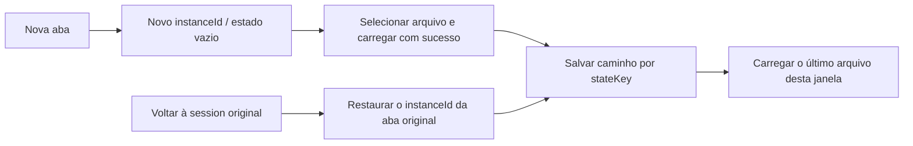

# Painéis de visualização dos plugins de documentos integrados: documents / pdf / presentations / spreadsheets 0.2.0

> Data: 2026-10-15
> Status: implementado, verificação real no desktop pendente
> Relacionado: o mercado de testes do repositório de plugins já publicou um plugin com o mesmo nome na versão 0.2.0 (com os painéis de visualização); desta vez os painéis são incorporados aos plugins integrados que acompanham o aplicativo.

## 1. Contexto e decisão

Os quatro plugins de documentos são plugins integrados que acompanham o aplicativo (`zcode-plugins-official`), com IDs de plugin no formato `<name>@zcode-plugins-official`. Caso o diretório CDN do repositório de plugins publique um item com o mesmo nome, o diretório combinado exibirá o item do CDN, mas a descoberta em tempo de execução carrega primeiro a cópia integrada, e uma instalação do mercado com o mesmo ID é descartada como duplicata; os plugins integrados também não participam das atualizações do mercado. Portanto, os painéis de visualização não podem ser publicados separadamente pelo repositório de plugins: precisam ser publicados junto com a atualização dos plugins integrados.

Decisão:

- Os quatro plugins sobem uniformemente para 0.2.0, adicionando, além das skills de produção existentes, uma skill de visualização (`docx-viewer`, `pdf-viewer`, `pptx-viewer`, `xlsx-viewer`), um MCP server via stdio e uma UI surface com `availability: "session"`.
- A implementação dos painéis fica no pacote compartilhado `@zcode/office-runtime` (`apps/zcode-cli/packages/office-runtime`). Cada plugin declara o título do painel e os formatos no campo `office` do package.json, e o script `build` chama `../office-runtime/scripts/build.mjs`, empacotando apenas o parser e o visualizador daquele formato.
- As skills de produção, o Agent de revisão visual e a licença (Apache-2.0) permanecem inalterados; o código do painel e do server, sob a licença MIT do office-runtime, é gravado em `dist/LICENSE`.

## 2. Build e artefatos

```text
apps/zcode-cli/packages/<name>-plugin/package.json  ── office.title / office.kinds
                │ pnpm --filter @zcode/<name>-plugin build
                ▼
office-runtime/scripts/build.mjs（插件名取自 .zcode-plugin/plugin.json）
                ▼
<name>-plugin/dist/
  server.mjs                 MCP server，esbuild 全量打包，运行时不读 node_modules
  ui/panel.html, assets.json 面板入口与分片脚本清单
  ui/bundle-*.txt …          面板脚本、pdf.js / xlsx 资源
  LICENSE, THIRD_PARTY_NOTICES.txt
```

- O nome do plugin deve ser obtido do manifest: ele é o nome do serviço MCP, o id da surface e o prefixo `ui://<name>/`, enquanto o diretório do pacote integrado tem o sufixo `-plugin`.
- `dist/` não entra no git (`apps/zcode-cli/.gitignore`). O `build` de plugins do turbo depende do `build` do office-runtime (somente checagem de tipos), e mudanças no código-fonte do office-runtime invalidam o cache de build dos quatro plugins.
- As dependências dos visualizadores (pdfjs-dist, docx-preview, pptx-renderer, react-xlsx, exceljs etc.) são declaradas como devDependencies do office-runtime: elas só são empacotadas na fase de build e não são distribuídas como dependências npm de runtime; as licenças das partes empacotadas são gravadas junto dos artefatos em `dist/THIRD_PARTY_NOTICES.txt`. As dependências de leitura/escrita em streaming do exceljs (archiver, unzipper, tmp, fast-csv) são substituídas por módulos stub no build e não entram nos artefatos.

## 3. Ativos obrigatórios e fonte de verdade das versões

A definição única dos caminhos dos artefatos é o `OFFICE_RUNTIME_OUTPUTS` do `contract.ts` do office-runtime: `dist/server.mjs`, `dist/ui/assets.json`, `dist/ui/panel.html`. A lista a seguir precisa ser mantida em sincronia:

| Local                                                  | Conteúdo                                                                                                                     |
| ----------------------------------------------------- | ------------------------------------------------------------------------------------------------------------------------ |
| `bootstrap/src/app/official-plugin-definitions.ts`    | versão 0.2.0 (pdf 0.2.1, conforme a declaração de cada plugin); `requiredSeedPaths` recebe a viewer skill e `OFFICIAL_OFFICE_VIEWER_RUNTIME_PATHS` |
| `cli/scripts/sea-official-plugin-assets.mjs`          | versão 0.2.0 (pdf 0.2.1); `requiresRuntime: true`, `requiredRuntimePaths` são os artefatos dos painéis                     |
| `desktop/scripts/prepare-agent-node-bundle.mjs`       | `requiresRuntime: true`, `runtimeBuildScript` aponta para o script de build do office-runtime                              |
| `scripts/build-desktop-agent-cli.mjs`                 | a cadeia de dev constrói os quatro plugins e valida `dist/server.mjs`                                                        |
| `server/src/remote/zcodeAgentOfficialPluginAssets.ts` | os ativos obrigatórios do remoto recebem a viewer skill e os artefatos dos painéis                                            |
| `docker/plugin-eval/Dockerfile`                       | a imagem de avaliação constrói os quatro plugins antes do stage                                                               |
| `package.json` / `.zcode-plugin/plugin.json` de cada plugin | versão 0.2.0 (pdf 0.2.1)                                                                                                |

Quando `requiredSeedPaths` está incompleto, o seed recusa apenas aquele plugin e faz fallback para um cache antigo utilizável, sem afetar os demais plugins; por isso, um ambiente de desenvolvimento sem build verá esses quatro plugins parados no cache antigo ou ausentes, e não a falha de todos os plugins.

O caminho de bootstrap do desktop rodava antes `tsc` e depois o script de build para cada plugin de runtime; como os plugins de documentos não têm tsconfig próprio, agora `tsc` só é executado quando existe `tsconfig.json` na raiz do plugin.

## 4. Aceitação

- office-runtime: `typecheck`, `lint`, testes unitários (parser, âncoras, texto, i18n, alinhamento, contrato).
- Os quatro plugins: após o `build`, `smoke` (MCP stdio real: abrir, ler, buscar, localizar, rejeição de caminhos fora do escopo) e `test:e2e` (carregamento do painel no Chrome sob a CSP do sandbox de MCP Apps, cobrindo referência de seleção, localização pelo Agent, busca, gaveta, captura de tela e cards inline escuros em chinês).
- Consistência de versões e ativos: bootstrap `plugins.test.ts`, `build-sea.test.mjs`, desktop `runtime-asset-scripts.test.ts`, server `remoteDeploy.test.ts`.
- Pendente: abrir de fato os quatro painéis no ZCode desktop (incluindo workspaces remotos); o e2e não cobre o sandbox do Electron em si.

## 5. Arquivos locais e restauração de janela (2026-10-16)

- O estado vazio tem título, descrição, botão de abrir arquivo e explicação dos formatos. O botão chama o seletor de arquivos do sistema e suporta arquivos de fora do workspace; cancelar não altera a página.
- Os arquivos são importados em blocos de 4 MiB para `.zcode/document-imports/<uuid>/<filename>`, mantendo o limite de 100 MiB. A pré-visualização e as referências do Agent usam uma cópia, sem modificar o arquivo original e sem abrir leitura de caminhos arbitrários. Arquivos com o mesmo nome são salvos de forma independente.
- A criação manual de uma janela de documento gera um instanceId, persistido junto com a aba. Plugins comuns e surfaces dirigidas por ferramentas mantêm o roteamento original.
- O SHA-256 da instância completa de workspace/session/plugin/server/resource/surface compõe um stateKey opaco; o localStorage do painel salva o último caminho carregado com sucesso nessa janela, sem restaurar do último documento global do servidor. Quando o armazenamento não está disponível, a pré-visualização ainda funciona, mas a restauração não é garantida.



A entrada oficial do plugin é reconstruída a partir do manifest integrado original, preservando a entrada e os parâmetros reais e corrigindo o cache corrompido; HTTP/SSE não são validados como stdio. O serviço exporta `main` e só se inicia sozinho quando executado diretamente. Os popups de confirmação de envio e de pergunta por seleção adotam espaçamento compacto, área de entrada e borda unificada, preservando envio, cancelamento e comportamento de teclado.

### Cenários e matriz de cobertura

| Cenário                                       | Local de cobertura                                         | Limite                                               |
| ------------------------------------------ | ------------------------------------------------ | -------------------------------------------------- |
| Correção da entrada em cache, preservação de parâmetros, configuração HTTP | bootstrap/tests/official-plugin-runtime.test.ts  | Teste unitário                                           |
| Ordem dos blocos, rejeição de importações incompletas, isolamento de nomes iguais, limpeza ao cancelar   | office-runtime/src/adapters/files.test.ts        | Teste unitário                                           |
| Isolamento de janelas, estabilidade do escopo de serialização, isolamento por session | packages/ui/src/plugin-ui/contract.test.ts       | Teste unitário                                           |
| Importação local, restauração ao recarregar, estado vazio em nova janela | ramo de documents em office-runtime/scripts/e2e.mjs | AppBridge do navegador + MCP real, não é E2E de Electron     |
| Seleção nativa de arquivo em PDF/PPT, duas janelas de PDF na mesma session | aceitação manual em instância de desenvolvimento no macOS | Validado; entre sessions, workspace remoto e Windows/Linux pendentes |
| Popups compactos e caixas de confirmação                     | regressão de interação existente e verificação manual                 | Aceitação visual dos dois temas e do controle remoto pelo celular pendente                       |

## 6. Texto CJK em PDF

Convenções do painel de PDF (`office-runtime/ui/viewers/PdfView.tsx`, pdf.js 5.4.296) para texto CJK (chinês, japonês, coreano). Publicado junto com o plugin pdf 0.2.1: a atualização de versão leva quem já instalou a um novo diretório de cache, sem reaproveitar os artefatos do painel antigo da 0.2.0 (os outros três plugins de documentos continuam em 0.2.0). As fontes embutidas são carregadas diretamente pelo pdf.js, sem passar pela cadeia de fontes abaixo; esta seção trata apenas de **fontes não embutidas** e de **extração de texto**.

### 6.1 Cadeia de fontes para fontes não embutidas

Para fontes não embutidas, o pdf.js procura pelo nome uma fonte do sistema com o mesmo nome e, se não encontrar, recorre às famílias genéricas `serif` / `sans-serif`; por isso o SimSun costuma ser desenhado como uma fonte sem serifa. Quando o nome da fonte está em codificação multibyte como GBK (por exemplo `/#CB#CE#CC#E5` = 宋体), o pdf.js desiste de substituir. O painel assume a cadeia de fontes no ponto em que o pdf.js define a fonte no canvas:

```text
PDF 字体（未嵌入）── 名称（含 GBK / Big5 / Shift-JIS / EUC-KR 解码）+ pdf.js 的 Serif 标志
        │ 分类 ui/cjkFonts.ts
        ▼
文种 sc | tc | jp | kr（默认 sc）× 字形 serif | sans | kai | fang（名称未识别时取 Serif 标志）
        ▼
canvas font = <pdf.js 原字体链（去掉末尾通用族）>, "zcode-cjk-<文种>-<字形>",
              ["zcode-cjk-<文种>-serif"（kai / fang 时）], ["zcode-cjk-fallback"], <通用族>
```

- `zcode-cjk-*` são os `FontFace` registrados pelo painel: a origem é uma lista de `local()` de fontes equivalentes comuns nas três plataformas (macOS 宋体-简 / 苹方 / 楷体-简…, Windows SimSun / Microsoft YaHei / KaiTi…, Linux Noto / Source Han / 文泉驿…), e o `unicode-range` cobre apenas caracteres CJK e pontuação de largura inteira, portanto não altera o fallback do texto latino.
- O painel carrega todos os `zcode-cjk-*` antes de abrir o documento (busca via `local()`, sem download). A cadeia original do pdf.js fica em primeiro lugar: quando o sistema realmente tem uma fonte com o mesmo nome (como a SimSun no Windows), ela continua sendo usada.
- Só se aplica às fontes que o pdf.js marca como arquivo ausente (`missingFile`); Type 3 e fontes embutidas não mudam.
- Forma de implementação: na fase de build, um plugin do esbuild reescreve a linha que calcula a cadeia de fontes no `setFont` do canvas do pdf.js (a build falha se o texto original não for encontrado), chamando o `pdfTypeface` de `ui/cjkFonts.ts`.

### 6.2 Fontes de fallback integradas

Quando o sistema não tem nenhuma fonte CJK (todos os `zcode-cjk-*` falham ao carregar, comum em Linux enxuto), o painel carrega, antes de abrir o primeiro PDF, o Noto Sans SC 400 distribuído com o plugin (Fontsource 5.3.1, OFL-1.1, dividido por `unicode-range` em 97 arquivos, cerca de 2.4 MiB, cobrindo 99.5% do GB2312), registrado como `zcode-cjk-fallback`, posicionado antes da família genérica na cadeia de fontes. O canvas não espera a fonte no desenho, então a fonte de fallback precisa estar pronta antes do primeiro desenho, e não carregada depois com um redesenhe. Ela é carregada apenas uma vez no ciclo de vida do painel; máquinas com alguma fonte CJK do sistema não a carregam. Os arquivos de fonte são lidos como recursos `ui://pdf/assets/fonts/*.woff2`, com o manifesto em `ui://pdf/assets/cjk-fallback.json`; apenas o build do plugin pdf os produz.

### 6.3 Normalização da extração de texto

PDFs impressos por Chrome / Skia costumam escrever o ToUnicode de alguns hanzi como caracteres compatíveis com radicais (文→⽂ U+2F42, 黄→⻩ U+2EE9): a imagem fica correta, mas copiar, buscar e referenciar ficam todos errados. A análise no server (`read_document`, `search_document`) e a camada de texto e a busca do painel passam uniformemente por `normalizeCjkCompat` em `src/domain/cjk.ts`: radicais Kangxi (U+2F00–2FD5) por NFKC, suplemento de radicais (U+2E80–2EF3) pelo `EquivalentUnifiedIdeograph.txt` do Unicode 16.0, aceitando apenas as 100 entradas cujo ideógrafo equivalente está no BMP (outras 14 são caracteres de componente em áreas estendidas e não são substituídas). Não se faz NFKC completo (transformaria pontuação de largura inteira em meia largura). Antes e depois da substituição, o resultado é uma única unidade UTF-16.

### 6.4 Recursos do pdf.js

A whitelist de recursos do painel permite `pdfjs/wasm/*.wasm` (openjpeg para decodificar imagens JPEG 2000, qcms para processar cores ICC), antes recusados e por isso impossibilitando a decodificação desses dois tipos de conteúdo.

### 6.5 Aceitação

- Testes unitários: classificação de fontes e cadeia de fontes (`ui/cjkFonts.test.ts`), normalização de radicais (`src/domain/cjk.test.ts`), extração e busca em `fixtures/cjk.pdf` (`parse.test.ts`), whitelist de recursos (`src/adapters/assets.test.ts`).
- `test:e2e` do plugin pdf: abrir `docs/cjk.pdf`, afirmar que as fontes `zcode-cjk-*` já estão carregadas antes do desenho, que a localização pela citação normalizada e a busca têm acerto; abrir outra página de modo que todas as buscas `local()` falhem, afirmar que apenas `zcode-cjk-fallback` foi registrada e tirar uma captura de tela para registro; o `smoke` lê os recursos wasm e de fonte de fallback.
- Pendente: verificação manual em máquinas reais com Windows / Linux e em ambientes sem fontes CJK.

## 7. Fechamento da revisão: privacidade, views e ciclo de vida da importação

- O host envia apenas a chave de restauração SHA-256 do escopo completo, sem enviar caminhos nem sessionId. A restauração de janela e os arquivos recentes compartilham um cache de nível de janela, mantendo no máximo as 128 janelas usadas recentemente; ao exceder, a janela mais antiga volta ao estado vazio.
- report_view carrega o viewId, e o DocumentOwner salva por janela. get_view pode especificar o viewId; com várias janelas e sem viewId especificado, retorna a lista de janelas e um aviso de ambiguidade, sem escolher arbitrariamente o último que reportou. A visão é liberada quando a página é deixada normalmente; uma visão antiga de saída anormal pode causar, no máximo, um aviso de ambiguidade conservador, sem responder por outra. A localização pelo Agent continua abrindo uma surface dedicada, e o texto da ferramenta deixa esse comportamento explícito.
- A importação é gerenciada serialmente pelo servidor; antes de admitir uma nova importação, são limpas as importações incompletas sem dados há mais de 10 minutos. Na inicialização do servidor, apenas `.partial` expirados são varridos, preservando os produtos prontos e as importações recentes de outros processos. Importações begin concorrentes não ultrapassam o limite de 4 slots, e falhas e limpezas na saída não geram rejection não tratado. A expiração de recursos serve apenas para coleta, e não para determinar a ordem de sincronização da página.
- Cobertura: privacidade da chave de restauração, limite e isolamento do cache de janelas, ambiguidade de múltiplas views, limite de concorrência, coleta por timeout, varredura na inicialização e preservação das cópias concluídas.
