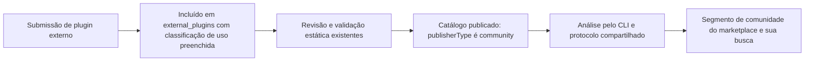
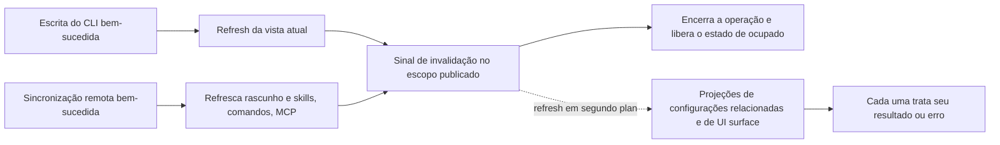
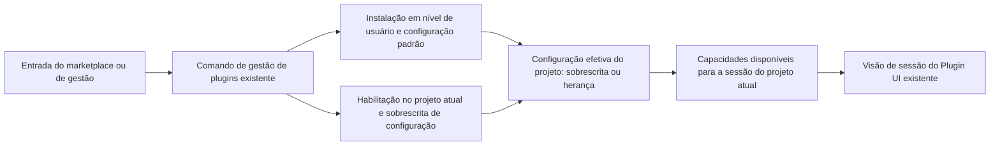
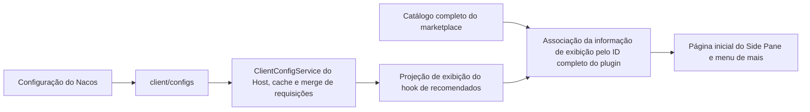
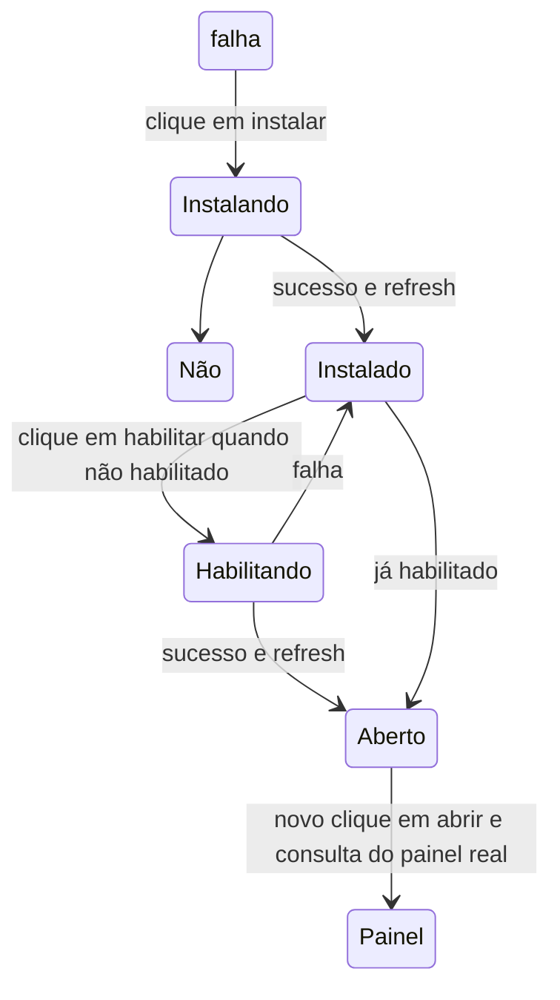

# Ajustes de interação do marketplace de plugins: escopo de implementação

## Baseline e protótipo

- Baseline de implementação: staging `6295a71ff38a242af5704061fea6b3947ce7241b`.
- Referência de interação: `feat/side-pane-plugins-and-file-manager`, commit `eb137c6fae42e727f139a7568a67df782446b345`.
- Base de produto: "Ajustes de interação do marketplace de plugins e do Side Pane" (插件市场 & Side Pane 交互调整), revisão de 2026-10-09, seções 4–7.
- Este arquivo registra o escopo confirmado e as restrições de implementação; as evidências de execução estão na matriz de verificação.

## Revisão de escopo de 2026-10-11

O usuário exigiu explicitamente que “a gestão de plugins continue a suportar a gestão por projeto”. Este requisito tem precedência sobre a descrição do PRD que cancela a dimensão de gestão por projeto.

- A gestão de plugins mantém a alternância entre global / por projeto. Instalação global e gestão por projeto coexistem.
- As configurações globais oferecem estado de habilitação padrão e configuração; o projeto pode sobrescrever o estado de habilitação e a configuração, e restaurar a herança das configurações globais.
- Pausar / habilitar dentro de um projeto altera apenas o projeto atual, não o global nem outros projetos; a interface exibe claramente o escopo da operação e a origem da configuração.
- Desinstalar continua sendo remover a instalação global, e a confirmação explica o impacto sobre outros projetos; a pausa por projeto não pode ser apresentada como desinstalação.
- Ao entrar no marketplace a partir de um projeto, o card mostra o estado efetivo do projeto; pausar / habilitar grava a sobrescrita daquele projeto; sem contexto de projeto, modifica o padrão global.
- A gestão de plugins fica embutida dentro do marketplace, reutilizando a lista de plugins e as capacidades de configuração existentes; o marketplace não abre abas independentes de configuração de MCP / Skill. Na primeira vez o padrão é global; na ida e volta preserva o projeto selecionado e os filtros de navegação.

## Plugins da comunidade: inclusão, publicação e exibição

O segmento da comunidade passa a consumir dados reais do catálogo; o estado vazio só aparece quando não há entradas da comunidade. A classificação é feita na momento da inclusão do plugin e percorre a publicação do catálogo, a consulta via CLI e a exibição no cliente.

### Semântica da classificação

- O marketplace oficial é o canal de distribuição e continua usando `zcode-plugins-official`, onde são incluídos tanto plugins oficiais quanto de comunidade.
- Oficial / comunidade indica a atribuição de manutenção do plugin. Plugins mantidos por times externos, parceiros e pela comunidade vão para a comunidade; plugins mantidos oficialmente que usam serviços de terceiros continuam sendo oficiais — a atribuição não pode ser deduzida automaticamente pela marca do serviço ou por strings do autor.
- `category` continua representando a classificação de uso, por exemplo ferramentas de desenvolvimento, produtividade; a capacidade de UI é outra dimensão independente e não ocupa os campos de classificação de uso nem de atribuição de manutenção.
- O segmento pessoal continua representando mercados e fontes locais adicionados pelo próprio usuário. Uma fonte pessoal que se declara oficial ou da comunidade não entra nos segmentos público / da comunidade do ZCode.

### Mudanças no repositório de plugins

1. Em `zcode-plugins`, os plugins mantidos oficialmente permanecem em `plugins/<name>` e os novos plugins externos são incluídos em `external_plugins/<name>`. A atribuição de diretório é a única fonte de verdade da classificação de inclusão; não se mantém mais uma segunda lista manual de classificação.
2. Submissões externas que adicionam plugins novos precisam usar o diretório externo; correções em plugins oficiais existentes não alteram a atribuição do plugin. Atualizar o guia de contribuição, o template de submissão e a validação de recebimento de PRs externos existentes, verificando diretório, registro da entrada e classificação de uso já na etapa de inclusão.
3. Validadores, empacotador, publicação incremental e os testes relacionados cobrem os dois diretórios raiz de plugins e continuam rejeitando travessia de caminho, links simbólicos e diretórios não registrados. Segue-se a cadeia atual de revisão e publicação.
4. O publicador gera, a partir da atribuição de diretório, o `publisherType: "official" | "community"` de cada entrada e em seguida converte `source` para o endereço de ZIP no CDN. O cliente consome os campos já publicados e não depende do caminho de diretório de origem reescrito.
5. Entradas históricas são conferidas item a item por origem de manutenção, e plugins confirmados como mantidos externamente migram para o diretório externo. Nome do plugin, ID de marketplace, versão e caminho do artefato são preservados; a versão do plugin só é elevada pelas regras existentes quando o conteúdo muda. A migração de diretório verifica que o conteúdo do ZIP e o sha256 permanecem iguais, evitando quebrar instalações, atualizações e configurações de projeto existentes.

### Mudanças no cliente

- O campo opcional `publisherType` é Integrated ao longo dos tipos de Store Listing existentes, do schema de runtime, da resolução de catálogo e da consulta de plugins, sem modificar a semântica de instalação de `source`.
- Público = plugins mantidos oficialmente no marketplace oficial; comunidade = plugins mantidos pela comunidade no marketplace oficial; pessoal = fontes adicionadas pelo próprio usuário.
- Consulta por classificação, os destaques, a área de plugins de UI e a busca restringem-se primeiro ao segmento atual, evitando que a mesma entrada apareça repetida em segmentos diferentes.
- A área de plugins de UI agrupa pelo tipo de componente `ui` da entrada; os plugins de UI embutidos (Word, PDF, PPT, planilhas), quando desinstalados, geram entradas recuperáveis sem informação de runtime, e o tipo de componente vem da definição embutida, distribuída junto com o catálogo oficial e a lista de recuperáveis, permanecendo na área em vez de cair nos agrupamentos de classificação.
- Compatibilidade com catálogos antigos: quando o marketplace oficial não tem o campo de atribuição, mantém-se temporariamente a exibição pública original; plugins embutidos são explicitamente oficiais. Catálogos recém-publicados devem gerar o campo completo, e as entradas históricas entram no segmento correto após a conferência e a atualização do catálogo.
- Não se migram o diretório de instalação do usuário, os IDs de plugin nem as configurações global / por projeto, e a atribuição do plugin não é tratada como permissão de execução nem como grau de confiabilidade.



## Ajustes do marketplace e aceitação

| Ajuste              | Requisito de aceitação                                                                                                                   |
| ------------------- | ------------------------------------------------------------------------------------------------------------------------------------------ |
| Origem e busca      | Público por padrão; público, comunidade e pessoal sempre alternáveis; a busca é restrita à origem atual e preserva a capacidade de correspondência por pinyin já existente. |
| Entrada da comunidade | Exibe plugins reais da comunidade conforme a atribuição do catálogo; sem entradas, mostra “暂无社区插件”; falha de carregamento não é disfarçada de estado vazio. |
| Gestão de plugins   | Entrada unificada “插件管理” no topo; mantém a alternância global / por projeto, o controle de habilitação por projeto e a sobrescrita de configuração; permite voltar a “浏览全部插件”. |
| Ações de gestão     | O menu de mais ações traz apenas pausar/habilitar e desinstalar; a capacidade de atualização existente é mantida como operação independente; mantém a confirmação de desinstalação e o retorno de falha. |
| Instalação          | Reutiliza a instalação em nível de usuário existente, a recuperação de embutidos e a atualização de skills após a instalação; não cria outro estado de instalação. |
| Card de plugin de UI | A linha inteira abre os detalhes; apenas no marketplace à direita da sessão há um «打开» a mais; no estado pausado mostra «启用» e habilita antes de abrir; quando não instalado, permite instalar direto. |
| Agrupamento de plugins de aplicativo | Compartilha com as outras classificações o expandir/recolher dentro do grupo, com tudo expandido por padrão; acima de 6 itens pode recolher para os 6 primeiros e não entra em uma lista independente. A busca e a limpeza da busca preservam a seleção manual de cada origem. |
| Detalhes de plugin de UI | Reutiliza o layout de detalhes comum, mostrando a imagem ampliada, as capacidades de interface e as informações. |
| Reuso do marketplace | A área principal e a entrada do Side Pane reutilizam o mesmo componente; dentro do marketplace alterna-se entre navegar / detalhes / gestão; a entrada pode suprimir o breadcrumb da página de configurações. |

O gerenciador de arquivos e a abertura múltipla / ordenação / fechamento recente das abas genéricas não fazem parte do escopo desta implementação de marketplace.

## Divergências verificadas

1. O protótipo `useUiPluginInstall.ts` usa localStorage para simular habilitação, pausa e remoção; `DEMO_PLUGINS` e a página de demonstração não são pacotes de plugin reais instaláveis. Não se pode reportar sucesso real de instalação com base nesse estado.
2. O `PluginStorePage.handleInstall` atual já instala com scope `user`. O workspace/user da página de gestão também carrega a semântica de sobrescrita de configuração e restauração da herança; não se pode equiparar a remoção do agrupamento de escopo de instalação à remoção da capacidade de configuração por projeto.
3. O marketplace do protótipo também depende dos callbacks da página de demonstração do Side Pane. Copiar diretamente arrastaria junto a navegação de arquivos, os recursos de demonstração e a reformulação de abas.
4. A atualização de plugins existente, a instalação órfã, a recuperação de embutidos, os erros de refresh do marketplace e a confirmação de desinstalação precisam continuar disponíveis.

## Limites de integração de UI confirmados

O repositório já tem um painel real de Plugin UI, `plugins/listUiSurfaces` e a cadeia de execução em sandbox. Esta rodada reutiliza as capacidades existentes e complementa o marcador de capacidade de UI do catálogo e a entrada de abertura no marketplace; quando há múltiplos surfaces, é oferecida uma escolha. A lista de recomendados independente contém apenas plugins reais verificados; sem entradas válidas usa-se o estado vazio e não se importa o estado de demonstração do protótipo.

O publicador gera a capacidade `ui` em `componentTypes` do catálogo a partir de `ui.surfaces` válido no manifesto; o CLI projeta a capacidade do catálogo para entradas não instaladas, projeta o resultado real da análise para entradas instaladas e preserva o resumo de surfaces no protocolo de detalhes do plugin. Desabilitar não remove a classificação de capacidade, e o ponto de entrada de execução continua permitindo apenas os surfaces já habilitados no projeto atual. Atribuição, uso e capacidade de UI são mutuamente independentes.

Abrir a UI só está disponível no marketplace de plugins à direita da sessão: o card, os detalhes e a linha «打开 / 启用» da página de gestão; na navegação principal o marketplace abre os detalhes ao clicar na linha inteira, e o botão principal dos detalhes é «立即试用». No desktop local a UI abre quando há uma sessão existente disponível; celular, Web e remoto podem navegar, instalar e gerenciar, e ao abrir a UI exibem um aviso de que não é suportado por enquanto. Inicialização fora de uma conversa, criação de nova sessão, promoção de rascunho e hot reload de sessão antiga ficam para tarefas seguintes; esta rodada não cobre esses fluxos.

As vistas de consulta são isoladas por host, identidade de workspace e escopo de configuração, reutilizando a lógica de leitura e escrita do store de gestão existente. Após uma mudança bem-sucedida, refrescam-se as vistas afetadas e a lista de UI surfaces, descartando respostas tardias de alvos antigos, evitando que a área principal, o Side Pane e a troca de projeto se misturem.

A projeção das configurações globais e a projeção independente do marketplace compartilham a notificação de mudança não bloqueante; a falha ou o atraso de uma consulta de vista secundária não afeta o estado de conclusão das escritas bem-sucedidas. A notificação registra o host, o workspace e o escopo de escrita no momento em que a operação foi iniciada: mudanças em nível de usuário refrescam os projetos do mesmo host, mudanças em nível de projeto só refrescam a configuração efetiva daquele projeto; a sincronização remota não exige abrir antes as configurações globais. Consultas em voo do mesmo serviço, identidade e escopo de configuração compartilham o resultado; uma consulta iniciada antes da mudança não pode satisfazer o refresh posterior à mudança. As configurações de usuário de um Source e a projeção por projeto desse Source usam a mesma determinação de host, e cada vista verifica separadamente se o alvo continua válido e preserva seus próprios erros de operação. A assinatura de UI surface reutiliza o mesmo host e o mesmo escopo de projeto, sem refrescar workspaces sem relação; a sincronização remota primeiro completa as atualizações de capacidade necessárias e só então notifica as vistas derivadas. Instalação e recuperação de embutidos só invalidam o rascunho e refrescam as skills depois de sucesso; mesmo falhas diagnósticas devem aparecer como erro. O marketplace da navegação principal não oferece abertura de UI, e o “浏览全部插件” da página de gestão continua alternando dentro do marketplace.



O card de UI instalada e a linha da página de gestão abrem os detalhes pela linha inteira, sem o botão “详情” independente; ver os detalhes não dispara habilitação nem abertura, e funciona no desktop, na Web e no remoto. A lista de recomendados padrão continua independente da lista de instalados, e o estado vazio mantém a entrada “查看所有插件”.

## Atribuição de estado



Fechar a vista não desinstala o plugin. O estado de instalação não é gerenciado de forma independente pelo componente nem pelo localStorage. O layout do marketplace nesta rodada não altera a fronteira de entrega de mensagens do continuous do desktop nem do replayable do celular.

## Verificação de implementação

- Atualizar primeiro os testes de isolamento de origem, de estado vazio da comunidade, de ida e volta no marketplace e de comportamento de menu; só depois modificar a implementação.
- O repositório de plugins cobre a inclusão no diretório externo, a consistência entre diretório e entradas, a classificação de uso obrigatória, a rejeição de caminhos ilegais, a preservação do campo de atribuição na publicação e a estabilidade do artefato e dos identificadores de instalação após a migração de catálogos existentes.
- O cliente cobre a exclusividade mútua dos segmentos oficial / comunidade / pessoal, diferentes atribuições de manutenção sob a mesma classificação de uso, a autodeclaração de um marketplace pessoal sem ultrapassar limites, a compatibilidade com catálogos antigos e a reclasificación após o refresh do catálogo.
- Manter o E2E do ciclo de vida dos plugins: instalação, gestão, pausa/habilitação, atualização, desinstalação e cenários de falha.
- Verificar que a pausa e a configuração do projeto A não afetam o projeto B nem os padrões globais; após restaurar a herança usa-se a configuração global; a troca de projeto não mistura estados; a desinstalação global indica claramente o escopo do impacto.
- Verificar larguras de desktop e celular, Zai Light/Dark e chinês/inglês; preservar o foco do teclado e os nomes acessíveis.
- Executar a checagem de arquitetura, typecheck, lint, testes unitários relacionados e o E2E de interação. Registrar com honestidade o que não foi executado.

## Ordem de implementação e estado atual

Entregar primeiro a leitura compatível do campo de atribuição opcional pelo cliente, depois a classificação de inclusão no repositório de plugins, a migração do estoque existente e o campo de publicação, deixando testes e commits separados dos dois lados. O repositório de plugins usa um worktree isolado adicional, preservando as alterações já existentes no checkout original. Atualizar em sincronia o glossário de domínio do cliente e os documentos de contribuição / distribuição do repositório de plugins.

Já foram implementados a classificação de inclusão, os metadados de publicação, os três segmentos do cliente e a identificação de capacidade de UI, a gestão dentro do marketplace e a entrada do Side Pane. Cliente e repositório de plugins usam worktrees independentes, e o baseline passou na checagem de frescor. A instalação real no desktop, o sandbox de UI, o isolamento por projeto, a restauração da herança e a desinstalação passaram pelo E2E de Electron; a matriz de navegador cobre visores largos e estreitos, chinês/inglês e temas claro e escuro. A migração de diretórios externos existentes mantém inalterados o ID de instalação e 27 artefatos ZIP. O catálogo ainda não foi publicado, e a lista padrão de recomendados de UI está vazia; o controle remoto real por celular e o Electron em Windows/Linux ainda não foram verificados. O registro completo de execução está na [matriz de verificação](../testing/plugin-management-lifecycle-e2e-coverage-matrix.md).

## Conferência de impacto

Esta rodada pertence a mudanças de presentation, option-source, validation, commit-effect e persistência de publicação de catálogo. Não mudou a restauração de conversa, a fila nem a entrega de mensagens. A árvore de trabalho não tem índice de grafo de código; a conferência foi feita por importações reais, chamadores e campos de protocolo; não se declara ter executado uma varredura profunda de Codegraph.

| Entrada                                | Implementação compartilhada e estado de exibição                                             | Autoridade e caminho de submissão                          | Isolamento que deve ser mantido                                                |
| ------------------------------------- | ------------------------------------------------------------------------------------------ | ------------------------------------------------------ | --------------------------------------------------------------------------- |
| Marketplace principal do workspace, marketplace do Side Pane | PluginStorePage / ListView / Card; consulta, busca e origem independentes por vista | IPluginManagementService → diretório de instalação e arquivo de configuração do CLI | Identidade do workspace, host, configuração por projeto / global; refresh da projeção após escrita bem-sucedida |
| Gestão dentro do marketplace, gestão em configurações      | PluginsSection; primeira vez global, seleção de projeto e restauração de configuração reaproveitam capacidades existentes | setPluginEnabled / configurePlugin / resetPluginConfig | A sobrescrita por projeto não modifica o global; a desinstalação é explicitamente uma ação global em nível de usuário |
| Card de UI, detalhes, entrada de recomendados             | Capacidade do catálogo válido; lista de recomendados independente; a abertura reaproveita o sandbox de plugins | listUiSurfaces → runtime de UI da sessão existente      | Só o desktop local abre; respostas tardias de sessão antiga / vista desinstalada não abrem um novo alvo |
| Inclusão externa, publicação do catálogo | Diretório externo e classificação de uso obrigatória; a publicação gera atribuição e capacidade | validate / sync_external_prs / build_dist do repositório de plugins | A atribuição de origem é separada do uso e da capacidade de UI; a migração não altera o ID de instalação nem o conteúdo do ZIP |

As capacidades adjacentes que precisam ser verificadas são o refresh de skills após a instalação, o teste de plugins comuns, a recuperação de embutidos, o portão de atualização de plugins órfãos, o salto por deep link e o título de aba / busca. A capability frozen da sessão, o continuous do desktop, o replayable do celular e as permissões do sandbox existente são mantidos como invariantes. Uma fonte pessoal não pode entrar nos segmentos público ou de comunidade por autodeclaração de atribuição.

Drift do grafo estático: os nós existentes de ordenação de classificação ainda têm nomes de modo antigos e descrições de entradas instaladas; esta rodada registra a relação entre marketplace e capacidade de UI, e a nomenclatura antiga de modo está fora do escopo desta rodada. O estado de interface atual vem da configuração do CLI e da projeção do catálogo; o componente não guarda estado de instalação.

Passagem de casos: testes unitários de origem e interação, regressão de navegador do Side Pane, PLM-LC-001/002 e o novo PLM-UI-001; este último cobre instalação real, recursos MCP e sandbox, isolamento por projeto, restauração da herança e desinstalação. O resultado completo da execução segue a matriz de verificação, e casos pending não são promovidos automaticamente.

Os dois arquivos grandes do CLI já excediam 800 linhas no upstream; desta vez apenas foram adicionados o campo de catálogo e a projeção de capacidade, e o caminho exato foi registrado como alerta de contagem de linhas conforme as regras do CLI, mantendo estritas as demais checagens.

## Configuração de recomendados no servidor do Side Pane

Os recomendados padrão de UI são distribuídos por `GET /api/v1/client/configs` em `data.configs.uiPluginRecommendations`, em substituição à lista estática do cliente. O `configs` do `client_config.yaml` do Nacos recebe a entrada abaixo:

```yaml
- key: uiPluginRecommendations
  value:
    - pluginId: example@zcode-plugins-official
      surfaceId: panel
```

A lista apenas controla a exposição; não instala nem habilita plugins automaticamente e não fornece endereços de recursos. A página inicial do Side Pane e o menu “+” associam o marketplace pelo `pluginId` completo, e a identidade da recomendação é `pluginId` + `surfaceId`, exibidos na ordem da configuração e com deduplicação.
Entradas não instaladas e desabilitadas continuam sendo exibidas; plugins desconhecidos ou de origem diferente não são exibidos. O comportamento dos botões está na seção abaixo.

Durante o carregamento da configuração e do catálogo completo do marketplace, exibe-se um placeholder de esqueleto, sem antecipar “暂无”. Depois que ambos terminam, uma lista ausente, vazia ou com formato inválido mostra o estado vazio; uma requisição que falha encerra o carregamento e não se usam recomendados fixos no código.
O rascunho não tem entrada; Web, celular e remoto mantêm o aviso de capacidade de abertura já existente.



O único owner do cache é o `ClientConfigService` existente, que reaproveita o TTL de uma hora, sem polling nem cache independente.
A leitura acontece na montagem da entrada; após troca de serviço ou desinstalação, o resultado de requisições antigas é descartado. A mudança de configuração aparece após a próxima leitura válida, e reiniciar limpa o cache do processo. A leitura de recomendados não altera a posse de sessão, fila ou runtime de UI.

Aceitação: o parsing da configuração isola campos corrompidos; entradas duplicadas e desconhecidas não são expostas; requisições tardias não exibem entre serviços;
após o navegador fazer uma requisição real de configuração, a página inicial e o menu ficam consistentes, e abrir com mouse ou teclado preserva os parâmetros originais da sessão;
listas ausentes, vazias e requisições que falham escondem os recomendados. Cobrir visores largos e estreitos, os dois temas e chinês/inglês.

### Instalação e habilitação na área de recomendados

A exposição de recomendados passa a ser a correspondência entre a lista do servidor e o catálogo completo do marketplace, e deixa de intersectar com a lista de painéis disponíveis.
Plugins oficiais não instalados e não habilitados também são exibidos; nome e descrição vêm do catálogo do marketplace, e o título de painel já instalado tem precedência.
A lista é exibida na ordem da configuração, com deduplicação pelo ID completo do plugin e pelo ID do painel; entradas cujo catálogo não existe não são exibidas.

- Não instalado: mostra “安装”, reutilizando a instalação em nível de usuário; plugins embutidos recuperáveis reutilizam a operação de recuperação.
- Instalado, mas não habilitado no projeto atual: mostra “启用”, gravando a sobrescrita do workspace atual.
- Instalado e habilitado: mostra “打开”; ao clicar, consulta o painel real novamente e não pode construir o endereço do recurso a partir da configuração.
- Instalação e habilitação bem-sucedidas apenas atualizam o estado e não abrem automaticamente; só o clique seguinte do usuário abre. Em caso de falha, o estado original é mantido com aviso e a operação pode ser repetida.
- A área de recomendados e o marketplace compartilham o estado de operação determinado por plugin: ao instalar ou recuperar A, B ainda pode submeter a instalação e o C já habilitado ainda pode ser clicado para abrir; apenas se bloqueia a operação repetida do mesmo plugin, e múltiplos surfaces do mesmo plugin compartilham o progresso.
- O estado de ocupado vem do store de gestão de plugins existente, sem criar um lock global de operações no hook de recomendados. Instalações enfileiradas mantêm a exibição “安装中” do marketplace; instalações de plugins diferentes ainda são executadas em série pela ordem de submissão, e nesta entrega não há cancelamento de instalação.
- Enquanto uma instalação está em andamento, é possível abrir os detalhes de qualquer plugin (inclusive o que está sendo instalado); a área de componentes lê `plugins/describe` e não espera a conclusão da instalação.
- Ao abrir uma nova aba à direita durante a instalação, a área de recomendados carrega por `plugins/list` e `plugins/overview`, sem esperar a conclusão da instalação e sem ficar presa na tela de esqueleto.
- O “更新” do card e o “恢复用户默认” dos detalhes também ficam ocupados conforme o plugin, desabilitando apenas o plugin da própria operação em curso; o mesmo plugin também é considerado ocupado durante o salvamento de configuração.
- Após trocar de workspace, serviço ou sessão, operações antigas não podem disparar ações nem avisos de erro no novo alvo, nem limpar o estado de ocupado do novo alvo.
- O rascunho continua não sendo exibido. Celular/Web/remoto podem instalar ou habilitar; a abertura continua obedecendo às limitações de plataforma já existentes.



A aceitação é ampliada: não instalado/desabilitado ainda é exposto; parâmetros de instalação user e habilitação workspace; sucesso não abre automaticamente;
falha permite repetir; cliques rápidos repetidos escrevem apenas uma vez; após a troca de alvo, resultados antigos não abrem nem geram aviso.
