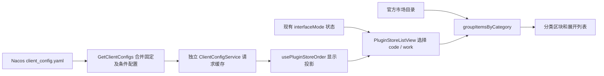

# Ordenação de entrega da loja de plugins por modo de interface

## Funcionalidade e limites

O escopo de ordenação do marketplace se limita aos blocos de categorias da seção pública; ficou confirmado depois que a caixa de entrada @ / + reutiliza a mesma configuração (ver o fim do documento). A seleção Code / Work segue o modo de interface do menu do avatar.
`interfaceMode=coding` corresponde a `code`, `interfaceMode=general` corresponde a `work`, continuando a usar o Zustand, as preferências locais e o mecanismo de broadcast entre janelas já existentes. A atribuição de categoria continua vindo de marketplace listing.category.

- Apenas se ordenam categorias e plugins existentes: não se cria categoria, não se move a atribuição de plugin e não se oculta item não configurado.
- Os itens configurados aparecem primeiro na ordem do array; os restantes mantêm a ordem atual. `other` por padrão é o último, mas pode ser reposicionado quando configurado explicitamente.
- Categorias não configuradas: productivity, developer-tools, utilities, finance, legal, template,
  depois slugs desconhecidos em ordem de code point e, por último, `other`. Plugins não configurados: PDF oficial → PPT → Excel → Word têm prioridade; os demais seguem a ordem do nome de exibição localizado.
- Itens duplicados na lista ordenada usam a primeira ocorrência e os dois extremos são aparados com trim; categorias ou plugins inexistentes são ignorados.
  As chaves de `pluginOrder` usam o slug de categoria exato e os plugins usam o ID completo em correspondência exata.
- Quando um único modo é inválido ou está ausente, esse modo volta ao padrão e não herda o outro. Array vazio significa usar a ordem padrão.
- A ordenação do Featured do marketplace, das seções pessoais, da busca global e da barra de instalados não é afetada; gerenciar instalados, instalar/iniciar-desligar e o runtime ficam inalterados. O plugin de restauração exibido isoladamente é tratado na seção própria abaixo.
- Cada categoria mostra 6 itens por padrão; a pré-visualização colapsada e a lista expandida usam o mesmo resultado de ordenação.

### Ajuste de categorias (2026-09-15)

- A categoria `guides` foi removida; a definição de catálogo do `zcode-guide` embutido passa a ser `utilities`. O cliente agrupa o `guides` antigo em cache em `utilities`, preservando plugin, estado de instalação e comportamento.
- Nova categoria conhecida `legal`, "法律" em chinês e "Legal" em inglês; nenhum plugin novo por enquanto.
- As ordenações Code / Work do ambiente de teste removem `guides` e adicionam `legal`. Categoria vazia segue a regra de não exibição; quando um plugin futuro declarar `category: legal` ele já aparece na posição definida pelo servidor.
- Cobertura: união de guias antigos com utilitários, ausência do título de guias, rótulo Legal bilingue, categoria vazia sem geração de card e ordenação por configuração quando surgir um plugin de Direito. A migração muda apenas a projeção de categorias e o catálogo embutido, não o ID nem a funcionalidade dos plugins.
- Lista e página de detalhe compartilham o agrupamento de categorias, e o detalhe do cache antigo também aparece como Utilitários. No ambiente de teste as duas ordenações já removeram `guides` e colocaram `legal` logo após finanças; no dev real a troca entre os dois modos foi verificada com sucesso.

## Contrato de configuração

`GET /api/v1/client/configs` → `data.configs.pluginStoreOrder`:

```json
{
  "code": {
    "categoryOrder": ["developer-tools", "productivity"],
    "pluginOrder": {
      "productivity": ["lark-cli@zcode-plugins-official"]
    }
  },
  "work": {
    "categoryOrder": ["productivity", "finance", "other"],
    "pluginOrder": {
      "productivity": [
        "tencent-meeting-cli@zcode-plugins-official",
        "lark-cli@zcode-plugins-official"
      ]
    }
  }
}
```

Os IDs acima são exemplos estruturais; na publicação, copie os IDs do catálogo real. Os dois campos de cada modo podem ser omitidos.
O cliente valida com schema de runtime na fronteira de serviço; formato incorreto não entra no ordenador.

## Posse do estado e temporização



- A leitura dos campos públicos usa um `IClientConfigService.getSnapshot({ forceRefresh? })` dedicado, exposto pelo canal RPC comum `client-config`; veja [Contrato do serviço de configuração](../client-config-service.md).
- O serviço de configuração do Local Host da janela é o único owner de requisição/TTL desta cadeia; workspace remoto e anexo de celular reutilizam a mesma instância. O cache é isolado por endpoint/version/platform, válido por 1 hora; a UI não adiciona cache com TTL.
- Só migram as leituras de plugin novas neste MR; as cadeias antigas de assinatura, verificação de segurança, atualização forçada, ocioso, ajuda e Built-in permanecem como estão.
- Na abertura da loja a leitura é assíncrona e o catálogo aparece imediatamente pelas regras padrão; quando a configuração chega, a reordenação acontece no modo atual.
- Trocar de modo apenas recalcula: não faz requisição, não sobrescreve a preferência de interface e não reseta o estado de expansão.
- O refresh manual busca a configuração de ordenação em paralelo; não espera a configuração para atualizar o catálogo. Se a leitura falhar, a projeção válida atual é mantida; na primeira falha, usa-se o padrão.
- Desmontagem do componente, troca de serviço e conclusão de uma requisição mais antiga não podem sobrescrever a nova projeção; a troca de serviço não pode exibir a configuração do serviço antigo.
- Campo ausente (inclusive revogação da configuração) é uma configuração padrão bem-sucedida e precisa limpar a ordenação antiga. Não há polling periódico nem migração persistida.
- Desktop, Web e celular compartilham UI/hook, lendo por meio do service injetado; esta funcionalidade não toca o workspace identity, o shared-host attachment nem o caminho de dados de sessão continuous ou replayable.

## Ponto de implantação no servidor

O zcode-server já suporta `ClientConfigItem.Value:any` e substitui o snapshot após o parse bem-sucedido da atualização do Nacos.
`GetClientConfigs` mescla a configuração fixa do banco com a configuração condicional; a condição com a mesma chave, quando vencida, sobrescreve por inteiro, e não é merge aninhado. Os dois modos vão no mesmo value, publicados atomicamente; não se pode usar duas chaves de mesmo nome com um modo cada.
Não é preciso novo endpoint de negócio em Go nem migração; o servidor fornece exemplo do Nacos e teste de regressão de passagem de ordem de objeto.

## Impacto da funcionalidade (Feature Impact Brief)

Camadas alteradas: option-source, presentation. Modo: planning → implementation-handoff.

| Cenário de UI             | Entrada/implementação compartilhada                                       | Owner de exibição / fonte padrão        | Validação e submissão        | Autoridade/persistência     | Modo e isolamento                                    |
| --------------------- | ------------------------------------------------------------ | -------------------------------- | --------------------- | --------------------- | ------------------------------------- |
| Navegação/expansão de categorias públicas | PluginStorePage → PluginStoreListView → groupItemsByCategory | projeção de configuração do hook / ordenação antiga | schema do serviço; somente leitura | Nacos / cache em memória do Host | compartilhado por desktop/web/mobile, sem mudar o estado do plugin |
| Menu de modo de interface        | Configuração interfaceMode existente                                      | Zustand / normalizeInterfaceMode | setInterfaceMode existente    | preferência local e broadcast entre janelas | mapeamento coding/general → code/work |
| Featured/pessoal/busca/instalados | selectors próprios no mesmo ListView                                    | catálogo/estado de instalação existentes | nenhuma ação nova            | fontes existentes              | ordenação totalmente isolada                            |

O que é compartilhado é o componente de lista, a origem da configuração e o catálogo; o filtro, a ordenação e as ações de instalação de cada entrada mantêm a semântica original.

| Nível           | Relação                           | Evidência/ponto de checagem                                                    |
| -------------- | ------------------------------ | ---------------------------------------------------------------------- |
| must-inspect   | configuração de serviço → hook → ordenação de categorias | ClientConfigService.getSnapshot, PluginStorePage, groupItemsByCategory |
| must-inspect   | interfaceMode → escolha da regra de ordenação | useIsGeneralMode, StoreProvider                                        |
| should-inspect | ordenação → 6 primeiros itens e demais | PluginStoreListView                                                    |
| invariant-only | selectors de busca/featured/pessoal/instalados | pluginStoreListing, PluginStoreListView                                |
| invariant-only | isolamento de instalação/runtime/workspace | não alterar serviços de gerenciamento nem o protocolo do Agent                          |
| evidence-only  | schema, serviços, ordenação e testes de navegador | tabela de cobertura abaixo                                                             |

CodeGraph: nenhum dos dois workspaces tem `.codegraph/`, então a indexação foi pulada por convenção e os chamadores reais foram localizados com rg.
Profundidade de rastreamento estático 2: Page → ListView → groupItemsByCategory; service → provider → client/configs.
Drift do grafo: a capacidade interface-mode existente não tinha semântica de ordenação da loja pública; esta mudança complementa uma capability explícita e as sementes de código.
A submissão de estado ocorre apenas na configuração de modo de interface já existente; a configuração de ordenação não escreve preferência local, catálogo de plugins nem tasks.

## Decisões e handover de cobertura

O usuário já confirmou dois limites: categorias públicas limitadas; itens não configurados são adicionados ao final e `other` pode ser ordenado explicitamente. Nenhuma questão de produto pendente.
Dimensões principais: code/work × configuração válida/ausente/inválida × primeira vez/troca/refresh × expandido/colapsado.
Plataforma/tema/idioma são combinações representativas; a entrega de sessão e o ciclo de vida de plugins não foram modificados e seu produto cartesiano foi podado.

| ID     | Configuração → ação → asserção                                                       | Evidência              |
| ------ | ------------------------------------------------------------------------ | ----------------- |
| PSO-01 | Mesmo catálogo e configuração de dois modos → alternar o estado de modo existente → categorias e plugins se reordenam, número de requisições inalterado | teste de ordenação + navegador |
| PSO-02 | Sem configuração/configuração vazia/campo de modo corrompido → navegar → ordenação padrão, o outro modo continua válido             | schema + teste de ordenação |
| PSO-03 | IDs duplicados/desconhecidos, item explícito em other → ordenar → primeira ocorrência válida, sem adições, remoções nem movements entre categorias | teste unitário              |
| PSO-04 | Configuração não retornada/falha de rede → navegar → catálogo visível; falha no refresh mantém a projeção antiga                | hook + teste de serviço   |
| PSO-05 | Dois serviços ou requisição mais antiga atrasada → trocar serviço/refresh → não sobrescreve o resultado novo                      | teste do hook         |
| PSO-06 | Mais de 6 itens → expandir/recolher → todos os itens na ordem unificada e estado de expansão preservado                   | navegador            |
| PSO-07 | Featured/pessoal/busca/instalados na mesma página → trocar de modo → ordenação original inalterada                        | navegador/teste unitário existente   |
| PSO-08 | Array aninhado de dois modos no Nacos → parse/override/serialização JSON → ordem dos arrays de dois níveis preservada como está      | teste em Go           |
| PSO-09 | Plugin oficial de restauração instalado e listado no featured → navegar e buscar nos dois modos → todas as entradas de mercado ocultas, o plugin pessoal de mesmo nome preservado | navegador + dev real |

Os casos de navegador ficam em `packages/ui/test/browser/manual-review/pending/plugin-store-mode-order.*`,
usando o ListView, o hook e o Zustand de modo de interface reais, com respostas de serviço injetadas e limitadas; não dependem de modelo nem de configuração online.
Cobrem desktop/390px, chinês/inglês, tema claro/escuro. Validam a interação da UI compartilhada, sem se passar por aceitação completa da cadeia Electron/controle remoto.

## Retirar da exibição de mercado o plugin de sessões da versão antiga

- `restore-legacy-sessions@zcode-plugins-official` deixa de aparecer no featured da loja, nas categorias (inclusive expandidas), na busca e na barra de atalhos de instalados; Code / Work, desktop e web de celular usam a mesma regra.
- O `PluginStoreListView` compartilhado filtra o ID completo do plugin de forma unificada antes de derivar categorias, featured, busca etc., de modo que cache de catálogo antigo ou lista de featured do servidor não o façam reaparecer; plugins de origem pessoal com o mesmo nome não são afetados.
- Esta mudança remove apenas a entrada de exibição do mercado e preserva o pacote do plugin, o estado de instalado e a página de gerenciamento de plugins, evitando que entradas ocultas tornem inviável gerenciar instalações existentes. A configuração de ordenação não tem responsabilidade de listar/delistar; a configuração atualmente publicada não referencia este plugin e nada precisa mudar no Nacos.
- A regressão de navegador cobre o plugin oficial instalado e listado no featured, os dois modos, a busca e o plugin pessoal de mesmo nome.
- Em 2026-09-15 os dois grupos de casos de navegador passaram (1200px/en-US/light, 390px/zh-CN/dark); o dev Electron real passou ao alternar os dois modos pelo menu do avatar, com zero entradas de mercado e zero resultados de busca do plugin. Typecheck, lint (43 avisos existentes, 0 erros) e verificação de arquitetura passaram.

## Registro de verificação desta mudança

- Passaram 114 testes unitários direcionados cobrindo schema, ordenação de categorias, cache de serviço, corrida no hook e funcionalidades adjacentes.
- Casos de navegador passaram: 1200px / en-US / light, 390px / zh-CN / dark; validaram o componente compartilhado real, o hook, a preferência de modo no Zustand e a ordem do DOM, incluindo atraso de configuração, falha, revogação e preservação do estado de expansão.
- `pnpm typecheck` passou; `pnpm lint` sem erros, com 43 avisos existentes; a verificação de arquitetura não apontou violações.
- A verificação do novo nó, das novas arestas e das sementes de código do mapa de funcionalidades passou; a baseline do mapa já tinha 4 arestas penduradas e nenhuma foi adicionada nesta mudança.
- Passaram os testes de config e dos pacotes application/client_config do zcode-server.
- Em 2026-09-15 a cadeia do ambiente de teste real foi concluída: o MSE `zcode_test / ZCODE / client_config.yaml` apenas acrescentou `pluginStoreOrder`, mantendo inalterado o conteúdo das 14 configurações existentes; a publicação com o MD5 original e a releitura exata tiveram sucesso.
  Logo após o teste online, `/api/v1/client/configs` do backend devolveu exatamente o mesmo objeto, sem reinício do servidor.
- No workspace atual, `mise run dev` subiu o Electron e a RPC de configuração do Host real obteve a nova configuração pelo refresh manual da loja.
  Usando o menu do avatar para alternar entre "modo de programação / modo geral", a ordem Code foi ferramentas de desenvolvedor, utilitários, produtividade, finanças e guias; a ordem Work foi produtividade, finanças, utilitários, ferramentas de desenvolvedor e guias.
- Os três primeiros itens de ferramentas de desenvolvedor no Code foram GitHub, GitLab e Aliyun CLI; os quatro primeiros de produtividade no Work foram Feishu, Tencent Meeting, DingTalk e WeCom. Depois de expandir todas as categorias, o prefixo de ordem da configuração do servidor foi verificado item a item; os membros de categoria e a barra de instalados permaneceram consistentes, o estado de expansão foi preservado antes e depois da troca e nenhuma nova RPC de ordenação foi criada.
- A primeira abertura usou a ordenação antiga porque o Host já havia cacheado a configuração antes da publicação, e entrou em vigor após o refresh manual, de acordo com o contrato de cache de 1 hora.
  O carregamento do Nacos em tempo real no servidor não equivale a um push ativo para clientes já abertos.
- A integração real com shared-host no celular não foi executada; os casos de navegador automatizados continuam em manual-review/pending e não se alega entrada na CI oficial.

## Reuso da ordenação na caixa de entrada @ / +

- As duas entradas compartilham `usePluginsMentionProvider`: apenas plugins oficiais já habilitados dentro do authority catalog são ordenados pela categoria do marketplace e pela ordem dentro da categoria, expandidos em uma coluna; em seguida itens pessoais mantêm a ordem de descoberta, e conflitos ficam visíveis, porém não selecionáveis.
- A função de ordenação pura é extraída em shared para ser usada pelo marketplace e pelo Picker, incluindo guides → utilities, a ordem padrão de categorias, a ordenação explícita de `other` e o fallback de nome localizado. Quando a configuração não chega/falha/é revogada, o Picker mantém a ordem de descoberta original, sem bloquear a edição nem o menu.
- A categoria é informação de exibição de um listing mutável do Host de destino, unida pelo ID completo do plugin; não altera a identidade, as capacidades nem o estado de habilitação congelados na Session e não traz plugins novos do marketplace.
- `plugins/referenceCatalogWithCategory` reutiliza a implementação de consulta original, apenas acrescentando o campo de exibição `category`. O método antigo mantém a estrutura de resposta antiga. A nova versão do serviço só faz fallback para o método antigo quando o novo retorna -32601; outros erros são propagados como estão. Quando o catálogo antigo não tem category, a ordem original é preservada.
- A requisição de configuração continua sendo cacheada e mesclada pelo ClientConfigService do Local Host da janela; só é requisitada quando o Picker abre, resultados atrasados após o fechamento são descartados e a troca Code/Work só reordena localmente. O workspace remoto mantém seu próprio catálogo de autoridade e o celular segue compartilhando o Host do attachment.

```text
workspace/session catalog ── enabled 与冲突状态 ─┐
目标 Host listing ── category（display-only）───┼─ 共用排序 ─ 搜索匹配度（同分保序）─ @ / +
窗口 ClientConfigService ── Code/Work 配置 ─────┘
```

| ID | Cenário e asserção | Verificação |
| --- | --- | --- |
| PSO-10 | O mesmo catálogo tem ordem Code/Work consistente entre o marketplace e o subconjunto oficial do Picker; itens pessoais preservam a ordem | teste da função pura/Provider |
| PSO-11 | Configuração não chegada/falha/atraso após fechamento/revogação não bloqueia, e trocar de modo não dispara requisição | Hook + navegador |
| PSO-12 | Identidade da Session congelada, category atualizável, método antigo não retorna campos novos e o novo método adiciona category | teste de protocolo |
| PSO-13 | -32601 no método novo faz fallback para o antigo; outros erros não fazem fallback | teste de serviço |
| PSO-14 | As entradas reais @ e + têm a mesma ordem, a relevância da busca tem prioridade, conflitos não são selecionáveis e desabilitados ficam ocultos | navegador |

### Registro de verificação da ordenação na caixa de entrada

- Ordenação compartilhada entre UI/Hook/marketplace e degradação de serviço: 4 arquivos de teste, 44 casos passando; 4 casos de protocolo CLI passando, cobrindo a preservação dos campos da entrada antiga, a projeção de categoria da entrada nova, Sessions congeladas e a autoridade do workspace.
- Casos de navegador dos componentes reais @ / +: dois grupos passando (1200px/en-US/light, 390px/zh-CN/dark); as duas regressões de navegador existentes do marketplace também passaram. Os casos substituem fontes de dados não-plugin como arquivos/habilidades/sessões, preservando o provider de plugin real, o hook de referência, o hook de configuração, o painel @ do Lexical e o menu +.
- Após reiniciar o dev do workspace atual, as RPCs de configuração e de catálogo de referência do Host real funcionaram. No modo de programação os plugins oficiais começam com GitHub, Aliyun CLI e Android Emulator; no modo geral, com Feishu e Tencent Meeting. Os itens oficiais já renderizados em @ / + no modo de programação têm a mesma ordem; os itens pessoais no fim diferem pelo alcance de montagem da scroll virtual, e a igualdade do catálogo completo não deve ser inferida pela contagem do DOM.
- Typecheck da raiz, typecheck do bootstrap, lint (43 avisos existentes, 0 erros) e verificação de architecture passaram. A combinação real de celular/agente remoto antigo não foi integrada em aparelho; a degradação de compatibilidade é verificada por testes de protocolo e serviço; nenhuma mensagem foi enviada e nenhuma capacidade de sessão ou configuração de modelo foi alterada.