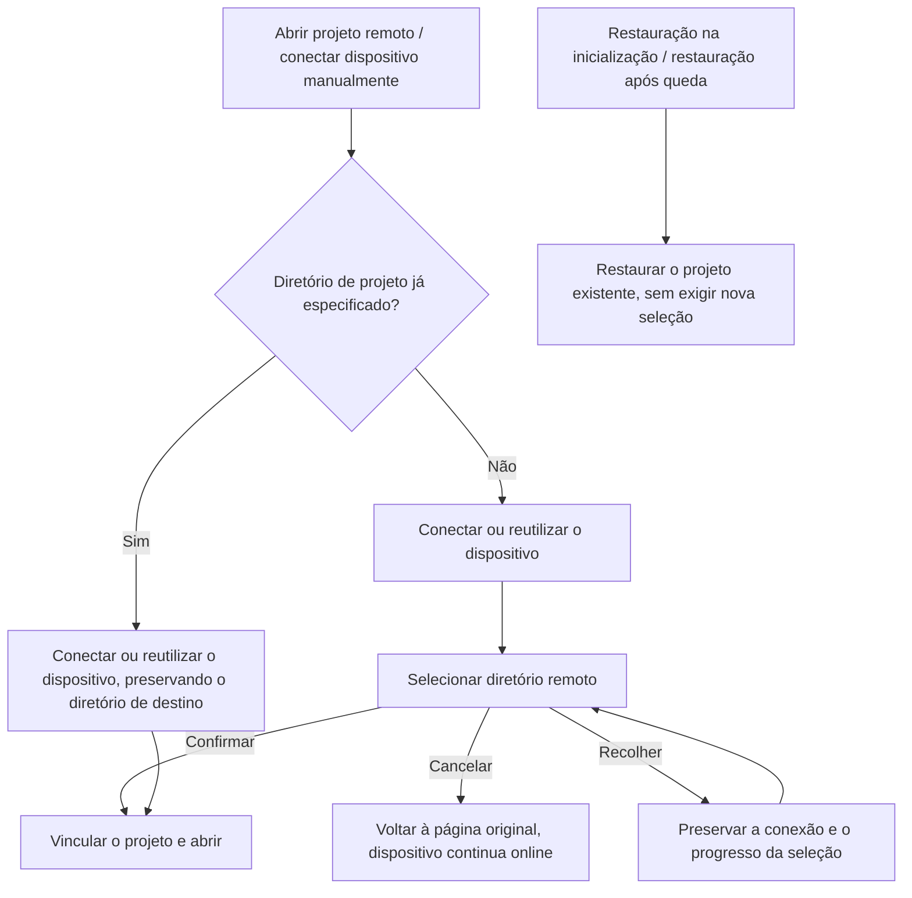

# Navegação de projetos em lista plana e seleção do workspace remoto após a conexão

2026-10-12 confirmada a meta do próximo ciclo: [Separação entre criação de projeto e gestão de conexão remota](../issues/remote-connection-ux/15-project-device-selection-and-connection-management.md)
(ready-for-agent, ainda não implementada). Ao implementar essa issue, a entrada do botão de adicionar projeto, o fechamento unificado da conexão manual sem diretório e as regras de rascunho entre páginas seguem a spec de objetivo;
as partes já existentes deste documento — reconexão de projeto existente, restauração na inicialização, isolamento de identidade e limites de dados históricos — continuam válidas. As marcações de "implementado" e as evidências de execução abaixo correspondem apenas à rodada original.

## Estado e escopo

- Estado: implementado (2026-09-16); protótipo A confirmado; validação local aprovada, o escopo da validação com remoto real/celular está na §9.
- Origem: discussão desta rodada de grill-me / grilling, Q1–Q7 confirmadas.
- Escopo: aba "Projetos" da barra lateral, fluxo de abertura de projeto remoto, desativação da UI de chat remoto sem projeto.
- Cobre SSH / WSL / Docker / Direct Server; os modelos de dispositivo, linha, identidade e gestão de conexão continuam os da arquitetura atual.
- Esta spec é o contrato atual de navegação de projetos. As seções de agrupamento de dispositivos e de UI connect-and-chat das specs antigas são substituídas por esta; os modelos de compatibilidade de dispositivos, linhas, Host e dados continuam válidos.
- Não é objetivo: apagar dados de chat históricos, migrar chats remotos para chats locais, reescrever os protocolos de conexão/autenticação/instalação/upgrade, nem estender a lista de projetos para o sistema de arquivos do dispositivo ou todos os diretórios históricos.

## 1. Decisões de produto confirmadas

| Decisão                   | Contrato                                                                                                                                 |
| ------------------------- | --------------------------------------------------------------------------------------------------------------------------------------- |
| Q1 Exibição de projeto   | A aba "Projetos" remove a camada de dispositivos. Projetos locais e remotos ficam lado a lado no mesmo grupo "Projetos". Projetos remotos mantêm uma identificação leve do dispositivo, com a etiqueta compacta de dispositivo e o conjunto de cores de status do protótipo A confirmado. |
| Q2 Abrir projeto         | Conexões manuais de dispositivo sem projeto especificado pedem a seleção de um diretório remoto após o sucesso; clicar em um projeto existente abre esse projeto; a restauração na inicialização e a reconexão após queda restauram o projeto original, sem pedir diretório novamente. |
| Q3 Desativar a UI remota sem projeto | Todas as entradas de criação e de acesso histórico são desativadas, os dados históricos são preservados e não são mais restaurados automaticamente; não há migração nem exclusão de tarefas remotas, índices, arquivos de chat ou backing workspace. |
| Q4 Pontos de entrada | A página de Settings e o diálogo de conexão remota continuam gerenciando dispositivos; a barra lateral mantém a entrada global "Abrir projeto remoto", em um menu de adição no título do grupo "Projetos". Projetos existentes são abertos/conectados a partir da linha do projeto. |
| Q5 Ordenação             | Projetos locais e remotos compartilham uma ordem global, permitem arrastar entre dispositivos e memorizam a ordem; mudanças no estado de conexão não alteram a posição; linhas de projetos offline continuam exibidas. |
| Q6 Cancelar e recolher    | Cancelar a seleção de diretório volta à página original, libera a sessão temporária deste projeto não vinculado, mantém o dispositivo online, não cria projeto nem chat e não afeta os demais projetos; recolher preserva o progresso. |
| Q7 Remover ação de projeto | A caixa de texto do projeto remoto oculta o × da etiqueta de projeto e "Trabalhar fora do projeto", e mantém a capacidade de trocar de projeto; o comportamento local não muda. |

```text
Aba Projetos
├─ Projetos
│  ├─ Projeto local A
│  ├─ Projeto B do dispositivo remoto 1
│  └─ Projeto C do dispositivo remoto 2 (mantido quando offline)
└─ Tarefas
   └─ Sessão local sem projeto
```

Ao desvincular um projeto local, a correspondência com a aba atual usa a chave completa `workspaceKey = workspaceIdentity?.trim() || workspacePath`;
uma aba remota com o mesmo caminho, mesmo que listada antes, também não pode sombrear o projeto local ou a aba de conversa local.
Uma aba de conversa local existente é reutilizada diretamente; projetos remotos continuam proibindo o desvinculamento.

Projetos com o mesmo nome, mesmo caminho e dispositivos diferentes continuam sendo entradas distintas. O nome do dispositivo serve apenas para exibição e não pode participar da igualdade de identidade, da chave de ordenação ou do isolamento de persistência.

## 2. Entradas e ordem de conexão



- Entradas manuais sem diretório explícito entram uniformemente na seleção de diretório; não criam nem ativam rascunho de chat remoto sem projeto.
- Projetos existentes e entradas de diretórios recentes devem preservar a intenção original do projeto; quando for preciso complementar credenciais, instalar ou fazer upgrade, isso é concluído dentro do assistente e depois o projeto original é retomado.
- O cartão de dispositivo da página de Settings, em "Projeto recente", resolve o projeto original a partir da identidade Source e do diretório usando as entradas salvas na máquina, fixando o ID da entrada antes da conexão; tanto o clique com o dispositivo online quanto a reconexão offline reutilizam a cadeia de restauração de projeto existente, sem entrar no criador de projetos e sem adicionar projetos. Não é permitido passar apenas o diretório e rebaixar a intenção de abertura para uma intenção de criação; quando a entrada está ausente ou há várias entradas para o mesmo diretório e não é possível determinar uma univocamente, reportar que o projeto original não pode ser determinado, manter a página atual e não adivinhar um projeto. Após a conexão, ainda assim revalidar pela entrada original e pela elegibilidade de membro do Host; após a remoção, não ressuscitar.
- A restauração do projeto original, após a conexão, resolve a partir da árvore de projetos do Host de origem o projeto válido correspondente à entrada, passa seu projectId explicitamente para a inicialização do rascunho e atualiza o escopo do rascunho; quando o cache local de rascunhos está ausente ou ainda aponta para outro projeto do mesmo diretório, ele não pode substituir a identidade do projeto original. Entradas antigas seguem a regra de correspondência única do dono do diretório; quando o projeto está ausente, foi excluído ou o diretório não confere, a restauração é interrompida. A reconexão que restaura apenas sessões existentes continua preservando a seleção de sessão.
- Projetos salvos não exigem que já exista uma aba no Renderer. O menu do desktop é despachado pelo Root, e projetos não carregados são resolvidos a partir do diretório de membros da máquina; quando as credenciais estão completas, apenas o dispositivo é restaurado. Quando houver interação, deve-se levar o Profile preciso e a entrada original do projeto; ao concluir, vincular diretamente ao diretório original, sem entrar na edição de novo projeto. Verificar até a conclusão que o membro ainda existe; quando o Profile tiver outra intenção de conexão, levar a intenção Source "escolher diretório após a conexão".
- Para projetos salvos sem aba carregada, sua linha operacional segue a regra de seleção de Profile padrão do Host; falhas de outras linhas participam apenas da exibição do dispositivo e não podem substituir a linha padrão nem impedir sua conexão. A entrega usa apenas o estado e o erro da linha operacional.
- A intenção de conclusão do projeto original fixa o entryId e o membershipId do Host. Depois que as etapas assíncronas, como a vinculação de diretório, retornam, revalidar a instância original a partir do diretório de membros e só então submeter o histórico de conexão e a navegação; a remoção da entrada ou a troca de membro cancela a intenção original, sem recuar para a seleção de um novo diretório e sem liberar o attachment compartilhado por outros projetos.
- Só se adiciona/ativa o projeto depois que a vinculação do diretório tem sucesso. Caminho inválido, falta de permissão ou falha de vinculação não podem adicionar entradas fantasma; reaproveitar as capacidades existentes de exibição de erro e de correção do diretório.
- O caminho global de nova criação, atalhos de teclado e ativação do histórico não podem contornar a desativação da UI remota sem projeto por meio do active workspace antigo.
- Abrir projeto local, nova tarefa dentro de um projeto existente, restauração de tarefa dentro do projeto e o próprio gerenciamento de grupos mantêm a semântica existente.

### 2.1a Barra lateral, detalhes e menu do dispositivo (RDUX-12)

- A linha do projeto exibe em uma única linha um ícone de cinco estados, o nome do projeto e o nome do dispositivo com largura limitada (o nome do dispositivo é mantido tanto online quanto offline, ver RDUX-IDENTITY-01). Quando não está online, acrescenta-se um texto de status após o nome do dispositivo: quando o modelo de exibição é pendente (`pending`), mostra-se o seu status curto (precisa atualizar, precisa instalar, precisa confirmar novo dispositivo, precisa completar senha), usando a cor de warning; durante a conexão (incluindo a restauração automática e o dispositivo online com o projeto ainda não pronto) mostra-se o status curto "Conectando/Atualizando", e na falha "Falha na conexão"; em qualquer outro estado não online, "Offline"; quando o remoto está online mas o projeto não foi resolvido, "Selecione o projeto". Não são exibidos ícones extras de erro, ícones de diagnóstico, spinner duplicado nem botão permanente de reconexão; o progresso da conexão e a causa da falha só aparecem nos detalhes ao passar o mouse (ver "Detalhes do progresso da conexão"), e as ações no fim da linha só aparecem no hover/foco por teclado, mantendo a entrada acessível em telas de toque.
- A linha do projeto abre um detalhe de identidade somente leitura após 300ms de hover ou foco por teclado, ancorado à borda direita da linha inteira, para não sombrear as ações do fim da linha. O clique segue a ação original da linha do projeto e não bloqueia o detalhe; Escape, a saída do mouse da área de gatilho e da sobreposição, e a saída do teclado fecham.
- O título do detalhe usa o mesmo nome de exibição do projeto, com o status alinhado à direita e usando o status curto do modelo de exibição (consistente com a linha do projeto, sem o "requer atenção" genérico); durante a conexão ou em caso de falha, abaixo do título mostra-se primeiro a área de progresso da conexão ou a área da causa da falha (ver "Detalhes do progresso da conexão"), e só então a lista de projeto, nome completo do dispositivo, tipo de conexão, endereço e caminho remoto completo; para online e pendente essa área não é exibida. O detalhe não tem botões de conectar, desconectar ou editar; essas operações continuam sendo fornecidas pelo menu do projeto e pela entrada de configurações do dispositivo.
- Exceção pendente (2026-10-14, opção C): quando o modelo de exibição é `pending` e o cliente é desktop, o rodapé do detalhe recebe, abaixo da linha divisória, uma entrada "⚙ <nome da ação do modelo de exibição> ›" (como "Atualizar o remoto", "Atualizar o desktop", "Instalar e conectar", "Usar como novo dispositivo", "Completar senha"). O nome da ação lê o mesmo estado do gerenciador de conexões que o cartão de dispositivo da página de Settings: a projeção do Host do projeto traz `upgradeTarget` junto com `lastConnectionStatus`, e quando a versão do desktop está muito antiga (`upgradeTarget: controller`) exibe-se "Atualizar o desktop", sem recuar para "Atualizar o remoto". O clique fecha o detalhe e abre "Settings › Dispositivos remotos", posicionando o cartão do dispositivo, deixando o tratamento real para a página de Settings; o detalhe em si não executa atualização, instalação ou confirmação de identidade. O cliente Web não tem página de configurações de dispositivos remotos e não exibe essa entrada. O texto explicativo ainda não é distinguido por cenário.
- Entrada de menu de projeto remoto (2026-10-16): para projetos remotos no desktop (online, offline e pendente), o menu de mais opções e o menu de contexto oferecem "Configurações do dispositivo remoto", posicionados depois das ações de sincronização/conexão e antes de editar o projeto. O clique compartilha a mesma navegação da entrada de detalhes pendente: abre "Settings › Dispositivos remotos" e posiciona o cartão do dispositivo ao qual o projeto pertence; o menu em si não executa conexão, desconexão ou atualização. Projetos locais e o cliente Web não exibem essa opção.
- "Projetos + → Abrir projeto remoto" expande todos os dispositivos salvos, com origem no snapshot de gestão de dispositivos e independente dos projetos abertos; online reutiliza a conexão para entrar na seleção de diretório, offline conecta primeiro e depois seleciona o diretório. O último item "Nova conexão remota…" entra no assistente existente.
- O cabeçalho da sessão mantém o ícone de status e o nome do dispositivo; o hover no nome do projeto e no caminho completo é consistente com a barra lateral. O menu de troca de projeto da caixa de texto usa a exibição compacta em uma única linha, com nome do projeto, nome do dispositivo e estado não online; tanto online quanto offline mantêm o nome do dispositivo, e a busca casa simultaneamente nome do projeto, diretório e nome do dispositivo. As linhas de tarefa de todas as vistas compartilham o tamanho de fonte e a cor da etiqueta de dispositivo.

```text
Hover/foco na linha do projeto → sobreposição de identidade somente leitura → abre em 300ms → Escape/saída da área/saída do teclado fecha
Entrada de detalhes pendente / "Configurações do dispositivo remoto" do menu do projeto → setPendingSettingsSectionIntent(remoteDevices, sourceServerId) → página de Settings posiciona o cartão do dispositivo
Conexão pelo menu do projeto → entrada de conexão de projeto existente do Root → attachment do diretório original
Dispositivo no menu → assistente único existente → conectar ou reutilizar → selecionar diretório
Gerenciar dispositivos → intenção de navegação de configuração única → SettingsPage → foco no cartão correspondente
```

Esses estados pertencem apenas à navegação de UI e às sobreposições; os fatos de conexão continuam vindo do snapshot de gestão do Host, e a identidade do projeto continua usando workspaceIdentity. O continuous do desktop e o replayable do celular mantêm suas próprias cadeias de restauração.

### 2.1b Assinatura de estado de novos projetos vazios

Antes que a árvore de projetos remotos seja retornada, `bindRemoteProjectIdentities` deve, pelo resolver existente, concluir a preparação de identidade de todas as roots de projeto e dos cwd de tarefa, deduplicando por caminho. Projetos vazios também participam; não se pode derivar o escopo de preparação apenas a partir das tarefas existentes. Falhas de preparação devem ser reportadas a quem chamou, e é proibido publicar a árvore não preparada e assinar cedo. Esse processo não abre aba, não inicia Agent e não adiciona entrada de projeto; as regras de diretório e de projetos duplicados não mudam.

```text
readTree do Host de origem → roots + cwd de tarefa deduplicados → resolver de identidade existente concluído
                                         → publicar árvore → assinatura de workspace/sessions-index do Controller
```

Motivo: um listener dinâmico criado antecipadamente fica preso a um emitter ainda não mapeado; o registro do mapeamento só acontece na primeira abertura posterior e não refaz a vínculo dos listeners antigos. A correção é concluída no limite de publicação da árvore, preservando a restauração de assinatura original de desktop-continuous / mobile replayable e o mesmo owner remoto, sem novo mapeamento nem mecanismo de retry. A regressão cobre a exibição em tempo real da permissão do primeiro disparo de projeto vazio, o diretório de tarefas existentes, a deduplicação de root compartilhado e o fato de não publicar quando a preparação falha.

### 2.1 Seleção em três telas e recolhimento (RDUX-10)

"Abrir projeto remoto" entra sempre por uma lista unificada e pesquisável; a origem e os portões de plataforma estão na [spec de UX](../architecture/remote-device-connection-ux-spec.md#三屏向导与统一选择2026-09-28rdux-10). A linha do dispositivo, após a conexão, seleciona o diretório; o chip de diretório recente (inclusive de dispositivos offline) abre aquele diretório após a conexão. O formulário de criação na primeira tela não adiciona etapas de progresso.

O topo da área de projetos reserva espaço de exibição para o único assistente quando recolhido: um cartão de duas linhas mostra o dispositivo, a proporção de etapas e a etapa atual; o cartão de falha mantém a causa e permite retomar pelo clique, sem abrir modal automaticamente antes da visualização. O cartão é renderizado diretamente pela sessão do assistente, e a barra lateral apenas fornece o contêiner DOM, sem manter requisições, logs ou cópia de estado. Fechar limpa o rascunho e cancela a conexão; o histórico de entrada é preservado. O cartão de retomada segue a intenção original; novas entradas explícitas usam um identificador de intenção independente, e fluxos ociosos ou com falha cedem passagem, revogando o epoch antigo e a espera de confirmação, e consomem de novo o Profile/alvo mais recente e o diretório; fluxos realmente em andamento ou com session pendente de vínculo não são preemptados. O estado dessa entrada continua sendo mantido pelo owner único do assistente.

### 2.2 Experiência de queda de conexão e reconexão no lugar (RDUX-08)

- O botão de reconexão da barra lateral, a linha de projeto offline, o cartão de detalhes e a página de Settings compartilham a intenção de conexão: quando carregam o diretório, restauram o projeto original; quando não carregam o diretório, conectam e depois pedem a seleção do diretório. A seleção de diretório oferece "Selecionar depois", que fecha o assistente, libera o attachment temporário de projeto não vinculado, mantém o dispositivo online e não adiciona projeto.
- Projetos existentes passam primeiro pelo caminho de reconexão existente do Root; com credenciais completas não aparece o assistente, e o modelo de exibição do projeto indica "Conectando". O sucesso não toma a página atual. Quando for preciso complementar credenciais, instalar, atualizar ou confirmar a identidade, o assistente único entra diretamente no ponto de espera correspondente da etapa de conexão, preservando a intenção de diretório.
- A entrega da conexão manual de projeto original com `source-server-upgrade-required` segue a spec principal §6.3: o assistente lê o snapshot mais recente do Host, confirma que o alvo da atualização é o remoto e executa automaticamente uma atualização com `force:false`, e então retoma o diretório original. A guarda de tarefa em execução ainda exige confirmação explícita; se a máquina local estiver muito antiga, apenas se sugere atualizar a máquina local. Cancelar ou trocar a intenção invalida os resultados assíncronos antigos; recolher/retomar não repete a atualização; se a atualização falhar ou o sistema continuar incompatível depois dela, mantém-se uma entrada explícita de retry, sem ciclo automático. A restauração em segundo plano na inicialização e após a queda continua aguardando a ação do usuário.
- Quando a leitura do snapshot do Host antes da atualização falha, tanto a conexão comum quanto a entrega do projeto original exibem o erro real de leitura e oferecem "Tentar novamente", sem manter o botão "Atualizar o remoto" sem alvo de atualização e sem usar snapshot antigo para atualizar automaticamente. O retry explícito segue a linha e o diretório originais, reconecta e revalida a atualização; após o cancelamento, uma exceção de leitura tardia não pode sobrescrever o estado de cancelamento.
- Uma falha de compatibilidade carrega o `profileId` realmente usado pelo Host nesta tentativa, preservado até o assistente pelo resultado de conexão do Main/plataforma e pela entrega de falha do projeto original. O assistente valida, por esse ID e pelo alvo normalizado da falha, a linha e o estado de atualização do snapshot mais recente, continuando a intenção original com os parâmetros de conexão reais da falha; a distribuição e o usuário padrão do WSL são resolvidos pelo Main, e a identidade da linha não pode ser reconstruída com parâmetros não resolvidos, nem a omissão do usuário pode ser tratada como correspondência com qualquer usuário. Chamadas antigas sem ID mantêm a correspondência exata de alvo; quando o ID especificado foi removido ou não há estado de atualização executável, oferece-se retry, sem escolher outra linha e sem deixar um botão de atualização vazio. Se a máquina local estiver muito antiga, apenas se sugere atualizar a máquina local.
- A recuperação após falha de atualização fixa a identidade de alvo da própria falha; não pode sobrescrever com o Profile mais recente de mesmo ID e depois casar. A entrega assíncrona de reconexão do projeto original preserva um `failedTarget` não sensível; se, depois de abrir o assistente, o Profile tiver mudado de endereço, não se lêem as credenciais da nova linha. Falhas de upgrade do WSL também carregam `resolvedWslTarget`; sem distribuição/usuário reais, a atualização automática é interrompida e um retry é oferecido. Se a linha mais recente mudar de endereço, for removida ou for aposentada, a recuperação antiga é interrompida, sem atualizar nem reconectar o novo alvo, e a intenção do diretório original é preservada.
- A atualização automática do assistente, a atualização explícita e a atualização forçada após a confirmação de tarefa em execução submetem todas um `expectedTarget` não sensível. O Host valida a identidade na entrada de atualização, resolve e fixa o alvo de execução a partir do mesmo Profile já lido; mudar de endereço depois da verificação do snapshot deve ser rejeitado, e mudar de endereço depois que o Host aceitou não pode fazer o alvo de execução derivar. Alterar apenas o nome de exibição não muda a identidade do alvo. Reutiliza-se o requestId/entryEpoch original, sem nova revisão persistida nem owner de recuperação.
- A espera da primeira instalação do WSL também preserva o `profileId` do Host e carrega um `resolvedWslTarget` contendo apenas a distribuição e o usuário reais. O assistente mostra a prévia de instalação com esse alvo real, espera a confirmação e retoma o diretório original; a falha do snapshot da prévia afeta apenas as informações adicionais, sem perder a espera de instalação e o alvo. Modificar a distribuição ou o usuário padrão do sistema antes da confirmação não pode mudar o alvo da instalação já aguardado. Cancelar, fechar ou trocar de entrada invalida snapshots tardios e confirmações antigas, que não podem restaurar a instalação.
- O formulário do WSL sincroniza a distribuição e o usuário ao aceitar o alvo de conexão, limpando os campos padrão; a falha de conexão de uma linha já salva, o retorno à configuração após a espera de instalação e o retorno à configuração após a atualização editam o alvo atual, sem tomar as entradas da linha anterior. As quatro combinações de distribuição padrão/explícita e usuário padrão/explícito preservam a intenção correspondente; as esperas de instalação/upgrade já resolvidas pelo Host usam os parâmetros reais.
- Uma falha de reconexão comum mantém a linha do projeto e a causa classificada; clicar de novo entra na etapa de conexão do assistente e expande o log de falha, sem discar de novo automaticamente. Só um clique explícito em tentar novamente dispara uma nova requisição.
- Quando o attachment da sessão ainda não está pronto, mantém-se a faixa da página, o placeholder de conteúdo e o rascunho existente, desabilita-se o envio, não se cria fila offline e não se envia automaticamente após a restauração. Somente o conteúdo ainda mantido pelo owner de sessão existente pode ser exibido em modo somente leitura esmaecido, sem novo cache de conteúdo.
- Timeline, grupos, fixados e arquivo mantêm, para cada projeto offline, uma linha de placeholder de conexão e ocultam as tarefas expiradas. Erros de corrida entre busca e envio usam textos legíveis de classificação de conexão remota.

```text
Entrada do projeto → owner de reconexão do Root → conexão do Host / admission de attachment
             ├─ Sucesso → projeto original pronto; não altera a página atual
             ├─ Pendente → assistente único assume a intenção do diretório original → usuário trata → admission de attachment
             └─ Falha → causa na linha do projeto → usuário visualiza → etapa de conexão do assistente e log
Serviço indisponível → portão de religação existente fechado → faixa + placeholder + rascunho (envio proibido)
desktop-continuous / web-remote-replayable → seus limites de restauração existentes → mesmo owner de tarefa remota
```

### 2.3 Voltar ao ponto original após reconexão e reinício (RDUX-09)

- O alvo de restauração continua pertencendo à persistência de abas existente: TabStore / `lastWorkspaceSession` / `lastActiveTabIndex` guardam o projeto e a posição ativa, e o `usePaneSessionPersistence` existente do Layout guarda o último ID de sessão daquele workspaceKey. Ambos guardam apenas a seleção de navegação, não conteúdo remoto, e não criam um novo owner de restauração.
- O cold start da janela principal restaura o último projeto ativado (inclusive projetos remotos) e a sessão; `restoreTabs` marca a aba ativada na inicialização, e somente essa aba pode consumir a seleção de sessão do cold start. Abrir um projeto explicitamente, novas janelas e novas tarefas seguem a intenção de navegação original. Completar abas em segundo plano ou restaurar a Source não rouba o foco; mesmo caminho em dispositivos diferentes é isolado por identity.
- O pré-aquecimento local do Host ainda seleciona apenas workspaces locais. Ativar uma aba remota no Renderer não significa que o Host possa pré-aquecer por caminho remoto; os dois não são mais obrigados a selecionar o mesmo projeto.
- Conforme o [portão de religação do Renderer](./desktop-remote-session-renderer-reattach.md), depois que a Source fica online ainda é preciso concluir o workspace bind, o registro de services e o ready ACK; antes da primeira religação só pode-se exibir o placeholder de conexão, sem assinar nem renderizar a sessão remota. Quando o estado final da restauração é "não conectado" ou falho, permanece-se na aba original exibindo a faixa existente, sem saltar automaticamente para o local.
- Após a religação bem-sucedida, mantém-se a seleção de sessão original e não se chama a ação de nova tarefa. Apenas para a seleção existente nos instantes de restauração de inicialização e de religação de attachment, entra-se na página de nova tarefa deste projeto e limpa-se a seleção antiga somente quando o `getTaskMeta` autoritativo daquele workspace confirmar que a sessão não existe mais; o ACK de criação normal de tarefa é anterior à persistência do índice e não participa dessa determinação de ausência. Falha de RPC não é exclusão de sessão. Resultados de consulta antigos são descartados após troca de projeto, de sessão, criação de rascunho ou troca de services.
- Conteúdo de queda que já está carregado e ainda é mantido pelo owner de sessão existente continua seguindo a regra de retenção somente leitura do RDUX-08. Aqui não muda nenhuma regra de eligibility, ciclo de vida, retry ou identidade de conexão automática da Source.
- Somente o `desktop-continuous` do desktop consome a restauração de navegação da inicialização; o `web-remote-replayable` do celular não lê nem escreve a seleção de pane do desktop e continua sendo restaurado pelo fluxo original de attachment/snapshot/gap.

```mermaid
sequenceDiagram
    participant P as Persistência de abas e pane (owner de navegação)
    participant R as Portão de religação do Renderer
    participant S as Source / Host
    participant T as owner de tarefa remota
    P->>P: Restaura a seleção do último projeto ativado e da sessão T
    P->>R: Aba original exibe placeholder de conexão
    S-->>R: Source online
    R->>S: workspace bind / registro de services / ready ACK
    alt Religação falha ou não conectado
        R-->>P: Mantém aba e alvo, exibe faixa
    else Religação concluída
        R->>T: Consulta T por workspaceIdentity
        T-->>P: Existe → sessão original; não existe → nova tarefa deste projeto
    end
    Note over R,T: Antes da religação não se lê nem se renderiza conteúdo remoto; resultados tardios não podem sobrescrever a nova intenção de navegação
```

A aceitação reutiliza as fronteiras de teste de persistência de abas, restauração de pane e religação; o caso real de cold start SSH `SSH-P0-LIFE-01` ganha asserções sobre projeto/sessão ativados originais, placeholder de religação, reconexão manual preservando a seleção e recuo para sessão já excluída. Os testes unitários replayable existentes do celular e os casos de integração servem de regressão de fronteira inalterada.

### 2.4 Diretório de projeto remoto excluído externamente

- Na admission de workspace da primeira abertura, da vinculação explícita e da restauração após queda, o Host confirma, pelo File Service remoto atual, que o diretório pode ser lido e percorrido, e só então prepara o mapeamento de identidade. Reaproveita-se o RPC `readdir` existente para ler `workspacePath + "/."`; mantém-se o `/.` final para que o sistema de arquivos remoto valide simultaneamente a permissão de travessia do diretório de destino. Um `stat` bem-sucedido do próprio diretório não prova direito de acesso; não se depende da atualização do Server remoto e não se usa o sistema de arquivos local da estação para verificar caminhos remotos.
- Verifica-se apenas o acesso ao diretório, sem exigir permissão de escrita; diretórios somente leitura, mas legíveis e percorríveis, ainda podem ser abertos. A verificação apenas enumera o diretório raiz, sem varredura recursiva; a identidade e a persistência continuam usando o caminho original, e o caminho de sondagem não pode se tornar uma nova workspace identity.
- Quando o diretório não existe, o caminho não é um diretório ou faltam permissões, retorna-se `remote-workspace-directory-unavailable`, e apenas a restauração daquele projeto falha. O dispositivo continua online e os demais projetos do mesmo dispositivo continuam sendo restaurados; mesmo que um SSH de reconexão seja iniciado a partir de um projeto inválido, o erro de diretório não pode ser tratado como falha de credenciais e impedir os outros projetos.
- Projetos já abertos continuam na barra lateral e no open set persistido, exibindo a falha e o aviso de diretório indisponível; não são marcados como connected, o histórico de tarefas não é apagado e o diretório excluído pelo usuário não é recriado. Depois que o usuário restaurar o diretório, pode tentar de novo. Um diretório inválido recém-selecionado não pode adicionar projeto.
- A validação do diretório usa o escopo existente do Host e o sinal de cancelamento; resultados tardios após o cancelamento não podem continuar vinculando identidade nem registrando histórico de abertura. O continuous do desktop e o replayable do celular compartilham essa fronteira do Host, sem novo owner de conexão ou de tarefa.
- Esta é uma validação na abertura/restauração, e não adiciona um monitor de diretório online; operações de arquivo que deletem o diretório depois da vinculação continuam tratadas pelos erros de I/O originais.

```text
Source Manager: dispositivo online
  -> Host workspace admission: readdir remoto (diretório/.)
       -> legível e percorrível: mapeamento de identidade -> attachment/Controller existentes -> projeto conectado
       -> diretório inválido: falha do projeto -> preserva a entrada histórica; os demais projetos seguem a admission
```

## 3. Superfície de desativação e dados históricos

A sessão remota sem projeto é determinada pela identidade do workspace remoto e por `workspacePurpose=conversation`, sem filtrar por "tarefa remota" ou por nome de caminho; as tarefas normais em projetos remotos continuam visíveis e utilizáveis.

A superfície de desativação inclui pelo menos:

1. O "+" de tarefas remotas na barra lateral, "Conversar neste dispositivo" no cartão de dispositivo e "Nova tarefa" no dispositivo da página de Settings.
2. O ramo em que a conexão manual bem-sucedida abre por padrão uma conversation.
3. O × da etiqueta de projeto remoto na caixa de texto / "Trabalhar fora do projeto".
4. As sessões remotas sem projeto em "Grupos", fixados, busca, timeline, arquivo e outras entradas de histórico.
5. As antigas entradas de conversation abertas na restauração de inicialização, na religação do Renderer e na restauração por subida de dispositivo.
6. Os atalhos nas criações globais, atalhos de teclado e na restauração de active workspace já persistido.
7. As entradas de histórico correspondentes no controle remoto do celular; preservam-se os chats locais do desktop sem projeto e as tarefas de projetos remotos.

Os dados de tarefas históricas, o conteúdo original das sessões e o diretório remoto de backing são preservados. Filtrar a open membership da UI e excluir dados remotos são operações distintas, e esta mudança não pode ser usada para executar limpeza de dados remotos. Depende de a capacidade de conversation na base ser usada por outros chamadores precisa ser verificada na implementação; esta spec não autoriza exclusão de serviços não relacionados nem migração de armazenamento.

## 4. Propriedade do estado e fronteiras multi-dispositivo

| Estado                       | Owner autoritativo / fronteira                                                                          |
| --------------------------- | ------------------------------------------------------------------------------------------ |
| Dispositivo, linha e online/offline | Source Directory / connection manager do Host existentes; remover a camada de exibição não equivale a remover o modelo de dispositivos. |
| Identidade do projeto       | `workspaceIdentity?.trim() \|\| workspacePath`; mesmo caminho entre dispositivos não pode ser mesclado, o caminho serve para exibição e execução. |
| Lista e ordenação de projetos | Reaproveita o caminho existente de workspace/open-set e de persistência de ordenação, sem introduzir uma segunda ordem "accepted" por dispositivo. |
| Rascunho de seleção de diretório | Único diálogo de conexão remota; cancelar, recolher e confirmar seguem as vias de ciclo de vida existentes. |
| Tarefas e mensagens          | Owner original do CLI/runtime, sem migrar o estado para sidebar, main ou relay. |

```text
desktop-continuous   → link direto em tempo real existente ─────────────┐
                                                    ├→ owner de estado Host / CLI existente
web-remote-replayable → attachment de shared-host → fronteira de restauração ┘
```

- O `/remote` do celular continua se anexando ao Host já existente no desktop, sem criar Agent, sessão SSH/WSL/Docker ou local host independentes.
- O caminho remoto preserva `workspaceIdentity` e `remoteSessionId` em toda a cadeia; o roteamento owner/lease e a proteção contra stale-run não mudam.
- A gestão de dispositivos / criação de conexão do celular não é estendida por causa do protótipo de layout; a UI correspondente segue as capacidades de plataforma existentes.
- A subida, a queda e a restauração de attachment de dispositivos não reordenam os projetos; apenas a ordenação manual do usuário atualiza o fato de ordenação.
- Claro/escuro, desktop/tela estreita, chinês/inglês precisam ser validados, sem usar o hover como única forma de identificação do dispositivo.

## 5. Regras de exibição

As linhas de projeto, os detalhes e o menu do dispositivo seguem a §2.1a; cores, ícones e prioridade de status referenciam apenas
a [tabela de cinco estados da UX](../architecture/remote-device-connection-ux-spec.md#统一展示合同2026-09-27rdux-03).
As-discussões antigas dos protótipos A/B/C e os quatro estados verde/azul/laranja/vermelho saíram de cena e não servem como base da aceitação visual atual.

## 6. Casos de aceitação

Abaixo está a lista de aceitação dos contratos confirmados. Os testes precedem a implementação; os testes unitários e o E2E local com Electron já executados, e os ambientes reais ainda não verificados, estão na §9.

| ID     | Cenário / operação                                    | Asserção                                                                           |
| ------ | ----------------------------------------------------- | ---------------------------------------------------------------------------------- |
| RPN-01 | Projeto aberto na máquina local e em dois dispositivos remotos | Um único grupo "Projetos", sem camada de dispositivos, com identidade independente dos projetos remotos. |
| RPN-02 | Projetos com mesmo nome e caminho em dois dispositivos | É possível identificar o dispositivo de origem; o clique entra no workspace correspondente. |
| RPN-03 | Arrastar entre dispositivos e reiniciar                | A ordem é preservada; subida/queda de dispositivo não reordena.                     |
| RPN-04 | Clicar no projeto original após ficar offline          | A linha continua existindo; após a conexão abre o diretório original, sem criar rascunho remoto sem projeto. |
| RPN-05 | Conexão manual de cada tipo remoto, sem diretório indicado | Após o sucesso, seleciona-se o diretório; antes da confirmação não é criado projeto nem chat remoto. |
| RPN-06 | A conexão do projeto original exige credencial/instalação/upgrade | Após a conexão concluída continua no projeto original, o erro pode ser repetido e não há caminho morto silencioso. |
| RPN-07 | Cancelar a seleção de diretório após conexão bem-sucedida | A página original é preservada, o dispositivo fica online, os demais projetos não são afetados e a quantidade de projetos/chats não muda. |
| RPN-08 | Retomar depois de recolher na etapa de diretório        | Progresso e seleção são preservados e a conexão não é cancelada.                    |
| RPN-09 | Restauração na inicialização e após queda              | Restaura o projeto original sem abrir a seleção de diretório; a antiga conversation remota não é restaurada. |
| RPN-10 | Sessões remotas históricas sem projeto em grupos/fixados/arquivo etc. | Todas as entradas de UI são ocultadas e os dados preservados; as tarefas de projetos remotos funcionam normalmente. |
| RPN-11 | Caixa de texto remota, criação global e atalhos         | × / "Trabalhar fora do projeto" não ficam visíveis; não é possível entrar em chat remoto sem projeto. |
| RPN-12 | Projetos locais e sessões sem projeto                   | Criação, desvinculação de projeto e acesso histórico existentes não regridem.        |
| RPN-13 | Desktop e celular acessando o mesmo projeto remoto      | shared-host e isolamento de identidade se mantêm; continuous / replayable não se misturam. |
| RPN-14 | Temas claro/escuro, idiomas, tela estreita, teclado     | Dispositivo identificável, status não dependente apenas de cor, menus sem corte e foco visível. |
| RPN-15 | Diretório inválido ou falha de vinculação               | O erro fica no fluxo de seleção, sem criar projeto e sem trocar o dispositivo de execução. |
| RPN-16 | Diretório de um dos três projetos remotos excluído externamente e reconexão | Dispositivo online, demais projetos restaurados; o projeto excluído é preservado mas mostra falha, o diretório não é recriado e, após restaurá-lo, é possível repetir. |
| RPN-17 | Menu de mais opções / menu de contexto de projeto remoto no desktop | Há "Configurações do dispositivo remoto", que abre a página de Settings e posiciona o cartão do dispositivo de origem; projetos locais e o cliente Web não têm essa opção. |

## 7. Conexão manual e restauração automática

### Fronteira mútua entre conexão manual e restauração automática

A intenção de conexão atual do Root preserva o tabId de destino existente (identificador já presente na janela, não uma nova workspace identity). Durante a atividade ou o recolhimento do assistente, a restauração por subida de dispositivo trata apenas os outros projetos; a vinculação de diretório dessa aba é feita pelo assistente. O tabId se mantém inalterado na reprojeção de legacy → stable identity e, portanto, não perde a exclusão mútua por troca de key. Após a conclusão/cancelamento do assistente a exclusão é liberada, e a restauração continua sendo julgada pela open membership existente; recolher não limpa a intenção nem repete automaticamente a conexão que falhou.

```text
Source online
  ├─ tabIdCurrently held pelo assistente → o assistente conclui a vinculação do diretório original
  └─ outros projetos já abertos          → restauração automática de attachment existente
Assistente concluído/cancelado → libera a exclusão temporária; recolhido → mantém intenção e erro
```

Essa fronteira não cria nova fila accepted, novo owner do Host nem cache de conexão; apenas faz com que as duas entradas existentes da UI obeyam a mesma intenção explícita do usuário. Os testes unitários de RPN-04 e RPN-08 provaram primeiro a admission duplicada e o retry acidental após o recolhimento, e só então validaram a correção.

## 9. Registro de validação e limitações

### Restauração de "Projeto recente" na página de Settings (2026-10-16)

A causa raiz é que a entrada de Settings passava apenas Profile e diretório, e o Root não recebia o ID da entrada salva, pulando o ramo de restauração do projeto original. A correção reaproveita o owner de diretório da barra lateral, fixando um ID de entrada único no clique por Source e diretório; após a conexão concluída continua com a revalidação de membro e a navegação existentes, sem novo cache de estado nem retry.

Correção complementar adicionada na revisão do mesmo dia: depois da validação da entrada o projectId ainda não era passado, e o rascunho herdava o cache local, ficando sem categoria quando ausente e apontando para outro projeto quando expirado. A restauração agora resolve o projeto válido a partir do Host de origem, entrega o ID do projeto ao owner de rascunho do Root e atualiza o escopo em memória e persistido; rascunho de projeto explícito e restauração da seleção de sessão antiga são mutuamente exclusivos.

- A regressão confirmou primeiro as duas falhas (cache ausente e cache incorreto), e só então validou o cache correto, o escopo persistido e o cenário cruzado de reconexão em segundo plano na mesma aba; por fim, a partir de `1d187f8f691a9e9e5cf27156ef2826d435d87ec9` foram selecionados 43 arquivos de teste afetados / 535 casos aprovados, e a regressão direcionada cobriu simultaneamente a resolução de entradas antigas e a invalidação de membro. typecheck, Lint (0 errors), arquitetura e verificação de formatação do código alterado passaram.
- O run de E2E `desktop-e2e-20261016141425114-p13665-2cfa998be7b5adba`, com Desktop macOS + contêiner SSH Linux novo, foi PASS com o código final: tanto na ausência de cache de rascunho online quanto com cache residual de outro projeto offline, o projeto original é restaurado e o escopo persistido é corrigido, o conjunto de entradas não muda e nenhum modal de criação aparece. Os screenshots de tema claro/escuro e das três larguras seguem o RDUX-13-03; nenhuma requisição de modelo foi enviada.
- O primeiro run `desktop-e2e-20261016140536472-p84812-8785189417c54ffb` apresentou renderer attachment não pronto na primeira abertura de projeto e depois expirou, sem entrar nas novas asserções de cache; a causa dessa falha não foi determinada, o registro é preservado e não conta como aprovação funcional. A segunda rodada, reconstruída, e a rodada final acima passaram. Não foram executados de fato Windows/Linux Desktop, WSL, transport Docker ou celular; a entrada de gestão de dispositivos na página de Settings só está aberta no desktop, e o E2E candidato permanece pending.

- Primeiro modificou-se o E2E RDUX-13-01, confirmando no macOS Desktop + contêiner SSH Linux novo, antes da correção, a falha da asserção do modal de criação (run `desktop-e2e-20261016134122289-p3441-1b5b8c7e11c117a8`).
- Após a correção, o run completo de E2E `desktop-e2e-20261016134749964-p14872-919a9a258f3e5144` foi PASS: por meio de um contêiner SSH independente criado pelo Docker local foi feita a instalação real, a conexão, o clique online e o clique após queda; a workspace identity original, o ID do projeto e o conjunto de entradas locais permanecem inalterados e nenhum modal de criação aparece. Os screenshots de tema claro/escuro × 1440/900/480px estão guardados no artifact desse run. Nenhuma requisição de modelo foi enviada.
- Na primeira execução após a correção, a asserção de "projeto recente" já passou, mas a verificação antiga de recolhimento das conexões históricas falhou por ainda haver um processo em segundo plano; o teste passou a validar o recolhimento padrão depois de fechar o fluxo com falha, preservando a asserção original. Outra execução que reaproveitou a build falhou na inicialização do Host, sem entrar no cenário de negócio; a execução completa acima, após nova build, passou, e a falha de inicialização não é contada como aprovação funcional.
- `pnpm typecheck`, a checagem de tipos do E2E do Desktop, Lint (0 errors), o portão de arquitetura e a verificação de formatação do código alterado passaram; a partir do ponto de partida `38c8129a54edc615c7c41950ea929e7a539427e7` foram aprovados 478 arquivos de teste unitário afetados / 5108 casos. Os testes direcionados cobrem o isolamento de mesmo caminho entre Sources, a ausência de aba, as entradas antigas, a ausência de entrada/Host e a ambiguidade; a regressão de entrega de restauração existente continua cobrindo a invalidação de membro.
- Nesta rodada não foram executados de fato Windows/Linux Desktop, WSL, transport Docker ou celular; a página de gestão de dispositivos só está aberta no desktop, e shared-host, continuous/replayable, Host e CLI não foram modificados. O E2E candidato permanece pending, sem promoção manual nem inclusão no CI.

### Regressão de isolamento da intenção de conexão (2026-09-16)

Quando um projeto existente entra no assistente, a preferência externa inicializa apenas uma vez a intenção de conexão atual; as complementações posteriores de credencial, instalação, upgrade e retry leem o `pendingCompletionIntentRef` do assistente. Quando a página de dispositivos escolhe explicitamente "Nova conexão" ou outra linha, o cancelamento da mutually exclusive entre o diretório do projeto antigo e o `preferredWorkspaceTabId` mantido pelo Root é desfeito, e uma conexão sem diretório indicado precisa entrar na seleção de diretório após o sucesso.

As credenciais do formulário pertencem apenas ao alvo atual. O preenchimento automático com outro dispositivo (inclusive após retorno à configuração por credenciais de Profile ausentes) precisa limpar a senha, a passphrase da chave privada e o Server token da última vez; não se pode transformar a falta de credencial em reuso das credenciais de outro dispositivo. Ao preencher um destino SSH existente, preserva-se o `assetInstallMode` desse destino, e apenas linhas novas usam o modo de download padrão. Recolher/retomar a mesma intenção preserva o rascunho e não consome de novo a preferência externa.

```text
Preferência de projeto existente → intenção atual do assistente → credencial / instalação / retry → diretório do projeto original
                      └→ nova conexão explícita / troca de linha → limpar credenciais antigas e intenção de projeto → selecionar novo diretório
O Root mantém apenas a exclusão mútua de restauração do projeto atual; ao cancelar a intenção do projeto, ela é liberada imediatamente.
```

A regressão corresponde a RPN-05/06/08: os testes de componente de formulário real cobrem as duas entradas de alvo, o isolamento de senha/passphrase/Server token, nova conexão e troca de linha, retry de instalação e modo de download; os casos locais com Electron cobrem a entrada de projeto, o preenchimento do formulário e a troca para nova conexão. A correção fica apenas na fronteira de intenção de UI, sem alterar Host, protocolo, dados de tarefa ou as cadeias desktop continuous / mobile replayable.

Verificação da correção: os 12 cenários de formulário real de `sshDialogConnectionIntent.test.ts` passaram (antes da correção 10 falhavam e 2 passavam), com 32 arquivos de teste / 221 casos relacionados aprovados. O run de Electron `desktop-e2e-20260916065031134-p97183-32bff41d1e35e7a9` passou, com o screenshot `rpn-connection-intent-isolation.png`; as asserções cobrem dispositivo A → B limpando a senha, linha existente mantendo o download remoto e nova conexão restaurando o modo de download padrão. Esse E2E não envia prompt nem disca; o callback de diretório após conexão bem-sucedida e o retry de instalação são validados pelos testes de fronteira de componente, e a instalação/upgrade reais em remoto e o shared-host do celular ainda não foram testados de fato.

2026-09-16:

- Testes unitários direcionados/relacionados: 96 arquivos, 673 casos aprovados. Cobrem o filtro de propósito de projeto, o isolamento de mesmo caminho, expansão e ordenação, a preservação de dados na restauração, a exclusão mútua entre restauração manual e em segundo plano, a seleção de diretório após a conexão, a preservação do diretório original através do upgrade, o portão de credenciais, a ausência de retry após recolher, a projeção de histórico no mobile e a mascaramento do endereço de conexão.
- `pnpm typecheck` e `pnpm --filter @zcode/desktop typecheck:e2e` passaram; `pnpm lint` com 0 erros e 57 avisos preexistentes, sem novos avisos.
- `pnpm architecture:check --changed`: 0 violações. Os nós do feature graph são únicos e as novas arestas pendentes são 0; o grafo completo tem 4 arestas pendentes idênticas de baseline, que não foram tratadas nesta rodada por serem dados de grafo não relacionados.
- A auditoria global `audit:conversation-session-coverage` não passou: 37 problemas preexistentes (27 metadados de fixtures pending antigos, estatísticas/referências antigas de matriz e documentos gerados). Rodando em paralelo num worktree de protótipo com as entradas de auditoria idênticas ao HEAD, os 37 itens são exatamente iguais e não há problema novo; não se reescreveu baseline não relacionado.
- Novo E2E local com Electron: `packages/desktop/test/e2e/conversation-session/manual-review/pending/conversation-session-rpn-project-navigation.test.ts`, já aprovado.
- Run de E2E: `desktop-e2e-20260916060143354-p74119-7eab82eb8a75775c`. Em um HOME isolado foram pré-carregados dois dispositivos com projetos offline de mesmo caminho e uma conversation remota histórica; confirmou-se a listagem plana, o grupo único de projetos/tarefas, o isolamento dos detalhes de dispositivo, a ausência de efeitos de conexão ao visualizar detalhes, o Escape não reabrir o tooltip, a conversation antiga não restaurada, a preservação dos dados canônicos e o clique no nome do projeto entrando no único assistente de conexão. O screenshot `rpn-project-sidebar.png` está guardado no artifact desse run.
- O E2E não enviou prompt nem conectou a um remoto real; reutilizou a CLI já construída e não modificada (`ZCODE_E2E_SKIP_AGENT_BUILD=1`), com Desktop/UI reconstruídos a partir do worktree atual.
- O fluxo de conexão comum do helper SSH já exige entrar na etapa de diretório e não mais considera o fechamento do assistente como sucesso de criação de chat remoto sem projeto.

O novo E2E continua em manual-review/pending e nesta rodada não houve promoção manual nem admissão por Docker. Os casos pending antigos, de cabeçalho de grupo de dispositivos e de connect-and-chat, pertencem ao contrato de UI substituído e não servem como aceitação da nova funcionalidade; o E2E formal não encontrou referências diretas a essas entradas revogadas.

Ainda não foi executada por completo a conexão, instalação, upgrade e restauração após queda em SSH / WSL / Docker / Direct Server reais, nem a integração com shared-host em aparelho de celular real. Os callbacks de conclusão e os portões de restauração relacionados são cobertos por testes unitários de componente e de estado; esses testes não podem ser descritos como aprovação de E2E remoto real ou de celular.

O rollback pode reverter integralmente o commit desta implementação. Não foram excluídas sessões remotas, arquivos de tarefas ou mapeamentos canônicos de conversation, e não foram alterados protocolo, owner/lease, continuous/replayable ou gestão da conexão física.

## Detalhes do progresso da conexão (2026-10-15)

Contexto da regressão: o merge de 10-10 perdeu a injeção de `onLog` do Host para a conexão de projeto, o Main nunca registrou os requestId `project-connection:*` e o tooltip de diagnóstico (i) da barra lateral ficou sempre vazio; ao mesmo tempo, o texto de status das linhas de projeto em conexão caía no ramo "Offline". Após a correção, a barra lateral não usa mais logs de texto por requestId e passa a ler o log estruturado de operações do serviço de gestão de conexões; o canal antigo e o ícone de diagnóstico foram removidos.

Voltado ao usuário e não ao desenvolvedor: não se exibem linhas brutas de log, timestamps ou níveis. Adota-se o protótipo D confirmado (bloco de fundo semântico claro + barra de progresso segmentada):

```text
┌ Nome do projeto ─────────────────── Conectando ┐
│ ┌──────────────────────────────────────────┐ │
│ │ ⟳ Instalando ZCode Server 43%            │ │  Etapa atual + porcentagem só no upload/download
│ │ ▬▬▬▬ ▬▬▬▬ ▬▬── ────                     │ │  4 segmentos: concluído cheio, atual por progresso, não iniciado vazio
│ │ Passo 3/4 · 32 segundos decorridos · Recuperação automática 2/3 │ │
│ └──────────────────────────────────────────┘ │
│ Projeto / Dispositivo / Conexão / Endereço de conexão / Diretório │
└──────────────────────────────────────────────────┘
```

- As etapas compartilham a mesma projeção do assistente de conexão (RDUX-11): conectar dispositivo / identificar dispositivo / instalar ZCode Server / iniciar e verificar compatibilidade; a regra de mesclagem das phases originais existe em um único lugar. Etapas puladas (como a de instalação quando já está instalado) são exibidas como concluídas junto com as etapas seguintes. Sem logs ainda, exibe-se o passo 1.
- A porcentagem vem apenas do `progress` do log atual de upload/download; nas demais etapas o segmento atual respira por inteiro.
- O tempo decorrido é contado a partir do primeiro log da operação atual; uma nova operação (incluindo cada tentativa de recuperação automática) substitui o log antigo e o cronômetro é reiniciado. O cronômetro é atualizado a cada segundo apenas enquanto o detalhe está aberto e serve só para exibição, sem participar da decisão de timeout.
- O log mais recente do Host representa "a última operação", não necessariamente "a operação em andamento". Quando a última entrada é um estado final de sucesso (`ready`) ou de falha (nível `error`), aquela operação terminou: isso vale para antes da primeira tentativa de retry após uma queda inesperada e entre duas tentativas de retry. Nesse caso a exibição é a de "sem logs ainda" (passo 1, sem tempo decorrido), mantendo apenas "Recuperação automática n/m"; quando a próxima tentativa começa, o Host substitui o log e o progresso passa a aparecer.
- A "Recuperação automática n/m" vem do `recoveryAttempt/Limit` do dispositivo no registro de estado; a linha do projeto continua mostrando apenas "Conectando".
- Na falha (modelo de exibição `failed`, ou offline com erro), exibe-se um bloco de fundo vermelho claro: a causa legível é exibida conforme a classificação do erro e, quando não é classificável, mostra-se "Falha na conexão"; acompanha o botão "Copiar detalhes do erro", que copia o texto original do erro de conexão (o `lastConnectionError` projetado pelo Host ou o erro antigo do workspace), o mesmo texto do diagnóstico original, sem exibição direta; "Copiado" corresponde apenas ao texto que foi copiado e volta a "Copiar detalhes do erro" quando o erro muda.
- Dados somente leitura: `host.id` → `sourceServerId` (mesma resolução de `resolveProjectHostService` no lado do Host) → entrada do registro de estado (`profileId`, contagem de recuperação, código de erro) → `getRecentOperationLogs(profileId)`. Com o detalhe fechado não há assinatura de logs; o Server direto por URL (e o Host que ainda não tem `sourceServerId`) não tem o domínio de gestão de Source e, durante a conexão, não exibe a área de progresso, mantendo apenas o "Conectando" à direita do título; a área de falha não é afetada.
- O controle remoto Web do celular não tem hover e recebe apenas a correção do texto de status da linha do projeto.

```text
Pipeline de conexão do Host → SourceServerOperationLogs (único owner de logs)
      │ onDidAppendOperationLog (apenas como notificação de invalidação)
      ▼
Detalhe aberto → useSourceServerOperationLogs([profileId]) → projeção de etapas (compartilhada com o assistente) → área de progresso
Registro de estado (sourceServerId) → contagem de recuperação / código de erro ─────────────────┘
```

Validação (2026-10-15): E2E `hovercard-retry-20261015-r3`, com Desktop macOS + contêiner SSH Linux independente `retry-budget`, PASS. Após a perda de rede, a linha do projeto exibe "Conectando" e não há ícone de diagnóstico; enquanto o detalhe permanece aberto, "Recuperação automática 1/3, 2/3, 3/3" incrementa em tempo real e, após esgotar, a mesma sobreposição muda para a área de falha (causa legível + copiar detalhes do erro); após a liberação, a recuperação silenciosa e a tomada manual recebem cada uma uma nova sessão. A falha conhecida `displayedAttempts=[]` (remote-e2e-stability #20) fica visível no detalhe.

## Detalhe de identidade remota em hover (2026-10-13)

O menu de projeto da caixa de chat e a linha de projeto remoto da barra lateral compartilham a sobreposição de detalhes somente leitura. As linhas de sessão da barra lateral (dentro do projeto, na área de fixados e nas atualizações recentes) não exibem o detalhe de identidade remota no hover ou no focus, e mantêm as ações de sessão existentes. Exibem-se projeto, nome completo do dispositivo, tipo de conexão, endereço, diretório e o estado de cinco estados existente; projetos com o mesmo nome são diferenciados por Host + ID de projeto, o nome vem da projeção de nomes de Source já existente, e o endereço e o estado vêm do Host correspondente, sem usar o dispositivo ativo atual. Projetos offline continuam visualizáveis, e as permissões de seleção e navegação não mudam.

Adota-se o protótipo confirmado "compacto em uma única linha". A sobreposição não tem X de fechamento nem bloqueio por clique; ela fecha automaticamente quando o mouse sai da área de gatilho e da sobreposição, e quando o foco sai pelo teclado ou com Escape. O texto do detalhe pode ser selecionado e copiado, mas a seleção não trava a sobreposição; após selecionar texto, sair diretamente, voltar à área de gatilho e sair de novo, ou sair pelo teclado, a sobreposição deve fechar em todos os casos. A movimentação entre a área de gatilho e a área de detalhe preserva o buffer de fechamento existente. Entrar na sobreposição permite ler o texto completo, sem bloquear a expansão, a seleção, o arraste e as ações de tarefa já existentes. Em telas de toque o nome do dispositivo permanece visível, e o detalhe não muda a semântica de seleção existente. Vale para chinês e inglês, nomes/caminhos longos, temas claro e escuro e a visão compartilhada entre desktop e celular.

O detalhe dentro do menu de projeto da caixa de chat usa a camada do menu a que pertence e não pode ser cortado nem coberto pelo menu. O detalhe usa a borda externa do menu como âncora horizontal, com espaçamento externo uniforme de 4px, mantido igual com ou sem barra de rolagem, após filtro de busca e nos casos de desvio à esquerda/direita; quando o espaço é insuficiente, aplica-se o desvio existente à esquerda/direita e o detalhe encolhe conforme a largura realmente disponível. O detalhe não se sobrepõe ao menu e as opções do menu continuam operáveis. Quando o mouse sai do item de projeto, o menu devolve o foco ao contêiner, o que não significa ter saído do detalhe e não fecha um detalhe já acessado; sair de fato da área de gatilho e do detalhe, trocar pelo teclado ou usar Escape continua seguindo as regras existentes. Vale tanto para projetos online quanto offline; a aceitação precisa verificar o elemento realmente atingido nas bordas do detalhe, e não apenas a existência do DOM ou o conteúdo do texto.

```text
Diretório de Host existente + projeção de nomes de Source → identidade do projeto → linha de projeto da barra lateral / menu de projeto do chat compartilham a sobreposição somente leitura
Hover/focus na linha de sessão da barra lateral → ações de sessão existentes, sem montar a sobreposição de identidade remota
Entrar com o mouse / foco por teclado → exibir → sair da área / sair do foco / Escape → fechar
```

Validação histórica (inclui o antigo contrato de detalhes de tarefa): E2E de barra lateral remota e de tarefas reais 3/3 PASS (`r3-server-ui-identity-20261013-r6`), shared-host de celular e menu de projeto PASS (`r3-server-ui-identity-20261013-r5`); chinês/inglês, temas claro/escuro, online/offline e layouts largo/estreito foram verificados. O ambiente de execução e os registros históricos de falha estão na seção de correção de 2026-10-13 do catálogo de casos.

Ajuste de 2026-10-14 no escopo de hover de sessão: a sobreposição de identidade das linhas de sessão foi removida, enquanto a linha de projeto e o menu de projeto do chat foram mantidos. A regressão de componente reproduziu primeiro as três visões de sessão com a sobreposição e depois validou que hover/focus não a exibe mais. E2E `task-hover-20261014-r2`, com Desktop macOS + contêiner SSH Linux independente, 2/2 PASS, validando que o detalhe do projeto ainda abre e que o hover de sessão não mostra detalhe. A primeira rodada falhou por o DOM selecionar a tarefa sem que o mouse saísse da linha do projeto, não gerando um novo evento de entrada; o teste foi corrigido e passou, sem alteração na temporização das sobreposições do produto. Nesta rodada não foram reexecutados Windows/Linux Desktop nem shared-host do celular, e o candidato permanece pending.
