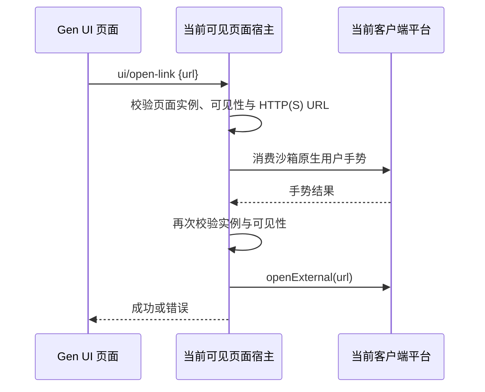

# Links externos no Gen UI

## Objetivo e escopo

No Gen UI, um `<a href="https://example.com/subscribe">` comum navega diretamente; quando for necessário controlar por script, é fornecido `window.zcode.openExternal({ href })`, que retorna `Promise<void>`. As duas entradas reutilizam a mesma cadeia do host e não adicionam outras APIs de página.

## Contrato de comportamento

- São suportadas URLs absolutas `http:` / `https:`; endereços relativos, `file:`, `javascript:`, `data:` e outros protocolos não podem ser abertos pelo host.
- Links comuns são tratados de forma delegada pelo runtime da página, incluindo links adicionados dinamicamente, ícones dentro do link, ativação por Enter do teclado, clique com botão esquerdo e botão do meio com modificadores. `target` não altera o roteamento do host; o próprio cartão não navega nem cria janela guest. O botão direito mantém o comportamento existente.
- Cliques que já tiveram `preventDefault()` aplicado pela página não são tratados de novo. href vazio e `#fragmento` mantêm o comportamento intra-página. Links `download` não viram abertura externa; nesta rodada não há capacidade de download.
- Links externos precisam ser disparados por uma ação real do usuário; cliques sintéticos não abrem, e carregamento de página ou chamadas por timer sem gesto de usuário são recusados. O host reutiliza o mecanismo existente de consumo de gesto nativo recente e revalida a página depois que a validação assíncrona retorna.
- O parâmetro explícito da API é `{ href: string }`, e a Promise é rejeitada em caso de falha; falhas de links comuns são reportadas pelo evento `zcode:error` já existente. A Promise confirma que o host chamou a entrada da plataforma e não indica que o navegador carregou com sucesso.
- O host da página declara a capacidade `openLinks` e trata requisições padrão de `ui/open-link`. A função de abertura externa é obtida por injeção de dependência, sem expor o preload do Desktop à página e sem afrouxar as intercepções existentes de navegação, nova janela e download.
- A ação de abertura acontece no cliente que está exibindo a página, e o `IPlatformService.openExternal` decide o comportamento real do navegador; o workspace remoto não executa comandos de abertura remota, não envia mensagens ao Agent e não cria estado persistente novo.
- Quando o Web / celular não oferece sandbox do Gen UI, o comportamento de fallback HTML existente continua sendo usado; nesta rodada não há novo sandbox Web e a cadeia de mensagens continuous / replayable não muda. Não há mudança de tema, texto ou layout.

## Verificação

Nos fixtures de integração Gen UI do Electron existentes, usar o guest bridge de produção, o registro de gesto nativo e eventos confiáveis de mouse/teclado do CDP para verificar: links comuns, conteúdo aninhado, links dinâmicos, `target`, modificadores, botão do meio, teclado e a API explícita abrem apenas uma vez; fragmento, cancelamento do comportamento padrão, download, URL inválida, clique sintético, ausência de gesto e página oculta não abrem. Interceptando a resposta do gesto e ocultando a página, verificar que requisições atrasadas não abrem. Cartões de workspace remoto precisam chamar o opener do cliente, e as verificações existentes de estado, follow-up, layout e reuso de página continuam passando.

O fixture registra o gesto por entrada nativa de teclado do Electron e depois usa cliques/Enter confiáveis do CDP para atingir o iframe aninhado (o CDP em si não dispara `input-event` do Electron). O opener final da plataforma é substituído por um registrador, para verificar o roteamento das requisições e a propagação de falhas, sem abrir o navegador do sistema. A cobertura automatizada não equivale à abertura real do navegador nem à aceitação manual de entrada em cada sistema operacional.

Executar `pnpm typecheck`, `pnpm lint`, o gate de arquitetura e `node packages/desktop/scripts/gen-ui-e2e.mjs`. A cobertura real por plataforma e as verificações que não puderam rodar ficam registradas na descrição do commit.