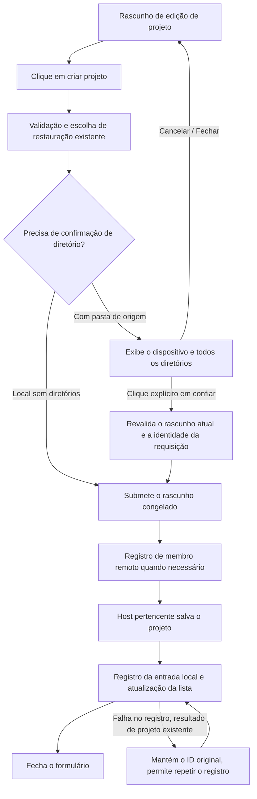

# Confirmar a confiança na pasta antes de criar o projeto

Status: implementado, 2026-10-13. Q1–Q3 foram confirmados item a item; o usuário autorizou o desenvolvimento conforme esta solução. A entrada unificada de criação, a confirmação de restauração e os detalhes de interação entram nesta mudança; o escopo de verificação está na seção 10.

## 1. Resumo da feature

| Item                 | Conteúdo                                                                                                    |
| -------------------- | ----------------------------------------------------------------------------------------------------------- |
| Requisito confirmado | Havendo pasta de origem, é preciso confirmar explicitamente a confiança antes de criar ao clicar em «创建项目»; projeto local sem pastas é criado direto |
| Camada de capacidade / mudança | Confirmação de diretório na criação de projeto; presentation, validation, commit-effect; sem nova persistência |
| Modo de trabalho      | implemented; primeiro os testes que falham, depois a implementação da confirmação de criação compartilhada   |
| Baseline do código-fonte | `842da373332763dd39fec2bebb4f80c817b410af`                                                                 |
| Entrada principal     | `ProjectCreation` → `ProjectEditor.save` → `IProjectService.saveProject`                                     |
| Escopo de implementação | Confirmação de acesso a diretórios no fluxo de criação, cobrindo local e remoto, além das entradas desktop, Web/celular que reutilizam esse fluxo |
| Fora do escopo por enquanto | Autorização automática de Hook, registro persistente de confiança de diretórios, migração de projetos existentes, novos diretórios na edição de projeto, deep link, modo de permissões de tarefa |

As restrições atuais de projeto estão em [spec do projeto virtual](../superpowers/specs/2026-09-09-virtual-project-design.md), [integração das regras de projeto](../superpowers/specs/2026-10-10-session-manage-upstream-integration.md) e [seleção de diretório local](../ui/project-local-directory-picker.md). Os limites de segurança estão em [Workspace Hook Trust](workspace-hook-trust-persistent-only.md) e [limite de confiança da configuração do projeto](../security/deep-link-project-trust-boundary.md).

## 2. Registro de esclarecimentos / decisões de limite

| ID  | Decisão                                                        | Conclusão / recomendação                                                                          | Status e impacto                                                                |
| --- | -------------------------------------------------------------- | --------------------------------------------------------------------------------------------------- | ------------------------------------------------------------------------------ |
| Q1  | «信任» também autoriza a execução automática de configuração? | Confirma somente o acesso ao diretório deste projeto; o Hook continua sob as regras de confiança já existentes | Confirmado pelo usuário; não altera o admission do Agent nem o Hook Trust |
| Q2  | Criar projeto de novo no mesmo diretório exige nova confirmação? | Confirma a cada criação, sem novo registro permanente de confiança | Confirmado pelo usuário; não adiciona armazenamento de confiança, migração ou entrada de revogação |
| Q3  | Projeto local com zero diretórios abre diálogo?                | Cria direto, seguindo na primeira uso as regras de diretório padrão existentes                        | Confirmado pelo usuário; o diretório padrão não é gerado antecipadamente na etapa de criação |
| Q4  | Entradas remota e Web/celular que reutilizam o fluxo de criação | Confirma uniformemente o diretório real do Host escolhido; o remoto mantém um único root | Incluído neste desenvolvimento; o celular exibe o diretório do Host, sem descrevê-lo como diretório local do celular |
| Q5  | Restauração, edição e adição de projeto remoto existente     | A restauração via «创建项目» também confirma; edição e a simples adição de projeto remoto existente não ganham diálogo por enquanto | Incluído neste desenvolvimento; os dois últimos mantêm o comportamento atual |

A confirmação de diretório vale apenas para esta criação e não estabelece uma autorização de segurança permanente. Os chamadores de serviço existentes, a CLI e o deep link não ganham com isso um novo mecanismo global de admissão de diretórios.

## 3. Interação e ordem de estados

1. O usuário continua preenchendo primeiro nome, dispositivo e pasta de origem; a seleção de diretório altera apenas o rascunho do formulário.
2. Ao clicar em «创建项目», executam-se primeiro a validação de formulário existente e a escolha de restauração de projeto. A escolha de restauração mantém a semântica original de «恢复或继续新建».
3. Projeto local com zero diretórios é salvo direto, seguindo na primeira uso as regras de diretório padrão existentes. Havendo pasta de origem, congela-se `hostId + roots + primaryRoot + name + restoreProjectId` para o alvo desta vez e só então se exibe o diálogo de confiança. Enquanto o diálogo está aberto, o formulário subjacente não pode ser operado.
4. Após a confirmação, submete-se esse snapshot. Cancelar, o botão de fechar, Escape ou fechar pelo overlay volta ao formulário original, preservando nome, dispositivo, diretórios e diretório principal, sem salvar o projeto.
5. Falha ao salvar exibe o erro original e preserva o rascunho. Se o salvamento remoto teve sucesso, mas o registro da entrada local falhou, reaproveita-se o resultado `created` para tentar o registro de novo, sem criar de novo e sem pedir de novo a confirmação deste diretório.

Textos:

- Título: para um único diretório, «信任此文件夹吗？»; para vários diretórios, «信任这些文件夹吗？».
- Conteúdo: nome do dispositivo e a lista completa de diretórios; o caminho usa fonte monoespaçada, permite copiar, quebrar linha e rolar, e não pode mostrar apenas o nome do último nível.
- Explicação: «ZCode 可在当前权限设置允许的范围内读取、编辑这些文件夹中的文件，并运行命令。请仅在你信任列出的所有文件夹时继续。»
- Ação principal: «信任文件夹并创建»; na restauração, «信任文件夹并恢复». Ação secundária: «取消».

O diálogo adota as regras de tema e tamanho dos componentes Dialog/Button existentes, segue o [DESIGN.md](../../DESIGN.md) e não replica os botões em cápsula grandes da imagem. Em telas estreitas a área de caminhos pode rolar e a área de ações permanece visível; cobre português, inglês e os temas claro e escuro atuais.

O foco inicial fica na ação de cancelar e o Tab alcança o botão de confiança. Só o Enter/Space no botão de confiança ou o clique nele confirmam; não se usa Enter global para aceitar. Após cancelar, o foco volta ao botão de criação original. Quando o pai é ocultado ao trocar de aba, o subdialogo também é ocultado e a confirmação pendente é invalidada; não se pode continuar submeteendo a partir de um formulário oculto.

## 4. Matriz de superfícies de UI

| Cenário / entrada                     | Implementação compartilhada e rascunho                                                | Padrão / validação                                                                                   | Submissão e ponto de autoridade autoritativo                       | Modo e isolamento                                                          |
| ------------------------------------- | ------------------------------------------------------------------------------------- | --------------------------------------------------------------------------------------------------- | -------------------------------------------------------------------- | ------------------------------------------------------------------------- |
| Botão de adicionar projeto na barra lateral | `ProjectCreation` → `ProjectEditor` mantém name/host/roots/primary                 | Reusa o valor padrão do dispositivo, as regras de 0..n local e de 1 root remoto; acrescenta confirmação antes da criação | `onBeforeSave` → `saveProject`; biblioteca de projetos do Host        | Compartilhado por Desktop/Web/celular; não é afetado pelo cwd de outras abas ativas |
| Menu de projeto do chat «在此设备创建项目» | `ProjectComposerMenu` → o mesmo `ProjectCreation`                                     | Pré-seleciona o dispositivo remoto retornado; o restante é igual ao acima                             | A mesma cadeia de salvamento e o mesmo registro da entrada remota   | Não cria chat, não altera o texto digitado nem os anexos                  |
| Nova criação dentro do seletor de projetos remotos | `RemoteProjectPicker` → `ProjectEditor(project=null)`                     | Usa host explícito e initialRoots                                                                    | Após o Host salvar, o callback add original registra a entrada       | Precisa passar pela mesma confirmação; não basta adicionar o diálogo por fora do `ProjectCreation` |
| Editar projeto                        | `ProjectEditor(project!=null)`                                                       | Validações de diretório e de edição existentes                                                       | `saveProject(id)` original                                            | Esta rodada não acrescenta confirmação; o componente compartilhado precisa distinguir explicitamente |
| Adicionar projeto remoto existente    | `RemoteProjectList`, não é um ramo de save                                            | Validações de membro e de identidade de entrada existentes                                           | `addEntry`, sem criar projeto remoto                                 | Esta rodada mantém o estado atual                                      |

## 5. Comportamento compartilhado e divergente

| Ponto de atenção                | Compartilhado e diferença                                                                             | Significado nesta rodada                                     |
| ------------------------------- | ------------------------------------------------------------------------------------------------------ | ------------------------------------------------------------- |
| UI / origem dos candidatos      | Editor compartilhado; no Desktop o local usa o seletor do sistema, no remoto/Web/celular usa o serviço de diretórios do Host | Não muda a origem da seleção de diretórios; a lista de confirmação vem do mesmo snapshot do rascunho |
| Valores padrão                 | O local aceita roots vazios; o remoto exige um root                                                  | Local com zero diretórios é criado direto, o remoto ainda exige escolher um diretório |
| Validation                     | Na gravação já existe a checagem de existência dos diretórios do Host; a confirmação de confiança é uma ação extra do usuário | A confirmação não substitui a validação do serviço nem concede permissão do sistema operacional |
| Commit effect                  | O remoto salva primeiro o projeto autoritativo e depois registra a entrada local                       | Preserva o ID já criado e o ramo de re-tentativa do registro    |
| Persistence / recovery         | A autoridade do projeto permanece no Host pertencente; a UI tem apenas um estado temporário de confirmação | Já confirmado: não adiciona banco de dados, localStorage nem protocolo de recuperação |

## 6. Relações da feature / donos de estado

| Nível            | Relação e evidência                                                                    | Motivo                                                           |
| ---------------- | --------------------------------------------------------------------------------------- | ---------------------------------------------------------------- |
| must-inspect     | Validação de `ProjectEditor.save` → `ProjectCreation.onBeforeSave` → `saveProject`     | A confirmação precisa vir antes do registro de membro remoto e da escrita do projeto |
| must-inspect     | `ProjectCreation.saved` → `remoteService.addEntry`; `ProjectEditor.created`             | Preserva a semântica de conclusão em duas fases, a re-tentativa de registro não recria |
| must-inspect     | `epoch` / `alive` / `suspended` do editor → resultado assíncrono da confirmação        | Uma confirmação antiga não pode submeter o rascunho depois da troca de dispositivo nem de uma tela já abandonada |
| should-inspect   | Exclusão lógica de projeto com os mesmos roots → confirmação de restauração            | Confirma só depois de determinar o alvo da restauração; as duas confirmações não podem virar uma aceitação padrão única |
| invariant-only   | Q2 → sem registro permanente de confiança de diretório                                   | O diretório ter sido usado em outro projeto não dispensa a confirmação desta criação |
| invariant-only   | Workspace Hook Trust, permissões de ferramentas, confirmação de deep-link                | A confirmação de diretório desta rodada não escreve o estado de autorização delas |
| invariant-only   | shared-host / continuous-replayable do celular                                          | Não acrescenta Host/Agent nem muda o limite de entrega de mensagens |
| evidence-only    | Criação de projeto, seleção de diretório, E2E de projeto no celular                     | Registra a cobertura apenas pelo setup, action e assertion realmente executados |

| Estado                          | Dono do rascunho / exibição                            | Dono autoritativo / ponto de submissão                                       |
| ------------------------------- | ------------------------------------------------------- | ----------------------------------------------------------------------------- |
| Nome, dispositivo, roots, primary | `ProjectEditor`                                         | `saveProject` → ProjectRepository do Host pertencente                        |
| Alvo pendente de confirmação    | Snapshot local e geração da requisição em `ProjectEditor` | Não é persistido; só pode disparar uma submissão vinculada ao snapshot     |
| Resultado criado, estado pendente de registro | `created` existente                       | O projeto remoto já foi salvo; a entrada remota local continua gerenciada pelo RemoteProjectService |
| Hook Trust                      | Projeção de UI de Hook existente                        | Trust authority exato do Agent, mantido como está                            |

## 7. Invariantes que precisam ser mantidos

- Para criações com pasta de origem, antes da confirmação do usuário não se chama o `onBeforeSave`, o `saveProject` ou o `addEntry` desta criação, não se abre o workspace e não se inicia Agent. Conexões já disparadas pelo usuário para escolher diretórios remotos seguem o fluxo existente.
- Os diretórios exibidos, os diretórios submetidos e o dispositivo são consistentes; não se compara pelo nome de exibição do dispositivo e não se usa caminho local para julgar diretório remoto.
- Enquanto uma operação está em curso, fica proibido criar de novo. Reusa-se a geração de requisição existente e o estado explícito, revalidando após o retorno assíncrono, sem usar atraso para supor sincronia.
- Se o diretório for apagado ou perder permissão durante a confirmação, a validação do Host original devolve falha e o rascunho é preservado; não se cria um diretório substituto por causa disso.
- Cancelar não deixa projeto para trás; falha de registro da entrada remota e falha de salvamento do projeto precisam ser distinguidas. A solução não acrescenta nova re-tentativa automática de rede nem promete resolver o problema preexistente de resultado RPC desconhecido.
- Múltiplos diretórios locais, diretório único remoto, cwd de sessão inalterado, dono do estado organizacional, autorização exata de Hook e o limite de permissões do celular mantêm o contrato original.

## 8. Evidência do codegraph / delta do grafo

O codegraph retornou que o checkout atual não tem índice; desta vez usamos `rg` e a conferência com o código-fonte, sem construir índice e sem alegar a conclusão da consulta de impact de depth-2 da ferramenta de grafo. O rastreio manual cobriu as entradas, o editor compartilhado, o salvamento no Host e as duas camadas-chave de relação do registro remoto.

| Seed                | Chamadas diretas / caminhos-chave conferidos                                  |
| ------------------- | ----------------------------------------------------------------------------- |
| `ProjectEditor`     | `ProjectCreation`, entrada de edição da barra lateral, `RemoteProjectPicker`  |
| `ProjectCreation`   | Nova criação na barra lateral, `ProjectComposerMenu`                          |
| `saveProject`       | schema de service/validação de diretórios → repository; no remoto roteia por `hostId` |
| `ConfirmDialogHost` | A confirmação comum captura o Enter da janela; não pode ser usada diretamente como controle explícito de confiança |

Graph drift: o grafo original não tinha a capacidade de confirmação de diretório na criação de projeto; esta rodada adicionou a capability, a surface do diálogo de criação, o code seed do componente de confirmação e o limite de não reescrever o Hook Trust.

Delta do grafo confirmado: a confirmação de diretório vale apenas para esta criação; registros de uso existentes não dispensam a confirmação, o local com zero diretórios é criado direto e o Hook Trust é independente. Os novos code seeds apontam para a entrada de criação compartilhada e o componente de confirmação já implementado. A autorização de desenvolvimento inclui as três entradas de criação e o ramo de restauração; a edição e a adição de projeto existente mantêm o comportamento original.

## 9. Planejamento de casos

O domínio principal é a UI de projeto, a identidade workspace/remota e a persistência do estado organizacional; as permissões de Hook são um invariante. O formal-proof foca atualmente na composição de turnos de sessão e desta vez seu enumerador não é estendido.

Dimensões: criação/restauração/edição, 0/1/muitos diretórios, local/remoto, confiar/cancelar/fechar, pendente de confirmação/salvo/re-tentativa de registro, Desktop/Web/celular.
Combinações de alto risco: confirmação com troca de dispositivo/rascunho, ocultação do formulário pai, clique duplo, salvamento bem-sucedido com falha de registro, mesmo caminho em dispositivos diferentes.

| Case ID | Setup → Action                            | Guard / Assertions                                      | Estado / evidência                                           |
| ------- | ----------------------------------------- | ------------------------------------------------------- | ----------------------------------------------------- |
| PCFT01  | Dois diretórios locais → clique em criar → clique em confiar | Exibe todos os diretórios; sem gravação antes da confirmação, grava o projeto alvo só depois | E2E de Electron aprovado; comparação real do Host antes e depois da gravação |
| PCFT02  | Diálogo de confirmação aberto → cancelar, X, Escape, fechar pelo overlay | Nada criado; retorna ao nome, dispositivo, roots e primary originais; foco restaurado | E2E de Electron aprovado; as quatro formas de fechar e rascunho/foco |
| PCFT03  | Diálogo de confirmação aberto → navegação por teclado; cliques sucessivos em criar/confiar | Enter não confirma globalmente; apenas uma submissão em curso; sem criação duplicada | Teste unitário direcionado aprovado; interação de teclado no desktop ver na seção 10 |
| PCFT04  | Remoto com diretório único, mesmo caminho com diretório local → confirmar criação | Exibe o dispositivo remoto; chama o Host correspondente, sem escrever projeto local | Testes unitários do componente e do dono da criação aprovados; SSH/WSL/Docker reais não executados |
| PCFT05  | Confirmação pendente → troca de aba/descarga/geração de requisição nova | A confirmação expira; o resultado antigo não salva nem fecha o novo formulário | Teste unitário direcionado aprovado; cobre ocultação/descarga durante a confirmação e durante a pré-consulta remota |
| PCFT06  | Após a confirmação o diretório fica indisponível ou o remoto cai → salvar | Erro visível, rascunho preservado, sem diretório substituto, sem reenvio automático | Teste unitário direcionado cobre a recusa de gravação; queda real/permissão alterada não executadas |
| PCFT07  | Projeto remoto já retornou sucesso, registro local falhou → re-tentar | Reutiliza o ID original do projeto, apenas re-tenta o registro, sem recriar | Teste unitário direcionado aprovado; grava uma vez e, após a falha de registro, só re-tenta o registro |
| PCFT08  | Local com zero diretórios; mesmo diretório usado por outro projeto → criar | Zero diretórios não abre diálogo; diretório já usado em outro projeto ainda exige nova confirmação | Teste unitário direcionado aprovado; projeto vazio dispensa confirmação, diretório existente ainda confirma |
| PCFT09  | A criação atinge um projeto em exclusão lógica → escolher restaurar → confiar | Reutiliza o ID original do projeto; cancelar a confiança não restaura nem cria outro | Teste unitário direcionado aprovado; o ID do alvo da restauração mantém o valor original |
| PCFT10  | Diretório contém Hook não confiável → concluir a criação do projeto | A confirmação de diretório não escreve o Hook Trust nem dispara esse Hook | Conferência de limite no código-fonte; cenário ponta a ponta com Hook malicioso não executado |
| PCFT11  | Entradas de criação no desktop e no celular → cancelar/confirmar | Ambos salvam pelo mesmo Host; sem Host/Agent extra; tema e caminhos longos utilizáveis | E2E de shared-host do celular aprovado; toque em cancelar/confiar, contagem de Host/abas |

Poda: não se faz o produto completo de tema/idioma com todos os estados de erro; usam-se como representativos o local com múltiplos diretórios e o remoto com caminho longo. As partes de gate de UI compartilhadas por SSH/WSL/Docker podem reutilizar casos, mas as evidências de conexão real são reportadas separadamente. Editar projeto e adicionar projeto remoto existente são por enquanto comportamento inalterado; por Q1/Q2 ficam excluídos a confiança permanente de diretório, a revogação e a autorização automática de configuração.

## 10. Implementação e verificação

- `ProjectFolderTrustDialog` reutiliza Dialog/Button e é independente da caixa de confirmação global por Enter. O diálogo fica dentro da subárvore React do DialogContent pai, evitando que o clique externo tardio do cancelamento por toque feche o rascunho subjacente. O foco inicial fica no botão de cancelar; os caminhos mantêm o valor original, suportam quebra de linha e rolagem, e o nome do dispositivo exibe o Host alvo. Os textos em português e inglês e os temas claro e escuro seguem o sistema existente.
- O fechamento de gravação de `ProjectEditor` fixa o rascunho desta vez; a marca síncrona de "em curso" impede submissões duplicadas e, após a confirmação, revalida-se a geração de requisição existente. Ocultar ou descarregar cancela a confirmação, invalidando a consulta de restauração remota que ainda não retornou. O estado de confirmação não é persistido.
- Antes da confirmação não se chama `onBeforeSave`, `saveProject` nem o registro da entrada; depois se continua usando o salvamento no Host original e a re-tentativa de registro via `created`. Não se modificou ProjectService, protocolo, banco de dados nem Hook Trust.
- O helper de E2E de criação clica explicitamente no botão de confiança, sem aceitar automaticamente por ferramenta de clique genérica. Os casos de diretório nativo usam inicialização sem conta, evitando que uma expiração OAuth espúria e sem relação tape os testes; o ajuste de tela estreita é feito pelo BrowserWindow do Electron, e a barra lateral é restaurada antes da lista de verificação.

Verificações executadas:

| Verificação                                              | Resultado e limite                                                                                                                                                                               |
| ------------------------------------------------------- | ---------------------------------------------------------------------------------------------------------------------------------------------------------------------------------------- |
| Checagem de tipos da raiz, `typecheck:e2e` do desktop, lint, arquitetura changed | Aprovado; lint com 0 erros / 208 avisos, arquitetura com 0 violações                                                                                                                                 |
| Testes unitários afetados                                | Executados por seleção do commit de origem, 670 arquivos / 6521 testes aprovados primeiro; apenas 2 testes do helper de criação via SSH não foram adaptados ao novo botão e, após a correção, os testes correspondentes passaram. No final, 8 arquivos / 101 testes direcionados de criação, diretório, dono, toque, ciclo de vida e fixture passaram |
| E2E de diretório nativo no desktop                        | Antes da confirmação o Host real não grava projeto; cancelar/X/Escape/overlay preservam rascunho e foco; após a confirmação a gravação e a atualização/reabertura preservam diretório e diretório principal; 1200px em inglês e 390px em chinês, temas claro e escuro e verificação de acerto dos botões |
| E2E de shared-host do celular                            | Simulação de dispositivo de toque Chrome 390×844, pareada com um Host de desktop real via relay local/fixture de conta; após cancelar o rascunho é preservado e só a nova confirmação cria; tema/acerto dos botões, contagem de Host/abas, tarefas seguintes e asserções de reabertura passaram. Não é verificação em celular físico nem com relay externo real |
| fixture / documentação                                    | Verificação de fixture do celular aprovada, reaproveitando os warnings existentes de metadata/matcher; as 6 referências relativas da spec são válidas, o novo nó do feature graph e seus seeds são válidos e não há novas arestas penduradas; verificação de termos concorrentes com 0 itens |

Artefatos de execução: o run ID de desktop e do celular está registrado na matriz de cobertura. Os casos continuam em `manual-review/pending`, sem promoção automática nem inclusão no CI em container. GUI multiplataforma, SSH/WSL/Docker reais e E2E com Hook não fazem parte das evidências executadas desta vez.
