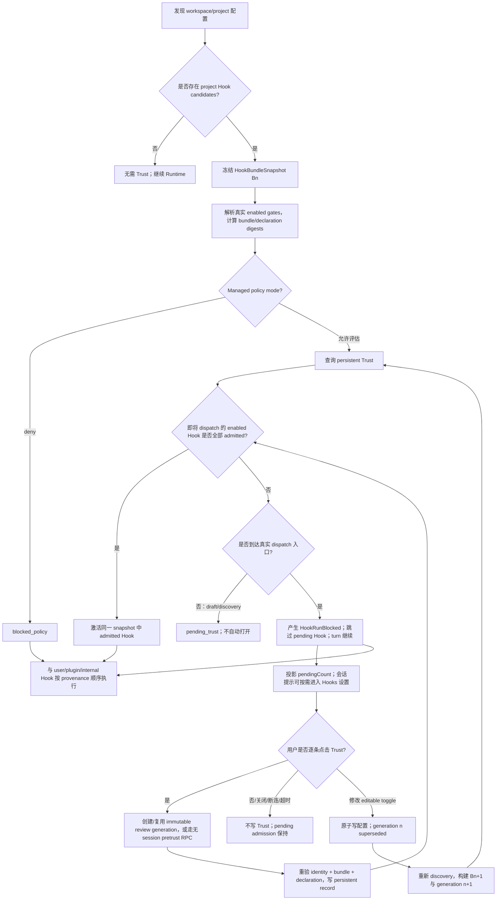
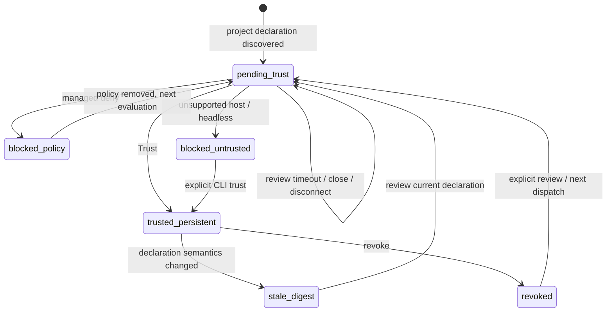

# Mecanismo de Workspace Hook com Trust Manual (centralizado em Settings)

> **Revisão de 2026-08-13 para simplificação do Trust persistente:** a semântica de produto mais
> recente está em
> [`workspace-hook-trust-persistent-only.md`](./workspace-hook-trust-persistent-only.md).
> O Workspace Hook mantém somente o Trust persistente declarado item a item. As seções de
> especificação deste documento foram convergidas para o schema atual; a máquina de estados de
> autorização descontinuada não é mais uma entrada executável NL→Code.

> **Modelo de interação (fato atual em 2026-08):** ao enviar um prompt, se existir um Hook não
> confiável, o turno não aguarda revisão humana; o Hook pendente produz `HookRunBlocked` no turno
> e é ignorado, e uma barra de aviso aparece na parte inferior do chat. Depois que o usuário entra
> ativamente nas configurações de Hooks, ele só pode estabelecer Trust persistente item a item; o
> SessionStart ignorado não é reexecutado. O sequenciamento detalhado está em
> [`workspace-hook-trust-soft-gate.md`](./workspace-hook-trust-soft-gate.md).

| Campo        | Valor                                                                                                                                                                                                                 |
| ------------ | ----------------------------------------------------------------------------------------------------------------------------------------------------------------------------------------------------------------------- |
| Status       | Implementado; a interação atual é persistent-only + soft-gate, com verificações estáticas e de automação concluídas; o aceite manual final no Desktop real é executado pelo produto                |
| Data         | 2026-08-07                                                                                                                                                                                                             |
| Escopo       | ZCode CLI Runtime, ZCode Protocol v4, Desktop/Web UI, Remote Workspace, Headless CLI                                                                                                                                    |
| Alvo         | Hooks de `zcode.json` e `.zcode/config.json` no nível workspace/projeto                                                                                                                                                   |
| Baseline de segurança | Deny por padrão, autorização explícita, invalidação por item em caso de mudança de declaração, precedência da recusa de política                                             |
| Documentos relacionados | `docs/security/deep-link-project-trust-boundary.md`; `docs/web-remote-control/web-remote-control-architecture.md`; `docs/web-remote-control/task-realtime-sync.md`; `docs/web-remote-control-task-command-queue.md` |
| Solução de interação   | Revisão concluída em `Settings → Hooks → Workspace`; não se usa um Trust Dialog separado na página de tarefas                                                       |
| Demo da interação      | `docs/specs/workspace-hook-trust-demo.html` (protótipo histórico, substituído pela especificação persistent-only)                                                 |
| Aceite manual          | `docs/testing/workspace-hook-trust-manual-acceptance.md`; fixtures gerados por `scripts/create-workspace-hook-trust-uat-fixture.mjs`                                  |

## 1. Resumo

Esta seção de resumo descreve a implementação atual; a interação e os estados seguem
[`workspace-hook-trust-persistent-only.md`](./workspace-hook-trust-persistent-only.md) e
[`workspace-hook-trust-soft-gate.md`](./workspace-hook-trust-soft-gate.md). Este documento
descreve apenas o contrato atual de Trust persistente e soft-gate, sem manter os detalhes
normativos do modelo de interação antigo.

O baseline de segurança, o discovery isolado, o domínio de Trust, a admissão no Runtime, a
revisão Desktop/Mobile, a rota remota, CLI/Headless, o rollout e a telemetria foram concluídos e,
pelos documentos persistent-only e soft-gate, convergidos para:

- declarações de Hook de workspace/projeto são normalizadas pelo discovery do Runtime em um snapshot imutável e não podem entrar no caminho executável antes da admissão;
- o Desktop exibe a configuração de Hooks em `Settings → Hooks → Workspace`; linhas não confiáveis oferecem apenas o "confiar" persistente por item e mostram o interruptor de execução efetiva desligado e não operável; linhas confiáveis não exibem emblema adicional de estado de Trust;
- ausência de Host capaz, clientes antigos, geração obsoleta, divergência de snapshot, falha do Trust store e falha na reconstrução da configuração resultam em fail closed;
- Desktop continuous e Web/Mobile replayable compartilham a mesma projeção de revisão do Runtime; a resposta é vinculada a task/run/remoteSession/runtime epoch, comandos sensíveis fazem apenas ACK query e não são reproduzidos automaticamente;
- o Headless fornece status/review/grant/revoke exatos e diagnósticos de pretrust; o gate de rollout confiável, telemetria anonimizada, documentação de segurança/controle remoto/usuário e migração de diagnósticos antigos são feitos na Fase 6.

Esta especificação introduz o **Workspace Hook Trust Admission**, independente do estado usual de
habilitação de Hook, e adota explicitamente a interação **centralizada em Settings**:

1. Descobrir Hooks a partir da configuração do projeto, mas sem convertê-los ainda em callbacks executáveis;
2. Formar um `HookBundleSnapshot` imutável a partir das declarações de Hook do projeto atual;
3. Calcular um `bundleDigest` para o bundle e um `hookDeclarationDigest` para cada declaração de Hook;
4. O Trust persistente usa `workspace identity + hook declaration digest` como chave de permissão, permitindo revisão item a item;
5. O usuário pode confiar ativamente em `Settings → Hooks → Workspace`; se qualquer entrada real de dispatch de Hook de projeto encontrar uma declaração não revisada, o Runtime **não bloqueia mais o turno nem força a navegação até a página de configurações** — o hook pendente é simplesmente ignorado no turno (`HookRunBlocked`), o turno segue imediatamente e uma barra de aviso permanente aparece na parte inferior do chat (N Hooks aguardando revisão + revisar/ignorar); somente quando o usuário clica ativamente as configurações de Hooks são abertas (ver a spec do soft gate);
6. A interface de configurações oferece apenas o `Trust` persistente para cada declaração não confiável; confiança e o interruptor de configuração permanecem ortogonais;
7. Fechar a interface de configurações ou a desconexão temporária do attachment do cliente não produz decisão de segurança; dispensar a barra de aviso é apenas esconder localmente, sem persistir; a admissão pendente pode ser recuperada por evento continuous ou snapshot replayable. Persistir o Trust só afeta eventos de Hook naturais posteriores; o SessionStart já ignorado **não é reexecutado**, no máximo valendo a partir do próximo SessionStart real;
8. Uma mudança nas declarações de Hook invalida apenas o declaration digest afetado; o snapshot/bundle digest continua sendo usado para garantir consistência entre revisão e execução;
9. Em ambientes sem interação o padrão é fail closed, e o Trust preciso deve ser previamente estabelecido por comandos explícitos de CLI;
10. Políticas corporativas/gerenciadas: deny tem precedência sobre qualquer autorização do usuário;
11. O interruptor de execução efetiva de declarações não confiáveis permanece desligado e não operável; exibir ou confiar não pode reescrever a configuração original do workspace; após o sucesso do Trust o interruptor é restaurado conforme o `configuredEnabled` real;
12. O Desktop usa `desktop-continuous` e o Web no celular usa `web-remote-replayable`; ambos se conectam ao mesmo Host/Runtime, e os comandos de revisão são submetidos via attachment confiável com roteamento por owner/stale-run.

Este design autoriza as **declarações de Hook atuais exibidas na página de configurações**, e não
o conteúdo completo do código transitivo referenciado pelos comandos do Hook e suas dependências.

---

## 2. Contexto e situação atual

### 2.1 Correção de segurança atual

`apps/zcode-cli/packages/adapters/src/config/project-config.adapter.ts` atualmente trata Hooks de
projeto por dois caminhos isolados:

1. `loadProjectConfigFile()` gera um diagnóstico ao detectar `result.config.hooks` e guarda as
   declarações em um side-channel independente de candidate/snapshot:

```text
config_project_hooks_pending_trust
Project hooks are pending workspace trust and remain blocked
```

2. `normalizeProjectConfig()` ainda remove o campo `hooks` inteiro do `RuntimeConfigPatch`
   executável retornado; o candidate não é consumido pelo mergeador de configuração nem pelo
   runner configurado.

Esse comportamento corrige a seguinte cadeia de ataque:

```text
deep link externo / diretório não confiável
  -> abrir um workspace controlado pelo atacante
  -> descobrir automaticamente a configuração do projeto
  -> Hook SessionStart executa shell/process no caminho de startup ou resume
```

Portanto, o novo mecanismo de Trust não pode apenas adicionar um interruptor na página de
configurações do renderer, nem apenas fazer uma verificação temporária em um ponto de chamada de
`turn.ts`. A fronteira de segurança deve estar **antes de a declaração de Hook do projeto entrar no
Runtime executável, a partir da configuração, e deve cobrir todas as entradas de dispatch de Hook**.

### 2.2 Inconsistência entre a página de configurações e a semântica do Runtime

O Settings Service e o Runtime Adapter da Fase 1 já reutilizam o mesmo resolver
discovery/canônico, sendo capazes de exibir o snapshot de Hooks do projeto, os gates configurados
reais, a procedência da origem e `editable`. O patch executável do Runtime continua removendo
sempre os Hooks de projeto, portanto a UI atual exibe o estado "configurado mas não admitido", e não
o estado executável.

O novo modelo precisa distinguir claramente:

```text
configuredEnabled  se a configuração do Hook está habilitada
trustState         se a declaração atual passou pela admissão de Trust
effectiveRunnable  se a execução é de fato permitida neste contexto
```

Não se pode continuar usando um único `enabled` para significar ao mesmo tempo "configurado" e
"permitido com segurança".

### 2.3 O discovery de configuração não é um modelo de arquivo único

Dentro de um worktree Git, a configuração do projeto é descoberta do diretório atual até a raiz do
worktree:

```text
<dir>/zcode.json
<dir>/.zcode/config.json
```

e mesclada na ordem da raiz para o cwd; um `projectConfigPath` explícito (atualmente repassado
principalmente por testes e por poucos caminhos de construção) é acrescentado após os arquivos de
discovery, sendo uma capacidade de compatibilidade futura e não o caminho principal da UI na V1.

**O comportamento existente para diretórios não-Git é diferente:** `getProjectConfigDirectories()`
finalmente retorna apenas `cwd` e não adiciona diretórios pais intermediários ao escopo de
discovery. O construtor de snapshot precisa reutilizar esse comportamento e não pode implementar
por conta própria outra regra de "varrer diretórios pais mesmo fora do Git".

Portanto, o snapshot de discovery não pode representar apenas um arquivo `.zcode/config.json`, nem
pode fazer hash apenas do texto final exibido na UI. O bundle completo deve cobrir o escopo real de
discovery, a origem, a ordem relativa e o resultado da mesclagem; o declaration digest do Trust
item a item também deve incluir a source, o event, o matcher, a posição e toda a semântica de
execução conhecida daquele Hook.

### 2.4 Draft prewarm e momento real de execução são diferentes

O composer V4 cria a draft session antecipadamente, mas o draft prewarm não executa Hooks.

O `SessionStart` tem hoje pelo menos dois caminhos reais de execução:

- `turn.ts` chama `runSessionStartHooks("startup", ...)`;
- `resume.ts` chama `runSessionStartHooks("resume", ...)`.

O tipo de source de matcher de `runSessionStartHooks()` ainda reserva `clear` e `compact`.
Embora hoje não haja pontos de chamada independentes correspondentes, quando forem adicionados eles
deverão herdar automaticamente a admissão e não se tornar um caminho alternativo.

Esta especificação não abre automaticamente a interface de revisão na fase de draft prewarm. O
usuário pode revisar antecipadamente na página de configurações; quando qualquer entrada real capaz de
fazer dispatch de um Hook de workspace chegar, o Runtime deve concluir a admissão antes de permitir
a execução dos Hooks de projeto que correspondam a essa source/event.

---

## 3. Terminologia

### 3.1 Workspace Hook / Project Hook

Um Hook originado de `zcode.json`, `.zcode/config.json` ou de um `projectConfigPath` explícito dentro
do escopo de discovery da configuração do projeto do workspace.

Este documento o chama uniformemente de **Workspace Hook**; o enum de origem de código deve usar
`project`, para manter consistência com o `ConfigScope.Project` existente.

### 3.2 Hook Bundle

O conjunto normalizado de todas as declarações relacionadas à execução de Hooks de projeto obtidos
no discovery de configuração deste workspace.

### 3.3 HookBundleSnapshot

Um snapshot imutável em memória criado antes da admissão. O resumo visto pelo usuário, o digest
canônico e a execução real devem vir do mesmo snapshot.

### 3.3.1 Hook Declaration Digest

O digest calculado sobre a serialização canônica versionada da semântica de execução de uma única
`CanonicalWorkspaceHookEntry`. O Trust persistente e o revoke item a item usam esse digest como
fronteira de conteúdo.

O `bundleDigest` continua existindo, mas é usado para identificar o snapshot completo atual,
detectar inconsistência entre review e execute e agregar diagnósticos; já não é a única granularidade
persistente de Trust na V1.

### 3.4 Workspace Identity

A identidade da dimensão de workspace do Trust:

- workspace local: usar o `workspacePath` / `workspaceKey` canônico já existente na camada de protocolo/serviço;
- workspace remoto: usar o `workspaceIdentity` já existente;
- não é permitido usar apenas o path puro na máquina remota como identidade;
- a identidade deve ser tratada pelo serviço de Trust como uma string opaca, sem que o serviço a deduza ou recomponha por conta própria.

### 3.5 Ciclo de vida do Trust

A autorização de um Workspace Hook vem apenas de um registro persistente preciso no Trust store
de propriedade do usuário. `sessionId`, `taskId`, `runId`, `reviewFlowId` e `interactionId` servem
apenas para vincular um comando de revisão ao snapshot confiável atual do Runtime e não ampliam o
escopo do Trust. A validade da autorização depende somente do registro preciso
`workspace identity + hook declaration digest` e do gate atual de policy/snapshot.

compact, resume, fork, new task e subagent não podem gerar nem herdar autorizações adicionais; eles
só podem reutilizar o registro persistente existente sob a mesma workspace identity que ainda
corresponda ao declaration digest atual. Após a reconstrução do Runtime, ele deve fazer bootstrap a
partir do Trust store e falhar de forma fechada antes da leitura ser concluída.

### 3.6 Trust Record

Registro persistente no armazenamento seguro do domínio do usuário, indicando que um
`workspace identity + hook declaration digest` foi escolhido como confiável pelo usuário. O produto
atual cria um registro preciso a partir de cada linha de Hook.

### 3.7 Admission

A decisão de segurança antes de um Hook de projeto entrar no conjunto executável do Runtime. A
admissão é uma dimensão diferente da permissão comum de ferramentas e do estado enabled de um Hook.

---

## 4. Objetivos

1. Permitir que o usuário autorize explicitamente as declarações de Hook atuais do workspace, em vez de bloquear permanentemente todos os Hooks de projeto.
2. Manter o fail closed por padrão; Hooks de projeto não autorizados não podem entrar no caminho executável.
3. Usar a mesma fronteira de admissão para deep link, abertura de pasta comum, workspace recente e workspace remoto.
4. Não incomodar o usuário quando ele apenas navega por um workspace ou faz o prewarm do composer draft.
5. Permitir que o usuário continue usando tarefas mesmo sem Trust, apenas pulando os workspace Hooks.
6. Exigir nova autorização automaticamente quando as declarações de Hook do projeto mudarem.
7. Oferecer Trust item a item na UI existente `Settings → Hooks → Workspace`, expressando o estado não confiável por um interruptor efetivo travado e desligado.
8. Oferecer a Headless/automation um comportamento determinístico, auditável e sem elevação implícita de privilégio.
9. Não escrever dados de Trust no repositório do projeto, evitando que o projeto se declare confiável.
10. Preservar o comportamento existente e a semântica de ordem de execução de user Hooks, plugin Hooks e internal Hooks.
11. Suportar revoke explícito, com a interrupção subsequente da obtenção de admissão por Hooks do projeto de forma oportuna.
12. Formar uma interface de política extensível, permitindo adicionar no futuro políticas gerenciadas de deny/allow.

---

## 5. Não objetivos

1. Não validar a cadeia de suprimentos completa dos scripts, binários, interpretadores, pacotes de dependência ou recursos de rede referenciados por um Hook.
2. Não criar um novo sandbox de SO para Hooks de projeto; o Hook continua usando as capacidades existentes do Hook executor.
3. Não mesclar o Trust de Hook no prompt comum de permissão de ferramentas.
4. Não alterar a política de confiança existente do MCP do workspace.
5. Não alterar a fronteira de segurança do `permissionMode` do perfil de subagent do projeto.
6. A V1 não oferece "confiar permanentemente em todas as futuras mudanças de Hook deste workspace".
7. A V1 não oferece autorização granular do tipo "liberar permanentemente todo um evento de Hook"; o alvo do Trust é a declaração de Hook efetiva.
8. A V1 não cria Trust persistente silenciosamente via variável de ambiente.
9. A V1 não grava trust token, assinatura ou allowlist no arquivo de configuração do workspace.
10. O revoke não se responsabiliza por encerrar processos externos de Hook já iniciados; o cancelamento de processos é uma capacidade separada posterior.

---

## 6. Modelo de ameaça e princípios de segurança

### 6.1 Cenários que precisam ser defendidos

- um atacante induz o usuário via deep link a abrir um diretório com Hook malicioso;
- após clonar um repositório, a primeira mensagem dispara o Hook `SessionStart`;
- o projeto modifica a configuração de Hook e continua reutilizando o Trust antigo;
- um workspace remoto reutiliza indevidamente o Trust de outra máquina apenas porque o path é igual;
- renderer/UI é contornado e uma chamada direta de CLI ou protocolo cria o Runtime;
- draft prewarm dispara autorização ou execução sem uma intenção explícita do usuário;
- a revisão exibe uma configuração e, após a aprovação, a execução relê outra configuração;
- a política corporativa proíbe explicitamente Hooks de projeto, mas o Trust local do usuário a sobrescreve.

### 6.2 Princípios de segurança

1. **Default deny**: sem um resultado explícito de admissão, o Hook de projeto não é executado.
2. **Runtime-enforced**: a decisão ocorre antes da formação do conjunto executável do Runtime e não depende da disciplina da UI.
3. **Content-bound**: o Trust persistente é vinculado ao declaration digest da Hook individual atual; o bundle digest é usado para consistência de snapshot.
4. **Identity-bound**: o Trust é vinculado à workspace identity.
5. **Policy-first**: deny gerenciado tem precedência sobre o Trust do usuário.
6. **Snapshot consistency**: review, digest e execução usam o mesmo snapshot imutável.
7. **No repository self-trust**: o conteúdo do projeto não pode escrever nem declarar o próprio Trust.
8. **Explicit automation**: ambientes sem interação aceitam apenas comandos de pré-autorização explícitos e auditáveis.
9. **Graceful refusal**: recusar um Hook não equivale a recusar o uso do workspace.
10. **Honest wording**: a UI deve esclarecer que o que é autorizado é a declaração do Hook, e não há garantia de que o conteúdo do script chamado não mude.

---

## 7. Árvore de decisão do usuário final



### 7.1 Semântica de dispensar, desconectar e encerrar

Os seguintes eventos não são decisões de Trust:

- fechar ou sair da página de configurações;
- reload do renderer do desktop;
- atualização da página Web no celular ou desconexão temporária do attachment replayable;
- lacuna de transporte/reanúncio enquanto o mesmo Runtime continua vivo.

Nenhum desses eventos grava Trust nem chama um `cancel` genérico; a admissão pendente permanece válida e
é recuperada a partir da projeção/snapshot do Runtime.

Somente os seguintes eventos encerram a generation de revisão atual:

- o usuário submete um Trust persistente para a declaração exatamente selecionada;
- após a mutação bem-sucedida do toggle configurado, a generation antiga é marcada como `superseded` e substituída por uma nova;
- o vencimento de `WORKSPACE_HOOK_REVIEW_TIMEOUT_MS`, que apenas expira a request imutável e não grava nenhuma decisão do usuário;
- cancelamento/exclusão explícita da sessão;
- término do processo Runtime/Host. O término do processo não forja decisão do usuário; um resume posterior precisa refazer o discovery/evaluate e criar um novo interactionId.

### 7.2 Substituição atômica de toggle durante a revisão

O toggle em revisão não modifica o snapshot imutável antigo. Para o `.zcode/config.json` atual do
workspace com `editable=true`:

```text
acquire workspace review mutation lock
  -> validate proposed config in memory
  -> atomic write temp + fsync/close + rename
  -> rebuild discovery snapshot Bn+1
  -> mark generation n superseded
  -> atomically install generation n+1
  -> re-evaluate persistent Trust
  -> preserve renderer presentation state
```

Restrições:

- uma response atrasada do interactionId antigo retorna `workspace_hooks_review_superseded` e não pode gravar Trust;
- no novo snapshot após o disable, aquela declaration não pode ser executada a partir do snapshot enabled antigo;
- após o enable, se a declaration não estiver confiável, ela entra na nova generation pending;
- se a escrita ou o rebuild falhar, a tarefa atual faz fail closed, a generation antiga não pode continuar executando e a UI mostra o erro de escrita/parse da configuração;
- o `bundleDigest` continua incluindo os configured gates; a identidade do snapshot não é enfraquecida para acomodar o toggle da UI.

### 7.3 Semântica quando não há Hooks de projeto

Não se deve criar um review flow vazio nem Trust Records sem sentido. A página de configurações pode
exibir um estado vazio comum.

## 8. Decisões de produto e arquitetura adotadas

### D1. Granularidade do Trust

**Adotado:** `workspace identity + hook declaration digest`, com suporte apenas a Trust persistente
item a item.

Identificador auxiliar: o `bundleDigest` serve para congelar o snapshot completo, correlacionar pending
requests, validar responses e garantir consistência de execução, mas não é uma autorização permanente
que permita mudanças futuras do bundle inteiro.

Razões:

- a revisão por Hook permite ao usuário ver com clareza qual comando específico está confiando;
- a mudança de um único Hook exige nova revisão apenas das declarações afetadas, evitando que Hooks não relacionados voltem a pending em bloco;
- a workspace identity impede que o mesmo comando compartilhe Trust indevidamente entre workspaces locais/remotos diferentes;
- o declaration digest precisa conter event, matcher, source, ordem e todos os campos relevantes à execução, impedindo que declarações "aparentemente homônimas, mas com semântica de execução diferente" reutilizem o Trust;
- cada mutation precisa estar ligada à declaration precisa selecionada explicitamente; a UI atual submete apenas a linha atual.

### D2. Momento da pergunta e superfície que a hospeda

**Adotado:** a operação de confiança acontece unicamente em `Settings → Hooks → Workspace`. Quando
qualquer entrada real de dispatch de workspace Hook encontra uma declaração pendente, o turno apenas
produz `HookRunBlocked` e segue; o Host não bloqueia o turno nem força a abertura das configurações. A
barra de aviso da sessão permite ao usuário entrar ativamente nessas mesmas Hooks settings.

O que precisa ser coberto hoje:

- startup: `turn.ts -> runSessionStartHooks("startup")`;
- resume: `resume.ts -> runSessionStartHooks("resume")`;
- cada dispatch dos demais Hook events;
- as SessionStart sources `clear` / `compact` que forem conectadas no futuro.

Recomenda-se descer a admissão de SessionStart para o caminho prévio compartilhado
`runSessionStartHooks(source, ...)`, em vez de aplicar um remendo apenas em `turn.ts`, evitando
estruturalmente que o resume/futuras sources a contornem.

Não se adota um Trust Dialog separado na página de chat da tarefa.

Razões:

- O Trust é um estado de segurança de longo prazo do workspace Hook e pertence ao mesmo contexto de
  configuração da origem, configuração, liga/desliga e revogação do Hook;
- Abrir um workspace ou fazer o draft prewarm não navega automaticamente para as configurações de Hooks;
- A fronteira coercitiva do Runtime é definida por todos os execution entry point, não por um caminho de produto específico;
- A página de configurações é apenas o ponto de entrada da decisão; a decisão de segurança continua sendo aplicada pelo Runtime/Trust Service.

### D3. Conjunto de ações do usuário

**Adotado:**

- `Trust`: confiar persistencialmente apenas na declaração de Hook exata da linha atual no workspace atual;
- `Enable / Disable`: altera apenas o estado configurado, sem criar ou remover Trust implicitamente; quando não confiável, o interruptor de execução efetiva aparece desligado e não operável;
- `Revoke`: a camada inferior mantém a capacidade de revogação precisa, mas a lista atual de Hooks não exibe botão de revogação;
- Fechar as configurações, dispensar o aviso, timeout ou desconexão não constituem decisão do usuário e não gravam estado negativo.

A V1 não oferece `Always trust this workspace`, nem wildcard para Hooks adicionados no futuro.

Razões:

- Manter apenas autorização persistente item a item, explicável e auditável;
- Separar o toggle configurado do Trust evita "ligar o interruptor já executa código desconhecido";
- Todas as ações mapeiam para estados claros, testáveis e reversíveis.

### D4. Comportamento da tarefa após a recusa

**Adotado:** a tarefa continua, apenas pulando o project Hook.

Razões:

- Hooks normalmente são capacidades de aprimoramento e não devem sequestrar a usabilidade básica do workspace;
- O usuário pode visualizar e modificar o projeto sem executar código desconhecido;
- É compatível com o baseline de segurança atual de "Hook de projeto ignorado, mas tarefa disponível".

### D5. Semântica de mudança de configuração

**Adotado:** reconstruir o snapshot; o declaration digest alterado não casa com o Trust antigo, enquanto as declarações inalteradas continuam casando.

Detalhamento:

- `command`, `args` do processo, `async`/`shell` do comando, timeout/max-output normalizados, event, matcher, source identity ou mudança na ordem semântica: a declaração correspondente precisa ser revisada novamente;
- Apenas mudança em `configuredEnabled`: não remove o Trust persistente; ao reativar ainda casa o mesmo declaration digest, mas o effectiveRunnable continua sendo determinado por enabled e policy em conjunto;
- Novo Hook: a nova declaração fica pending e não afeta o Trust persistente dos Hooks inalterados;
- Hook removido: o registro pode ser mantido para auditoria, mas o estado atual não é mais exibido como active;
- Draft session que ainda não iniciou um turno real: invalidar e reconstruir o snapshot;
- Session ativa já iniciada: manter o snapshot imutável aprovado na inicialização, sem hot-replace das novas declarações do disco;
- Um reload/restart explícito posterior usa o novo snapshot e reavalia item a item.

Razões:

- Impede a substituição do comando após a aprovação;
- Reduz reanálises causadas por mudanças irrelevantes no bundle;
- Mantém configured, trusted e effective como três dimensões independentes.

### D6. Semântica de Revoke

**Adotado:** suportar revoke item a item e revoke em lote no escopo do workspace.

Revoke item a item:

- Remove o Record persistente alvo `workspace identity + hook declaration digest`;
- A execução do Hook alvo que ainda não começou é imediatamente blocked.

Revoke em lote:

- Remove os declaration records especificados ou todos sob a workspace identity atual;
- Não mata à força processos de Hook já iniciados.

Razões:

- Mantém consistência com o estado e as ações por Hook na página de configurações;
- Bloquear imediatamente execuções futuras corresponde à expectativa do usuário;
- Matar à força processos externos exige contratos confiáveis de process ownership, cancel e cleanup, fora do escopo desta especificação.

### D7. Headless / Bot / Automation

**Adotado:** fail closed por padrão e comandos explícitos de CLI para gerenciar Trust.

Razões:

- headless não tem interface interativa confiável e não pode escolher Allow automaticamente;
- Pré-autorizar por comando é mais auditável do que por variável de ambiente;
- A CI pode inspecionar os digests explicitamente e então decidir se confia.

### D8. Remote identity

**Adotado:** o Remote usa `workspaceIdentity`, e não o remote path puro.

Razões:

- `/repo` não é o mesmo sujeito de confiança em hosts/containers remotos diferentes;
- O protocolo existente já fornece a identidade de workspace remoto; deve-se reutilizá-la em vez de inventar mais um conjunto de host key;
- Os registros de Trust local e remoto ficam naturalmente isolados.

### D9. Local de persistência do Trust

**Adotado:** armazenamento seguro independente do domínio do usuário; não escrever no workspace e não sincronizar junto das configurações comuns.

Local lógico sugerido:

```text
~/.zcode/security/workspace-hook-trust.json
```

O caminho real deve ser gerado pelo resolver existente de diretório de dados do usuário / CLI storage
root; não é permitido hardcodar `$HOME` diretamente no código de negócio.

Razões:

- O conteúdo do workspace não pode estabelecer Trust de si mesmo;
- Sincronizar configurações comuns para outra máquina ampliaria o escopo da autorização;
- Schema independente, permissões de arquivo, escrita atômica e migração são mais fáceis de auditar.

### D10. Precedência da política corporativa

**Adotado:** `managed deny > user trust > default deny`.

Razões:

- A política administrativa precisa estabelecer uma fronteira de segurança organizacional que o usuário local não possa sobrescrever;
- O Trust do usuário só vale quando a política permite decisão do usuário;
- Mesmo havendo um Trust Record, o policy deny deve ser exibido como blocked, e não como trusted.

### D11. Ciclo de vida do Trust persistente

**Adotado:** o único fato de autorização de um Workspace Hook é o Trust persistente preciso no store
de propriedade do usuário; o ciclo de vida de session/task não cria nem herda autorização.

- A session atual, compact, resume, fork, new task e subagent não criam nenhum novo tipo de autorização;
- O bootstrap do Runtime carrega os registros do Trust store e invalida/atualiza a avaliação em memória por security revision;
- Após a mudança do declaration digest, o registro antigo deixa de autorizar a nova declaração;
- Fechar a página, relações de session dentro do processo ou o ciclo de vida do attachment não podem estender o Trust;
- Enquanto o Trust store não estiver pronto ou o carregamento falhar, tudo é fail closed.

### D12. Configured Toggle durante a revisão

**Adotado:** manter o toggle editável; após o commit bem-sucedido do toggle, a review generation
antiga é superseded e o snapshot e as requests pendentes são reconstruídos a partir da configuração
após a escrita atômica.

Usa-se `reviewFlowId + generation + interactionId`:

- `reviewFlowId` representa o fluxo de revisão contínuo visto pelo usuário;
- Cada bundle imutável usa uma `generation` incremental e um novo `interactionId`;
- A UI pode preservar janela, rolagem e estado de expansão, mas a resposta de segurança só vale para a generation atual;
- O Trust persistente continua sendo reutilizado por declaration digest, e os configured gates continuam entrando no bundle digest.

Não se adota "remover configuredEnabled do bundle digest", porque isso impediria o bundle de
representar com precisão o conjunto executável atual; também não se adota congelar o toggle durante
toda a V1, porque a página de configurações é justamente o principal ponto de entrada para o
usuário compreender e corrigir a configuração de Hooks.


### D13. Limite de interação multiplataforma Desktop / Mobile

**Adotado:** Desktop e Web no celular se conectam ao mesmo Host/Runtime e ambos implementam a UI de
revisão responsiva `Settings → Hooks → Workspace`; a semântica de entrega e recuperação é distinguida
pelo attachment confiável.

- Desktop: `clientMode=desktop-continuous`, atualizando a barra de aviso e o store de Settings por projeção continuous direta;
- Mobile Web: `clientMode=web-remote-replayable`, recuperando a revisão pendente a partir do conversation snapshot/resume;
- A revisão pendente é visível para clientes online capazes da mesma task, mas não bloqueia o turno;
- Qualquer attachment autenticado e que declare a capability de UI pode submeter a decisão;
- A resposta é roteada por owner/lease/stale-run até um único Runtime e deve carregar as informações de correlação: workspace identity, remote session, task/session, run, interaction generation;
- O relay e o desktop main apenas encaminham/roteiam e não mantêm estado de negócio de Trust, snapshot ou revisão pendente;
- Decisões concorrentes de múltiplos clientes aceitam apenas a primeira submissão válida da generation atual.

Clientes antigos ou sem suporte a essa UI só podem exibir um aviso de compatibilidade e não podem
responder automaticamente; se não houver cliente capaz, a request aguarda até o deadline seguro e
então fica blocked.

### D14. Execution Gate e Security Revision

**Adotado:** adicionar uma security revision de nível de host, com escopo por workspace; o gate usa
apenas um caminho rápido em memória.

- Cada processo de host cria um `coordinatorEpoch` aleatório;
- Cada workspace identity mantém um `counter` monotônico;
- É incrementado em grant/revoke de Trust persistente e em mudanças de policy revision;
- O cache admitted do Runtime guarda a revision verificada mais recente;
- Se a revision for a mesma e a declaração estiver no admitted set, a passagem é O(1);
- Se a revision for diferente, reavalia usando o índice de Trust/policy em memória; é proibido ler disco, rede ou refazer o discovery no hot path de dispatch;
- Quando a verificação falha, um lifecycle blocked é produzido antes do `HookRunStarted` e do dispatch em background.

### D15. Contrato de ativação do soft-gate

> O turno nunca espera por revisão; o hook pendente é pulado no turno (`HookRunBlocked`) e o turno
> executa imediatamente; o fluxo de revisão é aberto sob demanda pelo usuário, clicando em "revisar"
> na barra de aviso, por meio do comando `requestWorkspaceHookReview`.
>
> **Contrato atual de `activate()`:** aguarda apenas o bootstrap do Trust store e a conclusão da
> avaliação em memória; ao encontrar uma declaração pendente, não cria nem espera uma revisão humana,
> e no limite de execução do turno gera `HookRunBlocked` e pula.
> O usuário pode então iniciar ativamente o fluxo de revisão pela barra de aviso; essa ação não
> restaura nem reexecuta o evento de Hook já pulado.

### D16. Função única de arbitragem da monotonicidade de review (convergência de drift)

O mesmo conjunto de regras de monotonicidade de review (monotônico por generation no mesmo flow;
generation igual tratada como replay idempotente ou rejeição de corruption; flow diferente pertence
a uma troca de Runtime e exige arbitragem por limite de epoch) é unificado por uma função pura
compartilhada. Atualmente os únicos consumidores espelhados são a projeção de produto do bootstrap
(replay de eventos) e o review store do renderer (exibição do binding); o observador de prompt-turn
foi removido junto com o soft gate.

**Adotado:** arbitragem e aplicação em camadas, com a função única de arbitragem no shared
(`workspace-hook-review-monotonicity`) compartilhada pelos três consumidores espelhados:

```text
裁决（纯函数，单一来源）：输入 current {reviewFlowId, generation, interactionId}
                          与 candidate 同构三元组，输出：
  no_current            -> 无当前权威，candidate 接管
  same_flow_advance     -> 同 flow 更高 generation，接受
  same_flow_replay      -> 同 flow 同 generation 且同 interactionId，幂等 replay
  same_flow_conflict    -> 同 flow 同 generation 但 interactionId 不同，违反 controller 单调性
  same_flow_stale       -> 同 flow 更低 generation，迟到事件
  cross_flow            -> 不同 flow，Runtime 换代；由调用方按 own epoch 证据裁决

应用（各消费方保留）：projection cross_flow -> drop（等待 onSessionResumed 清空）
                     store        cross_flow -> 接受（新 Runtime 权威覆盖旧 binding）
                     replay/conflict/stale  -> 两方一致忽略
```

O core flow registry é o owner do contrato de mutação (semântica de supersede/validate) e não é
obrigado a usar esta função; novos consumidores espelhados devem consumi-la. A ordem dos eventos
(sequenceNumber) é mantida pela product projection, e o ciclo de vida de conexão do store continua
pertencendo ao store.

**Restrição de caminho de exposição (revisão de 2026-08-07, lista ampliada em 2026-08-10):**
subpath whitelist de conexão direta: `@zcode/shared/workspace-hook-review-monotonicity` (função de
arbitragem) e `@zcode/shared/workspace-hook-mutation` (`WorkspaceHookMutationError` / API de escrita
atômica, conectado diretamente pelo review controller desde 2026-08-10). Todos os consumidores devem
importar o subpath declarado diretamente; o barrel `workspace-hook-discovery` **não pode fazer
re-export** desses módulos. Causa raiz: a primeira versão de D16 expôs via `export *` do barrel de
discovery; a chain de build Desktop do packages/ui falhou ao resolver essa aresta de re-export e o
App não pôde abrir após reiniciar; além disso o barrel criaria "dois caminhos de exposição para a
mesma API", e a reincidência do drift não seria detectável no ponto de import. O lado de empacotamento
cli SEA/esbuild (`packages/cli/scripts/build.mjs`) precisa declarar um alias preciso para **cada**
subpath — o esbuild reescreve por prefixo e uma declaração ausente seria reescrita pelo alias genérico
`@zcode/shared` como `src/index.ts/<subpath>` (arquivo tratado como diretório), quebrando o pack; a
ordem dos aliases é travada por `build.test.mjs`. **Checklist de sincronização ao adicionar um subpath:
exports do package.json / import dos consumidores / alias preciso em build.mjs.**

**Restrição de atribuição de erro do toggle (2026-08-10, TR27):** o catch de controller.toggle precisa
repassar conforme `WorkspaceHookMutationError.code` (`snapshot_mismatch` ≠ `config_write_failed`) — o
mismatch ocorre antes da escrita em disco e reportar como "falha de escrita" induz a retentativas
inválidas e oculta a causa real (medido em UAT: o caminho de escrita da configuração não tinha falha,
mas o usuário via apenas falsos positivos). O toggle_failure de telemetry precisa carregar o
errorMessage original.

### D17. Fonte única do schema de configuração de Hook (revisão de 2026-08-07: re-export bloqueado por duas instâncias de zod)

A cópia de hooksSchema em `adapters/config/schema.ts` é campo a campo equivalente a
`shared/workspace-hook-config.ts`. Foram tentadas três convergências, todas bloqueadas pela realidade
das dependências:

- re-export do schema do shared: os dois workspaces pnpm resolvem **instâncias de zod fisicamente diferentes** (adapters 4.4.3 / shared 4.3.6, particionamento de lockfile); após o schema do shared ser embutido na composição `ZCodeConfigFileSchema` deste pacote, a referência dts aos tipos internos de zod estrangeiro dispara TS2742 ("not portable");
- anotações explícitas com `typeof`: valem para os quatro const que podem ser re-exportados por nome, mas o tipo inferido do schema composto (ZCodeConfigFileSchema) ainda carrega a referência estrangeira, e a anotação se propaga circularmente para o tipo de saída (TS2502/2456);
- unificar a versão de zod (^4.4.3): exige rolar o pnpm-lock raiz e todos os protocol schema do shared dependem da semântica de zod strict/passthrough; há risco de drift de comportamento e custo de merge em upgrades minor — **rejeitado, salvo decisão de nível de produto**.

**Adotado (implementação atual):** a cópia é mantida, mas com o papel rebaixado para "diagnóstico
específico do carregamento de arquivo de configuração" — a validação autoritativa em runtime sempre
pelo schema do shared (discovery / montagem de trust / entrada do settings service importam o shared
todos); `workspaceHooksConfigSchema.parse(hooks)` em `project-config.adapter` é mantido como **ponte de
tipos** (`HooksRuntimeConfigPatch` e `WorkspaceHooksConfig` são dois tipos de domínio; é proibido
trocar por asserção `as`); um sentinela de paridade de digest dos dois builders (lado services) trava a
consistência da montagem. **Condição de reavaliação: após unificar a instância de zod, apagar a cópia e
usar re-export.**

### D18. Autoridade do Runtime Admission

**Adotado:** o Runtime admission depende apenas do snapshot imutável atual, do índice de Trust
persistente, da managed policy e da workspace security revision. O ciclo de vida de task/session não
cria registro de autorização algum nem estende o escopo do Trust. A API mutável de
`InMemoryWorkspaceHookPolicyProvider` (set/clear policy e cadeia de subscribe de revision) continua
sendo o ponto de extensão da managed policy e não faz parte do estado de Trust do usuário.

### D19. Semântica unificada de exibição do Trust persistente

O snapshot estático de Settings e o review item do Runtime usam uniformemente o schema
persistent-only. O único estado autorizável pelo usuário é `pending_trust -> trusted_persistent`; os
outros estados blocked/revoked/stale são resultados de avaliação de segurança, e não outra autorização
do usuário.

**Adotado:** a linha não confiável mostra apenas o botão "confiar" item a item e o interruptor de
execução efetiva travado e desligado; após o sucesso do Trust persistente o botão desaparece. A UI
não exibe badge de estado de Trust nem badge de expectativa de execução; as linhas de Settings apenas
apresentam os fatos com base no snapshot estático e no Trust store persistente.

### D20. Responsabilidade do teste de paridade de digest Runtime / Settings

`workspaceHookDigestParity.test.ts` do lado services é na verdade uma validação de "autocoerência do
builder de Settings" (ambos lados são espelhos da fórmula de montagem do hooksService) e não cobre o
Runtime; a paridade na entrada do Runtime é verificada pelo lado adapters em
`tests/workspace-hook-digest-parity.test.ts`, comparando o produto real de `createConfig` (a camada de
Runtime inclui Default/user/project/env/cli) com a fórmula de montagem de Settings. Os dois builders
estão convergidos hoje (as camadas Default/env/cli são itens idempotentes no-op para hooks); qualquer
mudança de camada ou de semântica de merge em um dos lados deixa o teste vermelho do lado adapters.

### D21. Dismiss não altera o Trust

O dismiss da barra de aviso é apenas uma ocultação local do renderer, com key
`sessionId + bundleDigest`; fechar as configurações, timeout ou desconexão também não gravam Trust.
A revogação apenas remove o registro persistente exato e volta para admissão pendente. Se o produto
precisar no futuro de uma capacidade de nível workspace "não mostrar de novo", ela deve ser
desenhada separadamente como preferência de usuário visível e reversível, sem estender a máquina de
estados do Trust nem usar chaves de permissão ambíguas por source/event. A blacklist organizacional
gerenciada continua sendo expressa por `blocked_policy`.

### D22. Settings exibe apenas fatos persistentes prováveis

`hooksService.readPersistentWorkspaceHookTrustDigests` lê apenas o Trust store de propriedade do
usuário; essa é uma fronteira de design, não uma ausência de consulta de estado de runtime. Settings
julga se a declaração atual já tem Trust persistente apenas pelo snapshot estático, não pode adicionar
consultas de autorização de task/session e não exibe selos derivados como "vai rodar/não vai rodar",
que cruzariam policy, configured gate e eventos futuros.

---

## 9. Esquemas não adotados e razões das decisões

| Ponto de decisão | Esquema não adotado | Razão para não adotar | Condição para reavaliação futura |
| --- | --- | --- | --- |
| Granularidade do Trust | Confiar permanentemente em todo o workspace | Hooks adicionados ou substituídos depois ganham execução automaticamente e o escopo cresce com o conteúdo do projeto | Havendo política assinada, identidade de repositório controlada ou política de publisher |
| Granularidade do Trust | Confiar só por digest, entre workspaces | A mesma declaração poderia ser reutilizada em workspaces/remotos diferentes, faltando fronteira de identidade do projeto | Existir assinatura global de publisher e publisher identity confiável |
| Granularidade do Trust | Trust all-or-nothing só do bundle completo | Qualquer mudança irrelevante em um Hook invalidaria todo o Trust; impediria revisão e revoke item a item | O produto voltar a exigir explicitamente um modelo bundle-only minimalista |
| Granularidade do Trust | Liberar o evento de Hook inteiro | Sob o mesmo event pode haver vários comandos distintos; o objeto autorizado é amplo demais | Haver política de event controlada proibindo comandos arbitrários |
| Local da interação | Trust Dialog separado na página de chat da tarefa | Separa-se da configuração, origem, toggle e revoke dos Hooks; cria um segundo ponto de gestão e contraria o design atual de configurações | A página de tarefa precisar suportar um Host especial sem acesso às configurações |
| Local da interação | Runtime Inspector / página de fluxo de decisão | Densidade de informação e mudança visual grandes demais; contraria o estilo atual do produto de configurações | Apenas como ferramenta interna de debug, nunca como interface de usuário |
| Momento da pergunta | Abrir a revisão automaticamente ao abrir o workspace | O usuário seria perturbado só por navegar no diretório, e nesse momento talvez nem haja tarefa ou execução de Hook | O produto exigir concluir o Trust de código antes de entrar no workspace |
| Momento da pergunta | Abrir a revisão automaticamente no draft prewarm | O prewarm é otimização de performance e não deve produzir efeito de segurança visível ao usuário | O prewarm for redefinido como uma ação explícita do usuário |
| Momento da pergunta | Perguntar antes de cada execução de Hook | Perturbação frequente, altera a temporização dos Hooks, difícil para eventos non-interactive | Introduzir níveis de risco de Hook com necessidade real de confirmação a cada vez |
| Opções do usuário | `Always trust this workspace` | Ignora mudanças futuras de declaração; a expressão de risco não é honesta | Introduzir avisos explícitos, assinatura de repositório ou managed policy |
| Comportamento da recusa | Bloquear a criação da session / o primeiro turno | Hook não é funcionalidade básica do workspace; obrigaria o usuário a executar código desconhecido para usar o projeto | Hooks passarem a ser dependência rígida de startup do projeto com fluxo seguro alternativo |
| Comportamento da recusa | Tratar silenciosamente como se não houvesse Hooks | Difícil para o usuário entender por que a automação do projeto não rodou | Apenas em modo de compatibilidade explícito, mantendo diagnóstico visível |
| Mudança de configuração | Hot-load de novos Hooks em session ativa | Novos comandos não aprovados, gerando fácil inconsistência review/execute | Só permitir hot-load explícito após nova admissão do snapshot |
| Revoke | Apenas remover o registro, sem afetar eventos futuros do Runtime ativo | Após clicar em revoke o Hook continuaria obtendo admission | Nenhuma |
| Revoke | Matar à força todos os processos de Hook iniciados | Falta uma atribuição de processo unificada e segura, com garantia de cleanup | O Hook executor passar a ter cancelamento confiável de process-group |
| Headless | Liberação temporária automática quando não confiável | A automation viraria um canal para contornar a fronteira de segurança interativa | Apenas em ambientes fechados sob managed policy |
| Headless | Confiança permanente por variável de ambiente | Fácil ampliação silenciosa de privilégios por processo pai ou template de CI; auditoria fraca | Token de curto prazo protegido e assinado |
| Remote | Apenas por remote path | Caminhos iguais em hosts ou containers diferentes conflitariam | Nunca recomendado; no mínimo é necessária host/workspace identity |
| Persistência | Gravar em `.zcode/config.json` | O repositório poderia versionar a própria auto-confiança | Nunca recomendado |
| Persistência | Reutilizar o settings store comum com sync em nuvem | A autorização poderia se espalhar para máquinas não revisadas, misturando registro de segurança e preferência | Havendo design de vínculo a dispositivo, criptografia e autorização entre dispositivos |
| Digest | Fazer hash apenas da string de comando | Ignora semântica de execução como event, matcher, timeout, source e ordem | Nenhuma |
| Digest | Fazer hash dos bytes brutos do arquivo de config | Mudanças de formatação ou configurações não relacionadas a Hook causariam repetição de perguntas; semântica de merge de múltiplos arquivos confusa | O produto quiser reavaliar a qualquer mudança de byte do projeto |
| Digest | Fazer hash do conteúdo dos scripts referenciados e do closure de dependências | O closure de dependências não é enumerável por completo, criando falsa sensação de segurança | Haver um modelo de execução restrito ou grafo de dependências verificável |
| Infraestrutura de interação | Reutilizar o tipo comum de tool permission | Ciclo de vida, persistência e estrutura de resumo diferentes; risco de confundir conceitos de segurança | É possível reutilizar broker/queue, mas não os tipos de evento de domínio |
| Toggle durante a revisão | Remover os configured gates do bundle digest | O bundle não consegue representar o conjunto executável real, enfraquecendo a identidade review/execute | Somente quando o bundle deixar de carregar a identidade do snapshot |
| Toggle durante a revisão | Congelar todos os toggles durante todo o pending | Simples de implementar, mas bloqueia o usuário de corrigir a configuração direto na entrada de revisão | Se a implementação de supersede/rebuild não puder ser entregue com segurança na V1 |
| Interação multiplataforma | Celular sempre somente leitura, decidir só no desktop | Inconsistente com o roteamento de owner das permissões/elicitações multiplataforma existentes e não atende às restrições de UI móvel | O produto proibir explicitamente decisões de segurança persistentes no mobile |
| Interação multiplataforma | Criar um Agent Runtime/Host separado para o celular | Rompe a fronteira de shared-host e de workspace identity | Atualizar a arquitetura de controle remoto e fazer uma revisão de segurança independente |
| Versão do digest | Mudança minor na semântica de execução continuar casando com o Trust antigo | O record antigo tem apenas o digest e em geral não prova que os novos defaults de campo são equivalentes à autorização antiga | Haver migration proof verificável e dados canônicos antigos |
| Precedência de política | Trust do usuário sobrescrevendo managed deny | Quebra a autoridade da política organizacional | Nunca recomendado |
| Prompt transport | Só deixar o comando de decisão de review contornar a fila serial | Cria um bypass de prioridade oculto e ainda não garante roteamento completo de readState/subscribe/createSession; complexo e difícil de provar | O protocol passar a fornecer formalmente uma control lane ordenada |
| Prompt transport | Tornar todas as requests comuns de protocol concorrentes | Quebra as premissas atuais de FIFO de comandos, session gate, idempotência e temporização de projection | Concluir uma refatoração completa da semântica de concorrência do protocol |
| Runtime admission | Tornar `activate()/review` fire-and-forget | O dispatch de Hook em background poderia passar por uma admission incompleta, quebrando diretamente o execution gate fail-closed | Nunca recomendado |
| Crash recovery | Reexecutar silenciosamente inputs pendentes após restart do Runtime | Pode duplicar a execução da entrada do usuário ou herdar decisão antiga em um novo epoch; o ledger atual não tem estado hold recuperável | Adicionar estado held durável, reconstrução de flow e reconciliação por ACK |
| Client lifecycle | Depender apenas de `client.onClose` para limpar o cache de service | O recycle por request-timeout pode dispor o protocol client antes, enquanto o service ainda mantém a referência antiga, e o próximo comando falha direto com `client is disposed` | Ordem estrita entre o close do transport e o lifecycle do manager ser provada |

---

## 10. Modelo de estado do Trust

### 10.1 Dimensões independentes

Contracts, camada de serviço e renderer expõem uniformemente os seguintes sete estados para cada
workspace Hook; a autorização do usuário existe em um único caminho
`pending_trust -> trusted_persistent`:

```ts
interface WorkspaceHookEffectiveState {
  reviewItemId: string;
  sourceRootEnabled: boolean;
  declarationEnabled: boolean;
  runtimeHooksEnabled: boolean;
  configuredEnabled: boolean;
  editable: boolean;
  trustState:
    | "not_applicable"
    | "pending_trust"
    | "trusted_persistent"
    | "blocked_untrusted"
    | "blocked_policy"
    | "revoked"
    | "stale_digest";
  admissionClass: "not_applicable" | "admitted" | "pending" | "blocked";
  effectiveRunnable: boolean;
  workspaceIdentity?: string;
  bundleDigest?: string;
  hookDeclarationDigest?: string;
  sourcePaths: string[];
  reasonCode?: string;
}
```

O `configuredEnabled` precisa ser calculado pelo mesmo resolver autoritativo do
Runtime discovery / config merger / configured runner:

```text
sourceRootEnabled     = source hooks.enabled !== false
declarationEnabled    = hook.enabled !== false
runtimeHooksEnabled   = merged hooks.enabled === true
configuredEnabled     = declaration 是否按上述真实语义进入 callback construction
```

O `hooksConfig?.enabled ?? false` atualmente usado por Settings tem semântica inconsistente com o
`enabled !== false` do Runtime; a V1 precisa eliminar essa via dupla: a exibição de Trust/UI lê a
avaliação do Runtime discovery; `hooksService` passa a responder apenas por mutação controlada e
linhas de compatibilidade, sem voltar a definir estado de segurança por conta própria.

### 10.2 Mapeamento de State, Admission e Reason

| trustState | admissionClass | effectiveRunnable | reasonCode |
| --- | --- | --- | --- |
| `not_applicable` | `not_applicable` | false | `workspace_hooks_not_applicable` |
| `pending_trust` | `pending` | false | `workspace_hooks_pending_trust` |
| `trusted_persistent` | `admitted` | conforme configured/policy/snapshot | `workspace_hooks_trusted_persistent` |
| `blocked_untrusted` | `blocked` | false | `workspace_hooks_blocked_untrusted` |
| `blocked_policy` | `blocked` | false | `workspace_hooks_blocked_by_policy` |
| `revoked` | `pending` | false | `workspace_hooks_revoked` |
| `stale_digest` | `pending` | false | `workspace_hook_declaration_changed` |

`revoked` e `stale_digest` são estados de diagnóstico legíveis pelo usuário, e não uma terceira
autorização executável. O Coordinator deve normalizá-los como não admitted; uma revisão explícita
posterior pode voltar a `pending_trust`.

Desconexão transitória de renderer/mobile, fechar as configurações, dispensar a barra de aviso e
timeout de review não produzem novo Trust state. `blocked_untrusted` representa um resultado de
avaliação fail-closed, como indisponibilidade de capability do Runtime/Host, e não uma escolha do
usuário; timeout de review apenas expira a request imutável, e a admissão pendente é mantida.

### 10.3 Cálculo de `effectiveRunnable`

```text
effectiveRunnable =
  configuredEnabled
  AND admissionClass == admitted
  AND current policy permits this grant class
  AND declaration belongs to current immutable snapshot and evaluated admitted set
  AND workspace security revision has been validated
```

Para Hooks de projeto em diretórios ancestrais, `zcode.json`, `projectConfigPath` explícito ou outros
casos em que o settings service não consegue reescrever com segurança, vale `editable=false`.
Compatibility rows como `.agents/settings.json` e `.claude/settings.json` permanecem disabled/read-only,
mas não entram no snapshot de Trust do Runtime.

### 10.4 Transições de estado



## 11. Modelo de dados

### 11.1 HookBundleSnapshot

Sugere-se adicionar uma estrutura de dados pura, sem closures mutáveis:

```ts
interface WorkspaceHookBundleSnapshot {
  schemaVersion: 1;
  workspaceIdentity: string;
  discoveredAt: string;
  sourceFiles: Array<{
    canonicalPath: string;
    baseDir: string;
    discoveryOrder: number;
    configFileKind: "zcode.json" | ".zcode/config.json" | "explicit";
    explicitProjectConfig: boolean;
    editable: boolean;
    hooksRoot: {
      enabled?: boolean;
      timeoutMs?: number;
      maxOutputBytes?: number;
    };
  }>;
  hooks: CanonicalWorkspaceHookEntry[];
  digestAlgorithm: "sha256";
  bundleDigest: string;
}
```

`discoveredAt` é usado apenas para diagnóstico e não entra em nenhum digest. Compatibility rows de
settings como `.agents/settings.json` e `.claude/settings.json` não entram nesse snapshot.

### 11.2 CanonicalWorkspaceHookEntry

Os campos precisam ser derivados do schema real de Hook atual e das funções de parsing do runner; não
se pode inventar `cwd`, `env` ou um campo executável `process` separado:

```ts
interface CanonicalWorkspaceHookEntry {
  reviewItemId: string; // 仅在当前 snapshot/request 内使用的 opaque ID
  event: HookEventName;
  matcherIndex: number;
  hookIndex: number;
  sourceFileIndex: number;
  sourceRelativePath: string;
  matcher: string | null;

  type: "command" | "process";
  command: string; // 两种类型都使用 command
  args?: string[]; // process only
  async?: boolean; // command only
  shell?: true | string; // command only

  // 使用与 configured-runner 相同的归一结果，而不是同时保存 timeout/timeoutMs 权限语义。
  resolvedTimeoutMs: number;
  resolvedMaxOutputBytes: number;

  // Presentation-only，不进入 declaration digest。
  statusMessage?: string;

  sourceRootEnabled: boolean;
  declarationEnabled: boolean;
  runtimeHooksEnabled: boolean;
  configuredEnabled: boolean;
  editable: boolean;

  declarationDigestAlgorithm: "sha256";
  hookDeclarationDigest: string;
}
```

Restrições de origem dos campos:

- para o tipo `process`, o executável vem de `command` e os argumentos de `args`; não existe `process?: string`;
- o schema de Hook hoje não tem `cwd` nem `env`; o cwd de execução é fornecido pelo workspace/input do runner e não é um campo de declaration;
- `timeout` (segundos) e `timeoutMs` (milissegundos) do command precisam ser normalizados para `resolvedTimeoutMs` reutilizando a semântica de `resolveHookTimeoutMs()`;
- `timeoutMs` da source root é a entrada default do timeout de um único Hook;
- o valor efetivo de `maxOutputBytes` resolvido na source/merged root entra em `resolvedMaxOutputBytes`;
- `async` e `shell` do command são semântica de execução e precisam entrar na forma canônica;
- `statusMessage` afeta apenas a apresentação, não muda a execução do comando, e é explicitamente excluído do declaration digest;
- campos de extensão desconhecidos aceitos pelo `.passthrough()` do schema existem para compatibilidade de round-trip e, na V1, explicitamente não entram no digest; o Runtime não deve consumir nenhum campo de extensão desconhecido sem antes adicioná-lo ao schema suportado, incrementar a versão do schema de digest e adicionar testes.

O `reviewItemId` não pode ser interpretado pelo renderer como chave de permissão; o Runtime precisa
mapeá-lo de volta ao declaration digest através da request imutável pendente.

### 11.3 Registro persistente de Trust

```ts
interface WorkspaceHookTrustStoreFile {
  schemaVersion: 1;
  records: WorkspaceHookTrustRecord[];
}

interface WorkspaceHookTrustRecord {
  workspaceIdentity: string;
  hookDeclarationDigest: string;
  digestAlgorithm: "sha256";
  decision: "trusted";
  grantedAt: string;
  lastUsedAt?: string;
  bundleDigestAtGrant?: string; // 仅诊断，不参与权限匹配
  eventAtGrant: string;
  displayCommandAtGrant: string;
  sourcePathAtGrant: string;
  sourceDiscoveryOrderAtGrant?: number;
  matcherAtGrant?: string | null;
  matcherIndexAtGrant?: number;
  hookIndexAtGrant?: number;
  appVersionAtGrant?: string;
}
```

Restrições:

- todo Trust de usuário de Workspace Hook é gravado neste arquivo; não existe grant temporário adicional por task/session;
- a UI atual submete a cada vez apenas a declaration exatamente selecionada; a API de lote subjacente do store também precisa preservar a atomicidade;
- o arquivo é criado com permissões privadas do usuário;
- as atualizações usam temp file + fsync/close + atomic rename, ou reutilizam um store JSON atômico já existente;
- na falha de parsing, fail closed;
- event/command/source/order/matcher slot servem apenas para diagnóstico e identificação precisa de `stale_digest`, e não como chave de permissão; quando faltarem metadados de slot de versões antigas, é preferível exibir `pending_trust` a fabricar uma atribuição stale errada por correspondência ambígua de source/event;
- a implementação precisa fornecer uma estratégia de GC/compaction limitada, capaz ao menos de remover records antigos muito tempo sem uso e que não apareçam mais no discovery atual; o GC não pode remover current records em uso ou recém-criados.

### 11.4 Security Revision e seu portador de nível de host

```ts
interface WorkspaceHookSecurityRevision {
  coordinatorEpoch: string;
  counter: number;
}

interface WorkspaceHookWorkspaceSecurityState {
  workspaceIdentity: string;
  revision: WorkspaceHookSecurityRevision;
}
```

Esse estado fica na fronteira confiável Runtime/Coordinator. Grant/revoke do Trust store, policy
revision e invalidação de snapshot incrementam a revision; o dispatch gate pode usá-la para invalidar
o cache de avaliação em memória. A revision não é um registro de autorização, não pode ser fornecida
pelo workspace e não substitui a consulta precisa ao Trust store.

### 11.5 Review Flow / Generation

```ts
interface WorkspaceHookReviewFlowState {
  reviewFlowId: string;
  generation: number;
  interactionId: string;
  sessionId: string;
  workspaceIdentity: string;
  bundleDigest: string;
  state: "pending" | "resolved" | "superseded" | "cancelled" | "timed_out";
  supersededByInteractionId?: string;
  createdAt: number;
  deadlineAt: number;
}
```

A mesma apresentação de settings pode permanecer aberta entre generations, mas qualquer decisão de
Trust precisa estar ligada ao `interactionId + generation` atual. Uma generation antiga não pode
reescrever o Trust store.

## 12. Regras de Canonical Digest

### 12.1 Digest em duas camadas

A V1 usa digests em duas camadas:

1. `hookDeclarationDigest`: a fronteira de conteúdo do Trust persistente e do revoke item a item;
2. `bundleDigest`: a identidade de todo o snapshot imutável, usada em requests pendentes, validação de response, TOCTOU e diagnóstico.

### 12.2 Entradas do Hook Declaration Digest

Cada declaration digest precisa conter:

1. a versão do schema de digest;
2. a identidade canônica do source file dentro do namespace do workspace;
3. o discovery order do source file;
4. o Hook event;
5. o matcher e o matcherIndex;
6. o hookIndex;
7. o tipo de Hook;
8. `command`;
9. os `args` ordenados do process;
10. o `async` do command;
11. o `shell` do command (`undefined`, `true` e uma string de shell concreta precisam ser distinguidos);
12. o `resolvedTimeoutMs` obtido reutilizando `resolveHookTimeoutMs()`;
13. o `resolvedMaxOutputBytes` usado pelo runner real;
14. qualquer campo de execução futuro que já seja consumido pelo Runtime.

Campos que explicitamente não existem no schema de Hook declaration atual e não podem ser escritos no
modelo canônico:

- `cwd`;
- `env`;
- campo executável `process` (o tipo process também usa `command`).

O `configuredEnabled` e seus gates originais **não entram no declaration digest**. Ligar e desligar é
estado de configuração, e não Trust de conteúdo; quando o usuário desativa e reativa exatamente a
mesma declaração, não é preciso repetir o Trust apenas por causa da mudança do interruptor.

Requisitos de normalização semântica:

```text
{ timeout: 30 }
{ timeoutMs: 30000 }
```

Com os demais campos iguais e a mesma saída do resolver, devem produzir o mesmo declaration digest.

### 12.3 Entradas do Bundle Digest

O `bundleDigest` contém:

- a versão do schema de digest;
- o conjunto de source files, o file kind e a ordem de descoberta/mesclagem;
- os valores brutos de `enabled`, `timeoutMs` e `maxOutputBytes` do hooks root de cada source;
- a lista ordenada de `{hookDeclarationDigest, sourceRootEnabled, declarationEnabled, runtimeHooksEnabled, configuredEnabled}`;
- a distinção entre `projectConfigPath` explícito e origem de descoberta automática.

Portanto, enable/disable, adição, remoção, defaults de source ou mudanças de ordem produzem uma nova
identidade de bundle snapshot, mas não apagam automaticamente o Trust persistente de declarações não
alteradas.

### 12.4 Exclusões explícitas

O declaration digest não contém:

- `statusMessage`;
- campos de extensão desconhecidos preservados por `.passthrough()`;
- o conteúdo de arquivos dos scripts, binários ou pacotes de dependência referenciados pelo Hook.

Qualquer campo de extensão desconhecido precisa, antes de ser consumido pela primeira vez pelo Runtime:

1. entrar no schema/contracts oficial de Hook;
2. ter regras canônicas definidas;
3. ter a versão do schema de digest incrementada;
4. receber um exhaustive test de "mudança do campo obriga a nova revisão".

Tanto o bundle digest quanto o declaration digest não contêm:

- `discoveredAt`;
- locale/tema da UI;
- espaços em branco do JSON, ordenação original das keys e formatação;
- Hooks user/plugin/internal;
- estado de Trust;
- resultados de execução de Hook ou logs.

### 12.5 Serialização canônica

Fluxo sugerido:

```text
parse and validate project config files with current schema
  -> preserve source hooks root settings and provenance
  -> resolve real discovery/merge order
  -> normalize command fields, defaults, timeout and output limits with shared runner helpers
  -> preserve matcher/hook order
  -> canonicalize supported execution fields for one Hook
  -> SHA-256 => hookDeclarationDigest
  -> build ordered snapshot descriptor including configured gates
  -> SHA-256 => bundleDigest
```

Não se deve depender diretamente da ordem de keys acidental de um `JSON.stringify()` comum sobre
objetos não normalizados, nem duplicar no digest builder uma lógica de timeout/default diferente da do
runner.

### 12.6 Regras de source path

- a identidade do source file entra no declaration digest;
- paths locais usam a forma canônica do resolver de workspace identity;
- paths remotos precisam ser interpretados dentro do namespace da `workspaceIdentity` correspondente;
- aliases de symlink não herdam automaticamente o Trust de outro caminho, a menos que o resolver existente os normalize explicitamente como a mesma identity;
- a normalização de caixa e separadores de path no Windows reutiliza as regras de plataforma já existentes;
- diretórios não-Git incluem apenas o discovery de cwd e não inclui declarações de diretórios pais por acidente no snapshot.

### 12.7 Versionamento do digest

Qualquer alteração de implementação que mude a semântica canônica precisa incrementar a schema
version. Após a mudança de versão o Trust antigo deixa de casar por padrão, e a página de
configurações mostra que é necessária uma nova revisão.

### 12.8 Limitação importante

Para:

```json
{
  "type": "command",
  "command": "./scripts/session-start.sh"
}
```

Mudanças no conteúdo do script não alteram necessariamente o declaration digest. Portanto, a
formulação da UI precisa ser:

```text
Trust / 信任当前 Hook 声明
```

Não é permitido usarformulações como "confiar em todo o código de Hook atual" ou "script verificado
como inalterado".

---

## 13. Prevenção de TOCTOU e corrida de Review Generation

Cadeia básica:

```text
发现配置
  -> 解析/规范化
  -> 创建 immutable HookBundleSnapshot Bn
  -> 计算 bundleDigest 与 declaration digests
  -> 创建 review generation n
  -> 设置页展示 Bn 摘要
  -> response 通过 interactionId/generation 映射回 Bn
  -> 仅从 Bn 构造 admitted callbacks
```

É proibido:

```text
读取 A -> 展示 A -> 用户批准 -> 再从磁盘读取 B -> 执行 B
```

Requisitos de implementação:

1. após a criação do snapshot, congelar profundamente ou converter em um DTO imutável;
2. Hooks executáveis precisam ser derivados do snapshot;
3. a request pendente guarda `workspaceIdentity + bundleDigest + reviewItemId -> hookDeclarationDigest`;
4. a response do Host referencia apenas o `reviewItemId` opaco e não pode submeter nem sobrescrever digest;
5. a response valida workspace identity, reviewFlowId, generation, interactionId e bundleDigest;
6. responses unknown, expired, superseded, cancelled ou stale são sempre rejeitadas;
7. o snapshot imutável atual do Runtime não é hot-replaceado por um watcher comum;
8. o toggle controlado durante a revisão é a única entrada de reconstrução local da V1 e precisa passar pelo workspace mutation lock e por uma troca de generation atômica;
9. após o sucesso da mutação de toggle, Bn fica permanentemente superseded e a tarefa atual só pode aguardar/executar Bn+1;
10. decisões concorrentes de múltiplas janelas/clientes e o toggle são serializados pelo mesmo flow lock, e o primeiro commit válido para a generation atual vence.

Recuperação de erros:

- falha de validação antes da escrita atômica: mantém a generation n, e a configuração não muda;
- escrita atômica bem-sucedida mas falha no discovery/build: a generation n é marcada como superseded, o project Hook fica fail closed e é criada uma projection de configuration-error;
- renderer desconectando durante o swap: o Runtime ainda completa ou reverte a mutação, e após a reconexão o cliente obtém a generation autoritativa a partir do snapshot;
- restart do processo Runtime: todas as interaction/generation antigas são inválidas, e o resume começa de um novo discovery.

## 14. Arquitetura de Runtime Admission

### 14.1 Camadas

```text
Project Config Discovery
  -> Workspace Hook Candidate Bundle
  -> Snapshot + Declaration/Bundle Digests
  -> WorkspaceHookTrustService.evaluate()
  -> Admission Result
  -> admitted project hooks / blocked project hooks
  -> merge with user/plugin/internal hooks
  -> Hook Runtime
```

### 14.2 Fronteira de segurança

`normalizeProjectConfig()` deixa de remover incondicionalmente os Hooks de projeto, mas também não pode
simplesmente devolvê-los à config runtime merged comum.

Sugere-se dividir o valor de retorno:

```ts
interface ProjectConfigDiscovery {
  // 既有字段
  projectHookCandidates?: WorkspaceHookCandidateBundle;
}
```

Os Hooks de projeto ficam em um canal separado antes da admissão. O `configResult.config.hooks` comum
contém apenas Hooks user/internal já tratáveis pelas regras existentes; alternativamente, os contracts
carregam explicitamente o source/admission state, garantindo que após o merge ainda não sejam
executáveis. A primeira opção é a recomendada, porque a fronteira de tipos entre "declaração
candidata" e "configuração executável" fica mais forte.

### 14.3 Porta do Trust Service

```ts
interface WorkspaceHookTrustPort {
  evaluate(input: {
    workspaceIdentity: string;
    bundleDigest: string;
    declarations: Array<{
      reviewItemId: string;
      hookDeclarationDigest: string;
      configuredEnabled: boolean;
    }>;
    policy: WorkspaceHookPolicy;
  }): Promise<WorkspaceHookTrustEvaluation>;

  grantPersistent(input: GrantWorkspaceHookDeclarationsPersistentInput): Promise<void>;
  revoke(input: RevokeWorkspaceHookTrustInput): Promise<void>;
  list(input?: ListWorkspaceHookTrustInput): Promise<WorkspaceHookTrustRecord[]>;
}
```

`evaluate()` precisa ser uma decisão de domínio sem UI, retornando trust/effective state item a item.
revisão pendente será criada e se a UI será navegada são decisões do admission coordinator e do Host.

### 14.4 Admission Coordinator

O Coordinator é responsável por:

1. receber o snapshot imutável;
2. ler a managed policy;
3. consultar persistent records item a item;
4. reportar o pendingCount pelo evento `WorkspaceHookAdmissionUpdated`; criar uma request de revisão imutável dedicada somente quando o usuário a solicita ativamente;
5. pular o hook pendente diretamente no turno (`HookRunBlocked`), com execução imediata do turno; quando o usuário clicar ativamente em "revisar" na barra de aviso, as configurações de Hooks são abertas pelo comando `requestWorkspaceHookReview`;
6. aceitar somente Trust persistente `trust_selected`;
7. validar a response contra o snapshot da request;
8. registrar atomicamente o grant persistente; fechar, timeout ou desconexão não registra nenhuma decisão de segurança do usuário;
9. retornar as declarations admitted do mesmo snapshot e os diagnósticos blocked.

Fechar a página de configurações, um reload do renderer ou uma desconexão transitória do attachment não
chamam a decision API; o Coordinator mantém a request pendente até uma decisão explícita, um timeout
seguro, um supersede de generation, o cancelamento da session ou o término do Runtime.

### 14.7 Ordenação mixed-source

Após a mesclagem de Hooks user/project/plugin/internal, a semântica existente de ordem de eventos,
matchers e Hooks precisa ser preservada. Depois da admissão, os project candidates precisam ser
reinseridos na posição lógica original conforme o config scope, o source discovery e a proveniência de
matcher/hook, e não simplesmente anexados ao final do array.

Quando um project Hook é blocked:

- apenas as entradas de source project são filtradas da lista de execução;
- as entradas user/plugin/internal mantêm a ordem relativa;
- a correspondência de matchers não deve mudar incorretamente por causa da remoção de uma entrada project;
- o estado/log de execução registra explicitamente `skipped_untrusted` ou `skipped_policy`, em vez de fingir que está disabled.

### 14.8 Limite do turno com soft-gate

O turno nunca fica esperando a revisão. Quando `activate()` encontra uma declaração pendente, ele não
cria review flow nem espera; o hook pendente emite `HookRunBlocked` item a item e o turno segue
normalmente. O review flow só é aberto sob demanda, quando o usuário clica ativamente em "revisar" na
barra de aviso, por meio do comando `requestWorkspaceHookReview`.

Temporização de activate sob o soft gate:

```text
sendText / createSession(firstInput)
  -> durable input admission
  -> background sendInput starts
  -> activate(): pending → skip (HookRunBlocked)
  -> WorkspaceHookAdmissionUpdated { pendingCount }
  -> snapshot.workspaceHookAdmission 投影
  -> TurnStarted committed
  -> command accepted

用户点击提示条 [去审核]
  -> requestWorkspaceHookReview 命令
  -> controller openReviewFlowForNewPendingItems + supervise
  -> Settings/Hooks 行内逐条信任
  -> trust 落盘, revision bump
  -> 只影响后续自然 Hook event；已跳过的 SessionStart 不补跑
```

O limite de epoch de `SessionResumed` continua limpando a review canônica antiga de Workspace Hook;
generation/interaction antigas e eventos atrasados de flows diferentes não podem renovar nem encerrar o
monitor atual — essas regras de monotonicidade de review continuam aplicáveis sob o soft gate.

---

## 15. Protocolo e design de entrega multiplataforma

### 15.1 Novas capacidades de protocolo

É possível reutilizar a infraestrutura de pending/queue/resolve/reject do interaction registry, mas é
obrigatório adicionar um domínio independente e roteamento multiplataforma:

1. `hostCapabilities.workspaceHookReview: boolean`: se o Host entende o domínio de review, a projection e a rota segura de response;
2. `clientHello.capabilities.workspaceHookReviewUi: boolean`: se o attachment atual consegue apresentar e responder a revisão responsiva em Hooks Settings;
3. o interaction kind pending `workspaceHookReview`;
4. a projection/linha de snapshot de conversa `workspaceHookReviewState`;
5. banner/store continuous no desktop e snapshot/resume replayable no mobile;
6. response command de owner/stale-run;
7. semântica de reviewFlow/generation/supersede;
8. novo campo aditivo `workspaceHookAdmission` em `conversationSnapshotSchema` (`pendingCount`, `bundleDigest`, `workspaceIdentity`, `default: null`);
9. novo evento `WorkspaceHookAdmissionUpdated` (da mesma família de `WorkspaceHookReviewRequested/Settled/Superseded`);
10. novo comando `requestWorkspaceHookReview` (enviado quando o usuário clica ativamente em "revisar" na barra de aviso; o handler abre o review flow e fica sob supervisão do supervisor).

`clientMode` e `deliveryProfile` vêm do connection context confiável e não podem ser forjados pelo body
de decisão da UI.

### 15.2 Capability de Host / Client

Sugere-se estender os contracts Zod. Para compatibilidade com Hosts/Clients já implantados, os campos
de wire V4 são additive optional; todos os consumidores precisam interpretar a ausência como `false`
por meio de um helper de capability, sem depender diretamente da existência do campo:

```ts
const hostCapabilitiesSchema = z.object({
  nativeDialogs: z.boolean(),
  localTerminal: z.boolean(),
  binaryFrames: z.boolean(),
  compression: z.enum(["none", "permessage-deflate"]),
  workspaceHookReview: z.boolean().optional(),
});

const clientHelloSchema = z.object({
  // existing fields
  capabilities: z
    .object({
      workspaceHookReviewUi: z.boolean().optional(),
    })
    .optional(),
});
```

Semântica:

- optional no wire serve apenas à compatibilidade de protocolo e não significa ligado por padrão; tanto `workspaceHookReview !== true` quanto `workspaceHookReviewUi !== true` são tratados como capability false;
- capability de domínio do Host ausente: o Runtime imediatamente faz fail closed e não envia sondagem de method desconhecido;
- Host suporta mas não há attachment capaz no momento: a request permanece pending até o deadline;
- depois que um attachment desktop/mobile capaz entra, a mesma request é obtida da projeção continuous ou do snapshot replayable;
- clientes antigos não exibem trusted falso nem podem enviar uma resposta de permission genérica.

### 15.3 Schema de Review Request / Projection

```ts
interface WorkspaceHookReviewRequest {
  kind: "workspaceHookReview";
  reviewFlowId: string;
  generation: number;
  interactionId: string;
  sessionId: string;
  taskId: string;
  runId: string;
  workspaceIdentity: string;
  workspaceLabel: string;
  remoteSessionId?: string;
  bundleDigest: string;
  createdAt: number;
  deadlineAt: number;
  sourceFiles: Array<{
    path: string;
    displayPath: string;
    editable: boolean;
  }>;
  summary: {
    eventCount: number;
    hookCount: number;
    pendingCount: number;
  };
  items: Array<{
    reviewItemId: string;
    event: string;
    matcher?: string;
    type: "command" | "process";
    displayName: string;
    displayCommand: string;
    sourcePath: string;
    resolvedTimeoutMs: number;
    resolvedMaxOutputBytes: number;
    executionMode: "foreground" | "background";
    configuredEnabled: boolean;
    editable: boolean;
    trustState: WorkspaceHookEffectiveState["trustState"];
  }>;
  warningCode: "workspace_hooks_execute_code";
}

type WorkspaceHookReviewDecision = { action: "trust_selected"; reviewItemIds: string[] };
```

Todos os tipos precisam entrar no Zod runtime schema de `packages/shared`, e o snapshot de pending
interaction, a projection/delta de conversa e a union de answer dos owner commands independentes
precisam ser estendidos em sincronia. `workspaceHookReview` não pode reutilizar nem estender a answer
genérica `resolveInteraction`; somente a secure owner route `respond_workspace_hook_review` pode
submeter uma Trust decision.

### 15.4 Separação entre Navigation e Decision

Após o clique do Desktop na barra de aviso, o renderer define o intent de navegação de Hooks e abre a
página de configurações; esse ato de navegação não submete Trust decision. Fechar a página de
configurações também não chama `resolve()` do registry nem envia um `cancel` genérico. O mobile
replayable recupera o pending state a partir do snapshot/delta e, quando o usuário toca no aviso,
navega para a visão responsiva `Settings → Hooks → Workspace`; o relay/main não guarda estado de
negócio de navegação ou de Trust.

### 15.5 Isolamento de segurança e Timeout da auto-resolução

O turno não espera a revisão; o timeout do review flow apenas expira a request imutável e não produz
Trust nem decisão negativa do usuário.

Restrições rígidas:

- o kind do registry precisa ser `workspaceHookReview`, e não a semântica de segurança genérica `askUserQuestion`/`other`;
- `autoResolutionEligible=false`;
- não entrar no auto-accept de 60s/300s do AskUserQuestion;
- passar explicitamente `WORKSPACE_HOOK_REVIEW_TIMEOUT_MS`, com sugestão de 10 minutos para a V1;
- o vencimento do deadline é sempre um settlement `timed_out`; o Trust store e a admissão pendente permanecem inalterados;
- desconexão transitória de attachment, reload do renderer e gap replayable no mobile não reiniciam o deadline nem disparam blocked;
- o término do processo Runtime/Host invalida a request antiga; o resume cria uma nova request e não forja decision.

No caminho de prompt command, após o soft gate existe apenas um conceito de timeout:

| Camada | Valor padrão | Responsabilidade |
| --- | --- | --- |
| Prompt request authority watchdog | 25 segundos | Aguarda um `TurnStarted` committed; se não aparecer, faz fail closed (semântica de turn normal, sem ramo de ReviewRequested) |
| Workspace Hook review deadline | 10 minutos | Validade do snapshot operacional imutável; ao vencer fecha aquela generation, sem escrever autorização nem recusa |
| Host protocol request watchdog | Valor padrão comum | O review não ocupa RPC; serve para detectar Runtime realmente sem authority/stale |

Um timeout do Host não pode ser interpretado como Trust decision; quando disparado, ele pode apenas
reciclar o Runtime, invalidar a interaction antiga e fazer fail closed. Não se deve mascarar um deadlock
de requests serializadas afrouxando o timeout do Host.

### 15.6 Response / Owner Route

Uma response vinda de um attachment capaz entra no Runtime owner por um route envelope confiável:

```ts
interface RespondWorkspaceHookReviewCommand {
  type: "respond_workspace_hook_review";
  commandRequestId: string;
  workspacePath: string;
  workspaceIdentity: string;
  workspaceKey: string;
  remoteSessionId?: string;
  taskId: string;
  runId: string;
  sessionId: string;
  reviewFlowId: string;
  generation: number;
  interactionId: string;
  decision: WorkspaceHookReviewDecision;
}
```

Requisitos:

- o command reutiliza o owner envelope de task realtime: `commandRequestId` é usado para idempotência/rastreamento do command e `workspaceKey` participa da localização do owner; não se pode substituir a owner key existente por `workspaceIdentity`;
- `clientMode`/delivery profile é injetado pelo attachment context e não é aceito declarado no body;
- owner/lease rejeita stale run por workspaceKey + taskId + runId;
- `reviewItemIds` precisa ser um subconjunto da request atual;
- `reviewItemIds` precisa ser não vazio, sem duplicatas e inteiramente pertencente à request imutável atual;
- o Host não devolve declaration digest; o Runtime mapeia a partir da request;
- generation superseded/expired/cancelled/unknown retorna um erro estável e não grava record;
- responses duplicadas de múltiplos clientes aceitam apenas a primeira;
- quando o ACK é incerto, é possível consultar o status do command; decisões sensíveis não são reproduzidas automaticamente entre runtime epochs.

### 15.7 Protocolo de Toggle Mutation

O toggle é um settings mutation command independente, e não uma Trust decision. Ele precisa carregar a
review generation atual e, por parte do Host/Service:

1. validar `editable`, workspace identity e source file;
2. escrever a configuração atomicamente dentro do workspace review mutation lock;
3. disparar o snapshot Bn+1;
4. superseder a interaction antiga;
5. publicar a nova pending projection;
6. transmitir a substituição de generation para todos os attachments.

### 15.8 Host antigo / Client antigo

- Novo Runtime + capability de domínio do Host false: project Hook blocked;
- Novo Host + client desktop/mobile antigo: a request pode ser tratada por outro attachment capaz; caso contrário aguarda o timeout seguro;
- Runtime antigo + Host/UI novos: mantém o hard block antigo e não exibe Trust falso;
- Não se faz sondagem de capacidade via `-32601` de um reverse method desconhecido.

## 16. Desktop / Web UI

### 16.1 Única entrada de revisão

O Runtime não navega automaticamente para a página de configurações; a barra de aviso na parte inferior
do chat só abre as configurações de Hooks depois que o usuário clica ativamente em "revisar".

A interação de nível de usuário fica unificada em:

```text
设置 → 钩子 → 工作区
```

Não é adicionado um Trust Dialog separado na página de chat da tarefa, nem produtos de UI permanentes
como Runtime Inspector, grafo de fluxo de decisão ou log de eventos.

A página de configurações mantém a estrutura visual atual:

- a navegação de configurações à esquerda seleciona "钩子" (Hooks);
- a área principal mantém as Tabs "用户 / 工作区" (Usuário / Workspace), a busca e o estilo atual de configuração de Hooks;
- uma barra de aviso permanente na parte inferior do chat (`WorkspaceHookPendingBanner`) exibe "N 个工作区 Hook 待审核，本会话暂未启用" (N Hooks de workspace aguardando revisão, não habilitados nesta sessão) + [去审核] (Revisar) + [忽略] (Ignorar), abrindo as configurações de Hooks apenas quando o usuário clica ativamente;
- a lista de Hooks mantém apenas a configuração por linha e a ação de Trust, sem uma segunda área de revisão.

### 16.2 Trust dentro da linha de Hooks

- uma linha não confiável mostra apenas um botão outline `信任` (Confiar) à esquerda do interruptor de execução efetiva, no extremo direito;
- a visibilidade do botão vem do snapshot estático de Trust persistente de Settings e não depende de existir um review flow ativo;
- quando há session command binding, solicita/reutiliza primeiro uma generation imutável contendo aquele item e só então submete a linha;
- quando existe session command binding, mas o Runtime rejeita explicitamente o bundle atual de Settings com `workspace_hooks_require_trust_capable_host`, `workspace_hooks_snapshot_mismatch` ou `workspace_hooks_bundle_changed`, se o Host confiável fornecer autoridade de grant de workspace, o fluxo muda para uma Agent RPC de nível de workspace que refaz o discovery e valida com precisão o snapshot canônico; não se pode hot-replacear o snapshot de uma session ativa nem fazer um fallback genérico para outras recusas (policy, store, timeout);
- sem task/session, o discovery é refeito e o snapshot canônico validado com precisão por uma Agent RPC de nível de workspace;
- o botão fica desabilitado enquanto a mutação está em andamento; após o sucesso a lista é atualizada e o botão desaparece, e na falha o botão permanece com um erro localizado;
- o interruptor de execução efetiva de uma linha não confiável aparece desligado e não operável, mas não pode reescrever o `configuredEnabled` original;
- linhas confiáveis não mostram badge de Trust nem entrada de revogação;
- o Desktop e a Web no celular reutilizam a mesma arquitetura de informação responsiva e a mesma fronteira de Host/Runtime confiável.

### 16.3 Hierarquia visual e de informação

A UI da V1 precisa seguir:

- reutilizar a surface, bordas, tamanhos de fonte, espaçamentos e estilo de ícones já existentes na página de configurações escuras;
- usar o token de warning existente para o aviso de risco; não usar cores extras nem um check para indicar "confiável";
- sempre que, no escopo atual de Settings, existir um Workspace Hook não persistentemente confiável com o mesmo critério do botão de Trust da linha, exibir acima da lista um aviso de risco sem interação:
  "Hooks can run outside of the sandbox so we ask you to review any recently installed or modified hooks"
  (em chinês: "钩子可在沙盒外运行，因此，请审查最近安装或修改的所有钩子"). O aviso é derivado apenas do snapshot do HooksService do workspace alvo, sem adicionar botões, eventos de clique, navegação ou estado de revisão; após o Trust persistente ele desaparece na atualização do mesmo snapshot, e o filtro de busca não pode ocultar esse aviso de nível de scope.

  ```text
  target workspace HooksService snapshot
                    |
                    v
  workspaceHook.trustState !== trusted_persistent
                    |
              +-----+------+
              |            |
          review needed   no review
              |            |
       show static notice  hide notice
  ```

- não introduzir gradientes roxos, painéis grandes de fluxo ou seletores de múltiplos cenários que sejam inconsistentes com o produto atual;
- o toggle configurado fica ao lado do botão de Trust, mas com semântica independente; o toggle precisa ser operável ou não conforme `editable`;
- compatibility rows `.agents/.claude` mantêm a semântica atual de disabled/read-only e não entram na revisão de Trust do workspace.

### 16.4 Semântica de interação

Sob o soft gate o turno executa imediatamente e o hook pendente é pulado; as semânticas abaixo descrevem o
efeito de o usuário submeter um Trust persistente dentro da linha de Hooks.

- após um Trust único, a linha é atualizada imediatamente; a barra de aviso desaparece quando o pendingCount chega a 0;
- assim que todas as linhas enabled estiverem admitted, a barra de aviso desaparece; o SessionStart já pulado não é reexecutado;
- fechar a janela, trocar de página ou um reconnect transitório não resolve a request;
- "忽略" (Ignorar) na barra de aviso é apenas um dismiss local do renderer (key `sessionId + bundleDigest`), sem persistência; após mudança de bundle a barra de aviso reaparece;
- um toggle editable dispara `superseded -> rebuild -> generation+1` por mutação controlada; a UI permanece aberta e exibe "配置已更新" (configuração atualizada);
- uma declaration disabled não pode ser executada na nova generation; uma declaration enabled e ainda não confiável entra como pending;
- ao receber uma response de uma generation antiga, exibe "审核内容已更新" (o conteúdo da revisão foi atualizado) e não pode ficar silenciosamente sem resposta;
- em caso de managed deny, as operações correspondentes são desabilitadas conforme o policy mode;
- o revoke incrementa imediatamente a security revision e afeta os gates futuros, sem matar processos já iniciados.

### 16.5 Settings e o Runtime real

A página de configurações não pode ler apenas a configuração do disco e deduzir sozinha a admissão do
Runtime. O discovery/evaluation do Runtime é a fonte autoritativa dos resultados configured, trust e
effective; o snapshot estático de Settings responde apenas por "existe Trust persistente exato" e pela
exibição de botões/interruptores, sem formar um segundo conjunto de semântica de segurança:

| Dimensão | Exemplos |
| --- | --- |
| Config | Runtime enabled / Source enabled / Hook enabled / Read-only source |
| Trust | Pending persistent Trust / Trusted persistent / Policy denied / Changed |
| Effective | Usado apenas para travar o interruptor, sem renderizar selos de "vai rodar/não vai rodar" |
| Source | `zcode.json`, `.zcode/config.json`, user, plugin, internal |

Se não houver task/session no momento, o Hooks service pode obter o snapshot estático usando o mesmo
resolver de discovery por um Agent control plane somente leitura; ao clicar em Trust, o Agent precisa
revalidar a identity, o bundle e o declaration digest, e passar antes pelo managed policy provider
confiável compartilhado entre o Protocol Host e o session Runtime; apenas `user_decides` pode executar a
mutação, e `deny` / `allow_trusted_only` precisam retornar respectivamente
`workspace_hooks_blocked_by_policy` / `workspace_hooks_policy_requires_pretrust` antes de qualquer
mutação no Trust store.
A UI ou os services não podem gravar diretamente no Trust store. A UI precisa usar o `editable` e o
`configuredEnabled` composto retornados pela camada de serviço. Toda mutação de `.zcode/config.json` usa
temp + fsync/close + atomic rename; após a escrita, o Runtime discovery reconstrói o snapshot
autoritativo. Compatibility rows podem aparecer na lista comum de configurações, mas não entram na
contagem de pendências.

### 16.6 Status de execução

Reutilizar a provenience/metadata de exibição de Hooks, acrescentando project source e skip reason:

```text
source: project
status: skipped_untrusted | skipped_policy | skipped_revoked | executed | failed | disabled
```

`skipped_untrusted` não pode ser exibido como uma falha comum nem se passar por configured disabled.

### 16.7 i18n / Acessibilidade

- command/path usam fonte monoespaçada e texto copiável;
- fragmentos em command/args que pareçam tokens, query strings de URL, headers ou credenciais são mascarados por padrão;
- não se pode diferenciar trusted/blocked apenas por cor;
- o foco inicial fica no título da revisão ou na descrição de risco, e o Enter não dispara Trust persistente por padrão;
- Escape/fechar apenas fecha a apresentação e não produz Trust decision;
- teclado, leitor de tela e telas estreitas conseguem ver por completo lista, detalhes e operações.

---

## 17. CLI / Headless

### 17.1 Comandos sugeridos

```text
zcode hooks trust status [--workspace <path-or-identity>] [--json]
zcode hooks trust review [--workspace <path-or-identity>] [--json]
zcode hooks trust grant --workspace <path-or-identity> --hook-digest <sha256> [--hook-digest <sha256> ...]
zcode hooks trust grant --workspace <path-or-identity> --all-current --bundle-digest <sha256>
zcode hooks trust revoke --workspace <path-or-identity> [--hook-digest <sha256>|--all]
```

A forma final dos comandos segue as convenções atuais da CLI, mas precisa atender a:

- `review/status` são somente leitura e exibem tanto o bundle digest quanto o declaration digest/state item a item;
- um `grant` preciso precisa indicar explicitamente o workspace e um ou mais `--hook-digest`;
- `--all-current` é o comando de pré-Trust headless: precisa estar vinculado ao `bundleDigest` atual e criar records persistentes precisos apenas para as declarations configuradas atuais; não é uma action de decisão de review e a UI não expõe essa operação;
- em TTY é possível exibir um índice temporário estável para a saída atual e permitir a seleção interativa; o índice serve apenas como selector de UX e, no envio, continua vinculado ao bundleDigest atual com validação do declaration digest correspondente;
- em non-TTY não se pode confiar em declarações desconhecidas ou alteradas com um `--yes` vago;
- `revoke` suporta declaration digest preciso e todos os records do workspace;
- `--json` emite reason codes estáveis para uso em CI.

### 17.2 Headless admission

Quando não há Host interativo e alguma declaration não casa com o Trust:

- Hooks de projeto não admitted não são executados;
- Hooks de projeto que já têm Trust persistente preciso podem ser executados;
- session/turn podem continuar;
- stderr/diagnósticos estruturados exibem a workspace identity, o bundle digest, os declaration digests pendentes e a dica de comando para estabelecer Trust;
- uma tarefa comum não falha isoladamente por Hook skipped; um futuro modo `--require-workspace-hooks` pode falhar.

### 17.3 Bypass proibido

A V1 não suporta:

```text
ZCODE_TRUST_WORKSPACE_HOOKS=1
ZCODE_ALWAYS_ALLOW_PROJECT_HOOKS=1
```

Se no futuro for introduzido um token de automation, ele precisa ser uma capacidade de curto prazo,
vinculada à workspace identity e a um conjunto preciso de declaration digests, revogável e auditável —
e não um booleano global.

---

## 18. Remote Workspace e entrega multiplataforma

### 18.1 Identity e fronteira de host

1. o namespace de Trust usa `workspaceIdentity`;
2. a rota de response remota carrega e valida `remoteSessionId` ao mesmo tempo;
3. o source path da declaration só é interpretado dentro do namespace dessa identity;
4. o Trust store fica no lado do host de usuário confiável que executa a admissão e não pode ser controlado pelo repositório remoto;
5. o mesmo remote path com identities diferentes não compartilha Trust;
6. na ausência de identity ocorre fail closed, sem fallback para o path puro;
7. relay/main não guarda estado de negócio de Trust, review flow ou snapshot.

### 18.2 Desktop Continuous

```text
CLI Runtime
  -> continuous conversation projection
  -> desktop attachment (desktop-continuous)
  -> pending banner (user opens Hooks Settings)
  -> requestWorkspaceHookReview
  -> respond_workspace_hook_review
  -> owner/stale-run validation
  -> same CLI Runtime
```

O Desktop não compõe mensagens de recuperação de gap/snapshot do mobile replayable. Um reload do
renderer não destrói a pending request do Runtime.

### 18.3 Mobile Web Replayable

```text
CLI Runtime owns pending review
  -> conversation snapshot/delta
  -> host owned subscription
  -> mobile attachment (web-remote-replayable)
  -> responsive Hooks Settings review
  -> owner-routed response command
  -> same CLI Runtime
```

Requisitos:

- o `/remote` no celular apenas se attach a um Host compartilhado já existente e não cria Agent Runtime/local/remote Host independente;
- pending review, deadline, generation e state precisam ser recuperáveis a partir do snapshot replayable completo;
- gap/resync afeta apenas a subscription mobile e não pausa o desktop irmão;
- a reconstrução do attachment não limpa o Trust persistente de propriedade do usuário;
- um restart do Runtime muda o epoch e as interactions/commands antigas não são reproduzidas automaticamente; o resume refaz discovery/evaluate;
- a pending review é visível para clientes online capazes da mesma task e não pode ser engolida pelo filtro de conteúdo owner-only comum;
- o registry de pending-command para decisões sensíveis guarda apenas digest/status do command, e nunca o payload de autorização original que possa ser reenviado automaticamente.

### 18.4 Concorrência multiplataforma e ausência de UI disponível

- desktop e mobile abertos no mesmo reviewFlow compartilham a mesma current generation;
- a primeira decision que passar pela validação owner/stale-run/generation vence;
- os outros clientes recebem a projection resolved/superseded e fecham o estado de operação antigo;
- quando o Host suporta o domínio de review mas não há attachment de UI capaz no momento, o estado permanece pending até o deadline seguro;
- sem capability de domínio no Headless/Host, não se espera por UI: faz-se fail closed direto e emitem-se as instruções de CLI.

### 19. Managed Policy

```ts
type WorkspaceHookPolicy =
  | { mode: "deny"; reason: string; policyRevision: string }
  | { mode: "user_decides"; policyRevision: string }
  | { mode: "allow_trusted_only"; reason?: string; policyRevision: string };
```

#### 19.1 Semântica dos modes

| mode | Usa Trust persistente existente | Cria/atualiza Trust persistente | Quando não casa |
| --- | --- | --- | --- |
| `deny` | Não | Não | `blocked_policy` |
| `user_decides` | Sim | Sim | pending interativo ou blocked em headless |
| `allow_trusted_only` | Sim | Não | `blocked_policy`, com aviso de que o registro precisa ser criado por administrador/CLI de pré-revisão |

`allow_trusted_only` não equivale a Trust automático nem se degrada para `user_decides`.

Decisão item a item:

```text
policy deny
  -> blocked regardless of records
policy allow_trusted_only
  -> matching persistent record only; no new grant
policy user_decides
  -> matching persistent -> pending/default deny
```

#### 19.2 Origem da policy e atualização a quente

Decisão da V1: reutilizar primeiro o canal existente de managed-settings / organization policy, com um
snapshot de policy somente leitura e uma revision fornecidos pelo Host confiável; se esse canal não
satisfer os requisitos de ownership de Runtime/Remote na fase de implementação, adicionar um provider
dedicado, mas um arquivo de workspace nunca pode ser origem de policy.

Requisitos:

- o policy provider não pode ser sobrescrito pelo repositório;
- na falha de leitura ou quando a revision não pode ser verificada, fail closed;
- mudança de policy revision incrementa a workspace security revision;
- Hooks já iniciados não são mortos à força e o dispatch subsequente é reavaliado;
- após liberar um deny não há Trust automático;
- o estado de policy na UI é sincronizado por projeção continuous/replayable.

## 20. Configuração e ciclo de vida da Session

### 20.1 Draft session

- discovery, snapshot e digest podem ser concluídos na fase de prewarm;
- cada declaration não confiável permanece `pending_trust`;
- não há navegação automática para as Hooks settings visíveis ao usuário;
- o usuário ainda pode revisar ativamente pela página de configurações;
- callbacks de project Hook não são ativados;
- mudanças no arquivo de configuração causam invalidation/rebuild do draft.

### 20.2 Todas as entradas reais de dispatch

A admissão não é um passo prévio de UI que roda "apenas no primeiro turno", e sim duas camadas de
fronteira de segurança do Runtime:

1. **Activation admission**: concluída antes de um project candidate entrar pela primeira vez em um snapshot imutável admitted;
2. **Execution gate**: antes de cada dispatch de project Hook, verificando a declaration, a policy e a workspace security revision.

Toda entrada capaz de disparar um project Hook precisa passar por essas duas camadas. Hoje SessionStart
inclui pelo menos `startup` e `resume`; novos pontos de chamada `clear`, `compact` ou o dispatch de
outros events precisam reutilizar o guard compartilhado, sem copiar um julgamento próprio que facilmente
fica de fora.

### 20.3 Startup

Sob o soft gate, `activate()` não espera review; declarações pendentes são puladas e o turno executa
imediatamente.

Ordem em `turn.ts -> runSessionStartHooks("startup")`:

- obter/confirmar o snapshot imutável atual;
- avaliar a admissão item a item;
- se existirem declarações pendentes, **não criar mais review request nem esperar** — o hook pendente emite `HookRunBlocked` item a item e o turno segue normalmente;
- reportar o pendingCount pelo evento `WorkspaceHookAdmissionUpdated`, projetar o campo `workspaceHookAdmission` no snapshot e exibir a barra de aviso na parte inferior do chat;
- ativar apenas os project Hooks admitted do mesmo snapshot;
- após passar pelo execution gate, executar os Hooks `SessionStart` que casem com `startup`;
- o evento SessionStart já pulado termina imediatamente; persistir o Trust só afeta eventos reais posteriores e não reexecuta nada.

### 20.4 Resume

`resume.ts -> runSessionStartHooks("resume")` precisa usar o mesmo guard de admissão compartilhado do
startup:

- o resume não pode executar Hooks não confiáveis por contornar `turn.ts`;
- `matcher: "resume"` e outros project Hooks que casem com a source resume também estão sujeitos ao gate;
- o Trust persistente só casa por identity + declaration digest;
- após reiniciar o processo de aplicação/host, fazer bootstrap novamente a partir do Trust store de propriedade do usuário; fail closed antes da leitura terminar.

### 20.5 Session ativa

- usa o snapshot imutável admitted no momento da activation;
- quando um watcher detecta mudança no disco, marcar `Hook declaration changed` na página de configurações;
- não hot-carregar novas declarações automaticamente;
- o Trust persistente de declarações não alteradas não é afetado;
- revoke, mudança de grant set ou atualização de managed policy incrementam a security revision; project Hooks correspondentes que ainda não começaram são reavaliados pelo gate;
- Hooks de foreground ou async/background já iniciados não têm promessa de kill forçado.

### 20.6 Clear / Compact

Fatos atuais do código:

- compact é uma operação local dentro da session atual e não cria um novo session id;
- hoje não existe ponto de chamada de protocol/runtime dedicado a clear;
- o tipo `SessionStartSource` reserva `clear` e `compact`.

Portanto, a V1 não cria caminhos especiais para cadeias de chamada inexistentes. Quando os respectivos
`runSessionStartHooks(source)` forem conectados:

- o guard de admissão compartilhado é reutilizado automaticamente;
- digests novos ou alterados não casam;
- o Trust persistente casa conforme as regras item a item.

### 20.7 Fork / New Task

- podem casar com o Trust persistente item a item;
- as declarations restantes sem correspondência voltam para revisão.

### 20.8 Subagent

- embora o child `AgentRuntime` seja uma instância independente, ele continua julgando item a item com sua própria workspace identity e os declaration digests atuais;
- o child não pode reutilizar o evaluation cache de outro Runtime quando usa uma workspace identity diferente ou declarations diferentes;
- o child não pode criar Trust persistente por conta própria; a escrita persistente só pode vir de uma decisão do Host do usuário ou de um comando explícito de gerenciamento pela CLI.

### 20.9 Client Reconnect / Runtime Restart

- reload do desktop renderer e disconnect/reconnect do attachment mobile: enquanto o Runtime continua vivo, a pending review é preservada;
- um client replayable recupera a current generation a partir do snapshot, sem criar interaction duplicada;
- restart do processo Runtime/Host: interaction, generation e coordinator epoch antigos ficam inválidos;
- quando o Process Manager publica o `unavailable` do Runtime atual, o Service limpa sincronamente o active protocol client correspondente, o estado de readiness do Provider Registry, o interaction preference sync e o session model cache; o próximo comando precisa obter/iniciar um novo Runtime e não pode reutilizar um client já disposed; o estado de Registry aqui pertence ao Environment atual e não representa o Desktop sincronizando Registry com um remoto;
- a limpeza precisa comparar client identity; eventos tardios de close/unavailable do Runtime antigo não podem remover o novo client já registrado para o mesmo workspace;
- o resume usa o discovery snapshot do novo processo e reavalia o Trust persistente; se ainda houver declarações pendentes, cria um novo reviewFlow/interaction;
- decisões sensíveis anteriores ao restart do Runtime não são reproduzidas automaticamente no novo epoch.

---

## 21. Escopo de mudanças

### 21.1 Config Discovery / Adapters

Locais principais:

- `apps/zcode-cli/packages/adapters/src/config/project-config.adapter.ts`
- `apps/zcode-cli/packages/adapters/src/config/config-factory.ts`
- `apps/zcode-cli/packages/adapters/src/config/config-merger.ts`
- `apps/zcode-cli/packages/adapters/src/config/schema.ts`
- `apps/zcode-cli/packages/adapters/tests/config.test.ts`

Mudanças:

- remover a forma final de "apagar os project hooks logo após o parse";
- preservar as declarações candidatas, source path, baseDir, ordem de descoberta e diagnostics;
- adicionar snapshot imutável e builders de declaration digest e bundle digest;
- o builder canônico mapeia item a item o schema real: `command`, `args` do process, `async`/`shell` do command, timeout/max output normalizados;
- campos desconhecidos de `.passthrough()` não entram no digest e o Runtime não pode consumi-los;
- separar `configuredEnabled` do declaration digest e manter os três gates de source-root / declaration / merged-runtime;
- impedir que um candidate entre nos runtime hooks executáveis antes da admissão;
- no caminho `loadProjectConfigFile()` que hoje gera o diagnóstico, migrar `config_project_hooks_ignored` para diagnósticos pending/blocked; `normalizeProjectConfig()` continua responsável apenas por isolar o executable patch.

### 21.2 Contracts / Provenance

Locais principais:

- `apps/zcode-cli/packages/contracts/src/hooks/index.ts`
- `apps/zcode-cli/packages/core/src/hooks/display-metadata.ts`
- contracts de lifecycle de Hook / product projection

Mudanças:

- `HookSourceKind` ganha `project`, `HookConfigSource.kind` ganha `project` em sincronia, e a dedução de source e o `clientVisible` de `buildHookExecutionDescriptor()` são modificados;
- adicionar `reviewItemId`, declaration digest, bundle digest, workspace identity, estado trust/admission e skip reason;
- adicionar schema de review request/result centralizado em Settings;
- estender lifecycle/projection para que project Hooks sejam visíveis ao cliente;
- reutilizar os existentes `HookRunStarted`, `HookRunCompleted`, `HookRunFailed`, `HookRunBlocked` e criar um mapeamento estável para untrusted/policy/revoked.

### 21.3 Domínio de Trust / Persistência

Módulos sugeridos:

```text
apps/zcode-cli/packages/contracts/src/interfaces/workspace-hook-trust.port.ts
apps/zcode-cli/packages/adapters/src/security/workspace-hook-trust.adapter.ts
apps/zcode-cli/packages/core/src/hooks/workspace-hook-admission.ts
```

Mudanças:

- evaluate/grant persistent/revoke/list por declaration;
- store JSON atômico do domínio do usuário;
- schema version, recuperação de corrupção, migração de records e GC limitado;
- workspace security revision `{coordinatorEpoch,counter}` e índices de Trust/policy em memória;
- um `WorkspaceHookTrustCoordinator` de nível de processo de host, mantendo o índice persistente, o snapshot de policy e a security revision;
- integrar o managed policy provider escolhido na Fase 2.

### 21.4 Runtime

Locais principais:

- `apps/zcode-cli/packages/core/src/runtime/methods/hooks.ts`
- `apps/zcode-cli/packages/core/src/runtime/methods/turn.ts`
- `apps/zcode-cli/packages/core/src/runtime/methods/resume.ts`
- `apps/zcode-cli/packages/core/src/hooks/configured-runner-input.ts`
- `apps/zcode-cli/packages/core/src/hooks/runner.ts`
- cadeia de construção de registry/executor/session runtime de Hooks

Mudanças:

- ligar a activation admission no caminho prévio ao `runSessionStartHooks(source, ...)` compartilhado, cobrindo startup, resume e futuros clear/compact;
- `turn.ts` e `resume.ts` deixam de carregar cada qual a fronteira de segurança;
- ativar callbacks admitted item a item a partir do snapshot imutável;
- passar pelo fast path O(1) de security revision antes de cada execução de project Hook; em caso de revision mismatch, reavaliar usando apenas o índice em memória;
- o runner async/background precisa passar pelo gate antes de criar dispatch fire-and-forget; quando não está admitted, não pode criar Promise, processo ou ciclo de vida em background;
- project Hooks blocked geram lifecycle/status explícito;
- snapshot ativo, admissão parcial e semântica de reload;
- a fronteira de "não matar à força" entre Hooks async/background já iniciados e o revoke;
- a activation de admission aguarda apenas o bootstrap do Trust store; o `AbortSignal` do turno não participa da revisão humana e o review flow converge de forma independente por comando explícito, deadline e ciclo de vida do Runtime.

### 21.5 Protocol / Bootstrap

Locais principais:

- `packages/shared/src/zcode-protocol-v4/transport.ts`
- `packages/shared/src/zcode-protocol-v4/snapshot.ts`
- `apps/zcode-cli/packages/bootstrap/src/zcode-protocol/interaction-broker.ts`
- `apps/zcode-cli/packages/bootstrap/src/zcode-protocol-v4/interaction-registry.ts`
- `apps/zcode-cli/packages/bootstrap/src/zcode-protocol/server-operations.ts`
- `packages/shared/src/zcode-protocol-v4/command.ts` ou o schema real de owner-command
- contracts de conversation projection/delta/snapshot
- contracts de protocol/method registry correspondentes

Mudanças:

- adicionar `workspaceHookReview: boolean` em `hostCapabilities` do V4 e `capabilities.workspaceHookReviewUi` em `clientHello`;
- adicionar um kind/payload de pending interaction `workspaceHookReview` independente, sem reutilizar permission/userInput/askUserQuestion;
- desabilitar permanentemente a auto-resolution de AskUserQuestion para esse kind no registry;
- passar `WORKSPACE_HOOK_REVIEW_TIMEOUT_MS` explicitamente ao broker; o timeout apenas expira a request imutável atual;
- projeção do estado de review/admission tanto no continuous snapshot/delta de conversa quanto no snapshot replayable;
- separar a navegação local do renderer da Trust decision; dismiss não chama resolve/cancel;
- correlação workspace/bundle/reviewItem e validação da response;
- capability de domínio do Host ausente ou timeout seguro resulta em fail closed; disconnect transitório do attachment é recuperado via reannounce/snapshot;
- review response command de owner/lease/stale-run e propagação de resultados remotos/headless;
- `prompt-turn.ts` não observa eventos de review; o `TurnStarted` committed continua sendo a authority do prompt request comum; o review flow é aberto sob demanda pelo usuário através do comando `requestWorkspaceHookReview`;
- novo campo aditivo `workspaceHookAdmission` (`default: null`) em `conversationSnapshotSchema`, além do novo evento `WorkspaceHookAdmissionUpdated`.

### 21.6 Services / Desktop Host

Locais principais:

- `packages/services/src/zcode-agent/zcodeAgentService.ts`
- `packages/services/src/hooks/hooksService.ts`
- bridge de request/event entre Desktop main e renderer
- rota realtime owner/lease/stale-run de task
- bridge de attachment/projection mobile replayable
- `packages/ui/src/lib/settingsNavigation.ts`
- integração de navegação de tab/settings store

Mudanças:

- a barra de aviso do renderer navega localmente para `Settings → Hooks → Workspace` usando o intent de settings existente;
- abrir, fechar a página e dispensar o aviso não constituem Trust decision;
- fornecer effective trust state item a item;
- fornecer `trust_selected`, revoke, toggle e a API de workspace pretrust sem session;
- sincronizar operações de settings com requests de Runtime pendentes;
- deduplicação de requests e broadcast de estado entre múltiplas janelas;
- retornar `editable=false` para sources que não podem ser reescritos com segurança;
- mutations de Settings usam escrita atômica e disparam supersede/rebuild de generation dentro do review mutation lock;
- alinhar a semântica padrão de `hooks.enabled` e eliminar a dupla interpretação entre Settings e Runtime;
- para commands v4 capazes de prompt, a request authority é apenas o `TurnStarted` committed; o prompt não bloqueia esperando revisão e continua usando o timeout de protocol padrão;
- observar o ciclo de vida `unavailable` do current-runtime do Process Manager e aplicar imediatamente a invalidação com guarda de identidade do active client e dos sync/cache de escopo de runtime.

### 21.7 UI

Locais principais:

- `packages/ui/src/store/hooksStore.ts`
- `packages/ui/src/settings/HooksSection.tsx`
- `packages/ui/src/settings/HooksList.tsx`
- `packages/ui/src/settings/useWorkspaceHookInlineTrust.ts`
- `packages/ui/src/v4/composer/useDraftSessionPrewarm.ts`

Mudanças:

- não adicionar um Trust Dialog separado na página de tarefa;
- adicionar uma barra de aviso permanente `WorkspaceHookPendingBanner` no `conversationBottomDock` do `SessionPane` (`role="status"`, border/bg-surface, ação primária [去审核] e ação secundária [忽略]), exibida quando `snapshot.workspaceHookAdmission?.pendingCount > 0` e não foi dispensada;
- [去审核] (Revisar) = `setPendingSettingsSectionIntent("hooks")` + `openSettingsTab()` + envio do comando `requestWorkspaceHookReview` via `findWorkspaceHookCommandBinding`;
- [忽略] (Ignorar) = dismiss local do renderer, com key `sessionId + bundleDigest`; após mudança de bundle a barra de aviso reaparece;
- remover o redirecionamento forçado de `V4InteractionDialogs.tsx` (o Set `presentedWorkspaceHookReviewInteractions` + `setPendingSettingsSectionIntent/openSettingsTab`), mantendo connect/upsert/clear do store;
- em `chatLoadingVisibility.ts`, `workspaceHookReview` deixa de ser um blocker de chat-loading;
- o cálculo de `blockingInteractionId` do `SessionPane` precisa excluir `workspaceHookReview`;
- remover o painel de review separado de settings, a seleção em lote e os selos de estado;
- linhas não confiáveis mostram apenas o `信任` (Confiar) item a item à esquerda do interruptor de execução efetiva; sem session, usa a workspace Agent pretrust RPC;
- o interruptor não confiável aparece desligado e travado, sem reescrever a configuração original; após o Trust bem-sucedido ele é restaurado conforme o estado configured real;
- sources que não podem ser reescritos com segurança — `zcode.json` ancestral, `.zcode/config.json` a montante, `projectConfigPath` explícito — exibem toggle somente leitura e `Open source config`;
- compatibility rows `.agents/.claude` permanecem disabled/read-only e não entram no snapshot de Trust;
- pending/invalidation de draft, policy deny, status de execução e provenance;
- Desktop e Web no celular implementam a UI de revisão responsiva, reutilizando os design tokens de settings existentes e evitando um sistema visual separado.

### 21.8 CLI

Locais principais:

- `apps/zcode-cli/packages/cli/src/*`

Mudanças:

- comandos status/review/grant/revoke;
- declaration digest e `--all-current` guardado; essa capacidade de CLI não estende o schema de review decision;
- comportamento em TTY e non-TTY;
- structured diagnostics/JSON output;
- skip fail-closed quando não há Trust;
- exibir explicitamente sources como startup/resume e o blocked reason.

### 21.9 Docs / Security

Mudanças:

- atualizar `docs/security/deep-link-project-trust-boundary.md`, `docs/web-remote-control/web-remote-control-architecture.md`, `docs/web-remote-control/task-realtime-sync.md` e a documentação de task command queue;
- a documentação do usuário explica a diferença entre configured, Trust e effective;
- esclarecer que a entrada de UI única é `Settings → Hooks → Workspace`;
- exemplos de automação via CLI;
- explicações sobre as limitações de segurança, o conteúdo dos scripts não entrar no digest e os campos de extensão desconhecidos não serem consumidos pelo Runtime.

---

## 22. Compatibilidade e migração

### 22.1 Comportamento padrão

Após a atualização, Hooks de projeto em workspaces sem Trust Record continuam não sendo executados.
Portanto, não existe ampliação silenciosa de permissão de execução em relação à versão atual.

### 22.2 Migração dos diagnostics de Project Hook

A Fase 1 já gera `config_project_hooks_pending_trust` em `loadProjectConfigFile()` quando detecta
project hooks válidos, mantendo ao mesmo tempo o side-channel de candidates; `normalizeProjectConfig()`
continua responsável apenas por remover os hooks do executable patch. A fase de admissão posterior
continua detalhando os diagnostics de blocked no primeiro / Trust evaluation, sem colocar a atribuição de
segurança na fase de normalize.

Estado da migração e recomendações seguintes:

- discovery bem-sucedido e ainda não avaliado: `config_project_hooks_pending_trust` (já habilitado na Fase 1);
- bloqueio por usuário/ausência de Host: `config_project_hooks_blocked_untrusted`;
- bloqueio por policy: `config_project_hooks_blocked_policy`;
- o código antigo pode manter aliases por um curto prazo, com migração gradual de logs/telemetria.

### 22.3 Primeira criação e retenção do Trust store

- a ausência de arquivo equivale a um store vazio;
- não inferir Trust a partir das configurações atuais de Hooks habilitados;
- não inferir Trust a partir do histórico de workspaces abertos recentemente;
- não migrar automaticamente nenhum projeto como trusted;
- records stale/orphaned podem ser mantidos por um curto período para auditoria, mas precisam de GC/compaction limitado, com limiares fixados antes da implementação.

### 22.4 Host antigo / CLI antiga

- a capability de domínio do Host estende `hostCapabilities.workspaceHookReview` no hello V4; a capability de UI do cliente estende `clientHello.capabilities.workspaceHookReviewUi`;
- Runtime novo + Host antigo com capability false/ausente: project Hook blocked, com saída de `workspace_hooks_require_trust_capable_host`;
- o Runtime novo não envia reverse method desconhecido para sondar suporte via dependência de `-32601`;
- Runtime antigo + Host novo: mantém o hard block do Runtime antigo e não exibe trusted falso;
- CLI/Headless sem capability interativa só pode usar Trust persistente preciso previamente estabelecido; caso contrário, skip fail closed;
- attachments mobile/desktop antigos não respondem à review; o mesmo Runtime pode aguardar outro attachment capaz ou o timeout seguro.

---

## 23. Observabilidade e diagnóstico

### 23.1 Reason codes

Códigos estáveis autoritativos (precisam ficar em sincronia com o schema de contracts):

```text
workspace_hooks_no_enabled_hooks
workspace_hooks_not_applicable
workspace_hooks_pending_trust
workspace_hooks_trusted_persistent
workspace_hooks_blocked_untrusted
workspace_hooks_blocked_by_policy
workspace_hooks_policy_requires_pretrust
workspace_hook_declaration_changed
workspace_hooks_bundle_changed
workspace_hooks_require_trust_capable_host
workspace_hooks_interaction_timeout
workspace_hooks_trust_store_corrupt
workspace_hooks_snapshot_mismatch
workspace_hooks_review_superseded
workspace_hooks_config_write_failed
workspace_hooks_config_unreadable
workspace_hooks_config_rebuild_failed
workspace_hooks_revoked
workspace_hooks_unknown_execution_field
workspace_hooks_feature_disabled
```

### 23.2 Lifecycle de Hook / Product projection

O status de execução reutiliza o lifecycle de Hook existente:

```text
HookRunStarted
HookRunCompleted
HookRunFailed
HookRunBlocked
```

Requisitos:

- o project source precisa ser explicitamente visível na determinação `clientVisible` de `display-metadata.ts` / projection;
- `skipped_untrusted`, `skipped_policy` e `skipped_revoked` são mapeados para `HookRunBlocked` + reason code estável, em vez de fingirem ser `HookRunFailed`;
- state/admission/reason usam o mapa único da §10.2;
- um Hook que não passa pelo gate async gera apenas o lifecycle blocked, sem started/background-dispatch;
- `hookInvocationId` / `hookRunId` seguem o modelo de correlação existente;
- o comportamento de projection existente para Hooks user/plugin/internal permanece inalterado.

### 23.3 Segurança dos logs

- é possível registrar event, source path, prefixo de digest, decision e reason code;
- por padrão não enviar para telemetry o command/args completos nem neles fragmentos que pareçam tokens, query strings de URL, headers ou credenciais;
- escritas de Trust persistente, revoke e policy deny devem ter logs locais favoráveis à auditoria;
- a telemetry não envia o workspace path completo, a menos que isso esteja de acordo com as normas de privacidade existentes.

### 23.4 Métricas

Métricas opcionais:

- conversão de declaration pending -> Trust persistente;
- número de vezes que um declaration digest ficou stale;
- número de bloqueios em headless;
- número de Hosts não suportados;
- abandono da página de configurações, interaction timeout e conversão de Trust;
- project Hook executed/skipped/failed;
- distribuição de startup/resume blocked;
- número de vezes que um Hook async foi interceptado pelo gate antes do dispatch;
- número de review generation superseded/config rebuild failure;
- distribuição de pending restore/decision entre desktop continuous e mobile replayable;
- número de responses stale-run/old-generation rejeitadas.

Todas as métricas devem usar campos anônimos/agregados, sem enviar o comando completo do Hook.

---

## 24. Matriz de testes

### 24.1 Config / Digest / Alinhamento de Settings

| ID | Cenário | Resultado esperado |
| --- | --- | --- |
| CFG01 | Hook do tipo command | Gera project candidate, declaration digest e bundle digest, sem entrar nos executable hooks |
| CFG02 | Hook do tipo process | `command` é o executável e `args` entra no digest em ordem; não existe campo `process` separado |
| CFG03 | Mudança de `async` do command | declaration digest muda |
| CFG04 | `shell` do command variando entre undefined/true/string | declaration digest muda |
| CFG05 | `{timeout:30}` e `{timeoutMs:30000}` | declaration digest igual quando o resultado do resolver é o mesmo |
| CFG06 | Mudança do timeout efetivo | declaration digest muda |
| CFG07 | Mudança de `timeoutMs` / `maxOutputBytes` da root | declaration efetiva e bundle digest mudam conforme o resultado normalizado |
| CFG08 | Mudança em command/matcher/event/source identity/order | o declaration digest correspondente muda |
| CFG09 | Apenas mudança de `statusMessage` | declaration digest não muda |
| CFG10 | Mudança em campo desconhecido de `.passthrough()` | digest não muda; o Runtime não consome o campo |
| CFG11 | Novo campo consumido pelo Runtime sem atualização do schema canônico | o exhaustive test falha, bloqueando o release |
| CFG12 | Combinações de enabled de source-root / declaration / merged-runtime | `configuredEnabled` consistente com a semântica real do Runtime |
| CFG13 | Apenas mudança de configured gates | declaration digest não muda, bundle digest muda |
| CFG14 | Padrão de `hooks.enabled` em Settings | consistente com o resolver autoritativo `enabled !== false` do Runtime |
| CFG15 | Vários arquivos de configuração em root e cwd | ordem de sources, provenance e digest estáveis |
| CFG16 | `zcode.json` ancestral / `.zcode/config.json` a montante | entra no snapshot; linha de Settings com `editable=false` |
| CFG17 | Hook de compatibilidade `.claude/.agents` | disabled/read-only, fora do Trust snapshot/pending count |
| CFG18 | Workspace não-Git | apenas o cwd é examinado, sem incluir diretórios pais |
| CFG19 | Mudança de espaços em branco / ordem de keys do JSON | digest não muda |
| CFG20 | Schema inválido | nenhum executable snapshot é criado; diagnóstico e fail closed |
| CFG21 | symlink/worktree | segue as regras de identity/source, sem ampliar o Trust |
| CFG22 | `projectConfigPath` explícito | marca a origem explícita e entra no digest |
| CFG23 | Escrita atômica de Settings bem-sucedida | após temp + flush/close + rename o watcher só vê o JSON completo |
| CFG24 | Falha na escrita atômica de Settings | o arquivo original continua parseável; nenhuma nova review generation é instalada |
| CFG25 | project candidate admitido e mesclado | reinserido conforme scope/discovery/matcher provenance original, sem simples append |

### 24.2 Review Generation / Trust Evaluation

| ID | Cenário | Resultado esperado |
| --- | --- | --- |
| TR01 | Sem registro, Host capaz | cria reviewFlow generation 1 e projeta a review de Settings |
| TR02 | Trust de um único item | grava record só da declaration alvo; as outras linhas seguem pending |
| TR03 | Várias pendentes, confiar em uma | submete apenas os `reviewItemIds` explícitos; não autoriza outras linhas implicitamente |
| TR04 | Resume após reinício do app | o persistent record casa; as interactions antigas são inválidas |
| TR05 | Runtime filho | reavalia com a própria workspace identity/declaration digest |
| TR06 | Pretrust de Settings sem task/session | o Agent revalida o snapshot canônico e grava item a item; nenhuma task oculta é criada |
| TR07 | Fechar as configurações ou dispensar | não grava decisão do usuário; Hooks não admitted seguem pending e são pulados no dispatch |
| TR08 | Dismiss / reload do desktop | a request segue pending e nenhum record é gravado |
| TR09 | Disconnect/reconnect do attachment mobile | o deadline não é reiniciado; a mesma generation é recuperada do snapshot replayable |
| TR10 | Timeout seguro | a request imutável expira; Trust e admissão pendente permanecem inalterados |
| TR11 | Toggle desabilitando item pending | escrita atômica; generation antiga superseded; o novo snapshot não executa aquele item |
| TR12 | Toggle habilitando item não confiável | o item pending aparece na nova generation |
| TR13 | Response de Trust antigo chegando após toggle | retorna `workspace_hooks_review_superseded`, sem gravar record |
| TR14 | Escrita do toggle bem-sucedida e rebuild falho | project Hook fail closed; publica o erro de config rebuild |
| TR15 | Trust e toggle concorrentes | serializados pelo flow lock; apenas o primeiro commit válido da generation atual vale |
| TR16 | Uma declaration muda | apenas aquela linha fica `stale_digest/admission=pending`; os outros records casam |
| TR17 | Revoke | estado `revoked/admission=pending`, sem gravar decisão negativa do usuário |
| TR18 | workspace identity muda com o mesmo digest | não casa |
| TR19 | managed deny + records | blocked_policy e todas as operações de autorização desabilitadas |
| TR20 | `allow_trusted_only` + record existente | o persistent record pode rodar |
| TR21 | `allow_trusted_only` + sem record | blocked_policy; criação de Trust desabilitada |
| TR22 | Trust store corrompido | fail closed, com diagnóstico, sem impedir o uso básico do workspace |
| TR23 | Response com session/workspace/generation divergentes | rejeitada, sem gravar record |
| TR24 | GC de records stale/orphan | não remove records current/active; o store permanece limitado |
| TR25 | bundle digest da response divergente do snapshot de admissão atual | `workspace_hooks_snapshot_mismatch`, sem gravar record (a autorização não pode cair em um novo bundle via replaceSnapshot; defesa antecipada do watcher em D5) |
| TR26 | Policy endurecida para deny/allow_trusted_only durante review pendente | o grant é explicitamente recusado com `workspace_hooks_blocked_by_policy`, sem reportar trust_store_corrupt por engano |
| TR27 | Falha na validação prévia da mutação no toggle (bundle já mudou/discovery falhou na leitura) | repassa `workspace_hooks_snapshot_mismatch` e não reporta `config_write_failed` indevidamente; telemetry com errorMessage |
| TR28 | Snapshot imutável de session ativa não permite revisar o bundle de Settings atual | só require-capable-host/snapshot-mismatch/bundle-changed passam a workspace pretrust; o Agent revalida o digest exato e a session atual não hot-carrega novas declarações |

### 24.3 Runtime / Security Revision / TOCTOU

| ID | Cenário | Resultado esperado |
| --- | --- | --- |
| RT01 | Hook SessionStart de projeto no startup | nunca é executado antes de a admissão terminar |
| RT02 | SessionStart no resume, incluindo matcher resume | guard compartilhado; sem Trust não executa |
| RT03 | Futuros clear/compact conectados ao método compartilhado | herdam o guard automaticamente |
| RT04 | Mudança comum no disco depois da review | executa apenas o snapshot imutável já admitted, sem reler B |
| RT05 | Toggle controlado durante a review | só pode aguardar/executar o snapshot da nova generation |
| RT06 | Trust parcial | ativa apenas os project Hooks admitted; os demais geram HookRunBlocked item a item |
| RT07 | project blocked + user/plugin/internal | a ordem relativa dos Hooks não-project é preservada |
| RT08 | Descriptor de project source | `HookConfigSource.kind=project`, clientVisible=true |
| RT09 | Próximo evento após revoke | security revision muda e o alvo fica `skipped_revoked` |
| RT10 | Mudança de policy revision | security revision muda e o próximo gate reavalia |
| RT11 | Fast path de revision | sem leitura de arquivo/rede, sem discovery e sem recálculo do bundle; verificação de associação O(1) |
| RT12 | Revision mismatch | consulta apenas o índice de Trust/policy em memória do host |
| RT13 | Async reprovado no gate | não cria Promise/processo em background, gera apenas HookRunBlocked |
| RT14 | Revoke depois da aprovação do async | o processo iniciado não é morto à força; dispatches subsequentes são blocked |
| RT15 | Draft prewarm | não abre review automaticamente e não roda project Hook |
| RT16 | Divergência entre mapping de snapshot/request | fail closed, proibindo aprovar A e executar B |
| RT17 | Filho usando outra workspace identity | não reutiliza o evaluation cache do Runtime pai, reavaliando |
| RT18 | Mudança do epoch de processo do Coordinator | todos os evaluation caches antigos do runtime ficam inválidos |
| RT19 | Nenhum `TurnStarted` committed em 25 segundos | um único latch entra em timeout/uncertain, a request é abortada e o RPC faz fail closed imediatamente (semântica de turn comum, sem ramo de ReviewRequested) |
| RT20 | Dispatch encontrando declaration pendente | emite `HookRunBlocked`, o turno continua e nenhum review flow é criado |
| RT21 | Vencimento do deadline de review | a request imutável expira; admissão pendente e Trust store ficam inalterados |
| RT22 | Trust bem-sucedido na linha atual | o record afeta apenas eventos de Hook naturais posteriores |
| RT23 | Turn recebendo abort | encerra o turno atual sem gerar nenhuma Trust decision |
| RT24 | Nova generation com settled antigo atrasado | a interaction antiga não encerra, encurta nem estende a nova generation |
| RT25 | Runtime reiniciando enquanto pending | aviso/review são limpos e um novo flow pode assumir a partir da generation 1; o input antigo termina normalmente ou é descartado |
| RT26 | Input enfileirado enquanto pending | o turno executa imediatamente e o item da fila é removido normalmente após o commit de `TurnStarted` |
| RT27 | Cold resume enviando prompt | o turno executa imediatamente, o hook pendente é pulado e o aviso aparece |
| RT28 | Corrida entre timeout e commit tardio da projection de TurnStarted | compartilham um único latch irreversível; o primeiro estado terminal vence e commit/timeout tardios são no-op |
| RT29 | Timeout de authority da fila / estado de commit incerto | a reservation permanece em promoting; são proibidos release, replay automático ou uma segunda promoção |
| RT30 | Mesmo flow, mesma generation, interaction diferente | tanto a projection quanto o store do renderer ignoram o evento conflitante e não substituem a authority atual |
| RT31 | Notificação de review fora de ordem em relação ao commit da projection | convergência pelo `sequenceNumber` canônico; Settled/Resumed não são revertidos por um Requested atrasado |

### 24.4 Protocol / Desktop Continuous

| ID | Cenário | Resultado esperado |
| --- | --- | --- |
| PD01 | Capability de domínio do Host true | é possível criar domain request e projection |
| PD02 | Capability de domínio do Host false/ausente | nenhum method desconhecido é enviado; project Hook blocked |
| PD03 | Attachment desktop capaz | a projeção continuous atualiza o aviso; as Hooks Settings só abrem por clique do usuário |
| PD04 | Reload do renderer do desktop | a request do Runtime permanece e a mesma generation é recuperada após reconectar |
| PD05 | kind `workspaceHookReview` | não se disfarça de permission/userInput/askUserQuestion |
| PD06 | Passar dos 300 segundos do AskUserQuestion | sem auto-accept; aguardando o deadline independente |
| PD07 | Sair das Hooks Settings | não resolve o Trust; a admissão pendente é mantida |
| PD08 | Dismiss da barra de aviso | apenas atualiza o estado de ocultação local do renderer, sem chamar a decision API |
| PD09 | client body forjando clientMode | ignorado/rejeitado; usa-se o connection context |
| PD10 | Schema Zod | validação em runtime cobre request/projection/decision/command por completo |
| PD11 | Prompt disparando um Hook pendente | o turno executa imediatamente; o review flow ainda exige requisição explícita do usuário |
| PD12 | Runtime atual unavailable | o active client do service é invalidado imediatamente e o próximo comando não pode acertar um client já disposed |
| PD13 | Qualquer RPC comum travada | usa o protocol watchdog padrão, sem afrouxamento global por causa do Workspace Hook review |
| PD14 | Review antigo após restart do Runtime e nova flow generation 1 | SessionResumed limpa a projection antiga e o novo flow assume o renderer store |
| PD15 | Primeiro prompt de cold-resume encontrando Hook pendente | o prompt executa imediatamente, o hook pendente é pulado e o aviso aparece |
| PD16 | request watchdog terminando antes do commit da projection | o command permanece failed/uncertain e um commit tardio não pode reverter o estado terminal para accepted |
| PD17 | Requested de outro flow sem passar por SessionResumed | tratado como evento stale/error, sem sobrescrever a review authority canônica atual |
| PD18 | Troca do command client do renderer | disconnect/effect antigos não podem limpar nem sobrescrever o novo binding; Settings não pode reutilizar client já disposed |

### 24.5 Mobile Web Replayable / Owner Route

| ID | Cenário | Resultado esperado |
| --- | --- | --- |
| PR01 | Attachment mobile capaz | recupera a pending review pelo conversation snapshot |
| PR02 | gap/resync | recupera a generation autoritativa após aplicar o snapshot completo, sem fazer merge de row stale |
| PR03 | Refresh no mobile | não cria Runtime/Host independente nem resolve como blocked |
| PR04 | Decisão simultânea de desktop/mobile | a owner route aceita apenas a primeira response válida da generation atual |
| PR05 | runId stale / task/workspace errada | owner/lease rejeita |
| PR06 | Rota de workspace remoto | carrega workspaceIdentity + remoteSessionId durante todo o percurso |
| PR07 | ACK de decisão mobile incerto | consulta o status do command, sem reenviar automaticamente o payload sensível |
| PR08 | Troca de logEpoch/processo do Runtime | decisões antigas não são reproduzidas; o resume cria uma nova review |
| PR09 | Cliente mobile antigo | não responde à review; outro client capaz ou o deadline resolve |
| PR10 | Gap no mobile | não pausa o desktop continuous irmão |
| PR11 | Projection bloqueante | não é engolida pelo filtro comum de conteúdo owner-only |
| PR12 | Inspeção por relay/main | não possui estado de negócio de Trust/review snapshot |

### 24.6 CLI / Headless

| ID | Cenário | Resultado esperado |
| --- | --- | --- |
| CLI01 | Primeira execução non-TTY | Hooks pending são pulados e a saída traz a orientação de bundle/declaration digest |
| CLI02 | status --json | emite identity, bundle, items, state e reason code |
| CLI03 | grant de digest preciso | apenas aquela declaration casa depois disso |
| CLI04 | Seleção por índice em TTY + validação de digest | o índice é apenas selector e o digest é validado no final |
| CLI05 | all-current + bundle correto | escreve records persistentes precisos separados para os itens configurados atuais |
| CLI06 | all-current + bundle stale | recusado, sem gravar record |
| CLI07 | revoke exact/all | remove os records alvo e incrementa a security revision |
| CLI08 | remote identity ausente / bypass por variável de ambiente | fail closed |
| CLI09 | Resume sem Trust persistente | Hook skipped e nenhum outro estado de autorização é criado |

### 24.7 Regressão de Deep Link

| ID | Cenário | Resultado esperado |
| --- | --- | --- |
| SEC01 | Deep link abrindo diretório malicioso | a confirmação de abertura é preservada; o Hook ainda exige Trust |
| SEC02 | Confirmação de abertura sem dispatch | nada é executado e a review não abre automaticamente |
| SEC03 | Primeiro dispatch sem Trust estabelecido | o Hook não executa e a tarefa continua |
| SEC04 | Deep link UNC/network | rejeitado antes de qualquer probe no filesystem |
| SEC05 | Capability de domínio do Host false | fail closed |
| SEC06 | Resume após deep link | ainda passa pelo shared admission guard |
| SEC07 | Deep link + attach remoto mobile | não contorna identity/replayable/owner route |

## 25. Plano de implementação por fases

### Fase 0：Contracts e testes de segurança primeiro

- fixar source kind, snapshot, digest em duas camadas e o mapeamento state/admission/reason;
- fixar reviewFlow/generation/supersede, capability de Host/Client, projeção continuous/replayable e o schema de owner response;
- lock exhaustive do schema real de Hook;
- adicionar testes de segurança inicialmente vermelhos para startup/resume/async/auto-resolution/replayable/toggle race;
- estabelecer golden tests para o hard block atual.

**Condição de saída:** existem os testes de schema exhaustive, startup+resume, isolamento do AskUserQuestion, generation antiga não escrevendo Trust e mobile replayable não contornando a owner route; o project candidate continua não executável.

#### Registro de implementação da Fase 0 (2026-08-06)

Concluído:

- novos contracts `workspace-hook-trust`, fixando trust state, admission class, reason code, entradas dos dois digests e snapshot de bundle imutável;
- manifesto exhaustive/golden test de campo construído a partir do schema Zod real de Hook do Adapter atual; ao adicionar um campo de execução é preciso atualizar explicitamente a canonicalization de Trust;
- o protocol V4 ganhou contracts independentes de target para request/decision/response `workspaceHookReview`, fixando reviewFlow, generation, interaction, workspace/session/run e a validação de subconjunto de review items;
- capability de Host/Client no V4 adota a estratégia compatível de "wire optional, missing = false"; o Host/UI atuais não anunciam `true`, evitando suporte falso enquanto admission/UI de produção ainda não está conectada;
- o delta continuous do Desktop e o snapshot replayable do Mobile usam o mesmo schema de pending interaction; esse kind proíbe carregar o `autoResolution` do AskUserQuestion;
- o interaction registry ganhou o kind `workspaceHookReview`, proibindo herdar ou injetar a contagem de 60/300 segundos do AskUserQuestion;
- o owner command de task realtime ganhou `respond_workspace_hook_review`, reutilizando o envelope existente de owner/lease/stale-run com `commandRequestId + workspaceKey + taskId + runId`; nesta fase apenas o schema é fixado e o handler real fica para a Fase 5;
- a provenance do lifecycle de Hook aceita `sourceKind=project` e continua client-visible; como a UI de review de Settings ainda não está conectada, os Dialogs genéricos, notificações e selos de permission/userInput de session existentes não podem apresentar esse request de forma rebaixada;
- golden tests de hard block para project Hooks de startup, resume e async foram estabelecidos; a implementação da Fase 0 ainda removia os project hooks via `normalizeProjectConfig()`, sem preservar candidate nem gerar executable callback. A Fase 1 já adicionou um side-channel de candidate/snapshot isolado sem mudar o executable hard block.

Conclusões de segurança da Fase 0:

- project Hook continua com default deny e o comportamento atual não amplia a superfície de execução em relação à baseline anterior à correção;
- Host/Client antigos, capability ausente, generation desconhecida e remote identity incompleta resultam em fail closed;
- esta fase não pode ser interpretada como "o usuário já pode confiar em workspace Hooks"; o discovery real de candidates, o Trust store, a UI de Settings, o Runtime admission e o response handler continuam pertencendo às fases seguintes.

### Fase 1：Discovery Snapshot, Digest e Alinhamento de Settings

- preservar os project Hook candidates;
- implementar digests versionados e provenance imutável;
- reutilizar o resolver de timeout/max-output;
- usar o resolver de discovery do Runtime como fonte autoritativa do configured state de Settings;
- isolar compatibility rows `.agents/.claude` do Trust snapshot;
- primitive de mutação atômica de `.zcode/config.json`.

**Condição de saída:** Settings e Runtime concordam totalmente sobre o padrão de `hooks.enabled`, source, editable e configured gates; o unknown passthrough não é consumido pelo Runtime; Hooks de projeto continuam não sendo executados.

#### Registro de implementação da Fase 1 (2026-08-06)

Concluído:

- novo subpath Node-only `@zcode/shared/workspace-hook-discovery`, compartilhado pelo CLI Adapter e pelo Settings Service para discovery de caminhos de configuração, schema de Hook, configured gate, normalização de timeout/max-output e digest/snapshot builder; a entrada browser-safe principal `@zcode/shared` não exporta a implementação Node-only;
- o discovery automático continua seguindo a semântica existente root-to-cwd, suportando `zcode.json`, `.zcode/config.json` e o `projectConfigPath` explícito acrescentado ao final; workspace não-Git examina apenas o cwd, sem ampliar por conta própria o escopo de descoberta de diretórios pais;
- `loadProjectConfigFile()` guarda as declarações válidas de project Hook num canal `hookCandidate` separado e gera `config_project_hooks_pending_trust`; `normalizeProjectConfig()` continua removendo `hooks` do executable patch, e o candidate não entra em `mergeConfigs()`, no configured runner nem na construção de callbacks;
- implementados `hookDeclarationDigest` e `bundleDigest` versionados: o declaration digest cobre source identity/order, event, matcher/order, command/process args, async/shell do command, resolved timeout e max output; `statusMessage`, unknown passthrough e configured gates não entram no declaration digest; configured gates e valores brutos da source root entram no bundle digest;
- o snapshot é revalidado pelo schema de contracts e congelado profundamente; espaços em branco e ordem de keys do JSON não afetam o digest, e `timeout`/`timeoutMs` são equivalentes após a normalização pelo mesmo resolver;
- configured gate fixado como `sourceRootEnabled = source.enabled !== false`, `declarationEnabled = hook.enabled !== false`, `runtimeHooksEnabled = merged hooks.enabled === true`, com os três determinando `configuredEnabled`; apenas mudanças de gate mantêm o declaration digest e alteram o bundle digest;
- o configured runner do Core reutiliza o mesmo `resolveWorkspaceHookTimeoutMs()` e `resolveWorkspaceHookMaxOutputBytes()`, evitando divergência de limites numéricos entre a canonicalization de Trust e o runner real;
- `loadHooks()` de Settings devolve o mesmo `workspaceHookSnapshot` canônico, e a linha de Hook expõe `configuredState`, `workspaceHook` e `editable`; apenas o `.zcode/config.json` do workspace atual é editável, enquanto config ancestral, `zcode.json` e configuração explícita são somente leitura;
- compatibility rows `.agents/.claude` permanecem disabled/read-only e não entram no Trust snapshot, no bundle digest nem na contagem de pendentes; ao salvar as configurações, só são escritos o user config e o `.zcode/config.json` do workspace atual, sem copiar declarações read-only de ancestor/project para o arquivo atual;
- novo primitive de mutação atômica de `.zcode/config.json`: escrita em temp file no mesmo diretório, `fsync`, `close` e depois atomic rename; em caso de falha antes do rename, o arquivo original é preservado e o temp file é limpo;
- a identity local da Fase 1 mantém temporariamente a semântica existente `workspaceIdentity?.trim() || workspacePath` e deixa explícito que não chama `realpath`.

Conclusões de segurança da Fase 1:

- project Hook continua com default deny; a Fase 1 apenas torna as declarações descobríveis, comparáveis e exibíveis, sem ampliar a superfície executável;
- o candidate snapshot e a config executável do Runtime são dois canais isolados; o `result.config.hooks.events` atual não contém project Hooks, e o hard block de startup/resume/async continua válido;
- unknown passthrough só pode ser preservado no parse, não entra no digest e não pode ser consumido pelo Runtime; qualquer novo campo de execução do Runtime precisa antes atualizar contracts, canonicalization, schema version e os exhaustive tests;
- a capability de Host/UI continua false; Trust store, managed policy, security revision, Runtime admission, review flow e response handler ainda não foram implementados;
- portanto, a Fase 1 não pode ser interpretada como Trust de workspace Hook em produção habilitado; o hard block é mantido até entrar nas Fases 2/3.

### Fase 2：Domínio de Trust, Policy e Security Revision

#### Decisões de implementação da Fase 2 (congeladas em 2026-08-06)

- **Camadas**: avaliação de Trust pura, Policy e security revision ficam em `@zcode/core`, com o dispatch fast path lendo apenas memória; caminhos de arquivo, locks, JSON atômico e recuperação de corrupção ficam em `@zcode/adapters`; contracts carregam apenas o schema de dados versionado.
- **Caminho do Trust store**: `security/workspace-hook-trust-v1.json` sob o CLI storage root confiável do usuário. Só é lido o `storage.dir` do user config; o project config, arquivos do workspace, variáveis de ambiente ou `resolveWorkspaceStorageDir()` não podem sobrepor o local dos registros de segurança.
- **Concorrência e atomicidade**: mutações em um único processo são serializadas; entre processos usa-se um lock file `wx` no mesmo diretório, relendo-se o store atual sob o lock e submeter o grant ou revoke persistente preciso com temp file `write -> fsync -> close -> rename`, evitando lost update e escritas parciais.
- **Permissões**: o diretório de segurança usa modo user-only, e store/temp/lock usam `0600`; a falha ao definir permissões não pode degradar para uma escrita permissiva.
- **Recuperação de corrupção**: com schema/JSON corrompido, o arquivo original é movido atomicamente para `.corrupt-<timestamp>`, o carregamento atual devolve índice vazio com `workspace_hooks_trust_store_corrupt` e todas as admissões fazem fail closed; somente uma nova mutação explícita de Trust cria um store limpo.
- **GC**: mantém os digests de discovery atuais e os registros usados/autorizados recentemente, aplicando também um limite max-record; o GC roda na mesma transação atômica da mutação e não remove records current ou recém-criados.
- **Policy**: o repositório atual não tem um provider gerenciado de settings que satisfaça os requisitos de ownership de Runtime/Remote, então a V1 adota um `WorkspaceHookPolicyProvider` dedicado e somente leitura. A policy embutida padrão é `user_decides`; falha de leitura/validação do provider vira um deny snapshot fail-closed, e um arquivo do workspace nunca pode ser origem de policy.
- **Security revision**: o coordinator de nível de host mantém `{coordinatorEpoch,counter}` para cada workspace identity; mutação de Trust persistente, revoke e mudança de policy revision elevam o counter. O dispatch gate compara apenas a revision em memória, sem arquivo, rede, discovery ou recálculo de digest.
- **Revoke**: o Trust persistente pode ser revogado por declaration precisa; o revoke não mata processos já iniciados à força, mas incrementa imediatamente a revision e bloqueia dispatches subsequentes.

- grants persistentes por entrada e revoke exato;
- workspace security revision e índices de Trust/policy em memória;
- provider de managed-settings policy, com os três modes implementados por completo;
- store de Trust atômico, recuperação de corrupção, GC e testes de escrita concorrente.

**Condição de saída:** Trust persistente, hot update de policy e invalidação de cache por revoke funcionam de modo estável sem UI, e o dispatch gate não precisa de I/O.

#### Registro de implementação da Fase 2 (2026-08-06)

Concluído:

- contracts com schema versioned de Trust store, record, managed policy e security revision; o schema do store rejeita chaves duplicadas `workspaceIdentity + hookDeclarationDigest`;
- o Trust record é construído apenas a partir do snapshot imutável e do `reviewItemId` opaco; o renderer não pode submeter digest, command ou provenance; o record guarda slots de source/order/matcher apenas para diagnóstico e identificação precisa de `stale_digest`, sem alterar a chave de permissão;
- novos contracts de Trust store, record, managed policy e security revision versionados; o schema do store rejeita chaves duplicadas `workspaceIdentity + hookDeclarationDigest`;
- o Core ganhou o `WorkspaceHookTrustCoordinator` de nível de host, mantendo em memória o índice persistente, revoke markers, snapshot de policy e a security revision por workspace;
- implementada a evaluation síncrona `deny > allow_trusted_only > user_decides(persistent > pending)`; falha de leitura/validação do policy provider é convertida em deny fail-closed; `allow_trusted_only` proíbe criar novo Trust persistente;
- hot update de policy, substituição de persistent record e revoke elevam a revision do workspace; `validateSecurityRevision()` é um fast path puro em memória O(1), sem arquivo, rede, discovery ou cálculo de digest;
- o revoke limpa o índice persistente em memória e invalida imediatamente a revision antiga; o revoke marker exibe `revoked`, e um record antigo do mesmo slot exato exibe `stale_digest`;
- Adapters ganhou o `FileWorkspaceHookTrustStore` user-only, com caminho padrão `security/workspace-hook-trust-v1.json` sob o CLI storage root confiável do usuário; a vinculação ao user home via `storage.dir` não pode derivar do cwd do workspace;
- mutações do store usam fila no processo e lock `wx` entre instâncias, relendo o store atual sob o lock e submetendo atomicamente com temp `write -> fsync -> close -> rename`; grant persistente, revoke, touch e compact não produzem registro parcial nem lost update;
- o diretório de segurança força `0700` e store/temp/lock forçam `0600`; falha antes do rename preserva o store original e limpa temp/lock;
- com JSON/schema corrompido, o backup atômico é `.corrupt-<timestamp>`, o carregamento devolve registros vazios e estado corrupt, e a evaluation faz fail closed; somente uma mutação explícita posterior de Trust cria um store limpo;
- o GC mantém os digests atuais e registros recentes e aplica limites max-age/max-record sem remover records current.

Conclusões de segurança da Fase 2:

- a Fase 2 estabeleceu um domínio de segurança em memória compartilhável por múltiplos Runtimes e um adapter de persistência, mas ainda não inseriu o project candidate no executable Hook runner;
- o Runtime admission, o handler de review response e as capability de Host/UI continuam não habilitados, então project Hook segue em hard block;
- a Fase 3 seguinte precisa construir admitted callbacks apenas a partir do snapshot imutável atual e validar a revision do coordinator antes de cada dispatch.

### Fase 3：Runtime Admission e Hook Lifecycle

- activation admission no `runSessionStartHooks(source)` compartilhado;
- security revision gate por dispatch;
- inserção mixed-source preservando provenance;
- gate antes do dispatch async/background;
- lifecycle/projection de project source client-visible.

#### Decisões de implementação congeladas da Fase 3 (2026-08-06)

1. **O bootstrap assíncrono do Trust store não altera o contrato de construção síncrono do App**
   - `createZCodeApp()` continua retornando de forma síncrona; o Bootstrap cria uma Promise `workspaceHookTrustReady` uma única vez, concluindo de forma assíncrona a resolução do caminho do Trust store user-only e o `load()`;
   - a Promise só é aguardada antes da primeira activation admission. Após o carregamento bem-sucedido, os persistent records e o status do store são injetados uma única vez no coordinator de nível de host; a falha de carregamento vira um estado em memória `corrupt/fail-closed`, sem bloquear Hooks user/plugin/internal nem a tarefa principal;
   - cada dispatch de Hook é proibido de aguardar essa Promise, ler arquivos, acessar a rede, refazer discovery ou recalcular digests.

2. **O Core usa uma porta explícita de Runtime admission, sem depender do Adapter**
   - `AgentRuntimeDeps` recebe apenas o `WorkspaceHookRuntimeAdmissionPort` definido pelo Core;
   - o Bootstrap combina snapshot imutável, Trust coordinator e a Promise de readiness nessa porta;
   - o Hook runner do Core consome apenas a decisão síncrona por entrada da admission port e não lê diretamente o Trust store nem o project config.

3. **Callbacks são materializados apenas a partir do snapshot imutável**
   - a Fase 3 não remerges o project config de volta ao `RuntimeConfigPatch` nem relê o disco após a aprovação;
   - a entrada do snapshot é convertida campo a campo nos campos suportados exigidos pelo callback de Hook configurado existente, usando o `resolvedTimeoutMs`, `resolvedMaxOutputBytes`, command/process args, async/shell e a provenance já normalizados dentro do snapshot;
   - o mapeamento `reviewItemId -> hookDeclarationDigest` existe apenas na instância de Runtime admission; renderer/Host continuam não podendo construir callback executável.

4. **Divisão entre activation compartilhada e gate por dispatch**

```text
createZCodeApp (sync)
  -> create coordinator
  -> start workspaceHookTrustReady (async store load)
  -> construct Runtime with immutable snapshot + admission port

runSessionStartHooks(startup|resume|clear|compact)
  -> await admission.activate(source)
  -> evaluate current snapshot from in-memory indexes
  -> cache {admittedSet, securityRevision}
  -> dispatch matching registrations

for each project registration
  -> gate before HookRunStarted
  -> revision equal + digest admitted: O(1) allow
  -> revision changed: synchronous in-memory snapshot re-evaluation
  -> denied/pending/revoked/policy: emit HookRunBlocked only
  -> allowed: create foreground callback or async/background Promise
```

5. **Lifecycle blocked não disfarça falha nem bloqueia a tarefa principal**
   - project Hooks enabled não confiáveis, com policy deny, revoke, store corrompido ou snapshot stale, geram `HookRunBlocked` client-visible;
   - `descriptor.sourceKind=project`, `errorCode` usa o `WorkspaceHookReasonCode` estável e `outcome=blocked`;
   - o bloqueio de admission não define `preventContinuation` na camada de saída do Hook, portanto apenas o project Hook é pulado e Hooks user/plugin/internal e a tarefa principal continuam;
   - o gate precisa ficar antes de `HookRunStarted`, do stdin temp file, da chamada ao ExecutionPort e da criação da Promise async.

6. **Ordenação mixed-source**
   - a ordem relativa das registrations executáveis existentes é preservada;
   - para cada event, as registrations de projeto são inseridas conforme a ordem de source discovery / matcher / hook do snapshot, depois da última registration de usuário e antes da primeira registration internal/plugin;
   - Hooks internal registrados mais tarde no Runtime, como mailbox, continuam depois das configured registrations;
   - uma registration de projeto blocked contribui apenas com o próprio `HookRunBlocked` e não reordena nem engole fontes vizinhas.

7. **A Fase 3 ainda não cria requests interativos**
   - esta fase conecta apenas persistent records já pré-confiáveis e a imposição no Runtime; itens pendentes têm o comportamento padrão blocked-and-continue;
   - o review flow oferece apenas mutação de Trust persistente fora de banda e não pode fazer `activate()` esperar uma decisão humana; essa extensão não pode alterar o gate por dispatch nem a fronteira de materialização do snapshot.

**Condição de saída:** startup/resume/async não podem ser contornados; o fast path não tem arquivo/rede/discovery; a project source blocked é visível e não afeta a ordem dos outros Hooks.

#### Registro de implementação da Fase 3 (2026-08-06)

Concluído:

- o Core ganhou `WorkspaceHookRuntimeAdmissionPort` e uma instância de admission ligada ao snapshot; o primeiro `activate(startup|resume|clear|compact)` aguarda uma readiness do Bootstrap e, depois, cada dispatch compara apenas a security revision em memória e o conjunto exato de digests;
- `runSessionStartHooks()` chama a admission antes da decisão runner/null-runner, e startup/resume compartilham o mesmo guard, de modo que futuros pontos de chamada clear/compact herdam o comportamento automaticamente;
- o configured runner materializa callbacks de projeto apenas a partir do `WorkspaceHookBundleSnapshot` imutável, usando timeout/max-output normalizados, command/process args, async/shell e source path do snapshot, sem reler o disco após a aprovação;
- um workspace somente com project Hooks cria o gated runner mesmo quando o `runtimeConfig.hooks.enabled=false` merged comum está desligado; itens não confiáveis não chegam ao ExecutionPort;
- o `InMemoryHookRunner` executa o gate de admission síncrono antes de `HookRunStarted`, do stdin temp file, do ExecutionPort e da Promise em background; Hooks async blocked não geram tarefa em background;
- pending/revoked/policy/corrupt/mismatch geram `HookRunBlocked` com reason code estável, mantendo o descriptor com `sourceKind=project` e client-visible; apenas a entrada de projeto é pulada, sem bloquear a tarefa principal;
- registrations mixed-source são inseridas na ordem user → project → internal/plugin, preservando a ordem relativa das origens existentes e das registrations de mailbox;
- o Bootstrap ganhou bootstrap assíncrono do Trust store user-only: `createZCodeApp()` permanece síncrono e a primeira activation de SessionStart aguarda o carregamento do store; falhas viram fail-closed em memória e não afetam Hooks de outras origens;
- testes unitários e de integração do Bootstrap cobrem startup pendente, persistent exato, revision de revoke, policy hot deny, snapshot mismatch, async blocked, ordem mixed-source, guard compartilhado entre startup/resume e a execução após pretrust em um Trust store real.

Conclusões de segurança da Fase 3:

- o Runtime de produção já não consegue contornar o Trust pelo merge executável de project config, pelo resume ou por ramos async;
- cada dispatch de projeto passa por um gate de snapshot identity + security revision, e o fast path não tem I/O externo;
- na entrega isolada da Fase 3, itens pendentes usam blocked-and-continue; a Fase 4 conectou um Review Flow dedicado no Host Desktop capaz, enquanto Hosts antigos ou sem capacidade mantêm esse comportamento fail-closed.

### Fase 4：Review Flow, Toggle Atômico e UI Desktop

#### Decisões de implementação congeladas da Fase 4 (2026-08-06)

1. **O estado autoritativo da review pertence ao security handle do Runtime, não ao renderer / Settings Service**
   - o Core ganhou o `WorkspaceHookReviewFlowRegistry`, puramente de domínio, que gerencia apenas `reviewFlowId + generation + interactionId`, deadline, snapshot imutável atual e first-valid-decision;
   - o `WorkspaceHookRuntimeSecurity` do Bootstrap combina registry, Trust coordinator, Trust store user-only e o controller de review/toggle/revoke restrito;
   - UI, Host e `IHooksService` não obtêm coordinator/store diretamente e só podem submeter o `reviewItemId` opaco com o target da generation atual.

2. **A activation não espera review, e Hosts antigos ou sem capacidade continuam fail closed**
   - `WorkspaceHookRuntimeAdmission.activate()` só conclui a readiness do store e a evaluate em memória; declarações pending enabled são puladas diretamente no turno;
   - a review generation só é criada/reutilizada quando o usuário solicita ativamente, e o vencimento do deadline não grava Trust nem decisão negativa;
   - sem capability de Host, não há sondagem de method desconhecido e o comportamento permanece blocked-and-continue.

3. **O Desktop continuous usa SessionEvent / projection dedicados, sem reaproveitar o Dialog genérico**
   - novos eventos de lifecycle de workspace Hook review requested/resolved/superseded/config-error, mapeados pela conversation projection para `pendingInteractions[kind=workspaceHookReview]`;
   - o renderer Desktop obtém a generation atual pelo snapshot continuous; sob o soft gate não há mais navegação automática, e sim uma barra de aviso permanente na parte inferior do chat, que abre `Settings → Hooks → Workspace` apenas quando o usuário clica ativamente em "revisar"; fechar as configurações, trocar de tab ou recarregar o renderer não envia decision;
   - `V4InteractionDialogs` continua pulando esse kind explicitamente, e o painel de Settings consome a projection por meio de um pequeno workspace review store, sem duplicar o estado autoritativo do Runtime.

4. **A decision usa um command v4 independente, sem passar por `resolveInteraction`**
   - novo command `respondWorkspaceHookReview`, cujo payload precisa conter `workspaceIdentity + bundleDigest + reviewFlowId + generation + interactionId` e a decision;
   - o handler chama apenas a API restrita `ZCodeApp.respondWorkspaceHookReview()`; o registry do Runtime valida session/workspace/bundle/generation atual antes de submeter;
   - unknown, resolved, superseded, expired ou snapshot mismatch retornam um reason estável e nunca gravam no store; com concorrência multiplataforma na mesma generation, apenas o primeiro commit é bem-sucedido.

5. **O toggle só pode alterar o configured gate de declarations editáveis do snapshot atual**
   - o runner do Runtime atual pré-registra callbacks para todas as declarations do snapshot; se estão configured/trusted é decidido pelo dispatch gate a partir do snapshot de admissão atual;
   - os campos executáveis do callback continuam ligados ao declaration digest. O toggle não altera o declaration digest e pode ser reutilizado com segurança; edição manual de command/args muda o digest e o callback antigo entra imediatamente em mismatch e blocked;
   - o review controller da V1 não usa a API de toggle para adicionar, remover ou reescrever conteúdo de declaration; essas mudanças são tratadas na materialização seguinte do Runtime.

6. **A ordem do toggle atômico e da troca de generation é fixa**

```text
generation n + bundle Bn
  -> acquire workspace mutation lock
  -> rebuild disk snapshot and require digest == Bn
  -> validate editable reviewItemId and mutate only enabled gate
  -> temp write -> fsync -> close -> atomic rename
  -> invalidate Bn admission + mark generation n superseded
  -> rebuild immutable snapshot Bn+1
  -> admission.replaceSnapshot(Bn+1)
  -> atomically publish generation n+1
```

- uma falha antes do rename preserva a generation n; depois de um rename bem-sucedido a generation n nunca retorna;
- se o rename funciona mas o rebuild falha, a admission entra em estado fail-closed invalidated e publica configuration-error, e nem responses antigas nem callbacks antigos podem executar.

7. **Ordem de commit e fronteira de rollback de Trust/revoke**
   - Trust persistente: o store faz primeiro o grant atômico e, só após o sucesso, os records devolvidos pelo store são aplicados ao coordinator e a revision é elevada; uma falha no store não muda a admissão em memória;
   - revoke persistente: o store faz primeiro o revoke atômico e, só após o sucesso, o estado revoked é atualizado no coordinator;
   - após cada mutação o snapshot atual é reavaliado, e a ativação usa somente o conjunto de digests exatos do mesmo snapshot.

8. **Capability e mesclagem de estado de Settings**
   - a Fase 4 só declara `workspaceHookReview=true` no Desktop Host e `workspaceHookReviewUi=true` no renderer Desktop quando o handler de command dedicado, a projeção continuous e a UI de Settings estiverem todos disponíveis; missing sempre significa false;
- quando as Settings são abertas ativamente, os três configured gates continuam exibidos pelo discovery snapshot existente, sobrepostos pelo exact persistent record; se o Runtime atual tiver uma generation pendente, o trust/effective state da projection do Runtime sobrepõe o resultado estático.

- pending interaction dedicado e timeout independente;
- registry de reviewFlow/generation;
- projeção admission/review continuous do Desktop e Trust item a item;
- workspace mutation lock, toggle atômico, supersede/rebuild;
- fluxo de Trust persistente item a item e interruptor de configuração nas Desktop Hooks Settings;
- fail-closed para Host/client antigos.

**Condição de saída:** após o toggle, responses antigas nunca gravam Trust e Hooks desabilitados não executam a partir do snapshot antigo; fechar a janela ou recarregar mantém o estado pending.

#### Registro de implementação da Fase 4 (2026-08-06)

Concluído:

- o Core ganhou o `WorkspaceHookReviewFlowRegistry` de propriedade do Runtime, implementando reutilização de generation pendente, deadline independente, first-valid-decision, rejeição de responses superseded/stale, ausência de decisão em dismiss/close e timeout fail-closed;
- o `WorkspaceHookRuntimeAdmission` suporta review port sob demanda e substituição/invalidação dinâmica de snapshot; a activation não espera review e, sem review port, continua blocked-and-continue;
- o Bootstrap combina Trust store singleton, coordinator, admission, review controller e mutation port; o lifecycle de review é gravado primeiro no `SessionEventStore` e só então entra na projection;
- o Trust persistente adota a ordem store-first, memory-second; fechar, expirar ou desconectar não cria registro de autorização;
- a camada compartilhada ganhou um helper de exact declaration digest e um primitive de toggle atômico de `.zcode/config.json`, permitindo alterar apenas o gate `enabled` de declarations editáveis do snapshot revisado, com temp write → fsync/close → atomic rename;
- o Bootstrap ganhou um workspace mutation lock process-global, executando dentro do lock o rebuild do disco, a comparação exata com `Bn`, a escrita atômica e o rebuild de `Bn+1`; mutações concorrentes de bundle antigo são rejeitadas após o primeiro commit;
- após o commit da escrita do toggle a admission antiga é invalidada imediatamente e a generation antiga fica superseded; se o rebuild falha, é publicado configuration-error e callbacks e responses antigos não podem voltar a executar;
- Contracts/Protocol v4 ganharam os SessionEvent `WorkspaceHookReviewRequested/Settled/Superseded`, a pending projection dedicada e os três commands independentes `respondWorkspaceHookReview`, `toggleWorkspaceHookReviewItem` e `revokeWorkspaceHookTrust`; sem reaproveitar o Dialog genérico ou `resolveInteraction`;
- o Host continuous do Desktop e o renderer declaram respectivamente as capabilities `workspaceHookReview` / `workspaceHookReviewUi`; capability ausente é sempre tratada como false;
- o renderer registra a review request pelo continuous conversation snapshot; sob o soft gate não há mais navegação automática, e sim uma barra de aviso permanente que abre `Settings → Hooks → Workspace` apenas quando o usuário clica ativamente em "revisar"; fechar as configurações, trocar de página e recarregar o renderer não produzem Trust decision;
- a lista de Settings implementa Trust persistente item a item e toggle editable; foram removidos o painel separado, as operações em lote, os selos de estado e a entrada de revoke da UI atual;
- o discovery comum das Hooks Settings, somente leitura, sobrepõe o exact persistent Trust record; linhas não confiáveis exibem "Confiar" e o interruptor de execução efetiva travado e desligado;
- quando as Settings são abertas ativamente e não há generation pendente, é possível submeter um revoke exato de `workspaceIdentity + current bundleDigest + hookDeclarationDigest` por um canal de session command independente; o Runtime aceita apenas digests presentes no snapshot imutável atual, e bundle stale ou digest fora do snapshot fazem fail closed; se o revoke ocorrer durante uma review pendente, o Runtime supersede a generation antiga e publica a projection `revoked` atualizada;
- a UI mantém o estilo atual de Settings, usando apenas `text-ui-*` e tokens semânticos, sem criar um Trust Dialog separado; os controller/renderer relacionados mantêm arquivos de até no máximo 400 linhas.

Cobertura de verificação:

- review/admission do Core: reutilização de pending, timeout, first-valid, stale/superseded, substituição de snapshot, mudança de command/args, reutilização de callback disabled/enabled e fail-closed;
- Bootstrap: Trust selecionado, revoke exato sem pending, refresh de generation no revoke, toggle atômico, lock process-global, falha de rebuild e o caminho Desktop capable request → decision → settled event;
- Protocol/projection: schema de command dedicado, divergência de session/target, reason de rejeição estável e pending interaction requested/settled/superseded;
- Shared/Services/UI: integridade da escrita atômica, rejeição approve-A/mutate-B, alinhamento do discovery de Trust persistente, store de generation do renderer, limpeza de command channel stale e ação de revoke das Settings.

Conclusões de segurança da Fase 4:

- renderer/Settings Service continuam sem Trust store ou coordinator; todas as mutações de Trust/revoke/toggle são finalmente validadas e submetidas pelo security handle do Runtime atual;
- review decision, toggle e revoke ficam ligados à identidade do snapshot imutável; generation antiga, bundle antigo e digest desconhecido não conseguem mudar o Trust;
- configured gate e Trust gate continuam independentes, e uma declaration desabilitada não executa mesmo já confiável; o revoke eleva a security revision, afeta apenas dispatches futuros e não mata processos já iniciados;
- o caminho Desktop capaz suporta Trust item a item fora de banda; Host/client antigos, capability de UI ausente e disconnect transitório não autorizam automaticamente nem bloqueiam o turno.

### Fase 5：Mobile Replayable / Remote / CLI

- projeção de review no conversation snapshot/delta;
- Hooks Settings responsivas no mobile;
- capability de cliente, owner/lease/stale-run response route;
- gap/resync replayable, ACK query e mudança de runtime epoch;
- CLI status/review/grant/revoke;
- remote workspaceIdentity + remoteSessionId.

**Condição de saída:** desktop-continuous e mobile-replayable usam o mesmo estado autoritativo do Runtime; um refresh no celular não altera a admissão; decisões concorrentes multiplataforma aceitam apenas uma; a CI pode pré-revisar declarations precisas.

#### Registro de implementação da Fase 5 (2026-08-06)

Concluído:

- o target do command ativo `workspaceHookReview` foi estendido para `sessionId + taskId + runId + remoteSessionId? + workspaceIdentity + bundleDigest + reviewFlowId + generation + interactionId`; o registry do Runtime faz a mesma validação fail-closed de task/run/remote/snapshot/generation em um único lugar, e task errada, stale run, remote session errada e commands antigos de antes de um restart do Runtime não conseguem gravar Trust;
- o `runId` da session de protocol passou a ser um epoch token novo gerado a cada criação de Runtime; após restart/resume uma interaction antiga não é aceitada indevidamente por ter o mesmo sessionId; o schema compatível do owner-command de task realtime também carrega o bundle digest, mas relay/main continuam sem copiar Trust store, snapshot ou review registry;
- o Host `web-remote-replayable` declara explicitamente a review domain capability, assim como o Desktop; o ClientHello continua declarando a capacidade de UI de forma independente com `workspaceHookReviewUi=true`, e a omissão de clients antigos continua equivalendo a false; clientMode/delivery profile no body continuam sendo removidos e sobrescritos pela trusted connection facade;
- Mobile/Web recupera a mesma request a partir de `pendingInteractions[kind=workspaceHookReview]` do conversation snapshot/delta existente; gap/resync, refresh e reconstrução de attachment apenas reconstroem a subscription do renderer e não dão settle na request do Runtime; o first-valid-decision continua garantido pelo registry do Runtime;
- o Trust item a item das Hooks Settings suporta layout de tela estreita; Desktop/Web continuam compartilhando o mesmo componente, i18n e tokens semânticos;
- o revoke exato estático carrega e valida `remoteSessionId` em workspace remoto; o mesmo path com identity ou remote session diferentes não compartilha Trust;
- o registry de pending-command do renderer registra review/toggle/revoke como sensitive digest: com ACK de rede incerto é possível reconciliar via `commands/query`, mas o localStorage não guarda a Trust decision original nem reenvia automaticamente entre runtime epochs;
- novos `zcode hooks trust status|review|grant|revoke`, emitindo bundle/declaration digest e reason codes estáveis; o grant exato valida o digest atual; `--all-current` exige o bundle digest exato e grava records item a item; revoke suporta exact/all; não há bypass por `--yes` nem por variável de ambiente;
- quando um project Hook headless não está confiável, o Hook é pulado e a tarefa continua, com workspace identity, bundle, pending declaration digests e o comando de pretrust impressos em stderr (no modo JSON, no campo structured `workspaceHookTrust`);
- um embedder confiável, em um caminho de App separado, pode injetar uma managed policy estática via `ZCodeAppOptions.workspaceHookPolicy`; o Protocol Host precisa manter um `WorkspaceHookPolicyProvider` e injetar a mesma instância no session Runtime e no pretrust de Settings sem session. Nenhum dos dois resolve policy a partir de arquivos do workspace/projeto, e `deny`/`allow_trusted_only` continuam acima do Trust persistente do usuário;
- os novos caminhos de CLI/discovery de Workspace Hook usam async read/access/stat; a mutação do Trust store continua reutilizando lock, temp write, fsync e atomic rename.

Notas sobre roteamento na Fase 5:

- as especificações sugeriam inicialmente que todas as responses desviassem pelo antigo owner bus de task-realtime. A arquitetura V4 atual unificou os caminhos de escrita de Desktop/Web/Mobile em `sendConversationCommandV4 -> CLI CommandInbox` com escopo de conexão, e o bus antigo mantém apenas o schema de compatibilidade; por isso a implementação oficial não cria uma segunda cópia de estado de Trust owner em main/relay: a trusted connection escolhe um único CLI Runtime e o target task/run/remote/generation da request imutável faz a admissão final de owner/stale-run;
- manter o schema de owner-command de task-realtime é por compatibilidade com relays antigos e integridade do contrato de wire; a autoridade de segurança continua sendo apenas o registry do CLI Runtime. Isso evita duplicar estado de lease/review entre main, relay e Runtime e ainda garante fail closed para responses de owner obsoleto.

Conclusões de segurança da Fase 5:

- Desktop e Mobile/Web são apenas dois attachments de apresentação/comando da mesma request do Runtime; refresh, gap e concorrência multiplataforma não criam uma segunda autoridade de Trust;
- qualquer divergência em remote route, runtime epoch, bundle/generation ou subconjunto de decision é rejeitada, e a rejeição ocorre antes da mutação do store;
- CLI/Headless só pode confiar precisamente na declaration atual ou no bundle exato, sem wildcard de caminho, `--yes`, variáveis de ambiente ou autoautorização pelo conteúdo do repositório;
- a origem da managed policy continua sendo a trusted bootstrap/embedder port; arquivos do projeto não conseguem mudar o policy mode nem o policy revision.

### Fase 6：Docs, Telemetria e Rollout

- atualizar a documentação de segurança, de arquitetura de controle remoto e do usuário;
- metrics/reason codes/diagnostics de generation;
- feature flag, rollout gradual e ensaio de rollback;
- remover ou migrar o texto antigo `config_project_hooks_ignored`.

**Condição de saída:** o comportamento padrão, o caminho de rollback, as regressões de Desktop/Mobile e o diagnóstico do usuário são verificáveis.

#### Registro de implementação da Fase 6 (2026-08-06)

- `ZCodeAppOptions.workspaceHookTrustEnabled` virou o trusted bootstrap rollout gate; o App comum tem padrão false, e os workspace Hosts Desktop/Web/Mobile do ZCode Protocol passam true explicitamente na fronteira confiável; configuração de workspace/projeto e variáveis de ambiente não podem definir esse valor.
- Com a flag desligada, o Runtime ainda mantém o snapshot/blocked lifecycle de project Hook, mas não cria o adapter do Trust store, não lê records existentes e não cria review request; todos os dispatch retornam `workspace_hooks_feature_disabled` e o arquivo de Trust é preservado como está.
- Com a flag ligada, vale a admission das Fases 3-5; o managed `deny` continua acima do Trust persistente e passa a valer no próximo dispatch gate através da security revision.
- Usando a Port `Logger` existente, foi adicionada telemetria estruturada estável `workspace_hook.*`: review created, selected persistent Trust, timeout, stale/superseded, snapshot mismatch, policy blocked, falha do Trust store, falhas de toggle/write/rebuild e feature disabled.
- A telemetria registra apenas reason/action/generation, um resumo curto SHA-256 da workspace identity e resumos curtos dos digests de bundle/declaration; não registra command, conteúdo de script, source path, payload de Trust nem response body. O Runtime admission faz deduplicação limitada dos eventos repetíveis de policy/store/mismatch para evitar inundar o log de produção com alta frequência por Hook.
- Os diagnostics headless preservam o motivo real de bloqueio do Runtime; com o rollout desligado a saída é `workspace_hooks_feature_disabled`, e não um pending sobrescrito pelo status estático da CLI.
- Removidos o code/i18n mapping antigos `config_project_hooks_ignored` do código de runtime; o discovery usa uniformemente `config_project_hooks_pending_trust` e o lifecycle do Runtime fornece o blocked reason específico.
- Atualizados `docs/security/deep-link-project-trust-boundary.md`, `docs/web-remote-control/web-remote-control-architecture.md` e `docs/hooks-runtime-contract.md`, com o novo `docs/workspace-hook-trust-user-guide.md`.

#### Registro de aceite final da Fase 6 (2026-08-06)

- Regressão focada do Bootstrap: 5 arquivos de teste e 19 testes passando; cobrindo review registry/controller/mutation, Runtime admission e domínio de Trust da CLI.
- Regressão focada de CLI/Headless: 4 testes de `hooks trust` passando e 2 testes de diagnostics de pending-trust headless e rollout-off.
- Regressões relacionadas às Fases 0-5 continuam passando: Contracts 1 arquivo/6 testes, Adapters 4 arquivos/76 testes, Core 4 arquivos/26 testes, Shared/Services/UI 9 arquivos/66 testes.
- Checagens de tipos e de build aprovadas: Shared, Contracts, Adapters, Core, Bootstrap, CLI, Services e UI; o Bootstrap refez o build após a divisão do helper de telemetria.
- O lint do escopo de mudanças e `git diff --check` passaram. O ambiente de verificação usou Node `v22.22.2`; o Node `24.14.0` declarado pelo repositório gerou apenas um engine warning, sem afetar os resultados acima.
- O smoke test real de CLI foi concluído: `status → pending_trust`, `grant` exato → `trusted_persistent` e `revoke` exato → `pending_trust`; o grant usou o declaration digest atual retornado pelo status, sem wildcard nem autorização implícita.
- A auditoria final de inicialização do Desktop encontrou que o alias genérico `@zcode/shared` do esbuild da CLI engolia indevidamente o novo subpath Node-only; foi adicionado um alias preciso para `@zcode/shared/workspace-hook-discovery` e `pnpm --dir apps/zcode-cli/packages/cli build:desktop-agent` voltou a passar.
- Adicionados um gerador de fixtures de UAT inofensivo e uma lista de aceite manual passo a passo; as operações de Trust item a item, de toggle e de mudança de digest no Desktop real são executadas manualmente pelo produto, sem substituir o aceite final por automação de UI.
- Falhas preexistentes de baseline full do core, sem relação com o Workspace Hook Trust, não foram contabilizadas na condição de saída desta Fase; a decisão de saída se baseia nas regressões focadas listadas, em tipos/build, lint e no smoke de CLI.

Conclusões de segurança da Fase 6: desligar o rollout gate é um hard block reversível, não interpreta a
flag como Trust nem apaga registros do usuário; com o gate ligado, managed policy, digest exato,
snapshot/generation e owner route continuam sendo obrigatórios.

## 26. Rollout e rollback

### 26.1 Feature flag

Uma trusted runtime feature flag controla "se é permitido entrar no fluxo de Trust do usuário". A
fábrica do App comum tem padrão false; o workspace Host do ZCode Protocol hoje é ligado explicitamente
na fronteira do trusted bootstrap:

```text
workspaceHookTrustEnabled = false
  -> 保持当前 hard block
workspaceHookTrustEnabled = true
  -> 使用本规格 admission
```

Essa flag não pode significar "confiança automática" nem ser definida pelo repositório ou por variáveis
de ambiente.

### 26.2 Rollback

Em caso de problema de segurança:

- desligar a feature flag;
- o Runtime volta ao hard block de project Hook;
- o Trust store é preservado, mas não é lido;
- não apagar registros do usuário, para evitar perder escolhas sem motivo após a correção;
- um managed emergency deny pode cobrir imediatamente todos os registros e passa a valer no próximo execution gate.

### 26.3 Migração de dados

Se a atualização do schema do Trust store falhar:

- fazer backup do arquivo original;
- fazer fail closed;
- pedir ao usuário que revise novamente;
- não tentar um parse permissivo de campos desconhecidos e continuar a execução;
- quando a semântica canônica do digest mudar de versão, o record antigo pode ser mantido para auditoria mas deixa de casar por padrão; não se pode reutilizá-lo apenas com o argumento de "minor version", salvo havendo migration proof verificável.

---

## 27. Riscos e mitigações

| Risco | Impacto | Mitigação |
| --- | --- | --- |
| O usuário acredita que o conteúdo do script foi verificado | Sensação de segurança excessiva | Deixar explícito que só a declaração atual é confiável; dependências de script não entram no digest |
| Divergência entre snapshot e execução | Aprovar A e executar B | Snapshot imutável + mapeamento de generation |
| Continuar executando o snapshot enabled antigo após o toggle | Viola um Disable explícito | Mutação atômica; generation antiga superseded; só é possível aguardar/executar o novo snapshot |
| Response atrasada de generation antiga | Grava Trust incorretamente | Validação de generation/interaction; erro superseded estável |
| declaration digest sem algum campo | Mudança semântica não revisada | Canonical exhaustive tests |
| Bypass por resume/futura source | Execução não autorizada | Guard de SessionStart compartilhado |
| Async iniciar antes do gate | Execução em background não autorizada | Gate antes de HookRunStarted/background dispatch |
| Gate lendo o disco a cada chamada | Performance/condição de corrida no hot path | Fast path O(1) de security revision + índices em memória |
| Auto-accept de interaction genérica | Autorização silenciosa | Kind dedicado; auto-resolution desativada permanentemente; timeout apenas expira a request |
| Queda transitória de renderer/mobile interpretada como recusa | Comportamento de tarefa inconsistente | Disconnect transitório mantém pending; recuperação por snapshot/reannounce |
| Semântica replayable se espalhando para o desktop | Complexidade no caminho principal do desktop | Fronteira clientMode/deliveryProfile; desktop usa apenas projeção continuous |
| Mobile contornando owner/stale-run | Resposta ao Runtime errado | owner/lease + validação de task/run/workspace/generation |
| Criar um Runtime separado para o celular | Divergência de identity/grant | Attachment de shared-host obrigatório |
| relay/main mantendo estado de review | Viola camadas de arquitetura / bifurcação na recuperação | Apenas encaminhar e rotear; o estado de negócio fica no CLI Runtime |
| Padrão de enabled divergente entre Settings e Runtime | UI enganoso | Um único discovery resolver autoritativo |
| Escrita não atômica das configurações | Watcher lendo JSON parcial | temp + flush/close + atomic rename |
| Project source classificado como internal | Estado blocked/executed invisível | Estender HookSourceKind/HookConfigSource/display metadata |
| Conflito entre múltiplos clientes/janelas | Decision duplicada | flow lock; first-valid-wins da generation atual |
| Crescimento do Trust store | Ruído de disco/auditoria | GC/compaction limitado |
| Identity remoto instável | Reutilização incorreta | workspaceIdentity + remoteSessionId |
| Processo já iniciado continua após revoke | Expectativa frustrada | Deixar explícito que não há kill forçado; a security revision bloqueia dispatches futuros |
| Host/Client antigo sem suporte | Travamento ou falso sucesso | Capability em duas camadas; outro client capaz ou timeout seguro |
| Exposição de secrets no command | Vazamento na UI/telemetria | Sanitizer; não enviar o comando completo |
| Review zombie após restart do Runtime | Decision do novo flow sempre stale | SessionResumed limpa a review antiga; projection com autoridade única; generation comparada apenas dentro do mesmo flow |
| Replay silencioso de input após crash do Runtime | Execução duplicada ou decision herdada entre epochs | Input antigo não é reenviado automaticamente; o usuário reenvia explicitamente |

## 28. Questões em aberto

As questões abaixo não alteram a semântica de segurança já decidida, mas exigem fixar parâmetros de
engenharia antes da implementação:

1. **Nomeação final da CLI**: `zcode hooks trust ...` ou um nome mais curto; o TTY pode usar seleção por índice, mas o digest precisa ser validado no final.
2. **Normalização de longo prazo da workspace identity local**: a Fase 1 mantém temporariamente `workspaceIdentity?.trim() || workspacePath` e não chama `realpath`; antes de o Trust store entrar em vigor ainda é preciso decidir se haverá um identity resolver versionado e uma migração verificável.
3. **Unificação final do Trust store entre os storage roots do Desktop e da CLI**: a Fase 2 já implementou `security/workspace-hook-trust-v1.json` sob o user CLI storage root, sem permitir override pelo projeto; na integração do Desktop Host é preciso confirmar se o mesmo caminho é reutilizado ou se um trusted storage provider mapeia para o mesmo domínio de dispositivo.
4. **Valor final do timeout de revisão**: a sugestão atual é de 10 minutos; o número pode ser ajustado, mas o vencimento apenas expira a request imutável, não grava decisão do usuário e não é reiniciado por reconnect.
5. **Parâmetros de GC dos Trust Records**: limiar de last-used, período de retenção para auditoria, número máximo de registros e comando de limpeza manual.
6. **Regras de mascaramento de command/args**: casos de uso dourados para o sanitizer de tokens, query strings de URL, headers e credenciais.
7. **Conexão da origem externa da managed policy**: a Fase 2 congelou e implementou a interface do provider dedicado somente leitura com semântica fail-closed; antes da Fase 5 a origem da política organizacional ainda precisa ser conectada a esse provider.
8. **Otimizações futuras da security revision**: a Fase 2 adotou um counter global por workspace; só depois dos benchmarks do Runtime avaliar uma revision por declaration, sem enfraquecer o gate por isso na V1.
9. **Texto de produto para o caso sem client capaz**: notificação de sistema do Desktop, banner mobile ou apenas a linha de task pendente.
10. **Ponto de recuperação quando a configuração é gravada mas o rebuild do snapshot falha**: oferecer "abrir o arquivo de origem/tentar o parse de novo" ou retry automático por watcher; em qualquer opção o fail closed é mantido.
11. **Se `--require-workspace-hooks` deve existir**: se a automação deve falhar ativamente quando algum Hook obrigatório for pulado.
12. **Arquivamento dos designs**: incorporar screenshots de design fornecidos pelo usuário ou links de design interno como anexos de design revisáveis.
13. **Ciclo de vida do pretrust sem session**: o tempo de recuperação ocioso e o feedback de falha do Agent control plane somente leitura podem ser otimizados, mas não podem criar tasks ocultas nem contornar a revalidação do snapshot canônico do Agent.

## 29. Critérios de aceite

Este recurso só está concluído quando todas as condições abaixo forem satisfeitas ao mesmo tempo:

1. Um project Hook não confiável não pode executar no Desktop, na CLI, no Remote, via deep link, no startup ou no resume;
2. O activation guard está no `runSessionStartHooks(source)` compartilhado, e cada dispatch ainda tem um security revision gate;
3. Os digests são consistentes com o schema real, os aliases de timeout são normalizados e o unknown passthrough não é consumido pelo Runtime;
4. `workspaceHookReview` nunca entra no auto-accept do AskUserQuestion; o timeout independente não grava Trust nem decisão negativa;
5. review, digest e execution usam a mesma immutable generation, proibindo aprovar A e executar B;
6. O toggle editable usa escrita atômica, a generation antiga é superseded e a nova é reconstruída; um Hook desabilitado não pode executar a partir do snapshot antigo;
7. Responses superseded/expired/stale não gravam Trust e retornam um reason visível;
8. Settings e Runtime usam o mesmo configured resolver, com a semântica padrão do enabled de nível superior igual;
9. Fontes ancestrais/explícitas são somente leitura e Hooks de compatibilidade não entram no Trust snapshot;
10. `HookSourceKind`, `HookConfigSource` e display metadata suportam project source client-visible;
11. O Desktop `desktop-continuous` não usa semântica de recuperação replayable; um reload do renderer mantém a pending request do Runtime;
12. O Mobile `web-remote-replayable` recupera a pending review de snapshot/resume e não cria Runtime/Host independente;
13. Responses mobile/remote passam por owner/lease/stale-run e validam workspaceIdentity, remoteSessionId, task/run/generation;
14. Disconnect transitório do attachment não resolve a request nem reinicia o deadline; restart do Runtime invalida a interaction antiga;
15. Desktop e Web no celular completam Trust persistente item a item na visão responsiva `Settings → Hooks → Workspace`; clientes antigos não podem responder automaticamente;
16. Concorrência multiplataforma aceita apenas a primeira decision válida da generation atual;
17. O Trust persistente só casa por workspace identity + declaration digest; cada operação da UI confia apenas na linha atual;
18. `WorkspaceHookReviewDecision` só aceita `trust_selected.reviewItemIds` não vazio e sem duplicatas;
19. Os três policy modes `deny/user_decides/allow_trusted_only` se comportam conforme a §19.1;
20. O fast path da security revision não tem arquivo, rede, discovery nem recálculo do bundle;
21. Um async reprovado no gate não cria dispatch em background; o revoke não mata processos já iniciados à força, mas bloqueia dispatches futuros;
22. `stale_digest` e `revoked` são normalizados para admissão pendente; fechar, expirar e dispensar não produzem decisão do usuário;
23. O lifecycle de project Hook é visível ao cliente, o mapeamento de blocked reason é estável e o protocolo de pretrust não repassa texto de erro interno;
24. Hosts sem interação fazem fail closed e oferecem diagnostics precisos de CLI; o Trust de Settings sem task/session passa pela revalidação do Agent e não cria task oculta;
25. As defesas de deep link UNC/caminho de rede e de confirmação de workspace não regridem;
26. A regressão cobre multi-configuração, worktree, symlink, draft/live, admissão parcial, resume, async, toggle race, reconnect do desktop, gap/resync mobile, owner route, subagent e revoke;
27. O turno não espera review; um Hook pendente gera `HookRunBlocked` no turno e o aviso do chat apenas orienta a revisão fora de banda;
28. O Trust só afeta eventos de Hook naturais futuros; um SessionStart já pulado não é reexecutado;
29. Depois de um Runtime unavailable, o Service não mantém nem reutiliza um protocol client já disposed e o próximo comando pode obter um novo Runtime;
30. Um restart do Runtime limpa a review canônica antiga e a nova flow generation 1 pode assumir; commands de autorização antigos não são reexecutados automaticamente;
31. Após o renderer reconectar, o cleanup/effect do command client antigo não pode apagar nem sobrescrever o novo binding de command/review, e a decisão das Settings precisa ser enviada ao client atual.

## 30. Conclusão

Esta especificação escolhe o modelo de **declaração vinculada item a item, vinculada ao workspace, deny
por padrão, Trust persistente centralizado em Settings, immutable review generation, admission em
duas camadas no Runtime e Desktop continuous / Mobile replayable compartilhando o mesmo estado
autoritativo do Runtime**. Sob o soft gate o turno não espera revisão: o Hook pendente é pulado no
turno, o aviso fica permanente, o usuário confia ativamente item a item e a autorização só afeta eventos
naturais futuros.

Sem desfazer a correção de segurança de deep link existente, ela permite que usuários de Desktop e
Web no celular revisem workspace Hooks na visão responsiva `Settings → Hooks → Workspace`. O Runtime
congela o snapshot, valida generation/digests e mantém pending requests e a security revision; Host e
relay são responsáveis apenas por capability, projection, apresentação e owner route. O toggle durante
a revisão garante, por escrita atômica e supersede/rebuild, que o usuário não continue executando o
snapshot antigo depois de um Disable.

A V1 deliberadamente não oferece wildcard de workspace que confie mudanças futuras, não verifica o
closure de dependências de scripts, não permite liberação silenciosa em headless e não introduz uma
página de segurança separada que contradiga o estilo de configurações existente.
