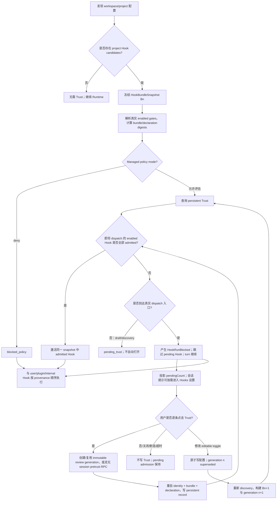

# Mecanismo de Workspace Hook com Trust Manual (centralizado em Settings)

> **Revisão de 2026-08-13 para simplificação do Trust persistente:** a semântica de produto mais
> recente está em
> [`workspace-hook-trust-persistent-only.md`](./workspace-hook-trust-persistent-only.md).
> O Workspace Hook mantém somente o Trust persistente declarado item a item. As seções de
> especificação deste documento foram convergidas para o schema atual; a máquina de estados de
> autorização descontinuada não é mais uma entrada executável NL→Code.

> **Modelo de interação (fato atual em 2026-08):** ao enviar um prompt, se existir um Hook não
> confiável, o turno não aguarda revisão humana; o Hook pendente produz `HookRunBlocked` no turno
> e é ignorado, e uma barra de aviso aparece na parte inferior do chat. Depois que o usuário entra
> ativamente nas configurações de Hooks, ele só pode estabelecer Trust persistente item a item; o
> SessionStart ignorado não é reexecutado. O sequenciamento detalhado está em
> [`workspace-hook-trust-soft-gate.md`](./workspace-hook-trust-soft-gate.md).

| Campo        | Valor                                                                                                                                                                                                                 |
| ------------ | ----------------------------------------------------------------------------------------------------------------------------------------------------------------------------------------------------------------------- |
| Status       | Implementado; a interação atual é persistent-only + soft-gate, com verificações estáticas e de automação concluídas; o aceite manual final no Desktop real é executado pelo produto                |
| Data         | 2026-08-07                                                                                                                                                                                                             |
| Escopo       | ZCode CLI Runtime, ZCode Protocol v4, Desktop/Web UI, Remote Workspace, Headless CLI                                                                                                                                    |
| Alvo         | Hooks de `zcode.json` e `.zcode/config.json` no nível workspace/projeto                                                                                                                                                   |
| Baseline de segurança | Deny por padrão, autorização explícita, invalidação por item em caso de mudança de declaração, precedência da recusa de política                                             |
| Documentos relacionados | `docs/security/deep-link-project-trust-boundary.md`; `docs/web-remote-control/web-remote-control-architecture.md`; `docs/web-remote-control/task-realtime-sync.md`; `docs/web-remote-control-task-command-queue.md` |
| Solução de interação   | Revisão concluída em `Settings → Hooks → Workspace`; não se usa um Trust Dialog separado na página de tarefas                                                       |
| Demo da interação      | `docs/specs/workspace-hook-trust-demo.html` (protótipo histórico, substituído pela especificação persistent-only)                                                 |
| Aceite manual          | `docs/testing/workspace-hook-trust-manual-acceptance.md`; fixtures gerados por `scripts/create-workspace-hook-trust-uat-fixture.mjs`                                  |

## 1. Resumo

Esta seção de resumo descreve a implementação atual; a interação e os estados seguem
[`workspace-hook-trust-persistent-only.md`](./workspace-hook-trust-persistent-only.md) e
[`workspace-hook-trust-soft-gate.md`](./workspace-hook-trust-soft-gate.md). Este documento
descreve apenas o contrato atual de Trust persistente e soft-gate, sem manter os detalhes
normativos do modelo de interação antigo.

O baseline de segurança, o discovery isolado, o domínio de Trust, a admissão no Runtime, a
revisão Desktop/Mobile, a rota remota, CLI/Headless, o rollout e a telemetria foram concluídos e,
pelos documentos persistent-only e soft-gate, convergidos para:

- declarações de Hook de workspace/projeto são normalizadas pelo discovery do Runtime em um snapshot imutável e não podem entrar no caminho executável antes da admissão;
- o Desktop exibe a configuração de Hooks em `Settings → Hooks → Workspace`; linhas não confiáveis oferecem apenas o "confiar" persistente por item e mostram o interruptor de execução efetiva desligado e não operável; linhas confiáveis não exibem emblema adicional de estado de Trust;
- ausência de Host capaz, clientes antigos, geração obsoleta, divergência de snapshot, falha do Trust store e falha na reconstrução da configuração resultam em fail closed;
- Desktop continuous e Web/Mobile replayable compartilham a mesma projeção de revisão do Runtime; a resposta é vinculada a task/run/remoteSession/runtime epoch, comandos sensíveis fazem apenas ACK query e não são reproduzidos automaticamente;
- o Headless fornece status/review/grant/revoke exatos e diagnósticos de pretrust; o gate de rollout confiável, telemetria anonimizada, documentação de segurança/controle remoto/usuário e migração de diagnósticos antigos são feitos na Fase 6.

Esta especificação introduz o **Workspace Hook Trust Admission**, independente do estado usual de
habilitação de Hook, e adota explicitamente a interação **centralizada em Settings**:

1. Descobrir Hooks a partir da configuração do projeto, mas sem convertê-los ainda em callbacks executáveis;
2. Formar um `HookBundleSnapshot` imutável a partir das declarações de Hook do projeto atual;
3. Calcular um `bundleDigest` para o bundle e um `hookDeclarationDigest` para cada declaração de Hook;
4. O Trust persistente usa `workspace identity + hook declaration digest` como chave de permissão, permitindo revisão item a item;
5. O usuário pode confiar ativamente em `Settings → Hooks → Workspace`; se qualquer entrada real de dispatch de Hook de projeto encontrar uma declaração não revisada, o Runtime **não bloqueia mais o turno nem força a navegação até a página de configurações** — o hook pendente é simplesmente ignorado no turno (`HookRunBlocked`), o turno segue imediatamente e uma barra de aviso permanente aparece na parte inferior do chat (N Hooks aguardando revisão + revisar/ignorar); somente quando o usuário clica ativamente as configurações de Hooks são abertas (ver a spec do soft gate);
6. A interface de configurações oferece apenas o `Trust` persistente para cada declaração não confiável; confiança e o interruptor de configuração permanecem ortogonais;
7. Fechar a interface de configurações ou a desconexão temporária do attachment do cliente não produz decisão de segurança; dispensar a barra de aviso é apenas esconder localmente, sem persistir; a admissão pendente pode ser recuperada por evento continuous ou snapshot replayable. Persistir o Trust só afeta eventos de Hook naturais posteriores; o SessionStart já ignorado **não é reexecutado**, no máximo valendo a partir do próximo SessionStart real;
8. Uma mudança nas declarações de Hook invalida apenas o declaration digest afetado; o snapshot/bundle digest continua sendo usado para garantir consistência entre revisão e execução;
9. Em ambientes sem interação o padrão é fail closed, e o Trust preciso deve ser previamente estabelecido por comandos explícitos de CLI;
10. Políticas corporativas/gerenciadas: deny tem precedência sobre qualquer autorização do usuário;
11. O interruptor de execução efetiva de declarações não confiáveis permanece desligado e não operável; exibir ou confiar não pode reescrever a configuração original do workspace; após o sucesso do Trust o interruptor é restaurado conforme o `configuredEnabled` real;
12. O Desktop usa `desktop-continuous` e o Web no celular usa `web-remote-replayable`; ambos se conectam ao mesmo Host/Runtime, e os comandos de revisão são submetidos via attachment confiável com roteamento por owner/stale-run.

Este design autoriza as **declarações de Hook atuais exibidas na página de configurações**, e não
o conteúdo completo do código transitivo referenciado pelos comandos do Hook e suas dependências.

---

## 2. Contexto e situação atual

### 2.1 Correção de segurança atual

`apps/zcode-cli/packages/adapters/src/config/project-config.adapter.ts` atualmente trata Hooks de
projeto por dois caminhos isolados:

1. `loadProjectConfigFile()` gera um diagnóstico ao detectar `result.config.hooks` e guarda as
   declarações em um side-channel independente de candidate/snapshot:

```text
config_project_hooks_pending_trust
Project hooks are pending workspace trust and remain blocked
```

2. `normalizeProjectConfig()` ainda remove o campo `hooks` inteiro do `RuntimeConfigPatch`
   executável retornado; o candidate não é consumido pelo mergeador de configuração nem pelo
   runner configurado.

Esse comportamento corrige a seguinte cadeia de ataque:

```text
deep link externo / diretório não confiável
  -> abrir um workspace controlado pelo atacante
  -> descobrir automaticamente a configuração do projeto
  -> Hook SessionStart executa shell/process no caminho de startup ou resume
```

Portanto, o novo mecanismo de Trust não pode apenas adicionar um interruptor na página de
configurações do renderer, nem apenas fazer uma verificação temporária em um ponto de chamada de
`turn.ts`. A fronteira de segurança deve estar **antes de a declaração de Hook do projeto entrar no
Runtime executável, a partir da configuração, e deve cobrir todas as entradas de dispatch de Hook**.

### 2.2 Inconsistência entre a página de configurações e a semântica do Runtime

O Settings Service e o Runtime Adapter da Fase 1 já reutilizam o mesmo resolver
discovery/canônico, sendo capazes de exibir o snapshot de Hooks do projeto, os gates configurados
reais, a procedência da origem e `editable`. O patch executável do Runtime continua removendo
sempre os Hooks de projeto, portanto a UI atual exibe o estado "configurado mas não admitido", e não
o estado executável.

O novo modelo precisa distinguir claramente:

```text
configuredEnabled  se a configuração do Hook está habilitada
trustState         se a declaração atual passou pela admissão de Trust
effectiveRunnable  se a execução é de fato permitida neste contexto
```

Não se pode continuar usando um único `enabled` para significar ao mesmo tempo "configurado" e
"permitido com segurança".

### 2.3 O discovery de configuração não é um modelo de arquivo único

Dentro de um worktree Git, a configuração do projeto é descoberta do diretório atual até a raiz do
worktree:

```text
<dir>/zcode.json
<dir>/.zcode/config.json
```

e mesclada na ordem da raiz para o cwd; um `projectConfigPath` explícito (atualmente repassado
principalmente por testes e por poucos caminhos de construção) é acrescentado após os arquivos de
discovery, sendo uma capacidade de compatibilidade futura e não o caminho principal da UI na V1.

**O comportamento existente para diretórios não-Git é diferente:** `getProjectConfigDirectories()`
finalmente retorna apenas `cwd` e não adiciona diretórios pais intermediários ao escopo de
discovery. O construtor de snapshot precisa reutilizar esse comportamento e não pode implementar
por conta própria outra regra de "varrer diretórios pais mesmo fora do Git".

Portanto, o snapshot de discovery não pode representar apenas um arquivo `.zcode/config.json`, nem
pode fazer hash apenas do texto final exibido na UI. O bundle completo deve cobrir o escopo real de
discovery, a origem, a ordem relativa e o resultado da mesclagem; o declaration digest do Trust
item a item também deve incluir a source, o event, o matcher, a posição e toda a semântica de
execução conhecida daquele Hook.

### 2.4 Draft prewarm e momento real de execução são diferentes

O composer V4 cria a draft session antecipadamente, mas o draft prewarm não executa Hooks.

O `SessionStart` tem hoje pelo menos dois caminhos reais de execução:

- `turn.ts` chama `runSessionStartHooks("startup", ...)`;
- `resume.ts` chama `runSessionStartHooks("resume", ...)`.

O tipo de source de matcher de `runSessionStartHooks()` ainda reserva `clear` e `compact`.
Embora hoje não haja pontos de chamada independentes correspondentes, quando forem adicionados eles
deverão herdar automaticamente a admissão e não se tornar um caminho alternativo.

Esta especificação não abre automaticamente a interface de revisão na fase de draft prewarm. O
usuário pode revisar antecipadamente na página de configurações; quando qualquer entrada real capaz de
fazer dispatch de um Hook de workspace chegar, o Runtime deve concluir a admissão antes de permitir
a execução dos Hooks de projeto que correspondam a essa source/event.

---

## 3. Terminologia

### 3.1 Workspace Hook / Project Hook

Um Hook originado de `zcode.json`, `.zcode/config.json` ou de um `projectConfigPath` explícito dentro
do escopo de discovery da configuração do projeto do workspace.

Este documento o chama uniformemente de **Workspace Hook**; o enum de origem de código deve usar
`project`, para manter consistência com o `ConfigScope.Project` existente.

### 3.2 Hook Bundle

O conjunto normalizado de todas as declarações relacionadas à execução de Hooks de projeto obtidos
no discovery de configuração deste workspace.

### 3.3 HookBundleSnapshot

Um snapshot imutável em memória criado antes da admissão. O resumo visto pelo usuário, o digest
canônico e a execução real devem vir do mesmo snapshot.

### 3.3.1 Hook Declaration Digest

O digest calculado sobre a serialização canônica versionada da semântica de execução de uma única
`CanonicalWorkspaceHookEntry`. O Trust persistente e o revoke item a item usam esse digest como
fronteira de conteúdo.

O `bundleDigest` continua existindo, mas é usado para identificar o snapshot completo atual,
detectar inconsistência entre review e execute e agregar diagnósticos; já não é a única granularidade
persistente de Trust na V1.

### 3.4 Workspace Identity

A identidade da dimensão de workspace do Trust:

- workspace local: usar o `workspacePath` / `workspaceKey` canônico já existente na camada de protocolo/serviço;
- workspace remoto: usar o `workspaceIdentity` já existente;
- não é permitido usar apenas o path puro na máquina remota como identidade;
- a identidade deve ser tratada pelo serviço de Trust como uma string opaca, sem que o serviço a deduza ou recomponha por conta própria.

### 3.5 Ciclo de vida do Trust

A autorização de um Workspace Hook vem apenas de um registro persistente preciso no Trust store
de propriedade do usuário. `sessionId`, `taskId`, `runId`, `reviewFlowId` e `interactionId` servem
apenas para vincular um comando de revisão ao snapshot confiável atual do Runtime e não ampliam o
escopo do Trust. A validade da autorização depende somente do registro preciso
`workspace identity + hook declaration digest` e do gate atual de policy/snapshot.

compact, resume, fork, new task e subagent não podem gerar nem herdar autorizações adicionais; eles
só podem reutilizar o registro persistente existente sob a mesma workspace identity que ainda
corresponda ao declaration digest atual. Após a reconstrução do Runtime, ele deve fazer bootstrap a
partir do Trust store e falhar de forma fechada antes da leitura ser concluída.

### 3.6 Trust Record

Registro persistente no armazenamento seguro do domínio do usuário, indicando que um
`workspace identity + hook declaration digest` foi escolhido como confiável pelo usuário. O produto
atual cria um registro preciso a partir de cada linha de Hook.

### 3.7 Admission

A decisão de segurança antes de um Hook de projeto entrar no conjunto executável do Runtime. A
admissão é uma dimensão diferente da permissão comum de ferramentas e do estado enabled de um Hook.

---

## 4. Objetivos

1. Permitir que o usuário autorize explicitamente as declarações de Hook atuais do workspace, em vez de bloquear permanentemente todos os Hooks de projeto.
2. Manter o fail closed por padrão; Hooks de projeto não autorizados não podem entrar no caminho executável.
3. Usar a mesma fronteira de admissão para deep link, abertura de pasta comum, workspace recente e workspace remoto.
4. Não incomodar o usuário quando ele apenas navega por um workspace ou faz o prewarm do composer draft.
5. Permitir que o usuário continue usando tarefas mesmo sem Trust, apenas pulando os workspace Hooks.
6. Exigir nova autorização automaticamente quando as declarações de Hook do projeto mudarem.
7. Oferecer Trust item a item na UI existente `Settings → Hooks → Workspace`, expressando o estado não confiável por um interruptor efetivo travado e desligado.
8. Oferecer a Headless/automation um comportamento determinístico, auditável e sem elevação implícita de privilégio.
9. Não escrever dados de Trust no repositório do projeto, evitando que o projeto se declare confiável.
10. Preservar o comportamento existente e a semântica de ordem de execução de user Hooks, plugin Hooks e internal Hooks.
11. Suportar revoke explícito, com a interrupção subsequente da obtenção de admissão por Hooks do projeto de forma oportuna.
12. Formar uma interface de política extensível, permitindo adicionar no futuro políticas gerenciadas de deny/allow.

---

## 5. Não objetivos

1. Não validar a cadeia de suprimentos completa dos scripts, binários, interpretadores, pacotes de dependência ou recursos de rede referenciados por um Hook.
2. Não criar um novo sandbox de SO para Hooks de projeto; o Hook continua usando as capacidades existentes do Hook executor.
3. Não mesclar o Trust de Hook no prompt comum de permissão de ferramentas.
4. Não alterar a política de confiança existente do MCP do workspace.
5. Não alterar a fronteira de segurança do `permissionMode` do perfil de subagent do projeto.
6. A V1 não oferece "confiar permanentemente em todas as futuras mudanças de Hook deste workspace".
7. A V1 não oferece autorização granular do tipo "liberar permanentemente todo um evento de Hook"; o alvo do Trust é a declaração de Hook efetiva.
8. A V1 não cria Trust persistente silenciosamente via variável de ambiente.
9. A V1 não grava trust token, assinatura ou allowlist no arquivo de configuração do workspace.
10. O revoke não seresponsabiliza por encerrar processos externos de Hook já iniciados; o cancelamento de processos é uma capacidade separada posterior.

---

## 6. Modelo de ameaça e princípios de segurança

### 6.1 Cenários que precisam ser defendidos

- um atacante induz o usuário via deep link a abrir um diretório com Hook malicioso;
- após clonar um repositório, a primeira mensagem dispara o Hook `SessionStart`;
- o projeto modifica a configuração de Hook e continua reutilizando o Trust antigo;
- um workspace remoto reutiliza indevidamente o Trust de outra máquina apenas porque o path é igual;
- renderer/UI é contornado e uma chamada direta de CLI ou protocolo cria o Runtime;
- draft prewarm dispara autorização ou execução sem uma intenção explícita do usuário;
- a revisão exibe uma configuração e, após a aprovação, a execução relê outra configuração;
- a política corporativa proíbe explicitamente Hooks de projeto, mas o Trust local do usuário a sobrescreve.

### 6.2 Princípios de segurança

1. **Default deny**: sem um resultado explícito de admissão, o Hook de projeto não é executado.
2. **Runtime-enforced**: a decisão ocorre antes da formação do conjunto executável do Runtime e não depende da disciplina da UI.
3. **Content-bound**: o Trust persistente é vinculado ao declaration digest da Hook individual atual; o bundle digest é usado para consistência de snapshot.
4. **Identity-bound**: o Trust é vinculado à workspace identity.
5. **Policy-first**: deny gerenciado tem precedência sobre o Trust do usuário.
6. **Snapshot consistency**: review, digest e execução usam o mesmo snapshot imutável.
7. **No repository self-trust**: o conteúdo do projeto não pode escrever nem declarar o próprio Trust.
8. **Explicit automation**: ambientes sem interação aceitam apenas comandos de pré-autorização explícitos e auditáveis.
9. **Graceful refusal**: recusar um Hook não equivale a recusar o uso do workspace.
10. **Honest wording**: a UI deve esclarecer que o que é autorizado é a declaração do Hook, e não há garantia de que o conteúdo do script chamado não mude.

---

## 7. Árvore de decisão do usuário final



### 7.1 Semântica de dispensar, desconectar e encerrar

Os seguintes eventos não são decisões de Trust:

- fechar ou sair da página de configurações;
- reload do renderer do desktop;
- atualização da página Web no celular ou desconexão temporária do attachment replayable;
- lacuna de transporte/reanúncio enquanto o mesmo Runtime continua vivo.

Nenhum desses eventos grava Trust nem chama um `cancel` genérico; a admissão pendente permanece válida e
é recuperada a partir da projeção/snapshot do Runtime.

Somente os seguintes eventos encerram a generation de revisão atual:

- o usuário submete um Trust persistente para a declaração exatamente selecionada;
- após a mutação bem-sucedida do toggle configurado, a generation antiga é marcada como `superseded` e substituída por uma nova;
- o vencimento de `WORKSPACE_HOOK_REVIEW_TIMEOUT_MS`, que apenas expira a request imutável e não grava nenhuma decisão do usuário;
- cancelamento/exclusão explícita da sessão;
- término do processo Runtime/Host. O término do processo não forja decisão do usuário; um resume posterior precisa refazer o discovery/evaluate e criar um novo interactionId.

### 7.2 Substituição atômica de toggle durante a revisão

O toggle em revisão não modifica o snapshot imutável antigo. Para o `.zcode/config.json` atual do
workspace com `editable=true`:

```text
acquire workspace review mutation lock
  -> validate proposed config in memory
  -> atomic write temp + fsync/close + rename
  -> rebuild discovery snapshot Bn+1
  -> mark generation n superseded
```
Razões:

- O Trust é um estado de segurança de longo prazo do workspace Hook e pertence ao mesmo contexto de
  configuração da origem, configuração, liga/desliga e revogação do Hook;
- Abrir um workspace ou fazer o draft prewarm não navega automaticamente para as configurações de Hooks;
- A fronteira coercitiva do Runtime é definida por todos os execution entry point, não por um caminho de produto específico;
- A página de configurações é apenas o ponto de entrada da decisão; a decisão de segurança continua sendo aplicada pelo Runtime/Trust Service.

### D3. Conjunto de ações do usuário

**Adotado:**

- `Trust`: confiar persistencialmente apenas na declaração de Hook exata da linha atual no workspace atual;
- `Enable / Disable`: altera apenas o estado configurado, sem criar ou remover Trust implicitamente; quando não confiável, o interruptor de execução efetiva aparece desligado e não operável;
- `Revoke`: a camada inferior mantém a capacidade de revogação precisa, mas a lista atual de Hooks não exibe botão de revogação;
- Fechar as configurações, dispensar o aviso, timeout ou desconexão não constituem decisão do usuário e não gravam estado negativo.

A V1 não oferece `Always trust this workspace`, nem wildcard para Hooks adicionados no futuro.

Razões:

- Manter apenas autorização persistente item a item, explicável e auditável;
- Separar o toggle configurado do Trust evita "ligar o interruptor já executa código desconhecido";
- Todas as ações mapeiam para estados claros, testáveis e reversíveis.

### D4. Comportamento da tarefa após a recusa

**Adotado:** a tarefa continua, apenas pulando o project Hook.

Razões:

- Hooks normalmente são capacidades de aprimoramento e não devem sequestrar a usabilidade básica do workspace;
- O usuário pode visualizar e modificar o projeto sem executar código desconhecido;
- É compatível com o baseline de segurança atual de "Hook de projeto ignorado, mas tarefa disponível".

### D5. Semântica de mudança de configuração

**Adotado:** reconstruir o snapshot; o declaration digest alterado não casa com o Trust antigo, enquanto as declarações inalteradas continuam casando.

Detalhamento:

- `command`, `args` do processo, `async`/`shell` do comando, timeout/max-output normalizados, event, matcher, source identity ou mudança na ordem semântica: a declaração correspondente precisa ser revisada novamente;
- Apenas mudança em `configuredEnabled`: não remove o Trust persistente; ao reativar ainda casa o mesmo declaration digest, mas o effectiveRunnable continua sendo determinado por enabled e policy em conjunto;
- Novo Hook: a nova declaração fica pending e não afeta o Trust persistente dos Hooks inalterados;
- Hook removido: o registro pode ser mantido para auditoria, mas o estado atual não é mais exibido como active;
- Draft session que ainda não iniciou um turno real: invalidar e reconstruir o snapshot;
- Session ativa já iniciada: manter o snapshot imutável aprovado na inicialização, sem hot-replace das novas declarações do disco;
- Um reload/restart explícito posterior usa o novo snapshot e reavalia item a item.

Razões:

- Impede a substituição do comando após a aprovação;
- Reduz reanálises caused por mudanças irrelevantes no bundle;
- Mantém configured, trusted e effective como três dimensões independentes.

### D6. Semântica de Revoke

**Adotado:** suportar revoke item a item e revoke em lote no escopo do workspace.

Revoke item a item:

- Remove o Record persistente alvo `workspace identity + hook declaration digest`;
- A execução do Hook alvo que ainda não começou é imediatamente blocked.

Revoke em lote:

- Remove os declaration records especificados ou todos sob a workspace identity atual;
- Não mata à força processos de Hook já iniciados.

Razões:

- Mantém consistência com o estado e as ações por Hook na página de configurações;
- Bloquear imediatamente execuções futuras corresponde à expectativa do usuário;
- Matar à força processos externos exige contratos confiáveis de process ownership, cancel e cleanup, fora do escopo desta especificação.

### D7. Headless / Bot / Automation

**Adotado:** fail closed por padrão e comandos explícitos de CLI para gerenciar Trust.

Razões:

- headless não tem interface interativa confiável e não pode escolher Allow automaticamente;
- Pré-autorizar por comando é mais auditável do que por variável de ambiente;
- A CI pode inspecionar os digests explicitamente e então decidir se confia.

### D8. Remote identity

**Adotado:** o Remote usa `workspaceIdentity`, e não o remote path puro.

Razões:

- `/repo` não é o mesmo sujeito de confiança em hosts/containers remotos diferentes;
- O protocolo existente já fornece a identidade de workspace remoto; deve-se reutilizá-la em vez de inventar mais um conjunto de host key;
- Os registros de Trust local e remoto ficam naturalmente isolados.

### D9. Local de persistência do Trust

**Adotado:** armazenamento seguro independente do domínio do usuário; não escrever no workspace e não sincronizar junto das configurações comuns.

Local lógico sugerido:

```text
~/.zcode/security/workspace-hook-trust.json
```

O caminho real deve ser gerado pelo resolver existente de diretório de dados do usuário / CLI storage
root; não é permitido hardcodar `$HOME` diretamente no código de negócio.

Razões:

- O conteúdo do workspace não pode estabelecer Trust de si mesmo;
- Sincronizar configurações comuns para outra máquina ampliaria o escopo da autorização;
- Schema independente, permissões de arquivo, escrita atômica e migração são mais fáceis de auditar.

### D10. Precedência da política corporativa

**Adotado:** `managed deny > user trust > default deny`.

Razões:

- A política administrativa precisa estabelecer uma fronteira de segurança organizacional que o usuário local não possa sobrescrever;
- O Trust do usuário só vale quando a política permite decisão do usuário;
- Mesmo havendo um Trust Record, o policy deny deve ser exibido como blocked, e não como trusted.

### D11. Ciclo de vida do Trust persistente

**Adotado:** o único fato de autorização de um Workspace Hook é o Trust persistente preciso no store
de propriedade do usuário; o ciclo de vida de session/task não cria nem herda autorização.

- A session atual, compact, resume, fork, new task e subagent não criam nenhum novo tipo de autorização;
- O bootstrap do Runtime carrega os registros do Trust store e invalida/atualiza a avaliação em memória por security revision;
- Após a mudança do declaration digest, o registro antigo deixa de autorizar a nova declaração;
- Fechar a página, relações de session dentro do processo ou o ciclo de vida do attachment não podem estender o Trust;
- Enquanto o Trust store não estiver pronto ou o carregamento falhar, tudo é fail closed.

### D12. Configured Toggle durante a revisão

**Adotado:** manter o toggle editável; após o commit bem-sucedido do toggle, a review generation
antiga é superseded e o snapshot e as requests pendentes são reconstruídos a partir da configuração
após a escrita atômica.

Usa-se `reviewFlowId + generation + interactionId`:

- `reviewFlowId` representa o fluxo de revisão contínuo visto pelo usuário;
- Cada bundle imutável usa uma `generation` incremental e um novo `interactionId`;
- A UI pode preservar janela, rolagem e estado de expansão, mas a resposta de segurança só vale para a generation atual;
- O Trust persistente continua sendo reutilizado por declaration digest, e os configured gates continuam entrando no bundle digest.

Não se adota "remover configuredEnabled do bundle digest", porque isso impediria o bundle de
representar com precisão o conjunto executável atual; também não se adota congelar o toggle durante
toda a V1, porque a página de configurações é justamente o principal ponto de entrada para o
usuário compreender e corrigir a configuração de Hooks.


### D13. Limite de interação multiplataforma Desktop / Mobile

**Adotado:** Desktop e Web no celular se conectam ao mesmo Host/Runtime e ambos implementam a UI de
revisão responsiva `Settings → Hooks → Workspace`; a semântica de entrega e recuperação é distinguida
pelo attachment confiável.

- Desktop: `clientMode=desktop-continuous`, atualizando a barra de aviso e o store de Settings por projeção continuous direta;
- Mobile Web: `clientMode=web-remote-replayable`, recuperando a revisão pendente a partir do conversation snapshot/resume;
- A revisão pendente é visível para clientes online capazes da mesma task, mas não bloqueia o turno;
- Qualquer attachment autenticado e que declare a capability de UI pode submeter a decisão;
- A resposta é roteada por owner/lease/stale-run até um único Runtime e deve carregar as informações de correlação: workspace identity, remote session, task/session, run, interaction generation;
- O relay e o desktop main apenas encaminham/roteiam e não mantêm estado de negócio de Trust, snapshot ou revisão pendente;
- Decisões concorrentes de múltiplos clientes aceitam apenas a primeira submissão válida da generation atual.

Clientes antigos ou sem suporte a essa UI só podem exibir um aviso de compatibilidade e não podem
responder automaticamente; se não houver cliente capaz, a request aguarda até o deadline seguro e
então fica blocked.

### D14. Execution Gate e Security Revision

**Adotado:** adicionar uma security revision de nível de host, com escopo por workspace; o gate usa
apenas um caminho rápido em memória.

- Cada processo de host cria um `coordinatorEpoch` aleatório;
- Cada workspace identity mantém um `counter` monotônico;
- É incrementado em grant/revoke de Trust persistente e em mudanças de policy revision;
- O cache admitted do Runtime guarda a revision verificada mais recente;
- Se a revision for a mesma e a declaração estiver no admitted set, a passagem é O(1);
- Se a revision for diferente, reavalia usando o índice de Trust/policy em memória; é proibido ler disco, rede ou refazer o discovery no hot path de dispatch;
- Quando a verificação falha, um lifecycle blocked é produzido antes do `HookRunStarted` e do dispatch em background.

### D15. Contrato de ativação do soft-gate

> O turno nunca espera por revisão; o hook pendente é pulado no turno (`HookRunBlocked`) e o turno
> executa imediatamente; o fluxo de revisão é aberto sob demanda pelo usuário, clicando em "revisar"
> na barra de aviso, por meio do comando `requestWorkspaceHookReview`.
>
> **Contrato atual de `activate()`:** aguarda apenas o bootstrap do Trust store e a conclusão da
> avaliação em memória; ao encontrar uma declaração pendente, não cria nem espera uma revisão humana,
> e no limite de execução do turno gera `HookRunBlocked` e pula.
> O usuário pode então iniciar ativamente o fluxo de revisão pela barra de aviso; essa ação não
> restaura nem reexecuta o evento de Hook já pulado.

### D16. Função única de arbitragem da monotonicidade de review (convergência de drift)

O mesmo conjunto de regras de monotonicidade de review (monotônico por generation no mesmo flow;
generation igual tratada como replay idempotente ou rejeição de corruption; flow diferente pertence
a uma troca de Runtime e exige arbitragem por limite de epoch) é unificado por uma função pura
compartilhada. Atualmente os únicos consumidores espelhados são a projeção de produto do bootstrap
(replay de eventos) e o review store do renderer (exibição do binding); o observador de prompt-turn
foi removido junto com o soft gate.

**Adotado:** arbitragem e aplicação em camadas, com a função única de arbitragem no shared
(`workspace-hook-review-monotonicity`) compartilhada pelos três consumidores espelhados:

```text
裁决（纯函数，单一来源）：输入 current {reviewFlowId, generation, interactionId}
                          与 candidate 同构三元组，输出：
  no_current            -> 无当前权威，candidate 接管
  same_flow_advance     -> 同 flow 更高 generation，接受
  same_flow_replay      -> 同 flow 同 generation 且同 interactionId，幂等 replay
  same_flow_conflict    -> 同 flow 同 generation 但 interactionId 不同，违反 controller 单调性
  same_flow_stale       -> 同 flow 更低 generation，迟到事件
  cross_flow            -> 不同 flow，Runtime 换代；由调用方按 own epoch 证据裁决

应用（各消费方保留）：projection cross_flow -> drop（等待 onSessionResumed 清空）
                     store        cross_flow -> 接受（新 Runtime 权威覆盖旧 binding）
                     replay/conflict/stale  -> 两方一致忽略
```

O core flow registry é o owner do contrato de mutação (semântica de supersede/validate) e não é
obrigado a usar esta função; novos consumidores espelhados devem consumi-la. A ordem dos eventos
(sequenceNumber) é mantida pela product projection, e o ciclo de vida de conexão do store continua
pertencendo ao store.

**Restrição de caminho de exposição (revisão de 2026-08-07, lista ampliada em 2026-08-10):**
subpath whitelist de conexão direta: `@zcode/shared/workspace-hook-review-monotonicity` (função de
arbitragem) e `@zcode/shared/workspace-hook-mutation` (`WorkspaceHookMutationError` / API de escrita
atômica, conectado diretamente pelo review controller desde 2026-08-10). Todos os consumidores devem
importar o subpath declarado diretamente; o barrel `workspace-hook-discovery` **não pode fazer
re-export** desses módulos. Causa raiz: a primeira versão de D16 expôs via `export *` do barrel de
discovery; a chain de build Desktop do packages/ui falhou ao resolver essa aresta de re-export e o
App não pôde abrir após reiniciar; além disso o barrel criaria "dois caminhos de exposição para a
mesma API", e a reincidência do drift não seria detectável no ponto de import. O lado de empacotamento
cli SEA/esbuild (`packages/cli/scripts/build.mjs`) precisa declarar um alias preciso para **cada**
subpath — o esbuild reescreve por prefixo e uma declaração ausente seria reescrita pelo alias genérico
`@zcode/shared` como `src/index.ts/<subpath>` (arquivo tratado como diretório), quebrando o pack; a
ordem dos aliases é travada por `build.test.mjs`. **Checklist de sincronização ao adicionar um subpath:
exports do package.json / import dos consumidores / alias preciso em build.mjs.**

**Restrição de atribuição de erro do toggle (2026-08-10, TR27):** o catch de controller.toggle precisa
repassar conforme `WorkspaceHookMutationError.code` (`snapshot_mismatch` ≠ `config_write_failed`) — o
mismatch ocorre antes da escrita em disco e reportar como "falha de escrita" induz a retentativas
inválidas e oculta a causa real (medido em UAT: o caminho de escrita da configuração não tinha falha,
mas o usuário via apenas falsos positivos). O toggle_failure de telemetry precisa carregar o
errorMessage original.

### D17. Fonte única do schema de configuração de Hook (revisão de 2026-08-07: re-export bloqueado por duas instâncias de zod)

A cópia de hooksSchema em `adapters/config/schema.ts` é campo a campo equivalente a
`shared/workspace-hook-config.ts`. Foram tentadas três convergências, todas bloqueadas pela realidade
das dependências:

- re-export do schema do shared: os dois workspaces pnpm resolvem **instâncias de zod fisicamente diferentes** (adapters 4.4.3 / shared 4.3.6, particionamento de lockfile); após o schema do shared ser embutido na composição `ZCodeConfigFileSchema` deste pacote, a referência dts aos tipos internos de zod estrangeiro dispara TS2742 ("not portable");
- anotações explícitas com `typeof`: valem para os quatro const que podem ser re-exportados por nome, mas o tipo inferido do schema composto (ZCodeConfigFileSchema) ainda carrega a referência estrangeira, e a anotação se propaga circularmente para o tipo de saída (TS2502/2456);
- unificar a versão de zod (^4.4.3): exige rolar o pnpm-lock raiz e todos os protocol schema do shared dependem da semântica de zod strict/passthrough; há risco de drift de comportamento e custo de merge em upgrades minor — **rejeitado, salvo decisão de nível de produto**.

**Adotado (implementação atual):** a cópia é mantida, mas com o papel rebaixado para "diagnóstico
específico do carregamento de arquivo de configuração" — a validação autoritativa em runtime sempre
pelo schema do shared (discovery / montagem de trust / entrada do settings service importam o shared
todos); `workspaceHooksConfigSchema.parse(hooks)` em `project-config.adapter` é mantido como **ponte de
tipos** (`HooksRuntimeConfigPatch` e `WorkspaceHooksConfig` são dois tipos de domínio; é proibido
trocar por asserção `as`); um sentinela de paridade de digest dos dois builders (lado services) trava a
consistência da montagem. **Condição de reavaliação: após unificar a instância de zod, apagar a cópia e
usar re-export.**

### D18. Autoridade do Runtime Admission

**Adotado:** o Runtime admission depende apenas do snapshot imutável atual, do índice de Trust
persistente, da managed policy e da workspace security revision. O ciclo de vida de task/session não
cria registro de autorização algum nem estende o escopo do Trust. A API mutável de
`InMemoryWorkspaceHookPolicyProvider` (set/clear policy e cadeia de subscribe de revision) continua
sendo o ponto de extensão da managed policy e não faz parte do estado de Trust do usuário.

### D19. Semântica unificada de exibição do Trust persistente

O snapshot estático de Settings e o review item do Runtime usam uniformemente o schema
persistent-only. O único estado autorizável pelo usuário é `pending_trust -> trusted_persistent`; os
outros estados blocked/revoked/stale são resultados de avaliação de segurança, e não outra autorização
do usuário.

**Adotado:** a linha não confiável mostra apenas o botão "confiar" item a item e o interruptor de
execução efetiva travado e desligado; após o sucesso do Trust persistente o botão desaparece. A UI
não exibe badge de estado de Trust nem badge de expectativa de execução; as linhas de Settings apenas
apresentam os fatos com base no snapshot estático e no Trust store persistente.

### D20. Responsabilidade do teste de paridade de digest Runtime / Settings

`workspaceHookDigestParity.test.ts` do lado services é na verdade uma validação de "autocoerência do
builder de Settings" (ambos lados são espelhos da fórmula de montagem do hooksService) e não cobre o
Runtime; a paridade na entrada do Runtime é verificada pelo lado adapters em
`tests/workspace-hook-digest-parity.test.ts`, comparando o produto real de `createConfig` (a camada de
Runtime inclui Default/user/project/env/cli) com a fórmula de montagem de Settings. Os dois builders
estão convergidos hoje (as camadas Default/env/cli são itens idempotentes no-op para hooks); qualquer
mudança de camada ou de semântica de merge em um dos lados deixa o teste vermelho do lado adapters.

### D21. Dismiss não altera o Trust

O dismiss da barra de aviso é apenas uma ocultação local do renderer, com key
`sessionId + bundleDigest`; fechar as configurações, timeout ou desconexão também não gravam Trust.
A revogação apenas remove o registro persistente exato e volta para admissão pendente. Se o produto
precisar no futuro de uma capacidade de nível workspace "não mostrar de novo", ela deve ser
desenhada separadamente como preferência de usuário visível e reversível, sem estender a máquina de
estados do Trust nem usar chaves de permissão ambíguas por source/event. A blacklist organizacional
gerenciada continua sendo expressa por `blocked_policy`.

### D22. Settings exibe apenas fatos persistentes prováveis

`hooksService.readPersistentWorkspaceHookTrustDigests` lê apenas o Trust store de propriedade do
usuário; essa é uma fronteira de design, não uma ausência de consulta de estado de runtime. Settings
julga se a declaração atual já tem Trust persistente apenas pelo snapshot estático, não pode adicionar
consultas de autorização de task/session e não exibe selos derivados como "vai rodar/não vai rodar",
que cruzariam policy, configured gate e eventos futuros.

---

## 9. Esquemas não adotados e razões das decisões
