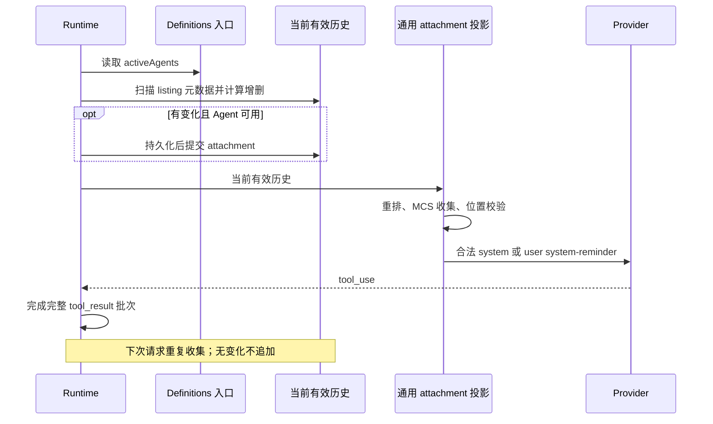

# Agent listing attachment

## Comportamento e limites

A descrição da ferramenta Agent aponta apenas para o `<system-reminder>` da sessão. O catálogo
completo é notificado ao modelo pelo attachment `agent_listing_delta`; a permissão de execução do
profile não muda. A atualização de configuração é regida pelo
[contrato de refresh do contexto pai](./subagent-runtime-refresh.md); o listing apenas consome o
catálogo válido deste turno e não cria um carregamento de configuração nem um estado de notificação
adicional.

`AgentDefinitionsSnapshot.activeAgents` é o catálogo válido já normalizado. O Runtime o lê por
`getAgentDefinitions()` injetado por dependência, de forma síncrona e sem I/O; a entrada padrão usa
um snapshot normalizado dos profiles do momento de inicialização. A entrada de integração local
carrega e fixa o snapshot quando um novo turno pai começa, e listing, runner e plugin-reference
compartilham essa definição. Solicitações posteriores no mesmo turno e o compact automático não
recarregam; mudanças de configuração com o mesmo nome não acrescentam lembrete de catálogo.
Falha ao carregar a configuração encerra o turno na etapa de preparação do turno pai; o listing não
precisa de um switch de degradação «available», e o histórico de catálogos existentes permanece
inalterado. O coletor não completa tipos embutidos, não mantém cache da lista e não lê arquivos; a
formatação de cada item preserva os nomes, descrições e semânticas de ferramentas existentes.

O texto da descrição de Agent é fixado na versão lean do branch first-party MCS.
A instrução de continuação é
`Use SendMessage with the agent's ID to continue a previously spawned agent with its context intact; a new Agent call starts fresh.`;
atualmente só há endereçamento por agent ID e não se introduz o `or name` de endereçamento por nome.
A origem das definições é
``Each agent type's model, reasoning effort, and tools come from its definition (`.zcode/agents/*.md` frontmatter).``;
mantém-se a frase de origem da definição, substituída pelo catálogo Markdown do ZCode, sem incluir
a entrada de SDK `agents` não suportada; o caminho de carregamento real, a prioridade de override e
o comportamento de execução não mudam.
O aviso de concorrência aparece apenas no primeiro listing, e a descrição remove a frase duplicada;
o comportamento padrão de background e o isolamento permanecem como estão.

O contrato provider-visible desta rodada fica restrito ao branch first-party MCS acima. Os testes
com MCS desligado servem para validar os caminhos de compatibilidade existentes do ZCode: não
introduzem comportamento adicional de serialização que mescle o reminder no último tool_result, e
também não se reivindica que a requisição inteira sem MCS seja byte a byte idêntica. A política de
exclusão da fonte histórica de continuity permanece como está, e o listing aceita junto com os
demais attachments comuns a verificação de posição legítima existente, sem contornar esses limites.

## Fonte única de verdade e sequenciamento

A única verdade para deduplicação é o branch atual, isto é, o histórico estruturado de attachments
que continua válido depois do compact.
Aplique `addedTypes` e `removedTypes` em ordem e compare com o conjunto exato de nomes das
definitions atuais.
As adições são ordenadas por nome com localeCompare e as remoções por string; renomear equivale a
remover o antigo e adicionar o novo.
Ao calcular as remoções, percorra diretamente o conjunto já notificado; só ordene depois de
confirmar que houve adições ou remoções, sem copiar o conjunto completo para um array temporário.
Mudanças de descrição/tools/model com o mesmo nome não geram delta; sem mudanças, ou quando não há
Agent entre as ferramentas atualmente válidas, nada é acrescentado.
Quando o conjunto notificado está vazio, `isInitial=true`, inclusive quando tudo foi removido e
novamente adicionado; um catálogo vazio não gera notificação inicial.

A coleta acontece antes de cada requisição normal do modelo, depois do compact e do filtro de
ferramentas. A continuação de tokens de saída mantém o branch privado de request já existente e não
altera o pareamento tool_use/tool_result incompleto. Falhas de leitura ou persistência são
propagadas para cima, não são interpretadas como catálogo vazio e não são gravadas no conjunto já
notificado. Sem SessionStore, ainda é possível submeter o histórico de runtime.

## Persistência, projeção e compact

Os metadados carregam `addedTypes`, `addedLines`, `removedTypes`, `isInitial` e
`showConcurrencyNote`, validados em runtime; a persistência mantém o texto original e a
restauração não infere nomes do corpo. O catálogo inicial traz o aviso de concorrência.
Dados estruturados ausentes ou inválidos não contam para o conjunto já notificado, e a sessão antiga
completa o catálogo inicial na próxima requisição.

A validação e a cópia defensiva permanecem nas fronteiras de restauração da persistência e de
escrita/substituição do MessageHistory; o delta gerado de novo dentro da requisição vem do mesmo
coletor. O coletor só lê `addedTypes` / `removedTypes` do histórico válido e não reparseia
metadata, copia arrays nem cria Sets de validação a cada requisição. O conjunto continua sendo
reconstruído a partir do histórico válido, sem cache de cursor incremental; o filtro de metadata inválido, o
isolamento da cópia do histórico e o conteúdo provider-visible permanecem inalterados.

O listing é um attachment comum de source-owned e reutiliza a reordenação, a coleta MCS, a
verificação de posição e a serialização de provider já existentes. Com MCS habilitado e posição
legítima, ele pode ser combinado com outros reminders no corpo system; com MCS desligado ou posição
ilegítima, usa-se `<system-reminder>` de user. Ele não entra na tabela de exclusão de
não-MCS/proibido reordenar, e o escopo do anchor genérico não é ampliado para o listing. O histórico
interno e o metadata não são reescritos pela reordenação do provider. A projection compartilhada é
classificada como provider context e não gera bolha de usuário, turn starter, despertar de
background nem novo aviso de UI. Desktop continuous e mobile replayable continuam usando as
fronteiras host/stream existentes, sem novos caminhos de runtime, fila ou entrega de mensagem.

O compact usa o mesmo coletor, toma como histórico de deduplicação as mensagens realmente
mantidas, coloca o listing necessário em postCompactReminderEntries e o submete junto com o
resumo após persistir. Uma compactação completa repõe tudo; uma parcial só repõe o que falta; a
próxima requisição normal não repete. Os tokens de reenvio contam para truePostCompactTokenCount.
microcompact que só limpa resultados de ferramentas não precisa reenviar. cold resume, fork e
rewind restauram o metadata a partir do branch válido.
Nenhuma tabela de banco de dados ou migração nova, sem backfill/reescrita de mensagens antigas.

A compactação automática obtém o conjunto de ferramentas de listing deste turno por uma entrada de
leitura preguiçosa, e o faz somente depois de passar pelo limiar de compactação e pela avaliação
rapid-refill; ao pular a compactação, não constrói contrato de ferramentas adicional. Requisições
normais continuam lendo as ferramentas atuais após a inicialização do MCP, mantendo a regra de
desabilitação deste turno e sem reutilizar o conjunto antigo entre inicializações do MCP; falha ao
ler as ferramentas continua sendo propagada e não conta como falha de compactação.

## Aceitação

Os testes são distribuídos por fronteira de responsabilidade, podando o cruzamento redundante de
profile × MCS × compact; cada nova lógica mantém uma asserção direta:

| Local de cobertura                                    | Asserções sob responsabilidade                                                                                                                                                                                                                                    |
| ------------------------------------------- | --------------------------------------------------------------------------------------------------------------------------------------------------------------------------------------------------------------------------------------------- |
| `agent-listing.test.ts`                     | Snapshot padrão de definitions; inicial, catálogo vazio, repetido, adições/remoções, nome exato/renomeação, metadados de mesmo nome, remoção total e nova adição; reconstrução do histórico válido/retenção parcial/fork/rewind; validação de metadata e isolamento da cópia; reminder adjacente, degradação de posição MCS e regressão de anchor sem listing                                  |
| `agent-listing-runtime.test.ts`             | Substituição de definitions após o lote de ferramentas do mesmo turno, deduplicação no turno de usuário seguinte, Agent indisponível; restauração puramente sintética/mista; equivalência live/cold após compact normal e pós-compact, reposição antes da submissão/sem repetição no turno seguinte; falhas de definitions/persistência; reactive compact ocultando Agent. Reutiliza o mesmo fixture de Runtime/store |
| `agent-listing-wire.test.ts`                | Configuração de publicação first-party `claude-fable-5-1` pelo adapter Anthropic real: corpo, role, wrapper, ordem e pareamento de ferramentas na estreia e após lotes completos de ferramentas, cobrindo o switch MCS; o Core não duplica este conjunto de asserções de serialização                                                                          |
| Testes existentes de tool/source, testes da projection compartilhada | Texto lean da descrição, registro/validação do source, classificação como provider context e ausência de turn trigger; o filtro de ferramentas mantém as restrições de automation/tempo ocioso                                                                                                                          |
| Desktop oficial I21/SA                         | Trajetórias non-MCS dos quatro profiles originais, mais um cenário general-purpose MCS; todos verificam estreia/deduplicação pós-ferramenta na requisição pai, child sem Agent/listing, conclusão da execução e ausência de mensagens falsas de usuário na UI;além disso poda a repetição MCS dos outros três profiles                                                              |

- Executar os testes unitários relacionados, o E2E oficial do Electron, architecture, typecheck,
  lint, a checagem de tipos do E2E e a auditoria de cobertura; registrar os resultados reais e os
  artefatos.

## Reverificação após o estreitamento dos testes

O código de produção não mudou. Os 5 arquivos centrais novos têm 100% de cobertura de
statements/branches/functions/lines; 558 testes relacionados por camada passaram.
O Electron oficial passou 2/2 de primeira: 10 requisições pai com um catálogo cada, 5 child sem
Agent/listing; artefato:
`packages/desktop/.e2e-artifacts/desktop-e2e-20260914124036720-p33068-abdaaec9eb6005b6/`.
A regressão ampliada encontrou asserções de notificação de background do Explore reproduzíveis no
HEAD; a auditoria de cobertura ainda mostra as derivações de referência/estatística já existentes
abaixo, e código não relacionado não foi corrigido.

## Reverificação da integração do attachment genérico em 2026-09-14

- A exceção de non-MCS e de reordenação proibida do listing, bem como a ampliação do anchor
  genérico, foram revertidas; os dois arquivos genéricos de projeção de provider estão idênticos ao
  HEAD original. O source ganhou apenas registro de ciclo de vida e descriptor.
- Asserções foram alteradas primeiro para reproduzir 7 falhas (source, role, estreia reordenada,
  reminder adjacente, reactive compact sem Agent) e só então as exceções foram revertidas. No
  final, 14 arquivos focados com 385 testes passaram, mais 1 teste da projeção de UI compartilhada.
- Os 4 testes de `agent-listing-wire.test.ts` passaram: usam a configuração de publicação para
  resolver o first-party `claude-fable-5-1`, passam pelo adapter Anthropic real e o fetch retorna uma
  fixture local. O MCS vem ligado por padrão; na estreia e após dois resultados de ferramenta
  completos obtém-se uma string system independente igual à projeção esperada. O branch com MCS
  desligado explicitamente valida o fallback de user já existente.
- O Electron oficial I21/SA passou 2/2 de primeira, sem retries; duas capacidades × quatro
  profiles. A captura real tem 16 requisições pai (8 com listing system, 8 com listing user), cada
  uma com um único catálogo; as 8 requisições child não têm Agent nem listing. As asserções
  incluem preservação do corpo do catálogo, role/wrapper/ordem, pareamento completo de ferramentas,
  conclusão da execução child e ausência de mensagens falsas de usuário na UI. O Electron MCS usa
  uma configuração de modelo que declara explicitamente a capacidade MCS; os modelos first-party da
  configuração de publicação são cobertos pelo teste wire acima; nenhum serviço de modelo online foi
  chamado.
- Artefato: `packages/desktop/.e2e-artifacts/desktop-e2e-20260914120729653-p63978-8d35aec89b130289/`.
  `network-capture/upstream-provider.json` são as requisições reais;
  `agent-listing-verification.json` é o resultado da conferência requisição a requisição; a fixture
  de projeção é o resultado de comparação (não é captura de processo).
- `pnpm typecheck` da root, `pnpm lint`, typecheck de Core/Adapters, lint do Core, typecheck do
  Desktop E2E e a checagem de fixtures passaram. O lint da root tem 42 warnings já existentes e o do
  Core tem 10; architecture com 0 violações, e a CLI continua sendo um módulo unmanaged — esse
  resultado não equivale à conclusão da cobertura de fronteiras managed.
- A execução completa ampliada de Core + Adapters deu 4084 passed / 84 failed. Destes, 3 são
  asserções de cache devidas à posição antiga do catálogo; as asserções originais foram
  restauradas e os dois arquivos terão 176 testes passando; as 6 falhas de timing, em quatro
  arquivos, deram 147 passed / 3 skipped quando reexecutados isoladamente. As demais falhas com o
  mesmo nome reproduzem numa cópia independente do HEAD original, sem alteração de implementação não
  relacionada. Depois de incluir na cópia de baseline a configuração de publicação do HEAD, os
  casos relacionados à configuração foram reconferidos à parte, para não tomar a falta de arquivo da
  cópia como falha de baseline.
- O script de lint próprio dos Adapters não encontra arquivos por causa do ignore; com `--no-ignore`
  explícito aparecem os erros max-lines existentes, todos em arquivos de produção dos Adapters não
  modificados nesta rodada. A auditoria de cobertura de conversation ainda tem as referências D19/I74/I75,
  estatísticas e documentação generated já divergentes. A saída detalhada dos comandos está no
  `validation/` do artefato, e esses gates não são reportados como totalmente aprovados. Windows,
  Linux e a GUI do celular não foram verificados separadamente em hardware real.

## Registro de validação do contrato antigo em 2026-09-14

Os registros abaixo pertencem ao contrato anterior à correção, de «listing sempre user», e só
provam o resultado da implementação antiga; não servem como prova do contrato provider-visible
atual. O contrato atual exige nova execução da validação focused/wire e do Electron oficial.

- Os 20 novos testes de coleta de listing, Runtime e persistência, mais 1 teste da projection
  compartilhada, passaram todos.
- Core completo: 2397 passed, 18 failed, 36 skipped, 2 todo. O HEAD original exportado
  independentemente, `ae7b0928a8`, reproduziu exatamente as mesmas 18 falhas no mesmo ambiente de
  dependências, sem nenhuma falha nova.
  As falhas se concentram no caminho de migração e na documentação do browser client/manifest, nas
  asserções de erro do unbound resume e em duas asserções de wrapper de notificação de background;
  estes problemas de baseline não são modificados nesta rodada.
- `pnpm architecture:check --changed`: 0 violações; `pnpm typecheck` e `pnpm lint` da root,
  typecheck/lint do Core, `typecheck:e2e` do Desktop e a checagem de case fixtures passaram.
- Comando oficial do Electron:
  `pnpm --filter @zcode/desktop test:e2e -- --spec ./test/e2e/conversation-session/conversation-session-subagent-prompt-assembly.test.ts`.
  I21/SA 1/1 passed, cobrindo os cenários general-purpose, Explore, custom e isolated custom.
  Foram 8 requisições pai no total, cada uma com apenas um listing de user; as 4 requisições child
  não têm Agent nem listing.
  As respostas usaram a fixture de replay de provider local do caso, sem chamar serviço real de
  modelo.
- Artefato do E2E: `packages/desktop/.e2e-artifacts/desktop-e2e-20260914094914319-p65512-58d2158db972bffc/`;
  `summary.md` traz o resultado e `network-capture/upstream-provider.json` a captura das requisições
  reais.
- `pnpm audit:conversation-session-coverage` não passou; o HEAD original reproduz o mesmo problema:
  referências abreviadas de automação em D19/I74/I75, estatísticas de matriz desatualizadas e três
  documentos generated de review vencidos.
  A extensão de I21 não aumentou o número de cases e não renova baselines de cobertura não
  relacionadas.
- O ambiente de validação em hardware real foi Electron no macOS; Windows, Linux e o controle
  remoto do celular não foram executados separadamente em hardware real.
  A classificação provider-context do celular é coberta pelo teste unitário da projection
  compartilhada, e o caminho de entrega não foi alterado.

Reverificação do acréscimo de texto lean no mesmo dia: 66 testes relacionados do Core passaram;
typecheck e lint da root/Core, typecheck do E2E, checagem de fixtures e architecture passaram. O
Electron oficial I21/SA passou de novo nos quatro cenários, com artefato
`desktop-e2e-20260914105041342-p8117-87dcf4e0620cd911`; as asserções de captura de continuação e de
existência do texto de origem das definições passaram, a descrição não tem aviso de concorrência e o
listing contém esse aviso apenas uma vez. Desta vez apenas o texto foi modificado; a execução
completa do Core e a auditoria de cobertura não foram refeitas.

## Observações de implementação

O listing delta gera, na etapa de formatação, apenas uma mensagem meta intermediária de user; o
role final do provider é decidido pela reordenação, pela coleta MCS e pela verificação de posição
posteriores. Não se deve tomar o estado intermediário do formatter como o role final do provider. A
conclusão antiga de que «a description carrega o catálogo por padrão» é apenas baseline histórico;
este spec substitui a explicação da implementação atual.