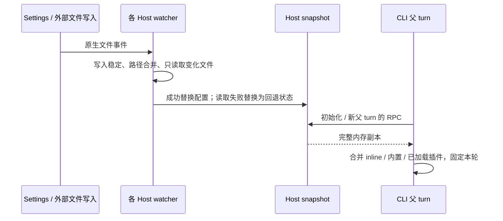
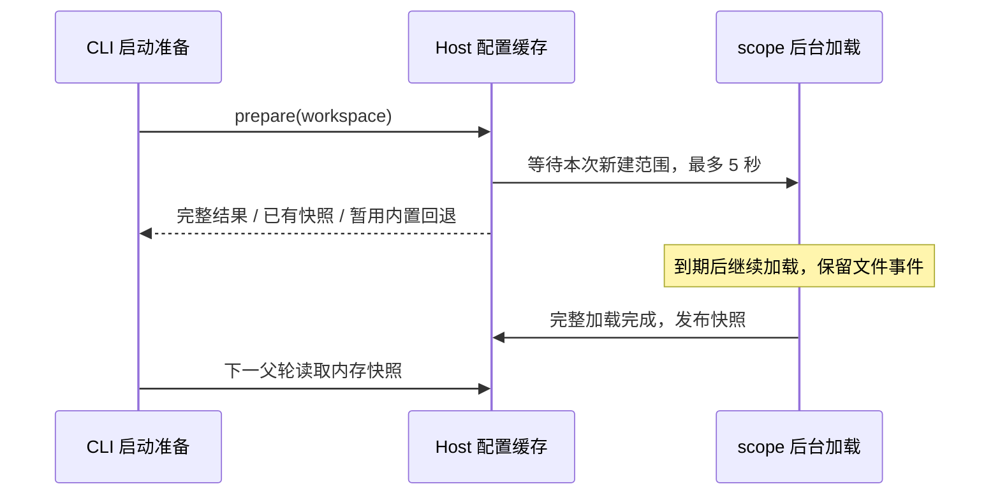

# Atualização da configuração de subagents conforme o contexto do pai

## Contrato e única fonte de dados

O serviço de subagents do Host local mantém o cache de parsing de arquivos e o snapshot em memória de cada workspace.
A documentação/o state do usuário são compartilhados dentro do Host, e os projetos são isolados por `workspaceIdentity?.trim() || workspacePath`.
A fonte local é o Host/Settings; os demais usos de storage.dir e as fontes de workspace CLI/remoto independentes permanecem inalterados.

A leitura acontece uma vez na inicialização da session e uma vez no início de cada turno pai comum, via `subagents/readRuntimeConfig`.
O listing, o Agent, o SendMessage e a referência de plugin desse turno compartilham as mesmas definitions fixas; as requisições de modelo seguintes, os retries, o compact, o Guide e as childs em execução não são atualizados. O resume terminal preserva o histórico de identidade e consulta o agentType original do turno; faltando profile/histórico, a falha é explícita, sem criar session vazia e sem substituir o profile padrão.

Edições em memória pela IDE não disparam atualização; Settings, o salvamento automático e a escrita externa em disco passam pelo mesmo watcher nativo.
"Publicar" significa apenas substituir o snapshot em memória: durante uma leitura em background o snapshot completo antigo continua sendo devolvido; depois de concluída, o novo turno pai consome o novo snapshot. Cada Host observa o disco de forma independente, sem broadcast, push de CLI ou barreira de confirmação entre Hosts.



## Escuta, parsing e I/O

### Preparação de startup e refresh em background

A preparação de startup só espera a primeira carga do escopo novo desta vez; quando o escopo compartilhado de usuário/state já carregado está sendo atualizado em background, um novo workspace pode combinar seu primeiro snapshot com o resultado da última carga completa de cada escopo, sem esperar o escopo compartilhado ficar ocioso.
Um workspace existente continua usando o snapshot já publicado original durante o refresh em background e não publica resultados parciais de leitura do lote.
Aqui, snapshot completo existente significa `ready`. O fallback interno gerado pelo primeiro timeout não bloqueia a recuperação: a publicação pode ocorrer assim que a carga do projeto termina e o escopo compartilhado já tem um resultado completo utilizável, mesmo que o refresh compartilhado ainda esteja em andamento; se algum escopo ainda falhar, o fallback continua.

O limite de espera da primeira carga (incluindo o reload explícito) é de 5000ms, e ao completar segue-se em frente, sem espera fixa. No vencimento, o snapshot de workspace existente é mantido; quando ainda não há resultado completo, apenas aquele workspace usa temporariamente `built-in-fallback`, preservando o inline.
Ler mais cedo um workspace preparado que ainda não publicou seu primeiro snapshot também usa a mesma espera limitada. Esse limite restringe apenas a espera do cache de carga e não é um prazo total de resolução de caminho em disco, de migração ou de startup do processo inteiro.

O vencimento da espera não marca a leitura do escopo como falha, não cancela a carga em background e não limpa caminhos pendentes. O carregamento em background continua sendo gerido pelo escopo, completa quando fica estável e publica de forma independente; não é preciso um evento de arquivo adicional para acordá-lo. Uma primeira carga que termina depois da espera de startup também precisa publicar.
Somente o novo turno pai consome o novo resultado; turnos pai já iniciados e childs em execução permanecem inalterados. Uma falha real de leitura segue as regras de fallback abaixo; destruição/substituição de escopo segue o cancelamento e o isolamento de resultado tardio, sem adicionar timer de retry nem novo cache.



### Escuta e parsing de arquivos

São usados os eventos nativos do chokidar 4.0.3 (usePolling:false), com escopo válido de arquivos diretos na raiz de agents (depth:0 em relação à raiz), aceitando .md/.markdown sem distinção de caixa. Quando o diretório existe, o path de configuração original da preparação é assistido diretamente e o sistema de arquivos cuida da caixa do diretório; não se mantém mapa de aliases nem se normaliza para minúsculas. Quando o diretório está ausente, escuta-se temporariamente a mudança de diretório direto do pai existente mais próximo, e o evento dispara a rechecagem do path de configuração original e a troca para o alvo.
Todas as escutas são fixas em depth:0; não se enumera recursivamente a partir dos ancestrais para depois filtrar por prefixo de string. O state recebe igualmente apenas eventos do arquivo de destino e suporta substituição atômica. São mantidos followSymlinks:true e a raiz com letra de unidade/POSIX, sem polling residente nem fallback de backend.
Cada escopo alterna serialmente um único Chokidar watcher ativo, e eventos tardios da instância antiga são inválidos; após a escuta ficar ready, o diretório é reconfirmado, cobrindo mudanças entre a checagem e a vinculação. Exclusão/substituição do diretório força uma nova vinculação, mesmo que o path original já tenha sido recriado. Mudanças irrelevantes de diretório fazem apenas a checagem de caminho necessária; sem mudança da posição de escuta, não há nova vinculação nem leitura de configuração. A troca e a destruição cancelam a carga antiga e vedam publicação tardia.
A checagem de diretório pai irrelevante não reinicia a contagem de coalescência do lote existente, evitando que a atividade de outros arquivos continue adiando a atualização de configuração.
A biblioteca nativa pode emitir primeiro o unlink do arquivo filho e atrasar o unlinkDir do diretório; antes de publicar o lote de exclusão, a posição do diretório é verificada uma única vez, garantindo que um diretório já excluído volte primeiro à escuta do pai. Caso contrário, a publicação de um snapshot vazio seguida de recriação imediata pode fazer a notificação de exclusão do diretório desaparecer e deixar uma escuta antiga.
A remoção de um diretório vazio inteiro pode no macOS gerar apenas um raw, e no Windows nem mesmo o raw da escuta da raiz. Por isso cada escopo acompanha uma assinatura nativa cancelável da estrutura do diretório pai, trocada/fechada junto com o Chokidar; não se enumera o conteúdo do diretório pai nem se incorporate o pai ao índice de arquivos do Chokidar, evitando que um AGENTS real seja reportado como exclusão de um agents lógico.
A checagem consulta apenas o estado da raiz de escuta e compara a identidade do diretório do momento da vinculação para identificar uma substituição rápida no mesmo caminho; não consulta identidade de arquivo, não mantém mapa de caminhos nem dispara leitura de configuração irrelevante. Quando o caminho de configuração está ocupado por um arquivo comum, a semântica de falha de leitura é preservada e esse caminho continua sendo assistido para permitir nova vinculação após exclusão/restauração.

O limiar de escrita estável é 1000ms, o intervalo de checagem é 500ms e a coalescência de eventos é 300ms, verificando apenas os arquivos em mudança.
O ready do Chokidar não garante que os arquivos da primeira enumeração já esténveis: quando o diretório aparece/re é recriado pela primeira vez, os candidatos enumerados são complementados por uma checagem de estado assíncrona e limitada, e a leitura só acontece quando tamanho, hora de modificação e identidade de substituição ficam inalterados por 1000ms consecutivos. Sumido é tratado como exclusão, e outros erros seguem o fallback de falha do escopo. Arquivos adicionados durante a varredura ficam a cargo do watcher, sem nova varredura completa à caça.
Fim da espera, cancelamento e falha liberam todos a checagem temporária; não há novo I/O síncrono. Cold start/reload explícito de um diretório existente mantém a semântica de carga original, e atualizações comuns continuam usando o Chokidar. Estável significa apenas que um período de silêncio foi observado e não garante transação de múltiplos arquivos.
Depois que a escuta é estabelecida, a carga acontece e os eventos do período de carga são tratados; a criação de diretório ausente e a recriação após exclusão de diretório se recuperam. Exceções na escuta registram warning, o reload explícito reconstrói a escuta e a destruição fecha a escuta e recusa publicações tardias.
A carga inicial, o reload explícito, a varredura complementar de reconstrução de diretório e a lista de Settings de profiles customizados de usuário/projeto processam apenas arquivos .md/.markdown diretos na raiz de agents, coerentes com a escuta em depth:0; o CLI independente usa o mesmo escopo.
Arquivos profundos não participam da lista de agents customizados nem das definições de runtime; um profile profundo existente precisa ser movido para a raiz para poder ser usado, sem mover nem apagar arquivos automaticamente. Os agents de plugin mantêm as regras de descoberta recursiva originais e não são afetados por esse estreitamento de escopo.
A regressão cobre inicialização de usuário/projeto, hot update, resscan, reconstrução de diretório, o scan de runtime não lendo arquivos profundos e a descoberta recursiva de plugins; o Desktop reaproveita SHR22 e afirma que os provider requests de inicialização e de turnos pai seguintes dos dois Hosts não contêm definições profundas.

O parser Markdown puro e os tipos/schema de profile ficam em shared, e Host e CLI independente reutilizam a mesma implementação.
O Host não importa Core; os campos de parsing, os diagnósticos e as restrições de permissão do projeto ficam inalterados, sem usar o AgentSummary de Settings no lugar do profile completo. Os diagnósticos são registrados no carregamento do arquivo e não a cada turno pai. A CLI apenas combina em memória e não analisa mais Markdown. A atualização de state usa o path fixo resolvido na preparação e não relê a config da CLI; mudar storage.dir ainda exige reload explícito.

| Mudança                                      | I/O de configuração                        |
| -------------------------------------------- | ------------------------------------------ |
| Adição/atualização de A                      | lê e analisa somente A                    |
| Exclusão de A                                 | remove a entrada de cache, sem ler outro Markdown |
| Renomeação A→B                                | remove o path antigo, lê o novo; lê o state só quando ele muda de fato |
| state                                         | lê só o state e calcula início/fim/override em memória |
| Inicialização, reload explícito, reconstrução de diretório, recuperação de falha de escopo | varre o escopo afetado |
| RPC de turno pai / spawn / resume / workspace irrelevante | sem leitura de arquivo de configuração e sem parsing repetido |

O cache é por path de arquivo, preservando arquivos de mesmo nome e a ordenação/override original; mudanças de state não exigem reler o documento. Cada escopo faz a coalescência dos caminhos pendentes e os eventos durante a leitura não se perdem; uma geração interna impede que resultados antigos sobrescrevam. Depois de um lote completo, o snapshot é substituído sem modificar snapshots já devolvidos. Não há hash, RPC diferencial nem framework incremental genérico. Os eventos nativos ainda exigem as consultas de estado de arquivo necessárias.

## Falhas, protocolo e persistência

A resposta RPC distingue estritamente `{ kind: "ready", profiles, builtInModelSelectionOverrides, pluginAgentModelSelectionOverrides }` de `{ kind: "built-in-fallback" }` e não passa Markdown bruto.
Os diagnósticos de parsing de arquivo seguem as regras de filtro existentes; uma falha de leitura de escopo faz os workspaces que dependem desse escopo voltarem aos agents internos, preservando o inline explícito e sem misturar overrides customizados/de plugin/do disco antigos; a recuperação acontece no próximo evento de arquivo ou em reload explícito, sem retry durante a leitura RPC. Uma falha em usuário/state afeta todos os workspaces dependentes, e uma falha no projeto afeta apenas aquele projeto.
Desconexão/cancelamento/não preparado/destruição da RPC continuam lançando erro: a entrada é preservada e o turno pai não envia requisição de modelo; não pode virar fallback interno.

O salvamento de Settings faz apenas a persistência serial já existente, removendo changedPaths, eventos dedicados e vinculações de broadcast, sem esperar o watcher.
O salvamento de múltiplos arquivos não é transacional; uma gravação parcial que falhou ainda vale conforme o fato em disco, e não se promete que um salvamento com falha nunca tem efeito. Modelos de plugin não fazem hot update, e as regras existentes de override e de nome canônico/alias são preservadas; plugins/MCP não são reconstruídos. O celular compartilha o Host original e a fronteira desktop continuous / mobile replayable não muda.

## Mapeamento de cobertura e verificação

Após o merge do staging, o Desktop E2E passa a usar o resolver oficial da CLI e a preparação de startup de armazenamento; o proxy de falha de configuração passa a ser pré-carregado pelo lado de teste via `NODE_OPTIONS --import`, envolvendo apenas o stdio do app-server e removendo o próprio pré-carregamento dos CLI filhos para evitar recursão.
Não se contorna storagePreparationEntry / supportsStorageStartup por comando customizado e o contrato de startup de produção não é modificado. O guia de carreiras de um profile isolado é pulado pelo helper de UI existente, e só depois o workspace e o modelo são preparados; o estado do guia de produção não muda. O override de modelo de plugin dos dois Hosts usa uma fixture de plugin case-local, evitando vincular um plugin embutido que já foi renomeado, dividido ou que teve o modelo padrão alterado. A descrição de Agent preserva o aviso de grey release de workflow dinâmico do upstream, e os avisos de diretório e de concorrência continuam fornecidos pelo listing attachment.

Correção da escuta de diretório em 2026-09-18: reutilizando as asserções de reprodução de SHR22, foram acrescentadas a troca de posição de escuta, mudanças de diretório antes/depois do ready, escritas consecutivas/arquivos transitórios, nova reconstrução/destruição de diretório com cancelamento, eventos tardios e a aceitação de isolamento de I/O. O Desktop reutiliza o cenário cross-host para acrescentar criação/reconstrução inicial do diretório, preservando as asserções de provider, histórico, trajetória e prefixo de cache dos seis grupos pending.
Verificação final da correção: macOS 114 passed / 1 skipped; Windows por SSH 112 passed / 3 skipped, com 22 arquivos de código/teste sincronizados de SHA-256 idêntico; volume temporário com caixa sensível 35 passed / 8 skipped. Os skips são de capacidades de sistema de arquivos ou de ramos de permissão POSIX não aplicáveis. As asserções adicionais de erro de cache/escuta de recursos foram retestadas à parte, com 17 passed.
Os seis grupos de Desktop pending deram 11 passed / 0 failed / 0 skipped: em SHR22, as sessions existentes dos dois Hosts/CLI consomem a nova configuração tanto ao atualizar um diretório com caixa diferente quanto após a criação/reconstrução inicial do diretório do projeto, e as asserções de histórico pai-filho e de prefixo de cache são preservadas. Regressões relacionadas de Bootstrap/Core somaram 30 passed. Arquitetura, typecheck, typecheck de E2E e verificação de fixtures passaram; o lint ficou em 42 warnings / 0 errors. O formato de código/fixture/spec desta rodada passou, e a verificação de formato de todo o repositório continua bloqueada por um erro de sintaxe HTML em documentação do Electron não modificada e por diferenças de formato preexistentes. A UI do Desktop no Windows não foi executada.
As modificações de produção ficaram restritas ao escopo e ao ponto de entrada interno de carga, sem novo ponto de entrada de teste ou dependência; continua pending e não commitado.
[Registro completo de verificação da correção](../packages/desktop/.e2e-artifacts/desktop-e2e-20260918124539197-p63724-d4568330d04f0b5d/directory-watch-validation/README.md)
São preservados PID, as requisições reais de provider, as trajetórias pai-filho, o resumo dos arquivos e os logs de semáforo; a marcação de cache do replay não representa a taxa de acerto em produção.
O registro de luz vermelha abaixo é preservado e não representa o estado após a correção.

Reprodução de limite de caminho em 2026-09-18 (apenas teste, sem implementar a refatoração da escuta): aceitação de SHR22. Em um sistema de arquivos sem distinção de caixa, quando o path de configuração `agents` e o diretório real `AGENTS` apontam para o mesmo diretório, os dois Hosts devem consumir as atualizações, exclusões e renomeações salvas; o escopo de usuário e o de projeto são verificados separadamente. O Desktop reutiliza o caso pending cross-host, faz primeiro os dois Hosts novos carregarem o profile antigo e então salva via Settings, aceitando o novo prompt pelos provider requests reais do próximo turno pai de cada ponta e preservando PID, conteúdo em disco e trajetórias pai-filho. Depois do vencimento da espera de publicação, as requisições continuam sendo coletadas para atribuição, mas a asserção final ainda exige a nova configuração e não aceita configuração antiga nem timeout como aprovação.
Criação inicial de diretório, reconstrução após exclusão e link simbólico seguem o contrato original, com a combinação de mudança de caixa e a renomeação de arquivo que muda apenas a caixa. Em um sistema de arquivos com distinção de caixa, `agents`/`AGENTS` coexistindo precisam ficar isolados. Os testes escolhem o cenário conforme a capacidade real do sistema de arquivos e não apenas por suposição de sistema operacional; ramos de capacidade pulados precisam ser explicados explicitamente no registro de verificação. A sonda de escuta de diretório direto do Chokidar serve apenas para análise da solução, não substitui a regressão do service de produção nem fixa a implementação de parent/mapeamento.

Resultado da reprodução de SHR22: macOS com 8 failed / 24 passed / 1 skipped e Windows por SSH com 8 failed / 22 passed / 3 skipped; as falhas são todas de atualização, exclusão, renomeação, criação inicial e reconstrução no diretório com caixa diferente descritas acima. As regressões dos caminhos normais existentes passaram. O volume temporário HFSX com caixa sensível deu 25 passed / 8 skipped, com `agents`/`AGENTS` isolado passando; combinações não aplicáveis foram puladas conforme a capacidade do sistema de arquivos e o Windows pulou ainda dois testes POSIX de permissão existentes. A execução final cross-host do Desktop deu 1 passing / 1 failing: SHR16/SHR18-SHR21 existentes passaram e o novo SHR22 falhou na asserção de novo prompt dos dois Hosts independentes, com o disco já contendo o conteúdo novo. As asserções de trajetória pai-filho, prefixo de histórico e marcação de cache das duas pontas passaram e não representam taxa de acerto de cache em produção.
O código de produção permanece inalterado e sem commit. O Desktop no Windows não foi executado. Comandos detalhados, PIDs, requisições e logs de verificação estão em
[Registro da reprodução de caminho](../packages/desktop/.e2e-artifacts/desktop-e2e-20260918095507282-p34362-d7288e0c52e18805/path-repro-validation/README.md).

São mantidos os seis grupos de E2E em manual-review/pending e as asserções de negócio abaixo, sem admissão em CI:

| Cenário               | Evidência preservada ou migrada                                                                                                                           |
| ------------------ | ------------------------------------------------------------------------------------------------------------------------------------------ |
| SHR01-SHR03        | runtime-refresh: novo turno pai, recuperação de child que falhou, configuração antiga no mesmo turno e compact                                                                             |
| SHR04-SHR08        | catalog-refresh: adição/exclusão/renomeação e início/fim, atualização de mesmo nome, user/MCS, trajetória do pai e prefixo de cache                                                                        |
| SHR09              | profile-fields: spawn/resume de campo único de reasoning/prompt/tools                                                                                 |
| SHR10-SHR13、SHR15 | context-boundaries: child em execução, resume no mesmo turno, falha de RPC, retry/cancelamento, trajetória do filho                                                                |
| SHR14、SHR17       | multi-workspace: múltiplas CLI reais, isolamento de projeto, falha não bloqueia o salvamento                                                                                      |
| SHR16、SHR18-SHR21 | cross-host: salvamento bidirecional e edição externa, o turno seguinte de cada um, override de estado, fallback de falha de I/O/recuperação por evento, resultado tardio em background, fechamento do Host                                       |
| SHR22              | cross-host: após atualizar o diretório de usuário com caixa diferente e criar/reconstruir o diretório do projeto, as duas sessions existentes consomem a nova configuração no turno seguinte; teste unitário do watcher real acrescenta criação/exclusão/renomeação e ciclo de vida |

Falha de envio de broadcast/carga inválida/retorno deixou de ser um ramo de produto, e os testes e fixtures correspondentes foram removidos; eventos atrasados/repetidos/irrelevantes passaram a ser validados por evento de arquivo e limite de I/O. Os testes unitários de cache acrescentam criação inicial, substituição atômica, reconstrução, leitura concorrente, atualização durante a leitura, destruição, contagem de leitura/parsing por arquivo e zero I/O de arquivo em novo turno pai. O parser compartilhado mantém as regressões de campos e diagnósticos existentes.
O controle dos testes fica restrito aos arquivos de teste, ao sistema de arquivos temporário e às fronteiras de transporte existentes, sem adicionar hook, marker ou dependência de produção.
A regressão de espera de startup cobre a atualização compartilhada não bloqueando o novo workspace, o limite de 5 segundos da primeira carga/reload explícito, leituras iniciais concorrentes, a publicação sem evento após o vencimento e o isolamento de destruição/substituição; o watcher real verifica que a preparação serial e o salvamento de estado conseguem ser concluídas com escritas contínuas, que depois de parar as escritas os workspaces existentes e novos se recuperam automaticamente e que os snapshots já devolvidos são preservados.
A observação dos logs de E2E casa caminhos pelo formato de serialização JSON de cada Host, cobrindo caminhos POSIX, letra de unidade do Windows e UNC; a espera de log e o observador de pré-carregamento compartilham essa convenção de escape, evitando que barras inversas façam uma atualização concluída ser reportada como timeout indevidamente.
A regressão da migração de Markdown verifica que o modo de arquivo realmente configurado pelo sistema operacional permanece inalterado antes e depois da migração; plataformas POSIX ainda verificam exatamente as permissões especificadas e o Windows não aplica o POSIX mode que ele não consegue expressar.

Executar os testes unitários afetados, os seis grupos de Desktop, a verificação de fixtures, architecture, typecheck, lint e fmt.
O watcher nativo precisa de verificação no Windows, e sem execução não se declara aprovação. Preservar PID, captura de provider, model-io/trajetória/logs de pai e filho; a verificação de prefixo de replay não representa taxa de acerto de cache em produção.

Verificação de migração em 2026-09-18: 117 testes unitários afetados passaram; os seis grupos de Desktop pending têm registro de aprovação em 10 cenários. A execução unificada passou 9/10, com a espera cross-host reconheceu por engano uma leitura antiga como concluída; apenas a observação do teste foi corrigida e a reexecução isolada passou 1/1, preservando o primeiro relatório de falha. fixture, arquitetura, typecheck, typecheck de E2E e a verificação de formato dos arquivos modificados passaram; o lint ficou em 0 errors e 42 warnings existentes. A verificação de formato de todo o repositório foi bloqueada por quatro erros de sintaxe HTML em exemplos do Electron não modificados. O E2E de workspace remoto real/celular não foi executado.
Os logs completos, PIDs, requisições de provider e trajetórias estão em
[registro de verificação desta rodada](../packages/desktop/.e2e-artifacts/desktop-e2e-20260917171528453-p97510-a3502ef3eb2643c7/verification/README.md).

Complemento no mesmo dia, verificação em Windows x64 / Node 24.14.0: 10 de escuta nativa, 9 de cache incremental, 30 de camada de serviço, 33 de campos compartilhados/migração e 21 do Core profile parser passaram; as asserções exatas de POSIX mode de dois testes de migração antigos falharam (`0o640/0o400` são `0o666/0o444` no Windows), e dois cenários existentes de falha de chmod foram pulados por plataforma.
O consumo de eventos de duas services independentes compartilhando um diretório real foi verificado; o E2E de Desktop com múltiplos Hosts/CLI no Windows não foi executado e a instalação completa de dependências foi interrompida por timeout no download de pacotes. A execução do código atual usa dependências de teste isoladas e esse resultado não é tratado como verificação completa de dependências/build do Desktop; nenhuma lógica de produção foi modificada nem as asserções afrouxadas. Ver
[Registro de verificação no Windows](../packages/desktop/.e2e-artifacts/desktop-e2e-20260917171528453-p97510-a3502ef3eb2643c7/verification/windows/README.md).

Reteste após correções do lado de teste no mesmo dia: no Windows, 123 testes unitários relacionados passaram e 2 casos antigos de falha de chmod POSIX foram pulados, com mais 1 teste de integração de criação inicial na raiz com letra de unidade passando. Duas fugas e a asserção de permissão de migração foram corrigidas e o código de produção não foi alterado; o E2E completo do Desktop não foi executado nesta rodada. Ver
[Registro de verificação da correção de teste](../packages/desktop/.e2e-artifacts/subagent-log-path-fix-20260918/README.md).

### Complemento de aceitação de diretório dinâmico e prefixo

Aceitação de SHR04-SHR08, usando operações reais de Settings, a mesma sessão pai já em execução e requisições reais de provider para a aceitação.
Os cenários de continuidade usam uma janela de contexto grande o suficiente e proíbem compact; os cenários compact existentes de SHR01-SHR03 são mantidos separados.

| Cenário            | Ação e o que precisa ser afirmado                                                                                                                                                                                                                                        |
| --------------- | ----------------------------------------------------------------------------------------------------------------------------------------------------------------------------------------------------------------------------------------------------- |
| SHR04 adição dinâmica  | depois que a sessão pai concluiu uma rodada, criar A; o listing seguinte acrescenta A e o provider request do Agent A usa o profile escolhido                                                                                                                                                        |
| SHR05 renomeação      | A passa a se chamar B; o listing seguinte remove A e acrescenta B; spawn com o nome antigo e SendMessage para a instância antiga falham explicitamente e sem nova child; B pode executar                                                                                                                                             |
| SHR06 exclusão/início-fim | com B desabilitado, spawn/resume falham; ao reabilitar, volta a funcionar; após excluir B, verifica-se de novo que o listing a remove e que spawn/resume falham; caminhos de falha não podem criar child/session                                                                                                                   |
| SHR07 atualização de mesmo nome  | atualizar modelo, reasoning, prompt, description e restrições de ferramentas de B; o provider seguinte usa os novos valores e o novo conjunto de ferramentas; o listing original mantém o corpo antigo e não acrescenta notificação de mesmo nome                                                                                                              |
| SHR08 continuidade da trajetória  | as duas projeções, MCS e user reminder, atravessam as operações acima; o model-io original é preservado antes da limpeza e exportado por prompt-trajectory; há exatamente um trecho por sessão pai, cobrindo todas as requisições principais; por requisição, verifica-se que system/tools não mudaram, que o histórico só cresceu, que tool_use/result são pareados e que o breakpoint de cache e o prefixo que ele cobre permanecem iguais |

```text
同一父 session：首轮 → 新增 A → 执行 A → A 改名 B → 旧名/旧实例失败
              → 执行 B → 同名配置更新 → 执行新配置 → 禁用/失败 → 启用/执行 → 删除/失败
provider 历史：原有前缀始终保留 ───────────────────────────────→ 仅尾部追加
```

O critério de continuidade da ferramenta de trajetória que ignora cache_control não pode substituir a verificação de cache; os requests de wire afirmam separadamente as marcas de cache e o conteúdo protegido. O usage de replay sintético serve apenas para replay de protocolo e não pode ser declarado como acerto real de cache do provider.
Alterar model/system prompt na child é uma mudança explícita de configuração; identidade/histórico continuam preservados e não se exige que o prefixo completo da nova configuração seja igual ao da antiga. Os testes não introduzem estado de negócio nem alteram a fronteira desktop-continuous / web-remote-replayable.

A SHR08 revelou algo incorporado à regressão: o Core marca corretamente a última mensagem de tool, mas o AI SDK, ao mesclar mensagens de tool consecutivas, mantém apenas os providerOptions da primeira, fazendo com que a marca de cache no fim do lote se perca.
O Adapter mapeia essa marca para os providerOptions da parte correspondente de tool-result, preservando a posição original do breakpoint; o histórico do Core, o corpo do resultado da ferramenta e o protocolo do provider não mudam. O teste unitário de wire cobre resultado único/múltiplo, resultado de erro, posição de cache no meio/fim do lote e TTL, e as duas projeções do Desktop continuam exigindo asserções por requisição.

### Atualização de campo único e limite de estado do SendMessage

Aceitação de SHR09: model/provider permanecem inalterados e mudam-se separadamente apenas reasoning, prompt e tools. Depois de cada salvamento, o spawn do próximo turno pai e o resume por SendMessage da child já concluída usam o campo novo, com os demais campos mantendo o valor original.
O resume preserva agentId, childSessionId e o histórico completo; apenas a mudança de reasoning reaproveita o registro de troca de modelo, e mudar somente prompt/tools não acrescenta nova linha divisória de modelo. O Desktop salva pelo formulário real de Settings e a aceitação é feita por asserções de requisição de provider e de persistência somente leitura; os casos do Core constroem cada um dos três campos de forma independente, evitando que múltiplas mudanças se mascarem.

Aceitação de SHR10: a configuração do SendMessage depende do estado do alvo, e não apenas do nome da chamada.

```text
父 T1 快照 v1 → child A 运行(v1)
保存 v2 → 父 T2 快照 v2
  ├─ SendMessage → A 仍运行：只投递消息，后续 child 请求保持 v1
  ├─ spawn B：使用 v2
  └─ A 已结束 → SendMessage resume A：沿用身份/历史，使用父 T2 的 v2
父 T2 内再次保存 v3 → 该轮 terminal resume 仍用 v2，父 T3 才能用 v3
```

Isolamento dos testes: controlar tempo, respostas de modelo e falhas só pode usar arquivos de teste, fixtures de provider e a injeção pela porta existente.
É proibido adicionar ao src de produção 판단 de ambiente de teste, branch de marker, hook de espera, RPC de teste ou interface pública exclusiva de teste.
O controle do lado de teste não pode introduzir entradas ou dependências de teste em produção.