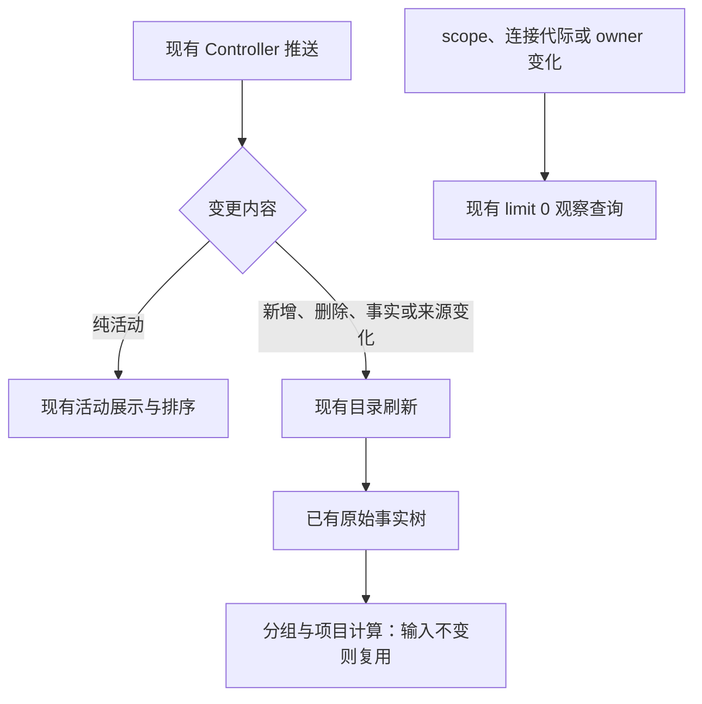

# Semântica de atualização da lista de tarefas (taxonomia do reason `workspace_task_list_changed`)

> Fechado em 2026-07. Contexto: depois que M5 migrou a fonte de dados da lista lateral para o sessions-index, apareceu uma sequência de sintomas em que "operar o campo de entrada (trocar de modelo) / concluir uma tarefa / abrir uma tarefa histórica" faz a lista lateral de tarefas recarregar por inteiro e a tarefa pular para o topo da lista. A causa raiz é que as duas semânticas de consumo nunca foram definidas como contrato: ① a taxonomia de reason de `workspace_task_list_changed`; ② a definição de "atividade" do `lastActivityAt` do sessions-index. Este documento é a fonte de verdade dessas duas semânticas. Atualmente a barra lateral de projetos é alimentada por `packages/ui/src/project-sidebar/useProjectTree.ts`, que consome as mudanças da lista, e o unread automático é tratado por `useProjectUnreadSignals.ts`, no mesmo diretório; as regressões estão em `packages/ui/test/projectTreeBackgroundUnread.test.ts`.

## 1. Matriz reason → nível de atualização na UI

Ponto de emissão: `taskIndexSyncer.emitWorkspaceTaskListChanged(target, meta, reason)` — **reason é obrigatório** (correção de design: o valor padrão ausente `task_meta_changed` fazia com que todo ponto de emissão que não se manifestasse caísse silenciosamente na semântica de atualização mais pesada, o que foi a raiz de toda a sequência de defeitos).

| reason                                           | Semântica                                                   | Recarrega a tabela inteira¹ | Refaz o membership² | Reescrita incremental de meta³ | Ponto de emissão típico                             |
| ------------------------------------------------ | ----------------------------------------------------------- | -------------------------- | ------------------- | ------------------------------ | --------------------------------------------------- |
| `task_pinned` / `task_unpinned`                  | Inversão de pertencimento de fixo                          | ✅                          | ✅                   | —                              | setTaskPinned                                       |
| `task_archived` / `task_unarchived`              | Inversão de pertencimento de arquivamento                  | ✅                          | ✅                   | —                              | archiveTask/unarchiveTask                           |
| `task_meta_changed`                              | Meta relacionada a pertencimento (unread) ou fallback sem categoria mais fina | ❌ (com meta)                | ✅                   | preserve-membership            | setTaskUnread, operações de grupo, arquivamento em massa, difusão inicial |
| `task_status_changed`                            | Convergência de status/snapshot (conclusão, resync, abrir/retomar tarefa, compact/goal) | ❌                            | ❌                   | preserve-membership            | applyTerminalTransition, resync, resumeSession       |
| `task_model_changed`                             | Troca de modelo (puramente configuração)                   | ❌                            | ❌                   | preserve-membership            | zcodeSessionService.setModel                        |
| `task_title_changed`                             | Título (primeira mensagem/título automático/renomeação manual) | ❌                            | ❌                   | preserve-membership            | applyTitleChange, renameTask                        |
| `task_created`                                   | Nova tarefa (o conjunto de linhas diretas do tasks-index cresce) | ✅ (sem meta)                | ✅                   | insert-active                  | adapter/create, primeiro envio de ordem agrupada     |
| `user_message_saved` / `assistant_message_saved` | Gravação de mensagem em disco                              | ❌ (com meta)                | ❌                   | preserve-membership            | Caminho do protocolo antigo                         |
| `task_deleted`                                   | Tombstone de exclusão                                     | ✅                          | ✅                   | —                              | deleteTask; remove do cache na hora e gera nova geração do membership deleted |
| `stream_mirror_*`                                | Fallback de recuperação de stream                         | ✅                          | ❌                   | —                              | Caminho de recuperação do controle remoto            |

¹ `shouldRefreshTaskListForWorkspaceEvent`; ² `shouldRefetchTaskListMembershipForWorkspaceEvent` →
`bumpTaskListMembershipVersion` (um número de versão global; um único bump faz todas as instâncias de
lista refazerem o join de pin/archive/unread, com deduplicação pelo conteúdo do evento para evitar
entrega duplicada pelas duas cadeias de assinatura); ³ `getTaskMetaWorkspaceEventSyncMode`.

`task_status_changed` também pode carregar o sinal opcional `unreadSignal="background_terminal"`. O host
syncer do sessions-index v4 não sabe qual task cada janela está visualizing, então o Host é responsável
apenas por decidir "vale a pena lembrar sobre este estado terminal"; o renderer executa depois a verificação
de visualização do endereço completo da tarefa. Estados terminais comuns de background, `verified` do Goal e erros reais carregam o sinal; os
estados `active/paused/verifying/notSatisfied/failed` do Goal não carregam. Broadcasts comuns de status,
como abrir/retomar tarefa histórica e convergência de snapshot de compact/goal, também não carregam, e é
proibido adivinhar uma nova conclusão apenas com base no status terminal. Quando o renderer recebe o sinal e
a tarefa não está sendo visualizada nem pelo desktop nem por um Web em primeiro plano válido, ele chama
`setTaskUnread(true)`; essa mudança de pertencimento emite um `task_meta_changed`, que por sua vez dispara o
refetch do join de membership de unread.

Depois que a barra lateral de projetos foi conectada ao Controller, o sinal explícito de estado terminal em
background ainda precisa chegar ao único tratador de unread da janela. O Host encaminha um live signal estreito
a partir do workspace event original, sem inferir nova conclusão a partir de snapshot do sessions-index, de
replay de reconexão ou de leitura de histórico; o sinal carrega o endereço completo da tarefa. O sinal de
unread automático é oferecido apenas ao attachment local/base do `desktop-continuous`; o attachment de escopo
remoto e o celular compartilham o mesmo `unreadAt` persistente, e portanto não produzem um segundo escritor
automático. O caminho Web comum, sem Controller, é consumido pelo mesmo owner da árvore de projetos.

A janela identifica a tarefa pelo workspaceKey completo + taskId e decide se precisa marcá-la como não lida
pelo fato de navegação do desktop e pelos fatos de visualização válida do Web descritos abaixo. O mesmo estado
terminal é deduplicado; escritas concorrentes são atribuídas atomicamente markers distintos pelo owner
persistente, e cada resposta representa apenas a sua própria escrita. Depois de uma escrita persistente bem
sucedida, a árvore de projetos existente é atualizada, sem criar um estado de unread já submetido em separado.
Se, durante a escrita, o usuário já tiver visto a tarefa, usa-se apenas o `unreadAt` exato da resposta desta
escrita para o CAS de leitura; o Controller não pode substituir a resposta desta mutation por outra versão de
marker lida em uma atualização posterior. Depois da troca de serviço ou do descarregamento do owner, uma
resposta antiga não inicia mais escritas. A regressão cobre o isolamento de identidade local/remota, a tarefa
ativa, o status comum, o estado terminal repetido, a falha de escrita e as respostas atrasadas.

### O estado real de visualização do Web conectado (2026-10-13)

A determinação de unread automático reconhece o fato de navegação completo já existente no desktop, ou o fato
de o Web conectado em primeiro plano realmente exibir o mesmo endereço completo de tarefa. A home do celular,
as vistas principais de configuração/其它, o chat coberto por uma camada inert, as páginas em background, os
rascunhos e as desconexões não contam como visualização. Tela larga e tela estreita compartilham a entrada de
report de visualização; a promoção de um rascunho para tarefa, a troca de tarefa, a mudança de visibilidade e o
descarregamento atualizam imediatamente; não se pode inferir apenas do componente montado ou de um
activeTaskId em cache. O primeiro plano do navegador é julgado pelo estado visível do Page Visibility.

A última posição de navegação `mobileViewState` mantém o uso original de restauração; o novo `mobileTaskView`
é um fato de visualização transitório no runtime de controle remoto já existente do Main, e não é persistido.
O Main só aceita declarações cuja geração de pareamento atual, número de sequência crescente, bridge e
identidade de workspace batem; uma desconexão ou uma bridge inválida limpa imediatamente, e uma reconexão
exige uma nova declaração, sem herdar a tolerância do mobileConnected do diálogo. Quando o Main publica um
fato de visualização para o desktop, injeta a partir da bridge atual o remoteSessionId confiável, e o Web não
pode declarar esse roteamento por conta própria. A leitura exata e o CAS da identidade remota antiga seguem
essa sessão; quando o session explícito da visualização e o do sinal de conclusão divergem, o unread não pode
ser suprimido. Cada mudança válida é enviada diretamente, e o desktop se inscreve antes de ler o estado
inicial; uma resposta inicial atrasada não pode sobrescrever um evento de atualização. Não se pode depender de
polling, comparação de relógio ou de novos timeouts para consertar a ordem.

No ciclo de vida do Web, em hidden/pagehide/freeze, a visualização precisa ser revogada primeiro pela conexão
atual, que ainda pode enviar, e só então o transport é pausado. Não se pode depender da ordem dos listeners do
Reporter do React: depois da pausa o envio já é proibido, e o relay ainda pode achar que o socket original está
pareado. O estado suspended e sua janela de sondagem do socket original entrando em reconnecting preservam o
epoch emitido pelo Main e o seq crescente; um novo contorno ou uma nova autenticação mesmo revoga a
qualificação antiga, e um novo pedido de pareamento ou o bootstrap restaura o epoch atual. Ao voltar para a
página visível, a declaração é refeita pelo fluxo de restauração original e pelo Reporter atual; um
online/resume em background não pode re-reportar uma tarefa em cache como "estando visualizada", e
freeze/resume precisa reler a visibilidade real da página.

O epoch de visualização do bootstrap só é escrito de forma sincronizada depois de o guard de versão existente
confirmar que a geração e a versão da requisição atual são aceitáveis; a função de requisição apenas lê a
resposta. Uma resposta antiga, mesmo que chegue já re-pareada, não pode ocupar um epoch vazio. Quando o pedido
de re-declaração da nova pareação se perde, o bootstrap da geração atual ainda precisa reenviá-lo; uma
redeclaração válida que chegou primeiro não pode ser sobrescrita pelo bootstrap. O mesmo se aplica ao
re-pareamento no mesmo socket, sem criar uma nova geração de socket como fonte de qualificação de visualização.

```text
antigo: hidden → transport pausado → Reporter(null) não consegue enviar → Main ainda acha que está visualizando T
novo: hidden → enviar null → transport pausado → Main revoga a visualização → escreve unread na conclusão
       visible/resume → ler o que está realmente exibido → restauração/novo pareamento da conexão original → declarar T → CAS exato
```

Somente o owner do diretório do desktop consome os eventos de visualização do Web e converge o unread
automaticamente; o Web apenas reporta e não pode se tornar um segundo escritor automático por compartilhar um
hook. O sinal de conclusão e um novo evento de visualização válido são tratados em série pelo mesmo writer,
pelo workspaceKey completo + taskId, e outras tarefas podem correr em paralelo. Se a visualização ocorrer
durante uma escrita de unread em andamento, limpa-se apenas o marker da resposta daquela escrita; se a escrita
já tiver sido concluída, o novo evento de visualização lê, pelo Controller, o marker atual do Source
proprietário com o `getTaskMeta(address)` exato e então faz o CAS. A leitura e o CAS ocupam a mesma posição na
cadeia serial daquela tarefa, e é proibido que uma leitura lenta ultrapasse uma conclusão posterior e limpe um
marker novo por engano. A cadeia gerencia apenas operações em andamento, e não é um novo accepted queue de
negócio nem um estado persistente.

A leitura exata do Controller é roteada, pela validação de source/attachment já existente, até o TaskService
proprietário, e verifica antes e depois da IO assíncrona que o owner não foi trocado; o marker não é lido pelo
cache de lista nem por uma projeção que engole erros. Descarregamento, mudança de identidade, falha de leitura
ou de escrita não fabricam um falso "lido" local; os erros permanecem nos caminhos de log e de atualização já
existentes. Repetir o mesmo estado de visualização válido não executa o comando de leitura, evitando que render,
polling ou reenvio apaguem um unread manual. Uma visualização válida que vira vazia e depois declara de novo a
mesma tarefa conta como uma nova visualização e deve limpar o unread gerado durante a desconexão ou a ausência.

A mudança do breakpoint largo/estreito só troca o layout e não significa sair da tarefa. O report de
visualização e a navegação Home/chat do celular ficam com o mesmo owner, fora dos ramos de layout; ao exibir
continuamente a mesma tarefa não pode surgir `T → null → T` por causa do descarregamento de um subcomponente, e o
unread manual precisa ser preservado. Ir de fato para a Home, cobrir o chat, ir para background ou descarregar
continua revogando a visualização imediatamente; não se usa delay para agrupar eventos.

```text
Web em primeiro plano realmente exibe T → Main valida conexão/bridge/sequência → writer único do desktop
U1 concluída → mark-unread(11) → visualizar T → owner lê + CAS(11) → sair
                                                        → U2 concluída → mark-unread(12)
```

A regressão MRO03 cobre tela larga e estreita, primeiro plano/Home/background, promoção de rascunho,
reconexão após desconexão, e o mesmo caminho com Sources diferentes; a regressão de sequência cobre escrita em
andamento, visualização depois de uma escrita concluída, saída e nova conclusão durante uma leitura lenta,
marker antigo que não limpa marker novo, resposta de owner antigo e visualização repetida que não limpa o
unread manual. Preservam-se o desktop-continuous e o replayable do celular originais, o sinal explícito de
conclusão do Host, o CAS de banco único e a semântica de tempo de ordenação.

O branch de visualização do desktop precisa combinar ao mesmo tempo a tab ativa, o `activeTaskId` do workspace e
o endereço completo `workspaceKey + taskId` do item de navegação atual. O registro de "visto" de uma escrita em
andamento consome apenas o evento de submissão de endereço completo do owner de navegação: publicado depois
que `setActiveTaskId` conclui a atualização atômica; quando a página de configurações retorna a uma tarefa já
existente, é a ação de retorno que publica. O evento não guarda uma segunda cópia do estado de navegação. Ao
clicar em B/T2 em outro workspace, ativar B expõe brevemente o T1 em cache; o rascunho ainda pode preservar o
histórico de B/T1, de modo que nenhuma notificação bruta de tab/session store prova sozinha que T1 foi visto.
Navegação vazia, automação ou o mercado de plugins também não podem servir como evidência de visualização de
uma tarefa. Preservam-se o registro de quem foi realmente aberto e depois deixado, e o CAS exato de marker, sem
atrasar o agrupamento de notificações de store.

```text
A → clicar em B/T2 → ativar B (T1 em cache, o histórico ainda pode ser B/T1) → não publica evento de visualização
             → submissão atômica de B/T2 → evento de endereço completo → confirma só T2
resposta de unread de T1 → sem fato de visualização de T1 → preserva o marker daquela vez
```

O Host encaminha o sinal explícito de conclusão imediatamente, sem esperar a IO da lista, garantindo que o
registro de visualização da janela cubra o período de leitura da lista. A mutation de unread fica responsável
por esperar a leitura já em andamento concluir; se o endereço exato da tarefa ainda não tiver linha projetada,
a lista é atualizada mais uma vez e o source é verificado como não trocado, e então a escrita original é
executada. Uma leitura antiga que falhou para uma tarefa conhecida não deve engolir o sinal de conclusão; se
faltam a linha e a atualização também falha, a escrita é recusada. Concluir em primeiro plano e depois sair,
assim como concluir em background e ver durante a leitura e depois sair, não podem fabricar unread de novo.

Na primeira abertura de um projeto remoto, o pedido de leitura verifica primeiro o sessionId completo, o
workspaceIdentity e o cwd do attachment atual, e então localiza a linha de tarefa que já existia na barra
lateral pela identidade estável do Source; uma projeção com sourceServerId não exige preencher retroativamente
o logical sessionId criado depois. O caminho antigo sem Source ID estável ainda casa pelo sessionId exato. Ao
terminar a leitura assíncrona depois da verificação de identidade, o attachment é verificado de novo, e
requisições antigas jágenerational trocadas são recusadas.

```text
estado terminal em background → live signal explícito do Host → guard de active-task do owner base da janela
                                  → mark-unread existente aguarda a linha da tarefa ficar pronta → unreadAt persistente → árvore de projetos
                                  → durante isso, visto: CAS de mark-read para o marker desta vez
```


O recarregamento integral da tabela em `task_deleted` continua sendo a salvaguarda dos campos ocultados
`total/hasMore`; para uma task que já atingiu o cache visível, pode-se antes fazer a remoção incremental.
Independentemente de atingir ou não o cache visível, ele precisa fazer bump da versão de membership, porque o
sessions-index ainda pode devolver a mesma CLI session em frames live posteriores ou no seed de cold start, e
só o conjunto negativo de ids deletados do tasks-index impede que ela volte para a lista comum.

`task_created` também precisa fazer bump da versão de membership. O tasks-index agora é a tabela à esquerda
das linhas persistidas de Project/Timeline/Pinned/Archived/Grouped; mesmo que o evento carregue `taskMeta` e o
sessions-index já tenha publicado atividade, não se pode manter a antiga política de "apenas reescrever meta
incrementalmente". O evento ocorre depois que a task row e a ordem agrupada inicial foram enviadas, e só a
leitura de nova geração completa a convergência `optimistic -> persisted row` e permite que tarefas criadas por
outras janelas ou pelo celular entrem na lista atual.

**Regra de decisão para novos pontos de emissão**: a mudança afeta o pertencimento de pin/archive/unread?
Se não → nunca use `task_meta_changed`; escolha um reason preciso ou crie um novo reason e atualize esta
matriz e os testes de guarda. O custo de classificar errado um caminho de alta frequência (que roda a cada
mensagem/conclusão/abertura) é = todas as instâncias de lista × RPC de membership × re-renderização da
lista inteira.

## 2. lastActivityAt: "o que conta como atividade da tarefa"

O `lastActivityAt` do sessions-index = `record.updatedAt` do CLI (`getSessionIndexMeta` do v4-bridge), e a barra
lateral da UI ordena por ele em ordem decrescente. **Somente atividade de sessão perceptível pelo usuário pode
fazer bump**:

- ✅ Conta como atividade: envio e recebimento de mensagens, ciclo de vida de turn, execução de ferramentas,
  tarefas em background, e os SessionEvents de bloqueio de permission/userInput recém-produzidos e perceptíveis
  pelo usuário.
- ❌ Não conta (`isNonActivitySessionEvent`, server-operations.ts):
  - `ModelSelected` / `SessionModeChanged`: mudança puramente de configuração (trocar modelo/trocar modo);
  - `FollowupModeChanged`: sincronização de configuração de queue/guide de mensagens adicionais; a sincronização
    automática ao abrir uma sessão histórica, as sincronizações repetidas e a troca manual não atualizam o
    tempo de atividade;
  - `SessionResumed`: abrir/retomar sessão é leitura, não atividade (o caminho de cold recovery acabou de
    preencher o store com o tempo real; isso não pode ser sobreposto).
- ❌ refresh/snapshot/resume/replay da mesma interação pendente não produz atividade nova; apenas um novo evento
  de requisição de bloqueio pode fazer bump uma vez.
- ❌ Mutations de configuração (`CONFIG_ONLY_MUTATION_REASONS`: model/thought_level/mode changed) e
  `updateRuntimeModelConfig` não fazem bump de `record.updatedAt`.
- ❌ Mutations de membership/meta do tasks-index (unread, pin/archive, group, rename) não podem mesclar o seu
  `updatedAt` do SQLite de volta no `lastActivityAt` do sessions-index. A ordenação por Updated só reconhece
  este último; a visão agrupada só reconhece o `sort_order` explícito.

Consequência de violar: operações de configuração/abertura de task empurram a task para o topo da lista e
disparam um reordenamento completo da coluna.

## 3. Defesa contra degradação no cold recovery do sessions-index (janela seed↔live)

No cold start o seed da lista vem do store (`getStoredSessionSummaries`); ao abrir uma task a projeção live
sobrescreve o seed. Antes da conclusão da hydration a projeção live está incompleta, então os campos abaixo não
podem ser sobrescritos com valores degradados sobre uma linha de base não vazia
(`SessionsIndexProjection.upsertFromConversation`):

- `title` vazio → manter a linha de base; `createdAt` atualizado → manter o valor mais antigo;
  `lastAssistantPreview` vazio → manter a linha de base;
- `phase === "draft"` com linha de base não draft → manter o phase/sessionEnded/goalStatus da linha de base
  (uma sessão que já tem conteúdo não pode voltar a draft).

Com a defesa completa, "abrir uma tarefa histórica sem mudanças" produz delta zero (teste de guarda:
sessions-index-projection.test.ts「冷恢复 draft 窗口快照与基线等价时不产 delta」).

## 4. Pipeline diferencial no renderer (impede que "uma mudança em um frame" vire recarregamento da lista toda)

A forma atual é "recálculo integral em memória + curto-circuito por equivalência de referência + cache de IO por
versão" (com milhares de sessões o recálculo leva ~ms; um store diferencial materializado de verdade é a
direção do refactor seguinte, ver §6):

- `useWorkspaceSessionsIndexItems`: a camada de agregação compara campo a campo e reaproveita o objeto antigo
  quando equivalente; quando a tabela inteira é equivalente, reaproveita o array antigo — assim os effects
  dependentes da identidade do array (grouped refresh, invalidação de cache do workspace, republish) fazem curto
  natural.
- `useWorkspaceTaskLists`: mudanças no sessions-index apenas marcam como sujo o escopo de workspace em que o
  diff encontrou mudança, em vez de invalidar tudo.
- **Semântica de exibição do refresh**: workspaces que já têm query cache usam stale-while-revalidate — apenas
  marca como `stale` o escopo atingido e mantém as linhas de task atuais, substituindo no lugar quando o
  recálculo em background termina; apenas a primeira hydration, quando o query cache está totalmente ausente,
  entra em blocking loading. É proibido expressar um refresh comum de sessions-index/membership como
  "limpar a lista existente → loading → preencher de volta", senão uma simples seleção ou retomada de tarefa
  ainda seria percebida pelo usuário como recarregar a barra lateral inteira.
- `useGroupedTaskView`: `stabilizeGroupedView` reaproveita em nível de nó; quando a árvore inteira é
  equivalente, o setState recebe a mesma referência e faz bail.
- `taskQueryCacheStore.setQueryResult(s)`: pula o setState quando o resultado equivale ao cache atual;
  `mergeIncomingTaskListItem` preserva a referência antiga quando o conteúdo é equivalente.
- **IO diferencial**: membership (pin/archive/unread) e estrutura agrupada não mudam com os frames de conteúdo
  do sessions-index; ficam em cache por `membershipVersion + assinatura`
  (`fetchTaskListMembershipSetsForEndpointsCached`, `remoteDataCacheRef` do grouped), enquanto os frames de
  conteúdo (title/status/lastActivity) fazem apenas join em memória, com zero RPC; o caminho de mutation de
  grupo invalida o cache explicitamente.

### 4.1 Isolamento de assinatura por escopo de workspace

`useWorkspaceSessionsIndexItems` consome o conjunto de vários workspaces, mas a posse da assinatura precisa
cair em um único `endpoint + workspaceKey`. Mudanças no conjunto de escopos só podem ser reconciliadas de
forma incremental por key; é proibido interpretar diretamente a mudança de assinatura do array como
"liberar todas as assinaturas antigas e reassinar todos os escopos novos". Caso contrário, remover um workspace
esvaziaria o snapshot, a marca d'água e as linhas de task dos demais workspaces, amplificando uma operação
local de navegação em uma reconstrução de estado entre workspaces.

```text
before = [A, B, C]             after = [B, C]
             │                         │
             └── reconcile by key ─────┤
                                       ├─ release A
                                       ├─ retain B store/subscription/watermark
                                       └─ retain C store/subscription/watermark
```

| Mudança de escopo                             | Efeito colateral permitido      | Efeito colateral proibido                  | Classificação          |
| --------------------------------------------- | ------------------------------- | ------------------------------------------ | ---------------------- |
| Remover A                                    | unsubscribe/release de A        | reconstruir ou esvaziar B/C                  | accepted               |
| Adicionar D                                  | adquirir D; hydration independente de D | esvaziar as linhas A/B/C existentes e esperar por D | accepted               |
| Apenas reordenar escopos                     | nenhum                          | qualquer subscribe/unsubscribe              | pruned: identidade do conjunto inalterada |
| Geração de endpoint/service de B troca       | substituir apenas B             | reconstruir outros workspaces do mesmo endpoint | accepted               |
| Desmontagem real do hook                     | liberar todas as entradas atuais | manter referências vazadas                 | accepted               |

Invariante principal: depois de ir de `[A, B, C]` para `[B, C]`, as instâncias de `SessionsIndexStore`, a
assinatura, a marca d'água e o conjunto de sessões de B/C precisam manter seus valores; o renderer não pode
publicar um estado intermediário vazio para B/C. O desktop continua usando `desktop-continuous`, e o escopo de
controle remoto do celular continua usando o `web-remote-replayable` do endpoint correspondente; esta mudança
apenas isola o ciclo de vida de assinatura, sem alterar nenhuma das duas semânticas de entrega. A chave de
identidade continua sendo `workspaceIdentity?.trim() || workspacePath`; `workspacePath` é usado apenas como
parâmetro de transporte e para exibição/execução.

### 4.2 Proibição de frames em branco na visão grouped (2026-08)

`Grouped` é a única visão da barra lateral que mantém a "lista autoritativa" em `useState` de instância de
componente e ainda tem gate de primeira tela; timeline/pinned/archived renderizam a partir do
`taskQueryCacheStore` de nível de módulo. Portanto, dentro do mesmo frame de conteúdo, apenas grouped expressa
"atualizando" como um bloco em branco — o usuário percebe "a lista agrupada da esquerda pisca inteira".
Quatro invariantes:

- **O gate só barra a primeira tela**: `isGroupedTaskViewInitialized` precisa ser um latch de uso único. É
  proibido ler diretamente o `loading` da lista atual do Controller — em uma tarefa em execução, cada nó de
  streaming (envio do prompt, primeira tool, conclusão da saída) dispara uma nova busca, o gate voltaria a
  fechar e a árvore inteira de grouped seria desmontada.
- **Uma vez desenhado, não pode voltar a branco**: `shouldHideGroupedTaskContent` precisa aceitar
  `hasPaintedOnce`. Depois de renderizar uma lista não vazia, qualquer frame de loading / não inicializado /
  estado vazio transitório continua renderizando a lista anterior.
- **A visão autoritativa sobrevive ao remontagem**: a última visão autoritativa é cacheada por assinatura de
  escopo em nível de módulo (`groupedViewCacheBySignature` em `useGroupedTaskView`), de forma que um
  remontagem de ancestral ou um HMR já desenhe em seguida; o RPC fica só com a convergência; o latch de
  inicialização também é semeado a partir do cache, senão o primeiro frame após o remontagem ainda fecharia a
  porta.
- **O memo de escopo precisa usar assinatura por valor**: `scopes` / `sessionsIndexScopes` é proibido fazer
  memo pela identidade do array de tabs. O pai reconstruindo um array de mesmo valor troca a identidade do
  `refresh`, e o effect "`refresh` mudou, então atualiza" faz setState e dispara o próximo render — formando um
  ciclo de refresh autoexcitado que emite RPC a cada frame e cria janelas de piscada para o gate e para o
  estado vazio. A convenção é a mesma de `workspaceSignature` em `useGlobalTaskList`.

```txt
Controller activity frame（phase/lastActivityAt 变化）
   │
   ├─ timeline/pinned/archived ─> 模块级 query cache ─> stale-while-revalidate，无空白
   └─ grouped ─> 实例 state + 首屏门禁 ─> 闩锁/hasPaintedOnce/模块缓存 缺一即整块空白
```

Dica de verificação: esse tipo de correção depende de "semear o estado inicial na montagem + latch dentro do
componente"; o vite HMR preserva o estado antigo dos componentes já montados, então é preciso **reiniciar o
aplicativo por completo** para retestar, e observações feitas sob hot reload não servem como conclusão.

## 5. Cadeia histórica de causas raiz (reconciliação das correções de 2026-07)

O mesmo sintoma (piscar/recarregar/pular para o topo na lista da esquerda) era resultado de quatro defeitos
independentes sobrepostos, com correções em:

1. reaproveitamento indevido do valor padrão de reason → reason obrigatório + classificação precisa dos caminhos
   de alta frequência (este §1);
2. configuração/retomada contada como atividade → o conjunto de eventos não-atividade do §2;
3. degradação para draft no cold recovery → defesa de phase do §3;
4. referência instável na camada de agregação/no query cache → estabilização do §4.

### 5.1 flash de bloco inteiro em grouped (reconciliação das correções de 2026-08)

O sintoma tem a mesma origem do acima, mas aparece apenas na visão `Group`: trocando para Group e rodando uma
tarefa com várias tools, há um flash **no envio do prompt, na exibição da primeira tool e na conclusão da saída
final**; trocando para Project/Timeline não há flash.

Três defeitos independentes reproduzidos e confirmados por testes
(`packages/ui/test/groupedTaskViewStreamingStability.test.ts`):

1. **O gate acompanha um loading transitório**: `initialized` é derivado diretamente do `loading` da lista do
   Controller, e cada nó de streaming refaz uma busca e fecha o gate → a árvore inteira de grouped é
   desmontada e remontada.
2. **Ciclo de refresh autoexcitado**: o memo de `scopes` fica na identidade do array, e o pai reconstruindo o
   array dispara render→refresh→setState→render (o caso de guarda chegaria a 200+ renders antes da mudança).
3. **Remontagem volta ao estado vazio**: a visão autoritativa existe apenas no state da instância do componente,
   então depois de remontar volta-se para "visão vazia + gate fechado", e é preciso esperar por dois RPCs para
   recuperar; essa é também a razão estrutural de "só grouped pisca".

Na mesma época foram descartados dois caminhos antes suspeitos: virtualização de topo/grupo (medido
`nodeCount 67 < 80`, ou seja, o limiar não foi atingido e não está ativo) e compressão da largura da barra lateral
pelo conteúdo da direita (o painel da barra lateral é `flex-none` + largura por variável CSS).

Contraexemplo (não introduzir de novo): outrora alguém usou "o Controller live ainda reporta a task" como
evidência de que "a linha não deveria sumir", para compensar a perda transitória de linhas. O critério daquela
abordagem é `kind:"active"` = `!archived`, o que **inclui tasks fixadas**, enquanto o critério de grouped é
"não fixada e não arquivada"; o resultado é que tasks fixadas eram ressuscitadas pelo guard e ficavam presas no
grupo. A restrição está em `docs/ui/task-grouped-view.md`, em「可见性真相源与删除收敛」.

## 6. Desempenho da barra lateral: otimizações locais

> 2026-10-15: corrigidas as dependências de atualização e os cálculos repetidos dos consumidores existentes;
> o Controller, as interfaces de serviço, a persistência e a estrutura de dados das listas são preservados. Um
> modelo de leitura completo, leases de assinatura e a reestruturação de assinatura por linha não entram
> nesta rodada. Apenas o host muda, e a política de não congelar ou recolher automaticamente o código de
> plugins e os guests de UI válidos permanece a mesma.

### 6.1 Evidência existente e objetivo

Em uma coleta em ambiente de desenvolvimento, o plugin levou 57,482 segundos da notificação de abertura até o
editor estar pronto; na mesma janela houve 431 ocorrências de `window-controller.listTaskList`, com o tratamento
no Host somando cerca de 473 milissegundos. O tempo do serviço RPC não explica toda a espera. Os quadros
longos originais e as pilhas de chamada seguintes apontam para a pressão de renderização síncrona do Renderer,
incluindo a ordenação de agrupamento e a serialização; o tracing completo tem um custo significativo por si só,
de modo que sua proporção de tempo não pode ser usada para preencher retroativamente a execução original, nem
se pode prometer antecipadamente um número de segundos de startup após a otimização.

A barra lateral atual usa uma consulta `limit: 0` para estabelecer a observação de atividade do Source, e essa
consulta não fornece as linhas da árvore de projetos. Antes da correção, a mesma revisão do Controller disparava
ao mesmo tempo a consulta de observação, a releitura do diretório e a síntese de atividade; o Provider entregava
a árvore sintetizada à lógica de agrupamento, o que fazia com que a atividade de tarefas também recalculasse a
assinatura de agrupamento. Agora a atividade pura só aciona o caminho de exibição.

### 6.2 Três mudanças

| Mudança                            | Limite de implementação                                                                                                                                                | Ganho esperado                                                      |
| ---------------------------------- | ---------------------------------------------------------------------------------------------------------------------------------------------------------------------- | ------------------------------------------------------------------- |
| Estreitar a condição de atualização | No registry existente, distinguir a atividade pura da mudança de fato; o diretório só é relido por fato, restauração e entradas de atualização explícita já existentes. A consulta de observação é estabelecida ou restaurada pelo conjunto de escopos válido, pela geração de conexão e pelo ciclo de vida do owner, e não é reenviada por atividade comum | Reduz listTaskList, readTree e computations inválidas da árvore inteira |
| Agrupamento e cálculo de projeto usam fatos estáveis | Reutiliza a árvore de fatos brutos que o useProjectTree já tem, sem criar outro store; a assinatura de agrupamento só é calculada quando a entrada de fato muda, a chave de ordenação é serializada uma única vez; a ordenação de projetos depende do conjunto de projetos e da preferência de ordenação original | Remove a ordenação completa do agrupamento a cada atividade, as alocações de JSON duplicadas e a ordenação de projetos irrelevante |
| Mensagens de controle do RPC verificam primeiro a marca | Na verificação de protocolo já existente, checa primeiro a marca de controle, e só mensagens candidatas a controle enumeram os campos, mantendo a validação estrita                                                        | Mensagens binárias grandes não enumeram mais os campos byte a byte só para o teste de tipo |

Estão envolvidos principalmente `windowControllerTaskListRegistry`, `useProjectTree`,
`ProjectDirectoryProvider`, `useTaskGroups` e a verificação de mensagens RPC, além dos testes correspondentes.
O protocolo do Controller não é estendido, o owner do diretório não é migrado, e o cache de busca/paginação nem
a projeção completa do Host são refeitos; esses caminhos continuam rodando pelos contratos existentes.



### 6.3 Como evitar perder atualizações ao estreitar o escopo

- Não é possível apenas remover a dependência de revision do effect. Com Controller, o hook atual não escuta
  mais diretamente os eventos de fato do workspace; é preciso preservar primeiro a notificação explícita de
  atualização de fato, e só então deixar a atividade pura seguir pelo caminho de exibição.
- Usa as linhas antes e depois já salvas no registry para a comparação local. O Host funde no meta o updatedAt, o
  status e o pendingInteraction da atividade, então não se pode reler o diretório só porque o meta foi
  referenciado ou porque esses campos mudaram. Quadros que carregam ao mesmo tempo mudanças de fato como
  título, unread e membership continuam precisando de atualização; criação, exclusão, snapshot, troca de Source
  e mudanças que não se provam ser atividade pura mantêm a atualização. A ordenação existente por tempo de
  atividade continua atualizando.
- O escopo é comparado por identidade estável e ordem canônica; o registro da observação não pode depender da
  atividade de tarefas para se manter. Falha no primeiro registro, reconexão, reconstrução do owner e atualização
  explícita ainda podem restabelecer a observação; a proteção por geração é mantida, e uma resposta atrasada
  não pode sobrescrever uma nova origem. Não se adiciona polling, agrupamento por atraso nem novo timer de
  retentativa automática.
- O agrupamento só troca a origem da entrada e o momento do cálculo, e continua registrado pelo taskGroupService
  já existente; as marcas de tarefa do sistema, a exclusão explícita, a promoção de primeira publicação, o CAS de
  unread e as regras de identidade remota são mantidos. Apenas aplicar useMemo à árvore de atividade sintetizada
  não resolve o problema.
- A janela de consulta limitada ainda pode gerar uma nova consulta quando a atividade muda a ordenação. O alvo de
  zero reconsulta desta rodada vale para a observação da barra lateral e a leitura do diretório, e não afirma que
  todos os caminhos de busca, menu e paginação passaram a consumir de forma incremental.

### 6.4 Verificação e escopo

- O contraexemplo do hook de atividade, antes da modificação, era 1.000 atividades causando 1.000 leituras de
  diretório; depois da modificação, a leitura de diretório, a consulta de observação e o cálculo da assinatura de
  agrupamento aumentam 0 vezes, e a atividade final está correta. A cobertura inclui título, unread,
  pin/archive, marca de sistema, criação/exclusão, retentativa após falha de registro, reconexão offline,
  snapshot de restauração e remontagem do owner.
- A regressão de RPC usa um Uint8Array real de 3 MiB e confirma que binário comum não enumera campos e que
  mensagens de controle legais e ilegais continuam sendo tratadas corretamente.
- TSL40, stream controlled de desktop completo: entre ACTIVITY_02 e ACTIVITY_29, a contagem de listTaskList
  permanece em 2 e a de readTree em 6; após o Stop a marca de execução desaparece e a renomeação pelo menu
  de contexto é sincronizada. O caso está em manual-review/pending; uma execução automática aprovada não
  equivale a uma aprovação manual.
- O E2E VP13 já existente do shared-host do celular passa, cobrindo o diretório compartilhado de projetos, as
  operações de agrupamento e a passagem de rascunho.
- A janela de desenvolvimento completa usa o PhotoCraft 0.2.2 sem modificações: duas sessões de teste não
  exibidas criam guest cada uma por um resultado real de open_editor, e ambas chegam a automationReady; a
  criação de documento em background, a adição de camada, o isolamento de documentos, a recusa de recolher
  automaticamente e a remoção de uma instância não afetando a outra passam. Verifica-se o inert e a opacidade do
  container oculto, e as sessões de teste são limpas.
- A regressão em um host Electron independente cobre adicionalmente o startup minimizado com WASM, a edição em
  background, ocultar e voltar à mesma aba com o mesmo guest, a preservação de estado não salvo e a liberação na
  remoção; ela complementa a evidência de ciclo de vida e não substitui a verificação da janela completa.
- Esses resultados provam que o trabalho inválido especificado foi eliminado. O cenário original de 57,482
  segundos ainda não tem uma comparação de startup a frio/a quente com os mesmos dados e a mesma carga, antes e
  depois da modificação, e por isso não se afirma que o startup total encurtou para algum número de segundos, nem
  que a memória do aplicativo inteiro diminuiu.

Esta rodada ainda preserva a síntese de atividade da árvore inteira e as notificações de Context existentes, e
não promete que apenas uma linha de tarefa é re-renderizada. Se o startup e a interação medidos atenderem ao
requisito, encerra-se; se ainda houver tarefas longas evidente, o próximo passo é desenhado em separado a partir
do hotspot restante. Não se antecipa um store de entidades, um protocolo de leases ou uma migração de bridge
apenas porque a otimização local não eliminou todo o trabalho O(N). O limite de retenção de plugins continua
regido por [MCP 页面保留与后台执行](./plugin-ui-background-execution.md).

## 7. Observação passiva e ciclo de vida do runtime

A escuta de `workspace_task_list_changed` e a aquisição de escopo do sessions-index são comportamentos de
observação, não intenção de uso do workspace. Elas precisam satisfazer:

- `onDynamicWorkspaceEvent` devolve apenas o emitter do workspace, sem estabelecer assinatura upstream;
- o sessions-index de task-list e o syncer de task-index do Host assinam/resincronizam apenas na forma
  `existing-only`;
- quando o runtime está ausente, entra em dormante: não registra erro de nível de produção, não inicia timer de
  backoff e não dispara Agent;
- quando o runtime fica disponível, cria uma única geração de assinatura apenas para os observers cujo
  workspaceKey corresponde; quando o estado dormante do task-index do Host é ativado pela primeira vez, precisa
  instalar de forma idempotente o listener de frames do workspace antes de enviar o subscribe, garantindo que um
  initial frame que chegue dentro da mesma leitura de stdio, depois do resolve da promise de ACK e antes do await
  continuation / da posse de assinatura assumir, não seja perdido; a troca de runtime apenas reassina, sem
  reinstalar o listener;
- após ficar indisponível, limpa a posse, os frames pendentes e as tentativas, e esconde as atividades em running
  que perderam a prova de vida;
- um reload do renderer pode reutilizar um runtime que já existe no Host, mas não deve fazer warm-up de outros
  workspaces restaurados.

O warm-up de cold start do app é uma intenção de inicialização explicitamente emitida pelo Main e não pertence à
observação passada acima. Ao restaurar vários workspaces locais em uma única janela, o Main escolhe apenas o
workspace ativado da última vez como target único (limite 1) e o entrega ao Host no primeiro `InitLocal` para
seguir o caminho de warm-up completo já existente `initializeWorkspace`; os outros workspaces de `recentProjects`
não são aquecidos e permanecem dormentes até o usuário abrir explicitamente / enviar / acionar uma entrada de
tarefa em background. Entradas de workspace único, como não ter sessão recuperável ou cold start por
open-workspace/deep-link explícito, também aquecem apenas o próprio target; uma falha no warm-up não varre
outros workspaces para substituir. Essa lista é calculada apenas quando o Host é criado pela primeira vez; um
reload do renderer reutiliza o Host original e não amplia a lista novamente.

> Em 2026-09-30 isso foi reduzido de no máximo 3 para 1: a CLI de sessão não tem coleta por ociosidade, então
> subir 3 processos de Agent no start deixa 3 cópias de memória da CLI residentes por janela, e o ganho de
> cold start ao trocar para o projeto recente não compensa esse custo de permanência.

```text
startup restore ─> explicit warmup target (active only, max 1) ─> Agent runtime available
                                                        │
sidebar mount/reconcile ─> passive observers ─> tasks-index rows
                                      │                 │
runtime available(workspaceKey) ──────┴─────────────────┴─> install listener -> attach sessions-index
runtime unavailable(workspaceKey) ─────────────────────────> dormant; no retry spawn
```

Em log de produção, mantém-se apenas runtime available/unavailable e o ciclo de vida real de assinatura; o
reconcile de observers, acertos de dormente e detalhes por frame usam `debug`, evitando que a quantidade de
workspaces multiplicada pelos consumidores de listas forme uma nova enxurrada de log.